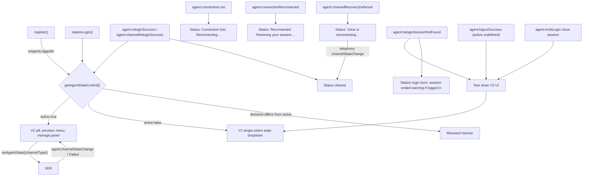

# Feature Spec — WXCC-15791: Granular Agent State sample UI

> Start here → monorepo [`AGENTS.md`](../../../../../../../AGENTS.md) (agent entry) · SDK package router [`docs/specs/README.md`](../../../../../../../packages/@webex/contact-center/docs/specs/README.md). The SDK side of this feature is [`feature-spec.md`](../../../../../../../packages/@webex/contact-center/ai-docs/features/WXCC-15791-user-granular-agent-state/spec/feature-spec.md) (R-14 points here) with design [`feature-design.md`](../../../../../../../packages/@webex/contact-center/ai-docs/features/WXCC-15791-user-granular-agent-state/design/feature-design.md).
> Context-efficiency: this spec owns the sample's user-visible behavior; SDK behavior and events are specified in the SDK feature docs.

## Metadata
| Field | Value |
|---|---|
| Feature / ticket key | WXCC-15791 |
| Title | Granular Agent State — widget-like UI and session status in the SDK sample app |
| Status | implementation-ready (implemented; manual validation pending) |
| Change class | ui |
| created_by / approved_by / date | SDD intake / pending / 2026-09-21, revised 2026-11-19 |
| Generated from | `feature-spec` @ SDLC template library `0.2.0` |

## Problem & Goal (WHAT + WHY)
**What:** The Contact Center sample app (`docs/samples/contact-center`) gets four things, all in vanilla HTML, CSS, and JS with no build step:
- a per-channel agent-state UI that mirrors the `@webex/cc-widgets` GranularAgentState component;
- a version-mismatch banner;
- connection and session status messages;
- correct teardown when the session ends outside the app.

**Why:** The sample is the main reference for SDK integrators. V2 sessions need per-channel state, and the SDK now reports connection loss, reconnect, deferred telephony, and a missing server session. Without a reference, integrators have to reverse-engineer the widget and guess the event order.

## Stakeholders & Open Questions
| Stakeholder / role | Interest in this feature | Sign-off needed? |
|---|---|---|
| SDK integrators | Working reference for the V2 API and the lifecycle events | no |
| `@webex/contact-center` maintainers | Sample matches SDK behavior | yes |

**Open questions:** none for the sample; SDK Q-1 and Q-2 apply.

## Scope
**In scope:**
- Detect the session version from `getAgentStateControl().active` after login, after `register()` (refresh), and after a relogin.
- V1 session: a single-select state dropdown styled like the widget's UserState, with the same options and `setAgentState` call as `next`.
- V2 session: pill, hover preview, state menu, and Manage Channel Availability panel, matching the widget's GranularAgentState.
- Mismatch banner when `declared !== active`.
- Session status for connection lost, reconnected, deferred telephony, and session ended.
- Teardown on logout, remote logout, multi-login close, session not found, and deregister.

**Out of scope:**
- Production widget changes.
- Momentum icons; the sample uses Font Awesome 4.7.
- Automated tests; the sample has no test harness.
- Changes to the V1 `setAgentState` request; only the V1 controls change.
- Per-channel selection, search, or a manage panel for V1.
- Retrying a failed reload or logging in automatically.

**Open decisions:** none.

## Requirements
| Req ID | Requirement (WHAT) | Rationale (WHY) | Acceptance (how proven) | State |
|---|---|---|---|---|
| R-1 | Choose the V1 or V2 UI from `getAgentStateControl().active` after `stationLogin()`, after `register()` when `isAgentLoggedIn`, and on `agent:reloginSuccess` / `agent:channelReloginSuccess` | The SDK pins the version per session; `register()` can restore a session before listeners exist | Right UI after login, refresh, and reconnect | Implemented |
| R-2 | V1 UI: one single-select state dropdown, styled like the widget's UserState. The trigger shows the state icon, the state name, and the timer (idle-code time / time in state). The list shows Available first, then the idle codes A to Z, from the same options as `next` (the profile's non-system idle codes plus the SDK's `Available` entry, id `0`). Choosing an item calls `setAgentState` right away; there is no Set button. A non-selectable current state such as RONA shows in the trigger in red and is never offered as a choice. Colors follow the widget's UserState with Momentum tokens: the trigger is green for Available, grey for idle codes, and red for RONA; the current list item takes the same color |  V1 has no per-channel control; the look matches the widget | Pill hidden on V1; dropdown lists Available first; a selection changes state; the hidden `#idleCodesDropdown` still feeds the wellness flow and the state popup | Implemented |
| R-3 | V2 pill: primary channel avatar, "`<state> - <time>`", a separator, the other channels' avatars, and a chevron that points up while the menu is open. The pill fills the width of the Agent status view; the separator and the other avatars sit together on the right, and the chevron at the right edge. When the label would be cut off, the pill shows only the avatars (`compact`) and shows the label again once it fits (`fitGranularPillLabel`, run on render, on each timer tick, and on resize). Its background is the same in every state; only the presence badges change. An idle channel shows its idle-code name. When the idle code changed after the channel went idle (`lastIdleCodeChangeTimestamp` differs from `stateChangeTimestamp`), the time is "idle-code time / total idle time". The format is `mm:ss` under an hour and `hh:mm:ss` from then on, as in the desktop `TaskTimer` | Desktop and widget parity | Pill reads, for example, "Tea Break - 00:48/02:19" after an idle-code change | Implemented |
| R-4 | Hover preview: one row per channel with the avatar, "**Label** : state", and `hh:mm:ss`. Dual-timer idle rows add a "Total Idle Duration" sub-line with the total time under the idle-code time. A pending idle shows the current state with a "Pending `<code>`" sub-line. Busy digital channels show capacity "(used/total)"; telephony, Idle, Available, and pending rows never do | Desktop `buildAgentChannelStates` and preview parity | Shows on hover, hides on leave or menu open, reappears when the menu closes under the pointer, and re-renders from the latest state each time it opens | Implemented |
| R-5 | Avatars and menu icons use Momentum icons (filled channel icons on colored circles, outline icons in the manage panel). The presence badge is a clock for away (idle or pending idle), a green dot for available, and a red badge for RONA, engaged, and wrap-up, following the desktop `presenceTypeMap`. State menu with search. With more than one channel and no search text: "Set as Available (all channels)", "Manage Channel Availability", then "Set as Idle (all channels)" and the reasons. With one channel: "Available" first in the reason list. While searching, only matching idle codes or "No matches found". Engaged, RONA, and other platform codes are never listed. The menu opens at the pill's width (at least 22rem). Escape or any press outside the widget closes the menu (document `pointerdown` in the capture phase, so elements that stop propagation cannot keep it open) | Widget parity | Search filters codes; actions call `setAgentState({channelType})` and close the menu right away | Implemented |
| R-6 | Manage panel: "All" toggle, per-channel toggles subtitled "State : `<state>`", Back and Cancel return to the menu, Apply disabled until a change (solid grey, not faded). Closing the menu, including an outside press, discards the draft. Toggle edits survive re-renders from SDK events. While R-19 applies, the Voice and All toggles are disabled with the disconnected tooltip | Widget parity | Only changed channels are sent | Implemented |
| R-7 | Apply sends Available channels first, then Idle, one request after the other | Avoids racing requests (widget W-R-6) | `await` in `applyChannelAvailability`, no `Promise.all` | Implemented |
| R-8 | Skip channels already in the target state | Avoids no-op SDK calls | `getGranularChannelsToChange()` | Implemented |
| R-9 | Show "Your settings were updated. Sign out and sign back in to apply the latest updates." when `declared` and `active` are both set and differ | The server keeps the session version; the new flag applies at next login | Banner on mismatch; hidden on teardown | Implemented |
| R-10 | Re-render on `agent:channelStateChange` and `agent:channelStateChangeFailed` | Server is the source of truth for channel state | UI matches `getChannelStates()` after each event | Implemented |
| R-11 | Tear down the V2 UI on `agent:logoutSuccess` when `getAgentStateControl().active` is `undefined` (own session logged out) | Supervisor, inactivity, or another client can log the agent out | V1 UI restored; other-session logouts ignored | Implemented |
| R-12 | Tear down on `agent:multiLogin` `AgentMultiLoginCloseSession` for this session and show the multi-login alert | The SDK does not clear its pin on this event | V2 UI removed; alert shown | Implemented |
| R-13 | On `agent:reloginSessionNotFound`, tear down, show station login, and show "Your session ended on the server. Log in again." only if the agent was logged in | The server has no session; the event also fires for a never-logged-in agent | Login form enabled; warning only when it applies | Implemented |
| R-14 | Show "Connection lost. Reconnecting…" (warning) on `agent:connectionLost` and "Reconnected. Restoring your session…" (info) on `agent:connectionReconnected`. Clear it on `agent:reloginSuccess`, `agent:channelReloginSuccess`, `agent:stationLoginSuccess`, and deregister | The agent should know why actions are paused | Messages appear and clear in that order | Implemented |
| R-15 | Show "Voice is reconnecting. Telephony will retry Available automatically in about a minute." on `agent:channelRecoveryDeferred`. Clear it on the next telephony `agent:channelStateChange` or on teardown | Telephony waits for the voice line after reconnect; the SDK retries it once after 60 s | Message shown during deferral, cleared after | Implemented |
| R-16 | Show a V2 state-change failure in the session status line (danger): the `setAgentState` error (`BROWSER_VOICE_NOT_READY` gets a voice message) or `agent:channelStateChangeFailed` with the channel and reason. Clear it on the next successful V2 change or on teardown; a connection message replaces it. A failed Apply also keeps the manage panel open with "Failed to apply changes. Please try again." | Failures were only in the console, so the agent saw nothing happen | Message shown on failure, cleared after success; panel stays open on a failed Apply | Implemented |
| R-17 | V2 channel states are shown only through the pill avatars and the hover preview, as in the widget; there is no separate always-visible list | Widget parity | No channel list under the pill; every channel's state and time appear in the hover preview | Implemented |
| R-18 | A channel idle with the system code RONA shows "RONA" (looked up in all idle codes, system codes included). When a channel goes idle with RONA, Agent_Declined, Agent_Busy, Agent_Unavailable, Channel_Failure, or Invalid_Number, a per-channel alert shows "`<Channel>`: State changed to Idle" with the desktop message. It offers "Stay as Idle" and "Set as Available", which sets only that channel; Invalid_Number offers only "Ok". The alert clears when the channel becomes Available, changes to another idle code, or on teardown. The V1 state popup is not shown for `task:rejected` on V2 | Desktop `RonaDialog` parity; V2 RONA is per channel | Alert shown for the RONA channel; "Set as Available" sends `setAgentState({state: 'Available', channelType: [<channel>]})` | Implemented |
| R-19 | While `getVoiceConnectionState().status` is `unavailable`, telephony cannot be set Available: the single-telephony "Available" item, the Voice and All toggles, and a telephony RONA alert's "Set as Available" are disabled with "Desktop telephony is disconnected. Please try other telephony options or contact your administrator.", and "Set as Available (all channels)" leaves telephony out. The UI re-renders on `voice:connectionStateChange` | Desktop `isTelephonyToAvailableDisabled` parity | With voice down, "Available (all channels)" sends only the digital channels | Implemented |

## Acceptance Criteria
- V1 login shows only the single-select state dropdown with its timer; choosing a state sets it (R-1, R-2).
- V2 login shows the pill; hover, menu, and manage panel work and send only changed channels, Available first (R-3 to R-8).
- After a refresh or reconnect the right UI comes back, and the status messages appear and clear (R-1, R-14, R-15).
- A profile flag change shows the banner until the agent logs out and back in (R-9).
- Remote logout, multi-login close, and session-not-found all tear down the V2 UI (R-11 to R-13).
- The pill, preview, menu, and manage panel match the Agent Desktop: Momentum icons, presence badges, dual idle timer, "Total Idle Duration", pending, and capacity (R-3 to R-6).
- A RONA channel shows its per-channel alert, and "Set as Available" sets only that channel (R-18).
- With voice unavailable, telephony cannot be set Available (R-19).
- No existing sample behavior breaks; `node --check app.js` passes.

## Success & Guardrail Metrics
N/A — sample app; no telemetry.

## Prior-Work Register
| Existing artifact (path / feature / spec) | How it relates | Reuse / extend / supersede |
|---|---|---|
| `@webex/cc-widgets` GranularAgentState component | V2 UI this sample mirrors | reuse as reference |
| `@webex/cc-widgets` UserState component | V1 dropdown look this sample mirrors | reuse as reference |
| `getSelectableIdleCodes` (`wellness-utils.js`) | Filters system and RONA codes | reuse |
| V1 `handleAgentStatus` / `setAgentStatus` | V1 flow | preserved; called by the new dropdown on selection |
| `resetWellnessSession`, `shouldResetForSessionEvent` | Session teardown helpers | reuse |

## Contracts Delta
**Provides:** none (sample).

**Requires:**
- `setAgentState({channelType})`, `getChannelStates()`, `getAgentStateControl()`.
- Events: `agent:channelStateChange`, `agent:channelStateChangeFailed`, `agent:channelReloginSuccess`, `agent:channelRecoveryDeferred`, `agent:reloginSessionNotFound`, `agent:connectionLost`, `agent:connectionReconnected`, `agent:reloginSuccess`, `agent:stationLoginSuccess`, `agent:logoutSuccess`, `agent:multiLogin`, `voice:connectionStateChange`, `task:rejected`.
- `getVoiceConnectionState()` for R-19.
- Contracts are in the SDK [`design/contracts/`](../../../../../../../packages/@webex/contact-center/ai-docs/features/WXCC-15791-user-granular-agent-state/design/contracts/).

## Impacted Modules / Repos
| Module / repo | Impact | Manifest coverage state |
|---|---|---|
| `docs/samples/contact-center` (`index.html`, `app.js`, `style.css`) | V2 UI, banner, status alert, teardown | not in manifest |

## Interaction / Scenario Matrix
| Scenario / condition combination | Expected behavior | Covered by (Req / test) |
|---|---|---|
| Refresh with a live V2 session | `register()` resolves logged in → V2 UI | R-1 / manual |
| Refresh, server V1, flag `true` | V1 UI plus banner | R-9 / manual |
| Socket drop then reconnect, V2 `BROWSER` | Lost → reconnected → cleared on channel relogin → deferred message → cleared when telephony changes | R-14, R-15 / manual |
| Reconnect, server session gone | Teardown, login form, session-ended warning | R-13 / manual |
| Registered, never logged in, refresh | Login form; no warning | R-13 / manual |
| Logout from another client for this session | V2 UI torn down | R-11 / manual |
| Another client takes the session | Multi-login alert, V2 UI torn down | R-12 / manual |
| Channel change rejected | UI re-rendered from SDK state | R-10 / manual |
| Idle code changed while idle | Pill "code time / total"; preview adds "Total Idle Duration" | R-3, R-4 / Puppeteer check |
| Pending idle on an engaged channel | Current state with a "Pending `<code>`" sub-line, away badge | R-4, R-5 / Puppeteer check |
| Chat RONA during a multi-channel session | Chat alert; "Set as Available" sets only chat | R-18 / Puppeteer check |
| Voice line down | Telephony Available blocked; digital channels still change | R-19 / Puppeteer check |
| Page CSS injects `.active { background-color: #717171 }` | Pill and badges keep their colors in every state | R-3, R-5 / Puppeteer check |
| Outside press on an element that stops propagation | Menu closes; manage draft discarded | R-5, R-6 / Puppeteer check |

## Rollout & Flags
| Flag | Purpose | Default | New/Existing |
|---|---|---|---|
| `agentProfile.manageChannelAvailability` | Selects V2 per agent (SDK) | off | Existing |
| `allowAutomatedRelogin` (sample config) | SDK relogin on refresh and reconnect | `true` | Existing |

## Documentation Obligations
- Keep this spec in step with `app.js` and `index.html`.
- SDK feature docs list this spec as R-14.

## UI Flow & Design
- **Figma:** none for the sample; visual reference is the widget. **Changes an existing flow?** yes: the agent-status fieldset now holds `v1-agent-state`, `v2-agent-state`, `agent-state-version-mismatch`, and `agent-session-status`.

1. **Login, refresh, or relogin:** `handleGranularStateLogin()` reads `getAgentStateControl()`. It switches the UI, sets the banner, and starts the pill timer on V2.
2. **V1 dropdown:** `renderUserStateDropdown()` mirrors the hidden `#idleCodesDropdown`. A selection runs `handleAgentStatus` and `setAgentStatus()`. `setV1CurrentState()` follows login, refresh, and `agent:stateChange`.
3. **Pill:** full-width; primary avatar, "`<state> - <time>` (or `<code time>/<total>`)", then on the right the separator, other channel avatars, and a chevron.
4. **Hover:** preview rows ("**Label** : state", capacity, "Total Idle Duration" or "Pending `<code>`", timers).
5. **Click:** state menu (multi-channel: Available for all, Manage, idle reasons; single channel: Available plus idle reasons; search shows only matching codes).
6. **Idle code:** `setAllChannelsIdle()` closes the menu and sends only the channels that change.
7. **Manage panel:** "All" toggle, per-channel toggles, Cancel / Apply → `applyChannelAvailability()` (Available first, then Idle). A failure keeps the panel open with an inline error.
8. **Session status:** the `agent-session-status` alert follows the connection and recovery events and shows V2 state-change failures (R-14 to R-16).
9. **Teardown:** `handleGranularStateLogout()` clears the timer, panel, banner, and deferred-telephony status, and restores the V1 UI. `showStationLoginAfterSessionLoss()` re-enables login after session not found.

**Styling constraints (`style.css`):** the page loads `water.css` and the IMI Engage scripts, which style every `button` (grey hover, focus ring, press shift, 50% disabled opacity) and inject page-wide rules on generic class names such as `.active`. So the V1 and V2 containers reset button styles (`#v1-agent-state button`, `#v2-agent-state button`), presence classes are prefixed (`presence-active`, `presence-away`, …), and state colors come from shared Momentum-token variables (`--state-available`, `--state-idle`, `--state-error`, `--state-hover-bg`).

## Event Contract
- Consumes the SDK events listed under Contracts Delta; publishes none. Listeners are registered once (`channelStateListenersRegistered`) after `register()`.

## Spec State
| Section | State (complete / partial / pending / N/A) |
|---|---|
| Problem & Goal | complete |
| Stakeholders & Open Questions | complete |
| Scope | complete |
| Requirements | complete |
| Acceptance Criteria | complete |
| Success & Guardrail Metrics | N/A — sample app |
| Prior-Work Register | complete |
| Contracts Delta | complete |
| Impacted Modules | complete |
| Conditional sections (as triggered) | complete (Feasibility, Data, Migration, Scale, Compliance, Serviceability, API Contract, Public API, and Cross-Package omitted: straightforward UI, no data or API change, no telemetry, not a published package) |

## Change Log
| Date | Change | By | Why |
|---|---|---|---|
| 2026-09-21 | Initial V2 UI (R-1 to R-8) | SDD intake | Widget parity |
| 2026-11-19 | Mismatch banner, relogin and refresh detection, remote-logout and multi-login teardown (R-9 to R-12) | desktop comparison | Server wins on the session version |
| 2026-11-19 | Session-not-found teardown, connection status, deferred-telephony status (R-13 to R-15) | SDK vs application review | Use the new SDK lifecycle events |
| 2026-11-19 | Rewritten to the template heading order | doc review | Template conformance |
| 2026-11-19 | V2 failure feedback (R-16); V1 parity with `next` stated in R-2 | sample review | Agents could not see V2 failures |
| 2026-11-19 | V1 layout restored to `next` (R-2); V2 channel status list (R-17) | sample review | V1 looked different; V2 showed only the first channel's state |
| 2026-11-19 | V2 aligned with the widget GranularAgentState (R-3 to R-6, R-16); channel status list removed (R-17); V1 is now a UserState-style single-select dropdown (R-2) | widget parity review | Sample should look and behave like the widgets |
| 2026-11-19 | Desktop-parity visuals and timers: Momentum icons, presence badges, dual idle timer, "Total Idle Duration", pending, and capacity (R-3 to R-6); RONA name and per-channel RONA alert (R-18); telephony Available blocked while voice is down (R-19) | wxcc-desktop comparison (`buildAgentChannelStates`, `presenceTypeMap`, `TaskTimer`, `RonaDialog`, `isTelephonyToAvailableDisabled`) | Sample should look like the Agent Desktop screenshots and match its timer and RONA logic |
| 2026-11-19 | Outside press closes the menu (capture phase) and discards a manage draft (R-5, R-6); agent-state buttons no longer take the page's global button styles; V1 and V2 use the same Momentum state colors (R-2 to R-5) | sample UI review | Menu stayed open on some outside clicks; disabled Apply looked faded; Available used different greens |
| 2026-11-19 | V2 pill fills the Agent status width with the separator and channel avatars on the right; menu matches the pill width; presence classes prefixed so injected `.active` rules cannot recolor the pill; preview reappears after the menu closes (R-3 to R-5) | sample UI review | Pill turned grey when all channels were Available; pill looked small in a wide view |

## References
- SDK feature: [`feature-spec.md`](../../../../../../../packages/@webex/contact-center/ai-docs/features/WXCC-15791-user-granular-agent-state/spec/feature-spec.md) · [`feature-design.md`](../../../../../../../packages/@webex/contact-center/ai-docs/features/WXCC-15791-user-granular-agent-state/design/feature-design.md) · [`test-strategy.md`](../../../../../../../packages/@webex/contact-center/ai-docs/features/WXCC-15791-user-granular-agent-state/test-strategy.md)
- Code: `docs/samples/contact-center/app.js` (`renderUserStateDropdown`, `setV1CurrentState`, `renderGranularAgentState`, `renderGranularMenuBody`, `renderManageChannelAvailability`, `requestGranularStateChange`, `handleGranularStateLogin`, `handleGranularStateLogout`, `registerChannelStateEventListeners`, `setAgentSessionStatus`, `showStationLoginAfterSessionLoss`, `buildChannelStates`, `updateGranularTimers`, `handleGranularRonaEvent`, `renderGranularRonaAlerts`, `isTelephonyAvailableBlocked`, `mdIcon`), `index.html`, `style.css`
- Desktop source: `wxcc-desktop/packages/agentx-mfe-wc-based/src/components/GranularStateSelector/`, `.../RonaDialog/`, `.../TaskList/comp/TaskTimer.ts`, and `wxcc-desktop/packages/agentx/src/store/store-agent.ts` (`isTelephonyToAvailableDisabled`)
- Widget source: `webex-widgets/packages/contact-center/cc-components/src/components/GranularAgentState/` and `.../UserState/` · widget spec: `webex-widgets/ai-docs/features/WXCC-15791-user-granular-agent-state/spec/feature-spec.md`
