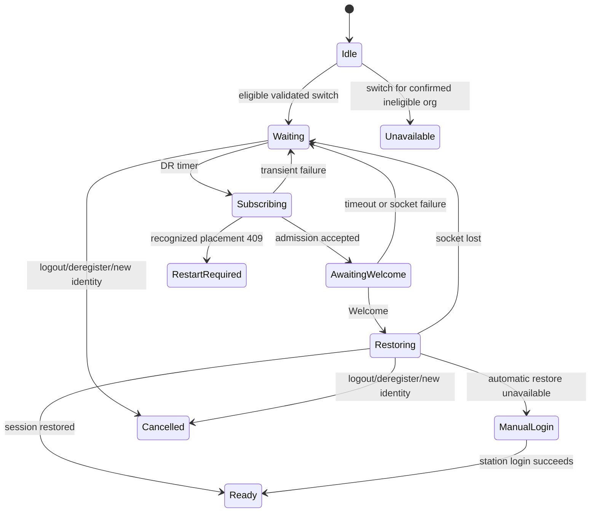

# Contact Center SDK multi-region recovery implementation plan

**Status:** engineering design draft, revised 2026-11-19. **Package:** `@webex/contact-center` in `/Users/rsarika/dev/Cypher/webex-js-sdk`. **Current pattern/routing baseline:** inspected working tree with HEAD `d90e192166646e74dd39e95277607ac0b7e8d25a`, branch `cc-multi-region`. Historical November 18 evidence is retained in the validation document. No feature code is implemented by this documentation change.

The normative behavior and proposed public interfaces are in [requirement.md](requirement.md). Evidence, requirement/test mapping and the manual runbook are in [validation-and-evidence.md](validation-and-evidence.md).

These three proposal documents live at the checkout root. Bare SDK paths (`src/`, `test/`, `docs/`, `AGENTS.md` and `.sdd/manifest.json`) refer to `packages/@webex/contact-center/` unless explicitly marked as workspace-root; Markdown links resolve from this document. Run package commands from the workspace root.

## 1. Decisions carried from the request

- Backend-delivered `multiRegionEnabled` controls SDK eligibility automatically. Add no Split dependency, CDN gate or SDK opt-in.
- Use the current `contact-center` package, not the historical `plugin-cc` checkout.
- SDK owns recovery orchestration and its resources; hosts own overlays, manual input and page reload.
- Preserve existing task/XState, browser-voice, Webex App, wellness and configuration aggregation ownership.
- Keep ordinary Wi-Fi recovery separate from confirmed region-switch recovery.
- Retain Desktop's conditional auto-Available rule for an exact backend `agent-wss-disconnect` reload result; defer while required browser voice is unavailable and report outcomes separately from session readiness.

## 2. Plain-language connection flow

U2C gives the API gateway's address. Subscribe gives the current notification WebSocket address. The gateway address can remain unchanged while a fresh subscription directs the client to a different region. Reconnecting the socket is followed by agent/station restoration; socket-open is not a usable session.

```mermaid
sequenceDiagram
    participant Host
    participant CC as ContactCenter
    participant Catalog as Webex service catalog
    participant Gateway
    participant Socket as Notification service
    Host->>CC: register()
    CC->>Catalog: resolve logical wcc-api-gateway
    CC->>Gateway: POST v1/notification/subscribe
    Gateway-->>CC: trusted webSocketUrl
    CC->>Socket: connect and await Welcome
    CC->>Gateway: fetch desktop-login configuration
    CC-->>Host: Profile (existing register boundary)
    CC->>Gateway: independent live organization-setting read for MR
    Note over CC,Gateway: Bounded MR retries; failure leaves unknown and does not fail valid registration
    Host->>CC: stationLogin(), if necessary
    CC-->>Host: region ready after successful station login
    Socket-->>CC: SYSTEM_REGION_SWITCH
    CC->>CC: validate eligibility, org and tracking ID
    CC->>CC: snapshot, interrupt old requests, guard continuations and pause RTD
    CC-->>Host: region recovering
    CC->>CC: recheck generation and close old transport
    CC->>Gateway: fresh subscribe after DR wait
    Gateway-->>CC: current trusted webSocketUrl
    CC->>Socket: connect and await Welcome
    CC->>CC: apply ordered station policy; wipe/restore only when eligible
    CC->>Gateway: restore supported RTD subscription
    CC-->>Host: region ready or action required
```

Do not explicitly refresh U2C for every event or retry. Webex core's logical-service resolution uses its catalog; it is not itself a forced catalog refresh. A recognized placement mismatch ends the current generation and asks the host for a controlled restart, which recreates normal authentication/discovery/registration initialization. Never substitute `effective_url` or replace `loadus1` with `loadus2` in a URL.

## 3. Current code that must be retained

| Current owner | Verified baseline | Design consequence |
| --- | --- | --- |
| [Configuration](packages/@webex/contact-center/src/services/config/index.ts) and [types](packages/@webex/contact-center/src/services/config/types.ts) | `getOrgDesktopLoginConfig()` supplies the normal complete Profile through the desktop-login aggregate | Preserve that aggregation. Add a narrow separate authenticated organization-setting reader for live MR authority; do not infer disabled eligibility from an omitted aggregate projection. |
| [WebSocketManager](packages/@webex/contact-center/src/services/core/websocket/WebSocketManager.ts) | Already rethrows subscribe errors and validates `wss:` plus allowed RoutingNotifs hosts | Preserve the checks; the old swallowed-subscribe-error finding does not apply to this checkout. |
| [ConnectionService](packages/@webex/contact-center/src/services/core/websocket/connection-service.ts) | Primary reconnect is an asynchronous 5-second interval with a separate recovery watchdog | Serialize attempts and add DR mode without replacing ordinary timing policy. |
| [ContactCenter](packages/@webex/contact-center/src/cc.ts) | Owns silent relogin, current team/timestamps, wellness identity and Webex App post-login work | Refactor shared restore-result application instead of duplicating an older plugin's simplified relogin. |
| [Calling](packages/@webex/contact-center/src/services/WebCallingService.ts) | Existing voice snapshots/events; `registerWebCallingLine()` replaces registration and deregisters an old line | Add an explicit DR preserve/ensure path. Do not claim current relogin already preserves a healthy registration. |
| [TaskManager](packages/@webex/contact-center/src/services/task/TaskManager.ts), [Task](packages/@webex/contact-center/src/services/task/Task.ts), state machine | Typed lifecycle/HYDRATE, ordered controls and existing task UI events | Put invalidation/control changes in these owners, with actual source tests. |
| [Services](packages/@webex/contact-center/src/services/index.ts) | Separate primary and RTD WebSocket managers | Pause and restore RTD explicitly; primary recovery alone is insufficient. |

The current browser-voice API (`getVoiceConnectionState()` / `voice:connectionStateChange`) describes line and Mobius connectivity. The proposed region event describes CC signaling/session recovery. Neither replaces the other.

The following are concrete existing gaps, not features the implementation can assume already work:

| Current gap | Source evidence | Required new work already covered by this proposal |
| --- | --- | --- |
| Ordinary async reconnect attempts can overlap and reject without a catch | `connection-service.ts::onSocketClose` / `handleSocketClose` | Add an in-flight/generation guard and caught, serialized retry scheduling; preserve timing policy. |
| Parsed Profile recovery timeout is not applied | `setConnectionProp()` has no production caller; Profile parser still projects the field | Describe the current effective 50-second default. Do not silently add tenant-timeout wiring. |
| Every primary message rearms liveness/restore timers | `ConnectionService.onPing()` is attached to the full message stream | Ignore any superseded-socket message, not just stale keepalives; suspend the watchdog in confirmed DR. |
| Close-before-Welcome can leave initialization unsettled | WebSocketManager stores a Welcome resolver without close rejection; `WELCOME_TIMEOUT` is unused | Store resolve/reject/timeout ownership and settle on close, timeout or supersession. |
| Registration/removal use different connection-listener identities | `setupEventListeners()` uses `.bind(this)`; deregister removes the unbound method | Retain and remove the same callback reference; prevent duplicates on re-register. |
| Services/ConnectionService/AqmReqs objects outlive deregistration | Static Services singleton has no reset/dispose; deregistration does close its sockets | Keep recovery context registration-scoped and explicitly stop/reset transport work and listeners. |
| AQM timeout handles are discarded and no cancel-all exists | `AqmReqs.createPromise()` schedules without retaining the handle | Store timeout/reject handles and add an internal interruption/cancel-all path with a compatible Err identifier. |
| No public bulk Task invalidation or explicit WebRTC track-release/late-acquisition guard | Task/TaskManager/WebRTC owners | Add typed invalidation, actor/control cleanup and SDK-owned media disposal. |
| RTD lacks its own reconnect driver | Services' RTD construction and feature-conditional setup in ContactCenter | Add the proposed pause/resubscribe lifecycle; current fire-and-forget setup does catch failure. |
| Auto-Available failure can leave cached aux claiming Available | silentRelogin sets its local aux before setAgentState, catches rejection and later stores that aux | Retain backend state/aux until acknowledgment; implement the selected conditional DR auto-Available policy with voice deferral, cancellation and outcome reporting. |
| Relogin metrics are declared but not tracked; dedicated loss/reconnect tracking is absent | Metrics constants/taxonomy and source call sites | Add actual tracking through existing MetricsManager conventions, not duplicate ad-hoc names. |

Serialization, deadlines, bulk cancellation, invalidation and RTD recovery below are proposed implementation work. They are not claims about the current SDK baseline.

The current AQM default TIMEOUT_REQ is 20 seconds, shorter than the first DR wait of at least 100 seconds. Reject/cancel pending requests at accepted event entry, before that wait; copying Desktop's post-reconnect application-state wipe alone would let these operations time out with the wrong reason. This request-interruption layer is a deliberate SDK adaptation of the existing AQM ownership pattern.

## 4. State and ownership

Add a small registration-scoped recovery context owned by ContactCenter, with transport scheduling delegated to ConnectionService. Do not create a process-global recovery store or put agent policy into Core.

Context fields: active org/registration generation, eligibility (`true | false | undefined`), accepted switch-ID FIFO/set (maximum 128 IDs, no TTL, oldest evicted at capacity), initiating validated scope/operation, phase, last successful station payload reconciled with the latest accepted station state, known home/serving region, and cancellation handles. Store no bearer token in this context.

Keep the DR auto-Available action in this same per-ContactCenter context, with station-session identity, state-intent revision captured when confirmed DR begins, backend disconnect-state precondition, outcome, one voice-listener reference and an in-flight request handle. It is a subordinate action, not another transport driver or a Task lifecycle state. The existing agent-state owner must coordinate its dispatch/correlation with explicit state requests.

Internal phases: idle, waiting, subscribing, awaiting-Welcome, restoring-session, ready, manual-login-required, restart-required, unavailable, cancelled. These are proposed internal phases, not additions to Task's existing lifecycle states. Every asynchronous continuation checks the current generation before changing state or emitting success.



Fresh registration resolves Profile at the existing boundary even when a person still needs to log into a station. An initial subscription mismatch rejects that registration promise and emits a separate lifecycle notification; neither completion channel substitutes for the other.

## 5. Configuration and protocol changes

### 5.1 Configuration

Keep `getAgentConfig()`, `getOrgDesktopLoginConfig()` and the all-or-nothing normal Profile aggregation unchanged. Add a narrow internal `getMultiRegionSettings(orgId)` reader in the existing Config service, through WebexRequest and logical `wcc-api-gateway`, using the proven `GET organization/{orgId}/organization-setting` route. Normalize the HTTP response body to a typed organization-settings array at the adapter boundary and validate the wire envelope with a sanitized fixture. For a nonempty array, use only [0] and ignore additional entries rather than merging or searching for an entitled record; malformed first/empty/non-array results leave eligibility unknown; do not substitute an aggregate object or cached login snapshot when the live read fails.

Start this registration-scoped MR task after notification Welcome and complete Profile availability without delaying the existing register() completion boundary. Apply the five-attempt 1/2/3/4-second retry only to this read, catch its asynchronous errors, and leave eligibility unknown on exhaustion. An MR-only failure does not fail an otherwise-valid registration or retry the Profile aggregation. Normal Profile-fetch failures and independent host-wide auth/session handling retain their existing authority. Hydrate once per register() generation only. A new register() invalidates old eligibility and starts one new bounded cycle; ordinary reconnect/DR restore do not re-read, and there is no polling/public refresh API. Terminal MR-reader auth failure after existing host auth handling stops that reader only, retains unknown, and does not close connections, reject valid registration or initiate logout.

Use a separate internal MR settings type and context. Any public metadata projection comes from that live result. A nonempty authoritative record without literal true can follow the chosen legacy-org disabled rule; omitted MR fields in an unverified aggregate cannot certify non-entitlement. Non-boolean live values remain unknown as an intentional SDK validation choice; Desktop's current `=== true` check instead treats those values as disabled.

Desktop's aggregate adapter does project MR fields, so these documents do not assert that an aggregate can never contain them. Desktop deliberately bypasses its cached aggregate for MR authority. The known fresh organization-setting endpoint avoids relying on unproven aggregate projection/freshness for the eligibility gate; retain a sanitized positive live fixture as integration evidence.

### 5.2 Event handling

Add `SYSTEM_REGION_SWITCH` to the internal backend event vocabulary/envelope without reinterpreting existing agent/task events. One coordinator validates authenticated org identity, nonblank IDs and deduplication before socket changes. Accepted tracking IDs enter a registration/org-scoped 128-item FIFO/set; duplicates in that window are ignored, capacity evicts the oldest ID, and teardown clears it. Unknown-eligibility events do not enter the accepted history. This bounded history deliberately also suppresses A/B/late-A delivery while all IDs remain retained. Optional unknown scope/operation is omitted, not used to infer routing.

Unknown eligibility intentionally ignores the event with no close/replay, including the hydration window after Welcome/profile availability. Four retry waits can total 10 seconds plus request durations. Only a subsequent transport failure starts ordinary reconnect; only a recognized admission 409 requests restart. Neither fallback is guaranteed to occur or recover from every ignored event, and an ignored event does not activate DR waits. Confirmed disabled stops both primary and RTD drivers, invalidates pending transport work, closes both sockets with reconnect disabled and emits unavailable/not-eligible. Leave the existing browser calling line registered; do not create a line or end contacts. The host owns sign-out UI and calls its normal deregister() teardown when signing out. Desktop's two-minute forced sign-out UI is a reference behavior, not an instruction for the SDK to revoke host-wide Webex credentials.

### 5.3 Public interface

Export the event constant, status/reason/state types (including RegionAutoAvailableStatus) and lifecycle error-code catalog/types specified in requirement.md from src/index.ts; public recovery failures remain plain Error objects. Add them to the owning contract catalog when implementation changes the public surface. Publish with the existing plugin `trigger()` mechanism and isolate observer exceptions from recovery completion.

Use augmented plain Error objects rather than exporting a new Error subclass. Export the proposed REGION_RECOVERY_ERROR_CODES const catalog and its derived union, put the lifecycle code in err.data.reason and preserve compatible non-sensitive .data diagnostics. Do not require instanceof across SDK bundles. Internal Err.Message/Err.Details remain separate. Existing catalogs are not uniform: VOICE_CONNECTION_ERROR is an enum.

The host receives complete snapshots. `ready` means the primary transport and station session are usable, subject to the existing independent voice-state/Available rules. Optional RTD failure is logged/metriced and does not falsely tear down that primary session. It does not mean every historical task or active call media migrated.

Use the optional autoAvailable field for waitingForVoice/requesting/succeeded/failed/cancelled, retaining the latest outcome until the next generation and omitting it when no action applies. Emit an updated snapshot on each outcome change, even if status remains ready. Do not repurpose unavailable/session-restore-failed for a usable session whose Available action is deferred or failed. Existing voice:connectionStateChange and backend agent-state success/failure payloads remain unchanged; a local validation failure must not masquerade as a backend notification.

## 6. Retry, timeout and error policy

| Operation / outcome | Specified behavior |
| --- | --- |
| Live MR settings only | One cycle per register(): separate read plus four retries with 1/2/3/4-second waits; unknown on exhaustion; terminal reader auth failure stops only that cycle, without failing valid Profile/register or closing connections |
| Initial primary admission | One attempt, preserving registration behavior; add settlement on timeout/close/supersession, which is not guaranteed today |
| Ordinary reconnect | Preserve 5-second cadence and current effective default 50-second timeout; serialization/caught failures are new work; configured Profile timeout is not wired today |
| Confirmed DR | Waits 100/60/30/15 seconds, drawing new jitter per scheduled wait with `1 + 0.5 * random()`; repeat final wait. Per-attempt jitter is an intentional SDK choice, unlike Desktop worker arrays randomized once |
| DR total duration | No time-based cap: exits are success, logout/deregister/multi-login/identity cancellation, a superseding switch generation, recognized restart-required response or terminal failure. Hosts must not await a timeout-based unavailable event; ordinary watchdog is suspended |
| Subscribe deadline | 20 seconds per attempt; late results discarded |
| Socket + Welcome deadline | 30 seconds after accepted admission; close the failed attempt |
| Reload-agent transient failure | After terminal-auth/cancellation guards, only AQM Timeout/TimeoutEvent, 1037/INTERNAL_ERROR and HTTP 429/502/503 get four total attempts with 2/4/8-second waits |
| Reload-agent missing session/DN or other non-transient failure | 1038/1041 and AGENT_NOT_FOUND/AGENT_DN_NOT_REGISTERED, and other non-transient reload failures, go to station fallback immediately; add missing numeric/reason normalization explicitly |
| Station login says session exists | 1035: one reload-agent retry, then manual-login-required if unsuccessful |
| Subscription 429/5xx/offline | Retry through the active scheduler; do not overlap work |
| Admission/session terminal 401/403 after existing auth handling (MR reader uses its separate row) | Stop and emit unavailable/authentication-failed; do not force OAuth refresh on every switch |
| Invalid or untrusted socket URL | Reject the attempt; never bypass the existing origin checks or open an old URL |
| Recognized subscription placement 409 | Stop that generation, settle pending calls and emit reloadRequired |

Read the header name `x-wxcc-region-reason` case-insensitively. Trim values and compare reason values exactly and case-sensitively. The first nonblank header, body `reason`, then body `error.reason` wins even when unrecognized: a nonblank unknown header must not fall through to a recognized body reason. Preserve only status/reason/tracking ID needed for classification. Apply the special restart rule only to the four reasons enumerated in REQ-MR-008; `REGION_MISMATCH_ORG_NOT_ELIGIBLE` and unrelated API conflicts are not in that class.

The 20-second subscribe and 30-second combined socket/Welcome limits are explicit new SDK choices using the existing timeout constants as numerical references; those constants do not prove active deadlines in the current implementation. Desktop uses a 10-second subscribe deadline and a 10-second Welcome timer that starts after socket-open.

The ordinary watchdog must not be rearmed by any message from a superseded socket while DR is waiting. A second valid switch cancels old timers/attempts and starts the new generation. A logout or deregistration invalidates even an in-flight subscribe, Welcome, media acquisition or reload response.

## 7. Session and resource restoration

1. At event acceptance capture whether a backend-confirmed active station existed, the state-intent revision and the last successful effective station payload, reconciled with current accepted team/device/DN state. A session restored during register() counts as active even without a public stationLogin() call in this tab. Do not use failed caller input. Preserve current stationLogin default-aux behavior (`auxCodeId: EMPTY_STRING`) rather than replaying a stale auxiliary code; apply current state/aux from successful backend restore responses. Keep the snapshot in memory before any wipe. Desktop rebuilds from current stores and re-resolves default auxiliary codes; that resolver can use cache and does not guarantee fresh HTTP.
2. Before closing the old primary socket or scheduling a DR wait, advance the generation, reject still-pending old AQM requests with RECOVERY_INTERRUPTED, clear their timers/binds, guard old HTTP/WebSocket/media continuations, block conflicting task/call-control actions and pause RTD. Install these protections before publishing recovering, then recheck generation after application callbacks so a reentrant logout/deregister cannot restart recovery or close a replacement session. Keep getters and logout/deregistration available. A request settled before acceptance is not settled again. Late getUserMedia must already be guarded at this point, even though full Task/store cleanup happens later. Do not label this immediate SDK interruption mechanism an existing Desktop API.
3. Close the old primary transport without its ordinary reconnect driver, schedule the DR wait, subscribe afresh and await a valid replacement Welcome under the transport deadlines. An old completion must not settle or install work for the new generation. The ordinary 20-second AQM timeout must never win for requests interrupted in step 2; no Welcome is needed to reject them.
4. After Welcome evaluate REQ-MR-012's ordered policy: no prior active station first; otherwise automation disabled; otherwise missing configuration; otherwise automatic restoration. The first branch preserves complete Profile, skips station wipe/reload/login and resumes enabled RTD with stationLoginRequired/region-switch, even when automation is false. The second skips automatic reload and fallback login with automatic-relogin-disabled, even if the snapshot is absent. The third emits session-restore-failed. Only the automatic branch proceeds to regional Task/store cleanup and reload. For manual outcomes keep conflicting task/call-control commands blocked while public stationLogin/getters/logout/deregister remain callable; cancel competing automatic work and clean up regional Task/session owners before applying a manual replacement session.
5. At the automatic post-Welcome wipe, or before accepting manual replacement-session data, invalidate actual retained Task objects through a typed Task/state-machine adapter entry point, stop old actors and disable existing controls without synthetic ContactEnded/wrap-up. Objects become STALE_TASK there; before that boundary blocked actions use RECOVERY_IN_PROGRESS. Dispose SDK-owned existing microphone tracks and task observers through their owners. A stream acquired by an old continuation during the earlier DR wait or after wipe is stopped without answering. Use calling cleanUpCall() only for its non-ending semantics; never call contact decline/end or deregister a healthy line. Replace non-authoritative cached agent state/aux from successful backend restoration.
6. In the automatic branch only, recover the backend session with bounded reload-agent/fallback station login, checking generation/socket readiness around every wait/request. Apply REQ-MR-011's transient allowlist and 1035 rule. With allowAutomatedRelogin:false, neither automatic reload nor fallback station login is invoked. Missing/failed automatic restoration requests manual login rather than reporting ready.
7. Apply the current restore side effects: agentSessionId/wellness identity, team, timestamps, auxiliary code, device mode and Webex App post-login integration. Reuse restore-result application with an explicit DR context; do not blindly reuse the browser-registration branch in handleDeviceType(). Apply backend-restored state/aux first. For successful automatic reload only, use the exact returned agent-wss-disconnect reason to arm the conditional auto-Available action below. Never derive it from outage length, pre-recovery state or a fallback/manual station login. Do not inherit current silentRelogin's preemptive Available cache assignment after a failed request.
8. Preserve a healthy browser line. The precise branch is `silentRelogin()` → `handleDeviceType(BROWSER)` → `registerWebCallingLine()`. The latter performs replacement, so route the DR context to preserve/ensure at handleDeviceType() or its factored restore equivalent instead of invoking replacement unconditionally. Ordinary reconnect keeps its existing registration policy unless separately specified. Add an internal ensure/preserve operation that observes line/Mobius state, honours `disableWebRTCRegistration`, and establishes registration only when absent/unusable. Keep calling's own reconnect ownership.
9. Restore SDK-supported RTD features using a new realtime subscription and the complete existing feature condition: transcripts, suggestions, wrap-up summaries, consult/transfer summaries and wellness where enabled. Reset task-owned pending RTD data through its owner. Rehydrate backend-delivered tasks through existing HYDRATE mapping, with no synthetic incoming event for a restored task.
10. Publish ready after station restoration succeeds without waiting indefinitely for required browser voice or auto-Available. Include the current autoAvailable outcome, when applicable, and publish subsequent outcome changes. Keep voice readiness in the existing voice snapshot/event. Manual-login-required and unavailable are explicit outcomes, not successful recovery.

### Conditional auto-Available after DR reload

This is the requester-selected Desktop-parity policy, with SDK-owned reporting and cancellation:

1. After successful automatic reload result application and the DR line preserve/ensure step, inspect the actual returned lastStateChangeReason. Only exact agent-wss-disconnect with no explicit state intent newer than the revision captured at DR entry arms the action. Do not reset that revision after an awaited reload. Omit autoAvailable when arming is prevented, for all other/absent reasons or fallback/manual station login. Honour allowAutomatedRelogin and the existing isBrowserVoiceRequired()/isVoiceReady() policy, including disableWebRTCRegistration; a DN/extension or other mode without the browser-voice requirement has no browser wait.
2. If required voice is unavailable, set waitingForVoice and attach one listener to the existing voice readiness source. Subscribe and immediately recheck readiness to close the subscribe/check race. Preserve backend state/aux and permit region ready. A registered/reconnected line alone is insufficient while Mobius remains disconnected. Do not start a polling loop or a second calling reconnect driver.
3. Before dispatch, check the active recovery generation, org/station session, state-intent revision, disconnect-state precondition and current voice readiness. Consume the pending action and detach its voice listener before awaiting the request so duplicate readiness callbacks cannot dispatch twice. Set requesting, route through the existing agent-state mutation owner, and update cached state/aux/timestamps to Available only after a successful backend acknowledgment. Set succeeded only on that acknowledgment; terminal success/failure retains no pending voice listener.
4. If the existing local pre-send voice gate rejects BROWSER_VOICE_NOT_READY, return to waitingForVoice, reattach once and recheck readiness. For other rejection/timeout, report failed, keep the last confirmed state/aux and do not silently retry Available. Existing authoritative backend events can still reveal the eventual result of a timed-out request; do not assert backend rejection or roll back a later authoritative state. Use existing sanitized diagnostics for detail and the new outcome for host presentation.
5. Cancel the pending action and detach its listener on explicit host/agent state intent, logout/deregister, identity or station-session replacement, multi-login, another recovery, or a newer backend state that no longer permits the disconnect-state action. The action's own correlated acknowledgment is a result, not an independent cancellation trigger. An explicit state intent cancels immediately even if that explicit request later fails. If automatic work was already sent, cancellation does not retract it: serialize the explicit request after it settles, and use distinct request correlation plus generation/session/intent checks so the old reply cannot settle the explicit promise or overwrite a newer accepted state. The current AQM binding by event/subtype is not enough to assume this isolation; implement and test the owner/correlation changes. Client ordering after a timeout does not prove the backend abandoned the timed-out request. Emit cancelled while the original context is active and clear pending work/listeners; retain the outcome if the session continues, and never publish an old-session outcome after replacement.

Only this DR action receives the new policy; ordinary reconnect's state/registration policy remains as currently specified. Voice events and region-ready are independent of becoming Available.

Failover and failback run the same recovery pipeline; operation/scope are metadata and do not select client-manufactured routing. The current SDK has no SYSTEM_SHUTDOWN replacement-socket swap, so Desktop's guard against region-switch events arriving on a swap replacement socket has no equivalent active swap state here; this proposal does not add shutdown swapping.

An abrupt outage without a switch event uses ordinary resubscription and existing hydration/session restore. It must not be mislabeled a confirmed DR event. A placement 409 can still lead to controlled restart on that path. A login during an existing failover similarly relies on admission rather than a prior event.

## 8. Host integration example

This is proposed API usage after implementation. Subscribe before registration so the host cannot miss initial restart/manual-login notifications. Omitted `limitedService` means placement is unknown. Host rendering must continue to use the existing per-task `uiControls`, not recreate task permissions from this event.

```ts
import {REGION_RECOVERY_EVENTS, type RegionRecoveryState} from '@webex/contact-center';

const onRegionState = (state: RegionRecoveryState) => {
  renderRecoveryStatus(state); // host-owned UI; ready does not imply uninterrupted audio
  renderAutoAvailableStatus(state.autoAvailable); // undefined clears a prior outcome
  if (state.autoAvailable === 'failed') showAgentStateAction();

  if (state.status === 'stationLoginRequired') showStationLogin();
  if (state.status === 'unavailable') showRecoveryUnavailable(state.reason);

  if (state.status === 'reloadRequired') {
    // Session storage is per browser tab. Add the authenticated org ID to isolate orgs.
    const key = `ccsdk:region-reload:${activeOrgId}`;
    const now = Date.now();
    const previous = Number(sessionStorage.getItem(key));
    if (Number.isFinite(previous) && previous > 0 && now - previous < 120_000) {
      showRecoveryUnavailable('Repeated region mismatch');
      return;
    }
    sessionStorage.setItem(key, String(now));
    window.location.reload();
  }
};

webex.cc.on(REGION_RECOVERY_EVENTS.STATE_CHANGE, onRegionState);
// Teardown: webex.cc.off(REGION_RECOVERY_EVENTS.STATE_CHANGE, onRegionState).
// Handle register()/stationLogin() promise rejection independently from lifecycle UI.
```

Production host code must handle sessionStorage unavailability by showing a restart action rather than initiating an unguarded reload. Its normal startup owns authentication recovery and station preferences. The SDK does not refresh catalog hosts by assigning private `_hostCatalog` fields.

## 9. Ordered engineering tasks

| Task | Requirements | Work and concrete completion evidence |
| --- | --- | --- |
| IMPL-01 | REQ-MR-001–REQ-MR-004 | Add the separate live MR-only Config reader/hydration; preserve Profile aggregation; authoritative positive/legacy/unknown fixtures, failure isolation and guards verified |
| IMPL-02 | REQ-MR-005–REQ-MR-009 | Preserve current URL security/error propagation; add structured mismatch classification, settled deadlines, generation cancellation and serialized ordinary/DR drivers |
| IMPL-03 | REQ-MR-010–REQ-MR-012 | Snapshot confirmed station data; implement ordered station/automation/configuration policy and bounded DR reload/station fallback; retain conditional auto-Available with voice deferral, state-intent/correlation guards and acknowledgment-only cache updates |
| IMPL-04 | REQ-MR-013–REQ-MR-016 | Add immediate event-entry AQM interruption and continuation/late-media guards before any DR wait; separately implement post-Welcome/manual-replacement Task invalidation, XState/control integration, media disposal and DR browser-line preservation |
| IMPL-05 | REQ-MR-017–REQ-MR-019 | Pause/resubscribe owned RTD features; add region snapshots including auto-Available outcomes and lifecycle cancellation; verify startup-away/failback metadata |
| IMPL-06 | REQ-MR-020–REQ-MR-021 | Add isolated diagnostics, public exports/types and host examples; update manifest-routed module docs/README.md specs, docs/architecture.md contract index and manifest as part of implementation |
| IMPL-07 | All local checks | Execute AC-001–AC-020 / T-001–T-013, package gates and applicable independent spec validation; report prerequisite failures separately and hand off AC-021 as not executed until QA/platform owners provide live evidence |

At implementation time, present the concrete affected source/contracts under the package's AGENTS.md coding workflow. This documentation change itself adds only the three requested proposal files and does not change the as-built canonical spec, manifest or product code.

AC-021 is a separate mandatory release gate owned by QA/platform operators, not an autonomous engineering task. Local implementation can complete with that gate explicitly not executed; release approval cannot. A DAG/build/test command must not acquire credentials, trigger failover/failback or wait for an unassigned operator window to satisfy local completion.

## 10. Review and delivery criteria

- Review the public additive names/error codes before coding; preserve the existing voice and task event contracts.
- Before admitting an implementation run, check checkout/root access and package dependencies; run node --version and yarn --version from the workspace root and verify Node 22.14.x / Yarn 3.4.1. A mismatch is an environment prerequisite failure. Reuse the selected runner's supported prerequisite schema rather than assuming prose configures its checks.
- Verify the positive authoritative organization-setting response and MR-reader failure isolation; mocks cannot establish deployed integration behavior.
- Use the package's Jest/fake-timer seams and source wiring. Do not add a new Playwright suite merely to mirror unit-observable logic.
- Run the package's Node 22.14 / Yarn 3.4.1 commands and retain existing 85% package coverage expectations; record baseline/tool failures separately.
- Follow current AGENTS/manifest routing: docs/specs/README.md, each owning module's docs/README.md and docs/architecture.md for the contract index. Do not recreate the migrated ai-docs tree. Resolve the intended new generator/validator provenance, different-runtime independence, runnable integration and repository access before canonical spec validation. Current manifest generator_runtime is claude-code and its validator value is a historical invocation identity, not a runnable validator selection. These draft proposal files do not claim that independent SDD validation or live acceptance has run.
- Publish/ship only after the evidence document identifies successful and unsuccessful results without converting source review or local mocks into a live MR pass.

The execution contract is SDK/library work: host UI and whole-page navigation remain host-owned. Admission must use a runner that supports that scope without inventing a prototype, frontend implementation, visual harness or accessibility suite. Parser source-registration success alone does not prove that capability. Record an unsupported runner as an admission failure before DAG/build/test execution; the installed prog-mini-js limitation and verified alternatives are tracked in the validation document, not implemented as SDK settings.
