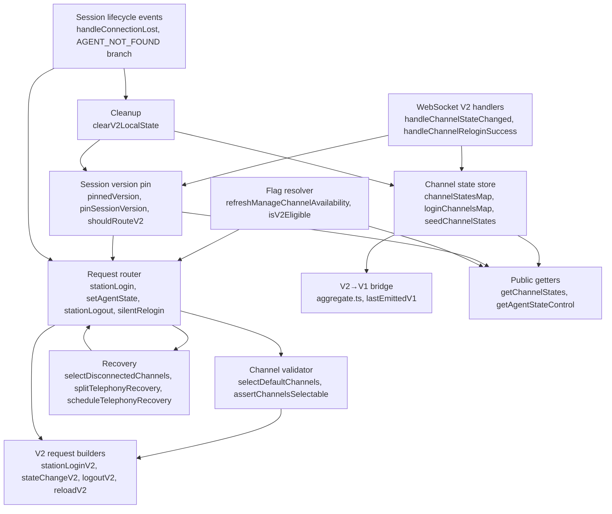
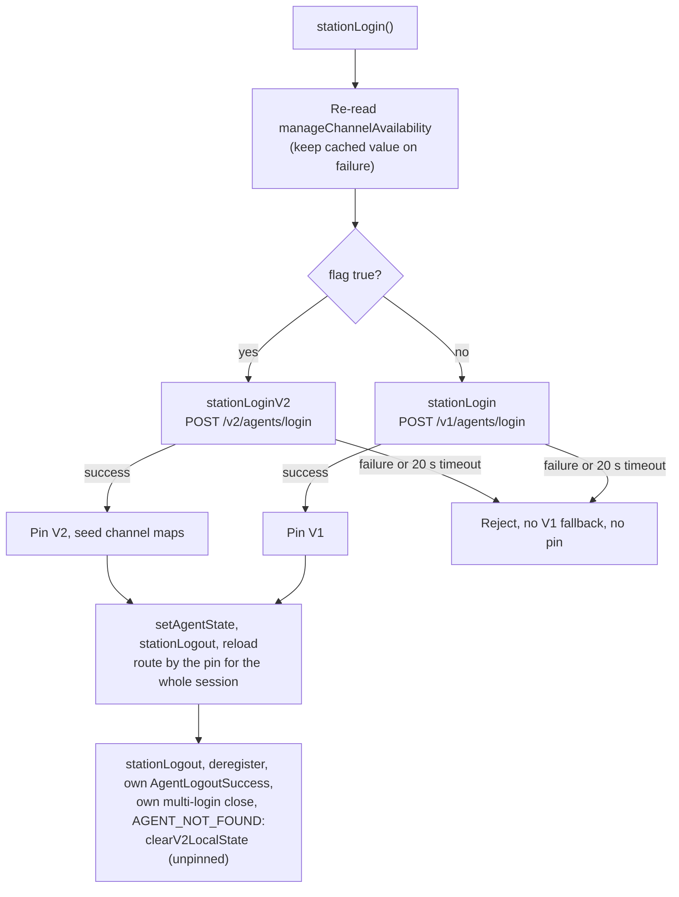
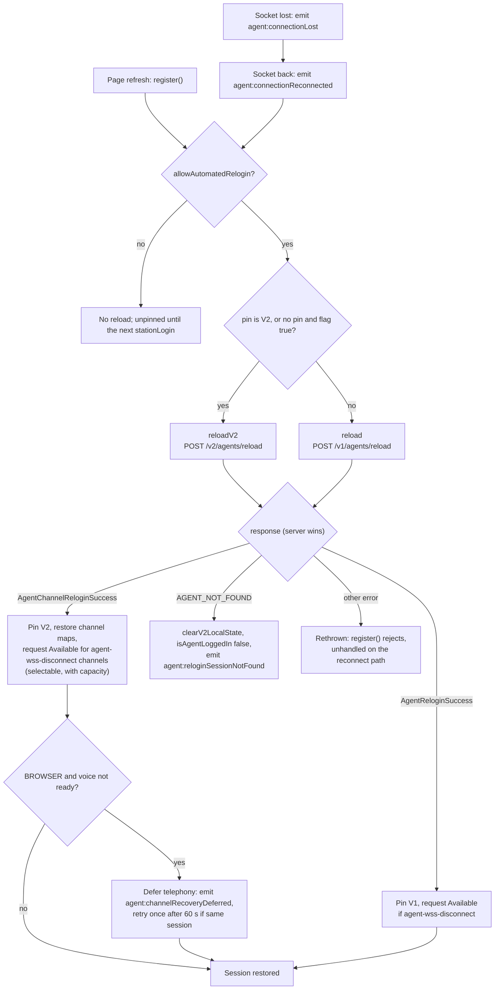

# Feature Design — WXCC-15791: Granular Agent State Control V2

> Start here → package [`AGENTS.md`](../../../../AGENTS.md) (agent entry) · router [`docs/specs/README.md`](../../../../docs/specs/README.md) · system [`docs/architecture.md`](../../../../docs/architecture.md). This design serves the spec [`feature-spec.md`](../spec/feature-spec.md); it feeds the decomposition [`../tasks/`](../tasks/) and the test plan [`test-strategy.md`](../test-strategy.md).
> Context-efficiency: this document owns the technical solution for this feature. Standing module behavior lives in the module specs; exact interfaces live in [`contracts/`](contracts/).

## Metadata
| Field | Value |
|---|---|
| Feature / ticket key | WXCC-15791 |
| Title | Granular Agent State Control V2 |
| Feature Spec | [`../spec/feature-spec.md`](../spec/feature-spec.md) (WHAT + WHY this design serves) |
| Status | implementation-ready (implemented; GA blocked on Q-1) |
| Change class | contract-affecting |
| created_by / approved_by / date | SDD intake / pending / 2026-09-21, revised 2026-11-19 |
| Generated from | `feature-design` @ SDLC template library `0.2.0` |

## Executive Summary
The SDK chooses V1 or V2 once per login from the profile flag `manageChannelAvailability`, which it re-reads before each `stationLogin` (R-9, R-10). It pins that version for the session; a reload pins the server's version instead (R-12). Every later call routes by the pin: state change, logout, and reload. On a V2 session, `setAgentState` sends per-channel requests (R-1, R-11). WebSocket channel events keep a per-channel map that the public getters expose (R-2, R-4, R-5, R-7). The pure module `aggregate.ts` projects the channel map into one V1 state so V1 listeners keep working (R-8). After a refresh or reconnect, the SDK reloads on the pinned or flagged version, restores the map, and recovers disconnected channels; telephony on `BROWSER` waits for the voice line (R-13). The SDK also tells the application about connection loss, reconnect, and a missing server session, but leaves recovery policy to the application (R-15, R-16). All V2 logic is in `src/cc.ts` and `src/services/agent/`; no new service or module was added.

## Scenario → Design Map
| Requirement / scenario (from Feature Spec) | Design element that satisfies it |
|---|---|
| R-1 per-channel `setAgentState` | `setAgentState` V2 branch → `selectDefaultChannels` → `assertChannelsSelectable` → `routingAgent.stateChangeV2` (`PUT /v2/agents/session/state`) |
| R-2 `getChannelStates()` | `channelStatesMap`, copied per entry, `{}` unless `isV2Session()` |
| R-4 `getAgentStateControl()` | `declared` = `isV2Eligible(agentConfig.manageChannelAvailability)`; `active` from `pinnedVersion` |
| R-5 channel events | `handleWebsocketMessage` → `handleChannelStateChanged` (V2 session, own-agent, selectable-channel guards) |
| R-6 channel failures | `handleWebsocketMessage` re-emits `AgentChannelStateChangeFailed` as `agent:channelStateChangeFailed` |
| R-7 channel relogin | `handleChannelReloginSuccess`: pin V2, replace maps, `restoreV2AgentConfigFromChannels` |
| R-8 V2→V1 bridge | `src/services/agent/aggregate.ts`: `projectAggregate`, `shouldEmitLegacyEvent`, `bridgeStateChangeSuccess`; `lastEmittedV1` in `cc.ts` |
| R-9, R-10 login version | `refreshManageChannelAvailability` → `isV2Eligible` → `stationLoginV2` or `stationLogin`; early pin in the `AgentStationLoginSuccess` handler; pin again after the promise |
| R-11 validation | `assertChannelsSelectable` throws `SDK_VALIDATION_ERROR` |
| R-12 server wins | `shouldRouteV2()` (pin, else flag) for reload and logout; `silentRelogin` pins from the response `type` |
| R-13 recovery | `selectDisconnectedChannels` → `splitTelephonyRecovery` → `setAgentState` + `scheduleTelephonyRecovery`; `affectsTelephony` voice check |
| R-15 connection events | `handleConnectionLost` emits `agent:connectionLost` / `agent:connectionReconnected` |
| R-16 session not found | `silentRelogin` `AGENT_NOT_FOUND` branch: `clearV2LocalState`, `isAgentLoggedIn = false`, `agent:reloginSessionNotFound` |
| R-17 cleanup | `clearV2LocalState` on `stationLogout`, `deregister`, own-session `AgentLogoutSuccess`, own-session `AgentMultiLoginCloseSession`; `handleConnectionLost` as one stable arrow-function reference |

---

# Feature Architecture

## System Context
- **Callers:** host applications (widgets, custom desktops, the sample) call `ContactCenter` methods and getters and listen to `agent:*` events.
- **Inside the SDK:** `ContactCenter` (`src/cc.ts`) uses `routingAgent` and `aggregate.ts` (`src/services/agent`), the config service for the profile flag, and AqmReqs, WebSocketManager, and ConnectionService (`src/services/core`).
- **External:** the WCC API gateway (`/v1` and `/v2` agent endpoints), the WCC notification WebSocket, and `@webex/calling` for the `BROWSER` voice line (`isVoiceReady()`).

Inside the boundary: session versioning, V2 routing, the channel map, the bridge, recovery, and the new events in `@webex/contact-center`. Outside it: the backend V2 API and its notification shapes (Q-1), widget and desktop UI, the voice line internals, and application recovery policy (retries, showing the login screen, banners).

## Functional-Block Decomposition

| Block | Responsibility (for this feature) | New or existing | Touches module(s) |
|---|---|---|---|
| Flag resolver | Re-read the profile flag before login; keep the cached value on failure | new | `src`, `src/services/config` |
| Session version pin | Hold V1 or V2 for the session; choose reload and logout routing | new | `src` |
| Request router | Choose V1 or V2 for login, state change, logout, and reload | existing (extended) | `src` |
| Channel validator | Default the channel list and reject unselectable channels | new | `src` |
| V2 request builders | AQM configs for the four V2 endpoints | new | `src/services/agent` |
| Channel state store | Per-channel state and capacity for the session | new | `src` |
| WebSocket V2 handlers | Apply channel events, pin on channel relogin | new | `src` |
| V2→V1 bridge | Project one V1 state and suppress duplicates | new | `src/services/agent/aggregate.ts` |
| Recovery | Return disconnected channels to Available; defer telephony | existing (extended) | `src` |
| Session lifecycle events | Tell the app about connection and session loss | existing (extended) | `src`, `src/services/agent/types.ts` |
| Cleanup | Clear the pin, maps, bridge memory, and timer | new | `src` |
| Public getters | Expose channel states and control status | new | `src`, `src/types.ts` |

## Object-Model Changes
| Object / entity | New / changed / removed | Fields / shape change | Owning module |
|---|---|---|---|
| `ChannelType` | new | `'telephony' \| 'chat' \| 'email' \| 'social' \| 'workItem' \| 'customMessaging'`; only the first four are selectable (`SELECTABLE_CHANNEL_TYPES` in `cc.ts`) | `src/services/agent/types.ts` |
| `AgentChannelTypeStates` | new | `agentState`, `pendingIdle`, `availableChannelCount`, `totalChannelCount`, `stateChangeReason`, `stateChangeTimestamp`; optional `auxCodeId`, manually-assigned counts, `lastIdleCodeChangeTimestamp` | same |
| `AgentChannelStateChanged` / `AgentChannelStateChangeFailed` / `AgentChannelReloginSuccess` | new | WebSocket notification payloads ([`v2-events.md`](contracts/v2-events.md)) | same |
| `ChannelStateChangeRequest` | new | `channelType[]`, `state`, `auxCodeId`, `reason?`, `agentId` | same |
| `StateChange` | changed | optional `channelType?: ChannelType[]` | same |
| `AgentStateControlStatus` | new | `{declared: boolean \| undefined, active: boolean \| undefined}` | `src/services/agent/types.ts` |
| `SetStateResponse` | changed | may also be `AgentChannelStateChanged` | `src/types.ts` |
| `AgentProfile` | changed | `manageChannelAvailability?` plus optional fields the SDK does not read | `src/services/config/types.ts` |
| `Profile` | changed | `manageChannelAvailability: boolean` (`=== true` of the profile field) | `src/services/config/types.ts`, `Util.ts` |
| `CC_AGENT_EVENTS` | changed | `AGENT_CHANNEL_STATE_CHANGE`, `AGENT_CHANNEL_STATE_CHANGED`, `AGENT_CHANNEL_STATE_CHANGE_FAILED`, `AGENT_CHANNEL_RELOGIN_SUCCESS` | `src/services/config/types.ts` |
| `AGENT_EVENTS` | changed | 7 new values (see [`v2-events.md`](contracts/v2-events.md)) | `src/services/agent/types.ts` |
| AQM error IDs | changed | `Service.aqm.agent.stationLoginV2`, `stationLoginV2Failed`, `stateChangeV2`, `logoutV2` | `src/services/core/Err.ts` |
| `SessionVersion` | new (internal) | `'V1' \| 'V2'`, not exported from `src/index.ts` | `src/services/agent/types.ts` |

## Design Decisions & Rationale
- **D-1 One routing version per session, pinned:** — **why:** the backend keeps a session on the version it was created with; mixing V1 and V2 calls in one session is undefined. Matches wxcc-desktop.
- **D-2 Profile flag is the only V2 switch, re-read before each login:** — **why:** the requirement in Jira says the SDK must not use Split.io or config overrides; re-reading lets a profile change apply without a new `register()`.
- **D-3 No V1 fallback when V2 login fails:** — **why:** retrying on V1 creates a session on a different version from the profile intent, and wxcc-desktop does not fall back. The error surfaces to the caller.
- **D-4 Server wins on reload:** reload routes by pin, else flag; the pin then comes from the response type. — **why:** after a refresh the SDK has no pin, and the flag may have changed since the session started.
- **D-5 V2→V1 bridge as a pure module:** — **why:** V1 listeners keep working on V2 sessions, and pure functions are easy to unit-test.
- **D-6 Telephony recovery waits for the voice line on `BROWSER`:** — **why:** going Available on telephony without a line drops calls; a 60 s timer with session checks avoids changing a later session.
- **D-7 SDK owns the relogin; the application owns the policy:** — **why:** only the SDK can rebuild its pin and channel map, and it already did the relogin on `next`. The application decides retries, the login screen, and banners, so the SDK emits events and does not decide policy.
- **D-8 V2 logic in `cc.ts`, not a new module:** — **why:** the logic needs `ContactCenter` private state (pin, maps, voice line); only the pure bridge was split out.

## Alternatives Explored
| Alternative | Pros | Cons | Why not chosen |
|---|---|---|---|
| Fall back to V1 when V2 login times out | Agents can still log in during a V2 outage | Session version differs from profile intent; diverges from wxcc-desktop | D-3 |
| Split.io flag or SDK config override for V2 | Gradual rollout from the client | Jira requires the profile flag only | D-2 |
| Decide the reload version from the flag only | Simpler | Wrong when the flag changed after the session started | D-4 |
| Drop `reloadV2` and always reload on `/v1` | One endpoint | Diverges from wxcc-desktop routing | D-4 (restored) |
| Separate `getChannelCapacity()` (old R-3) | Explicit API | Duplicates `totalChannelCount` | Dropped |
| Leave refresh and reconnect handling to the application | Thinner SDK | App cannot rebuild SDK pin and map; breaks behavior on `next` | D-7 |
| Emit no events and let the app poll `isAgentLoggedIn` | No new API | App cannot know when to look | D-7 |
| Separate V2 service class | Isolation | Needs `ContactCenter` private state | D-8 |

## Dependencies & Assumptions
- **Assumes:** the backend sends `AgentChannelStateChanged` per channel and `AgentChannelReloginSuccess` for V2 reloads, with the field names in [`contracts/`](contracts/). If false, the channel map and bridge receive nothing (Q-1).
- **Assumes:** both reload endpoints answer with the persisted session's response type.
- **Assumes:** `stateChangeReason === 'agent-wss-disconnect'` marks channels that the server idled on disconnect.
- **Depends on:** backend V2 endpoints deployed and `manageChannelAvailability` in the desktop-login profile; `@webex/calling` `isVoiceReady()`.

## Architecture Views
- **Logical view (session version):** the pin starts unset. Login sets it from the flag, and a reload sets it from the response type, which can switch it (server wins). `stationLogout`, `deregister()`, an `AgentLogoutSuccess` or `AgentMultiLoginCloseSession` for this session, and `AGENT_NOT_FOUND` clear it. Flow 1 and Flow 2 below show each transition.
- **Data-flow view:** `AgentChannelStateChanged` → `channelStatesMap[channelType]` → `getChannelStates()` (copies) and `agent:channelStateChange`; the same map → `aggregate.ts` → `agent:stateChange` / `agent:stateChangeSuccess` when the projection changes.

---

## Feature-Toggle Strategy
| Toggle | Gates | Behavior when OFF | Default | Owner | Removal trigger |
|---|---|---|---|---|---|
| `agentProfile.manageChannelAvailability` (backend profile) | V2 login and everything pinned by it | V1 behavior unchanged; `channelType` ignored; getters return `{}` and `active: false` | `false` / absent | Backend tenant admin | Not removable; it is the per-agent product setting |
| `allowAutomatedRelogin` (SDK config, existing) | Reload on refresh and reconnect | No reload; `agent:connectionReconnected` still emitted; session stays unpinned until login | `true` | Application | n/a |

## Impacted Services / Modules & Task Split
### `src/` (ContactCenter)
- **Deployment target:** npm `@webex/contact-center`.
- **Epic:** [`../tasks/sdk-v2-agent-state/epic.md`](../tasks/sdk-v2-agent-state/epic.md).
- **Changes:** session pin and routing; V2 branches in login, state change, logout, and reload; WebSocket V2 handlers; recovery; getters; lifecycle events; exports (T1, T2, T3, T4).

### `src/services/agent/`
- **Deployment target:** same package.
- **Epic:** same.
- **Changes:** V2 types, four builders, `aggregate.ts`, 7 `AGENT_EVENTS` (T1, T3, T4).

### `src/services/config/` and `src/services/core/`
- **Deployment target:** same package.
- **Epic:** same.
- **Changes:** V2 `CC_AGENT_EVENTS`, profile fields, `parseAgentConfigs` mapping, AQM error IDs (T1).

### `docs/samples/contact-center`
- **Deployment target:** monorepo sample.
- **Epic:** sample spec.
- **Changes:** reference V2 UI, mismatch banner, session status (T3, T4).

## Service Impact Matrix
| Service / module | Changes? | What changes (or why not) | Owner |
|---|---|---|---|
| `src` (`cc.ts`, `index.ts`, `types.ts`) | yes | V2 routing, pin, handlers, recovery, getters, events, exports | contact-center SDK |
| `src/services/agent` | yes | V2 types and builders, bridge, event constants | contact-center SDK |
| `src/services/config` | yes | Profile flag and V2 WebSocket names | contact-center SDK |
| `src/services/core` | yes | Error IDs only; AqmReqs, WebSocketManager, ConnectionService unchanged | contact-center SDK |
| `src/services/task` | **no** | Task routing does not depend on agent availability state | — |
| `src/metrics` | **no** | Existing metric names reused | — |
| `src/utils`, data services | **no** | Not involved | — |
| `@webex/calling` | **no** | Only `isVoiceReady()` is read | calling SDK |
| `docs/samples/contact-center` | yes | Reference UI | contact-center SDK |

## Interface & Contract Definitions
| Interface (API / event / schema) | Producer | Consumer(s) | Change type (new/modify/remove) | Contract doc | Schema / API source | Compatibility / deprecation |
|---|---|---|---|---|---|---|
| `POST /v2/agents/login`, `POST /v2/agents/logout` | Backend | `routingAgent` | new | [`v2-state-change.md`](contracts/v2-state-change.md) | `src/services/agent/index.ts` | Used only when the flag is `true` or pinned V2 |
| `PUT /v2/agents/session/state` | Backend | `routingAgent.stateChangeV2` | new | [`v2-state-change.md`](contracts/v2-state-change.md) | same | V2 sessions only |
| `POST /v2/agents/reload`, `POST /v1/agents/reload` | Backend | `silentRelogin` | new / modify | [`v2-reload.md`](contracts/v2-reload.md) | same | Both bind both response types |
| `AgentChannelStateChanged`, `AgentChannelStateChangeFailed`, `AgentChannelReloginSuccess` | Backend WebSocket | `handleWebsocketMessage` | new | [`v2-events.md`](contracts/v2-events.md) | `src/services/agent/types.ts`, `src/services/config/types.ts` | Additive |
| `setAgentState({channelType?})` | SDK | Applications | modify | [`v2-state-change.md`](contracts/v2-state-change.md) | `src/cc.ts`, `src/types.ts` | Optional argument; ignored on V1 |
| `getChannelStates()`, `getAgentStateControl()` | SDK | Applications | new | [`v2-events.md`](contracts/v2-events.md) | `src/cc.ts` | Additive |
| `agent:channelStateChange`, `agent:channelStateChangeFailed`, `agent:channelReloginSuccess`, `agent:channelRecoveryDeferred` | SDK | Applications | new | [`v2-events.md`](contracts/v2-events.md) | `src/services/agent/types.ts` | Additive |
| `agent:connectionLost`, `agent:connectionReconnected`, `agent:reloginSessionNotFound` | SDK | Applications | new | [`v2-reload.md`](contracts/v2-reload.md) | same | Additive; emitted on V1 and V2 |
| Bridged `agent:stateChange` / `agent:stateChangeSuccess` | SDK | V1 applications | modify (new source) | [`v2-events.md`](contracts/v2-events.md) | `src/services/agent/aggregate.ts` | Same payload shape as V1 |

> Per-interface contract documents live in [`contracts/`](contracts/). Exact types are the TypeScript declarations in the Schema / API source column.

## Data-Model Design
N/A — no persistent storage. In-memory session state only: `pinnedVersion`, `channelStatesMap`, `loginChannelsMap`, `lastEmittedV1`, `telephonyRecoveryTimer`. All of it is cleared by `clearV2LocalState`.

## Security / RBAC Design
N/A — no new scopes or trust boundaries. Requests use the existing authenticated `webex.request` path. Channel events for other agents are ignored (R-5) so the map only reflects this agent.

## Protocol / Wire-Format Design
- AQM request then matching WebSocket notification, the same as V1. The `stateChangeV2` success bind matches `AgentRequestEvent`, `RoutingMessage`, or `AgentChannelStateChange` with `data.type === 'AgentChannelStateChanged'`, so the promise resolves on the first channel's notification; later channels arrive only as events.
- Both reload builders bind `AgentReloginSuccess` and `AgentChannelReloginSuccess` so either response type settles the request.
- Wire shapes: [`contracts/`](contracts/).

## UX Design & Traceability
N/A for the SDK. The sample app's UI is specified in [`docs/samples/contact-center/ai-docs/features/WXCC-15791-granular-agent-state-sample/spec/feature-spec.md`](../../../../../../../docs/samples/contact-center/ai-docs/features/WXCC-15791-granular-agent-state-sample/spec/feature-spec.md).

## HA & Failure-Condition Matrix
| Failure condition | Probability | Impact | Mitigation / fallback |
|---|---|---|---|
| Flag re-read fails before login | low | Stale flag | Keep the cached value, log a warning, continue the login |
| V2 login fails or times out (`TIMEOUT_REQ` 20000 ms) | low | Agent cannot log in | Reject with `Service.aqm.agent.stationLoginV2` / `stationLoginV2Failed`; no V1 retry; rollback by profile flag |
| V2 state change fails | med | Channel not changed | `agent:channelStateChangeFailed` event and rejected promise (`Service.aqm.agent.stateChangeV2`) |
| Invalid or capacity-less channel requested | med | Request rejected locally | `SDK_VALIDATION_ERROR` before any request |
| Available with telephony while the browser line is not ready | med | Request rejected locally | `VOICE_CONNECTION_ERROR.NOT_READY`; non-telephony channels still allowed |
| Socket drops | med | Events stop | `agent:connectionLost`; ConnectionService reconnects |
| Reload: server has no session (`AGENT_NOT_FOUND`) | med | Agent is logged out on the server | Clear state, `isAgentLoggedIn = false`, `agent:reloginSessionNotFound`; the app shows login |
| Reload: other error | low | Session not restored | Error rethrown (from `register()` it rejects); state unchanged |
| Recovery `setAgentState` fails | low | Channel stays idle | Logged; the agent can set state manually |
| Deferred telephony: line still not ready after 60 s | low | Telephony stays idle | Voice-ready check rejects; logged; agent retries manually |
| Deferred timer fires after logout or a new session | low | Wrong session changed | Timer checks V2 pin, session id, and telephony reason; cleared by `clearV2LocalState` |
| Logout request fails | low | Session remains | State not cleared; caller retries |
| `AgentMultiLoginCloseSession` for this session | low | Another client took the session | `clearV2LocalState`, then `agent:multiLogin`; the sample tears down its UI |
| Reload marks a non-selectable or capacity-less channel `agent-wss-disconnect` | low | One invalid channel would reject the whole recovery batch | Recovery only requests channels that are selectable and have capacity in `loginChannelsMap` |
| Channel event for another agent or an unknown channel | med | Map polluted | Guards ignore it |
| Server session version differs from the flag | med | UI built for the wrong version | Pin from the response; `getAgentStateControl()` exposes `declared !== active` |
| Bridge would repeat the same V1 state | med | Duplicate V1 events | `shouldEmitLegacyEvent` compares subStatus and aux code |

## Sequence Diagrams
Only the two main flows are drawn here: choosing V1 or V2, and refresh or reconnect. Every other operation group already has a diagram in the module specs, so it is linked instead of redrawn.

Sequence coverage:

| Operation group | Diagram | Failure / recovery coverage |
|---|---|---|
| Station login and version selection | Flow 1 V1 / V2 selection | Flag re-read failure keeps the cached value; V2 failure or timeout rejects with no V1 fallback |
| Page refresh (`register()`) and socket reconnect | Flow 2 Refresh and reconnect reload | Relogin disabled; V1 or V2 response (server wins); deferred telephony; `AGENT_NOT_FOUND`; other reload error |
| Set agent state (V1 and V2) | [Station login, logout, and agent state](../../../../src/docs/README.md), [State change](../../../../src/services/agent/docs/README.md) | Channel validation error; voice not ready (telephony only); AQM failure emits `agent:channelStateChangeFailed` and rejects |
| Channel events and V2→V1 bridge | [Granular channel events](../../../../src/docs/README.md) | Not V2, other agent, or unknown channel ignored; no Available/Idle channel or unchanged projection emits no V1 event |
| Logout, remote logout, deregister | [Station logout](../../../../src/services/agent/docs/README.md), [Deregister](../../../../src/docs/README.md) | Logout failure keeps state; another session's `AgentLogoutSuccess` is ignored; the same `handleConnectionLost` reference is removed |
| Deferred telephony timer | Flow 2 and the HA & Failure-Condition Matrix | Fires once after 60 s; no-op if unpinned, session changed, or telephony no longer disconnect-idle; voice still not ready is logged |

### Flow 1 V1 / V2 selection

### Flow 2 Refresh and reconnect reload

Recovery `setAgentState` errors are logged, not thrown. `agent:reloginSessionNotFound` can fire during `register()` before the app attaches listeners, so the app also checks `isAgentLoggedIn` on the returned Profile.

## Rollout / Migration Interlock
| Step / wave | What ships | Depends on | Toggle state | Owner |
|---|---|---|---|---|
| 1 | SDK with V2 support (minor version) | Unit suites green | Flag `false` for all agents → V1 unchanged | SDK maintainers |
| 2 | Backend V2 endpoints and notifications confirmed (Q-1) | Backend deploy | Flag on for test agents | Backend routing team |
| 3 | Widgets consume getters and V2 events | Step 1 | Flag on for pilot tenants | Widgets team |
| 4 | GA | Steps 2–3 sign-off | Flag per tenant | Product |
| Rollback | Set the flag `false` | — | Applies at next login; existing sessions keep their version | Tenant admin |

## Test Strategy
→ Full plan: [`../test-strategy.md`](../test-strategy.md). Key scenarios this design must prove: version chosen from the re-read flag with no fallback; routing by pin, else flag; server wins on reload; per-channel validation and the telephony-only voice check; guards on channel events; bridge projection and duplicate suppression; recovery split and timer guards; connection and session-not-found events; cleanup on every path and a stable listener reference.

## Design Coverage Summary
| Concern | In-scope / N/A / Out-of-scope | Where addressed |
|---|---|---|
| System context | In-scope | System Context (narrative) |
| Functional decomposition | In-scope | Functional-Block Decomposition |
| Object model | In-scope | Object-Model Changes |
| Alternatives | In-scope | Alternatives Explored |
| Feature toggle | In-scope | Feature-Toggle Strategy |
| Scale | N/A | Omitted: per-agent session traffic, not perf-critical |
| Service impact | In-scope | Service Impact Matrix |
| Interfaces / contracts | In-scope | Interface & Contract Definitions, [`contracts/`](contracts/) |
| Data model | N/A | Data-Model Design (in-memory only) |
| Security / RBAC | N/A | Security / RBAC Design |
| HA / failure | In-scope | HA & Failure-Condition Matrix, Sequence Diagrams (Flow 1, Flow 2, and linked module-spec diagrams) |
| Rollout / migration | In-scope | Rollout / Migration Interlock |
| Test strategy | In-scope | Test Strategy |

## Reviewer Sign-Off
| Role | Reviewer | Status (pending / approved / changes-requested) | Date |
|---|---|---|---|
| Architect | | pending | |
| Tech Lead | | pending | |
| Product | | pending | |
| UX | | N/A (SDK) | |
| QA | | pending | |
| Delivery / SRE | | pending | |

## References / Traceability
- Feature Spec (WHAT + WHY): [`../spec/feature-spec.md`](../spec/feature-spec.md)
- Package architecture: [`docs/architecture.md`](../../../../docs/architecture.md) · module specs: [`src/docs/README.md`](../../../../src/docs/README.md), [`src/services/agent/docs/README.md`](../../../../src/services/agent/docs/README.md), [`src/services/config/docs/README.md`](../../../../src/services/config/docs/README.md)
- Per-interface contracts: [`contracts/`](contracts/) · Test strategy: [`../test-strategy.md`](../test-strategy.md)
- Decomposition: [`../tasks/sdk-v2-agent-state/`](../tasks/sdk-v2-agent-state/)
- Coverage / contracts baseline: [`.sdd/manifest.json`](../../../../.sdd/manifest.json)
