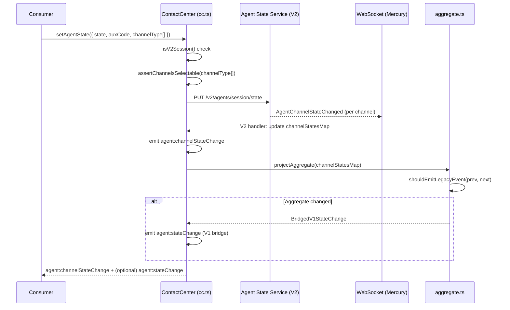

# Feature Design — WXCC-15791: Granular Agent State Control V2

> **Navigation:** [AGENTS.md](../../../AGENTS.md) → [SPEC_INDEX.md](../../../SPEC_INDEX.md) → [ARCHITECTURE.md](../../../ARCHITECTURE.md)

> Start here → repo [`AGENTS.md`](../../../AGENTS.md) · router [`SPEC_INDEX.md`](../../../ai-docs/SPEC_INDEX.md). Implements [`../spec/feature-spec.md`](../spec/feature-spec.md); contracts [`contracts/`](./contracts/); tasks [`../tasks/sdk-v2-agent-state/epic.md`](../tasks/sdk-v2-agent-state/epic.md).

## Metadata
| Field | Value |
|---|---|
| Feature key | WXCC-15791 |
| Status | implementation-ready |
| Change class | contract-affecting |
| Generated from | `feature-design` @ SDLC template library `0.2.0` |

## Executive Summary
V2 support is added to the existing `ContactCenter` plugin with minimal new surface: one new module (`services/agent/aggregate.ts`) for the deterministic V2→V1 event bridge, new V2 request builders in the existing `routingAgent` factory, and the remaining V2 logic (eligibility, session pinning, channel derivation/validation, recovery) folded into `cc.ts` as private methods. The session version is pinned once at login and governs which endpoints and events are used; V1 behavior is unchanged and V2 channel changes are bridged back to V1 events.

## Scenario → Design Map
| Scenario (spec) | Design element |
|---|---|
| V2 state change (R-1) | `setAgentState` → `isV2Session()` branch → `stateChangeV2` builder |
| Per-channel events (R-5/6/7) | `cc.ts` WebSocket router → V2 handlers → emit + update `channelStatesMap` |
| V2→V1 bridge (R-8) | `aggregate.ts` `projectAggregate` + `shouldEmitLegacyEvent` + `bridgeStateChangeSuccess` |
| Session pinning (R-9/10) | `isV2Eligible` + `pinSessionVersion` + `isV2Session` (private); version resolved inline in `stationLogin()` |
| Channel validation (R-11) | `assertChannelsSelectable` (private) |
| Recovery (R-12/13) | `selectDisconnectedChannels` + `splitTelephonyRecovery` + `shouldDeferTelephonyRecovery` (private) |

## System Context
`ContactCenter` (a `WebexPlugin`) talks to the WCC backend over HTTP (AQM request builders) and a Mercury WebSocket (notifications). Agent profile (incl. `manageChannelAvailability`) arrives via the desktop-login aggregate and `parseAgentConfigs()`. Consumers subscribe to `AGENT_EVENTS` and call the plugin's public methods.

## Functional-Block Decomposition
- **Request builders** (`services/agent/index.ts`): `stationLoginV2`, `stateChangeV2`, `logoutV2` added to the `routingAgent` factory alongside V1 builders; endpoint paths centralized here. (`reloadV2` was dropped; the unified `reload()` branches on the server-chosen response type.)
- **V2→V1 bridge** (`services/agent/aggregate.ts`, the only new file): `projectAggregate` (any Available wins; scalar fields come from the first channel in `telephony→chat→email→social` whose state equals that subStatus; bridgeable = `Available`/`Idle`), `shouldEmitLegacyEvent` (suppress only when both subStatus and that aux code are unchanged), `shouldBridgeChannelState`, and `bridgeStateChangeSuccess` returning a flat `BridgedV1StateChange`.
- **Plugin orchestration** (`cc.ts`): session pinning (`pinSessionVersion`/`isV2Session`/`clearSessionVersion`; version resolved inline in `stationLogin()`), eligibility (`isV2Eligible`), channel derivation/validation (`selectDefaultChannels`/`seedChannelStates`/`assertChannelsSelectable`), recovery (`selectDisconnectedChannels`/`splitTelephonyRecovery`/`shouldDeferTelephonyRecovery`), V2 getters (`getChannelStates`/`getAgentStateControl`), and the WebSocket V2 handlers.

## Object-Model Changes
New types in `services/agent/types.ts`: `SessionVersion`, `ChannelType`, `AgentChannelTypeStates`, `AgentChannelStateChanged`, `AgentChannelStateChangeFailed`, `AgentChannelReloginSuccess`, `AgentStateControlStatus`, `ChannelStateChangeRequest`, `ChannelsMap`. New private instance fields on `ContactCenter`: `channelStatesMap`, `pinnedVersion`, `declaredEligibility`, `lastEmittedV1`, `telephonyRecoveryTimer`.

## Design Decisions & Rationale
| Decision | Rationale |
|---|---|
| Fold eligibility/channels/recovery/version into `cc.ts` private methods; keep only `aggregate.ts` as a new file | Minimize new surface/files for easy review; these are plugin-instance concerns, the bridge is pure and worth isolating + unit-testing |
| `aggregate.ts` returns a flat `BridgedV1StateChange` interface | `StateChangeSuccess` is `Msg`-wrapped (nested `.data`); the bridged object is flat, so an explicit interface is the honest type |
| Pin version after the `stationLogin()` promise settles (after the WS success event) | Pinning lives in the flow that knows which endpoint/fallback ran; consumers read posture from the promise, not the event |
| V2 login AQM timeout → one V1 fallback, pin V1 | Keep agents able to log in if V2 is unavailable; other V2 errors rethrow |
| Recovery uses unified `reload()` branching on `response.type` | Backend chooses response from persisted session version, so recovery survives a page refresh; `reloadV2` is unused. Reload failures use `Service.aqm.agent.reload`. State change is `PUT /v2/agents/session/state`. |
| Getters return `{}` when not V2 | Emptiness is a clean "not V2" signal |

## Alternatives Explored
- Separate `setChannelState` method → rejected; extend `setAgentState` (additive, V1-compatible).
- Keep `channels.ts`/`version.ts`/`recovery.ts`/`routing-eligibility.ts` as modules → rejected; too many single-use files, folded into `cc.ts`.

## Dependencies & Assumptions
- `@webex/calling` owns the WebRTC line; the SDK only manages the telephony deferral boundary.
- Backend sends one `AgentChannelStateChanged` per channel; ordering across channels is not assumed (Q-1).

## Impacted Services / Modules & Task Split
| Module | Change | Task |
|---|---|---|
| `services/agent/types.ts`, `index.ts` | V2 types + request builders | T1 |
| `services/config` | V2 event constants + profile parsing | T1 |
| `services/agent/aggregate.ts` | V2→V1 bridge (new) | T2 |
| `cc.ts` | V2 public API, pinning, channels, recovery, event dispatch | T2 |
| tests + `docs/samples` | unit tests + sample panel | T3 |

## Interface & Contract Definitions
See per-interface contracts: [`contracts/v2-state-change.md`](./contracts/v2-state-change.md), [`contracts/v2-events.md`](./contracts/v2-events.md), [`contracts/v2-reload.md`](./contracts/v2-reload.md). Canonical `ChannelType = 'telephony'|'chat'|'email'|'social'|'workItem'|'customMessaging'`; `SELECTABLE_CHANNEL_TYPES = ['telephony','chat','email','social']`.

## HA & Failure-Condition Matrix
| Condition | Handling |
|---|---|
| V2 login AQM timeout | Fall back once to V1 login, pin V1 |
| No bridgeable channel state | `projectAggregate` returns `null`; no V1 event |
| State-change failure | `agent:channelStateChangeFailed` emitted unconditionally |
| WebSocket disconnect/reconnect | `reload()` → recover disconnected channels; BROWSER telephony deferred |
| Non-selectable channel requested | `assertChannelsSelectable` throws SDK validation error |

## Rollout / Migration Interlock
Backend-controlled via `manageChannelAvailability` (the sole V2 enablement signal for the SDK). No SDK feature-flag infra. Rollback = profile flag false → V1 on next login.

## Test Strategy
See [`../test-strategy.md`](../test-strategy.md). Unit coverage for `aggregate.ts` (projection/suppression) and the `cc.ts` V2 paths (routing, pinning, fallback, recovery, getters) within the package 85% gate.

## Design Coverage Summary
| Spec requirement | Design element | Covered |
|---|---|---|
| R-1..R-4 | `setAgentState` branch + getters | ✅ |
| R-5..R-8 | WS V2 handlers + `aggregate.ts` | ✅ |
| R-9..R-11 | pinning + eligibility + validation (private) | ✅ |
| R-12..R-13 | recovery (private) | ✅ |
| R-14 | sample panel | ✅ |

## References / Traceability
- Spec: [`../spec/feature-spec.md`](../spec/feature-spec.md) · contracts: [`contracts/`](./contracts/) · tests: [`../test-strategy.md`](../test-strategy.md)
- Owning module spec: `src/services/agent/ai-docs/*`

## Feature-Toggle Strategy

Granular agent state is controlled by the `manageChannelAvailability` flag on the agent profile (fetched during `register()` via `getAgentConfig()`).
- When `true`, the SDK pins the session to V2 and uses per-channel endpoints.
- When `false` or absent, the SDK falls back to V1 agent-wide state management.
- The toggle is evaluated once at login and cannot change mid-session.
- Widget rendering is gated by `store.isGranularAgentStateActive`.

## Service Impact Matrix

| Service | Impact | Notes |
|---|---|---|
| Agent State Service | V2 endpoints added | `/v2/agents/login`, `/v2/agents/session/state`, `/v2/agents/reload`, `/v2/agents/logout` |
| WebSocket (AQM) | New event types | `AgentChannelStateChanged`, `AgentChannelStateChangeFailed`, `AgentChannelReloginSuccess` |
| Agent Profile Service | Feature flag read | `manageChannelAvailability` field |
| Existing V1 consumers | No breaking changes | V1 events continue via aggregate bridge |

## V2 State Change Flow

## Reviewer Sign-Off

| Role | Name | Date | Status |
|---|---|---|---|
| Author | | | Pending |
| Technical Reviewer | | | Pending |
| Product Owner | | | Pending |
