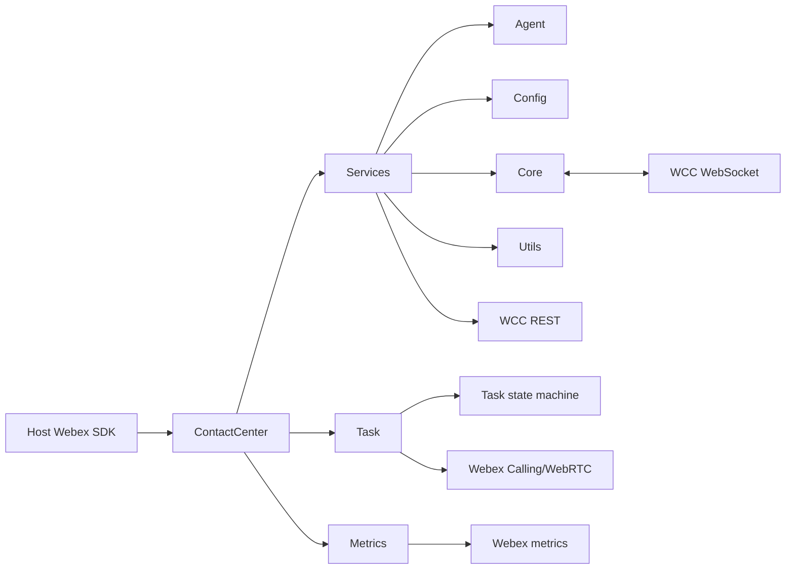
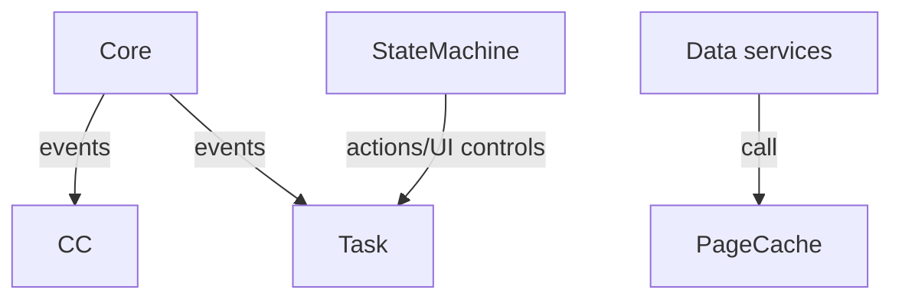
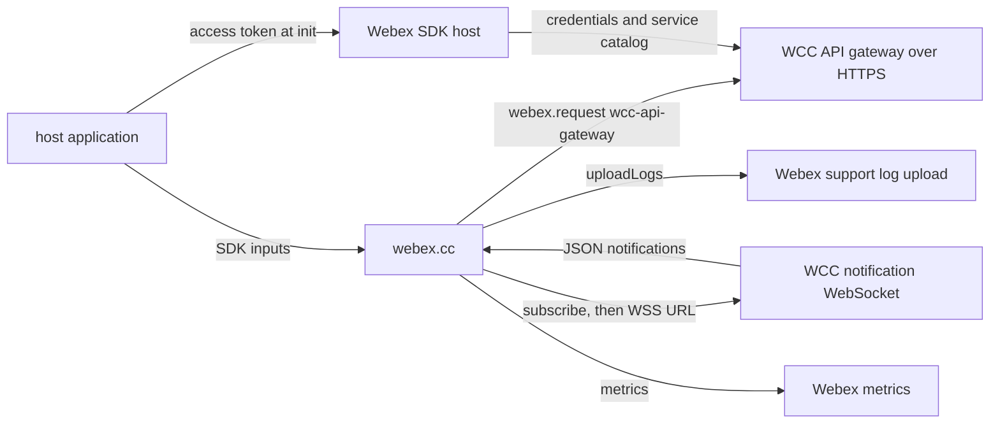

<!-- sdd-generated-metadata
doc_kind: standing-doc
generated_from: architecture@0.3.0
generated_by: claude-code
approved_by: rarajes2@cisco.com
updated_at: 2026-11-17T03:03:58Z
validation_status: pass-with-warnings
-->

# @webex/contact-center architecture

Canonical architecture for the `@webex/contact-center` package. This page owns the package
boundaries, the module inventory, how the modules interact with each other and with the Webex SDK host
and the Contact Center backend, the contract index, and the cross-cutting security, observability, and
state rules. Behavior of each module lives in its module specification, listed in the
[specification registry](specs/README.md).

Related context: [specification registry](specs/README.md) ·
[package agent instructions](../AGENTS.md)

## Applicability

| Condition ID                         | Status     | Evidence or reason | Owned section |
| ------------------------------------ | ---------- | ------------------ | ------------- |
| `repo.owns_datastore`                | N/A        | No file under src writes durable storage; remote Contact Center services own agent, task, and configuration records, and `src/utils/PageCache.ts` is an in-memory Map | Repository data and schema |
| `repo.holds_client_state`            | Applicable | `src/cc.ts` keeps the agent profile and session; `src/services/task/TaskManager.ts` keeps the task collection; `src/services/WebCallingService.ts` keeps the voice connection state | Client state model |
| `repo.components_interact`           | Applicable | `src/cc.ts` constructs and wires Services, TaskManager, MetricsManager, WebCallingService, and the data services | Dependency and interaction topology |
| `repo.domain_data_across_components` | Applicable | The agent profile from `src/services/config/index.ts` is read by `src/cc.ts`, the task layer, and the AI assistant | Object and data ownership |
| `repo.caches_data`                   | Applicable | `src/utils/PageCache.ts`, used by `src/services/AddressBook.ts` and `src/services/Queue.ts` | Caching catalog |
| `repo.observability_convention`      | Applicable | `src/logger-proxy.ts` log format and `src/metrics/MetricsManager.ts` event taxonomy | Observability patterns |
| `repo.deploys_to_infra`              | N/A        | Library published to npm by the deploy:npm script in `package.json`; it runs inside the host application and owns no infrastructure | Runtime and infrastructure |
| `repo.shared_base_libs`              | Applicable | ContactCenter extends WebexPlugin from @webex/webex-core (`src/cc.ts`); the legacy build and test stack comes from `babel.config.js` and `jest.config.js`, and lint from the workspace root ESLint config | Shared and base libraries |
| `repo.is_monorepo`                   | N/A        | This SDD root is one package; the workspace around it is out of scope (`package.json`) | Package map and inter-package dependencies |
| `repo.multi_platform`                | N/A        | One browser-oriented code path; `src/webex.js` is both the npm main and the UMD entry | Platform matrix |
| `repo.published_package`             | Applicable | `package.json` publishes @webex/contact-center through the deploy:npm script | Release and versioning |
| `repo.embedded_in_host`              | Applicable | `src/index.ts` registers the plugin cc into the host Webex SDK | Host integration and theming |
| `repo.exposes_commands_or_artifacts` | Applicable | `package.json` scripts; `typedoc.json` writes the API reference; the workspace webpack builds `umd/contact-center.min.js` from `src/webex.js` | Commands and generated artifacts |
| `repo.cross_repo_deps_material`      | Applicable | Every agent and task operation depends on the Contact Center API gateway and notification WebSocket (`src/services/core/WebexRequest.ts`, `src/services/core/websocket/WebSocketManager.ts`) | Cross-repository topology |
| `repo.security_arch_warranted`       | Applicable | Host credentials, agent identity, dial numbers, and customer interaction data cross `src/services/core/WebexRequest.ts` and the WebSocket handlers in `src/cc.ts` | Security architecture |

## Design overview

The `@webex/contact-center` package is a Webex SDK plugin that provides a TypeScript/JavaScript API for building Contact Center agent applications. It enables:

- **Agent Session Management**: Register, login, logout, state changes
- **Task Handling**: Inbound/outbound calls, chat, transfers, conferences
- **Real-time Events**: WebSocket-based notifications for agent and task events
- **Browser-based Calling**: WebRTC integration for browser softphone
- **Metrics & Diagnostics**: Built-in telemetry and log upload

The package is a host-embedded SDK plugin. `ContactCenter` owns the public façade and composes services for configuration, agent requests, tasks/calling, data lookup, realtime events, transport, and metrics. Remote Webex services own durable domain data.

Two interaction styles are deliberate: direct REST for immediate data/configuration responses, and AQM HTTP initiation followed by correlated WebSocket completion for event-driven agent/task operations. Typed events and XState isolate consumers from raw backend messages.

| Technology | Purpose |
|------------|---------|
| **TypeScript** | Primary language; the workspace `tsconfig.json` sets `alwaysStrict`, not the full `strict` flag |
| **WebexPlugin** | Base class from `@webex/webex-core` |
| **EventEmitter** | Event handling for real-time updates |
| **WebSocket** | Real-time communication with Contact Center |
| **WebRTC** | Browser-based calling (via WebCalling) |
| **Jest** | Unit testing framework |

## Resource inventory and responsibilities

The package is one published resource made of nine manifest modules.

| Resource | Kind | Responsibility | Owner | Source | Detailed specification |
| -------- | ---- | -------------- | ----- | ------ | ---------------------- |
| @webex/contact-center | package (nine modules) | The Contact Center agent SDK plugin `webex.cc`, its standalone `Webex` constructor, and its public exports | @webex/web-sdk | `package.json` | [Specification registry](specs/README.md) |

| Component | Responsibility (one line) | Docs |
|---|---|---|
| `src` | Own the published Webex Contact Center SDK plugin surface, registration lifecycle, public method delegation, and application-facing event routing. | [`src/docs/README.md`](../src/docs/README.md) |
| `src/metrics` | Own timing, taxonomy, queuing, payload preparation, and submission for Contact Center behavioral, operational, and business telemetry. | [`src/metrics/docs/README.md`](../src/metrics/docs/README.md) |
| `src/services` | Own composition and bootstrap order for backend request and realtime collaborators (the Services singleton), plus the direct REST data, user preference, AI assistant, and WebRTC service classes that ContactCenter constructs. | [`src/services/docs/README.md`](../src/services/docs/README.md) |
| `src/services/agent` | Own agent login, logout, state-change, buddy-agent, and reload request contracts; ContactCenter uses reload for silent relogin and stationLogin for device updates. | [`src/services/agent/docs/README.md`](../src/services/agent/docs/README.md) |
| `src/services/config` | Own retrieval and aggregation of remote organization, agent, team, profile, auxiliary-code, dial-plan, and feature configuration. | [`src/services/config/docs/README.md`](../src/services/config/docs/README.md) |
| `src/services/core` | Own authenticated HTTP, realtime WebSocket lifecycle, AQM request correlation, reconnect/keepalive behavior, and shared error normalization. | [`src/services/core/docs/README.md`](../src/services/core/docs/README.md) |
| `src/services/task` | Own task creation, media-specific behavior, call-control operations, lifecycle orchestration, task events, and integration with the task state machine. | [`src/services/task/docs/README.md`](../src/services/task/docs/README.md) |
| `src/services/task/state-machine` | Own deterministic task lifecycle states, transition guards/actions, typed internal events, and state-derived UI-control availability. | [`src/services/task/state-machine/docs/README.md`](../src/services/task/state-machine/docs/README.md) |
| `src/utils` | Own shared pagination contracts and the bounded in-memory page cache used by Contact Center data services. | [`src/utils/docs/README.md`](../src/utils/docs/README.md) |

Object composition at runtime (`src/cc.ts`, `src/services/index.ts`):

```text
ContactCenter (cc.ts), constructed on the Webex READY event
├── WebexRequest (singleton)       → authenticated HTTP and log upload
├── Services (singleton)
│   ├── agent/      → Agent operations (login, logout, state, buddy agents, reload)
│   ├── config/     → Configuration fetching
│   ├── contact, dialer → Task operations (hold, transfer, wrapup, outdial, campaign preview)
│   └── core/       → WebSocketManager (primary and RTD), ConnectionService, AqmReqs
├── TaskManager    → Task lifecycle (Task, Voice, WebRTC, Digital)
├── WebCallingService, ApiAIAssistant, MetricsManager
├── AnswerCallOnWebexService, WebexCrossClientService, WxAppTelephonyMercurySync → Better Together (wxApp) answer, cross-client state, and Mercury mute sync
└── AddressBook, EntryPoint, Queue, UserPreference → direct REST data services
```

## Interaction and execution flows



Nodes are manifest modules: `Services` is the `src/services` module, whose AddressBook and Queue
classes use the Utils page cache.

Public calls enter through `src/cc.ts`; direct REST returns through WebexRequest, while AQM operations resolve after matching WebSocket notifications. TaskManager converts backend events to task/state-machine events.

The collaborators in the composition tree are built once, on the Webex READY event; `register()` only subscribes to realtime messages, connects the WebSocket, obtains the remote agent profile, and routes agent/task events, and `deregister()` tears down listeners/connections.

| From | To | Interaction or transport | Purpose | Failure or compatibility behavior |
| ---- | -- | ------------------------ | ------- | --------------------------------- |
| Host application | `webex.cc` | In-process method calls and plugin events | Agent, task, data, and diagnostics operations | Promises reject with the errors described in the owning module spec; `register()` uploads logs on failure |
| `ContactCenter` | Services agent and dialer factories | AqmReqs: HTTP request, then a matched WebSocket notification | Station login, logout, state change, buddy agents, outdial, campaign preview | Settles on a matching notification, HTTP rejection, or the default 20-second timeout. |
| `ContactCenter` data services | Contact Center API gateway | WebexRequest HTTP | Address book, entry points, queues, user preferences, AI assistant | HTTP errors propagate after metrics and logging |
| ConnectionService | `ContactCenter` | `connectionLost` event | Socket loss and reconnect | Ordinary reconnect attempts `silentRelogin()` when configuration allows, automatic relogin is unsuppressed, and the recovery phase is idle or ready |
| WebSocketManager (primary and RTD) | ContactCenter, TaskManager, AqmReqs | `message` events | Realtime routing and AQM request completion | The manager forwards frames after Welcome; ContactCenter ignores unknown event types |
| TaskManager | Task instances and `ContactCenter` | Task events | Task offer, hydrate, merge, and lifecycle | Malformed or unknown messages are ignored |

## Dependency topology

| Dependency | Type (internal / external / peer) | How used | Failure / version handling |
|---|---|---|---|
| `@webex/webex-core` | external / peer | Runtime package dependency: plugin host, request/service routing; required | Workspace/declared version; errors propagate through owning module and fail the operation |
| `@webex/calling` | external / peer | Runtime package dependency: browser line/call lifecycle, required for BROWSER login | Workspace/declared version; calling failures are surfaced to the caller |
| `@webex/internal-plugin-metrics` | external / peer | Runtime package dependency: telemetry submission through MetricsManager; host-dependent | Workspace/declared version; nonblocking, errors never break the product flow |
| `@webex/internal-plugin-mercury` | external / peer | Runtime package dependency: Better Together (wxApp) telephony events | Workspace/declared version; errors propagate through owning module |
| `@webex/internal-plugin-support` | external / peer | Runtime package dependency for log upload (`uploadLogs`) | Workspace/declared version; upload errors are logged and rethrown by `src/services/core/WebexRequest.ts` |
| `@webex/plugin-authorization`, `@webex/plugin-logger` | external / peer | Loaded by `src/webex.js` for the standalone constructor (identity, logging) | Workspace/declared version |
| `xstate` | external | Task state machine runtime | Pinned `5.24.0` in `package.json` |
| `wcc-api-gateway` and the WCC notification WebSocket | external Webex service | Service-catalog identifier resolved through the host Webex SDK, not an npm package dependency; agent, task, config, and realtime contracts, required for runtime operations | Host service-catalog availability; structured error, reconnect, or timeout through the owning module against a remote compatible contract |

- Workspace glob: root `package.json` `workspaces`; this scoped package is public and consumes internal/public sibling packages through `workspace:*` dependencies, so it always builds against the sibling sources in the same checkout; `yarn workspace @webex/contact-center build` first runs `build:src` for `@webex/calling`.

No import cycle exists: the sibling packages this package uses do not import it.

## Public and consumer surfaces

The contract index: one row per `contract_catalog.definitions` ID in `.sdd/manifest.json`. Exact
definitions stay in the native TypeScript sources; the behavior of each symbol group is specified in
the owning module specification linked in the Owner column.

| Surface | Type | Owner | Consumers | Compatibility policy | Source |
| ------- | ---- | ----- | --------- | -------------------- | ------ |
| `contact-center-sdk` — npm package @webex/contact-center: `webex.cc` (`ContactCenter`, implementing `IContactCenter`) with station login, agent state, browser voice state (`getVoiceConnectionState`), buddy agents, queue and entry-point lists, campaign preview, Better Together, and wellness methods; `routingAgent`, `Task`, `AddressBook`, `ApiAIAssistant`, `UserPreference`, `getDefaultUIControls`, the event enums, and the public types | SDK, published | [`src`](../src/docs/README.md); data services in [`src/services`](../src/services/docs/README.md); consult and transfer defaults in [ADR-0002](adr/0002-consult-transfer-list-policy.md) | Agent desktop applications, the Contact Center sample, widgets | Public, semver: removals, renames, payload reinterpretation, or semantic breaks need a major version | `package.json` |
| `contact-center-region-recovery` — `REGION_RECOVERY_EVENTS`, `REGION_RECOVERY_ERROR_CODES`, and complete `RegionRecoveryState` snapshots on `region:stateChange`. | Event, published | [`src`](../src/docs/README.md) | Applications and `src/services/core` | Additive snapshot and error-reason contract | `src/index.ts`, `src/types.ts` |
| `contact-center-cc-events` — `CC_EVENTS`, `CC_AGENT_EVENTS` (including `WELLNESS_BREAK`), `CC_TASK_EVENTS`, `VOICE_CONNECTION_EVENTS` (`voice:connectionStateChange`) | Event, published | [`src/services/config`](../src/services/config/docs/README.md); emission by ContactCenter in [`src`](../src/docs/README.md) | Applications; AqmReqs, ContactCenter, and TaskManager | Additive; values equal backend message names | `src/services/config/types.ts` |
| `contact-center-agent-events` — `AGENT_EVENTS` (`agent:*`) and agent request and response types | Event, published | [`src/services/agent`](../src/services/agent/docs/README.md) | Applications | Additive constants | `src/services/agent/types.ts` |
| `contact-center-task-events` — `TASK_EVENTS` (`task:*`, including `task:hydrate`, `task:wrapup`, `task:midCallSummaryReceived`, `task:wxapp-mute-state-updated`), `TaskData`, `TaskResponse`, and task payload types | Event, published | [`src/services/task`](../src/services/task/docs/README.md) | Applications holding `ITask` objects | Additive constants; semantic extensions keep existing event names | `src/services/task/types.ts` |
| `contact-center-task-state-machine` — state machine factory, `TaskState`, `TaskEvent`, guards, actions, UI-control computer | SDK, internal (only `getDefaultUIControls` is re-exported) | [`src/services/task/state-machine`](../src/services/task/state-machine/docs/README.md) | Task and TaskManager | Internal; `TaskUIControls` fields are public and additive | `src/services/task/state-machine/index.ts` |
| `contact-center-services` — Services composition root and request factories | SDK, internal | [`src/services`](../src/services/docs/README.md) | ContactCenter, TaskManager | Internal | `src/services/index.ts` |
| `contact-center-core-transport` — AqmReqs, WebexRequest, WebSocketManager, ConnectionService, and error helpers. Owns AQM event matching and timeout, URL-only WebSocket admission and cleanup, Welcome deadlines, and ordinary liveness/reconnect timing. Services owns subscription HTTP. ContactCenter owns regional pacing, U2C recovery, placement metadata, and station restoration. | SDK, internal | [`src/services/core`](../src/services/core/docs/README.md) | Services, ContactCenter, TaskManager | Internal | `src/services/core/aqm-reqs.ts` |
| `contact-center-metrics` — `METRIC_EVENT_NAMES` and the MetricsManager submission API, including generation-owned regional recovery outcomes. | Event, internal | [`src/metrics`](../src/metrics/docs/README.md) | Every module that tracks events | Internal; names reach the Webex metrics backend | `src/metrics/constants.ts` |
| `contact-center-page-cache` — PageCache and pagination types and defaults | SDK, internal | [`src/utils`](../src/utils/docs/README.md) | AddressBook, Queue; EntryPoint reads its defaults | Internal | `src/utils/PageCache.ts` |
| `wxcc-api-gateway` — Contact Center REST API through `webex.request` service `wcc-api-gateway` | HTTP, external | Contact Center backend | Services, Config, data services | Owned by the backend; the package owns no route | Webex Contact Center API gateway (external) |
| `wxcc-websocket-notifications` — Contact Center notification WebSocket, primary and RTD | Event, external | Contact Center backend | Core, ContactCenter, TaskManager | Owned by the backend; names mirrored in `CC_EVENTS` | Webex Contact Center notification WebSocket (external) |
| `webex-core-plugin-runtime` — `registerPlugin`, `WebexPlugin`, `webex.request`, READY | SDK, external | `@webex/webex-core` | `src/index.ts`, `src/cc.ts` | Workspace version | @webex/webex-core workspace package (external) |
| `webex-calling-sdk` — calling client, line, call objects | SDK, external | `@webex/calling` | WebCallingService, WebRTC tasks | Workspace version | @webex/calling workspace package (external) |
| `webex-internal-mercury` — Mercury event stream | SDK, external | `@webex/internal-plugin-mercury` | Better Together (wxApp) telephony synchronisation | Workspace version | @webex/internal-plugin-mercury workspace package (external) |
| `webex-internal-metrics` — internal metrics submission | SDK, external | `@webex/internal-plugin-metrics` | MetricsManager | Workspace version | @webex/internal-plugin-metrics workspace package (external) |
| `webex-internal-support` — log upload | SDK, external | `@webex/internal-plugin-support` | `uploadLogs` | Workspace version | @webex/internal-plugin-support workspace package (external) |
| `xstate-runtime` — actor and state-machine runtime | SDK, external | `xstate` | Task state machine | Pinned 5.24.0 | xstate npm dependency (external) |

No OpenAPI/AsyncAPI/proto schema was found in scope; exact SDK and event contracts remain in TypeScript declarations and owning module specs.

<!-- Include if: the repository holds client-side or in-memory session state. [condition-id: repo.holds_client_state] -->

## Client state model

- ContactCenter retains agent profile, task collections, WebSocket/reconnect flags, metrics queues/timers, page-cache entries, and task actors in memory.
- Remote systems remain authoritative for agent/task/configuration records.

| State or slice | Owner | Transition triggers | Persistence or reset boundary |
| -------------- | ----- | ------------------- | ----------------------------- |
| Agent profile (`agentConfig`) and active station session | `ContactCenter` (`src/cc.ts`) | `register()`, station login, logout, silent relogin | Memory; cleared by `deregister()` |
| Task collection | TaskManager (`src/services/task/TaskManager.ts`) | Contact notifications, hydration, task removal | Memory; one XState actor per task |
| Regional recovery, entitlement, and last published station snapshot | ContactCenter (`src/cc.ts`) | Registration applies entitlement from the organization desktop-login aggregate. Switch, restore, and terminal outcomes update the snapshot. | Each registration starts with unknown eligibility and clears its state on teardown. |
| Voice connection state | WebCallingService (`src/services/WebCallingService.ts`) | Line registration and Mobius socket events | Memory; reset on line deregistration |
| Pending metrics events | MetricsManager (`src/metrics/MetricsManager.ts`) | `trackEvent`, the metrics ready signal | Memory; cleared when metrics are disabled |
| Cached pages | PageCache (`src/utils/PageCache.ts`) | `cachePage`, expiry on read | Memory; five-minute TTL |

## Cross-cutting architecture

### Security

- Trust boundaries, identity flow, credentials, data classes, and sensitive areas: see [Security architecture](#security-architecture).

### Observability and operations

- Logging, metrics, and diagnostic log upload conventions: see [Observability patterns](#observability-patterns).
- Ownership: the workspace `.github/CODEOWNERS` default rule assigns `@webex/web-sdk`; no line names this package. No dashboards or runbooks are recorded in this package.

### Quality attributes

Package compatibility and event-loop safety are primary: published exports/types are semver-sensitive, telemetry is non-blocking, listeners are cleaned up, and reconnect/timeouts are explicit.

| Signal | Target | Where measured |
|---|---|---|
| Unit coverage | 85% branches/functions/lines/statements | package Jest configuration |
| Operation duration/success/failure | no local numeric SLO routed | MetricsManager event taxonomy |
| Connection recovery | Ordinary 8s loss detection, 5s retry slots, and a 50s watchdog. ContactCenter owns regional retry pacing. | Core constants/ConnectionService and `src/cc.ts` |

<!-- Include if: repository resources call, import, or exchange events with one another. [condition-id: repo.components_interact] -->

## Dependency and interaction topology

The representative flow above shows the calls into Services and Core. This view adds the feedback
and event edges it does not show: realtime events back into ContactCenter and Task, the state
machine's actions and UI controls back to Task, and the data services' use of the page cache. The
event names on these edges are indexed in [Public and consumer surfaces](#public-and-consumer-surfaces).



| From | To | Kind (call / event) | Purpose |
|---|---|---|---|
| Task state machine | Task | event | Actions and UI-control updates applied back to the Task |
| Data services | PageCache | call | Bounded pagination reuse |

<!-- Include if: repository-owned domain data spans multiple resources. [condition-id: repo.domain_data_across_components] -->

## Object and data ownership

| Domain object | System-of-record (owning component) | Read by |
|---|---|---|
| Agent/Profile | Remote WCC services; Config aggregates a local view | ContactCenter, Agent, Task |
| Task/Interaction | Remote WCC services; Task owns client representation | ContactCenter consumers |
| Metric event | Metrics module until submission; remote metrics backend after submit | Observability systems |
| Cached page | Utils PageCache (ephemeral only) | AddressBook, Queue |

The package owns no datastore:

| Store | Purpose | Owned by this service? |
|---|---|---|
| In-memory PageCache Map | temporary paginated lookup reuse | ephemeral only; yes for cache entries |
| Remote WCC stores | agent/task/config domain state | no |

<!-- Include if: the repository caches data. [condition-id: repo.caches_data] -->

## Caching catalog

| Cache | Backend | What it holds | TTL | Invalidation trigger |
|---|---|---|---|---|
| PageCache | in-memory Map, one per AddressBook or Queue instance | simple paginated data-service pages keyed by `bookId` or `orgId`, page, and page size | 5 minutes | expiry on read; `clearCache()` exists but no consumer calls it; search, filter, attributes, sort, and profile-view queries bypass |

Failure behavior: a cache miss or bypass makes the backend request; a backend failure is not cached.
Cache eligibility rules are in the [Utils spec](../src/utils/docs/README.md) and
[ADR-0002](adr/0002-consult-transfer-list-policy.md).

<!-- Include if: the repository has logging, metrics, tracing, or audit conventions worth standardizing. [condition-id: repo.observability_convention] -->

## Observability patterns

- **Logging:** LoggerProxy with module/method and tracking/interaction identifiers; no credentials or sensitive payloads.
- **Metrics:** METRIC_EVENT_NAMES plus behavioral taxonomy and `WXCC_SDK_` operational/business names.
- **Audit:** no local audit store; remote services own operational records.
- **Log upload:** `register()` failures and the shared error helpers upload diagnostic logs through `uploadLogs` (`src/services/core/WebexRequest.ts`).

| Signal  | Convention or required fields | Propagation or naming rule | Primary evidence |
| ------- | ----------------------------- | -------------------------- | ---------------- |
| Logs    | `LoggerProxy.log`, `info`, `warn`, `error`, `trace` with a `{module, method}` context, optional `interactionId`, `trackingId`, `data`, `error` | Formatted as `module:… - method:… - interactionId:… - trackingId:…` after the package log prefix; `redactSensitiveLogs` on an AQM request suppresses URLs and routing payloads | `src/logger-proxy.ts` |
| Metrics | `trackEvent(name, payload, ['behavioral' / 'operational' / 'business'])`; `timeEvent` adds durations | Operational and business names are submitted as `WXCC_SDK_` followed by the event name; behavioral names map through the taxonomy | `src/metrics/MetricsManager.ts` |
| Traces  | None | Backend `trackingId` values are carried into logs and metrics | `src/metrics/MetricsManager.ts` |
| Audit   | None | Remote services own operational records | `src/cc.ts` |

<!-- Include if: modules inherit a shared or base library stack. [condition-id: repo.shared_base_libs] -->

## Shared and base libraries

| Library | What every module inherits from it | Version floor |
|---|---|---|
| LoggerProxy/MetricsManager | package logging and telemetry conventions | package-local |
| `@webex/babel-config-legacy`, `@webex/jest-config-legacy`, `@webex/legacy-tools` | build and test stack (`babel.config.js`, `jest.config.js`, which adds the 85% coverage threshold); lint uses the workspace root ESLint config because the package has no ESLint config of its own | workspace version |

<!-- Include if: the repository publishes a package or consumer artifact. [condition-id: repo.published_package] -->

## Release and versioning

The [regional recovery release checklist](getting-started.md#release-verification) covers live
failover and failback drills.

| Artifact | Publish target | Versioning rule | Deprecation window | Changelog or migration obligation |
| -------- | -------------- | --------------- | ------------------ | --------------------------------- |
| `@webex/contact-center`, including `dist/types` | npm through `yarn workspace @webex/contact-center deploy:npm` | Semver through the workspace release tooling | None declared | The workspace generates changelogs centrally; a removal, rename, payload reinterpretation, or semantic break needs a major-version consumer transition, consumer notes, and a `BREAKING CHANGE:` note |
| UMD `umd/contact-center.min.js` | Committed bundle served to the Contact Center sample | Built by the workspace webpack from `src/webex.js` | None declared | Rebuild with the package |

- **Deprecation:** mark symbols/types in source/JSDoc, retain through an announced transition, and update changelog/spec/catalog together.

<!-- Include if: the repository is embedded in a host application. [condition-id: repo.embedded_in_host] -->

## Host integration and theming

- Registered as WebexPlugin child `cc`; the host supplies credentials, configuration, request routing, logger, internal plugins, and lifecycle. The package renders no UI or theme.

| Host or integration | Mount or entry contract | Required providers or peers | Theming and accessibility constraints |
| ------------------- | ----------------------- | --------------------------- | ------------------------------------- |
| Webex SDK (`webex` or the package `Webex.init`) | `registerPlugin('cc', ContactCenter, {config})`; collaborators are built on READY | authorization, logger, mercury, metrics, support plugins | None: no UI |

Host configuration (`config.cc`, defaults in `src/config.ts`) and remote profile gates:

| Flag/config | Gates | Current default | Owner | Safe to remove when |
|---|---|---|---|---|
| `allowAutomatedRelogin` | silent relogin after recovery | `true` (`src/config.ts`) | ContactCenter | replacement recovery contract exists |
| `Profile.webRtcEnabled` and `Profile.loginVoiceOptions` | browser calling path (BROWSER login option) | remote profile | Config/WCC | remote contract removed |
| `Profile.allowConsultToQueue` and the other Desktop Profile access flags | task consult/transfer destinations and controls | remote profile (`consultToQueue`) | Task/Config | owning behavior removed |
| `Profile.isWellnessBreakEnabled` | wellness event/action APIs and system-code access | false unless backend AI enablement, reminders, and positive license quantity are all present | Config/ContactCenter | wellness contract removed |

The backend-delivered `agentWellbeing.enable` value is the supported server rollout decision. The SDK combines it with `wellnessBreakReminders === 'ENABLED'` and `aiAssistantQuantity > 0`; it does not evaluate the Desktop Split flag or define a new rollout response field.

<!-- Include if: the repository exposes commands, generators, or stable file outputs. [condition-id: repo.exposes_commands_or_artifacts] -->

## Commands and generated artifacts

| Command or artifact | Owner | Inputs | Output or side effect | Compatibility boundary |
| ------------------- | ----- | ------ | --------------------- | ---------------------- |
| `yarn workspace @webex/contact-center build:src` | Package scripts | `src` | JavaScript and maps in `dist/` through `webex-legacy-tools`, then runs `build` | `dist/` is generated and ignored by Git |
| `yarn workspace @webex/contact-center build` | Package scripts | `src`, `tsconfig.json` | Builds `@webex/calling` sources, then declarations in `dist/types` | `types` points at them |
| `yarn workspace @webex/contact-center compile` | Package scripts | This package and its workspace dependencies | `build:src` for each, in topological order | Workspace order |
| `yarn workspace @webex/contact-center test:unit` | Package scripts | `test/unit/spec` | Jest run with the 85% coverage threshold; writes `coverage/` and `junit.xml` (ignored by Git) | Fails below 85% |
| `yarn workspace @webex/contact-center test:style` | Package scripts | `src/**/*.ts` | ESLint run | Markdown is not linted |
| `yarn workspace @webex/contact-center test:e2e` | Workspace Playwright | `../../../playwright.config.ts`, `cc_playwright` | End-to-end run against the sample app | Needs environment credentials |
| `yarn workspace @webex/contact-center build:docs` | Package scripts | `typedoc.json`, `src/index.ts` | API reference in the workspace `docs/wxcc` folder | Output lives outside this package |
| `umd/contact-center.min.js` | Workspace webpack | `src/webex.js` | Browser bundle for the sample | Regenerated, not hand-edited |

<!-- Include if: cross-repository dependencies materially affect behavior or delivery. [condition-id: repo.cross_repo_deps_material] -->

## Cross-repository topology

- **External services:** WCC REST/WebSocket/RTD and Webex metrics backends.

| Category | In use | Notes |
|---|---|---|
| Datastores | Remote WCC-owned stores | Package owns no durable store. |
| Messaging / streaming | WebSocket notification and RTD streams | Used for realtime events and AQM completion. |
| Cloud / platform services | Webex service catalog, WCC APIs, Calling/WebRTC, metrics | Host SDK supplies credentials/routing. |

| Dependency | Used for | Timeout / retry | Circuit breaker / fallback |
|---|---|---|---|
| WCC API gateway | agent/task/config/data operations | operation/AQM timeouts | propagate structured failure |
| WCC WebSocket/RTD | realtime events and completion | reconnect and recovery timers | reconnect/silent relogin/restore failure |
| Webex Calling | BROWSER call lifecycle | async registration/call timeouts | emit/rethrow calling failure |
| Webex metrics | telemetry | nonblocking queued submission | log/drop without breaking product flow |

<!-- Include if: trust boundaries or identity flows warrant a dedicated architectural view. [condition-id: repo.security_arch_warranted] -->

## Security architecture

The host Webex SDK establishes identity and injects authenticated service routing. Trust boundaries occur at exported SDK input, REST request construction, WebSocket parsing/event mapping, log upload, and metrics submission. Transport security is provided by host-resolved HTTPS/WSS services; durable encryption is remote-service owned.



| Boundary | Untrusted side | Trusted side | What is enforced at the crossing |
|---|---|---|---|
| Exported SDK methods | Host application input | ContactCenter/module methods | Typed inputs, runtime validation where implemented, typed errors |
| REST construction | SDK data | Webex request/service routing | Host credentials, service identifier, method/path/payload mapping |
| WebSocket parsing | Remote messages | ContactCenter/Task/AqmReqs | JSON parsing, event-type mapping, correlation/guards |
| Logs/metrics | Runtime data | Remote observability systems | Context selection and no credential/sensitive-data logging |

- **Authentication and secrets:** supplied and maintained by the host Webex SDK (`src/services/core/WebexRequest.ts`); secrets come from the host Webex SDK/runtime configuration, never source code, and rotation is owned by the host credential system and remote services, so the package has no standalone credentials or local authorization store.
- **Authorization:** remote WCC services enforce tenant/agent permissions; this package must not bypass host service routing.
- **Hard rule:** never commit or log secrets, tokens, keys, or connection strings.
- Validate public inputs before request construction; use typed constants and endpoint builders; never concatenate credentials or executable commands.
- Authenticated requests use the Webex SDK service catalog and HTTPS. Realtime traffic uses host-resolved WSS; header/environment behavior is owned by `src/services/core/WebexRequest.ts` and the host request layer.
- WebSocketManager connects only to a `wss:` URL whose host is in `ALLOWED_ROUTING_NOTIFS_DOMAINS` (`cisco.com`, `ciscoccservice.com`) and rejects other supplied URLs (`src/services/core/websocket/WebSocketManager.ts`).

| Data class | Examples | Storage rule | Logging rule | In transit |
|---|---|---|---|---|
| Identity/PII | agent id/name/email, dial number | ephemeral client memory; remote system of record | do not log raw sensitive values | host-resolved HTTPS/WSS |
| Interaction data | task/customer/call metadata | ephemeral task state; remote system of record | use tracking/interaction ids, minimize payloads | HTTPS/WSS/WebRTC |
| Credentials | access tokens/service auth | host-owned only | never log | HTTPS/WSS |

| Area | Risk | Mitigation / why accepted | Owner |
|---|---|---|---|
| Log upload | Runtime context could contain sensitive values | Shared error helpers upload only approved diagnostic context; never add credentials/payload dumps | Contact Center maintainers |
| WebSocket event parsing | Malformed/unexpected remote data | Parse defensively, map known event constants, ignore/reject invalid transitions | Core/Task maintainers |
| Public dial/contact/participant-drop inputs | PII, external numbers, and participant identifiers | Validate and avoid logging raw values; sensitive AQM operations redact dynamic URLs and raw routing failures | Contact Center maintainers |

- Security-sensitive changes require package-owner review and independent SDD validation. Report vulnerabilities through the repository's documented Cisco security/support process.

## Domain language

| Term | Definition (one or two sentences) | Authoritative location (file/type) | Notes / synonyms to avoid |
|---|---|---|---|
| ContactCenter | Host-embedded Webex plugin exposing the package API. | `src/cc.ts` | Registered as `cc`. |
| Agent Profile | Aggregated remote configuration used during an agent session. | `src/services/config/types.ts` | Do not call it durable local state. |
| Task | Client representation of a contact-center interaction and its operations. | `src/services/task/Task.ts` | Backed by remote interaction data. |
| AQM request | HTTP initiation whose success/failure may be delivered by correlated WebSocket notification. | `src/services/core/aqm-reqs.ts` | Not request-over-WebSocket. |
| TaskEvent | Typed internal state-machine event mapped from API calls or backend events. | `src/services/task/state-machine/constants.ts` | Distinct from raw CC_EVENTS. |
| PageCache | Five-minute in-memory cache for simple paginated data-service requests. | `src/utils/PageCache.ts` | Parameterized searches bypass it. |

Further terms used across modules:

| Term | Repository-specific meaning | Authoritative source |
| ---- | --------------------------- | -------------------- |
| Station login | Agent sign-in to a Contact Center station with a `LoginOption` of `BROWSER`, `EXTENSION`, or `AGENT_DN` | `src/types.ts` |
| Silent relogin | ContactCenter's private recovery that calls the agent `reload` request after the WebSocket reconnects, when `allowAutomatedRelogin` is true | `src/cc.ts` |
| Better Together (wxApp) | Answering and controlling Contact Center calls in the Webex app, enabled by the `enableWxBetterTogether` init flag | `src/config.ts` |
| Auxiliary code | An idle (`IDLE_CODE`) or wrap-up (`WRAP_UP_CODE`) reason from the organization configuration | `src/services/config/types.ts` |
| Entry point dial number (EPDN) | The backend destination type `entrypointDialNumber` that a public `entryPoint` transfer is translated to | `src/services/task/constants.ts` |

| Abbreviation | Expansion | Meaning in this repo |
|---|---|---|
| WCC | Webex Contact Center | Remote Contact Center service family. |
| AQM | Agent Queue Manager | Backend operation/correlation pattern. |
| RTD | Realtime data/transcription | Secondary realtime WebSocket stream. |
| RONA | Ring On No Answer (task types also say Redirection on No Answer) | Offered-task failure state/event. |
| ANI | Automatic Number Identification | Outbound caller-id selection data. |

| Term | Context / module | Meaning here |
|---|---|---|
| Event | Config/Core | Raw backend WebSocket event. |
| Event | Task state machine | Typed TaskEvent after mapping. |
| State | Agent | Backend agent availability/substatus. |
| State | Task | XState task lifecycle state. |

## References and maintenance

| Reference | Location | When to read |
|---|---|---|
| Architecture decisions | [adr/index.md](adr/index.md) | Durable design choices and supersession |
| Repo patterns | [package agent instructions](../AGENTS.md) | Existing TypeScript, event, and testing conventions |
| Enforceable rules | [package agent instructions](../AGENTS.md) | Constraints for every change |

- Instantiated specifications and routing: [specs/README.md](specs/README.md)
- Update this catalog, the owning module spec, TypeScript declarations, and manifest in the same change as a contract.
- Add new entities, events, states, or renamed concepts here in the same change.
- Update the relevant row in the same change as any surface, dependency, timeout, metric, or flag.
- Update this document in the same change that alters package boundaries, resource ownership,
  cross-resource interaction, or cross-cutting architecture.
