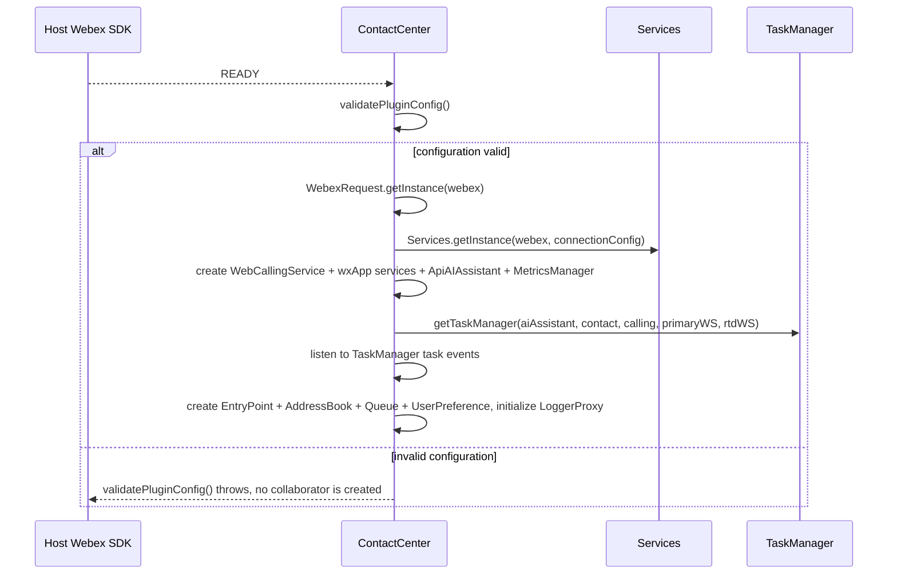
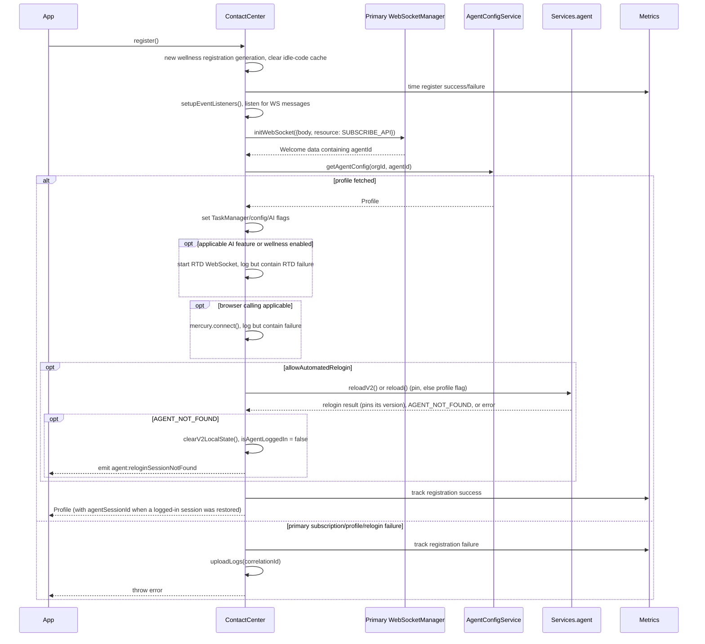
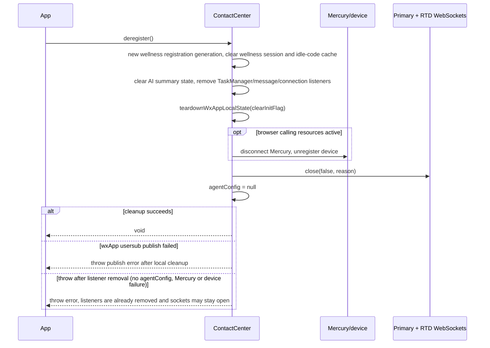
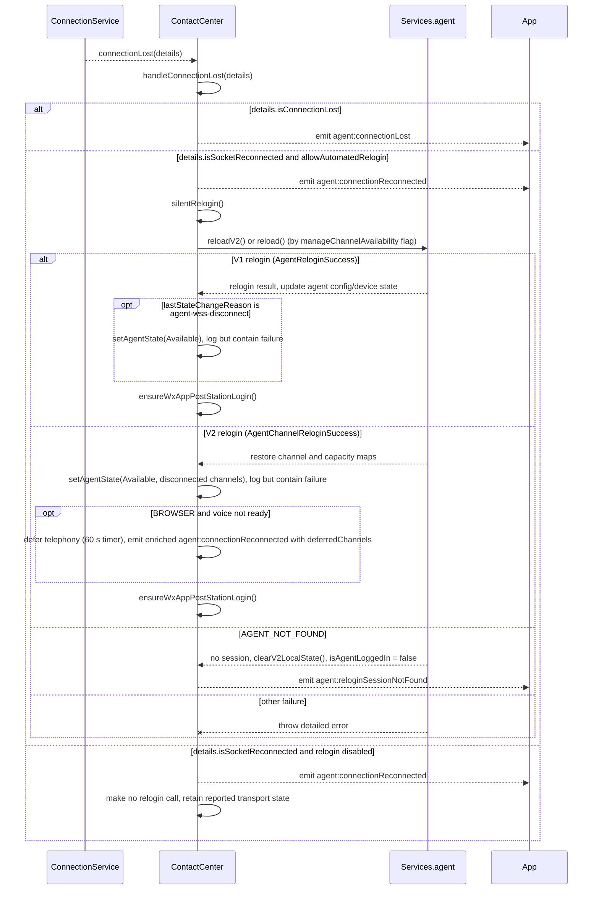
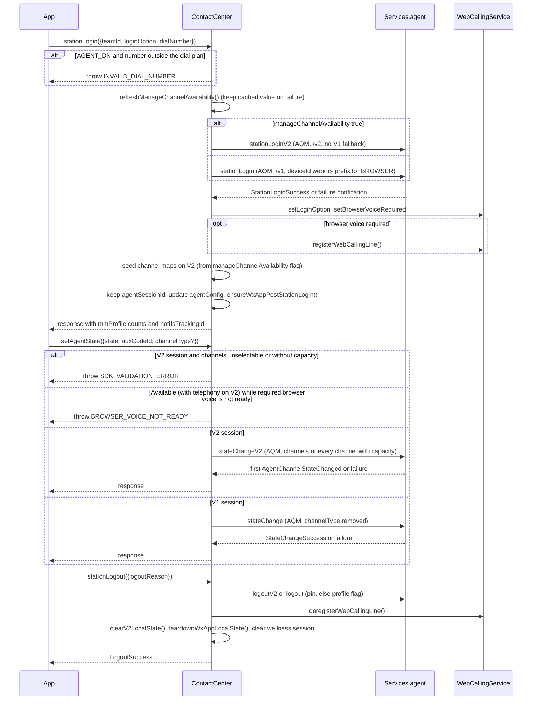
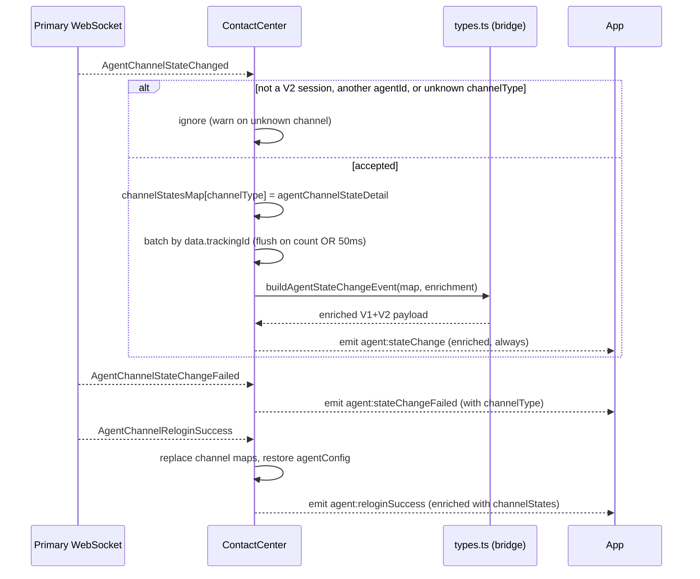
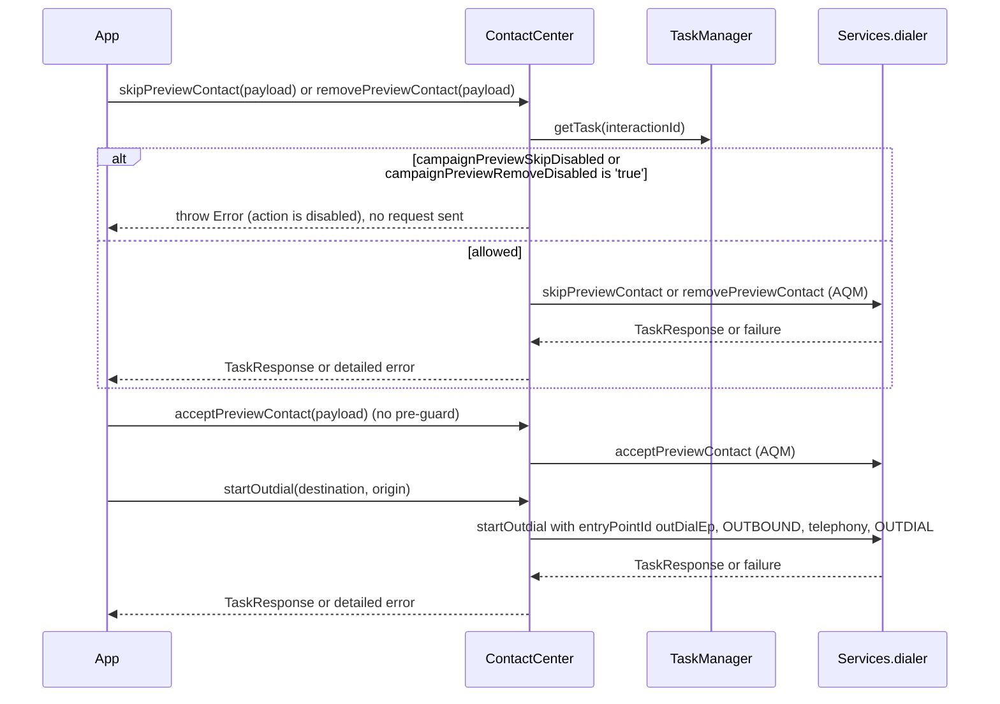
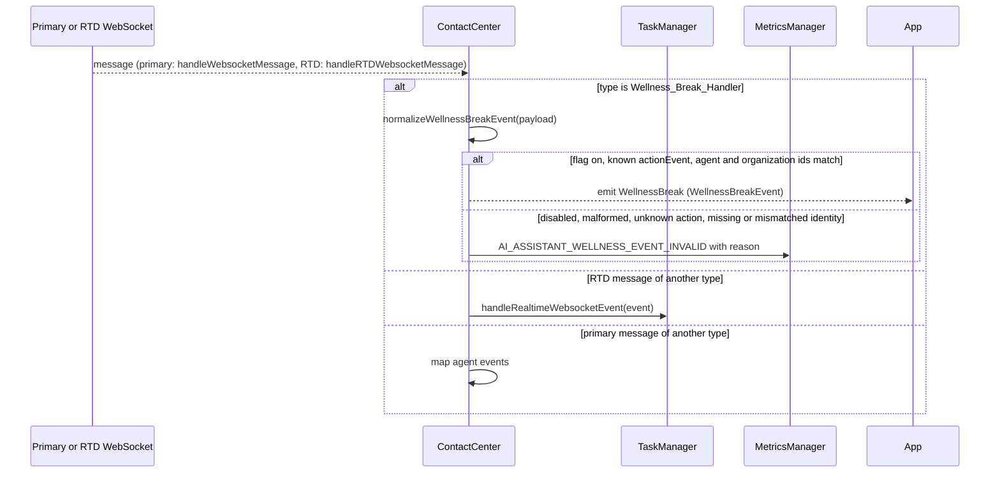
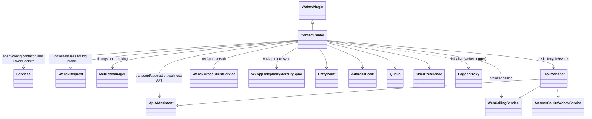
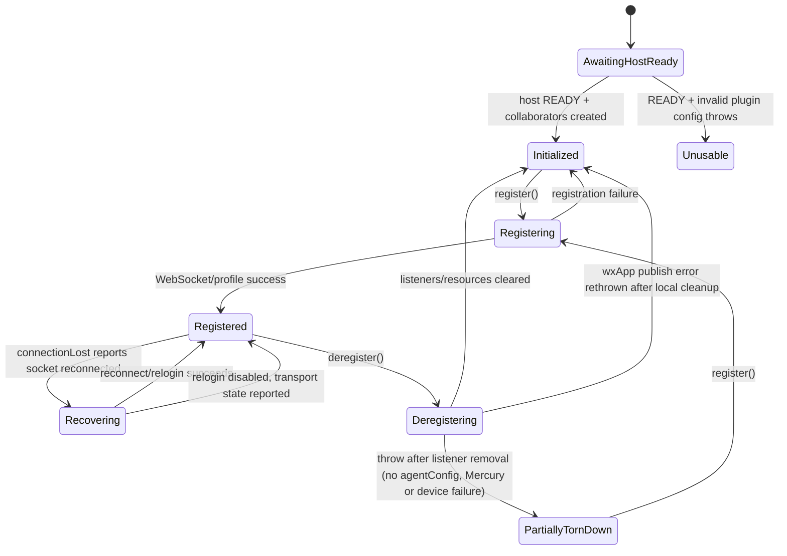

<!-- sdd-generated-metadata
doc_kind: module-spec
generated_from: module-spec@0.3.0
generated_by: claude-code
approved_by: rarajes2@cisco.com
updated_at: 2026-11-17T03:03:58Z
validation_status: pass-with-warnings
-->

# Contact Center plugin

This source-local document at `src/docs/README.md` owns the stable specification for **the Contact
Center plugin**: the `ContactCenter` WebexPlugin registered as `webex.cc`, the package entry
`src/index.ts`, the standalone `Webex` constructor in `src/webex.js`, and the package-level config,
constants, types, and logger. The transport, agent, configuration, task, and calling collaborators
belong to the [services module](../services/docs/README.md); telemetry to the
[metrics module](../metrics/docs/README.md); pagination caching to the
[utils module](../utils/docs/README.md). Ground every claim in package evidence and link to the
[package architecture](../../docs/architecture.md) instead of repeating broader facts. No service
specification exists because this package is a client library.

Related context: [documentation index](../../docs/index.md) ·
[package agent instructions](../../AGENTS.md)

## Metadata

| Field | Value |
|---|---|
| Owner | @webex/web-sdk |
| Source path | `src` |
| Resource kind | package |
| Status | Active |
| Last verified | 2026-11-16 at `0b8c34db7f` |
| Module id | `contact-center` |
| Parent spec | — |
| Doc kind | Module spec |
| Coverage score | Pending coverage assessment |
| Validation status | pass-with-warnings — assessed 2026-11-17; validator runtime 01a1e76f-2293-79a0-9f8f-f060038448dd; 0 Blocking, 0 Important, 4 Minor findings. |

## Applicability

| Condition ID | Status | Evidence or reason | Owned section |
| ------------ | ------ | ------------------ | ------------- |
| `module.has_tiers` | N/A | No tier policy exists in `package.json` or under src | Tier |
| `module.has_ui` | N/A | `src/cc.ts` renders nothing; every public method returns a promise or a value. The browser sample lives outside this package | UI use-case flow |
| `module.crosses_service_boundaries` | Applicable | `src/cc.ts` drives the Contact Center REST gateway and notification WebSockets through Services, Mercury, and the Webex device | Cross-boundary use-case flow |
| `module.holds_client_state` | Applicable | `src/cc.ts` keeps the agent profile, wellness session, idle-code cache, wxApp flags, and listener registrations in memory | Client state model |
| `module.enforces_domain_rules` | Applicable | Preview skip and remove guards, the event allow-list, the Available voice guard, and wellness identity checks in `src/cc.ts` | Business rules and invariants |
| `module.is_concurrent_async` | Applicable | `src/cc.ts` reacts to READY, WebSocket messages, TaskManager events, and ConnectionService events | Concurrency and reactive flow |
| `module.owns_persistence` | N/A | Nothing under src writes durable storage; `src/webex-config.ts` selects memory store adapters | Data, schema, and migration discipline |
| `module.stateful_transitions` | Applicable | Bootstrap, register, recovery, and deregister lifecycle in `src/cc.ts` | State machine |
| `module.exposes_wire_protocol` | Applicable | Subscribe request, Welcome event, notification envelopes, and Wellness_Break_Handler parsing in `src/cc.ts` and `src/constants.ts` | Protocol and wire format |
| `module.ui_multi_screen` | N/A | No UI | UI flow |
| `module.large_data_model` | N/A | The large payload types belong to child modules; `src/types.ts` holds request, config, and event shapes only | Data model |
| `module.returns_caller_errors` | Applicable | `src/cc.ts` rethrows detailed errors from getErrorDetails and throws local validation errors | Caller-visible failure modes |
| `module.module_specific_conventions` | Applicable | LoggerProxy context, metric timing, and error wrapping repeated by every public method of `src/cc.ts` | Module-specific rules |
| `module.published_package` | Applicable | `package.json` names @webex/contact-center and declares main, exports, types, and the deploy:npm script | Export stability |
| `module.embedded_in_host` | Applicable | `src/index.ts` registers the plugin into a host Webex SDK instance | Host integration and theming |
| `module.has_design_tradeoff` | Applicable | `src/cc.ts` is one façade over many collaborators that it builds at READY | Key design trade-off |
| `module.has_submodules` | Applicable | The metrics, services, and utils folders under src own their own specs (has_submodules computed by module_tree.py) | Sub-modules |

## Evidence register

Every requirement cites stable source and test file paths. Code and tests are the behavioral referee;
missing or contradictory evidence blocks promotion.

| Evidence | What it establishes |
| -------- | ------------------- |
| `src/cc.ts` | `ContactCenter` (namespace `cc`): READY-time construction, `register`, `deregister`, station login and logout, agent state, preview campaign, outdial, wellness, voice readiness, wxApp Better Together, WebSocket routing, and silent relogin; its JSDoc and comments are the recorded rationale. It also justifies the extension subsections under Design overview (Agent Wellness Break, wxApp Better Together) and under Data flow and sequence coverage (Bootstrap, Register, Deregister, Recovery, Station login, logout, and agent state, Preview campaign and outdial, Wellness notifications) |
| `src/index.ts` | `registerPlugin('cc', ContactCenter, {config})` and the root barrel of classes, enums, value objects, and types |
| `src/webex.js` | The npm `main`: side-effect imports of authorization, Mercury, logger, support, and `./index`; `WebexCore.extend`; `Webex.init` merge; constants attached to the constructor |
| `src/config.ts` | Registered plugin defaults under `cc` |
| `src/webex-config.ts` | Standalone constructor defaults (Hydra URL, device, memory storage) |
| `src/constants.ts` | `READY`, `WELLNESS_BREAK_HANDLER`, `DEFAULT_VOICE_CONNECTION_STATE`, `METHODS`, `AI_SUMMARY_ERROR_CODES`, outdial constants |
| `src/types.ts` | `IContactCenter`, `CCPluginConfig`, `WebexSDK`, `LoginOption`, voice connection enums, wellness value objects, `GenericError` |
| `src/logger-proxy.ts` | Static `LoggerProxy` that formats every log line with `PLUGIN_CC`, module, method, and optional ids |
| `src/services/ApiAiAssistant.ts` | Wellness action validation and the direct `/event` POST that must return 202 |
| `src/services/config/Util.ts` | The `isWellnessBreakEnabled` gate computed from the AI feature row and the organization licence count |
| `src/services/WebCallingService.ts` | Voice connection snapshot, readiness check, and reset on line deregistration |
| `package.json` | Name, `main`, `exports`, `types`, `devMain`, dependencies, and scripts |
| `jest.config.js` | 85% global branch, function, line, and statement threshold |
| `test/unit/spec/cc.ts` | ContactCenter behavior: construction, register, station login and logout, agent state, wellness contracts, buddy agents, silent relogin, outdial, queues, upload logs, deregister, WebSocket events, API properties, profile update, outdial ANI, preview campaign, and the private wxApp toggle |
| `test/unit/spec/index.ts` | TypeScript-compiler checks of the exact root export list, rejected internals, AI summary literals, and retained ITask signatures |
| `test/unit/spec/logger-proxy.ts` | LoggerProxy formatting |
| `test/unit/spec/wellnessSampleUtils.ts` | Transition helpers and surface guards of the monorepo wellness browser sample |

## Purpose and boundary

Contact Center is one of nine confirmed Contact Center SDK modules and the root of the module tree.

- Responsibility: Own the published Webex Contact Center SDK plugin surface, registration lifecycle, public method delegation, and application-facing event routing.
- In scope: the `ContactCenter` plugin and its public methods and properties; plugin registration and
  the root barrel; the standalone `Webex` constructor; plugin config validation and defaults;
  WebSocket message mapping to SDK events; wellness notification normalization; relogin policy;
  wxApp Better Together session hooks; `LoggerProxy`.
- Out of scope: request/notification correlation, sockets, and REST clients (services); task
  objects and the task state machine (services task modules); metric submission (metrics);
  page caching (utils); backend records, which remain owned by Webex Contact Center.
- Consumers: agent desktop applications and widgets through `webex.cc`, script-tag pages through the
  UMD bundle `umd/contact-center.min.js`, and the monorepo browser sample.

The `@webex/contact-center` package is a Webex SDK plugin that provides a TypeScript/JavaScript API for building Contact Center agent applications. It enables:

- **Agent Session Management**: Register, login, logout, state changes
- **Task Handling**: Inbound/outbound calls, chat, transfers, conferences
- **Real-time Events**: WebSocket-based notifications for agent and task events
- **Browser-based Calling**: WebRTC integration for browser softphone
- **Metrics & Diagnostics**: Built-in telemetry and log upload

Answer on Webex, Agent Wellness Break, and browser voice readiness are listed as Public surface rows.

## Structure and key files

| Path | Responsibility |
| ---- | -------------- |
| `src/index.ts` | Package entry: Contact Center root exports and the `registerPlugin('cc', ContactCenter, {config})` call |
| `src/cc.ts` | The `ContactCenter` WebexPlugin class: façade and lifecycle orchestration |
| `src/types.ts` | Package-level public types and value objects (`IContactCenter`, `CCPluginConfig`, `LoginOption`, voice enums, wellness value objects) |
| `src/constants.ts` | Package constants: `READY`, `WELLNESS_BREAK_HANDLER`, `METHODS`, `DEFAULT_VOICE_CONNECTION_STATE`, `AI_SUMMARY_ERROR_CODES` |
| `src/config.ts` | Registered plugin defaults: `allowMultiLogin` false, `allowAutomatedRelogin` true, `disableWebRTCRegistration` false, `enableWxBetterTogether` false, `clientType` `WebexCCSDK`, `isKeepAliveEnabled` false, `force` true, metrics client name and type |
| `src/logger-proxy.ts` | Static logger that drops messages until `initialize` and formats each line as timestamp, `PLUGIN_CC`, level, module, method, ids, data, and error |
| `src/webex.js` | npm `main` and UMD entry: `Webex` constructor, `Webex.init`, constants attached for browser samples |
| `src/webex-config.ts` | Standalone defaults: Hydra URL, ephemeral validated device, memory storage adapters |
| `src/docs/README.md` | This module specification |
| `src/services/UserPreference.ts` | User-preference CRUD implementation exposed through `cc.userPreference` (services module) |
| `src/services/task/dialer.ts` | Preview-campaign AQM request implementations (services task module) |
| `src/services/task/types.ts` | `PreviewContactPayload`, `DropConferenceParticipantPayload`, `TaskResponse`, and task contract types (services task module) |
| `package.json` | Package name, entry points, scripts, dependencies |
| `jest.config.js` | Jest configuration and the coverage threshold |
| `typedoc.json` | API reference build from `src/index.ts` |
| `umd/contact-center.min.js` | Tracked UMD build of `src/webex.js` (workspace webpack entry `contact-center`) |
| `test/unit/spec/cc.ts` | ContactCenter unit cases |
| `test/unit/spec/index.ts` | Root barrel contract cases |

The three child-module rows name files that back façade methods; their behavior is specified by the
child module that owns them (Sub-modules). dist/ is generated by `build:src` and never edited by hand.

## Sub-modules

| Sub-module | Responsibility | Specification |
| ---------- | -------------- | ------------- |
| `src/metrics` | `MetricsManager` and the metric event taxonomy used by every ContactCenter method | [metrics module spec](../metrics/docs/README.md) |
| `src/services` | Services composition root, transport core, agent, config, task, calling, wxApp, AI assistant, address book, entry point, queue, and user preference clients | [services module spec](../services/docs/README.md) |
| `src/utils` | `PageCache` and pagination defaults | [utils module spec](../utils/docs/README.md) |

## Public surface

| Contract ID | Type | Surface | Purpose | Compatibility / deprecation | Schema / detail link | Root index |
|---|---|---|---|---|---|---|
| `contact-center-sdk` | SDK / event / internal API | Published `@webex/contact-center` exports and the `ContactCenter` (`cc`) WebexPlugin API. | Stable module consumption boundary. | Additive changes by default; breaking package exports require a major-version transition. | `src/index.ts`, `package.json` | [package architecture](../../docs/architecture.md) |
| `contact-center-sdk` | SDK API / event | `getVoiceConnectionState()`, `voice:connectionStateChange`, and exported voice status/error symbols. | Let hosts observe local browser voice readiness and allow the SDK to reject only transitions into `Available` while required voice is unavailable. | Additive API/event; local login controls requirement and line deregistration on station logout resets the snapshot. | `src/cc.ts`, `src/services/WebCallingService.ts`, `src/types.ts`, `src/services/config/types.ts` | [package architecture](../../docs/architecture.md) |
| `contact-center-sdk` | SDK API / events | Granular agent state (WXCC-15791): `setAgentState({channelType?})`, `getChannelStates()`, `getAgentStateControl()`, enriched `agent:stateChange` / `agent:stateChangeFailed` / `agent:reloginSuccess` / `agent:connectionReconnected` on V2 sessions (unified surface — same events for V1 and V2), and the lifecycle events `agent:connectionLost`, `agent:connectionReconnected`, `agent:reloginSessionNotFound`. | Per-channel availability when the agent profile enables it, and refresh and reconnect signals for every session. | Additive; `channelType` is ignored on V1. A V2 login failure rejects with no V1 retry. | `src/cc.ts`, `src/types.ts`, `src/services/agent/types.ts`, `src/services/agent/utils.ts`; feature [contracts](../../ai-docs/features/WXCC-15791-user-granular-agent-state/design/contracts/) | [package architecture](../../docs/architecture.md) |
| `contact-center-sdk` | SDK data API | Existing `getQueues` and `getEntryPoints` methods, their existing search/response types, and full `ContactServiceQueue` / `EntryPointRecord` rows. | Provide consult/transfer telephony defaults without adding a parallel list API or projected destination model. | Defaults are overridable through the existing filter/sort/profile parameters; full record types remain the response contract. | `src/cc.ts`, `src/services/Queue.ts`, `src/services/EntryPoint.ts`, `src/types.ts` | [package architecture](../../docs/architecture.md) |
| `contact-center-sdk` | SDK task control API | Ordered `TaskUIControls.consultTransferDestinations` arrays using the existing destination values. | Give all Task consumers the same ordered, action-specific destination visibility without a second policy call. | Additive public field; consumers may hide SDK-allowed categories but must not enable omitted categories. | `src/cc.ts`, `src/services/task/types.ts`, `src/services/task/state-machine/uiControlsComputer.ts`, `src/index.ts` | [package architecture](../../docs/architecture.md) |
| `contact-center-sdk` | SDK data API | Exported `UserPreference`, `cc.userPreference`, and user-preference request/response types. | Read and mutate user preferences through authenticated REST operations. | Additive public API; removals or signature changes are breaking. | `src/services/UserPreference.ts`, `src/services/config/types.ts` | [package architecture](../../docs/architecture.md) |
| `contact-center-sdk` | SDK task API | `acceptPreviewContact`, `skipPreviewContact`, `removePreviewContact`. | Resolve campaign preview reservations through typed AQM operations. | Additive public API; removals or signature changes are breaking. | `src/cc.ts`, `src/services/task/dialer.ts`, `src/services/task/types.ts` | [package architecture](../../docs/architecture.md) |
| `contact-center-sdk` | SDK task API | Exported `DropConferenceParticipantPayload` and `ITask.dropConferenceParticipant`. | Remove a conference participant through the media-specific task implementation and correlated AQM completion. | Additive public API; removals or signature changes are breaking. | `src/index.ts`, `src/services/task/types.ts`, `src/services/task/voice/Voice.ts` | [package architecture](../../docs/architecture.md) |
| `contact-center-sdk` | SDK API / events | `Profile.isWellnessBreakEnabled`, `cc.apiAIAssistant.requestWellnessBreak`, `cc.apiAIAssistant.respondToWellnessBreak`, `getWellbeingBreakIdleCode`, and the wellness notification event contract. | Let hosts implement the public wellness-break lifecycle without reproducing backend payloads, routing rules, or session validation. | Additive public API; the effective gate is false unless all supported configuration inputs are affirmative. | `src/cc.ts`, `src/types.ts`, `src/services/ApiAiAssistant.ts`, `src/services/config/types.ts` | [package architecture](../../docs/architecture.md) |
| `contact-center-sdk` | SDK API / config | `enableWxBetterTogether` init flag and `isWxBetterTogetherEnabled()` (wxApp Better Together, WXCC-6026). | Let hosts opt into Webex App answer, mute, and DTMF routing at init and read the flag. | Init-only in Phase 1; the private runtime setter is not public. | `src/cc.ts`, `src/config.ts`, `src/types.ts` | [package architecture](../../docs/architecture.md) |
| `contact-center-sdk` | SDK entry | Package `main` and `exports['.']`: `dist/webex.js`, the `Webex` constructor with `Webex.init(attrs)`, the re-exported barrel, and `Webex.CC_AGENT_EVENTS`, `Webex.WELLNESS_BREAK_NOTIFICATION_ACTIONS`, `Webex.WELLNESS_BREAK_USER_ACTIONS`. | One import gives a configured SDK with `webex.cc`; the UMD build exposes the constants to script-tag pages. | Default export `Webex`; `types` points at the declarations of `src/index.ts`. | `src/webex.js`, `package.json` | [package architecture](../../docs/architecture.md) |
| `contact-center-cc-events` | Event enums | `CC_EVENTS`, `CC_AGENT_EVENTS`, `CC_TASK_EVENTS`, `VOICE_CONNECTION_EVENTS` re-exported from the root. | Name the notification types the plugin re-emits and the voice state event. | Additive values; renames are breaking. | `src/services/config/types.ts`, `src/index.ts` | [package architecture](../../docs/architecture.md) |
| `contact-center-agent-events` | Event enum and types | `AGENT_EVENTS` (also as type `AgentEvents`) and the agent request/response types re-exported from the root. | Name the agent events `cc` emits after mapping notifications. | Additive values; renames are breaking. | `src/services/agent/types.ts`, `src/index.ts` | [package architecture](../../docs/architecture.md) |
| `contact-center-task-events` | Event enum and types | `TASK_EVENTS` (also as type `TaskEvents`), `ITask`, `TaskData`, `TaskResponse`, the task payload and UI-control types, and `getDefaultUIControls`. | Name the task events `cc` and Task emit and the task payload contracts. | Additive values; renames are breaking. | `src/services/task/types.ts`, `src/index.ts` | [package architecture](../../docs/architecture.md) |

The contracts are indexed in the [package architecture](../../docs/architecture.md). The event
contracts are owned by the services modules that declare them; this module re-exports them.

## Dependencies

| Dependency | Why it is required | Failure behavior |
| ---------- | ------------------ | ---------------- |
| Webex SDK host/plugin lifecycle (`@webex/webex-core`, contract `webex-core-plugin-runtime`) | `WebexPlugin`, `registerPlugin`, `webex.request`, credentials, logger, and the `ready` event | Nothing is constructed until READY; a config validation error thrown in the READY handler leaves the plugin without collaborators |
| Contact Center REST and WebSocket backends (`wxcc-api-gateway`, `wxcc-websocket-notifications`) | Agent, task, configuration, and AI assistant operations and the notifications that settle them | Errors are rethrown as detailed errors; see Caller-visible failure modes |
| Services, TaskManager, MetricsManager, WebCallingService, UserPreference, and data-service modules | Collaborators the façade delegates to (services and metrics modules) | Their rejections propagate through `getErrorDetails` |
| `@webex/calling` (contract `webex-calling-sdk`) | Browser line registration for BROWSER login, used through WebCallingService | Line registration failure fails station login or silent relogin |
| `@webex/internal-plugin-mercury` (contract `webex-internal-mercury`) and the Webex device | Mercury for browser calling and for wxApp mute sync | A `mercury.connect()` failure during register is logged and contained; wxApp failures roll back without failing login |
| `@webex/internal-plugin-support` (contract `webex-internal-support`) | Log upload through WebexRequest | `uploadLogs()` rejects with the support error |
| `@webex/plugin-authorization`, `@webex/plugin-logger` | Loaded by `src/webex.js` for the standalone constructor | A missing install fails at import time |

## Requirements

| ID | WHAT | WHY | Source Evidence | Test / Example Evidence | Assumptions / Gaps | Confidence |
|---|---|---|---|---|---|---|
| CONTACT_CENTER-R-001 | Construct the service graph once after the host Webex SDK emits READY, before `register()` is invoked. | Collaborators require initialized host request, logger, and plugin configuration state. | `src/cc.ts` | `test/unit/spec/cc.ts` | None; the READY handler and its construction assertions were rechecked at 0b8c34db7f. | PRESENT |
| CONTACT_CENTER-R-002 | `register()` must attach connection/message listeners, connect the primary WebSocket, and return the fetched Profile or rethrow a logged failure. A failure also tracks the register-failed metric and starts a log upload correlated with the error tracking id. | Applications need an explicit readiness boundary and must never observe a synthetic successful registration. | `src/cc.ts` | `test/unit/spec/cc.ts` | The log upload is started without being awaited. | PRESENT |
| CONTACT_CENTER-R-003 | Delegate agent, task, data, user-preference, preview-campaign, AI-assistant, calling, and telemetry behavior to their owning collaborators while preserving typed package methods and events. Existing `getQueues` and `getEntryPoints` delegate to their services with unchanged signatures and full-record responses; the services own consult/transfer telephony filter, profile-view, ordering, and cache defaults while honoring explicit existing-parameter overrides. Before preview delegation, reject disabled skip/remove actions from task campaign flags. | A thin stable façade avoids parallel consumer APIs while service-owned defaults keep ordinary widget calls consistent and preserve an override path for other consumers. | `src/cc.ts`, `src/types.ts`, `src/services/Queue.ts`, `src/services/EntryPoint.ts`, `src/services/UserPreference.ts`, `src/services/task/dialer.ts` | `test/unit/spec/cc.ts`, `test/unit/spec/services/Queue.ts`, `test/unit/spec/services/EntryPoint.ts`, `test/unit/spec/services/UserPreference.ts`, `test/unit/spec/services/task/dialer.ts` | Public preview delegation is covered; the `campaignPreviewSkipDisabled` and `campaignPreviewRemoveDisabled` early-exit guards still lack direct unit coverage (the skip and remove cases cover success and failure only). | PRESENT |
| CONTACT_CENTER-R-004 | `deregister()` must remove registered listeners, stop applicable host/calling resources, close primary and RTD WebSockets, clear agent configuration, and surface cleanup failures, including a wxApp usersub publish error that it rethrows after local cleanup. | Listener or connection leaks create duplicate events and stale authenticated sessions in long-lived hosts. | `src/cc.ts` | `test/unit/spec/cc.ts` | Known defects in current code: the `TASK_MERGED` listener is not removed, and a call without agent configuration throws before the sockets close (Pitfalls and constraints). | WEAK |
| CONTACT_CENTER-R-005 | On a `connectionLost` event that reports `isSocketReconnected`, ContactCenter must own recovery policy and invoke private `silentRelogin()` only when automated relogin is allowed, after emitting `agent:connectionReconnected`; an event that reports `isConnectionLost` emits `agent:connectionLost`. | ConnectionService reports transport state; only ContactCenter has agent profile and policy context for authentication recovery, and consumers learn about transport changes only through these events. | `src/cc.ts` | `test/unit/spec/cc.ts` | `handleConnectionLost` cases cover both events and relogin gating; the `silentRelogin` cases cover reload, `AGENT_NOT_FOUND`, errors, device types, and usersub publication. | PRESENT |
| CONTACT_CENTER-R-006 | Expose Agent Wellness Break actions through `cc.apiAIAssistant` (`requestWellnessBreak`, `respondToWellnessBreak`), the lookup `cc.getWellbeingBreakIdleCode()`, and the action-value objects and types through the package exports. Derive the public action unions from those `as const` value objects. Action calls accept no identity or context-mutating API; ApiAIAssistant reads effective enablement and agent/session identity from a read-only provider supplied by ContactCenter at construction, reads the organization from the Webex credentials, and rejects when that context is incomplete. Logout, deregistration entry, a current-session multi-login close, and relogin update the provider's source state. The exact system idle-code cache and its in-flight lookup are owned by one registration generation; a newer registration or deregistration rejects a late result instead of caching it. | Wellness actions and cached configuration are registration-scoped and must not leak across agents, relogins, multi-login closures, organizations, or registrations; one public value/type source prevents wire-value drift. | `src/cc.ts`, `src/types.ts`, `src/services/ApiAiAssistant.ts`, `src/index.ts` | `test/unit/spec/cc.ts`, `test/unit/spec/services/ApiAiAssistant.ts` | The backend-delivered `agentWellbeing.enable` value is treated as the server rollout decision because no distinct rollout field exists in the supported SDK response contracts. | PRESENT |
| CONTACT_CENTER-R-007 | When wellness is effectively enabled, connect the RTD WebSocket even if transcripts and suggested responses are disabled. Route valid `Wellness_Break_Handler` messages from the primary or RTD data-notification socket to `CC_AGENT_EVENTS.WELLNESS_BREAK`. Notification eligibility is scoped to the current agent and organization and deliberately does not compare the notification-provided `agentSessionId` with the active session; outbound wellness APIs remain active-session validated. Ignore malformed or foreign-identity messages without logging the full payload. | A long-lived host needs parity with Desktop notification routing without dropping legitimate nudges whose backend session metadata differs, while actions must still be sent only for the active local session. | `src/cc.ts`, `src/constants.ts`, `src/services/config/types.ts`, `src/services/ApiAiAssistant.ts` | `test/unit/spec/cc.ts`, `test/unit/spec/services/ApiAiAssistant.ts` | Notification delivery remains best-effort; the backend owns offer generation and ordering. | PRESENT |
| CONTACT_CENTER-R-008 | The standalone constructor in `src/webex.js` exposes `CC_AGENT_EVENTS`, `WELLNESS_BREAK_NOTIFICATION_ACTIONS`, and `WELLNESS_BREAK_USER_ACTIONS` as static properties of `Webex`, so the UMD bundle gives script-tag pages, including the monorepo wellness browser sample, the same wire values as module consumers. The sample's own lifecycle is an external consumer flow (Use cases and flows), not a requirement of this module. | The `src/webex.js` comment: browser samples must use the same constants as module consumers, which avoids duplicated wire literals. | `src/webex.js`, `src/types.ts`, `src/services/config/types.ts` | `test/unit/spec/wellnessSampleUtils.ts` | The surface guard case checks the constants the sample consumes; no unit case loads `src/webex.js` itself. | PRESENT |
| CONTACT_CENTER-R-009 | Expose `getVoiceConnectionState()` and `voice:connectionStateChange` through the Contact Center package façade. Track local browser line registration separately from Mobius socket status; mark voice required only when the local BROWSER login enables WebRTC registration; preserve the socket failure reason across line keepalive events; detach all line listeners and reset the snapshot on logout. Keep the `REGISTERED` listener active for later registration recovery. Preserve browser line registration during silent relogin unless `disableWebRTCRegistration` is enabled, even when voice is not required by the profile. Clear a stale local voice requirement when a station login notification reports `EXTENSION` or `AGENT_DN`. Reject only transitions into `Available` while required browser voice is unavailable, and send the `BROWSER_VOICE_NOT_READY` validation error through the existing failure metric/log path. | Contact Center hosts need reliable local readiness signals and agents must be able to leave `Available` during outages; multi-login notifications from another SDK instance must not create or retain a false local requirement. | `src/cc.ts`, `src/services/WebCallingService.ts`, `src/types.ts`, `src/services/config/types.ts`, `src/index.ts` | `test/unit/spec/cc.ts`, `test/unit/spec/services/WebCallingService.ts` | The sample displays the current state; registration retries and socket recovery are reflected independently. | PRESENT |
| CONTACT_CENTER-R-010 | Importing the package registers `ContactCenter` as public plugin `cc` with the `src/config.ts` defaults, and `src/index.ts` exports exactly the root barrel list pinned by `test/unit/spec/index.ts`, without the AI-summary internals (`AIAssistantEventName`, `AISummaryTimeoutCodeByInboundType`, `AI_SUMMARY_DURATION_MS`, `AI_SUMMARY_REQUEST_CANCELLED`, `AI_ASSISTANT_CLIENT_TYPE`). The npm `main` is the built `src/webex.js`, which imports authorization, Mercury, logger, and support and re-exports the barrel. | Applications reach the API as `webex.cc`; the barrel test fails on any added, removed, or leaked export so the published surface changes only deliberately. | `src/index.ts`, `src/webex.js`, `src/config.ts`, `package.json` | `test/unit/spec/index.ts` | No unit case loads `src/webex.js` itself. | PRESENT |
| CONTACT_CENTER-R-011 | `enableWxBetterTogether` (default false) is an init-only flag read by `isWxBetterTogetherEnabled()`. After station login and silent relogin, ContactCenter applies the wxApp session hooks described under Design overview without failing the login, and `deregister()` clears the flag. | The private setter's JSDoc makes the init flag the Phase 1 host contract and keeps the runtime toggle internal; usersub state suppresses Webex App toasts, so a stale value must be cleared after a page refresh. | `src/cc.ts`, `src/config.ts`, `src/services/WebexCrossClientService.ts`, `src/services/WxAppTelephonyMercurySync.ts` | `test/unit/spec/cc.ts`, `test/unit/spec/services/WebexCrossClientService.ts`, `test/unit/spec/services/WxAppTelephonyMercurySync.ts` | Compatibility with `allowMultiLogin: true` is stated by the design but has no dedicated case. | PRESENT |
| CONTACT_CENTER-R-012 | At READY, ContactCenter throws `Invalid Contact Center configuration: disableWebRTCRegistration cannot be true when allowMultiLogin is false. …` when that combination is configured, before any collaborator is created. The subscribe request carries `force`, `isKeepAliveEnabled`, `clientType`, and `allowMultiLogin` from the plugin config. | The error text states the reason: an SDK instance can receive Mobius/WebRTC task events only when it registers WebRTC or allows multi-login. | `src/cc.ts`, `src/config.ts`, `src/types.ts` | `test/unit/spec/cc.ts` | `getConnectionConfig` falls back to `allowMultiLogin` true when no config is present, while the registered default is false. | PRESENT |
| CONTACT_CENTER-R-013 | Granular agent state session version (WXCC-15791):<br>- Before each `stationLogin`, re-read `manageChannelAvailability` from the user desktop-login API; keep the cached value if that fails.<br>- Log in on `/v2` when it is `true`, else `/v1`, with no fallback in either direction.<br>- All V1/V2 routing reads `manageChannelAvailability` directly with no intermediate state.<br>- `getAgentStateControl()` returns `{declared, active}`: `declared` from the current profile flag, `active` derived from whether a V2 session has populated `channelStatesMap`.<br>- `stationLogout`, `deregister()`, an `AgentLogoutSuccess` or `AgentMultiLoginCloseSession` for this session, and `AGENT_NOT_FOUND` on reload clear the channel maps and the telephony timer via `clearV2LocalState()`, which causes `active` to become `undefined`. | One routing version per session, matching wxcc-desktop; a profile change applies at next login. | `src/cc.ts` | `test/unit/spec/cc.ts` (`profile flag refresh before login`, `stationLogin` no-fallback cases, `stationLogout` routing, `getAgentStateControl`, `clearV2LocalState`, own-session logout) | No integration test against a V2 backend. | PRESENT |
| CONTACT_CENTER-R-014 | On a V2 session:<br>- `setAgentState` sends `stateChangeV2` for the requested channels, or for every selectable channel with capacity. It rejects unselectable or capacity-less channels with `SDK_VALIDATION_ERROR` before any request, and applies the browser voice check only when `telephony` is requested.<br>- `AgentChannelStateChanged` for this agent and a selectable channel replaces that channel's entry and emits an enriched `agent:stateChange` (batched by `data.trackingId`; flushed on count OR 50ms timeout). The enriched payload carries V1 base fields + V2 fields (`channelStates`, `changedChannels`, `channelDetail`, `requestTrackingId`).<br>- `getChannelStates()` returns copies, or `{}` off V2.<br>- A V2 reload restores the maps (including any non-selectable channel the server returns), requests Available for `agent-wss-disconnect` channels that are selectable and have capacity, and defers telephony on `BROWSER` without voice (60 s timer, emitted as enriched `agent:connectionReconnected` with `deferredChannels`). | Per-channel control without breaking V1 listeners; telephony needs a working line before it goes Available. | `src/cc.ts`, `src/services/agent/types.ts` | `test/unit/spec/cc.ts` (`V2 granular agent state` block), `test/unit/spec/services/agent/utils.ts` | Cross-channel ordering is not guaranteed by the backend and not asserted. | PRESENT |

## Design overview

`ContactCenter` is the package façade and lifecycle owner. Its constructor waits for the host Webex SDK `READY` event, validates plugin configuration, initializes `WebexRequest`, obtains the singleton `Services` graph, and constructs calling, wxApp (AnswerCallOnWebexService, WebexCrossClientService, WxAppTelephonyMercurySync), AI-assistant, metrics, task-management, `UserPreference`, and data-service collaborators. `register()` is deliberately narrower: it attaches runtime listeners and establishes the primary Contact Center WebSocket subscription.

Direct data/configuration and user-preference operations return authenticated REST responses. Enabled agent/task AQM operations, including preview-campaign accept/skip/remove, send authenticated HTTP requests but resolve or reject only after a matching WebSocket notification. Before delegating preview skip/remove, ContactCenter checks the task's campaign-disable flags and throws locally when the corresponding flag is `'true'`. TaskManager converts backend task events into Task instances and typed state-machine events. ContactCenter maps package-facing events through WebexPlugin `trigger` (task and voice events) or WebexPlugin `emit` (WebSocket agent events and wellness events); the private `eventEmitter` it constructs is not used.

Stack: TypeScript 5.4, WebexPlugin, Node EventEmitter, WebSocket/WebRTC integrations, Jest 27, Yarn 3.4.1.

### Agent Wellness Break

The public enablement signal is `Profile.isWellnessBreakEnabled`. It is true only when the backend-delivered AI feature row has `agentWellbeing.enable === true`, `wellnessBreakReminders === 'ENABLED'`, and the organization reports `aiAssistantQuantity > 0`. The SDK does not create a Desktop Split client or invent a rollout response field: the backend controls rollout by deciding whether the delivered AI feature configuration enables wellness for the organization.

When registration silently restores an already logged-in station, the returned `Profile.agentSessionId` projects that active session. It is absent when registration has no active session. This lets hosts recover session-scoped state after refresh without reading SDK internals or trusting a notification's session id.

Design rationale: ContactCenter, not the caller, owns wellness identity. ApiAIAssistant receives a
read-only provider instead of a setter, so a host cannot send an action for another agent or session
(CONTACT_CENTER-R-006, `INV-008`). Notification session metadata is diagnostic only, so a legitimate
nudge is not dropped when the backend's session id differs, while outbound actions still use the
active local session (CONTACT_CENTER-R-007, `INV-010`).

### wxApp Better Together (WXCC-6026)

Contract ID: `contact-center-sdk` ([package architecture](../../docs/architecture.md)). Task telephony routing, UI controls, and mute events are specified in the [task module spec](../services/task/docs/README.md). Service collaborators: [services module spec](../services/docs/README.md).

- **Init flag:** `webex.init({ cc: { enableWxBetterTogether: boolean } })` — default `false`. When `true`, ContactCenter enables wxApp telephony routing on tasks after supported station login. **Compatible with `allowMultiLogin: true`** (multiple SDK sessions may receive offers; wxApp telephony is routed per active task instance). **Phase 1 is init-only** — to change the flag after SDK init, re-init with updated config.
- **Read API:** `cc.isWxBetterTogetherEnabled()` returns the current init flag value.
- **Phase 2 (internal/private):** `setManageWebexCallingInWxcc(enabled)` remains as a private implementation for future runtime toggle; hosts must not call it in Phase 1.
- **Post-login hooks:** `ensureWxAppPostStationLogin()` runs after successful `stationLogin()` and after `silentRelogin()` on socket reconnect. A BROWSER login is skipped (with a skip metric when the flag is on). When the init flag is ON, it publishes usersub `true`, connects Mercury/device for mute sync, and backfills mute state on active tasks. Failures roll back wxApp config and release partial Mercury/device resources without failing station login. When OFF, it force-publishes usersub `false` (clears stale suppression after page refresh) and tears down wxApp Mercury resources; a failed false publish is retried (Concurrency and reactive flow).
- **Teardown:** `deregister()`, station logout, and wxApp teardown paths call `teardownWxAppLocalState()` — publish usersub `false`, unsubscribe Mercury, release CC-owned device/Mercury connections, and reset **session runtime** state (usersub active flag, Mercury subscriptions, task-manager wxApp routing) so stale session flags do not apply on relogin. The host init flag (`enableWxBetterTogether`) is **not** cleared on station logout — it persists until `deregister()` or re-init per Phase 1 contract. Local cleanup runs even when usersub publish fails; `deregister()` rethrows the publish error after its local cleanup.
- **Host telephony surface:** Hosts call unified `task.accept()`, `task.decline()`, `task.toggleMute({ muted? })`, and `task.transmitDtmf({ dtmf })`; SDK `Voice` routes wxApp legs internally when the flag is active. Shared-line `lineOwnerId` defaults from the wxApp agent participant when omitted.

Evidence: `src/cc.ts`, `src/config.ts`, `src/services/WebexCrossClientService.ts`, `src/services/WxAppTelephonyMercurySync.ts`, `test/unit/spec/cc.ts`.

### Granular agent state V2 (WXCC-15791)

Contract ID: `contact-center-sdk` ([package architecture](../../docs/architecture.md)). The feature design with every flow and failure path is [`feature-design.md`](../../ai-docs/features/WXCC-15791-user-granular-agent-state/design/feature-design.md); request builders, event constants, and the bridge are in the [agent module spec](../services/agent/docs/README.md).

- **Switch:** `Profile.manageChannelAvailability`, re-read before each `stationLogin`. There is no SDK flag or config override (CONTACT_CENTER-R-013). All V1/V2 routing decisions use `this.agentConfig?.manageChannelAvailability === true` directly.
- **State:**
  - `channelStatesMap` and `loginChannelsMap` hold per-channel state and capacity;
  - `pendingBatches` holds in-flight trackingId batches for the unified event debounce;
  - `telephonyRecoveryTimer` holds the deferred telephony recovery.
  `clearV2LocalState()` resets all of them.
- **Refresh and reconnect:** ContactCenter keeps running the automated relogin (`allowAutomatedRelogin`) and emits `agent:connectionLost`, `agent:connectionReconnected`, and `agent:reloginSessionNotFound`. Recovery policy (retries, showing login) stays with the application (CONTACT_CENTER-R-005).

Design rationale: the backend keeps a session on the version it was created with, so one pinned version avoids mixing V1 and V2 calls. The server's version wins after a refresh because the flag may have changed since the session started.

## Data flow and sequence coverage

Call style: in-process promise methods on `webex.cc`. Collaborators make authenticated HTTPS calls
through `webex.request`, and the primary and RTD WebSockets deliver notifications that settle AQM
operations and drive events.

Sequence coverage:

| Operation group | Entry and outcome | Diagram or evidence | Failure and recovery coverage |
| --------------- | ----------------- | ------------------- | ----------------------------- |
| READY-time bootstrap | Host `ready` event; collaborators built once | Bootstrap | Invalid configuration throws in the READY handler before any collaborator exists, so later readiness-dependent use fails |
| Registration | `register()`; resolves the Profile | Register | Connection/subscription failure is logged, metrics record failure, logs upload, and the error is rethrown; RTD and Mercury failures are contained |
| Deregistration | `deregister()`; resolves void | Deregister | Cleanup failure is measured, logged, and rethrown; no synthetic success; a throw after listener removal leaves a partial teardown (State machine) |
| Connection recovery | ConnectionService `connectionLost` event; session reloaded | Recovery | ContactCenter chooses silent relogin or preserves failure state; `AGENT_NOT_FOUND` clears session state and emits `agent:reloginSessionNotFound` |
| Station login, logout, and agent state | `stationLogin`, `stationLogout`, `setAgentState`, `updateAgentProfile`; resolve the AQM response; V1 or V2 chosen by `manageChannelAvailability === true` | Station login, logout, and agent state | Dial-number, browser-voice, and V2 channel validation, AQM failure or timeout (no V1 fallback for V2 login), and line registration failure reject with detailed errors |
| Granular channel events | `AgentChannelStateChanged`, `AgentChannelStateChangeFailed`, `AgentChannelReloginSuccess` notifications; emit enriched `agent:stateChange`, `agent:stateChangeFailed`, `agent:reloginSuccess` (unified surface — same events for V1 and V2) | Granular channel events | Not a V2 session, another agent, or an unknown channel is ignored; non-bridgeable aggregate produces a fallback V1 payload with `subStatus: 'Idle'` |
| Preview campaign and outdial | `acceptPreviewContact`, `skipPreviewContact`, `removePreviewContact`, `startOutdial`; resolve `TaskResponse` | Preview campaign and outdial | Disabled skip or remove throws before transport; AQM failures are tracked and rethrown |
| Wellness notifications | `Wellness_Break_Handler` on the primary or RTD socket; emits `WellnessBreak` | Wellness notifications | Invalid notifications are dropped and measured |

### Bootstrap



### Register



### Deregister



### Recovery



### Station login, logout, and agent state



Every failure branch tracks the failed metric and rethrows the `getErrorDetails` error.
`updateAgentProfile()` runs `stationLogout()` then `stationLogin()` and returns the login response
typed `AgentDeviceTypeUpdateSuccess`.

### Granular channel events



### Preview campaign and outdial



`cc.startOutdial(destination, origin)` places an outbound call from the logged-in agent:

- `destination` is the number to call (the customer DN; `DialerPayload` documents at most 36
  characters). ContactCenter does not validate or normalize it.
- `origin` is the outbound ANI (caller ID) shown to the customer, typically one of the numbers
  returned by `cc.getOutdialAniEntries({outdialANI})`. The TypeScript signature requires it, but the
  method forwards `undefined` unchanged when it is omitted, and the unit spec covers both calls.
- The method sends one AQM request through `Services.dialer.startOutdial`: a POST to `/v1/tasks/` on
  the Contact Center API gateway with body `{destination, origin, entryPointId, direction, attributes,
  mediaType, outboundType}`, where `entryPointId` is the profile's `outDialEp`, `direction` is
  `OUTBOUND`, `attributes` is `{}`, `mediaType` is `telephony`, and `outboundType` is `OUTDIAL`.
- It resolves with the `AgentOfferContact` notification (`TaskResponse`) and rejects with the
  `getErrorDetails` error when `AgentOutboundFailed` arrives or the request times out. The `Task`
  object reaches the application through the task events owned by the task module, not as this
  return value.

```typescript
const cc = webex.cc;
await cc.register();
await cc.stationLogin({teamId: 'team123', loginOption: 'BROWSER'});

// destination is the number to call; origin is the outbound ANI (caller ID)
const response = await cc.startOutdial('+14155550100', '+14155550199');
console.log(response);
```

### Wellness notifications



## Class and component relationships



`Services`, `WebexRequest`, `MetricsManager`, and `TaskManager` are obtained through their singleton
accessors; the other collaborators are constructed per plugin instance at READY.

## Use cases and flows

| Use case | Actor or caller | Primary steps and outcome | Failure or boundary behavior | Evidence |
| -------- | --------------- | ------------------------- | ---------------------------- | -------- |
| `UC-1` | Host application | Host bootstrap: after host READY, initialize the complete collaborator graph exactly once. | Invalid plugin configuration throws in the READY handler | `src/cc.ts`, `test/unit/spec/cc.ts` |
| `UC-2` | Host application | Register: attach listeners and establish the primary WebSocket subscription before returning Profile. | Failure is measured, logs upload, and the error is rethrown | `src/cc.ts`, `test/unit/spec/cc.ts` |
| `UC-3` | Host application or widget | Delegate SDK operations: validate/map public inputs, call the owning collaborator, track metrics, and return or emit typed results. | Detailed errors from `getErrorDetails` | `src/cc.ts`, `src/index.ts`, `test/unit/spec/cc.ts` |
| `UC-4` | ConnectionService | Recover connection: consume ConnectionService state and conditionally reload the agent session through ContactCenter policy. | `AGENT_NOT_FOUND` does not throw and emits `agent:reloginSessionNotFound`; other relogin errors reject in the listener | `src/cc.ts`, `test/unit/spec/cc.ts` |
| `UC-5` | Host application | Deregister: remove the same listener identities, shut down applicable host/WebSocket resources, and clear in-memory profile state. | Cleanup errors are rethrown; listener identity gaps in Pitfalls and constraints | `src/cc.ts`, `test/unit/spec/cc.ts` |
| `UC-6` | Host application and agent | Wellness lifecycle: consume an agent/org-scoped offer regardless of its notification session metadata, report a user action using the active local session, resolve the system idle code, and demonstrate legacy Idle/Available transitions. | Disabled or incomplete context rejects before transport | `src/cc.ts`, `src/services/ApiAiAssistant.ts`, `src/services/config/index.ts`, `test/unit/spec/cc.ts` |
| `UC-7` | Host application and agent | Granular agent state: log in on V2 when the profile enables it, set state per channel, read `getChannelStates()` and `getAgentStateControl()`, and keep V1 listeners working through the bridge. After refresh or reconnect, the session version comes from the server. | V2 login failure rejects with no V1 retry; invalid channels reject with `SDK_VALIDATION_ERROR` before transport; `AGENT_NOT_FOUND` clears the V2 state | `src/cc.ts`, `src/services/agent/utils.ts`, `test/unit/spec/cc.ts` |

External consumer flow, not owned by this module: the monorepo wellness browser sample (docs/samples/contact-center: app.js, wellness-utils.js, index.html) drives `UC-6`. Its helpers are pinned by `test/unit/spec/wellnessSampleUtils.ts`.

The standalone SDK browser sample keeps `WellbeingBreak` out of the ordinary status selector. It reads the exported wellness wire constants from the standalone `Webex` constructor, seeds its current session and legacy state from a logged-in registration profile after silent relogin, and shows only the action name in its latest-event display. It creates a session-scoped recovery marker before changing legacy state, clears manual-request eligibility when a break starts so the request control remains disabled after restoration until another `SUGGEST_WELLNESS_BREAK`, confirms the transition, sends `ACCEPTED` only after state success, and waits for every task to leave incoming, active, consult, conference, campaign, and wrap-up work before starting its 60-second demonstration timer. Restoration targets `Available / 0`, retries bounded failures, and retains reconnect recovery ownership after exhaustion. Authoritative external Available changes end the local lifecycle, while refresh recovery restores a matching current session without replaying the offer, response action, or break. Pure helpers own notification, response, logout, and deregistration transition decisions; a failed rejection/no-response delivery retains and re-arms its offer. If SDK deregistration completes its local teardown but reports a deferred error, the sample still detaches listeners and resets its local controls. It revokes manual-request eligibility on `WELLNESS_BREAK_NOT_ALLOWED`, and its logout cleanup ignores a different agent session.

### Cross-boundary use-case flow

| Boundary | Transport and ordering | Compatibility | Timeout, retry, and recovery |
| -------- | ---------------------- | ------------- | ---------------------------- |
| Contact Center notification WebSocket (`UC-2`, `UC-4`) | Subscribe over HTTPS, then one primary socket; messages are handled in arrival order by AqmReqs, ContactCenter, and TaskManager listeners | Notification type names mirrored in `CC_EVENTS` | ConnectionService reconnects; ContactCenter reloads the session on reconnect when allowed |
| RTD WebSocket (`UC-6`) | Started after the profile when an AI feature or wellness is enabled; not awaited by `register()` | Same subscribe body, `RTD_SUBSCRIBE_API` resource | A failure is logged and registration continues |
| Contact Center REST gateway (`UC-3`) | `webex.request` through the services clients | Owned by the backend; the package owns no route | Errors become detailed errors; no automatic retry here |
| Mercury and the Webex device (`UC-2`, wxApp) | Connected for browser voice during register and for wxApp mute sync after login | Host internal plugins | Connect failures are logged; wxApp failures roll back |
| AI assistant `/event` (`UC-6`) | Direct POST of a `CUSTOM_EVENT` | HTTP 202 required | Other statuses reject; no retry |

## Client state model

ContactCenter retains in-memory `agentConfig`, collaborator references, event listeners, task collections through TaskManager, and connection/recovery state. Remote Webex services remain authoritative for agent, task, and organization data. Registration establishes runtime connectivity but does not imply station login; deregistration tears down SDK resources but does not itself perform station logout. The package owns only in-memory profile/task/listener/cache/connection state.

| State or slice | Owner | Initial state | Transition triggers | Reset or persistence boundary |
| -------------- | ----- | ------------- | ------------------- | ----------------------------- |
| `agentConfig` (Profile) | `ContactCenter` | undefined | Set by `register()`; updated by station login, silent relogin, and login notifications | Set to null by `deregister()`; memory only |
| `currentAgentSessionId` | `ContactCenter` | undefined | Station login, relogin, and login-success notifications set it | Cleared on logout, current-session multi-login close, registration failure, each profile fetch during register, and deregister |
| `wellbeingBreakIdleCode`, `wellnessRegistrationGeneration` | `ContactCenter` | undefined, 0 | A lookup fills the cache; each `register()` and `deregister()` increments the generation | The cache is cleared on every register, profile fetch, and deregister |
| `$config.enableWxBetterTogether` | `ContactCenter` | From init config | Rolled back to false when an enabled post-login hook fails | Cleared by `deregister()` |
| wxApp ownership flags and retry timer | `ContactCenter` | false, none | Set when wxApp opened Mercury or registered the device; timer set on a failed false publish | Cleared on release and teardown |
| `channelStatesMap`, `loginChannelsMap`, `pendingBatches` | `ContactCenter` | `{}`, `{}`, empty Map | Seeded by V2 login and V2 reload; a channel entry is replaced by each accepted `AgentChannelStateChanged`; `pendingBatches` holds in-flight trackingId batches for unified event debounce | Cleared by `clearV2LocalState()`; `getChannelStates()` returns copies |
| `telephonyRecoveryTimer` | `ContactCenter` | none | Set when V2 recovery defers telephony on `BROWSER` without voice | Fires once after 60 s and requests Available only if the session is still V2, the same `agentSessionId`, and telephony is still in the `agent-wss-disconnect` idle; cleared by `clearV2LocalState()` |
| `agentConfig.manageChannelAvailability` | `ContactCenter` | From the profile | Re-read by `refreshManageChannelAvailability()` before each `stationLogin` | Cached value kept when the re-read fails |
| Voice connection snapshot | `WebCallingService` | `DEFAULT_VOICE_CONNECTION_STATE` (`not-required`) | Line and Mobius socket events | Reset on line deregistration at station logout; `getVoiceConnectionState()` returns the default when no service exists |

## Business rules and invariants

| ID | Invariant | WHY | Enforcement source | Test evidence |
| -- | --------- | --- | ------------------ | ------------- |
| `INV-001` | Collaborators are initialized after host READY and before their use; `register()` must not be documented as their constructor boundary. | Collaborators need the host request, logger, and configuration that exist only after READY (CONTACT_CENTER-R-001). | `src/cc.ts` | `test/unit/spec/cc.ts` |
| `INV-002` | AQM promises complete only from correlated WebSocket success/failure or timeout, not from HTTP acknowledgement. | The HTTP response only acknowledges the request; the backend reports the outcome on the socket. | `src/services/core/aqm-reqs.ts` | `test/unit/spec/services/core/aqm-reqs.ts` |
| `INV-003` | `skipPreviewContact` checks `campaignPreviewSkipDisabled` and `removePreviewContact` checks `campaignPreviewRemoveDisabled` on the matching task. When the applicable value is `'true'`, ContactCenter throws before initiating an HTTP or WebSocket-correlated AQM operation; `acceptPreviewContact` has no equivalent pre-guard. | The campaign disables those actions for the reservation; a local throw avoids a request the backend would reject. | `src/cc.ts` | None found (CONTACT_CENTER-R-003 gap) |
| `INV-004` | `handleWebsocketMessage` only re-emits event names that belong to the typed `CC_EVENTS` allow-list (the values of `CC_AGENT_EVENTS` and `CC_TASK_EVENTS`); an untrusted `eventData.data.type` outside that allow-list is not emitted as an event name. Mapped `AGENT_EVENTS` names come only from fixed switch cases. | The comment on `CC_EVENT_ALLOW_LIST`: guard against emitting an arbitrary event name supplied by the socket payload. | `src/cc.ts` | `test/unit/spec/cc.ts` |
| `INV-005` | ContactCenter owns automated relogin policy; ConnectionService owns transport-state detection/emission. | Only ContactCenter has the profile and config needed to relogin (CONTACT_CENTER-R-005). | `src/cc.ts`, `src/services/core/websocket/connection-service.ts` | `test/unit/spec/cc.ts` |
| `INV-006` | Deregistration does not station-logout the agent. | Deregistration tears down SDK resources; the agent session stays on the backend for relogin. | `src/cc.ts` | `test/unit/spec/cc.ts` |
| `INV-007` | Published methods/types/events remain semver-sensitive through `src/index.ts`. | The barrel is the published declaration surface. | `src/index.ts`, `package.json` | `test/unit/spec/index.ts` |
| `INV-008` | Wellness actions take no public identity or context-mutating input and require the effective profile flag plus non-empty organization (from the Webex credentials), registered-agent, and current-session context (from the internal live provider); all checks fail closed after current-session logout, multi-login close, or deregistration. | CONTACT_CENTER-R-006 | `src/cc.ts`, `src/services/ApiAiAssistant.ts` | `test/unit/spec/services/ApiAiAssistant.ts`, `test/unit/spec/cc.ts` |
| `INV-009` | Wellness action unions derive from exported `as const` value objects; backend message-type and enablement sentinels use internal constants rather than duplicated literals. | One public value source prevents wire-value drift (CONTACT_CENTER-R-006). | `src/types.ts`, `src/constants.ts`, `src/services/config/constants.ts` | `test/unit/spec/cc.ts` |
| `INV-010` | Malformed, unknown-action, stale-agent, and stale-org wellness notifications are ignored and measured without logging the full payload. A different notification `agentSessionId` is retained as diagnostic metadata and does not make an otherwise valid current-agent/current-org wellness event stale. | CONTACT_CENTER-R-007 | `src/cc.ts` | `test/unit/spec/cc.ts` |
| `INV-011` | `setAgentState` rejects a transition into `Available` with `BROWSER_VOICE_NOT_READY` only while browser voice is required and not ready; other states are never blocked. On a V2 session the check applies only when `telephony` is among the requested channels. | Agents must be able to leave `Available` during outages (CONTACT_CENTER-R-009), and digital channels do not need the voice line. | `src/cc.ts`, `src/services/WebCallingService.ts` | `test/unit/spec/cc.ts` |
| `INV-012` | One session uses one API version. Once pinned, `setAgentState`, `stationLogout`, and the reload never switch versions mid-session; a V2 login failure never retries on V1; the server's reload response type overrides the pin. | The backend keeps a session on the version it was created with (CONTACT_CENTER-R-013). | `src/cc.ts` | `test/unit/spec/cc.ts` |
| `INV-013` | `AgentChannelStateChanged` changes local state only on a V2 session, for this `agentId`, and for a selectable channel (`telephony`, `chat`, `email`, `social`). The bridge emits V1 events only when the projected state or idle code changes. | Other agents' events or unknown channels must not corrupt state; V1 listeners must not see duplicates (CONTACT_CENTER-R-014). | `src/cc.ts`, `src/services/agent/utils.ts` | `test/unit/spec/cc.ts`, `test/unit/spec/services/agent/utils.ts` |

## Concurrency and reactive flow

READY initialization, REST promises, AQM WebSocket correlation, TaskManager events, calling events, and connection timers execute asynchronously. Listener cleanup must use the registered function identity. Message listeners are independent: AqmReqs correlates pending requests, ContactCenter maps package events, TaskManager owns task lifecycle, and ConnectionService tracks liveness/reconnect state.

- Execution model: one JavaScript event loop; public methods are `async` except `getVoiceConnectionState()`, `isWxBetterTogetherEnabled()`, `getChannelStates()`, and `getAgentStateControl()`.
- Ordering guarantees: within `register()`, the profile is fetched before RTD start, Mercury connect, and silent relogin; the RTD socket start is not awaited. Within a WebSocket message, wellness handling runs before agent event mapping.
- Idempotency and retry: no public method retries. A failed wxApp usersub false publish (flag-off post-login hook or teardown) is retried up to three times, 30 seconds apart. A repeated `register()` attaches another `connectionLost` listener (Pitfalls and constraints).
- Shared-state protection: the wellness registration generation and the captured organization reject a stale idle-code lookup; there is no lock.
- Blocking restrictions: socket message handlers are synchronous; `handleConnectionLost` awaits `silentRelogin()`, and a rejection there has no caller.

## State machine



- Guards: `allowAutomatedRelogin` decides the relogin; `isSocketReconnected` decides whether a
  `connectionLost` event triggers recovery.
- Station login is a separate backend state; registration neither logs in nor logs out.
- PartiallyTornDown: TaskManager, message, and connection listeners are removed (except the two
  identity defects in Pitfalls and constraints) and wxApp state is torn down, but the sockets may stay
  open and `agentConfig` may remain set. A later `register()` attaches the listeners again.
- No terminal state except Unusable; register and deregister can repeat on one instance.

## Protocol and wire format

Authenticated REST initiates direct data/config operations and AQM agent/task operations. For AQM, the HTTP response is acknowledgement only; `notifSuccess.bind`/`notifFail.bind` match WebSocket payloads that settle the promise. Wellness actions are the exception: ApiAIAssistant posts a direct `CUSTOM_EVENT` to `/event` and requires HTTP 202. The primary and RTD WebSockets can carry `Wellness_Break_Handler`; ContactCenter routes it before task-specific traffic. Payload and event names are owned by `src/types.ts`, `src/services/config/types.ts`, `src/services/agent/types.ts`, and `src/services/task/types.ts`.

| Message or frame | Version | Producer or serializer | Consumer or parser | Compatibility and ordering rule |
| ---------------- | ------- | ---------------------- | ------------------ | ------------------------------- |
| Subscribe request `{force, isKeepAliveEnabled, clientType, allowMultiLogin}` | — | `getConnectionConfig` in `src/cc.ts` | Contact Center subscribe endpoint (`SUBSCRIBE_API`, `RTD_SUBSCRIBE_API`) | Defaults from `src/config.ts` |
| Welcome event with `agentId` | — | Contact Center backend | `connectWebsocket` in `src/cc.ts` | First message after subscribe; `agentId` keys the profile fetch |
| Notification envelope `{type, data: {type, ...}, keepalive, trackingId}` | — | Contact Center backend | `handleWebsocketMessage` in `src/cc.ts` | Keepalives are not re-emitted; `data.type` is re-emitted only from the allow-list (`INV-004`) |
| `Wellness_Break_Handler` notification | — | Contact Center backend (primary or RTD socket) | `normalizeWellnessBreakEvent` in `src/cc.ts` | Requires matching `notifType`, a known `actionEvent`, and agent and three organization ids equal to the current ones |
| `WellnessBreakEvent` `{agentId, orgId, agentSessionId, actionEvent, actionText?, interactionId?, trackingId?}` | — | `src/cc.ts` | Applications listening for `WellnessBreak` | Optional fields appear only when present as strings |

## Caller-visible failure modes

| Condition | Signal or result | Caller behavior | Retry or recovery | Evidence |
| --------- | ---------------- | --------------- | ----------------- | -------- |
| Invalid plugin configuration at READY | `Error` `Invalid Contact Center configuration: …` thrown in the READY handler | Fix the config (allow multi-login or WebRTC registration) | Re-init; no collaborator exists | `src/cc.ts`, `test/unit/spec/cc.ts` |
| An AQM operation gets no correlated notification before its timeout | AqmReqs rejects `Service.aqm.reqs.Timeout`; the façade logs, uploads logs, and rethrows `Error` with the backend reason or `Error while performing` plus the method name | Treat the outcome as unknown and wait for the next agent or task notification | Retry only operations that are safe to repeat | `src/services/core/aqm-reqs.ts`, `src/services/core/Utils.ts` |
| The same AQM request is already pending | `Service.aqm.reqs.Pending` | Wait for the first request to settle | Retry after it settles | `src/services/core/aqm-reqs.ts` |
| Backend failure notification or REST error | `Error` whose message is `details.data.reason`; station login also sets `data.message` and `data.fieldName` | Show the reason; read the tracking id from the log | Caller decides | `src/services/core/Utils.ts`, `src/cc.ts` |
| AGENT_DN login with a number outside the dial plan | `INVALID_DIAL_NUMBER`, wrapped by `getErrorDetails` | Correct the dial number | Retry the login | `src/cc.ts`, `test/unit/spec/cc.ts` |
| `setAgentState` to `Available` while required browser voice is not ready | `BROWSER_VOICE_NOT_READY` with `details.type` `SDK_VALIDATION_ERROR` | Wait for `voice:connectionStateChange` to report ready | Retry after ready | `src/cc.ts`, `test/unit/spec/cc.ts` |
| V2 `setAgentState` with an unselectable channel or a channel without capacity | `SDK_VALIDATION_ERROR` thrown before any request | Pick a channel from `getChannelStates()` | Retry with a valid channel | `src/cc.ts`, `test/unit/spec/cc.ts` |
| V2 station login fails or times out | The `stationLoginV2` error rethrown through `getErrorDetails`; no V1 attempt and no pin | Show the reason | Retry the login; the flag is re-read first | `src/cc.ts`, `test/unit/spec/cc.ts` |
| V2 state change fails | The `stateChangeV2` error rethrown; a later per-channel failure arrives as enriched `agent:stateChangeFailed` with `channelType` | Show the reason for that channel | Caller decides | `src/cc.ts`, `test/unit/spec/cc.ts` |
| Wellness lookup while disabled, or after the registration or organization changed | `WELLNESS_BREAK_NOT_ENABLED` or `WELLNESS_BREAK_REGISTRATION_CHANGED` (`SDK_VALIDATION_ERROR`) | Re-read the profile | Retry after the new registration | `src/cc.ts`, `test/unit/spec/cc.ts` |
| Preview skip or remove disabled by the campaign | Plain `Error` `Skip action is disabled …` or `Remove action is disabled …`, not wrapped | Hide the action | None | `src/cc.ts` |
| `getOutdialAniEntries` with no organization id | Plain `Error('Org ID not found.')` | Authorize the host SDK first | Retry after authorization | `src/cc.ts`, `test/unit/spec/cc.ts` |
| Silent relogin reports an unsupported device type | `Unsupported device type: …`, wrapped; `AGENT_NOT_FOUND` does not throw, clears the V2 state, sets `isAgentLoggedIn` false, and emits `agent:reloginSessionNotFound` | Station login again | None automatic | `src/cc.ts`, `test/unit/spec/cc.ts` |
| `register()`, `deregister()`, or `updateAgentProfile()` fails | The original error rethrown after logging and metrics | Inspect the error | Call again; a failed `deregister()` may leave a partial teardown (State machine) | `src/cc.ts`, `test/unit/spec/cc.ts` |

## Pitfalls and constraints

- READY-time construction and `register()` are different lifecycle boundaries; moving collaborator creation into `register()` can duplicate listeners and use uninitialized host services.
- Listener cleanup must use the same bound function identities registered during setup or repeated register/deregister cycles will leak handlers. `handleConnectionLost` is an arrow-function property, so `setupEventListeners()` and `deregister()` use the same reference, and the tests assert that identity. Known defect in current code: `deregister()` never removes the `TASK_MERGED` TaskManager listener.
- `deregister()` reads `agentConfig.webRtcEnabled` without a guard, so a call with no agent configuration (registration never succeeded, or a second deregister) throws a TypeError after listener removal and wxApp teardown but before the sockets close.
- `types` resolves to the declarations of `src/index.ts`, whose default export is `ContactCenter`, while `main` loads the built `src/webex.js`, whose default export is the `Webex` constructor; the named exports agree because `src/webex.js` re-exports the barrel.
- The `startOutdial` JSDoc in `src/cc.ts` lists errors (agent not configured for outbound, invalid E.164 number, agent not Available) and an example that calls `task.on` on the result; the method performs none of those checks and resolves with the offer notification, not a `Task`.
- `IContactCenter` in `src/types.ts` declares only `register`, `getWellbeingBreakIdleCode`, and `getVoiceConnectionState`; the rest of the public API, including `getChannelStates()` and `getAgentStateControl()`, is declared by the class alone.
- Granular agent state has no SDK flag or config override; `Profile.manageChannelAvailability` alone selects V2 at login.
- `getEntryPoints` and `getQueues` are façade wrappers; `entryPoint` is private while `addressBook`, `queue`, `userPreference`, and `apiAIAssistant` are public properties.

## Module-specific rules

- Do: log through `LoggerProxy` with `module: CC_FILE` and a `METHODS` name, and never log a full notification payload.
- Do: in each public operation, `timeEvent` the success and failure metrics first, then `trackEvent` exactly one of them, and rethrow the `getErrorDetails` error.
- Do: add or remove a root export in `src/index.ts` and in the expected list of `test/unit/spec/index.ts` in the same change.
- DO route agent recovery decisions through ContactCenter because it owns profile/config policy.
- DON'T synthesize successful register/deregister results after a dependency or cleanup failure.
- DON'T let transport services call `silentRelogin()` directly.

## Export stability

The npm export/type-declaration surface is semver-sensitive. Additive optional types are compatible; removals, renames, or semantic changes require a major-version migration.

Compatibility notes:

- Do not remove or reinterpret exported symbols/events without a documented consumer migration.

| Export or entry point | Consumer | Stability | Versioning and deprecation rule | Declaration or API report |
| --------------------- | -------- | --------- | ------------------------------- | ------------------------- |
| `main` and `exports['.']` (`dist/webex.js`): default `Webex` and the re-exported barrel | Applications | Public | Workspace release process; breaking changes need a major version | `package.json`, `src/webex.js` |
| `types` (`dist/types/index.d.ts`): the root barrel of `src/index.ts` | TypeScript consumers | Public, pinned by the barrel test | Same | `package.json`, `src/index.ts` |
| Public plugin `cc` and its methods and properties | Applications | Public | Same | `src/cc.ts`, `src/index.ts` |
| `exports['./package']` | Tooling | Public | Same | `package.json` |
| `umd/contact-center.min.js` | Script-tag pages | Public | Rebuilt by the workspace webpack entry | `src/webex.js` |

`yarn workspace @webex/contact-center build` writes the declarations to dist/types; `yarn workspace @webex/contact-center build:docs` publishes the typedoc API
reference. No API report exists.

## Host integration and theming

The module registers as `cc` through the Webex SDK plugin system and depends on host-provided Webex credentials, configuration, request routing, and lifecycle events. It renders no UI and defines no theme contract.

- Mount or entry contract: `registerPlugin('cc', ContactCenter, {config})` on import; reached as `webex.cc`.
- Required providers, peers, or host versions: an authorized host with `credentials.getOrgId()`, `request`, `logger`, `internal.mercury`, `internal.device`, and `internal.support`; Node 20 or later per `package.json` engines.
- Theme and design-token contract: none.
- Accessibility and lifecycle obligations: call `register()` after READY and `deregister()` at teardown.

## Key design trade-off

| Chosen trade-off | Preserved invariant or benefit | Cost or limitation | Decision evidence |
| ---------------- | ------------------------------ | ------------------ | ----------------- |
| A single plugin surface centralizes compatibility and event routing, while specialized modules retain implementation ownership | One typed consumption boundary and one place for relogin policy | This costs careful bootstrap and cleanup ordering | `src/cc.ts` |
| Singleton `Services`, `WebexRequest`, `MetricsManager`, and `TaskManager` | Every collaborator shares one socket set and one task registry | Two plugin instances in one process share them | `src/cc.ts`, `src/services/index.ts` |

## Verification

`test/unit/spec/cc.ts` is the characterization baseline. Cover READY-time construction, registration success/failure, listener identity, existing queue/entry-point method delegation, WebSocket event mapping, preview-campaign operations (including disabled skip/remove pre-guards, which still need cases), automated-relogin enabled/disabled branches, browser-calling conditions, and deregistration cleanup/error paths. Use Queue and EntryPoint service tests for default policy and explicit existing-parameter overrides, `test/unit/spec/services/UserPreference.ts` for user-preference CRUD, and `test/unit/spec/services/task/dialer.ts` for preview AQM request contracts. Preserve the package-wide 85% branch/function/line/statement threshold.

All rows are unit level (Jest through `yarn workspace @webex/contact-center test:unit`).

| Requirement or invariant | Test level | Positive evidence | Negative or boundary evidence | Gap |
| ------------------------ | ---------- | ----------------- | ----------------------------- | --- |
| CONTACT_CENTER-R-001, `INV-001` | Unit | `test/unit/spec/cc.ts` | `test/unit/spec/cc.ts` | READY-time ownership and initialization order are asserted; none |
| CONTACT_CENTER-R-002 | Unit | `test/unit/spec/cc.ts` | `test/unit/spec/cc.ts` | register success/failure and log-upload path are covered; none |
| CONTACT_CENTER-R-003, `INV-003` | Unit | `test/unit/spec/cc.ts`, `test/unit/spec/services/UserPreference.ts`, `test/unit/spec/services/task/dialer.ts`, `test/unit/spec/services/Queue.ts`, `test/unit/spec/services/EntryPoint.ts` | `test/unit/spec/cc.ts` | Add direct tests proving disabled skip/remove flags throw before dialer invocation |
| CONTACT_CENTER-R-004 | Unit | `test/unit/spec/cc.ts` | `test/unit/spec/cc.ts` | listener/resource cleanup, the `connectionLost` identity, and V2 state clearing are covered; the `TASK_MERGED` listener is not removed, and no case deregisters without agent configuration |
| CONTACT_CENTER-R-005, `INV-005` | Unit | `test/unit/spec/cc.ts` | `test/unit/spec/cc.ts` | none (`handleConnectionLost` cases cover both events and the relogin gate) |
| CONTACT_CENTER-R-006, `INV-008`, `INV-009` | Unit | `test/unit/spec/cc.ts`, `test/unit/spec/services/ApiAiAssistant.ts` | `test/unit/spec/cc.ts`, `test/unit/spec/services/ApiAiAssistant.ts` | Effective-gate and organization/agent/session validation, current-session multi-login invalidation, registration-generation idle-code cache ownership, identity-free public input, exact request body, action validation, and direct-HTTP failure paths are covered; none |
| CONTACT_CENTER-R-007, `INV-010` | Unit | `test/unit/spec/cc.ts` | `test/unit/spec/cc.ts`, `test/unit/spec/services/ApiAiAssistant.ts` | Wellness normalization on primary and RTD notification sockets, notification-session mismatch acceptance, invalid agent/org filtering, and active-session outbound validation are covered; none |
| CONTACT_CENTER-R-008 | Unit | `test/unit/spec/wellnessSampleUtils.ts` | `test/unit/spec/wellnessSampleUtils.ts` | Standalone browser constant exposure is checked through the sample surface guard; `src/webex.js` is not loaded by a unit case |
| CONTACT_CENTER-R-009, `INV-011` | Unit | `test/unit/spec/cc.ts`, `test/unit/spec/services/WebCallingService.ts` | `test/unit/spec/cc.ts` | none |
| CONTACT_CENTER-R-010, `INV-007` | Unit (TypeScript compiler) | `test/unit/spec/index.ts` | `test/unit/spec/index.ts` | no case loads `src/webex.js` |
| CONTACT_CENTER-R-011 | Unit | `test/unit/spec/cc.ts`, `test/unit/spec/services/WebexCrossClientService.ts` | `test/unit/spec/cc.ts` | no case for `allowMultiLogin: true` with the flag on |
| CONTACT_CENTER-R-012 | Unit | `test/unit/spec/cc.ts` | `test/unit/spec/cc.ts` | none |
| CONTACT_CENTER-R-013, `INV-012` | Unit | `test/unit/spec/cc.ts`, `test/unit/spec/services/agent/index.ts`, `test/unit/spec/services/config/Util.ts` | `test/unit/spec/cc.ts` (V2 login failure with no fallback, flag re-read failure, server-wins pin) | no integration or E2E test against a V2 backend |
| CONTACT_CENTER-R-014, `INV-013` | Unit | `test/unit/spec/cc.ts`, `test/unit/spec/services/agent/utils.ts` | `test/unit/spec/cc.ts` (other agent, unknown channel, invalid channel, voice not ready, deferred telephony timeout) | cross-channel event ordering is not asserted |
| `INV-002` | Unit | `test/unit/spec/services/core/aqm-reqs.ts` | `test/unit/spec/services/core/aqm-reqs.ts` | owned by the services core module |
| `INV-004` | Unit | `test/unit/spec/cc.ts` | `test/unit/spec/cc.ts` | none |
| `INV-006` | Unit | `test/unit/spec/cc.ts` | None found | no case asserts that deregister sends no logout |

Record coverage gaps explicitly: the preview guards, the `TASK_MERGED` listener-identity
defect, and the unguarded second `deregister()` have no unit case; granular agent state
(CONTACT_CENTER-R-013, CONTACT_CENTER-R-014) has unit coverage only. A module specification is
complete only when its public surface, invariants, failure modes, and test evidence agree with the
implementation. Coverage measurement remains pending; independent validation on 2026-11-17 passed with warnings (0 Blocking, 0 Important, 4 Minor). No coverage promotion was performed.
