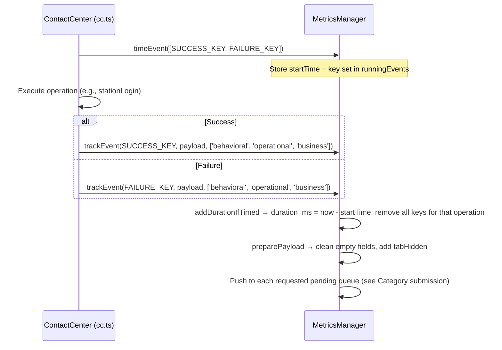
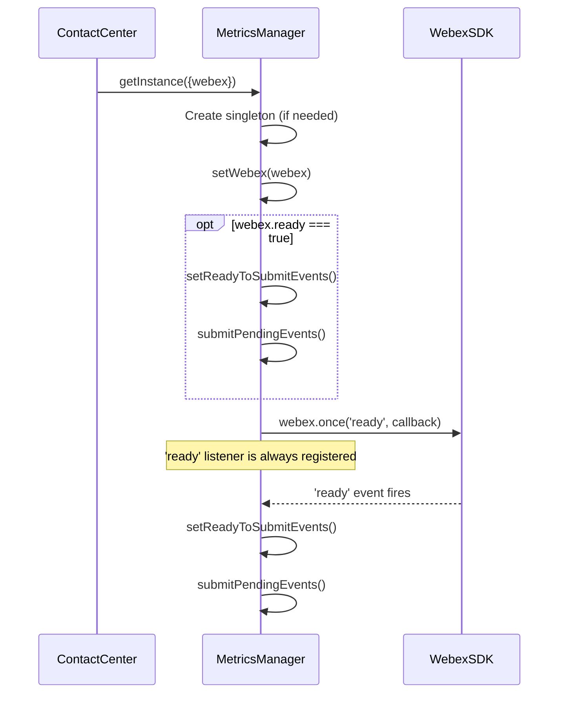
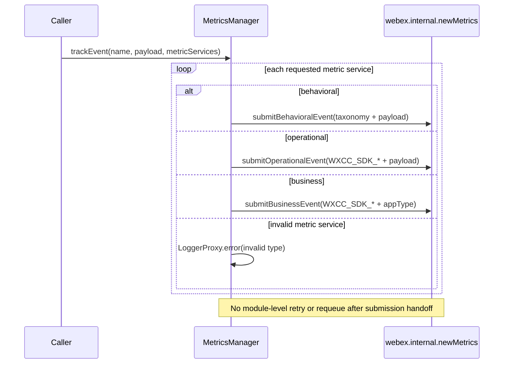
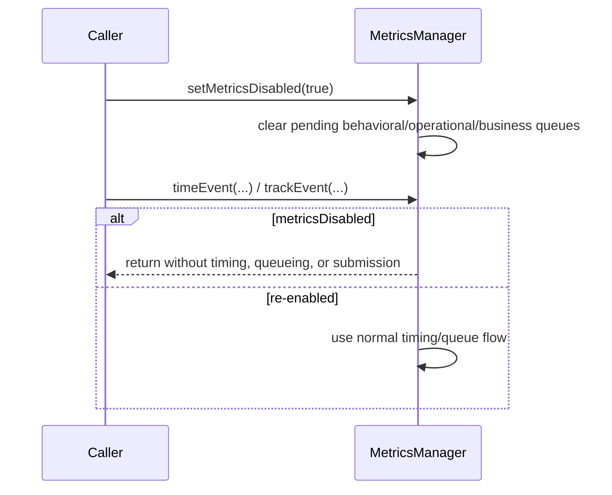
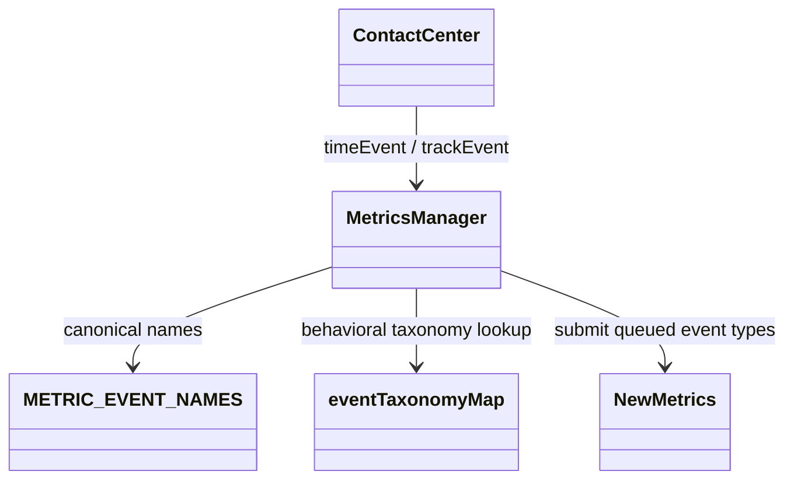
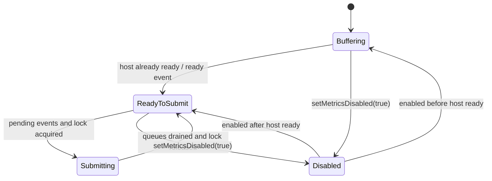

<!-- sdd-generated-metadata
doc_kind: module-spec
generated_from: module-spec@0.3.0
generated_by: claude-code
approved_by: rarajes2@cisco.com
updated_at: 2026-11-17T03:03:58Z
validation_status: pass-with-warnings
-->

# Metrics

This source-local document at `src/metrics/docs/README.md` owns the stable specification for
**the Contact Center metrics module**: the `MetricsManager` singleton, the `METRIC_EVENT_NAMES`
catalog, and the behavioral event taxonomy that every other Contact Center module uses to report
telemetry through `webex.internal.newMetrics`. Ground every claim in repository evidence and link to
the [package architecture](../../../docs/architecture.md) instead of repeating broader facts. No
service specification exists because this package is a library. The parent specification is the
[`src` package spec](../../docs/README.md).

Related context: [documentation index](../../../docs/index.md) ·
[package agent instructions](../../../AGENTS.md)

## Metadata

| Field | Value |
|---|---|
| Owner | @webex/web-sdk |
| Source path | `src/metrics` |
| Resource kind | module |
| Status | Active |
| Last verified | 2026-11-16 at `0b8c34db7f` |
| Module id | `metrics` |
| Parent spec | [src/docs/README.md](../../docs/README.md) |
| Doc kind | Module spec |
| Coverage score | Pending coverage assessment |
| Validation status | pass-with-warnings — assessed 2026-11-17; validator runtime 01a1e76f-2293-79a0-9f8f-f060038448dd; 0 Blocking, 0 Important, 4 Minor findings. |

## Applicability

| Condition ID | Status | Evidence or reason | Owned section |
| --- | --- | --- | --- |
| `module.has_tiers` | N/A | No tier policy exists in `package.json` or the manifest profile | Tier |
| `module.has_ui` | N/A | `src/metrics/MetricsManager.ts` renders nothing; it only queues and submits telemetry | UI use-case flow |
| `module.crosses_service_boundaries` | Applicable | `src/metrics/MetricsManager.ts` hands every event to the host webex.internal.newMetrics client, which sends it to the Webex metrics backend | Cross-boundary use-case flow |
| `module.holds_client_state` | Applicable | `src/metrics/MetricsManager.ts` keeps the singleton, three pending queues, running timers, and the ready, lock, and disabled flags in memory | Client state model |
| `module.enforces_domain_rules` | Applicable | Name and taxonomy rules in `src/metrics/constants.ts` and `src/metrics/behavioral-events.ts`; the disabled and readiness guards in `src/metrics/MetricsManager.ts` | Business rules and invariants |
| `module.is_concurrent_async` | Applicable | `src/metrics/MetricsManager.ts` defers submission until the host ready event and drains queues from async methods behind a lock | Concurrency and reactive flow |
| `module.owns_persistence` | N/A | Nothing in `src/metrics/MetricsManager.ts` writes storage; queues live in memory only | Data, schema, and migration discipline |
| `module.stateful_transitions` | Applicable | `src/metrics/MetricsManager.ts` moves between buffering, ready, submitting, and disabled through setWebex, the ready event, submitPendingEvents, and setMetricsDisabled | State machine |
| `module.exposes_wire_protocol` | N/A | The wire format to the metrics backend belongs to @webex/internal-plugin-metrics; this module only builds names and payload objects | Protocol and wire format |
| `module.ui_multi_screen` | N/A | No UI | UI flow |
| `module.large_data_model` | N/A | The only types are the taxonomy and queue entry shapes in `src/metrics/behavioral-events.ts` and `src/metrics/MetricsManager.ts` | Data model |
| `module.returns_caller_errors` | N/A | No method in `src/metrics/MetricsManager.ts` throws to its caller; invalid input is logged and ignored | Caller-visible failure modes |
| `module.module_specific_conventions` | Applicable | The timer-pairing, category-submitter, and taxonomy rules every caller of `src/metrics/MetricsManager.ts` follows | Module-specific rules |
| `module.published_package` | N/A | `src/index.ts` does not export the metrics module; the manifest records contract contact-center-metrics as internal | Export stability |
| `module.embedded_in_host` | N/A | No host mount, theme, or embed API | Host integration and theming |
| `module.has_design_tradeoff` | Applicable | `src/metrics/MetricsManager.ts` queues and drops telemetry rather than blocking or failing product calls | Key design trade-off |
| `module.has_submodules` | N/A | The manifest has no module under src/metrics (computed by the plugin's module_tree.py) | Sub-modules |

## Evidence register

| Evidence | What it establishes |
| --- | --- |
| `src/metrics/MetricsManager.ts` | The `MetricsManager` singleton: private constructor, `getInstance`, `resetInstance`, `setWebex` readiness wiring, the three pending queues, `timeEvent`, `cancelTimedEvent`, `addDurationIfTimed`, `preparePayload`, `spacesToUnderscore`, the `track*` methods, `setMetricsDisabled`, the `submittingEvents` lock, and the two AQM field helpers; its JSDoc is the recorded rationale |
| `src/metrics/constants.ts` | The `METRIC_EVENT_NAMES` const object (123 names) and the derived `METRIC_EVENT_NAMES` type |
| `src/metrics/behavioral-events.ts` | `BehavioralEventTaxonomy`, the private `eventTaxonomyMap` (97 names), `getEventTaxonomy`, and the comment asking authors to add new metrics to the Cypher CC metrics wiki |
| `src/constants.ts` | `PRODUCT_NAME` (`'wxcc_sdk'`), the behavioral product and the operational and business name prefix |
| `src/services/core/GlobalTypes.ts` | The `Failure` type read by `getCommonTrackingFieldForAQMResponseFailed` |
| `package.json` | Declares `@webex/internal-plugin-metrics`, whose `metrics.types` supply `EventPayload` and the taxonomy enums |
| `src/cc.ts` | Primary consumer: binds the singleton with `getInstance({webex})` in the READY callback, times and tracks station, state, WebSocket, Webex Together session, and wellness metrics |
| `src/services/ApiAiAssistant.ts`, `src/services/EntryPoint.ts`, `src/services/AddressBook.ts`, `src/services/Queue.ts`, `src/services/UserPreference.ts` | Service consumers that also call `getInstance({webex})`; AI Assistant and wellness actions are tracked as operational-only |
| `src/services/WebexCrossClientService.ts` | Usersub publish metrics, the `usersubPublishMetricsId` guard, preflight `skipReason` failures, and the only `cancelTimedEvent` caller |
| `src/services/WxAppTelephonyMercurySync.ts` | Mercury subscribe success and failure metrics |
| `src/services/task/voice/wxAppVoiceMethods.ts`, `src/services/task/voice/Voice.ts`, `src/services/task/voice/wxAppOfferObservability.ts`, `src/services/task/TaskManager.ts` | Webex Together task metrics, their payload helpers, the per-task tail promise chains, the 500 ms participant-field grace timer, and the participant drop metric |
| `src/services/wxAppDiagnosticLogging.ts` | The `[CC wxApp]` log prefix, the diagnostic messages, and the accept-reason and skip-reason enums that appear in metric payloads |
| `test/unit/spec/metrics/MetricsManager.ts` | 32 jest cases: category submission and wire names, invalid type, disabled behavior, queue clearing, the lock, singleton creation, readiness, timers, cancellation, duration, and both AQM helpers |
| `test/unit/spec/metrics/behavioral-events.ts` | One jest case asserting the taxonomy of 31 mapped names |
| `test/unit/spec/cc.ts`, `test/unit/spec/services/ApiAiAssistant.ts`, `test/unit/spec/services/WebexCrossClientService.ts` | Consumer-level assertions on wellness, usersub, and other tracked metrics |
| `jest.config.js` | Jest with an 85% global coverage threshold; the shared config runs in the `node` environment, so the browser-only `tabHidden` branch is not exercised |
| `src/metrics/MetricsManager.ts`, `src/services/wxAppDiagnosticLogging.ts` (extension subsections) | Justify the extension subsections: MetricsManager API, Metric event catalog, Webex Together behavioral taxonomy, and WxApp metric payload fields under Public surface; one subsection per operation group under Data flow and sequence coverage; Customer console log triage under Use cases and flows. The two Webex Together subsections are kept here on purpose (see Purpose and boundary): they are the payload-field and wire-name contract of `METRIC_EVENT_NAMES` values that the code in `src/services/task/voice/wxAppVoiceMethods.ts`, `src/services/WebexCrossClientService.ts`, and `src/cc.ts` emits, and the triage table maps those wire names to the diagnostic lines of `src/services/wxAppDiagnosticLogging.ts` |

## Purpose and boundary

- Responsibility: Track behavioral, operational, and business metrics for Contact Center SDK operations using a singleton `MetricsManager`. Provides event timing, behavioral taxonomy, in-memory queuing until the host Webex SDK is ready, payload preparation, and submission to the Webex metrics backend.
- In scope: the `METRIC_EVENT_NAMES` catalog, the behavioral taxonomy map, timers, the three pending queues, payload cleanup, name transforms, the readiness and disabled gates, and the AQM tracking-field helpers.
- Also in scope, as the telemetry contract dashboards and support read: the payload fields of the Webex Together (`WXAPP_*`) metrics and the console search terms that pair their `WXCC_SDK_WXAPP_*` wire names with `[CC wxApp]` diagnostic lines. The calling modules own the call sites; this spec owns what the emitted names and fields mean.
- Out of scope: the call sites that decide when an operation emits a metric (the calling modules), transport, batching, and authentication to the metrics backend (`@webex/internal-plugin-metrics` and the host Webex SDK), and the implementation of the `[CC wxApp]` diagnostic logging helpers (`src/services/wxAppDiagnosticLogging.ts`, specified with the services layer in [the services spec](../../services/docs/README.md)).
- Consumers: `src/cc.ts` (main plugin class, primary consumer), the services under `src/services`, `Task`, `Voice`, `WebRTC`, `Digital`, and the Webex Together helpers. Applications never reach this module directly.
- Stack: TypeScript 5.4 singleton service, Webex internal metrics APIs, LoggerProxy, Jest 27.

## Structure and key files

| Path | Responsibility |
| --- | --- |
| `src/metrics/MetricsManager.ts` | `MetricsManager`: singleton that manages event queuing, timing, payload preparation, and submission, plus the AQM helpers |
| `src/metrics/behavioral-events.ts` | `BehavioralEventTaxonomy`, `eventTaxonomyMap`, and `getEventTaxonomy`: maps metric event names to structured taxonomy for behavioral analytics |
| `src/metrics/constants.ts` | `METRIC_EVENT_NAMES`: canonical constant object of all tracked metric event names |
| `src/metrics/docs/README.md` | This module specification |
| `test/unit/spec/metrics/MetricsManager.ts` | Unit cases for `MetricsManager` |
| `test/unit/spec/metrics/behavioral-events.ts` | Unit case for `getEventTaxonomy` |

## Public surface

| Surface | Consumer | Compatibility commitment | Source |
| --- | --- | --- | --- |
| Contract `contact-center-metrics`: `METRIC_EVENT_NAMES` values and the `METRIC_EVENT_NAMES` type | Every Contact Center module that tracks a metric; backend dashboards read the emitted names | Internal (not exported by the package entry). Names are a telemetry contract: additive by default; renaming or removing a value changes the wire name dashboards query | `src/metrics/constants.ts` |
| `MetricsManager.getInstance`, `resetInstance`, `timeEvent`, `cancelTimedEvent`, `trackEvent`, `trackBehavioralEvent`, `trackOperationalEvent`, `trackBusinessEvent`, `setMetricsDisabled` | Contact Center modules; tests | Internal API under the same contract; synchronous, returns `void` (except `getInstance`), never throws to callers | `src/metrics/MetricsManager.ts` |
| Static helpers `getCommonTrackingFieldForAQMResponse`, `getCommonTrackingFieldForAQMResponseFailed`, `spacesToUnderscore` | Contact Center modules building metric payloads | Internal; field names are part of the payload contract | `src/metrics/MetricsManager.ts` |
| Type `MetricsType`: behavioral, operational, or business | Callers of `trackEvent` | Internal | `src/metrics/MetricsManager.ts` |
| `getEventTaxonomy` and type `BehavioralEventTaxonomy` | `MetricsManager`; tests | Internal; the map itself is private | `src/metrics/behavioral-events.ts` |

Compatibility notes:

- Do not remove or reinterpret exported symbols/events without a documented consumer migration.

### MetricsManager API

- `MetricsManager.getInstance(options?)`: Returns the singleton instance. On first call with `{webex}`, binds to the Webex SDK and begins listening for the `ready` event.
  - **Parameters**: `options` (object, optional): `{webex: WebexSDK}` - The Webex SDK instance
  - **Returns**: `MetricsManager`
- `metrics.timeEvent(keys)`: Starts a timer for one or more event keys. When a matching `trackEvent` / `trackBehavioralEvent` / `trackOperationalEvent` / `trackBusinessEvent` is called, `duration_ms` is automatically added to the payload.
  - `keys` (string | string[]): One or more `METRIC_EVENT_NAMES` values. The first key is the tracking key; all keys in the array will resolve the same timer.
  - **Returns**: `void`
- `metrics.cancelTimedEvent(keys)`: Clears a running timed event without emitting a metric. Takes the same `keys` as `timeEvent` and deletes the timer stored under the first key; an empty array, or disabled metrics, is a no-op. **Returns**: `void`
- `metrics.trackEvent(name, payload?, metricServices?)`: Tracks an event across one or more metric services.
  - `name` (METRIC_EVENT_NAMES): The event name constant
  - `payload` (EventPayload, optional): Key-value pairs of event data
  - `metricServices` (MetricsType[], optional): Array of `'behavioral'` | `'operational'` | `'business'` (default: `['behavioral']`)
  - **Returns**: `void`
- `metrics.trackBehavioralEvent(name, options?)`: Tracks a single behavioral event. Looks up the event taxonomy from `behavioral-events.ts` and submits via `webex.internal.newMetrics.submitBehavioralEvent`.
- `metrics.trackOperationalEvent(name, options?)`: Tracks a single operational event and submits via `webex.internal.newMetrics.submitOperationalEvent` (wire name per METRICS-R-008).
- `metrics.trackBusinessEvent(name, options?)`: Tracks a single business event and submits via `webex.internal.newMetrics.submitBusinessEvent` (wire name and `appType` metadata per METRICS-R-008).
  - For all three `track*` methods: `name` (METRIC_EVENT_NAMES): The event name; `options` (EventPayload, optional): Additional payload data; **Returns**: `void`
- `metrics.setMetricsDisabled(disabled)`: Enables or disables metrics collection. When disabled, all pending events are cleared and new events are dropped.
  - `disabled` (boolean): `true` to disable, `false` to enable
  - **Returns**: `void`
- Two static helpers extract standardized fields from AQM responses for metric payloads. `MetricsManager.getCommonTrackingFieldForAQMResponse(response)`: Static helper that extracts common tracking fields from an AQM success response.
  - `response` (any): The AQM response object
  - **Returns**: `Record<string, any>` with fields: `agentId`, `agentSessionId`, `teamId`, `siteId`, `orgId`, `eventType`, `trackingId`, `notifTrackingId`
  - `agentId`, `agentSessionId`, `siteId`, and `orgId` prefer `response.data` over the top-level field; `teamId` prefers the top-level field; `eventType` is `response.type`, `trackingId` is `response.data.trackingId`, and `notifTrackingId` is the top-level `response.trackingId`.
- `MetricsManager.getCommonTrackingFieldForAQMResponseFailed(failureResponse)`: Static helper that extracts common tracking fields from an AQM failure response.
  - `failureResponse` (Failure): The AQM failure response object
  - **Returns**: `Record<string, any>` with fields: `agentId`, `trackingId`, `notifTrackingId`, `orgId`, `failureType`, `failureReason`, `reasonCode`
  - `agentId`, `failureReason` (`data.reason`), and `reasonCode` come from `failureResponse.data`; `trackingId` and `notifTrackingId` are both the top-level `trackingId`; `failureType` is `failureResponse.type`.
- `MetricsManager.spacesToUnderscore(str)`: Static helper that replaces every space with an underscore; used for payload keys and operational and business names.
- `MetricsManager.resetInstance()`: Resets the singleton instance. Used for testing only. It sets the singleton to `undefined`, allowing a fresh instance to be created. **Returns**: `void`

**Example**:

```typescript
// During initialization (called internally from the ContactCenter READY callback)
const metrics = MetricsManager.getInstance({webex});

// Subsequent calls (no webex needed)
const metrics = MetricsManager.getInstance();
```

```typescript
// Single key
metrics.timeEvent(METRIC_EVENT_NAMES.STATION_LOGIN_SUCCESS);

// Multiple keys (success/failure share one timer)
metrics.timeEvent([
  METRIC_EVENT_NAMES.STATION_LOGIN_SUCCESS,
  METRIC_EVENT_NAMES.STATION_LOGIN_FAILED,
]);
```

```typescript
// Behavioral only (default)
metrics.trackEvent(METRIC_EVENT_NAMES.STATION_LOGIN_SUCCESS, {agentId: '123'});

// Multiple services
metrics.trackEvent(
  METRIC_EVENT_NAMES.TASK_ACCEPT_SUCCESS,
  {interactionId: 'abc'},
  ['behavioral', 'operational']
);
```

```typescript
const fields = MetricsManager.getCommonTrackingFieldForAQMResponse(aqmResponse);
metrics.trackEvent(METRIC_EVENT_NAMES.TASK_ACCEPT_SUCCESS, {
  ...fields,
  interactionId: task.interactionId,
});
```

### Metric event catalog

All event names are defined in `constants.ts` as `METRIC_EVENT_NAMES`. Events follow a `{Domain} {Action} {Success|Failed}` naming convention; the exceptions are `Agent RONA`, `Websocket Event Received`, `WxApp Session Skipped`, `WxApp Offer Participant Fields Missing`, `AI Assistant Wellness Action Accepted`, `AI Assistant Wellness Event Invalid`, and the `AI_SUMMARY_*` values, whose text starts with `Post Call Summary` or `Mid Call Summary`.

ContactCenter's regional recovery diagnostic owner (`recordRecoveryDiagnostic` in `src/cc.ts`) produces `STATION_RELOGIN_*` for regional `reload` attempts: `succeeded` emits `STATION_RELOGIN_SUCCESS`, while `retrying`, `terminal`, or `failed` emits `STATION_RELOGIN_FAILED`. Ordinary `silentRelogin` emits no `STATION_RELOGIN_*` metric. Fallback station login has its own `fallback-login` diagnostic stage and does not produce this pair.

The same owner produces `REGION_RECOVERY_FAILED` once for each current admission attempt that settles as `retrying` or `terminal`, so one recovery can emit multiple failures. `REGION_RECOVERY_SUCCESS` means `recoverRegion` completed after primary Welcome and the `afterWelcome` session-restore policy. That policy can finish with manual station login required, including after failed automatic restoration; success therefore does not guarantee station or calling readiness. Cancelled or superseded attempts do not emit a region failure.

Both pairs use only `['operational']` submission. Their safe diagnostic payload contains `stage`, `outcome`, `attempt`, and finite nonnegative `elapsedMs`, with optional finite `status` / `reasonCode`, sanitized bounded `id` / `trackingId`, and an allowlisted `reason`. Raw errors, request/response bodies, headers, URLs, credentials, and station data are excluded. Timing belongs to the current generation and stage attempt: admission elapsed time starts when the attempt is scheduled, includes its scheduled wait and work through settlement (including the `afterWelcome` policy), and restarts for the next attempt. Reload timing covers that reload attempt. Neither pair uses a shared `timeEvent` timer or `duration_ms`; stale work cannot consume a newer owner's timing, and diagnostic sink failures cannot change recovery outcomes.

`AI_ASSISTANT_WELLNESS_ACTION_*` record the direct wellness custom-event result, `AI_ASSISTANT_WELLNESS_EVENT_INVALID` a malformed or mismatched wellness notification that was ignored, and `WELLBEING_BREAK_IDLE_CODE_FETCH_*` the system wellness idle-code lookup result.

This table contains all 123 names from `src/metrics/constants.ts`; taxonomy presence is checked against `src/metrics/behavioral-events.ts`: 97 mapped and 26 unmapped.

| Constant | Emitted name | Behavioral taxonomy? |
|---|---|---|
| `REGION_RECOVERY_SUCCESS` | `Region Recovery Success` | no |
| `REGION_RECOVERY_FAILED` | `Region Recovery Failed` | no |
| `STATION_LOGIN_SUCCESS` | `Station Login Success` | yes |
| `STATION_LOGIN_FAILED` | `Station Login Failed` | yes |
| `STATION_LOGOUT_SUCCESS` | `Station Logout Success` | yes |
| `STATION_LOGOUT_FAILED` | `Station Logout Failed` | yes |
| `STATION_RELOGIN_SUCCESS` | `Station Relogin Success` | yes |
| `STATION_RELOGIN_FAILED` | `Station Relogin Failed` | yes |
| `AGENT_STATE_CHANGE_SUCCESS` | `Agent State Change Success` | yes |
| `AGENT_STATE_CHANGE_FAILED` | `Agent State Change Failed` | yes |
| `FETCH_BUDDY_AGENTS_SUCCESS` | `Fetch Buddy Agents Success` | yes |
| `FETCH_BUDDY_AGENTS_FAILED` | `Fetch Buddy Agents Failed` | yes |
| `WEBSOCKET_REGISTER_SUCCESS` | `Websocket Register Success` | yes |
| `WEBSOCKET_REGISTER_FAILED` | `Websocket Register Failed` | yes |
| `AGENT_RONA` | `Agent RONA` | yes |
| `AGENT_CONTACT_ASSIGN_FAILED` | `Agent Contact Assign Failed` | yes |
| `AGENT_INVITE_FAILED` | `Agent Invite Failed` | yes |
| `TASK_ACCEPT_SUCCESS` | `Task Accept Success` | yes |
| `TASK_ACCEPT_FAILED` | `Task Accept Failed` | yes |
| `TASK_DECLINE_SUCCESS` | `Task Decline Success` | yes |
| `TASK_DECLINE_FAILED` | `Task Decline Failed` | yes |
| `TASK_END_SUCCESS` | `Task End Success` | yes |
| `TASK_END_FAILED` | `Task End Failed` | yes |
| `TASK_WRAPUP_SUCCESS` | `Task Wrapup Success` | yes |
| `TASK_WRAPUP_FAILED` | `Task Wrapup Failed` | yes |
| `TASK_HOLD_SUCCESS` | `Task Hold Success` | yes |
| `TASK_HOLD_FAILED` | `Task Hold Failed` | yes |
| `TASK_RESUME_SUCCESS` | `Task Resume Success` | yes |
| `TASK_RESUME_FAILED` | `Task Resume Failed` | yes |
| `TASK_CONSULT_START_SUCCESS` | `Task Consult Start Success` | yes |
| `TASK_CONSULT_START_FAILED` | `Task Consult Start Failed` | yes |
| `TASK_CONSULT_END_SUCCESS` | `Task Consult End Success` | yes |
| `TASK_CONSULT_END_FAILED` | `Task Consult End Failed` | yes |
| `TASK_TRANSFER_SUCCESS` | `Task Transfer Success` | yes |
| `TASK_TRANSFER_FAILED` | `Task Transfer Failed` | yes |
| `TASK_RESUME_RECORDING_SUCCESS` | `Task Resume Recording Success` | yes |
| `TASK_RESUME_RECORDING_FAILED` | `Task Resume Recording Failed` | yes |
| `TASK_PAUSE_RECORDING_SUCCESS` | `Task Pause Recording Success` | yes |
| `TASK_PAUSE_RECORDING_FAILED` | `Task Pause Recording Failed` | yes |
| `TASK_ACCEPT_CONSULT_SUCCESS` | `Task Accept Consult Success` | yes |
| `TASK_ACCEPT_CONSULT_FAILED` | `Task Accept Consult Failed` | yes |
| `TASK_AUTO_ANSWER_SUCCESS` | `Task Auto Answer Success` | yes |
| `TASK_AUTO_ANSWER_FAILED` | `Task Auto Answer Failed` | yes |
| `TASK_CONFERENCE_START_SUCCESS` | `Task Conference Start Success` | yes |
| `TASK_CONFERENCE_START_FAILED` | `Task Conference Start Failed` | yes |
| `TASK_CONFERENCE_END_SUCCESS` | `Task Conference End Success` | yes |
| `TASK_CONFERENCE_END_FAILED` | `Task Conference End Failed` | yes |
| `TASK_CONFERENCE_TRANSFER_SUCCESS` | `Task Conference Transfer Success` | yes |
| `TASK_CONFERENCE_TRANSFER_FAILED` | `Task Conference Transfer Failed` | yes |
| `TASK_CONFERENCE_EXIT_SUCCESS` | `Task Conference Exit Success` | yes |
| `TASK_CONFERENCE_EXIT_FAILED` | `Task Conference Exit Failed` | yes |
| `TASK_CONFERENCE_PARTICIPANT_DROP_SUCCESS` | `Task Conference Participant Drop Success` | yes |
| `TASK_CONFERENCE_PARTICIPANT_DROP_FAILED` | `Task Conference Participant Drop Failed` | yes |
| `TASK_SWITCH_CALL_SUCCESS` | `Task Switch Call Success` | yes |
| `TASK_SWITCH_CALL_FAILED` | `Task Switch Call Failed` | yes |
| `TASK_OUTDIAL_SUCCESS` | `Task Outdial Success` | yes |
| `TASK_OUTDIAL_FAILED` | `Task Outdial Failed` | yes |
| `WXAPP_TASK_MUTE_SUCCESS` | `WxApp Task Mute Success` | yes |
| `WXAPP_TASK_MUTE_FAILED` | `WxApp Task Mute Failed` | yes |
| `WXAPP_TASK_DTMF_SUCCESS` | `WxApp Task Dtmf Success` | yes |
| `WXAPP_TASK_DTMF_FAILED` | `WxApp Task Dtmf Failed` | yes |
| `WXAPP_TASK_ACCEPT_SUCCESS` | `WxApp Task Accept Success` | yes |
| `WXAPP_TASK_ACCEPT_FAILED` | `WxApp Task Accept Failed` | yes |
| `WXAPP_TASK_DECLINE_SUCCESS` | `WxApp Task Decline Success` | yes |
| `WXAPP_TASK_DECLINE_FAILED` | `WxApp Task Decline Failed` | yes |
| `WXAPP_SESSION_INIT_SUCCESS` | `WxApp Session Init Success` | yes |
| `WXAPP_SESSION_INIT_FAILED` | `WxApp Session Init Failed` | yes |
| `WXAPP_SESSION_SKIPPED` | `WxApp Session Skipped` | yes |
| `WXAPP_USERSUB_PUBLISH_SUCCESS` | `WxApp Usersub Publish Success` | yes |
| `WXAPP_USERSUB_PUBLISH_FAILED` | `WxApp Usersub Publish Failed` | yes |
| `WXAPP_MERCURY_SUBSCRIBE_SUCCESS` | `WxApp Mercury Subscribe Success` | yes |
| `WXAPP_MERCURY_SUBSCRIBE_FAILED` | `WxApp Mercury Subscribe Failed` | yes |
| `WXAPP_OFFER_PARTICIPANT_FIELDS_MISSING` | `WxApp Offer Participant Fields Missing` | yes |
| `UPLOAD_LOGS_SUCCESS` | `Upload Logs Success` | yes |
| `UPLOAD_LOGS_FAILED` | `Upload Logs Failed` | yes |
| `WEBSOCKET_DEREGISTER_SUCCESS` | `Websocket Deregister Success` | no |
| `WEBSOCKET_DEREGISTER_FAIL` | `Websocket Deregister Failed` | no |
| `AGENT_DEVICE_TYPE_UPDATE_SUCCESS` | `Agent Device Type Update Success` | yes |
| `AGENT_DEVICE_TYPE_UPDATE_FAILED` | `Agent Device Type Update Failed` | yes |
| `WEBSOCKET_EVENT_RECEIVED` | `Websocket Event Received` | no |
| `ENTRYPOINT_FETCH_SUCCESS` | `Entrypoint Fetch Success` | yes |
| `ENTRYPOINT_FETCH_FAILED` | `Entrypoint Fetch Failed` | yes |
| `ADDRESSBOOK_FETCH_SUCCESS` | `AddressBook Fetch Success` | yes |
| `ADDRESSBOOK_FETCH_FAILED` | `AddressBook Fetch Failed` | yes |
| `QUEUE_FETCH_SUCCESS` | `Queue Fetch Success` | yes |
| `QUEUE_FETCH_FAILED` | `Queue Fetch Failed` | yes |
| `OUTDIAL_ANI_EP_FETCH_SUCCESS` | `Outdial ANI Entries Fetch Success` | yes |
| `OUTDIAL_ANI_EP_FETCH_FAILED` | `Outdial ANI Entries Fetch Failed` | yes |
| `CAMPAIGN_PREVIEW_ACCEPT_SUCCESS` | `Campaign Preview Accept Success` | yes |
| `CAMPAIGN_PREVIEW_ACCEPT_FAILED` | `Campaign Preview Accept Failed` | yes |
| `CAMPAIGN_PREVIEW_SKIP_SUCCESS` | `Campaign Preview Skip Success` | yes |
| `CAMPAIGN_PREVIEW_SKIP_FAILED` | `Campaign Preview Skip Failed` | yes |
| `CAMPAIGN_PREVIEW_REMOVE_SUCCESS` | `Campaign Preview Remove Success` | yes |
| `CAMPAIGN_PREVIEW_REMOVE_FAILED` | `Campaign Preview Remove Failed` | yes |
| `AI_ASSISTANT_SEND_EVENT_SUCCESS` | `AI Assistant Send Event Success` | no |
| `AI_ASSISTANT_SEND_EVENT_FAILED` | `AI Assistant Send Event Failed` | no |
| `AI_ASSISTANT_GET_REAL_TIME_ASSISTANCE_SUCCESS` | `AI Assistant Get Real Time Assistance Success` | no |
| `AI_ASSISTANT_GET_REAL_TIME_ASSISTANCE_FAILED` | `AI Assistant Get Real Time Assistance Failed` | no |
| `AI_ASSISTANT_SEND_REAL_TIME_ASSISTANCE_USER_ACTION_SUCCESS` | `AI Assistant Send Real Time Assistance User Action Success` | no |
| `AI_ASSISTANT_SEND_REAL_TIME_ASSISTANCE_USER_ACTION_FAILED` | `AI Assistant Send Real Time Assistance User Action Failed` | no |
| `AI_ASSISTANT_FETCH_HISTORIC_TRANSCRIPTS_SUCCESS` | `AI Assistant Fetch Historic Transcripts Success` | no |
| `AI_ASSISTANT_FETCH_HISTORIC_TRANSCRIPTS_FAILED` | `AI Assistant Fetch Historic Transcripts Failed` | no |
| `AI_ASSISTANT_WELLNESS_ACTION_ACCEPTED` | `AI Assistant Wellness Action Accepted` | no |
| `AI_ASSISTANT_WELLNESS_ACTION_FAILED` | `AI Assistant Wellness Action Failed` | no |
| `AI_ASSISTANT_WELLNESS_EVENT_INVALID` | `AI Assistant Wellness Event Invalid` | no |
| `WELLBEING_BREAK_IDLE_CODE_FETCH_SUCCESS` | `Wellbeing Break Idle Code Fetch Success` | no |
| `WELLBEING_BREAK_IDLE_CODE_FETCH_FAILED` | `Wellbeing Break Idle Code Fetch Failed` | no |
| `AI_SUMMARY_GET_POST_CALL_SUCCESS` | `Post Call Summary Get Success` | no |
| `AI_SUMMARY_GET_POST_CALL_FAILED` | `Post Call Summary Get Failed` | no |
| `AI_SUMMARY_GET_MID_CALL_SUCCESS` | `Mid Call Summary Get Success` | no |
| `AI_SUMMARY_GET_MID_CALL_FAILED` | `Mid Call Summary Get Failed` | no |
| `AI_SUMMARY_POST_CALL_RESPONSE_SUCCESS` | `Post Call Summary Response Success` | no |
| `AI_SUMMARY_POST_CALL_RESPONSE_FAILED` | `Post Call Summary Response Failed` | no |
| `AI_SUMMARY_MID_CALL_RESPONSE_SUCCESS` | `Mid Call Summary Response Success` | no |
| `AI_SUMMARY_MID_CALL_RESPONSE_FAILED` | `Mid Call Summary Response Failed` | no |
| `USER_PREFERENCE_GET_SUCCESS` | `User Preference Get Success` | yes |
| `USER_PREFERENCE_GET_FAILED` | `User Preference Get Failed` | yes |
| `USER_PREFERENCE_CREATE_SUCCESS` | `User Preference Create Success` | yes |
| `USER_PREFERENCE_CREATE_FAILED` | `User Preference Create Failed` | yes |
| `USER_PREFERENCE_UPDATE_SUCCESS` | `User Preference Update Success` | yes |
| `USER_PREFERENCE_UPDATE_FAILED` | `User Preference Update Failed` | yes |
| `USER_PREFERENCE_DELETE_SUCCESS` | `User Preference Delete Success` | yes |
| `USER_PREFERENCE_DELETE_FAILED` | `User Preference Delete Failed` | yes |

Special events (no success/failure pair):

- `AGENT_RONA` — has behavioral taxonomy (`service.agent_rona.set`); Agent Ring-On-No-Answer triggered
- `AGENT_CONTACT_ASSIGN_FAILED` — has behavioral taxonomy (`service.agent_contact_assign.fail`)
- `AGENT_INVITE_FAILED` — has behavioral taxonomy (`service.agent_invite.fail`)
- `WEBSOCKET_EVENT_RECEIVED` — **no** behavioral taxonomy (not in `eventTaxonomyMap`)
- `WXAPP_SESSION_SKIPPED` — has behavioral taxonomy (`wxcc_sdk.user.webex_together_session_init.ignore`)

The 26 unmapped names are the two `REGION_RECOVERY_*` names, the eight original `AI_ASSISTANT_*` names, three Agent Wellness Break `AI_ASSISTANT_WELLNESS_*` names, two `WELLBEING_BREAK_IDLE_CODE_FETCH_*` names, eight `AI_SUMMARY_*` names, and three WebSocket names (`WEBSOCKET_DEREGISTER_SUCCESS`, `WEBSOCKET_DEREGISTER_FAIL`, and `WEBSOCKET_EVENT_RECEIVED`). Agent Wellness Break and AI summary metrics are intentionally operational-only.

### Webex Together behavioral taxonomy

Webex Together events (`WXAPP_*` constants) use `*_webex_together` compound targets. Assembled Amplitude names follow `wxcc_sdk.user.{target}.{verb}` (e.g. `wxcc_sdk.user.task_accept_webex_together.complete`). Operational and business wire names are unchanged (`WXCC_SDK_WXAPP_*`).

| Feature | Behavioral target | Success name | Failure name | Skip name |
|---|---|---|---|---|
| Task accept / answer | `task_accept_webex_together` | `wxcc_sdk.user.task_accept_webex_together.complete` | `wxcc_sdk.user.task_accept_webex_together.fail` | — |
| Task reject / decline | `task_reject_webex_together` | `wxcc_sdk.user.task_reject_webex_together.complete` | `wxcc_sdk.user.task_reject_webex_together.fail` | — |
| Task mute / unmute toggle | `task_mute_webex_together` | `wxcc_sdk.user.task_mute_webex_together.complete` | `wxcc_sdk.user.task_mute_webex_together.fail` | — |
| Task DTMF / keypad | `task_dtmf_webex_together` | `wxcc_sdk.user.task_dtmf_webex_together.complete` | `wxcc_sdk.user.task_dtmf_webex_together.fail` | — |
| Usersub publish | `webex_together_usersub_publish` | `wxcc_sdk.user.webex_together_usersub_publish.complete` | `wxcc_sdk.user.webex_together_usersub_publish.fail` | — |
| Mercury subscribe | `webex_together_mercury_subscribe` | `wxcc_sdk.user.webex_together_mercury_subscribe.complete` | `wxcc_sdk.user.webex_together_mercury_subscribe.fail` | — |
| Session init | `webex_together_session_init` | `wxcc_sdk.user.webex_together_session_init.complete` | `wxcc_sdk.user.webex_together_session_init.fail` | `wxcc_sdk.user.webex_together_session_init.ignore` |
| Offer participant fields | `webex_together_offer_participant_fields` | — | `wxcc_sdk.user.webex_together_offer_participant_fields.fail` | — |

What each Webex Together metric records, and the ordering rules its callers keep:

| Constant | Value | Description |
|---|---|---|
| `WXAPP_TASK_MUTE_SUCCESS` / `FAILED` | `'WxApp Task Mute ...'` | Webex Together task mute/unmute toggle (`wxcc_sdk.user.task_mute_webex_together.complete\|fail`). Mute telephony is queued per task via tail promise chain (`Voice.wxAppMuteToggleTail`) so concurrent toggles do not overwrite the shared `timeEvent` timer or reorder requests. |
| `WXAPP_TASK_DTMF_SUCCESS` / `FAILED` | `'WxApp Task Dtmf ...'` | Webex Together DTMF/keypad (`wxcc_sdk.user.task_dtmf_webex_together.complete\|fail`). DTMF telephony is queued per task via tail promise chain (`Voice.wxAppDtmfTail`) so concurrent keypad input does not overwrite the shared `timeEvent` timer or reorder digits. |
| `WXAPP_TASK_ACCEPT_SUCCESS` / `FAILED` | `'WxApp Task Accept ...'` | Webex Together accept/answer (`wxcc_sdk.user.task_accept_webex_together.complete\|fail`) |
| `WXAPP_TASK_DECLINE_SUCCESS` / `FAILED` | `'WxApp Task Decline ...'` | Webex Together reject/decline (`wxcc_sdk.user.task_reject_webex_together.complete\|fail`). Inbound offers: telephony `rejectCall` via `runWxAppReject`. wxApp outdial cancellations: CC `cancelTask` via `runWxAppOutdialDecline` (additive with `TASK_DECLINE_*`). Outdial failure payloads merge AQM `error.details` via `getCommonTrackingFieldForAQMResponseFailed` so wxApp metrics and diagnostic logs preserve `trackingId` / structured failure reason. |
| `WXAPP_SESSION_INIT_SUCCESS` / `FAILED` | `'WxApp Session Init ...'` | Webex Together session orchestration (`wxcc_sdk.user.webex_together_session_init.complete\|fail`) |
| `WXAPP_SESSION_SKIPPED` | `'WxApp Session Skipped'` | Webex Together session skipped (`wxcc_sdk.user.webex_together_session_init.ignore`) |
| `WXAPP_USERSUB_PUBLISH_SUCCESS` / `FAILED` | `'WxApp Usersub Publish ...'` | Cross-client usersub publish (`wxcc_sdk.user.webex_together_usersub_publish.complete\|fail`). Preflight failures (missing `userId` or device URL before HTTP publish) emit `WXAPP_USERSUB_PUBLISH_FAILED` with `skipReason` (`user_id_unavailable` / `device_url_unavailable`) and no `timeEvent` timer. Stale-generation discards (teardown or concurrent disable while HTTP publish is in flight) call `cancelTimedEvent` without emitting success/fail only when the completing publish still owns the active timer (`usersubPublishMetricsId` guard — a newer overlapping publish must not have its timer cleared). |
| `WXAPP_MERCURY_SUBSCRIBE_SUCCESS` / `FAILED` | `'WxApp Mercury Subscribe ...'` | Telephony Mercury mute-sync subscribe (`wxcc_sdk.user.webex_together_mercury_subscribe.complete\|fail`) |
| `WXAPP_OFFER_PARTICIPANT_FIELDS_MISSING` | `'WxApp Offer Participant Fields Missing'` | Read-only observability when usersub is active but inbound OFFERED participant **still** lacks valid wxApp fields after a **500 ms grace period** (orchestrated in `voice/wxAppOfferObservability.ts`; avoids false alarms from transient WS ordering). After usersub publish, `TaskManager.refreshWxAppOfferObservabilityForAllTasks()` re-runs the observer so a pre-publish OFFERED task can still schedule grace. Task removal calls `disposeWxAppOfferObservability()` so a pending timer cannot emit after `CONTACT_MERGED` / collection drop. Emitted with matching `[CC wxApp] participant fields mismatch` WARN (`wxcc_sdk.user.webex_together_offer_participant_fields.fail`) |

### WxApp metric payload fields (operational / behavioral tags)

Every Webex Together metric is tracked with `['operational', 'behavioral']`.

| Event | Payload fields (booleans/enums; no raw IDs) |
|---|---|
| `WXAPP_SESSION_INIT_SUCCESS` | `loginOption`, `enableWxBetterTogether`, `usersubPublished`, `mercurySubscribed`, `telephonyTaskType` |
| `WXAPP_SESSION_INIT_FAILED` | above + `skipReason` (`usersub_not_published`, `mercury_not_subscribed`, `mercury_subscribe_failed`, `publish_failed`) + optional `error`. `usersubPublished` reflects **retained session state** (`isAnswerCallsStateActive()` / `answerCallsState`), including on catch-path failures — not gated on the current init attempt's `publishedEnable`. |
| `WXAPP_SESSION_SKIPPED` | `loginOption`, `enableWxBetterTogether`, `skipReason` (`unsupported_browser_login` or `flag_disabled`) |
| `WXAPP_USERSUB_PUBLISH_SUCCESS` | `enableWxBetterTogether`, `usersubPublished` |
| `WXAPP_USERSUB_PUBLISH_FAILED` | `enableWxBetterTogether`, `usersubPublished`, optional `skipReason`, `error`. `usersubPublished` reflects **retained session state** (`answerCallsState`), not the requested enable value — a failed disable/refresh while usersub remains active reports `true`. |
| `WXAPP_MERCURY_SUBSCRIBE_SUCCESS` | `mercurySubscribed: true` |
| `WXAPP_MERCURY_SUBSCRIBE_FAILED` | `mercurySubscribed: false`, `error` |
| `WXAPP_TASK_ACCEPT_*` / `DECLINE_*` | `taskId`, `hasDeviceCallId`, `hasDeviceId`, optional `acceptReason`; failures add `trackingId` when available. `acceptReason` is captured **before** the telephony REST call (not hard-coded `wxApp_offer_ready`) so success and failure both retain `wxApp_answer_pending` / `wxApp_accept_in_flight` when those flags were already set. Outdial-cancel AQM failures (`error.details`) include the same participant context fields via `getWxAppTelephonyMetricContext` merged with AQM correlation fields. Outdial cancel during post-accept pending phase may report `acceptReason: wxApp_answer_pending`. |
| `WXAPP_TASK_MUTE_*` / `DTMF_*` | `taskId`, `hasDeviceCallId`, `hasDeviceId`; success adds `targetMuted` (mute) or `dtmfLength` (DTMF); failures add `error`, and `trackingId` when available |
| `WXAPP_OFFER_PARTICIPANT_FIELDS_MISSING` | `taskId`, `usersubPublished`, `hasDeviceCallId`, `hasDeviceId`, `acceptReason` |

## Dependencies

| Dependency | Why it is required | Failure behavior |
| --- | --- | --- |
| `@webex/internal-plugin-metrics` | Provides `webex.internal.newMetrics` for actual metric submission (`submitBehavioralEvent`, `submitOperationalEvent`, `submitBusinessEvent`); its `metrics.types` supply `EventPayload` and the taxonomy enums (contract `webex-internal-metrics`) | Calls are fire-and-forget: the module does not await, retry, or requeue after handing an event over |
| Host Webex SDK ready lifecycle (contract `webex-core-plugin-runtime`) | Webex ready lifecycle: `webex.ready` and `webex.once('ready')` open the submission gate | Until ready, events stay queued in memory |
| `LoggerProxy` | Used for error logging within the metrics module (`src/logger-proxy.ts`) | Logs an invalid metric type or an empty `timeEvent` key array; never throws |
| `Failure` type (from `services/core/GlobalTypes`) | Used in `getCommonTrackingFieldForAQMResponseFailed` | Type only; missing fields become `undefined` and are then stripped by payload preparation |
| `PRODUCT_NAME` (from `constants.ts`) | Set to `'wxcc_sdk'`, used as the product identifier in behavioral taxonomy and as prefix for operational/business event names | Compile-time constant |
| Browser `window` and `document` | Browser visibility metadata: `tabHidden` is read from `document.hidden` | Skipped when `window` is undefined (Node) |

## Requirements

| ID | WHAT | WHY | Source Evidence | Test / Example Evidence | Assumptions / Gaps | Confidence |
|---|---|---|---|---|---|---|
| METRICS-R-001 | Track only names defined by METRIC_EVENT_NAMES and keep the canonical catalog synchronized with the const object. | Telemetry queries and dashboards depend on exact stable event names. | `src/metrics/constants.ts` | None found (compile-time type check only) | No test compares this catalog with the const object; the `METRIC_EVENT_NAMES` parameter type of every `track*` method enforces the first half at compile time. | PRESENT |
| METRICS-R-002 | Map behavioral events through eventTaxonomyMap and explicitly identify defined names without taxonomy. | Undefined taxonomy must not be mistaken for an emitted or classified behavioral event. | `src/metrics/behavioral-events.ts` | `test/unit/spec/metrics/behavioral-events.ts` | The unit case asserts 31 of the 97 mapped names and none of the 24 unmapped names. | PRESENT |
| METRICS-R-003 | When metrics are disabled, clear pending events and make `timeEvent` plus all tracking methods return without recording/submitting. | Telemetry must never block or alter product behavior and disablement must be comprehensive. | `src/metrics/MetricsManager.ts` | `test/unit/spec/metrics/MetricsManager.ts` | `cancelTimedEvent` also returns early while disabled. No module in `src` calls `setMetricsDisabled`; disabling metrics in development mode is not implemented (code comment SPARK-637285). | PRESENT |
| METRICS-R-004 | Queue submissions until the host SDK is ready and flush through the correct behavioral/operational/business service. | Early lifecycle telemetry must not be lost solely because the host is not ready. | `src/metrics/MetricsManager.ts` | `test/unit/spec/metrics/MetricsManager.ts` | None. | PRESENT |
| METRICS-R-005 | Submit through the host SDK's `webex.internal.newMetrics` client without storing credentials or implementing authorization policy in MetricsManager. | Host-owned authentication keeps telemetry credential handling outside the Contact Center metrics module. | `src/metrics/MetricsManager.ts` | `test/unit/spec/metrics/MetricsManager.ts` | None; authentication is inherited and credential ownership is explicitly N/A. | PRESENT |
| METRICS-R-006 | Track wellness action, invalid notification, and system idle-code lookup outcomes as operational metrics using fixed names and reason-only/context-minimized payloads. | The feature needs diagnosable lifecycle signals without logging wellness payloads or agent PII. | `src/metrics/constants.ts`, `src/cc.ts`, `src/services/ApiAiAssistant.ts` | `test/unit/spec/cc.ts` | These names intentionally have no behavioral taxonomy. Only `AI_ASSISTANT_WELLNESS_EVENT_INVALID` is asserted by name; the action and idle-code metrics are not asserted. | PRESENT |
| METRICS-R-007 | `timeEvent(keys)` stores `{startTime, keys}` under the first key; tracking any key in that set adds `duration_ms` (now minus start) and deletes the whole entry; an empty key array logs `[MetricsManager] No keys provided for timeEvent` and is ignored; `cancelTimedEvent(keys)` deletes the entry under the first key without emitting. | Success and failure outcomes of one operation share one timer, so either outcome clears it; a discarded operation (a stale usersub publish) must not leave a timer that a later event would consume. | `src/metrics/MetricsManager.ts`, `src/services/WebexCrossClientService.ts` | `test/unit/spec/metrics/MetricsManager.ts`, `test/unit/spec/services/WebexCrossClientService.ts` | None. | PRESENT |
| METRICS-R-008 | Behavioral events submit `{product, agent, target, verb, payload}` from `getEventTaxonomy(name)`; operational and business events submit `name` as `WXCC_SDK_` plus the value with spaces replaced by underscores and upper-cased; business events also carry `metadata: {appType: 'wxcc_sdk'}`. | Each backend category keys on its own naming scheme; `PRODUCT_NAME` keeps the product identity in one constant. | `src/metrics/MetricsManager.ts`, `src/constants.ts` | `test/unit/spec/metrics/MetricsManager.ts` | None. | PRESENT |
| METRICS-R-009 | `preparePayload()` processes every event payload before submission: it removes empty/null/undefined fields (strips keys with `undefined`, `null`, `''`, any arrays, or empty objects), converts spaces to underscores (`spacesToUnderscore()` applied to all key names), and adds common metadata (appends `tabHidden: document.hidden` in browser environments, that is when `window` exists). | Backends reject or mis-index empty and nested values; `tabHidden` lets analysts separate background-tab activity. | `src/metrics/MetricsManager.ts` | `test/unit/spec/metrics/MetricsManager.ts` | The `tabHidden` branch is not exercised because jest runs in the `node` environment. | PRESENT |
| METRICS-R-010 | `trackEvent` defaults to `['behavioral']`, tracks each requested category in order, and logs `[MetricsManager] Invalid metric type:` followed by the category for an unknown category without throwing. | Callers choose the categories per event; a typo must not break the product call. | `src/metrics/MetricsManager.ts` | `test/unit/spec/metrics/MetricsManager.ts` | None. | PRESENT |
| METRICS-R-011 | `getCommonTrackingFieldForAQMResponse` and `getCommonTrackingFieldForAQMResponseFailed` return the fixed field sets listed under MetricsManager API, reading nested and flat AQM shapes. | AQM success and failure shapes differ; one helper per shape keeps correlation fields (`trackingId`, `notifTrackingId`) consistent across every metric. | `src/metrics/MetricsManager.ts`, `src/services/core/GlobalTypes.ts` | `test/unit/spec/metrics/MetricsManager.ts` | None. | PRESENT |
| METRICS-R-012 | ContactCenter emits operational recovery and regional station-reload metrics at the completion points defined in the [metric event catalog](#metric-event-catalog). Timing uses generation-owned `elapsedMs`. | Operators need attempt outcomes and duration without sensitive request or station data. | `src/metrics/constants.ts`, `src/cc.ts` | `test/unit/spec/cc.ts` T-012 and T-013 cover stage outcomes, stale owners, and the diagnostic field allowlist. | Diagnostic failures leave recovery intact. | PRESENT |

## Design overview

Metrics separates its stable consumption boundary from collaborators so ownership and failure behavior stay explicit. Telemetry is deliberately non-blocking and queue-backed so product behavior never waits for metrics; failures are logged rather than propagated (Key design trade-off records the cost).

- **Singleton Pattern**: Single `MetricsManager` instance shared across the entire SDK
- **Three Metric Types**: Behavioral (user actions), operational (system events), business (business-level analytics)
- **Event Timing**: `timeEvent` + `trackEvent` pattern automatically calculates `duration_ms`
- **Queued Submission**: Events are queued until the Webex SDK is ready, then submitted in order
- **Behavioral Taxonomy**: Structured `product.agent.target.verb` naming convention for behavioral events
- **Payload Preparation**: Automatic cleanup of empty fields, space-to-underscore conversion, and `tabHidden` metadata
- **AQM Response Helpers**: Static methods to extract common tracking fields from AQM responses

Each behavioral event maps to a structured taxonomy in `behavioral-events.ts`:

```text
{product}.{agent}.{target}.{verb}
```

- **product**: Always `'wxcc_sdk'` (from `PRODUCT_NAME`)
- **agent**: `'user'` for user-initiated actions, `'service'` for system-generated events
- **target**: Snake_case description of the action (e.g., `'station_login'`, `'task_accept'`)
- **verb**: `'complete'` for success, `'fail'` for failure, `'set'` for RONA events, and `'ignore'` for `WXAPP_SESSION_SKIPPED`

**Example**: `STATION_LOGIN_SUCCESS` maps to `wxcc_sdk.user.station_login.complete`

Each metric event name maps to a `BehavioralEventTaxonomy` with four fields, declared in [behavioral-events.ts](../behavioral-events.ts) with the types `MetricEventProduct` (`product`), `MetricEventAgent` (`agent`), `string` (`target`), and `MetricEventVerb` (`verb`) from `@webex/internal-plugin-metrics`. The mapping is defined in `behavioral-events.ts` via `eventTaxonomyMap` and accessed through `getEventTaxonomy(name)`.

> **Note**: The 24 names catalogued above as lacking `eventTaxonomyMap` entries, including the five wellness-related names, are operational-only; Pitfalls and constraints records what happens when one reaches the behavioral category.

Participant Drop uses target `task_conference_participant_drop` with `complete` for success and `fail` for failure. Its metric payload is limited to task/request correlation and standard AQM tracking fields; participant IDs, numbers, names, URLs, headers, and raw routing payloads are excluded.

## Data flow and sequence coverage

Call style: synchronous in-process method calls on the `MetricsManager` singleton; each queued event is handed to `webex.internal.newMetrics` by a direct call, which owns the network transport.

| Operation group | Entry and outcome | Diagram or evidence | Failure and recovery coverage |
| --- | --- | --- | --- |
| Time and track an event | `timeEvent` then `trackEvent`; the payload carries `duration_ms` | Timing and tracking subsection; `src/metrics/MetricsManager.ts` | Success/failure keys share one timer; missing timing data leaves the payload untimed. `cancelTimedEvent` drops a timer without emitting |
| Queue until SDK readiness | `getInstance({webex})`; queued events drain on ready | SDK readiness subsection; `src/metrics/MetricsManager.ts` | A not-ready SDK retains events; READY drains them through the configured metrics service. |
| Submit behavioral/operational/business events | `trackEvent(name, payload, metricServices)`; one `newMetrics` call per category | Category submission subsection; `src/metrics/MetricsManager.ts` | The module does not retry or requeue after handing an event to `newMetrics`. An unknown category is logged and skipped |
| Disable metrics | `setMetricsDisabled(true)` | Disablement subsection; `src/metrics/MetricsManager.ts` | Pending queues are cleared and future timing/tracking calls return immediately. |

### Timing and tracking



### SDK readiness



### Category submission



### Disablement



## Class and component relationships



`MetricsManager` uses a private constructor with a static `getInstance` factory ([MetricsManager.ts](../MetricsManager.ts)): `getInstance(options?: {webex: WebexSDK})` creates the private static `instance` with `new MetricsManager()` when none exists, calls `setWebex(options.webex)` only while the instance has no `webex` and options carry one, and returns the instance.

## Use cases and flows

| Use case | Actor or caller | Primary steps and outcome | Failure or boundary behavior | Evidence |
| --- | --- | --- | --- | --- |
| `UC-001` | Contact Center module (for example `src/cc.ts` station login) | Time and track an event: `timeEvent` records the start against success/failure keys and `trackEvent` attaches `duration_ms` before preparing and queuing the payload. | Untimed events carry no `duration_ms`; disabled metrics drop the call | `src/metrics/MetricsManager.ts`, `test/unit/spec/metrics/MetricsManager.ts` |
| `UC-002` | `ContactCenter` READY callback and service constructors | Queue until SDK readiness: events remain in the behavioral/operational/business pending queues until the host is ready, then the ready callback drains them. | Events tracked before `getInstance({webex})` also wait; nothing is persisted across reloads | `src/metrics/MetricsManager.ts`, `test/unit/spec/metrics/MetricsManager.ts` |
| `UC-003` | Any tracking caller | Submit event categories: each requested metric service uses its matching `webex.internal.newMetrics` submission method; taxonomy is applied only where `eventTaxonomyMap` contains the name. | Unknown category logged; unmapped behavioral name breaks the drain (Pitfalls and constraints) | `src/metrics/MetricsManager.ts`, `src/metrics/behavioral-events.ts`, `test/unit/spec/metrics/MetricsManager.ts` |
| `UC-004` | `WebexCrossClientService` usersub publish | Times the publish, tracks success or failure, and cancels the timer when a newer teardown or disable makes the result stale | `cancelTimedEvent` runs only while the publish still owns the timer (`usersubPublishMetricsId`) | `src/services/WebexCrossClientService.ts`, `test/unit/spec/services/WebexCrossClientService.ts` |

The standard pattern used throughout the Contact Center SDK (as in `cc.ts` station login, which also adds `loginType` and other fields):

```typescript
const metrics = MetricsManager.getInstance();

// 1. Start timing before the operation
metrics.timeEvent([
  METRIC_EVENT_NAMES.STATION_LOGIN_SUCCESS,
  METRIC_EVENT_NAMES.STATION_LOGIN_FAILED,
]);

try {
  const resp = await performLogin(params);

  // 2a. Track success (duration_ms auto-added)
  metrics.trackEvent(
    METRIC_EVENT_NAMES.STATION_LOGIN_SUCCESS,
    {...MetricsManager.getCommonTrackingFieldForAQMResponse(resp)},
    ['behavioral', 'operational', 'business']
  );
} catch (error) {
  // 2b. Track failure (duration_ms auto-added); the AQM Failure is on error.details
  const failure = error.details as Failure;
  metrics.trackEvent(
    METRIC_EVENT_NAMES.STATION_LOGIN_FAILED,
    {...MetricsManager.getCommonTrackingFieldForAQMResponseFailed(failure)},
    ['behavioral', 'operational', 'business']
  );
}
```

### Cross-boundary use-case flow

| Boundary | Transport and ordering | Compatibility | Timeout, retry, and recovery |
| --- | --- | --- | --- |
| `webex.internal.newMetrics` (`UC-001` to `UC-004`) | Direct in-process calls, one per queued event, in queue order per category; behavioral drains before operational before business in `submitPendingEvents` | Behavioral names come from the taxonomy; operational and business names are `WXCC_SDK_*` wire names | Delivery and its failure behavior belong to the internal metrics plugin (Dependencies) |
| Host Webex SDK `ready` event | `webex.once('ready')` registered on bind; `webex.ready` checked first | Contract `webex-core-plugin-runtime` | Until ready, events stay in memory; they are lost if the page unloads first |

### Customer console log triage (MMT / support)

Customers often embed with `logger.level: 'log'`. wxApp diagnostics use **`LoggerProxy.log`** / **`warn`** / **`error`** with prefix **`[CC wxApp]`** and grep-friendly `key=value` suffixes on the message string (fields also appear in structured `data`).

| Search in browser console | Meaning |
|---|---|
| `[CC wxApp]` | All wxApp diagnostic lines (primary search) |
| `WXCC_SDK_WXAPP` | Operational metric wire names (name only in console; payloads go to backend) |
| `session readiness` | usersub + Mercury state after station login |
| `offer decision` | Why Accept is visible/enabled; includes `acceptReason`, `hasDeviceCallId`, `usersubPublished` |
| `participant fields mismatch` | usersub active but WS participant **still** missing wxApp triple after ~500 ms (transient gaps on first OFFERED tick are normal — look for `wxApp_offer_ready` within 1 s) |
| `telephony accept failed` | REST answer failure; includes `trackingId` when available |

Do **not** search `WXAPP` alone — it matches metric wire names but misses `[CC wxApp]` diagnostic lines.

Example lines at `logger.level: 'log'`:

```text
PLUGIN_CC - [LOG]: ... [CC wxApp] session readiness usersubPublished=true mercurySubscribed=true loginOption=EXTENSION ...
PLUGIN_CC - [LOG]: ... [CC wxApp] offer decision acceptReason=wxApp_offer_ready hasDeviceCallId=true usersubPublished=true interactionId=...
PLUGIN_CC - [WARN]: ... [CC wxApp] participant fields mismatch usersubPublished=true hasDeviceCallId=false acceptReason=extension_non_wxApp_offer interactionId=...
PLUGIN_CC - [LOG]: ... operational-events -> @submitEvent. Submit event: WXCC_SDK_WXAPP_TASK_ACCEPT_SUCCESS
```

## Client state model

MetricsManager holds three pending queues, running timing entries, a readiness flag, a submission lock, and an independent disabled flag. Host READY enables draining; disabling metrics prevents both timing and tracking and clears pending events through the configured disable path.

| State or slice | Owner | Initial state | Transition triggers | Reset or persistence boundary |
| --- | --- | --- | --- | --- |
| Singleton `instance` | `MetricsManager` class | `undefined` | First `getInstance` creates it | `resetInstance()`; memory only |
| `webex` | Instance | unset | First `getInstance({webex})` calls `setWebex` | Never replaced while set; cleared only with the instance |
| `runningEvents` | Instance | `{}` | `timeEvent` adds; tracking a matching key or `cancelTimedEvent` deletes | Not cleared by `setMetricsDisabled`; memory only |
| `pendingBehavioralEvents`, `pendingOperationalEvents`, `pendingBusinessEvents` | Instance | `[]` | `track*` pushes; a ready drain empties | `setMetricsDisabled(true)` clears all three; memory only |
| `readyToSubmitEvents` | Instance | `false` | Set to `true` when `setWebex()` finds `webex.ready` already true or when `webex.once('ready')` fires; events queue until then | Never reset to `false` |
| `submittingEvents` | Instance | `false` | Lock flag to prevent concurrent `submitPendingEvents()` calls; set at its start | Released in `finally` |
| `metricsDisabled` | Instance | `false` | `setMetricsDisabled(disabled)`; `true` also runs `clearPendingEvents()`, which empties all queues | Independent of readiness |

## Business rules and invariants

| ID | Invariant | WHY | Enforcement source | Test evidence |
| --- | --- | --- | --- | --- |
| `INV-001` | `timeEvent` and every tracking method return immediately while metrics are disabled. | Disablement must be comprehensive (METRICS-R-003). | `src/metrics/MetricsManager.ts` | `test/unit/spec/metrics/MetricsManager.ts` |
| `INV-002` | Only names present in `eventTaxonomyMap` receive behavioral taxonomy; 97 of 123 names are mapped and all 26 exceptions are explicitly catalogued as unmapped. | Undefined taxonomy must not be mistaken for a classified behavioral event (METRICS-R-002). | `src/metrics/behavioral-events.ts` | `test/unit/spec/metrics/behavioral-events.ts` |
| `INV-003` | The `submittingEvents` lock prevents overlapping, concurrent `submitPendingEvents()` queue-drain executions; each `track*` call drains its own queue directly. | A ready callback and a direct track call must not submit the same queued event twice; each drain copies and empties the queue before submitting. | `src/metrics/MetricsManager.ts` | `test/unit/spec/metrics/MetricsManager.ts` |
| `INV-004` | Authentication is inherited from the host Webex SDK's metrics client; MetricsManager owns no credentials, tokens, or authorization policy. | METRICS-R-005. | `src/metrics/MetricsManager.ts` | `test/unit/spec/metrics/MetricsManager.ts` |

## Concurrency and reactive flow

- Execution model: one JavaScript event loop. Queue insertion is synchronous. Submission is gated by host readiness; the submission lock serializes the full `submitPendingEvents()` drain, and each metric type drains through its own host method without propagating telemetry failures to product callers.
- Ordering guarantees: events of one category are submitted in the order they were queued; there is no ordering across categories for direct `track*` drains.
- Idempotency and retry: none in this module (Dependencies).
- Shared-state protection: the singleton owns all state; each drain copies the queue and empties it before submitting, so a re-entrant track call queues into a fresh array.
- Blocking restrictions: no method awaits the network or throws; product code must never wait on telemetry.

## State machine



No terminal state exists; `resetInstance()` discards the whole instance instead.

## Pitfalls and constraints

- Never send an unmapped name to the behavioral category. `trackBehavioralEvent` queues `{taxonomy: undefined}`, and the next drain reads `event.taxonomy.product`, throws a `TypeError` inside the un-awaited async drain (an unhandled rejection, not a caller error), and drops the rest of that batch because the queue was already emptied. Every current caller tracks the 24 unmapped names with `['operational']` only.
- `setMetricsDisabled(true)` clears pending queues but does not create a delivery receipt; callers must not infer that previously submitted events were accepted.
- `trackEvent` passes the same payload object to each category. With a payload object, the first category writes `duration_ms` into that caller-owned object, so every category carries it; with no payload, only the first category gets `duration_ms`, because the timer is consumed. Pass a payload object (even `{}`) when a timed event goes to several categories.
- Wire names come from the values, not the keys: `WEBSOCKET_DEREGISTER_FAIL` is sent as `WXCC_SDK_WEBSOCKET_DEREGISTER_FAILED`, and `AI_SUMMARY_GET_POST_CALL_SUCCESS` as `WXCC_SDK_POST_CALL_SUMMARY_GET_SUCCESS`.
- `resetInstance()` does not remove the `ready` listener the discarded instance registered on `webex`, so that listener still fires on the old instance.

## Module-specific rules

- DO use `METRIC_EVENT_NAMES` and the matching category submitter instead of constructing event names manually.
- DO keep timing success/failure keys together so either outcome clears the same running timer.
- DO add a new name to `src/metrics/constants.ts`, to the catalog in this spec, and, for a behavioral name, to `eventTaxonomyMap`; the map's comment also asks authors to add new metrics to the Cypher CC metrics wiki.
- DO use `cancelTimedEvent` with the same keys when an operation is abandoned without an outcome.
- DON'T add a behavioral taxonomy entry unless the backend taxonomy contract exists.
- DON'T make product behavior depend on metrics delivery.
- DON'T put raw participant IDs, numbers, names, URLs, or wellness payloads in metric payloads; use booleans, enums, and correlation IDs.

## Key design trade-off

| Chosen trade-off | Preserved invariant or benefit | Cost or limitation | Decision evidence |
| --- | --- | --- | --- |
| Buffer events in memory and hand them off without waiting, instead of awaiting delivery or surfacing telemetry errors | Product calls never fail or slow down because of metrics; early events survive until the host is ready | No delivery guarantee or receipt; queued events are lost on unload or when metrics are disabled | `src/metrics/MetricsManager.ts` |
| One process-wide singleton bound to the first `webex` | Every module shares timers and queues without passing the manager around | Tests must call `resetInstance()`; a second SDK instance in one page reports through the first | `src/metrics/MetricsManager.ts` |

## Verification

Use `test/unit/spec/metrics/MetricsManager.ts` for readiness queues, timing/tracking, disabled behavior, submission categories, and failures. Use `test/unit/spec/metrics/behavioral-events.ts` to reconcile every taxonomy-backed name. Mechanically compare the complete constant catalog with taxonomy keys so newly defined events cannot disappear from the spec.

| Requirement or invariant | Test level | Positive evidence | Negative or boundary evidence | Gap |
| --- | --- | --- | --- | --- |
| `METRICS-R-001` | None (compile-time type check only) | None found (compile-time type check only) | None found | Add a catalog parity assertion if constants change. |
| `METRICS-R-002`, `INV-002` | Unit | `test/unit/spec/metrics/behavioral-events.ts` | None found | Only 31 mapped names are asserted; add coverage for the 26 unmapped names. |
| `METRICS-R-003`, `INV-001` | Unit | `test/unit/spec/metrics/MetricsManager.ts` | `test/unit/spec/metrics/MetricsManager.ts` disabled cases for each track method, timeEvent, and cancelTimedEvent | None. |
| `METRICS-R-004` | Unit | `test/unit/spec/metrics/MetricsManager.ts` readiness and queue cases | `test/unit/spec/metrics/MetricsManager.ts` queue-without-webex case | None. |
| `METRICS-R-005`, `INV-004` | Unit | `test/unit/spec/metrics/MetricsManager.ts` | None found | Authentication ownership is verified indirectly through the host metrics client. |
| `METRICS-R-006` | Unit (consumer) | `test/unit/spec/cc.ts` | `test/unit/spec/cc.ts` invalid wellness notification cases | Action and idle-code metrics are not asserted by name; `test/unit/spec/services/ApiAiAssistant.ts` only stubs `trackEvent`. |
| `METRICS-R-007` | Unit | `test/unit/spec/metrics/MetricsManager.ts` timer and duration cases | `test/unit/spec/metrics/MetricsManager.ts` cancel and untimed cases | The empty-array log is not asserted. |
| `METRICS-R-008`, `METRICS-R-010` | Unit | `test/unit/spec/metrics/MetricsManager.ts` three-category case | `test/unit/spec/metrics/MetricsManager.ts` invalid-type case | None. |
| `METRICS-R-009` | Unit (partial) | `test/unit/spec/metrics/MetricsManager.ts` | None found | Empty-value stripping, key rewriting, and `tabHidden` are not asserted. |
| `METRICS-R-011` | Unit | `test/unit/spec/metrics/MetricsManager.ts` nested and flat AQM cases | `test/unit/spec/metrics/MetricsManager.ts` missing-field cases | None. |
| `METRICS-R-012` | Unit | `test/unit/spec/cc.ts` T-012/T-013 restore outcomes and station metrics. | The same suite verifies elapsed time ownership, bounded diagnostic fields and throwing sinks. | Deployed telemetry remains separate. |
| `INV-003` | Unit | `test/unit/spec/metrics/MetricsManager.ts` lock case | None found | None. |

Run `yarn workspace @webex/contact-center build:src` and `yarn workspace @webex/contact-center test:unit` from the workspace root. On 2026-11-16 the two metrics test files passed 33 of 33 jest cases. A module specification is complete only when its public surface, invariants, failure modes, and test evidence agree with the implementation; this module stays Partial until a fresh coverage review and independent validation run.
