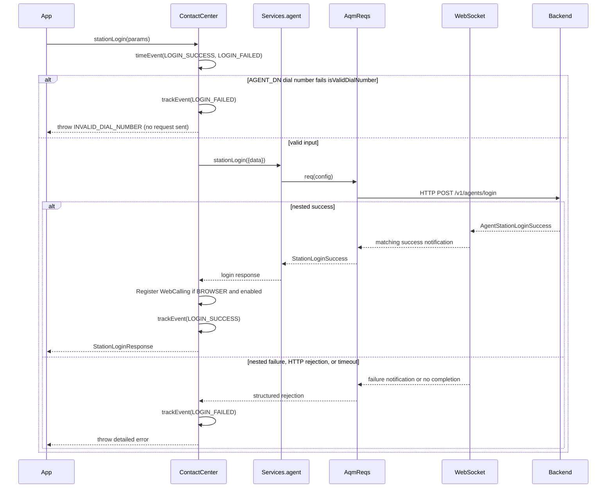
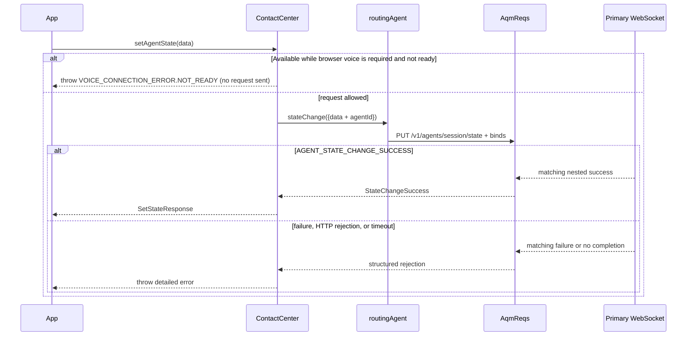
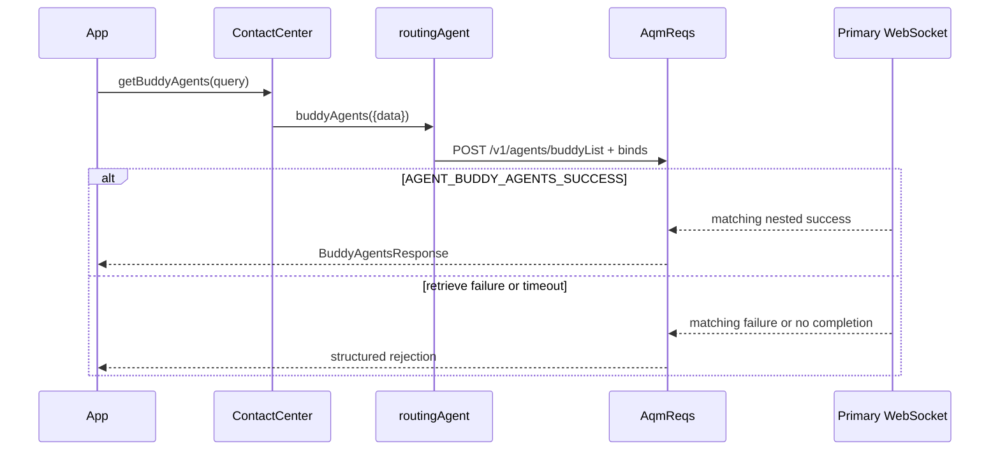
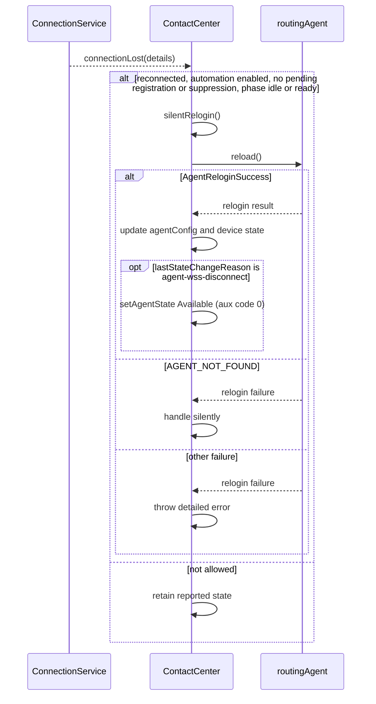
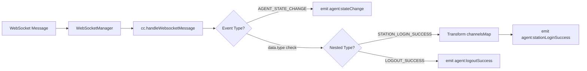
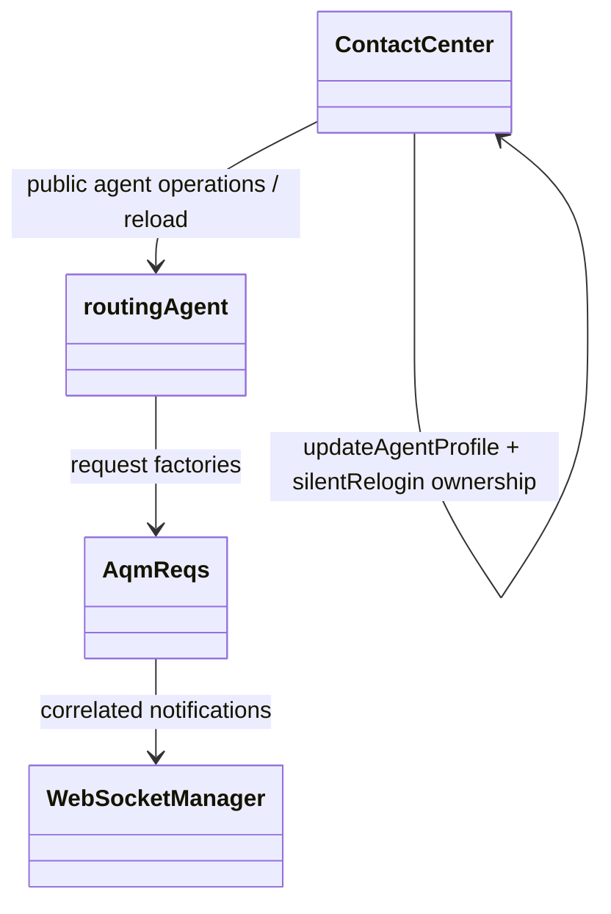

<!-- sdd-generated-metadata
doc_kind: module-spec
generated_from: module-spec@0.3.0
generated_by: claude-code
approved_by: rarajes2@cisco.com
updated_at: 2026-11-17T03:03:58Z
validation_status: pass-with-warnings
-->

# Agent service

This source-local document at `src/services/agent/docs/README.md` owns the stable specification for
**the agent service**: the `routingAgent(AqmReqs)` request factory in `src/services/agent/index.ts`,
the agent request, notification, and event types in `src/services/agent/types.ts` (contract
`contact-center-agent-events`), and the agent-specific behavior of the ContactCenter methods that wrap
it (`stationLogin`, `stationLogout`, `setAgentState`, `getBuddyAgents`, and the private silent relogin).
The ContactCenter class as a whole belongs to the [root module specification](../../../docs/README.md);
the AqmReqs transport belongs to the [core module specification](../../core/docs/README.md); the
services composition root that builds this factory is the parent
[services specification](../../docs/README.md). Ground every claim in package evidence and link to the
[package architecture](../../../../docs/architecture.md) instead of repeating broader facts. No service
specification exists because this package is a library.

Related context: [documentation index](../../../../docs/index.md) ·
[package agent instructions](../../../../AGENTS.md)

## Metadata

| Field | Value |
| ----- | ----- |
| Owner | @webex/web-sdk |
| Source path | `src/services/agent` |
| Resource kind | module |
| Status | Active |
| Last verified | 2026-11-16 at `0b8c34db7f` |
| Module id | `agent` |
| Parent spec | [src/services](../../docs/README.md) |
| Doc kind | Module spec |
| Coverage score | Pending coverage assessment |
| Validation status | pass-with-warnings — assessed 2026-11-17; validator runtime 01a1e76f-2293-79a0-9f8f-f060038448dd; 0 Blocking, 0 Important, 4 Minor findings. |

## Applicability

| Condition ID | Status | Evidence or reason | Owned section |
| ------------ | ------ | ------------------ | ------------- |
| `module.has_tiers` | N/A | No tier policy exists in `package.json` or under src | Tier |
| `module.has_ui` | N/A | Every request function and wrapper returns a promise; nothing renders | UI use-case flow |
| `module.crosses_service_boundaries` | Applicable | `src/services/agent/index.ts` targets the WCC API gateway and completes on Contact Center WebSocket notifications | Cross-boundary use-case flow |
| `module.holds_client_state` | N/A | The factory keeps no state; the agent configuration it updates is owned by `src/cc.ts` | Client state model |
| `module.enforces_domain_rules` | Applicable | Login-option, dial-number, browser-voice, and buddy-filter rules in `src/cc.ts` around the factory calls | Business rules and invariants |
| `module.is_concurrent_async` | Applicable | Every request in `src/services/agent/index.ts` is an AqmReqs promise settled by a WebSocket notification | Concurrency and reactive flow |
| `module.owns_persistence` | N/A | Nothing in the module writes storage | Data, schema, and migration discipline |
| `module.stateful_transitions` | N/A | Agent state lives in the backend; the module sends requests and relays notifications | State machine |
| `module.exposes_wire_protocol` | Applicable | Endpoint paths, payload types, and nested notification binds in `src/services/agent/index.ts` and `src/services/agent/types.ts` | Protocol and wire format |
| `module.ui_multi_screen` | N/A | No UI | UI flow |
| `module.large_data_model` | N/A | `src/services/agent/types.ts` holds message and payload types only | Data model |
| `module.returns_caller_errors` | Applicable | `src/services/agent/index.ts` declares errIds and error transformers; `src/cc.ts` rethrows them through getErrorDetails | Caller-visible failure modes |
| `module.module_specific_conventions` | Applicable | Each request keeps endpoint, method, and both binds in one config in `src/services/agent/index.ts` | Module-specific rules |
| `module.published_package` | N/A | The module is not a package; the package export is owned by the root module | Export stability |
| `module.embedded_in_host` | N/A | No host embedding | Host integration and theming |
| `module.has_design_tradeoff` | Applicable | HTTP initiation with WebSocket completion through `src/services/core/aqm-reqs.ts` | Key design trade-off |
| `module.has_submodules` | N/A | The module directory has no child module (module_tree.py reports none) | Sub-modules |

## Evidence register

| Evidence | What it establishes |
| -------- | ------------------- |
| `src/services/agent/index.ts` | The `routingAgent` request functions with their endpoints, methods, `CC_EVENTS` binds, error transformers, and errIds. `buildStationLoginPayload` builds the login request details. |
| `src/services/agent/types.ts` | `AGENT_EVENTS`, request types (`Logout`, `StateChange`, `UserStationLogin`, `BuddyAgents`), notification types (`StationLoginSuccess`, `LogoutSuccess`, `StateChangeSuccess`, `BuddyAgentsSuccess`, `ReloginSuccess`), `StationLoginSuccessResponse`, `DeviceTypeUpdateSuccess`, `AgentState`, `LoginOption`, and their JSDoc |
| `src/services/config/types.ts` | The `CC_EVENTS` string values the binds use, for example `StationLogin` with nested `AgentStationLoginSuccess` |
| `src/services/index.ts` | The services root builds `agent` as `routingAgent(aqmReq)` |
| `src/cc.ts` | ContactCenter wrappers `stationLogin`, `stationLogout`, `setAgentState`, `getBuddyAgents`, `updateAgentProfile`; `handleWebsocketMessage`; `handleConnectionLost`; `silentRelogin` |
| `src/services/core/aqm-reqs.ts` | `req` and `reqEmpty`, nested bind matching, the POST-if-data default method, the one-pending-request-per-bind rule, and the timeout rejection |
| `src/services/core/constants.ts` | `TIMEOUT_REQ` is 20000 ms |
| `src/services/core/Utils.ts` | `createErrDetailsObject`, `getErrorDetails`, `getStationLoginErrorData`, and `isValidDialNumber` |
| `src/services/constants.ts` | `WCC_API_GATEWAY` (`wcc-api-gateway`) and `WEB_RTC_PREFIX` (`webrtc-`) |
| `src/services/config/constants.ts` | `AGENT_STATE_AVAILABLE` (`Available`) and `AGENT_STATE_AVAILABLE_ID` (`0`) |
| `src/types.ts` | Public `AgentLogin`, `AgentProfileUpdate`, `BuddyAgents` (with `action`), the response aliases, and `CCPluginConfig.allowAutomatedRelogin` |
| `src/config.ts` | `allowAutomatedRelogin` defaults to true |
| `src/index.ts` | Public exports of `routingAgent`, `AGENT_EVENTS`, and the agent types |
| `src/metrics/constants.ts` | The station, state-change, and buddy-agent metric names |
| `test/unit/spec/services/agent/index.ts` | Agent-service request, station payload, and recovery error cases |
| `test/unit/spec/cc.ts` | `stationLogin`, `stationLogout`, `setAgentStatus`, `getBuddyAgents`, `silentRelogin`, `handleWebsocketMessage events`, and `updateAgentProfile` suites |
| `test/unit/spec/services/core/Utils.ts` | `getStationLoginErrorData` message and fieldName cases |
| `src/cc.ts` | Justifies the extension subsections under Data flow and sequence coverage: one subsection per operation group the wrappers implement (station login, station logout, state change, buddy-agent lookup, recovery reload) plus the WebSocket event mapping and silent-relogin flows |

## Purpose and boundary

- Purpose: Manage agent lifecycle including login, logout, state changes, and buddy agent queries.
- Responsibility: Agent owns the `routingAgent(AqmReqs)` request factory for station login, station logout, agent-state change, buddy-agent lookup, and agent-session reload. ContactCenter exposes the application-facing methods/events and owns profile/device updates plus recovery policy.
- In scope: Own AQM request definitions for station login/logout, state change, buddy-agent queries, and reload, the routing payload and notification types, and `AGENT_EVENTS`.
- Out of scope: Device/profile update and automated relogin orchestration belong to ContactCenter. Request correlation, timeouts, and the socket belong to AqmReqs and the core module.
- Consumers: the services root (`services.agent`), ContactCenter, and applications that import `routingAgent` or `AGENT_EVENTS` from the package.

The capabilities applications reach through ContactCenter:

- **Station Login**: Login with browser (WebRTC), extension, or dial number
- **Station Logout**: Logout from current station with reason
- **State Management**: Toggle between Available/Idle states with aux codes
- **Buddy Agents**: Query available agents for consult/transfer
- **Silent Relogin**: Automatic re-authentication on reconnection, and during `cc.register()`, when `allowAutomatedRelogin` is enabled

## Structure and key files

| Path | Responsibility |
| ---- | -------------- |
| `src/services/agent/index.ts` | Agent service factory: the AQM request definitions |
| `src/services/agent/types.ts` | Agent types and events: request payloads, notification messages, `AGENT_EVENTS` |
| `src/cc.ts` | ContactCenter wrappers, WebSocket-to-event mapping, and silent relogin around the factory |
| `src/services/index.ts` | Builds the factory once as `services.agent` |
| `test/unit/spec/services/agent/index.ts` | Factory delegation tests |
| `test/unit/spec/cc.ts` | Wrapper, event-mapping, relogin, and profile-update tests |

## Public surface

The public `cc.*` methods are part of the published `contact-center-sdk` contract owned by the
[root module](../../../docs/README.md); this module owns their agent semantics below.

| Surface | Consumer | Compatibility commitment | Source |
| ------- | -------- | ------------------------ | ------ |
| `contact-center-agent-events`: `AGENT_EVENTS`, the routing request types (`Logout`, `StateChange`, `UserStationLogin`, `BuddyAgents`), the notification types (`StationLoginSuccess`, `LogoutSuccess`, `StateChangeSuccess`, `BuddyAgentsSuccess`, `ReloginSuccess`), `StationLoginSuccessResponse`, and `AgentState` | Applications listening on `webex.cc`; TypeScript consumers | Published; event names and payload shapes change only with a package release | `src/services/agent/types.ts` |
| `contact-center-sdk`: the `routingAgent` export, the ContactCenter agent methods (`stationLogin`, `stationLogout`, `setAgentState`, `getBuddyAgents`, `updateAgentProfile`), and the response aliases `StationLoginResponse`, `StationLogoutResponse`, `BuddyAgentsResponse`, `SetStateResponse`, and `UpdateDeviceTypeResponse` | Applications | Published; the request function names and the method signatures are stable | `src/index.ts`, `src/types.ts` |

Login options:

| Option | Description | Requires dialNumber |
|--------|-------------|---------------------|
| `BROWSER` | WebRTC softphone in browser | No |
| `EXTENSION` | Desk phone extension | Yes |
| `AGENT_DN` | Direct dial number | Yes |

`cc.stationLogin(params)`: Login agent to a station.

**Parameters**:

- `teamId` (string): Team to login to
- `loginOption` ('BROWSER' | 'EXTENSION' | 'AGENT_DN'): Device type
- `dialNumber` (string, optional): Required for EXTENSION/AGENT_DN

**Returns**: `Promise<StationLoginResponse>`

```typescript
// Browser login
const response = await cc.stationLogin({
  teamId: 'team-123',
  loginOption: 'BROWSER',
});

// Extension login
const response = await cc.stationLogin({
  teamId: 'team-123',
  loginOption: 'EXTENSION',
  dialNumber: '1234',
});
```

`cc.stationLogout(params)`: Logout agent from station.

- `logoutReason` (string, optional): 'User requested logout' | 'Inactivity Logout' | 'User requested agent profile update'

**Returns**: `Promise<StationLogoutResponse>`

```typescript
await cc.stationLogout({
  logoutReason: 'User requested logout',
});
```

`cc.setAgentState(params)`: Change agent state (Available/Idle).

- `state` (`AgentState`: 'Available' | 'Idle' | 'RONA' | string): New state
- `auxCodeId` (string): Auxiliary code ID
- `lastStateChangeReason` (string, optional): Reason for change
- `agentId` (string, optional): Agent ID (defaults to current agent)

**Returns**: `Promise<SetStateResponse>`

```typescript
// Go Available
await cc.setAgentState({
  state: 'Available',
  auxCodeId: '0',
});

// Go to Idle with specific code
await cc.setAgentState({
  state: 'Idle',
  auxCodeId: 'break-code-123',
  lastStateChangeReason: 'Coffee break',
});
```

`cc.getBuddyAgents(params)`: Get list of agents for consult/transfer.

- `state` (string, optional): Filter by state ('Available', 'Idle')
- `mediaType` (string, optional): Media type filter ('telephony', 'chat', 'social', 'email'); defaults to 'telephony'
- `action` ('Consult' | 'Transfer', optional): applies the default state filter when `state` is omitted

**Returns**: `Promise<BuddyAgentsResponse>`

```typescript
const response = await cc.getBuddyAgents({
  state: 'Available',
  mediaType: 'telephony',
});

response.data.agentList.forEach(agent => {
  console.log(`${agent.agentName} (${agent.state})`);
});
```

End-to-end usage after registration:

```typescript
const cc = webex.cc;

// Register and login
const profile = await cc.register();
await cc.stationLogin({
  teamId: profile.teams[0].id,
  loginOption: 'BROWSER',
});

// Set state to Available
await cc.setAgentState({
  state: 'Available',
  auxCodeId: '0',
});

// Get available agents for transfer
const buddies = await cc.getBuddyAgents({
  state: 'Available',
  mediaType: 'telephony',
});
```

Events (`AGENT_EVENTS`) that ContactCenter emits:

| Event | Type | Description |
|-------|------|-------------|
| `agent:stationLoginSuccess` | `StationLoginSuccessResponse` | Login succeeded |
| `agent:stationLoginFailed` | Failure notification data | Login failed |
| `agent:logoutSuccess` | `LogoutSuccess` | Logout succeeded |
| `agent:logoutFailed` | Failure notification data | Logout failed |
| `agent:stateChange` | `StateChangeSuccess` | State changed (any source) |
| `agent:stateChangeSuccess` | `StateChangeSuccess` | State change succeeded |
| `agent:stateChangeFailed` | Failure notification data | State change failed |
| `agent:multiLogin` | Object | Multi-login detected |
| `agent:reloginSuccess` | `ReloginSuccess` with `mmProfile` and `notifsTrackingId` in place of `channelsMap` | Silent relogin succeeded |
| `agent:dnRegistered` | Object | DN registration complete |

```typescript
cc.on('agent:stateChange', (event) => {
  console.log(`State: ${event.subStatus}, AuxCode: ${event.auxCodeId}`);
});

cc.on('agent:multiLogin', (event) => {
  console.warn('Another session detected');
});
```

Agent states:

The `AgentState` type (`'Available' | 'Idle' | 'RONA' | string`) is extensible -- the `string` union member allows backend-defined states beyond the known values listed below.

| State | SubStatus | Description |
|---|---|---|
| LoggedIn | Available | Ready to receive tasks |
| LoggedIn | Idle | On break or not ready (uses aux code for sub-reason) |
| RONA | - | Rang but no answer; agent failed to accept offered task |
| LoggedOut | - | Not logged in |
| LoggedIn | *(custom)* | Additional org-specific states defined via aux codes |

> **Note**: `AgentState` is a union with `string`, so consumers should handle unknown state values gracefully rather than exhaustively matching only the known literals.

## Dependencies

| Dependency | Why it is required | Failure behavior |
| ---------- | ------------------ | ---------------- |
| AqmReqs and WCC API gateway (`src/services/core/aqm-reqs.ts`, service `wcc-api-gateway`) | Sends each request through `webex.request` and correlates the result | An HTTP rejection clears the pending entry and rejects through the request's `err` transformer |
| Correlated WebSocket success/failure notifications (contract `wxcc-websocket-notifications`) | The nested notification is the completion signal | A failure notification rejects with `Err.Details(errId)`; no notification rejects with `Service.aqm.reqs.Timeout` after 20000 ms |
| Registered ContactCenter profile and connection state (`src/cc.ts`) | Wrappers read `agentConfig` (agent id, profile id, dial plan, `webRtcEnabled`) | Wrappers assume registration; without it they fail when they read `agentConfig` |
| ContactCenter metrics, web calling, and logging (`src/cc.ts`) | Timing and tracking, browser line registration, structured errors | Metric and log calls do not change the request outcome |

Preconditions for the wrappers:

- Requires `cc.register()` to be called first
- Agent profile must be fetched before login
- WebRTC (BROWSER option) requires mercury connection

`cc.register()` connects Mercury when any of the agent's login voice options requires browser voice.

## Requirements

| ID | WHAT | WHY | Source Evidence | Test / Example Evidence | Assumptions / Gaps | Confidence |
|---|---|---|---|---|---|---|
| AGENT-R-001 | routingAgent station login/logout must use the documented WCC endpoints (`POST /v1/agents/login`, `POST /v1/agents/logout`) and settle on their nested `CC_EVENTS` success/failure notifications. | The backend operation is asynchronous and HTTP acknowledgement is not final agent state. | `src/services/agent/index.ts` | `test/unit/spec/services/agent/index.ts`, `test/unit/spec/cc.ts` | The factory test asserts delegation to `req` only; endpoint and bind values are not asserted. | PRESENT |
| AGENT-R-002 | State change must use PUT `/v1/agents/session/state` and preserve typed success/failure binds. | Agent availability drives routing eligibility and must not be inferred from request acknowledgement. | `src/services/agent/index.ts` | `test/unit/spec/services/agent/index.ts`, `test/unit/spec/cc.ts` | The PUT method and binds are not asserted by a unit test. | PRESENT |
| AGENT-R-003 | Buddy-agent lookup must preserve its typed request and correlated response contract. | Consult/transfer selection depends on backend-filtered availability. | `src/services/agent/index.ts` | `test/unit/spec/services/agent/index.ts`, `test/unit/spec/cc.ts` | The `POST /v1/agents/buddyList` endpoint is not asserted by a unit test. | PRESENT |
| AGENT-R-004 | The agent factory exposes `reload`, while ContactCenter alone decides when automated relogin is permitted. | Transport recovery lacks the profile/policy context required to mutate an agent session safely. | `src/cc.ts` | `test/unit/spec/cc.ts` | None. | PRESENT |
| AGENT-R-005 | Device/profile update is `ContactCenter.updateAgentProfile`: it calls `stationLogout` with reason 'User requested agent profile update', then `stationLogin` with the new `loginOption`, `dialNumber`, and `teamId`, and returns the login response typed `AgentDeviceTypeUpdateSuccess`; `routingAgent` has no `deviceUpdate` function. | The factory has no device-update request, so a device or team change reuses the logout and login flows with their metrics; calling a non-existent `routingAgent.deviceUpdate` would fail at runtime. | `src/cc.ts`, `src/services/agent/index.ts` | `test/unit/spec/cc.ts` | No test asserts that `routingAgent.deviceUpdate` is absent. | PRESENT |
| AGENT-R-006 | BROWSER station login must send `dialNumber` and `deviceId` as `webrtc-{agentId}` on `POST /v1/agents/login`. EXTENSION and AGENT_DN continue to send the caller-supplied dial number for both fields. | QRM stores `agent.dn` from `dialNumber`. Legacy VPOP RTMS only treats a DN as WebRTC when it starts with `webrtc-`; a bare UUID gets a steering prefix and the agent invite fails with SIP 484. | `src/services/agent/index.ts` | `test/unit/spec/services/agent/index.ts`, `test/unit/spec/cc.ts` | Public `stationLogin({loginOption: 'BROWSER'})` input is unchanged; only the backend login payload is prefixed. | PRESENT |
| AGENT-R-007 | An AGENT_DN station login whose dial number fails `isValidDialNumber` against the profile dial plan rejects with `INVALID_DIAL_NUMBER` before any request is sent. | The backend would otherwise register an unreachable DN; the reason maps to a field message for the login form. | `src/cc.ts` | `test/unit/spec/services/core/Utils.ts`, `test/unit/spec/cc.ts` | T-010 verifies that invalid manual recovery login sends no request. | PRESENT |
| AGENT-R-008 | `setAgentState` rejects a change to Available with `VOICE_CONNECTION_ERROR.NOT_READY` (type `SDK_VALIDATION_ERROR`) when browser voice is required and not ready; Idle and non-browser changes proceed. | An Available agent without a registered browser line would be offered calls it cannot answer. | `src/cc.ts` | `test/unit/spec/cc.ts` | None. | PRESENT |
| AGENT-R-009 | `getBuddyAgents` sends `agentProfileId` from the profile, defaults `mediaType` to `telephony`, and, when `state` is omitted, filters on Available for `action: 'Transfer'` and sends no state for Consult. | A transfer needs an agent who can take the call now; a consult may target an Idle agent. | `src/cc.ts`, `src/types.ts` | `test/unit/spec/cc.ts` | None. | PRESENT |
| AGENT-R-010 | Station login success and relogin success replace `channelsMap` with `mmProfile` counts per channel and add `notifsTrackingId`. | Applications receive capacity numbers instead of raw channel id lists. | `src/cc.ts`, `src/services/agent/types.ts` | `test/unit/spec/cc.ts` | None. | PRESENT |
| AGENT-R-011 | Reload and station login use the existing authenticated AQM request routing and its session-operation context. Recovery-owned operations match the request UUID in the nested notification. Ordinary operations retain their event-type bindings. `routingAgent.stateChange` accepts `{data}` and an optional callback. Internal calls pass recovery correlation in the context. Session restoration applies accepted backend data. Failure mapping retains normalized status, reason and tracking information. Teardown retains its own admission and settlement path. | A late notification from another operation or session must not publish a restored station. Ordinary callers retain the existing adapter shape. | `src/services/agent/index.ts`, `src/services/core/aqm-reqs.ts`, `src/cc.ts` | `test/unit/spec/cc.ts`, `test/unit/spec/services/agent/index.ts` | T-007, T-008, T-011, T-012. The SDK façade owns the ordered restore policy. | PRESENT |

## Design overview

The agent service uses a factory pattern: `routingAgent` is a pure AQM factory. It receives an initialized AqmReqs instance and returns five request functions: `reload`, `logout`, `stationLogin`, `stateChange`, and `buddyAgents`. Each request config declares the endpoint/payload plus exact `CC_EVENTS` notification binds.

The factory initiates authenticated HTTP requests and supplies `CC_EVENTS` success/failure binds to AqmReqs. The services root builds it once as `services.agent` (`src/services/index.ts`); the factory holds no state.

ContactCenter validates and enriches public inputs, starts metrics, delegates to the factory, performs browser-calling work when required, and maps backend notifications to application-facing events. `updateAgentProfile()` and private `silentRelogin()` are ContactCenter methods; the latter calls `services.agent.reload()` only after package-level recovery policy permits it.

Stack: TypeScript 5.4 AQM request factory, REST initiation, WebSocket completion events, Jest 27.

Metrics ContactCenter tracks around the factory calls (`timeEvent` before the call, `trackEvent` after it):

| Metric | Type | When Tracked |
| ---------------------------- | --------------------------------- | ------------------------ |
| `STATION_LOGIN_SUCCESS` | behavioral, business, operational | Login succeeds |
| `STATION_LOGIN_FAILED` | behavioral, business, operational | Login fails |
| `STATION_LOGOUT_SUCCESS` | behavioral, business, operational | Logout succeeds |
| `STATION_LOGOUT_FAILED` | behavioral, business, operational | Logout fails |
| `AGENT_STATE_CHANGE_SUCCESS` | behavioral, business, operational | State change succeeds |
| `AGENT_STATE_CHANGE_FAILED` | behavioral, business, operational | State change fails |
| `FETCH_BUDDY_AGENTS_SUCCESS` | operational | Buddy agents fetched |
| `FETCH_BUDDY_AGENTS_FAILED` | operational | Buddy agents fetch fails |

## Data flow and sequence coverage

Call style: in-process promise calls from ContactCenter into the factory; AqmReqs sends an authenticated
HTTP request to the WCC API gateway and settles the promise from the matching Contact Center WebSocket
notification.

Sequence coverage:

| Operation group | Entry and outcome | Diagram or evidence | Failure and recovery coverage |
| --------------- | ----------------- | ------------------- | ----------------------------- |
| Station login | `cc.stationLogin` → `stationLogin` → `POST /v1/agents/login`; resolves `StationLoginResponse` | Station login | Pre-request `INVALID_DIAL_NUMBER` rejection, nested failure notification, HTTP rejection, and timeout throw |
| Station logout | `cc.stationLogout` → `logout` → `POST /v1/agents/logout`; resolves `StationLogoutResponse` | Station logout | Nested failure/timeout rejects and calling deregistration occurs only after success |
| State change | `cc.setAgentState` → `stateChange` → `PUT /v1/agents/session/state`; resolves `SetStateResponse` | State change | Pre-request browser-voice rejection; failure notification or timeout returns a structured rejection |
| Buddy agents | `cc.getBuddyAgents` → `buddyAgents` → `POST /v1/agents/buddyList`; resolves `BuddyAgentsResponse` | Buddy-agent lookup | Correlated retrieval failure/timeout rejects |
| Reload | Reconnect or `cc.register()` → private `silentRelogin` → `reload` → `POST /v1/agents/reload` | Recovery reload | Disabled policy keeps the reported state; `AGENT_NOT_FOUND` is silent; other relogin failures throw |
| Event mapping | WebSocket message → `handleWebsocketMessage` → `AGENT_EVENTS` emit | WebSocket-to-application event mapping | Types outside `CC_EVENTS` are not emitted |

### Station login



The diagram's `LOGIN_SUCCESS` and `LOGIN_FAILED` are `METRIC_EVENT_NAMES.STATION_LOGIN_SUCCESS` and
`STATION_LOGIN_FAILED`. The browser line is registered only when the login option is BROWSER, the
profile has `webRtcEnabled`, and `disableWebRTCRegistration` is not set.

### Station logout

```mermaid
sequenceDiagram
  participant App
  participant CC as ContactCenter
  participant Agent as routingAgent
  participant AQM as AqmReqs
  participant WS as Primary WebSocket
  App->>CC: stationLogout({logoutReason})
  CC->>Agent: logout({data})
  Agent->>AQM: POST /v1/agents/logout + nested binds
  alt AGENT_LOGOUT_SUCCESS
    WS-->>AQM: matching nested success
    AQM-->>CC: LogoutSuccess
    CC->>CC: track success; deregister WebCalling line
    CC-->>App: StationLogoutResponse
  else failure, HTTP rejection, or timeout
    WS-->>AQM: matching failure or no completion
    CC->>CC: track failure
    CC-->>App: throw detailed error
  end
```

### State change



### Buddy-agent lookup



### Recovery reload



Automatic relogin on WebSocket reconnection: `handleConnectionLost` runs `silentRelogin()` only
when `isConnectionLost` is false, `isSocketReconnected` is true, `allowAutomatedRelogin` is enabled,
no initial registration is pending, `suppressAutomaticRelogin` is false, and the recovery phase is
`idle` or `ready`. Explicit logout suppresses automatic restoration; enabling the config flag alone
does not bypass suppression or regional recovery ownership. Separately, `connectWebsocket` during
`cc.register()` calls `silentRelogin(true)` when `allowAutomatedRelogin` is enabled, after awaiting
registration connection ownership; a relogin failure there rejects `cc.register()`. Regional restore
uses its own generation-owned session path, and `stationLoginRequired` requires explicit station
login. Evidence: `src/cc.ts`, `test/unit/spec/cc.ts`.

### WebSocket-to-application event mapping



The diagram shows the main branches. On the outer type, `AGENT_MULTI_LOGIN` also emits
`agent:multiLogin`. On the nested `data.type`, `AGENT_RELOGIN_SUCCESS` is transformed like login success
and emits `agent:reloginSuccess`; the state-change success and failure, station-login failure, logout
failure, and `AGENT_DN_REGISTERED` types emit their `AGENT_EVENTS` value with the notification data.
Before this mapping, any `data.type` found in `CC_EVENTS` is also re-emitted under its raw name.

The login success event transforms `channelsMap` to `mmProfile`:

```typescript
// Incoming
channelsMap: {
  chat: ['channel-1', 'channel-2'],
  email: ['channel-3'],
  social: [],
  telephony: ['channel-4'],
}

// Transformed
mmProfile: {
  chat: 2,      // Length of arrays
  email: 1,
  social: 0,
  telephony: 1,
}
```

## Class and component relationships



## Use cases and flows

| Use case | Actor or caller | Primary steps and outcome | Failure or boundary behavior | Evidence |
| -------- | --------------- | ------------------------- | ---------------------------- | -------- |
| `UC-1` Station login/logout | Application | validate public input in ContactCenter, initiate through routingAgent, settle from nested WebSocket notification | Invalid AGENT_DN dial number, failure notification, HTTP rejection, or timeout throws a detailed error | `src/cc.ts`, `src/services/agent/index.ts`, `test/unit/spec/services/agent/index.ts` |
| `UC-2` State change | Application or silent relogin | PUT the state payload and return the correlated typed response | Browser voice not ready, failure notification, or timeout throws | `src/services/agent/index.ts`, `test/unit/spec/services/agent/index.ts` |
| `UC-3` Buddy-agent query | Application selecting a consult or transfer target | retrieve backend-filtered candidates for consult/transfer | Retrieval failure or timeout throws | `src/services/agent/index.ts`, `test/unit/spec/services/agent/index.ts` |
| `UC-4` Recovery reload | ConnectionService reconnect or `cc.register()` | ContactCenter decides whether to invoke private relogin and the factory's `reload` | `AGENT_NOT_FOUND` returns silently; other failures throw | `src/cc.ts`, `test/unit/spec/cc.ts` |
| `UC-5` Device/profile update | Application | ContactCenter owns `updateAgentProfile`; the agent factory has no device-update method | A failing logout or login is tracked and rethrown | `src/cc.ts`, `test/unit/spec/cc.ts` |

### Cross-boundary use-case flow

| Boundary | Transport and ordering | Compatibility | Timeout, retry, and recovery |
| -------- | ---------------------- | ------------- | ---------------------------- |
| WCC API gateway (`UC-1` to `UC-5`) | Authenticated HTTP through `webex.request` with service `wcc-api-gateway`; the HTTP response is only an acknowledgement | Paths under `/v1/agents/`; contract `wxcc-api-gateway` | HTTP rejection rejects at once; no retry in this module |
| Contact Center WebSocket (`UC-1` to `UC-5`) | AqmReqs matches the outer `type` and the nested `data.type` of each notification against the request's binds | Contract `wxcc-websocket-notifications`; `CC_EVENTS` values | No matching notification within 20000 ms rejects with `Service.aqm.reqs.Timeout`; recovery after reconnect is the silent relogin (`UC-4`) |

## Business rules and invariants

| ID | Invariant | WHY | Enforcement source | Test evidence |
| -- | --------- | --- | ------------------ | ------------- |
| `INV-001` | Every request's success and failure binds match both the outer notification `type` and the nested `data.type`; flattening either bind can settle the wrong request. | One outer type carries several outcomes (`StationLogin` carries both `AgentStationLoginSuccess` and `AgentStationLoginFailed`), so only the nested type tells success from failure. | `src/services/agent/index.ts`, `src/services/core/aqm-reqs.ts` | none found for the agent binds |
| `INV-002` | After a successful EXTENSION or AGENT_DN login, `agentConfig.dn` and `defaultDn` hold the dial number, and `deviceType` holds the login option. | Later calls and relogin read the DN from the profile. | `src/cc.ts` | `test/unit/spec/cc.ts` |
| `INV-003` | Silent relogin after an `agent-wss-disconnect` requests Available with aux code `0`; any other last reason keeps the backend state. | A socket drop moved the agent out of Available without the agent asking. | `src/cc.ts` | `test/unit/spec/cc.ts` |

## Concurrency and reactive flow

- Execution model: one JavaScript event loop; every request function returns a promise that AqmReqs settles from a WebSocket message. Async operations must remain non-blocking.
- Ordering guarantees: within `stationLogin`, the browser line is registered only after the login notification resolves; within `stationLogout`, the line is deregistered only after the logout notification resolves.
- Idempotency and retry: AqmReqs rejects a second request with the same success or failure bind key while one is pending (`Service.aqm.reqs.Pending`), so two concurrent `stationLogin` calls do not both reach the backend. Nothing in this module retries.
- Shared-state protection: the factory has no state; ContactCenter is the single writer of `agentConfig`.
- Blocking restrictions: none; all I/O is in AqmReqs and WebexRequest.

## Protocol and wire format

Request, response, and event payload ownership is anchored in `src/services/agent/index.ts`. HTTP initiates backend work where applicable; WebSocket messages provide realtime events and, for AQM flows, correlated completion.

For example, station login defines the real outer and nested event binds shown in the first table row.

| Message or frame | Version | Producer or serializer | Consumer or parser | Compatibility and ordering rule |
| ---------------- | ------- | ---------------------- | ------------------ | ------------------------------- |
| `POST /v1/agents/login` with `UserStationLogin` | v1 path | `stationLogin` in `src/services/agent/index.ts` | WCC API gateway | Completes on outer `StationLogin` with nested `AgentStationLoginSuccess` or `AgentStationLoginFailed` |
| `POST /v1/agents/logout` with `Logout` | v1 path | `logout` | WCC API gateway | Completes on outer `Logout` with nested `AgentLogoutSuccess` or `AgentLogoutFailed` |
| `PUT /v1/agents/session/state` with `StateChange` | v1 path | `stateChange` | WCC API gateway | Completes on outer `AgentStateChange` with nested `AgentStateChangeSuccess` or `AgentStateChangeFailed` |
| `POST /v1/agents/buddyList` with `BuddyAgents` | v1 path | `buddyAgents` | WCC API gateway | Completes on outer and nested `BuddyAgents`, or nested `BuddyAgentsRetrieveFailed` |
| `POST /v1/agents/reload` with an empty body | v1 path | `reload` | WCC API gateway | Completes on outer and nested `AgentReloginSuccess` or `AgentReloginFailed` |

Each agent method defines a `routing.req` (or, for `reload`, `routing.reqEmpty`) callback returning `url`,
`host: WCC_API_GATEWAY`, `data: p.data`, an `err` transformer, an optional `method`, `notifSuccess` with
a `bind` of outer `type` and nested `data: {type}` plus a `msg` type hint such as
`Agent.StationLoginSuccess`, and `notifFail` with its `bind` and an `errId` such as
`Service.aqm.agent.stationLoginFailed`; see [the factory](../index.ts). AqmReqs uses the given `method`,
or POST if data present, GET otherwise; only `stateChange` (PUT) and `buddyAgents` (POST) set it.

Key nested WebSocket binds use the actual outer/data constants, for example `CC_EVENTS.AGENT_STATION_LOGIN` with `data.type = CC_EVENTS.AGENT_STATION_LOGIN_SUCCESS` or `CC_EVENTS.AGENT_STATION_LOGIN_FAILED`. The package export index is in the [root module specification](../../../docs/README.md).

## Caller-visible failure modes

Recovery errors use the [ContactCenter lifecycle contract](../../../docs/README.md#caller-visible-failure-modes).
The [Core admission matrix](../../core/docs/README.md#aqmreqs-members) applies to agent adapters.
`stateChange` uses the default command classification. `stationLogin` and `reload` are session
requests, `logout` is teardown, and `buddyAgents` is a query.

| Condition | Signal or result | Caller behavior | Retry or recovery | Evidence |
| --------- | ---------------- | --------------- | ----------------- | -------- |
| AGENT_DN dial number fails the dial plan | `Error('INVALID_DIAL_NUMBER')` before any request; `error.data` has the field message and `fieldName` | Show `error.data.message` on the dial-number field | Correct the number and call again | `src/cc.ts`, `src/services/core/Utils.ts` |
| Extension or DN already in use by another session | Backend reason `DUPLICATE_LOCATION`: `Error('DUPLICATE_LOCATION')` with the in-use message for the login option | Show `error.data.message` on the `error.data.fieldName` field | Log in with another extension or DN | `src/services/core/Utils.ts`, `test/unit/spec/services/core/Utils.ts` |
| Other ordinary backend failure notification | New `Error` whose message is the notification `data.reason`; for `stationLogin`, `error.data` has the generic login message and fieldName `generic` | Branch on `error.message`; lifecycle errors instead retain their `data.reason` as described above | Logs are uploaded with the failure tracking id | `src/cc.ts`, `src/services/core/Utils.ts` |
| HTTP rejection, timeout after 20000 ms, or the same request already pending | AqmReqs rejects with `Service.aqm.agent.stationLogin`, `Service.reqs.generic.failure`, `Service.aqm.reqs.Timeout`, or `Service.aqm.reqs.Pending` details; these carry no `data.reason`, so the wrapper throws `Error` with the message Error while performing followed by the method name | Treat the outcome as unknown and wait for an agent event; never synthesize success | Call again once the pending call has settled | `src/services/core/aqm-reqs.ts`, `src/services/core/Utils.ts` |
| Available requested while browser voice is not ready | `Error` whose message is `VOICE_CONNECTION_ERROR.NOT_READY`; no request sent | Wait for `voice:connectionStateChange` to report voice ready, or choose an Idle code | Call again when voice is ready | `src/cc.ts`, `test/unit/spec/cc.ts` |
| Silent relogin finds no agent session | Reason `AGENT_NOT_FOUND`; returns without throwing, error logging, or log upload | Nothing to handle; the agent is logged out | Call `stationLogin` | `src/cc.ts`, `src/services/core/Utils.ts` |
| Ordinary reconnect does not run silent relogin | No reload unless `isConnectionLost` is false, `isSocketReconnected` is true, `allowAutomatedRelogin` is true (the default), no registration is pending, `suppressAutomaticRelogin` is false, and phase is `idle` or `ready` | Preserve logout intent and recovery ownership; changing the flag alone does not satisfy all gates | A later eligible reconnect can relogin; `stationLoginRequired` needs explicit login. Register-time relogin is a separate path gated by the flag and current registration ownership | `src/config.ts`, `src/cc.ts`, `test/unit/spec/cc.ts` |

For ordinary `stationLogin` failures, special error handling extracts field-specific messages: `getStationLoginErrorData`
in `src/services/core/Utils.ts` builds an `errorCodeMessageMap` in which `DUPLICATE_LOCATION` gives the
message 'This extension is already in use' for EXTENSION, a 'Dial number is in use' message for
AGENT_DN, and 'This value is already in use' otherwise, and `INVALID_DIAL_NUMBER` gives 'Enter a valid
dial number. For help, reach out to your administrator or support team.'; both set `fieldName` to the
`loginOption`, and any other reason gets a generic message with fieldName `generic`.

> **Host-application example:** `showStationLoginError` represents consumer-owned UI handling. SDK package implementation must use `LoggerProxy` and must not log raw runtime values.

```typescript
try {
  await cc.stationLogin(params);
} catch (error) {
  showStationLoginError({
    message: error.message,
    fieldName: error.data?.fieldName,
    fieldMessage: error.data?.message,
  });
}
```

## Pitfalls and constraints

- `CC_EVENTS.AGENT_BUDDY_AGENTS` and `AGENT_BUDDY_AGENTS_SUCCESS` share the value `BuddyAgents`, so the buddy-list success bind is the same string at both levels.

## Module-specific rules

- DO keep HTTP endpoint/method and WebSocket success/failure binds in the same routing factory definition.
- DO keep browser-calling registration/deregistration in ContactCenter around successful station operations.
- DON'T resolve an agent operation from HTTP acknowledgement.
- DON'T move automated relogin policy into the agent factory or ConnectionService.

## Key design trade-off

| Chosen trade-off | Preserved invariant or benefit | Cost or limitation | Decision evidence |
| ---------------- | ------------------------------ | ------------------ | ----------------- |
| HTTP initiates each operation while the correlated WebSocket notification is the completion signal | Matches backend semantics: the agent state is final only when the backend reports it | Timeout/correlation complexity, and one pending request per bind key | `src/services/agent/index.ts`, `src/services/core/aqm-reqs.ts` |

## Verification

Use `test/unit/spec/services/agent/index.ts` for the factory and `test/unit/spec/cc.ts` for public validation, metrics, calling, updateAgentProfile, and recovery ownership. Cover success, nested failure, HTTP rejection, and timeout without inventing a `deviceUpdate` factory method. The factory tests assert delegation, operation kinds, request bodies, and station-login HTTP error details. Endpoint, method, and bind values remain outside those factory assertions. Run `yarn workspace @webex/contact-center test:unit` from the workspace root.

| Requirement or invariant | Test level | Positive evidence | Negative or boundary evidence | Gap |
| ------------------------ | ---------- | ----------------- | ----------------------------- | --- |
| `AGENT-R-001` | Unit | `test/unit/spec/services/agent/index.ts` logout and stationLogin cases; `test/unit/spec/cc.ts` stationLogin and stationLogout success | `test/unit/spec/cc.ts` stationLogin and stationLogout error cases | Endpoints and binds not asserted |
| `AGENT-R-002` | Unit | `test/unit/spec/services/agent/index.ts` stateChange case; `test/unit/spec/cc.ts` setAgentStatus success | `test/unit/spec/cc.ts` setAgentStatus error case | PUT method and binds not asserted |
| `AGENT-R-003`, `AGENT-R-009` | Unit | `test/unit/spec/cc.ts` getBuddyAgents success, Transfer, and Consult cases | `test/unit/spec/cc.ts` getBuddyAgents error case | Endpoint not asserted |
| `AGENT-R-004`, `INV-003` | Unit | `test/unit/spec/cc.ts` silentRelogin cases | `test/unit/spec/cc.ts` AGENT_NOT_FOUND and relogin error cases; register with relogin disabled | None |
| `AGENT-R-005` | Unit | `test/unit/spec/cc.ts` updateAgentProfile cases | `test/unit/spec/cc.ts` logout and login failure cases | No assertion that `routingAgent.deviceUpdate` is absent |
| `AGENT-R-006` | Unit | `test/unit/spec/cc.ts` BROWSER login and `test/unit/spec/services/agent/index.ts` BROWSER payload cases | `test/unit/spec/services/agent/index.ts` EXTENSION and AGENT_DN payload cases | None |
| `AGENT-R-007` | Unit | `test/unit/spec/services/core/Utils.ts` isValidDialNumber and getStationLoginErrorData cases | `test/unit/spec/cc.ts` T-010 rejects an invalid AGENT_DN without sending a request. | None |
| `AGENT-R-008` | Unit | `test/unit/spec/cc.ts` setAgentStatus Idle and non-browser cases | `test/unit/spec/cc.ts` browser-voice rejection case | None |
| `AGENT-R-010`, `INV-002` | Unit | `test/unit/spec/cc.ts` stationLogin and handleWebsocketMessage events mapped-payload cases | none found | None |
| `AGENT-R-011` | Unit | `test/unit/spec/services/agent/index.ts` checks operation kind and unchanged request bodies. | The same suite checks station-login error details across three HTTP error shapes. `test/unit/spec/services/core/aqm-reqs.ts` covers correlation and session ownership. | Backend UUID echo remains release evidence. |
| `INV-001` | None | none found | none found | No test asserts the agent bind values |
