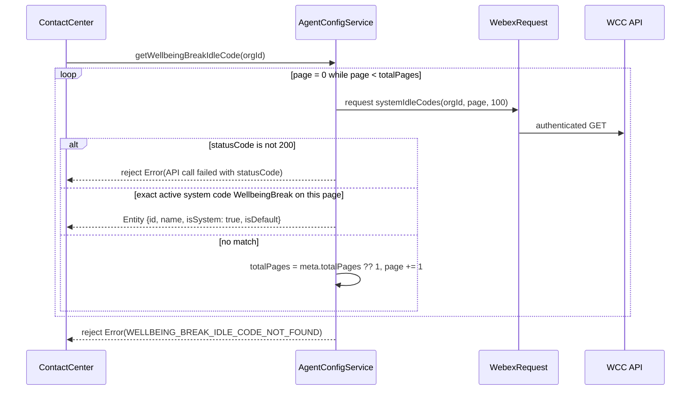
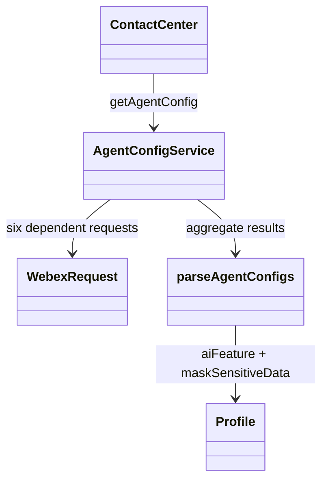

<!-- sdd-generated-metadata
doc_kind: module-spec
generated_from: module-spec@0.3.0
generated_by: claude-code
approved_by: rarajes2@cisco.com
updated_at: 2026-11-17T03:03:58Z
validation_status: pass-with-warnings
-->

# Config service

This source-local document at `src/services/config/docs/README.md` owns the stable specification for
**the config service**: `AgentConfigService`, which fetches and aggregates agent configuration data
from multiple API endpoints to build the AgentProfile, the `parseAgentConfigs` mapper, the
`endPointMap` resource builders, and the configuration and event types in `types.ts`, including the
`CC_EVENTS` event-name constants. This is the authoritative documentation for the Config service
scope. See the [package agent instructions](../../../../AGENTS.md) for the orchestrator and
cross-scope rules. Ground every claim in package evidence and link to the
[package architecture](../../../../docs/architecture.md) instead of repeating broader facts; no service
specification exists because this package is a library. The parent module is the
[services specification](../../docs/README.md).

Related context: [documentation index](../../../../docs/index.md) ·
[package agent instructions](../../../../AGENTS.md)

## Metadata

| Field | Value |
| ----- | ----- |
| Owner | @webex/web-sdk |
| Source path | `src/services/config` |
| Resource kind | module |
| Status | Active |
| Last verified | 2026-11-16 at `0b8c34db7f` |
| Module id | `config` |
| Parent spec | [src/services](../../docs/README.md) |
| Doc kind | Module spec |
| Coverage score | Pending coverage assessment |
| Validation status | pass-with-warnings — assessed 2026-11-17; validator runtime 01a1e76f-2293-79a0-9f8f-f060038448dd; 0 Blocking, 0 Important, 4 Minor findings. |

## Applicability

| Condition ID | Status | Evidence or reason | Owned section |
| ------------ | ------ | ------------------ | ------------- |
| `module.has_tiers` | N/A | No tier policy exists in `package.json` or under src | Tier |
| `module.has_ui` | N/A | `src/services/config/index.ts` only returns promises; nothing renders | UI use-case flow |
| `module.crosses_service_boundaries` | Applicable | `src/services/config/index.ts` calls the Contact Center API gateway through `src/services/core/WebexRequest.ts` | Cross-boundary use-case flow |
| `module.holds_client_state` | N/A | `src/services/config/index.ts` keeps only the WebexRequest handle; the built profile is stored by `src/cc.ts` | Client state model |
| `module.enforces_domain_rules` | Applicable | All-or-nothing aggregation in `src/services/config/index.ts` and the wellness and aux-code rules in `src/services/config/Util.ts` | Business rules and invariants |
| `module.is_concurrent_async` | Applicable | `src/services/config/index.ts` starts requests in parallel and joins them with Promise.all | Concurrency and reactive flow |
| `module.owns_persistence` | N/A | Nothing in `src/services/config/index.ts` writes storage | Data, schema, and migration discipline |
| `module.stateful_transitions` | N/A | `src/services/config/index.ts` has no state machine | State machine |
| `module.exposes_wire_protocol` | Applicable | REST resource shapes in `src/services/config/constants.ts`; WebSocket event names in `src/services/config/types.ts` | Protocol and wire format |
| `module.ui_multi_screen` | N/A | No UI | UI flow |
| `module.large_data_model` | N/A | Manifest profile false; the response and profile types in `src/services/config/types.ts` are summarized under Public surface | Data model |
| `module.returns_caller_errors` | Applicable | Every method in `src/services/config/index.ts` logs and rethrows | Caller-visible failure modes |
| `module.module_specific_conventions` | Applicable | Event-constant and logging conventions in `src/services/config/types.ts` and `src/services/config/index.ts` | Module-specific rules |
| `module.published_package` | N/A | Manifest profile false; package exports are owned by `src/index.ts` and the package spec | Export stability |
| `module.embedded_in_host` | N/A | No host theme or mount API | Host integration and theming |
| `module.has_design_tradeoff` | Applicable | All-or-nothing Promise.all aggregation in `src/services/config/index.ts` | Key design trade-off |
| `module.has_submodules` | N/A | The module tree computed by scripts/module_tree.py lists no child of src/services/config (manifest has_submodules false) | Sub-modules |

## Evidence register

Every requirement cites stable source and test file paths. Code and tests are the behavioral referee;
missing or contradictory evidence blocks promotion.

| Evidence | What it establishes |
| -------- | ------------------- |
| `src/services/config/index.ts` | `AgentConfigService` and its twelve public methods; the staged `getAgentConfig` orchestration; the per-method log, status-check, and rethrow pattern; the operation groups that justify the `Profile aggregation`, `Pagination`, and `Wellness idle-code lookup` subsections under Data flow and sequence coverage |
| `src/services/config/Util.ts` | `parseAgentConfigs` and its helpers `getFilterAuxCodes`, `getFilteredDialplanEntries`, `getDefaultWrapUpCode`, `getMsftConfig`, `getWebexConfig`, `getDefaultAgentDN`; the wellness gate |
| `src/services/config/constants.ts` | `endPointMap`, `DEFAULT_PAGE` (0), `DEFAULT_PAGE_SIZE` (100), `DEFAULT_AUXCODE_ATTRIBUTES`, `WELLBEING_BREAK_IDLE_CODE`, `WELLNESS_BREAK_REMINDERS_ENABLED`, `COLLABORATION_ACCESS`, `METHODS` |
| `src/services/config/types.ts` | `CC_TASK_EVENTS` (66 keys), `CC_AGENT_EVENTS` (19 keys), `CC_EVENTS`, `VOICE_CONNECTION_EVENTS`, `Profile`, and the response types (catalog source of `contact-center-cc-events`) |
| `src/services/index.ts` | `Services` constructs one `AgentConfigService` as `services.config` |
| `src/cc.ts` | Consumers: `connectWebsocket` consumes the optional recovery settings from the Profile returned by `getAgentConfig`; `getWellbeingBreakIdleCode` and `getOutdialAniEntries` wrap the service; `CC_EVENT_ALLOW_LIST` filters re-emitted WebSocket event names |
| `src/index.ts`, `src/webex.js` | Public re-export of `CC_EVENTS`, `CC_AGENT_EVENTS`, `CC_TASK_EVENTS`, `VOICE_CONNECTION_EVENTS`, `IDLE_CODE`, `WRAP_UP_CODE`, and the config types; `Webex.CC_AGENT_EVENTS` |
| `src/services/core/WebexRequest.ts` | The singleton HTTP wrapper over `webex.request` used by every method |
| `src/services/core/websocket/WebSocketManager.ts` | Resolves registration on the `CC_EVENTS.WELCOME` message |
| `src/services/WebCallingService.ts` | Emits `VOICE_CONNECTION_EVENTS.STATE_CHANGE` |
| `src/services/Queue.ts`, `src/services/EntryPoint.ts`, `src/services/AddressBook.ts`, `src/services/UserPreference.ts` | Other consumers of `endPointMap` |
| `src/services/ApiAiAssistant.ts` | Consumes `AIFeatureFlags` through `setAIFeatureFlags` |
| `src/constants.ts` | `CONFIG_FILE_NAME` is `config-index`, the log `module` of every config method |
| `test/unit/spec/services/config/index.ts` | Unit cases for every request method, pagination, the wellness lookup, `getAgentConfig` staging and rejection, and `getOutdialAniEntries` |
| `test/unit/spec/services/config/Util.ts` | Unit cases for `parseAgentConfigs` field mapping, aux codes, dial plan, and the wellness gate |
| `test/unit/spec/cc.ts` | WebSocket allow-list cases: an unknown `data.type` is not emitted; a known one is emitted verbatim |
| `package.json` | TypeScript 5.4.5 and Jest 27.5.1 |

## Purpose and boundary

- Responsibility: Config is one of nine confirmed Contact Center SDK modules. Own retrieval and
  aggregation of remote organization, agent, team, profile, auxiliary-code, dial-plan, and feature
  configuration, and own the event-name constants of the `contact-center-cc-events` contract.
- In scope: `AgentConfigService` request methods and pagination, `parseAgentConfigs`, the
  `endPointMap` resource builders, the system wellness idle-code lookup, the outdial ANI lookup, and the
  types and event constants in `src/services/config/types.ts`.
- Out of scope: when the profile is fetched and how it is stored or used (`src/cc.ts`, see the
  [package specification](../../../docs/README.md)); emitting events (ContactCenter, the
  [agent service](../../agent/docs/README.md), and the [task service](../../task/docs/README.md));
  HTTP transport (the [core service](../../core/docs/README.md)); queue, entry-point, address-book,
  and user-preference requests that only borrow `endPointMap`.
- Consumers: `ContactCenter` in `src/cc.ts` through `services.config`; every module that imports the
  event constants or types; applications through the re-exports in `src/index.ts`.

## Structure and key files

| Path | Responsibility |
| ---- | -------------- |
| `src/services/config/index.ts` | `AgentConfigService`: service implementation with all API methods |
| `src/services/config/types.ts` | Complete type definitions and event constants (`Profile`, response types, `CC_EVENTS`) |
| `src/services/config/Util.ts` | AgentProfile parsing utilities (`parseAgentConfigs`, `getFilterAuxCodes`, etc.) |
| `src/services/config/constants.ts` | API endpoints (`endPointMap`), default values, and method names |
| `src/services/config/docs/README.md` | This module specification |
| `test/unit/spec/services/config/index.ts` | Unit cases for `AgentConfigService` |
| `test/unit/spec/services/config/Util.ts` | Unit cases for `parseAgentConfigs` |

## Public surface

| Surface | Consumer | Compatibility commitment | Source |
| ------- | -------- | ------------------------ | ------ |
| `contact-center-cc-events`: `CC_EVENTS`, `CC_AGENT_EVENTS`, `CC_TASK_EVENTS`, `VOICE_CONNECTION_EVENTS`, and the `CC_EVENTS` value union type (exported as `ContactCenterEvents`) | Applications (re-exported by `src/index.ts`; `Webex.CC_AGENT_EVENTS` in `src/webex.js`), ContactCenter, agent, task, and core modules | Values equal the backend WebSocket `type` strings and are public event names; renaming or removing a value is a breaking change | `src/services/config/types.ts` |
| `contact-center-sdk` (owned by the package spec): `Profile` and the configuration response types (`OrgDesktopLoginResponse`, `UserDesktopLoginResponse`, `TeamList`, `AuxCode`, `Entity`, `DialPlan`, and the others listed below). Field rules: `aiFeature` CONFIG-R-002, `maskSensitiveData` and `MultimediaProfileResponse` CONFIG-R-004, `isWellnessBreakEnabled` CONFIG-R-006 | Applications through `src/index.ts` | Exported TypeScript types; renaming or removing a field breaks consumers | `src/services/config/types.ts`, `src/index.ts` |
| `contact-center-services` (owned by the services spec): `AgentConfigService` methods `getAgentConfig(orgId, agentId)` (CONFIG-R-001, CONFIG-R-005), `getOrgDesktopLoginConfig(orgId)`, `getUserDesktopLoginConfig(orgId, ciUserId)`, `getSiteInfo(orgId, siteId)`, `getDialPlanData(orgId)`, `getMultimediaProfileById(orgId, multimediaProfileId)`, `getListOfTeams`, `getAllTeams`, `getListOfAuxCodes`, `getAllAuxCodes` (CONFIG-R-003), `getOutdialAniEntries(orgId, params)` (CONFIG-R-010), and `getWellbeingBreakIdleCode(orgId)` (CONFIG-R-007) | `src/cc.ts` through `services.config`; `getOutdialAniEntries` and `getWellbeingBreakIdleCode` reach applications through ContactCenter wrappers, and ContactCenter caches the wellness code per registration | Internal; marked `@private`/`@ignore`; not exported by `src/index.ts` | `src/services/config/index.ts`, `src/services/index.ts`, `src/cc.ts` |
| `endPointMap` | This service, plus [`Queue.ts`](../../Queue.ts) (`queueList`), [`EntryPoint.ts`](../../EntryPoint.ts) (`entryPointDialNumberList`), [`AddressBook.ts`](../../AddressBook.ts) (`addressBookEntries`), and [`UserPreference.ts`](../../UserPreference.ts) (`userPreference`, `userPreferenceCreate`), which are not called by `AgentConfigService` | Internal resource builders for contract `wxcc-api-gateway`; route shapes in Protocol and wire format | `src/services/config/constants.ts` |

Exact package exports are indexed in the [package architecture](../../../../docs/architecture.md).

Compatibility: the desktop-login aggregate change is breaking for consumers of these types and needs a major version of the published package (`package.json`; semver rule in the [package architecture](../../../../docs/architecture.md)). The types `DesktopProfileResponse` (replaced by `AgentProfile`), `URLMapping`, and `AIFeatureFlagsResponse` and the field `Profile.environment` no longer exist in src (`test/unit/spec/services/config/Util.ts` asserts that `parseAgentConfigs` emits no `environment`); `TenantData.callVariablesSuppressed` is now `boolean`, and `parseAgentConfigs` copies it onto the returned profile; `getListOfTeams(orgId, page, pageSize, userDbId)` now filters teams by the user's database id (`filter=userId=={userDbId}`) instead of a list of team ids; auxiliary codes come from the unrestricted organization pool (CONFIG-R-011); and `webexConfig.stateSynchronizationWebex` is now read from the organization-level `webexConfig.stateSynchronization` (`src/services/config/Util.ts`), so it can change from `false` to `true`.

These methods exist in `AgentConfigService` but are **not** part of the `getAgentConfig()` aggregation flow. They can be used independently of profile building; applications reach them only through ContactCenter wrappers, because `services` is a private field of ContactCenter in `src/cc.ts`.

| Method | Status | Returns | Description |
| ------ | ------ | ------- | ----------- |
| `getOutdialAniEntries(orgId, params)` | **Publicly exposed** via `cc.getOutdialAniEntries()` | `OutdialAniEntriesResponse` | Fetch outbound ANI entries for caller ID selection. Supports pagination and search via [`OutdialAniParams`](../types.ts). |
| `getMultimediaProfileById(orgId, multimediaProfileId)` | **Not exposed, never called** | `MultimediaProfileResponse` | Fetch channel capacities (chat, email, telephony, social) and blending config. Available but unused anywhere. |
| `getListOfTeams(orgId, page, pageSize, userDbId)` | Used internally by `getAllTeams()` | `ListTeamsResponse` | Single-page team fetch with pagination metadata, filtered by `userDbId`. |
| `getListOfAuxCodes(orgId, page, pageSize, filter, attributes)` | Used internally by `getAllAuxCodes()` | `ListAuxCodesResponse` | Single-page aux code fetch with pagination metadata. Useful for custom pagination. |

The AgentProfile is defined as the [`Profile`](../types.ts) type. This is not an exhaustive list — see [`types.ts`](../types.ts) for the full 50+ field definition. Key fields:

| Field | Type | Description |
| ----- | ---- | ----------- |
| `agentId` | string | Unique agent identifier |
| `agentName` | string | Display name |
| `agentMailId` | string | Email address |
| `teams` | [`TeamList[]`](../types.ts) | Assigned teams (runtime data from `getAllTeams()`; `Profile` declares `TeamList[]`) |
| `defaultDn` | string | Default dial number |
| `idleCodes` | [`Entity[]`](../types.ts) | Available idle codes |
| `wrapupCodes` | [`Entity[]`](../types.ts) | Available wrapup codes |
| `webRtcEnabled` | boolean | WebRTC calling enabled |
| `loginVoiceOptions` | [`LoginOption[]`](../types.ts) | Available login types |
| `dialPlan` | [`DialPlan`](../types.ts) | Number transformation rules |
| `isOutboundEnabledForAgent` | boolean | Outbound calling allowed |
| `outDialEp` | string | Outbound entry point ID |
| `allowConsultToQueue` | boolean | Whether consult-to-queue is enabled on the Desktop Profile |
| `accessQueue` | `'ALL' \| 'SPECIFIC' \| 'NONE'` | Collaboration tab queue access scope from Desktop Profile |
| `accessEntryPoint` | `'ALL' \| 'SPECIFIC' \| 'NONE'` | Collaboration tab entry-point access scope from Desktop Profile |
| `accessBuddyTeam` | `'ALL' \| 'SPECIFIC' \| 'NONE'` | Collaboration tab buddy-team access scope from Desktop Profile |
| `isWellnessBreakEnabled` | boolean | Effective wellness gate derived from backend enablement/reminder configuration and positive AI Assistant license quantity |

`parseAgentConfigs()` maps the three `access*` fields from the user aggregate's `AgentProfile` section onto the public `Profile` returned by `cc.register()`.

Types used by the config service, all defined in [`types.ts`](../types.ts):

| Type | Description |
| ---- | ----------- |
| `Profile` | Aggregated agent profile returned by `getAgentConfig()`, with optional internal `multiRegionSettings` |
| `OrgDesktopLoginResponse` | Response from `getOrgDesktopLoginConfig()`; sections in Protocol and wire format |
| `UserDesktopLoginResponse` | Response from `getUserDesktopLoginConfig()` — `user` and `agentProfile` sections (fields in Protocol and wire format) |
| `AgentResponse` | `user` section of the user aggregate — agent metadata, `dbId`, `siteId`, `agentProfileId` |
| `AgentProfile` | `agentProfile` section of the user aggregate — layout, dial-plan enablement, login options |
| `TeamList` | Team record from API — `id`, `name`, `teamType`, `siteId`, `multiMediaProfileId` |
| `ListTeamsResponse` | Paginated wrapper around `TeamList[]` with `meta` for pagination |
| `OrgInfo` | Organization info — `tenantId`, timezone |
| `OrgSettings` | Organization feature flags, licenses, and optional multi-region settings |
| `TenantData` | Tenant-level config — inactivity timeout, `forceDefaultDn`, `outdialEnabled` |
| `SiteInfo` | Site config — `id`, `name`, `multimediaProfileId` |
| `OrgUrlMappings` | Keyed external URL mappings — `ACQUEON_API_URL`, `ACQUEON_CONSOLE_URL` |
| `MicrosoftConfig` | Org-level Microsoft presence config — `showUserDetails`, `stateSynchronization` |
| `WebexConfig` | Org-level Webex presence config — `showUserDetails`, `stateSynchronization` |
| `MultimediaProfileResponse` | Multimedia profile — channel capacities and settings |
| `AuxCode` | Auxiliary code record — `id`, `name`, `description`, `workTypeCode` |
| `ListAuxCodesResponse` | Paginated wrapper around `AuxCode[]` with `meta` |
| `DialPlanEntity` | Dial plan rule — regex pattern, prefix, strip digits, `active` |
| `Entity` | Basic entity info — `isSystem`, `name`, `id`, `isDefault` |
| `WrapupData` | Wrap-up config — auto-wrapup settings, available wrapup codes |
| `OutdialAniParams` | Parameters for `getOutdialAniEntries()` — ANI ID, pagination, filtering |
| `LoginOption` | Login types (BROWSER, EXTENSION, AGENT_DN) |
| `Team` | Team configuration; declared in `src/types.ts`, not in this module, and not used by `Profile.teams` |

## Dependencies

| Dependency | Why it is required | Failure behavior |
| ---------- | ------------------ | ---------------- |
| WebexRequest (`src/services/core/WebexRequest.ts`, [core service](../../core/docs/README.md)) | Singleton taken in the constructor; every method calls `request({service: WCC_API_GATEWAY, resource, method: GET})` | A rejection is logged and rethrown by the calling method |
| WCC organization/profile/team/site/tenant APIs (contract `wxcc-api-gateway`, service name `wcc-api-gateway`) | Desktop-login aggregates, teams, auxiliary codes, site, dial plan, multimedia profile, and outdial ANI resources | Non-200 responses become `Error('API call failed with {statusCode}')`, except in `getOutdialAniEntries` |
| ContactCenter registration flow (`src/cc.ts`) | Supplies `orgId` from credentials and `agentId` from the Welcome event, and stores the resolved Profile and optional regional eligibility | A `getAgentConfig` rejection propagates into registration |
| Backend notification names (contract `wxcc-websocket-notifications`) | `CC_AGENT_EVENTS` and `CC_TASK_EVENTS` mirror the WebSocket message `type` strings | A backend type missing from the constants is not re-emitted by `src/cc.ts` |
| `LoggerProxy` (`src/logger-proxy.ts`) | Info, log, and error lines with `module: CONFIG_FILE_NAME` | None |
| `LOST_CONNECTION_RECOVERY_TIMEOUT` (`src/services/core/constants.ts`) | Default for `Profile.lostConnectionRecoveryTimeout` when the tenant value is falsy | None |

## Requirements

| ID | WHAT | WHY | Source Evidence | Test / Example Evidence | Assumptions / Gaps | Confidence |
| --- | ---- | --- | --------------- | ----------------------- | ------------------ | ---------- |
| CONFIG-R-001 | Start the user desktop-login, organization desktop-login, and auxiliary-code requests together; after the user aggregate resolves, start site, teams, and the conditional dial plan; join all five with `Promise.all`. | Dependent IDs and all-or-nothing consistency require staged orchestration. | `src/services/config/index.ts` | `test/unit/spec/services/config/index.ts` | None. | PRESENT |
| CONFIG-R-002 | Include the organization aggregate's `aiFeature` section in `parseAgentConfigs` so `Profile.aiFeature` reflects the organization feature contract. | ApiAIAssistant behavior is gated by the remote organization feature contract. | `src/services/config/index.ts`, `src/services/config/Util.ts` | `test/unit/spec/services/config/Util.ts`, `test/unit/spec/services/config/index.ts` | `src/cc.ts` passes `Profile.aiFeature` to `setAIFeatureFlags` and into the task config flags. | PRESENT |
| CONFIG-R-003 | Paginate teams and auxiliary codes until completion and include `desktopProfileFilter=true` for auxiliary-code requests. | A partial or unfiltered set yields invalid profile/team/auxiliary choices. | `src/services/config/constants.ts`, `src/services/config/index.ts` | `test/unit/spec/services/config/index.ts` | None. | PRESENT |
| CONFIG-R-004 | Expose current response/field names: `MultimediaProfileResponse`, `OrgSettings.maskSensitiveData`, and real TeamList fields only. | Type-name drift causes invalid consumer code and incorrect privacy behavior. | `src/services/config/types.ts` | `test/unit/spec/services/config/index.ts`, `test/unit/spec/services/config/Util.ts` | `maskSensitiveData` defaults to false when the organization value is falsy. | PRESENT |
| CONFIG-R-005 | Reject the entire profile aggregation when any required dependent request fails. | Consumers must never receive an internally inconsistent partial Profile. | `src/services/config/index.ts` | `test/unit/spec/services/config/index.ts` | Rejection is asserted for five of the six requests; a `getDialPlanData` rejection inside `getAgentConfig` is not asserted. | PRESENT |
| CONFIG-R-006 | Always populate `Profile.isWellnessBreakEnabled`; set it true only when `agentWellbeing.enable` is true, `wellnessBreakReminders` is `ENABLED`, and `OrgSettings.aiAssistantQuantity` is greater than zero. Missing or null inputs fail closed. | Hosts need one license-and-server-rollout-aware signal rather than reconstructing partial configuration. | `src/services/config/Util.ts`, `src/services/config/types.ts` | `test/unit/spec/services/config/Util.ts` | The supported SDK contracts expose no separate rollout response field; backend delivery of enabled `agentWellbeing` configuration is the rollout decision. `Profile` declares the field optional. | PRESENT |
| CONFIG-R-007 | Retrieve the wellness idle code from `/v2/auxiliary-code` using `workType=IDLE_CODE`, `customFilter=isSystemCode==true`, and `desktopProfileFilter=false`; follow pagination and accept only the exact active system code name `WellbeingBreak`. | The dedicated state must be independent of desktop-profile filtering and must never fall back to a similarly named or non-system code. | `src/services/config/index.ts`, `src/services/config/constants.ts` | `test/unit/spec/services/config/index.ts` | `src/cc.ts` caches the result per registration and rejects with `WELLNESS_BREAK_NOT_ENABLED` when the profile flag is false. | PRESENT |
| CONFIG-R-008 | `CC_EVENTS` is the spread of `CC_AGENT_EVENTS` and `CC_TASK_EVENTS`; each value is the backend WebSocket `type` string, and `src/cc.ts` re-emits a message's `data.type` only when it is one of these values. | The values are the public event names applications subscribe to, and the allow-list stops an unknown or server-injected type from being emitted (comment on `CC_EVENT_ALLOW_LIST` in `src/cc.ts`). | `src/services/config/types.ts`, `src/cc.ts`, `src/index.ts` | `test/unit/spec/cc.ts`, `test/unit/spec/index.ts` | The shared `BuddyAgents` value is listed under Pitfalls and constraints. | Present |
| CONFIG-R-009 | `getAgentConfig` resolves `multimediaProfileId` from the first team's `multiMediaProfileId`, falling back to the site's `multimediaProfileId` when there is no team or the team has none. | The multimedia profile defines channel capacities; teams override the site default. | `src/services/config/index.ts` | `test/unit/spec/services/config/index.ts` | None. | Present |
| CONFIG-R-010 | `getOutdialAniEntries(orgId, params)` adds only the provided `page`, `pageSize`, `search`, `filter`, and `attributes` query parameters, resolves `response.body?.data`, and rethrows a request rejection; it does not check `statusCode`. | `cc.getOutdialAniEntries` is the public caller-ID lookup and records the result count in metrics. | `src/services/config/index.ts`, `src/cc.ts` | `test/unit/spec/services/config/index.ts` | A resolved non-200 response yields `undefined`, not an error (asserted by the 404 and 500 cases). | Present |
| CONFIG-R-011 | `parseAgentConfigs` keeps active aux codes of each `workTypeCode` from the full pool as `Entity` values, appends the synthetic idle code `{id: '0', name: 'Available'}`, and sets `defaultWrapupCode` to the default wrap-up code id or an empty string. | The desktop-login aggregate does not carry per-agent restriction lists, so the whole pool applies (JSDoc of `getFilterAuxCodes`). | `src/services/config/Util.ts` | `test/unit/spec/services/config/Util.ts` | None. | Present |
| CONFIG-R-012 | When `dialPlanEnabled` is true, `Profile.dialPlan` is `{type: 'adhocDial', dialPlanEntity}` built from every active plan; otherwise it is `undefined` and no dial-plan request is made. | The aggregate does not carry the per-profile `dialPlans` selection, so all active plans apply (JSDoc of `getFilteredDialplanEntries`). | `src/services/config/Util.ts`, `src/services/config/index.ts` | `test/unit/spec/services/config/Util.ts`, `test/unit/spec/services/config/index.ts` | None. | Present |
| CONFIG-R-013 | Internal `getAgentConfig()` resolves `Profile`. The optional `Profile.multiRegionSettings` carries the boolean `organizationSetting.multiRegionEnabled` and a trimmed, lowercase `organizationSetting.homeRegion` from the existing `GET organization/{orgId}/desktop-login` response. A missing or malformed flag leaves settings absent. | The registration aggregate provides eligibility in the existing request. | `src/services/config/index.ts`, `src/services/config/types.ts`, `src/cc.ts` | `test/unit/spec/services/config/index.ts`, `test/unit/spec/cc.ts` | Registration consumes the internal field before storing and returning the Profile. | PRESENT |

## Design overview

The Config Service is an **internal service** that builds the comprehensive AgentProfile (`Profile` type) from six requests; their order is under Profile aggregation.

The AgentProfile is the central configuration object required for an agent to operate within the contact center. It is built during the registration flow (`cc.register()`) and contains all the data an agent needs: identity, team assignments, dial plans, aux codes, login options, and feature flags. Once constructed, the AgentProfile is stored on the `ContactCenter` plugin instance as `this.agentConfig` and is used by other services (Agent, Task) throughout the session.

```typescript
// Config service is used internally during the registration flow.
// Inside cc.ts → connectWebsocket(), after WebSocket connection is established:
const agentId = data.agentId;
const orgId = this.$webex.credentials.getOrgId();
const profile = await this.services.config.getAgentConfig(orgId, agentId);
const {multiRegionSettings} = profile;
delete profile.multiRegionSettings;
this.agentConfig = profile;
this.services.connectionService.setMultiRegionSettings(multiRegionSettings);
// After Mercury and optional station relogin complete:
this.services.connectionService.reset();
```

Stack: TypeScript 5.4 REST client, Promise-based parallel aggregation, Jest 27.

Config separates its stable consumption boundary from collaborators so ownership and failure behavior stay explicit; profile creation is all-or-nothing (CONFIG-R-005).

`parseAgentConfigs` in Util.ts combines all data into a unified `Profile` object. See [types.ts](../types.ts) for full type definitions.

[`parseAgentConfigs`](../Util.ts) takes one object `{orgConfig, userData, agentProfileData, teamData, auxCodes, dialPlanData, multimediaProfileId}` typed `OrgDesktopLoginResponse`, `AgentResponse` (the `user` section), `AgentProfile` (the `agentProfile` section), `TeamList[]`, `AuxCode[]`, `DialPlanEntity[]`, and string, and returns a `Profile`. It destructures `organization` (orgInfoData), `organizationSetting` (orgSettingsData), `tenantConfiguration` (tenantData), `urlMappings`, `aiFeature`, `microsoftConfig`, and `webexConfig` from `orgConfig`. `getFilterAuxCodes(auxCodes, WRAP_UP_CODE)` and `getFilterAuxCodes(auxCodes, IDLE_CODE)` check `workTypeCode` and `active` over the full org pool (the aggregate returns no per-agent restriction) and map to `Entity` `{id, name, isSystem, isDefault}`; the hardcoded "Available" state (`id: '0'`) is always appended to idle codes. The returned profile sets `agentId` from `userData.ciUserId`, `analyserUserId` from `userData.id`, `agentName` from `firstName` and `lastName`, `teams` from `teamData` as-is, `webRtcEnabled` from `orgSettingsData`, `loginVoiceOptions` from `agentProfileData.loginVoiceOptions ?? []`, `enterpriseId` from `orgInfoData.tenantId`, `tenantTimezone` from `orgInfoData.timezone`, `multimediaProfileId` from the input, and `aiFeature` unchanged, plus the remaining fields: see Util.ts for the full implementation.

## Data flow and sequence coverage

Call style: in-process promise calls on `AgentConfigService`, each of which makes authenticated HTTPS
GET requests through `WebexRequest.request` to the `wcc-api-gateway` service.

Sequence coverage:

| Operation group | Entry and outcome | Diagram or evidence | Failure and recovery coverage |
| --------------- | ----------------- | ------------------- | ----------------------------- |
| Profile aggregation and AI feature flags | `getAgentConfig(orgId, agentId)` resolves one `Profile` | Profile aggregation diagram; `src/services/config/index.ts` | Any required request rejection rejects `getAgentConfig`; no partial Profile is returned. |
| Team/aux-code pagination | `getAllTeams`, `getAllAuxCodes` resolve the concatenated list | Pagination diagram; `src/services/config/index.ts` | Continue until page metadata is exhausted; any page rejection rejects the operation. |
| Wellness system idle code | `getWellbeingBreakIdleCode(orgId)` resolves one `Entity` | Wellness idle-code lookup diagram; `src/services/config/index.ts` | Sequential pages stop at the first match; no match rejects with `WELLBEING_BREAK_IDLE_CODE_NOT_FOUND`; a non-200 page rejects. |
| Single-resource fetches | `getOrgDesktopLoginConfig`, `getUserDesktopLoginConfig`, `getSiteInfo`, `getDialPlanData`, `getMultimediaProfileById`, `getListOfTeams`, `getListOfAuxCodes` resolve the response body | `src/services/config/index.ts` | Non-200 throws `API call failed with {statusCode}`; rejections are logged and rethrown. |
| Outdial ANI lookup | `getOutdialAniEntries(orgId, params)` resolves `body.data` | `src/services/config/index.ts` | Rejections are rethrown; a resolved non-200 response yields `undefined`. |

AI-feature retrieval shares the same actors, ordering, Promise aggregation, and all-or-nothing failure outcome as the other profile dependencies, so it is represented in the Profile aggregation diagram rather than duplicated.

### Profile aggregation

Main method that aggregates all configuration data into the AgentProfile.

**Returns**: `Promise<Profile>`

**Flow**:

1. Fire the user aggregate (`getUserDesktopLoginConfig`), the org aggregate (`getOrgDesktopLoginConfig`) and aux codes (`getAllAuxCodes`) in parallel
2. Await the user aggregate — it supplies `user.dbId`, `user.siteId` and `agentProfile.dialPlanEnabled`
3. Fetch site info (`getSiteInfo`) and teams filtered by `userId` (`getAllTeams`)
4. Fetch dial plan if `agentProfile.dialPlanEnabled` (`getDialPlanData`)
5. `Promise.all` the five remaining promises
6. Resolve `multimediaProfileId` from the team value, falling back to the site value
7. Parse and combine all data (`parseAgentConfigs`)
8. Attach the optional recovery settings from the organization desktop-login response.

The following diagram shows how `getAgentConfig` orchestrates six API calls and combines their results into the AgentProfile via `parseAgentConfigs()`:

```mermaid
sequenceDiagram
  participant CC as ContactCenter
  participant Cfg as AgentConfigService
  participant API as WCC APIs
  participant Util as parseAgentConfigs
  CC->>Cfg: getAgentConfig(orgId, agentId)
  par requests started before user data resolves
    Cfg->>API: getUserDesktopLoginConfig
    Cfg->>API: getOrgDesktopLoginConfig
    Cfg->>API: getAllAuxCodes
  end
  API-->>Cfg: user.dbId / user.siteId / agentProfile.dialPlanEnabled
  par user-dependent requests
    Cfg->>API: getSiteInfo + getAllTeams(filter userId==dbId)
    Cfg->>API: conditional dial plan gated on agentProfile.dialPlanEnabled
  end
  Note over Cfg,API: Promise.all awaits 5 result promises after the user aggregate
  alt all succeed
    API-->>Cfg: five results
    Cfg->>Cfg: multimediaProfileId = team value, else site value
    Cfg->>Util: parseAgentConfigs(orgConfig, userData, agentProfileData, ...)
    Util-->>Cfg: Profile including aiFeature
    Cfg-->>CC: Profile with optional internal recovery settings
  else any fails
    Cfg-->>CC: throw; no partial Profile
  end
```

### Pagination

For endpoints with pagination (teams, aux codes):

`getAllTeams(orgId, pageSize, userDbId)` starts at `DEFAULT_PAGE` (0), awaits the first `getListOfTeams(orgId, page, pageSize, userDbId)` request to get `totalPages` from `firstResponse.meta.totalPages`, concatenates `firstResponse.data` into `allTeams`, then issues parallel requests for the remaining pages from `DEFAULT_PAGE + 1` while `page < totalPages`, awaits them with `Promise.all`, and concatenates each `response.data` in request order before it returns `allTeams`. `getAllAuxCodes(orgId, pageSize, filter, attributes)` follows the same pattern over `getListOfAuxCodes`. Both log `{method} API call failed with {error}` and rethrow on any rejection.

```mermaid
sequenceDiagram
  participant Caller
  participant Cfg as AgentConfigService
  participant WR as WebexRequest
  participant API as WCC API
  Caller->>Cfg: getAllTeams(orgId, pageSize, userDbId) / getAllAuxCodes(orgId, pageSize, filter, attributes)
  Cfg->>WR: request page 0
  WR->>API: authenticated GET
  alt first page succeeds
    API-->>Cfg: page 0 data + meta.totalPages
    par remaining pages 1..totalPages-1
      Cfg->>WR: Promise.all(page requests)
      WR->>API: authenticated GETs
      API-->>Cfg: remaining page responses
    end
    alt every remaining page succeeds
      Cfg->>Cfg: concatenate responses in request order
      Cfg-->>Caller: complete accumulated list
    else any remaining page rejects
      Cfg-->>Caller: reject; do not return a partial list
    end
  else first page rejects
    Cfg-->>Caller: reject
  end
```

### Wellness idle-code lookup

`getWellbeingBreakIdleCode(orgId)` requests `endPointMap.systemIdleCodes` pages one at a time (the code comment says pagination is intentionally sequential so the lookup can stop as soon as the code is found) and returns the first entry that is active, a system code, and named exactly `WellbeingBreak`.



## Class and component relationships



`Services` in `src/services/index.ts` owns the single `AgentConfigService` instance; the service takes
the `WebexRequest` singleton in its constructor and holds no other state.

## Use cases and flows

| Use case | Actor or caller | Primary steps and outcome | Failure or boundary behavior | Evidence |
| -------- | --------------- | ------------------------- | ---------------------------- | -------- |
| `UC-001` | ContactCenter `connectWebsocket` during `cc.register()` | Two-wave profile aggregation: start the user, organization, and aux-code requests together, then site, teams, and the conditional dial plan once the user aggregate resolves, and parse one complete Profile or reject the whole operation (see Profile aggregation). | Any rejection rejects registration's profile step | `src/services/config/index.ts`, `src/services/config/Util.ts`, `test/unit/spec/services/config/index.ts` |
| `UC-002` | `getAgentConfig`, or a caller needing custom pagination | Paginated teams/aux codes: follow backend page metadata to completion; auxiliary-code requests include `desktopProfileFilter=true`. | Any page rejection rejects the list | `src/services/config/index.ts`, `test/unit/spec/services/config/index.ts` |
| `UC-003` | `getAgentConfig` | Dial plan and URL mappings: request dial-plan data only when the agent profile enables it, keep only `active` plans, and map the organization aggregate's `urlMappings` into the profile. | Empty or absent `urlMappings` yield empty Acqueon URLs | `src/services/config/index.ts`, `src/services/config/Util.ts`, `test/unit/spec/services/config/index.ts` |
| `UC-004` | `cc.getOutdialAniEntries` | Outdial ANI retrieval: return the organization-scoped ANI list (`body.data`) through authenticated WebexRequest and propagate request rejections without a partial substitute. | A resolved non-200 response returns `undefined` | `src/services/config/index.ts`, `src/cc.ts`, `test/unit/spec/services/config/index.ts` |
| `UC-005` | `parseAgentConfigs`; `cc.getWellbeingBreakIdleCode` | Wellness configuration: produce one fail-closed effective profile flag and retrieve the exact system wellness idle code across pages. | No exact code rejects with `WELLBEING_BREAK_IDLE_CODE_NOT_FOUND` | `src/services/config/Util.ts`, `src/services/config/index.ts`, `test/unit/spec/services/config/Util.ts`, `test/unit/spec/services/config/index.ts` |

### Cross-boundary use-case flow

| Boundary | Transport and ordering | Compatibility | Timeout, retry, and recovery |
| -------- | ---------------------- | ------------- | ---------------------------- |
| Contact Center API gateway (`UC-001` to `UC-005`) | `webex.request` with service `wcc-api-gateway` and method GET; ordering under Profile aggregation | Resource shapes in Protocol and wire format | No timeout or retry in this module; the first rejection rejects the operation |
| Backend WebSocket notifications (contract `wxcc-websocket-notifications`) | Delivered to `src/cc.ts`, which matches `data.type` against `CC_EVENTS` values | Values must equal the backend strings | Unknown types are dropped by the allow-list |

## Business rules and invariants

| ID | Invariant | WHY | Enforcement source | Test evidence |
| --- | --------- | --- | ------------------ | ------------- |
| `INV-001` | `isWellnessBreakEnabled` is always boolean and defaults false when any gate is absent, disabled, or unlicensed. | Fail-closed gating of a licensed feature. | `src/services/config/Util.ts` | `test/unit/spec/services/config/Util.ts` |
| `INV-002` | The system wellness code lookup is separate from profile auxiliary-code aggregation and uses `desktopProfileFilter=false`. | The system code need not appear in the agent-selectable idle-code list (JSDoc of `getWellbeingBreakIdleCode`). | `src/services/config/constants.ts`, `src/services/config/index.ts` | `test/unit/spec/services/config/index.ts` |

## Concurrency and reactive flow

- Execution model: one JavaScript event loop; every method is `async`.
- Ordering guarantees: the initial user desktop-login lookup supplies identifiers for the later requests (order under Profile aggregation). Team and aux-code pagination awaits the first page for `meta.totalPages`, then requests the remaining pages in parallel and concatenates them in request order. Only the wellness idle-code lookup awaits pages in order and stops from returned metadata or at the first match.
- Idempotency and retry: every method is a read; nothing retries or deduplicates.
- Shared-state protection: no shared mutable state; `parseAgentConfigs` builds a new object per call.
- Blocking restrictions: none in this module; the caller in `src/cc.ts` awaits `getAgentConfig` before
  it configures the task manager.

## Protocol and wire format

All Config operations are authenticated REST calls through WebexRequest. Important current routes include:

| Message or frame | Version | Producer or serializer | Consumer or parser | Compatibility and ordering rule |
| ---------------- | ------- | ---------------------- | ------------------ | ------------------------------- |
| Organization desktop-login aggregate: `endPointMap.orgDesktopLogin(orgId)` builds `organization/{orgId}/desktop-login`; response `OrgDesktopLoginResponse` | — | Contact Center API gateway | `getOrgDesktopLoginConfig`, `getAgentConfig`, `parseAgentConfigs` | Key fields: `organization`: `tenantId`, `timezone`. `organizationSetting`: `webRtcEnabled`, `maskSensitiveData`, `campaignManagerEnabled`, `aiAssistantQuantity`. `tenantConfiguration`: `outdialEnabled`, `forceDefaultDn`, `privacyShieldVisible`, `timeoutDesktopInactivityEnabled`. Optional `urlMappings`, `aiFeature`, `microsoftConfig`, `webexConfig`. Optional regional fields are `organizationSetting.multiRegionEnabled` and `organizationSetting.homeRegion`. |
| User desktop-login aggregate: `endPointMap.userDesktopLogin(orgId, ciUserId)` builds `organization/{orgId}/v2/user/by-ci-user-id/{ciUserId}/desktop-login`; response `UserDesktopLoginResponse` | v2 | Contact Center API gateway | `getUserDesktopLoginConfig`, `getAgentConfig`, `parseAgentConfigs` | Key fields: `user`: `ciUserId`, `id`, `dbId`, `firstName`, `lastName`, `email`, `agentProfileId`, `siteId`. `agentProfile`: `dialPlanEnabled`, `accessWrapUpCode`, `accessIdleCode`, `loginVoiceOptions`, `viewableStatistics`. Agent identity, team-filter id, site reference, and desktop settings in one call |
| Teams: `endPointMap.listTeams(orgId, page, pageSize, userDbId)` builds `organization/{orgId}/v2/team?page={page}&pageSize={pageSize}&agentView=true&filter=userId=={userDbId}`; response `ListTeamsResponse` of `TeamList` records | v2 | Contact Center API gateway | `getListOfTeams`, `getAllTeams` | The wire field is `userId` but the value is the user's database id (`user.dbId`); `meta.totalPages` drives pagination; channel capacities belong to `MultimediaProfileResponse` |
| Auxiliary codes: `endPointMap.listAuxCodes(orgId, page, pageSize, filter, attributes)` builds `organization/{orgId}/v2/auxiliary-code?page={page}&pageSize={pageSize}`, then `&filter=id=in=({filter})` only when filter has length, then `&attributes={attributes}&desktopProfileFilter=true`; response `ListAuxCodesResponse` | v2 | Contact Center API gateway | `getListOfAuxCodes`, `getAllAuxCodes`, `getFilterAuxCodes` | `getAgentConfig` requests `DEFAULT_AUXCODE_ATTRIBUTES`: `id`, `isSystemCode`, `name`, `defaultCode`, `workTypeCode`, `active` |
| Wellness system idle code: `endPointMap.systemIdleCodes(orgId, page, pageSize)` builds `organization/{orgId}/v2/auxiliary-code?page={page}&pageSize={pageSize}&workType=IDLE_CODE&customFilter=isSystemCode==true&desktopProfileFilter=false` | v2 | Contact Center API gateway | `getWellbeingBreakIdleCode` | Desktop Profile filtering is bypassed |
| Multimedia profile: `endPointMap.multimediaProfile(orgId, multimediaProfileId)` builds `organization/{orgId}/multimedia-profile/{multimediaProfileId}`; response `MultimediaProfileResponse` | — | Contact Center API gateway | `getMultimediaProfileById` | Channel capacities and blending settings |
| Dial plan: `endPointMap.dialPlan(orgId)` builds `organization/{orgId}/dial-plan?agentView=true`; response `DialPlanEntity[]` (`id`, `name`, `regularExpression`, `prefix`, `strippedChars`, `active`) | — | Contact Center API gateway | `getDialPlanData`, `getFilteredDialplanEntries` | Requested only when the agent profile enables dial plans; dial plan rules for outbound calling |
| Site: `endPointMap.siteInfo(orgId, siteId)` builds `organization/{orgId}/site/{siteId}`; response `SiteInfo` | — | Contact Center API gateway | `getSiteInfo`, `getAgentConfig` | Site details, including the `multimediaProfileId` fallback |
| Outdial ANI entries: `endPointMap.outdialAniEntries(orgId, outdialANI, queryParams)` builds `organization/{orgId}/v2/outdial-ani/{outdialANI}/entry`, plus `?{queryParams}` only when queryParams is non-empty; response body `data` is `OutdialAniEntriesResponse` | v2 | Contact Center API gateway | `getOutdialAniEntries` | Query parameters only for provided `OutdialAniParams` fields |
| Builders used by other services: `queueList` (`/organization/{orgId}/v2/contact-service-queue?{queryParams}`), `entryPointDialNumberList` (`/organization/{orgId}/v3/dial-number?{queryParams}`), `addressBookEntries` (`/organization/{orgId}/v2/address-book/{addressBookId}/entry?{queryParams}`), `userPreference` (`organization/{orgId}/user-preference/{userId}`), `userPreferenceCreate` (`organization/{orgId}/user-preference`) | v2, v3 | `src/services/config/constants.ts` | `src/services/Queue.ts`, `src/services/EntryPoint.ts`, `src/services/AddressBook.ts`, `src/services/UserPreference.ts` | Not called by `AgentConfigService`; user preferences also use non-GET verbs |
| WebSocket message `type` and `data.type` names | — | Contact Center notification socket | `src/cc.ts`, `src/services/core/websocket/WebSocketManager.ts` | Must equal a `CC_EVENTS` value to be re-emitted |

All endpoints are relative to the WCC API Gateway base URL. Query parameters like `agentView=true` filter responses to agent-relevant data.

Exact resources live in `src/services/config/constants.ts`; response/profile fields live in `src/services/config/types.ts`. These responses are parsed and aggregated into a single `Profile` object by the `parseAgentConfigs` function.

## Caller-visible failure modes

All API methods within the config service throw errors on failure, except that `getOutdialAniEntries` resolves `undefined` for a non-200 response. A failure in any required request, including `getOrgDesktopLoginConfig`, causes the entire AgentProfile fetch to fail (CONFIG-R-005). There is no partial profile — either all data is successfully fetched and aggregated, or the operation throws.

Each method follows consistent error handling:

Every single-request method, for example `getUserDesktopLoginConfig(orgId, ciUserId)`, logs `LoggerProxy.info` with `module: CONFIG_FILE_NAME` and its `METHODS` name, builds the resource with `endPointMap` (here `endPointMap.userDesktopLogin(orgId, ciUserId)`), awaits `this.webexReq.request({service: WCC_API_GATEWAY, resource, method: HTTP_METHODS.GET})`, throws `new Error('API call failed with {statusCode}')` when `response.statusCode !== 200`, logs `getUserDesktopLoginConfig api success.` through `LoggerProxy.log`, and resolves `response.body`; its catch logs `getUserDesktopLoginConfig API call failed with {error}` through `LoggerProxy.error` and rethrows the error. `getDialPlanData` skips the info line, and `getOutdialAniEntries` skips the status check.

A caller wraps the aggregation the same way; the service has already logged the failure:

```typescript
try {
  const profile = await this.services.config.getAgentConfig(orgId, agentId);
} catch (error) {
  // getAgentConfig already logged `getAgentConfig call failed with ${error}`
  // with module CONFIG_FILE_NAME and method getAgentConfig, then rethrew.
  throw error;
}
```

**Log patterns to search for:**

```typescript
// General config failure
"getAgentConfig call failed"
"module": "config-index", "method": "getAgentConfig"

// Specific API method failures
"getUserDesktopLoginConfig API call failed"
"getOrgDesktopLoginConfig API call failed"
"getAllTeams API call failed"
"getAllAuxCodes API call failed"

// Non-200 responses (thrown as errors)
"API call failed with 404"
"API call failed with 500"
```

| Condition | Signal or result | Caller behavior | Retry or recovery | Evidence |
| --------- | ---------------- | --------------- | ----------------- | -------- |
| One of the parallel API calls failed (network error, HTTP error, or a non-200 response) | `getAgentConfig` rejects with the original error after logging `getAgentConfig call failed with {error}`; a resolved non-200 response becomes `Error('API call failed with {statusCode}')` | Registration fails at the profile step; check the logs for the specific API that failed (each method logs `{method} API call failed with {error}`) | No retry in this module | `src/services/config/index.ts` |
| Pagination not completing: a team or aux-code page rejects or is not 200 (for example because filter parameters are incorrect) | `getAllTeams` or `getAllAuxCodes` rejects after `getAllTeams API call failed` or `getAllAuxCodes API call failed` | `getAgentConfig` rejects; no partial list is returned | No retry in this module | `src/services/config/index.ts` |
| Organization or tenant settings have the feature disabled | No error; `webRtcEnabled` (from `orgSettingsData.webRtcEnabled`) or `isOutboundEnabledForTenant` (from `tenantData.outdialEnabled`, the tenant flag for outbound features) is false | Read the flag before offering the feature | None | `src/services/config/Util.ts` |
| `dialPlanEnabled` is false in the desktop profile | No dial-plan request is made (the dial plan fetch only happens if `dialPlanEnabled === true`); `Profile.dialPlan` is `undefined` | Dial without transformation rules | None | `src/services/config/index.ts`, `src/services/config/Util.ts` |
| Expected auxiliary codes missing from the returned pool | `getFilterAuxCodes` applies the full organization pool for every agent; aux codes without `active: true` or with another `workTypeCode` are left out; the "Available" state is always appended to idle codes; `Profile.idleCodesAccess` / `wrapUpData.wrapUpProps.wrapUpCodeAccess` still report `ALL` or `SPECIFIC` from `agentProfileData` | Use `idleCodes` and `wrapupCodes` as returned | None | `src/services/config/Util.ts` |
| Wellness idle code absent | Rejects with `WELLBEING_BREAK_IDLE_CODE_NOT_FOUND` | `cc.getWellbeingBreakIdleCode` surfaces the error | None | `src/services/config/index.ts` |
| Outdial ANI response not 200 | Resolves `undefined` | Treat as no entries | None | `src/services/config/index.ts` |

## Pitfalls and constraints

- The team filter value must stay unquoted (`filter=userId=={dbId}`) — the quoted form returns HTTP 400 — and must not carry an `attributes=` projection, which would strip `multiMediaProfileId`, `teamType` and `siteName`.
- `AGENT_BUDDY_AGENTS` and `AGENT_BUDDY_AGENTS_SUCCESS` share the value `BuddyAgents`, so a listener
  cannot tell them apart; some task values (`REAL_TIME_TRANSCRIPTION`, `SUGGESTED_RESPONSE`, and others)
  are upper-case strings rather than PascalCase.
- `queueList`, `entryPointDialNumberList`, and `addressBookEntries` resources start with `/`; the
  config-owned resources do not.

## Module-specific rules

- DO add a new backend notification type to `CC_AGENT_EVENTS` or `CC_TASK_EVENTS` before relying on
  ContactCenter to re-emit it.
- DO log through `LoggerProxy` with `module: CONFIG_FILE_NAME` and a `METHODS` name.

## Key design trade-off

| Chosen trade-off | Preserved invariant or benefit | Cost or limitation | Decision evidence |
| ---------------- | ------------------------------ | ------------------ | ----------------- |
| One `Promise.all` over all profile dependencies | Consumers get a complete Profile or an error (CONFIG-R-005) | One failed optional-looking call (for example the dial plan) fails registration's profile step | `src/services/config/index.ts` |
| Two desktop-login aggregates instead of separate organization, setting, tenant, URL-mapping, AI-feature, user, and agent-profile calls | Fewer requests per registration | Per-agent aux-code and dial-plan selections are not carried, so the full active pools apply | `src/services/config/types.ts`, `src/services/config/Util.ts` |

## Verification

`test/unit/spec/services/config/index.ts` must cover staged user-first orchestration, five-promise aggregation, AI-feature mapping, conditional dial plan, the `userDbId` team filter, pagination, auxiliary-code URL filtering, real response field names, and whole-profile rejection on any required failure.

| Requirement or invariant | Test level | Positive evidence | Negative or boundary evidence | Gap |
| ------------------------ | ---------- | ----------------- | ----------------------------- | --- |
| `CONFIG-R-001`, `CONFIG-R-009` | Unit | `test/unit/spec/services/config/index.ts` (getAgentConfig staging, team and site arguments, multimedia fallback cases) | `test/unit/spec/services/config/index.ts` | Call order is asserted through arguments, not timing |
| `CONFIG-R-002` | Unit | `test/unit/spec/services/config/Util.ts` (aiFeature pass-through, absent section) | `test/unit/spec/services/config/Util.ts` | None |
| `CONFIG-R-003` | Unit | `test/unit/spec/services/config/index.ts` (getListOfTeams unquoted filter, getListOfAuxCodes URL, getAllTeams, getAllAuxCodes) | `test/unit/spec/services/config/index.ts` (non-200 pages) | None |
| `CONFIG-R-004` | Unit | `test/unit/spec/services/config/index.ts`, `test/unit/spec/services/config/Util.ts` | None found | Types are compile-time only |
| `CONFIG-R-005` | Unit | `test/unit/spec/services/config/index.ts` | `test/unit/spec/services/config/index.ts` (five rejecting calls) | Keep an explicit rejection assertion for each required dependency category; the dial-plan rejection is missing |
| `CONFIG-R-006`, `INV-001` | Unit | `test/unit/spec/services/config/Util.ts` (wellness enabled) | `test/unit/spec/services/config/Util.ts` (missing gate, absent section) | A null `aiAssistantQuantity` is not asserted |
| `CONFIG-R-007`, `INV-002` | Unit | `test/unit/spec/services/config/index.ts` (system-code query across pages) | `test/unit/spec/services/config/index.ts` (inactive and look-alike codes) | A non-200 page is not asserted |
| `CONFIG-R-008` | Unit | `test/unit/spec/cc.ts` (known type emitted), `test/unit/spec/index.ts` (exports) | `test/unit/spec/cc.ts` (unknown type not emitted) | None |
| `CONFIG-R-010` | Unit | `test/unit/spec/services/config/index.ts` (minimal, full, partial parameters) | `test/unit/spec/services/config/index.ts` (rejection, 404, 500, missing body) | None |
| `CONFIG-R-011`, `CONFIG-R-012` | Unit | `test/unit/spec/services/config/Util.ts` (aux codes, dial plan) | `test/unit/spec/services/config/Util.ts` (no default code, dial planning disabled) | None |
| `CONFIG-R-013` | Unit | `test/unit/spec/services/config/index.ts` checks both boolean values and region normalization on the existing desktop-login request. | The same cases cover absent and malformed flags and blank or non-string home-region values. `test/unit/spec/cc.ts` covers an ordinary reconnect while profile fetching is pending. | None |

Run `yarn workspace @webex/contact-center test:unit` from the workspace root. A module specification is complete only when its public surface,
invariants, failure modes, and test evidence agree with the implementation; coverage is pending a fresh
coverage review and independent validation.
