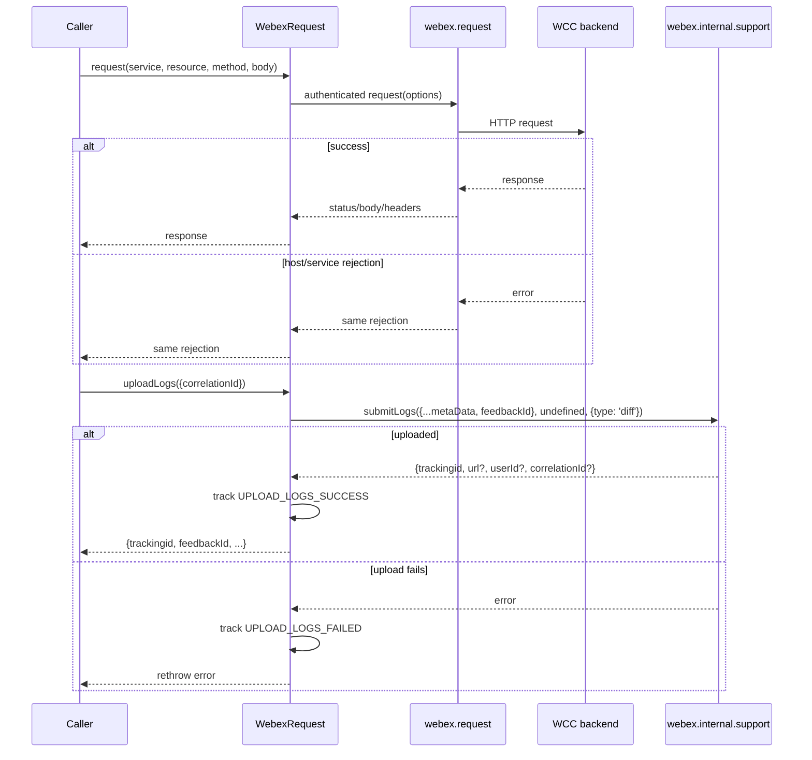
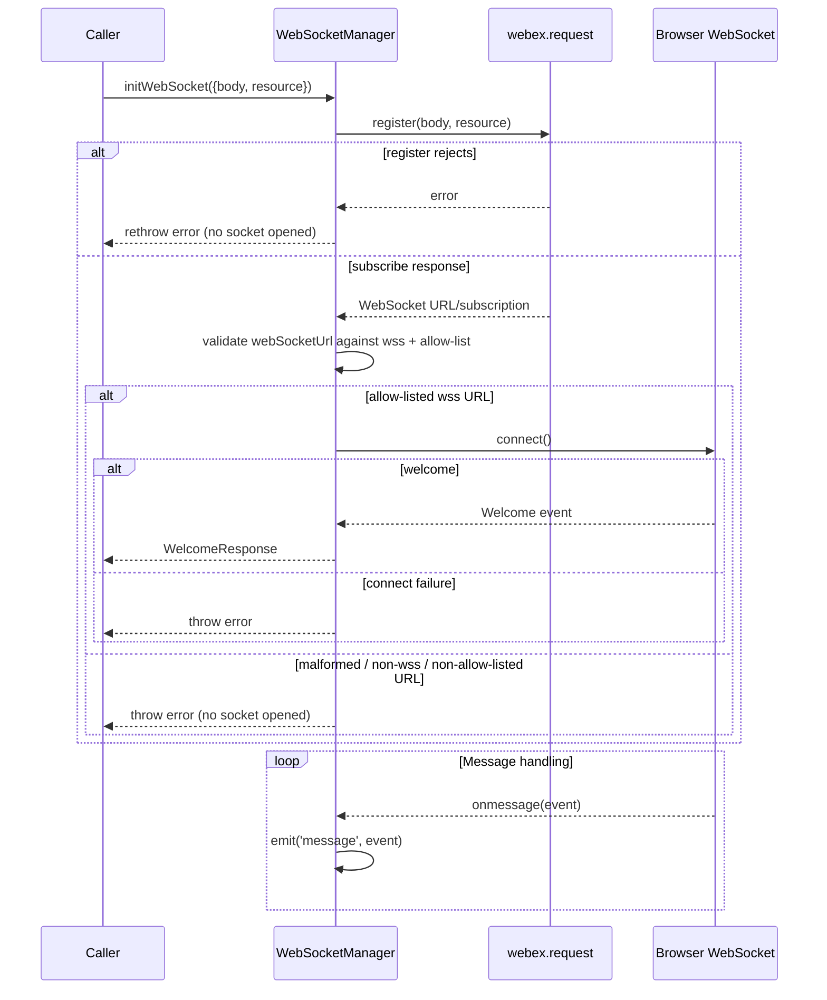
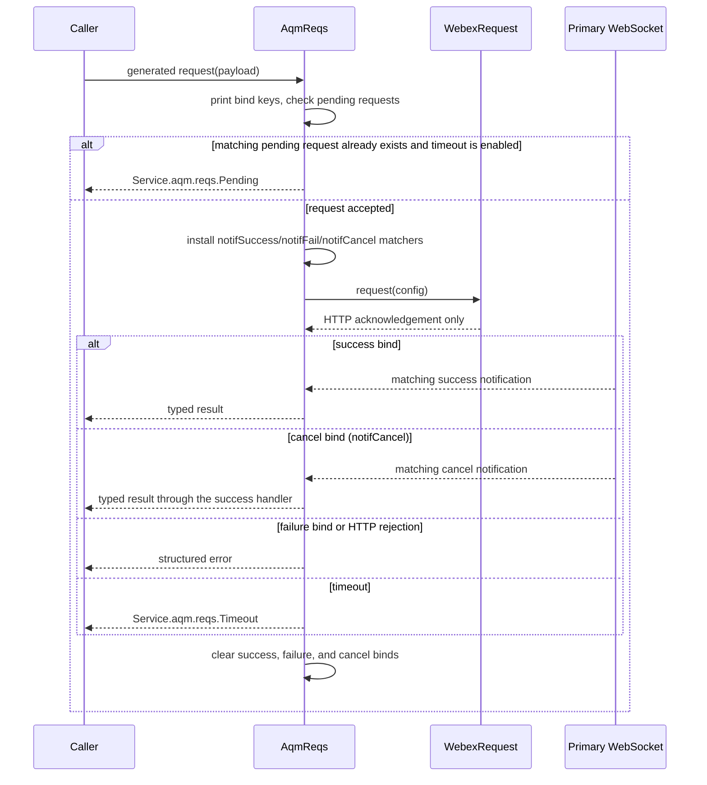
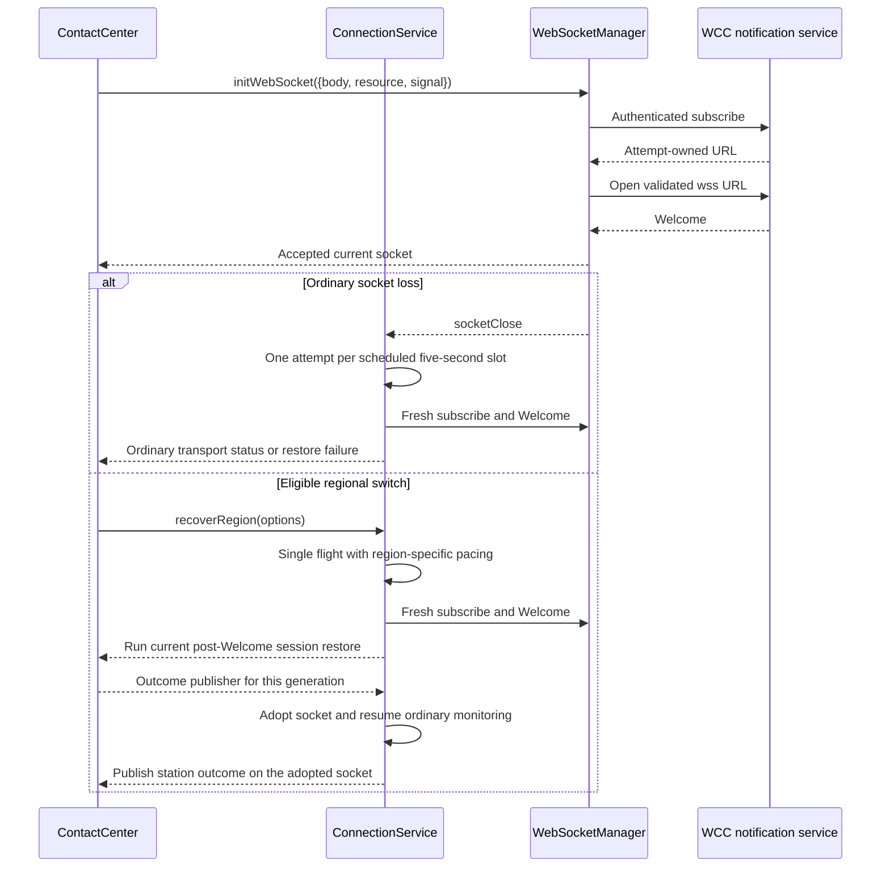
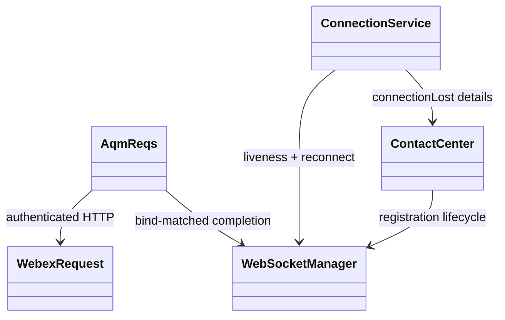
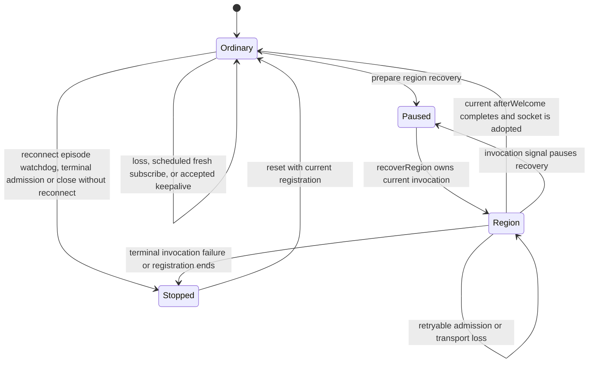
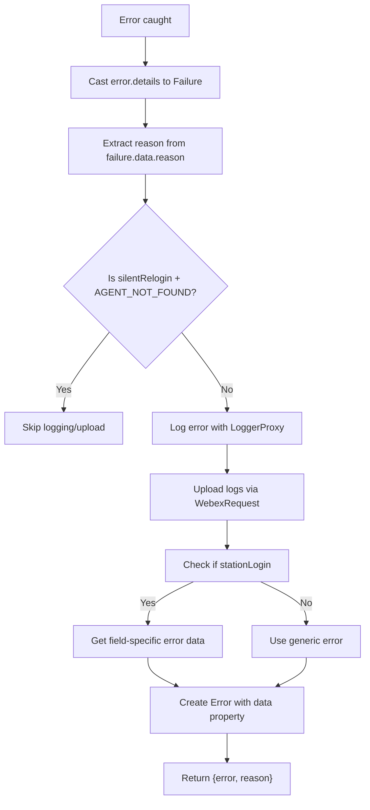

<!-- sdd-generated-metadata
doc_kind: module-spec
generated_from: module-spec@0.3.0
generated_by: claude-code
approved_by: rarajes2@cisco.com
updated_at: 2026-11-17T03:03:58Z
validation_status: pass-with-warnings
-->

# Core service

This source-local document at `src/services/core/docs/README.md` owns the stable specification for
**the core service** of `@webex/contact-center`. Core infrastructure components include WebSocket
management, HTTP requests, error handling, and utilities that the agent, config, task, dialer, and
plugin layers build on. Ground every claim in package evidence and link to the
[package architecture](../../../../docs/architecture.md) instead of repeating broader facts. The
parent [services specification](../../docs/README.md) owns the composition of these pieces into the
`Services` singleton.

Related context: [documentation index](../../../../docs/index.md) ·
[package agent instructions](../../../../AGENTS.md)

## Metadata

| Field | Value |
|---|---|
| Owner | @webex/web-sdk |
| Source path | `src/services/core` |
| Resource kind | module |
| Status | Active |
| Last verified | 2026-11-16 at `0b8c34db7f` |
| Module id | `core` |
| Parent spec | [src/services](../../docs/README.md) |
| Doc kind | Module spec |
| Coverage score | Pending coverage assessment |
| Validation status | pass-with-warnings — assessed 2026-11-17; validator runtime 01a1e76f-2293-79a0-9f8f-f060038448dd; 0 Blocking, 0 Important, 4 Minor findings. |

## Applicability

| Condition ID | Status | Evidence or reason | Owned section |
| ------------ | ------ | ------------------ | ------------- |
| `module.has_tiers` | N/A | The package defines no module tiers (`.sdd/manifest.json` profile sets has_tiers to false) | Tier |
| `module.has_ui` | N/A | No rendering code; every surface is a class, function, or event | UI use-case flow |
| `module.crosses_service_boundaries` | Applicable | `src/services/core/websocket/WebSocketManager.ts` calls the notification subscribe API and opens a WebSocket; `src/services/core/WebexRequest.ts` calls the WCC API gateway and the support log-upload service | Cross-boundary use-case flow |
| `module.holds_client_state` | Applicable | Socket, welcome, worker, pending-bind, timer, and connection flags in `src/services/core/websocket/WebSocketManager.ts`, `src/services/core/aqm-reqs.ts`, and `src/services/core/websocket/connection-service.ts` | Client state model |
| `module.enforces_domain_rules` | Applicable | The wss allow-list check, the duplicate-pending rejection, and the log-redaction rules in `src/services/core/websocket/WebSocketManager.ts` and `src/services/core/aqm-reqs.ts` | Business rules and invariants |
| `module.is_concurrent_async` | Applicable | Event-emitter fan-out, a keepalive Web Worker, and timer-driven reconnect in `src/services/core/websocket/connection-service.ts` and `src/services/core/websocket/keepalive.worker.js` | Concurrency and reactive flow |
| `module.owns_persistence` | N/A | Nothing in the module writes storage; all state is in memory | Data, schema, and migration discipline |
| `module.stateful_transitions` | Applicable | Socket lifecycle and connection-lost, reconnected, and restore-failed transitions in `src/services/core/websocket/connection-service.ts` | State machine |
| `module.exposes_wire_protocol` | Applicable | Subscribe request and response, the keepalive frame, the worker message contract, and the AQM bind matching in `src/services/core/websocket/WebSocketManager.ts` and `src/services/core/aqm-reqs.ts` | Protocol and wire format |
| `module.ui_multi_screen` | N/A | No UI | UI flow |
| `module.large_data_model` | N/A | The module's types (`src/services/core/types.ts`, `src/services/core/GlobalTypes.ts`, `src/services/core/websocket/types.ts`) are small request, message, and connection-state shapes | Data model |
| `module.returns_caller_errors` | Applicable | Err.Details and Err.Message rejections from `src/services/core/aqm-reqs.ts`, and the helpers in `src/services/core/Utils.ts` | Caller-visible failure modes |
| `module.module_specific_conventions` | Applicable | Error-helper, constants, redaction, and listener rules recorded under Module-specific rules, enforced by `src/services/core/Utils.ts` and `src/services/core/aqm-reqs.ts` | Module-specific rules |
| `module.published_package` | N/A | `src/index.ts` exports no core symbol; the module is internal to the package | Export stability |
| `module.embedded_in_host` | N/A | The package-level host integration is owned by the package root module | Host integration and theming |
| `module.has_design_tradeoff` | Applicable | HTTP initiation with WebSocket completion in `src/services/core/aqm-reqs.ts`; transport-only recovery in `src/services/core/websocket/connection-service.ts` | Key design trade-off |
| `module.has_submodules` | N/A | The websocket folder is part of this module; the plugin's module_tree.py reports no child module | Sub-modules |

## Evidence register

| Evidence | What it establishes |
| -------- | ------------------- |
| `src/services/core/WebexRequest.ts` | Singleton `WebexRequest`: `getInstance`, `request` (service, resource, method, body, optional headers), and `uploadLogs` with metrics |
| `src/services/core/aqm-reqs.ts` | `AqmReqs`: `req`, `reqEmpty`, bind keys, pending maps, duplicate rejection, HTTP failure cleanup, timeout, interruption and redacted diagnostics |
| `src/services/core/types.ts` | `Req`, `Conf`, `ConfEmpty`, `Res`, `ResEmpty`, `CbRes`, `Pending`, `Timeout`, and the RTD request types |
| `src/services/core/websocket/WebSocketManager.ts` | Subscribe registration, the `wss` allow-list check, socket handlers, keepalive worker wiring, welcome resolution, multi-login close, and `message`/`socketClose` events |
| `src/services/core/websocket/connection-service.ts` | Liveness timers, single-flight retry slots, restore failure, and the `connectionLost` event; the member subsections under Class and component relationships are justified by this file and `src/services/core/websocket/WebSocketManager.ts` |
| `src/services/core/websocket/keepalive.worker.js` | The worker script, its `start`/`terminate` inputs, and its `keepalive`/`closeSocket` outputs |
| `src/services/core/websocket/types.ts` | `ConnectionServiceOptions`, `ConnectionLostDetails`, `RegionRecoveryOptions` |
| `src/services/core/constants.ts` | Timer values, `ALLOWED_ROUTING_NOTIFS_DOMAINS`, participant constants, and method-name constants |
| `src/services/core/Utils.ts`, `src/services/core/Err.ts`, `src/services/core/GlobalTypes.ts` | Error helpers, the `Err` classes and error-id types, and `Msg`, `Failure`, `TaskError`, `AugmentedError` |
| `src/services/index.ts`, `src/cc.ts` | Consumers: construction order, the second RTD `WebSocketManager`, `connectWebsocket`, `handleConnectionLost`, and the `allowAutomatedRelogin` relogin policy |
| `src/services/constants.ts`, `src/services/config/types.ts`, `src/types.ts` | `WCC_API_GATEWAY`, `SUBSCRIBE_API`, `RTD_SUBSCRIBE_API`, `CC_EVENTS`, `SubscribeResponse`, `WelcomeResponse`, and the shared request types |
| `test/unit/spec/services/core/WebexRequest.ts`, `test/unit/spec/services/core/aqm-reqs.ts`, `test/unit/spec/services/core/Utils.ts` | Unit cases for request delegation, log upload, AQM settlement and redaction, and the error and URL helpers |
| `test/unit/spec/services/core/websocket/WebSocketManager.ts`, `test/unit/spec/services/core/websocket/connection-service.ts` | Unit cases for URL validation, the INT header, close paths, multi-login, timers, and reconnect |
| `src/services/core/WebexRequest.ts`, `src/services/core/websocket/WebSocketManager.ts`, `src/services/core/aqm-reqs.ts`, `src/services/core/websocket/connection-service.ts` (Data flow extension subsections) | One sequence subsection per operation group of the Data flow inventory: WebexRequest (request and uploadLogs), Subscribe and connect, Correlated request, and Connection lifecycle |
| `src/services/index.ts` (no feature gate) | `Services` constructs `WebSocketManager`, `AqmReqs`, and `ConnectionService` unconditionally; no rollout flag gates Core. No test observes this absence |
| `jest.config.js` | The 85% global branch, function, line, and statement threshold |

## Purpose and boundary

Core is the foundational infrastructure layer that all other services depend on. It owns authenticated HTTP to the WCC API Gateway with log upload support, the realtime WebSocket lifecycle with automatic reconnection and keepalive management, AQM request correlation (HTTP requests whose responses/failures are correlated via WebSocket notifications), and shared error normalization: standardized error extraction, logging via `LoggerProxy`, and log upload.

Boundary:

- Responsibility: the four concerns above, plus the shared consult and dial-number helpers in
  `src/services/core/Utils.ts`.
- In scope: every file under `src/services/core`, including `websocket/`.
- Out of scope: agent credentials, the agent profile, and the silent-relogin decision (the
  ContactCenter plugin in `src/cc.ts`); composing the services (`src/services/index.ts`, parent spec);
  the meaning of individual AQM operations (the agent, task, and dialer modules that call `req`).
- Consumers: `Services` constructs `WebSocketManager`, `AqmReqs`, and `ConnectionService`; `src/cc.ts`
  calls `initWebSocket`, `close`, and listens to `message` and `connectionLost`; `TaskManager`
  listens to `message` on both sockets; the agent, contact, and dialer factories call `req`; many
  service files call `WebexRequest`, `getErrorDetails`, `generateTaskErrorObject`, and the consult
  helpers.

## Structure and key files

```text
services/core/
├── aqm-reqs.ts           # AQM request handler
├── constants.ts          # Core constants
├── Err.ts                # Error classes
├── GlobalTypes.ts        # Failure, Msg<T>, etc.
├── types.ts              # Request/response types
├── Utils.ts              # Utility functions
├── WebexRequest.ts       # HTTP client
└── websocket/
    ├── WebSocketManager.ts    # Main WS handler
    ├── connection-service.ts  # Connection lifecycle
    ├── keepalive.worker.js    # Keepalive worker
    └── types.ts               # WS types
```

| Component | File | Description |
|---|---|---|
| `WebSocketManager` | [`WebSocketManager.ts`](../websocket/WebSocketManager.ts) | Manages the WebSocket connection lifecycle including initialization, message dispatch, keepalive worker integration, and graceful shutdown. Validates the subscribe/register `webSocketUrl` against the RoutingNotifs allow-list before opening a socket. Emits `message` events for incoming data and `socketClose` when the connection drops while reconnect is allowed. |
| `ConnectionService` | [`connection-service.ts`](../websocket/connection-service.ts) | Orchestrates reconnection logic and keepalive heartbeats on top of `WebSocketManager`. Detects connection loss/recovery and emits `connectionLost` details; ContactCenter owns any `silentRelogin()` policy. |
| `WebexRequest` | [`WebexRequest.ts`](../WebexRequest.ts) | Singleton HTTP client that forwards service, resource, method, body, headers, and timeout to the authenticated host request API and provides `uploadLogs` diagnostics. |
| `AqmReqs` | [`aqm-reqs.ts`](../aqm-reqs.ts) | Factory for creating request methods that send HTTP requests and wait for correlated WebSocket notifications (success or failure): the AQM request/response pattern and WebSocket notification binding, with the pending maps and timeout. Used by routing and task services to implement their API methods. |
| `Utils` | [`Utils.ts`](../Utils.ts) | Shared utility functions including `getErrorDetails()` for standardized error handling, `generateTaskErrorObject()` for task-specific errors, and `createErrDetailsObject()` for constructing error detail objects; also `getStationLoginErrorData`, `isAllowedUrlHost`, `isValidDialNumber`, `stripDialPlanChars`, and the consult utilities (`getConsultedAgentId`, `getDestAgentIdForCBT`, `calculateDestAgentId`, `calculateDestType`, `buildConsultConferenceParamData`, `deriveConsultTransferDestinationType`). |
| `Err` | [`Err.ts`](../Err.ts) | Error class definitions: `Err.Message` and `Err.Details` error classes and the typed error-id unions. `Err.Details` carries structured error metadata (status, type, trackingId) for consistent error propagation. |
| `constants` | [`constants.ts`](../constants.ts) | Timeout values, interval durations, participant types, interaction states, method name constants, and the `ALLOWED_ROUTING_NOTIFS_DOMAINS` WebSocket host allow-list used throughout the core layer. Any new constants for core should be defined here. |
| `GlobalTypes` | [`GlobalTypes.ts`](../GlobalTypes.ts) | `Msg`, `Failure`, `TaskError`, `AugmentedError` type definitions. |
| `types` | [`types.ts`](../types.ts) | `Pending`, `Req`, `Conf`, `Res` types for AqmReqs, plus the internal RTD request types. |
| keepalive worker | [`keepalive.worker.js`](../websocket/keepalive.worker.js) | Web Worker for periodic keepalive and offline detection, exported as a script string. |
| websocket `types` | [`types.ts`](../websocket/types.ts) | `ConnectionServiceOptions`, `ConnectionLostDetails`, `RegionRecoveryOptions`. |

Files outside the source layout above:

| Path | Responsibility |
| ---- | -------------- |
| `src/services/core/docs/README.md` | This module specification |
| test/unit/spec/services/core (directory) | Unit tests mirroring the source layout, including the websocket folder |

## Public surface

The module is internal to the package: `src/index.ts` exports none of it. Its consumption boundary is
contract `contact-center-core-transport` (internal SDK contract, canonical source
`src/services/core/aqm-reqs.ts`), indexed in the
[package architecture](../../../../docs/architecture.md).

| Surface | Consumer | Compatibility commitment | Source |
| ------- | -------- | ------------------------ | ------ |
| `contact-center-core-transport`: `AqmReqs` (`req`, `reqEmpty`, `beginGeneration`, `setRecoveryGate`, `interruptPending`) and the `Req`/`AqmRequestContext` configuration | Agent, contact, and dialer factories; ContactCenter owns generation and recovery-gate updates | Internal; additive config fields only, every in-package caller updated in the same change | `src/services/core/aqm-reqs.ts`, `src/services/core/types.ts`, `src/cc.ts` |
| `contact-center-core-transport`: `WebexRequest.getInstance`, `request`, `uploadLogs` | `src/cc.ts`, config and other services, the error helpers | Internal; `request` returns or rejects with the host result unchanged | `src/services/core/WebexRequest.ts` |
| `contact-center-core-transport`: `WebSocketManager` (`initWebSocket`, `close`, `handleConnectionLost`, `shouldReconnect`, `hasUsableSocket`, events `message` and `socketClose`) | `Services`, `src/cc.ts`, `TaskManager`, `AqmReqs`, `ConnectionService` | Internal; event names are string literals that listeners depend on | `src/services/core/websocket/WebSocketManager.ts` |
| `contact-center-core-transport`: `ConnectionService` (`reset`, `pause`, `recoverRegion`, `stop`, event `connectionLost` with `ConnectionLostDetails`) | `src/cc.ts` | Internal; ContactCenter reads `isConnectionLost` and `isSocketReconnected` | `src/services/core/websocket/connection-service.ts`, `src/services/core/websocket/types.ts` |
| `contact-center-core-transport`: error and utility helpers, `Err` classes, `Msg`, `Failure`, `AugmentedError` | Agent, config, task, and plugin code | Internal; error `message` and `data` shapes are observed by callers | `src/services/core/Utils.ts`, `src/services/core/Err.ts`, `src/services/core/GlobalTypes.ts` |

| Event | Data | Description |
|---|---|---|
| `message` | string (JSON) | WebSocket message received |
| `socketClose` | `{shouldReconnect: boolean}` | Reports explicit or admitted socket closure. False disables retries. |
| `connectionLost` | `ConnectionLostDetails` | Emitted by `ConnectionService` on ordinary lost, recovered, reconnected, and restore-failed transitions. A keepalive echo sets `isKeepAlive: true` and emits only in ordinary mode with no admission flight in progress. |

Generic message wrapper used throughout the SDK. All WebSocket messages and AQM responses conform to this shape:
`Msg<T>` in [GlobalTypes.ts](../GlobalTypes.ts) carries `type`, `orgId`, `trackingId`, and a `data` payload of type `T`, so a typed event such as a login success is declared as `Msg<{agentId, status, ...}>` and arrives as `{type, orgId, trackingId, data: {agentId, status, ...}}`.

Do not remove or reinterpret exported symbols/events without a documented consumer migration.

## Dependencies

| Dependency | Why it is required | Failure behavior |
| ---------- | ------------------ | ---------------- |
| Webex SDK service catalog and authenticated request API (`webex.request`, contracts `webex-core-plugin-runtime` and `wxcc-api-gateway`) | Every REST call and the subscribe registration; the host resolves the `service` key and adds authentication | Rejections propagate unchanged through `WebexRequest.request`; `AqmReqs` maps them (CORE-R-010) |
| Notification WebSocket (contract `wxcc-websocket-notifications`) | Delivers the welcome event, keepalive echoes, and every AQM result | Close and error handlers; recovery per Connection lifecycle |
| `webex.internal.support.submitLogs` (contract `webex-internal-support`) | `uploadLogs` diagnostics | Logged, tracked as `UPLOAD_LOGS_FAILED`, and rethrown |
| `webex.credentials.getOrgId`, `webex.internal.services.isIntegrationEnvironment` | The `X-ORGANIZATION-ID` header on the subscribe call in INT environments | A missing `isIntegrationEnvironment` is treated as production (no header) |
| Browser WebSocket, Worker, URL and network-status APIs | Socket, keepalive worker (`Blob` + `URL.createObjectURL`), URL validation, `navigator.onLine` | Offline ordinary attempts skip subscribe and retry at the next five-second single-flight slot, bounded by the watchdog |
| LoggerProxy and log upload | Every diagnostic line and the error helpers' upload | Fire and forget in the helpers |
| `MetricsManager` (`src/metrics/MetricsManager.ts`) | `UPLOAD_LOGS_SUCCESS` and `UPLOAD_LOGS_FAILED` behavioral events | Not awaited |
| `src/services/constants.ts`, `src/services/config/types.ts` | `WCC_API_GATEWAY`, `SUBSCRIBE_API`, `CC_EVENTS.WELCOME`, `SubscribeResponse`, `WelcomeResponse` | Compile-time |
| `src/types.ts` | Shared `WebexSDK`, `HTTP_METHODS`, `RequestBody`, `IHttpResponse`, `LogsMetaData`, `UploadLogsResponse`, `SubscribeRequest`, `WebexRequestPayload`, `LoginOption` types | Compile-time |
| `src/services/task/types.ts` | Interaction and destination types for the consult helpers in `Utils.ts` | Compile-time |

## Requirements

| ID | WHAT | WHY | Source Evidence | Test / Example Evidence | Assumptions / Gaps | Confidence |
|---|---|---|---|---|---|---|
| CORE-R-001 | WebexRequest delegates service, resource, method, body, headers, and timeout to the authenticated host request API and returns or rejects with the host result unchanged. | All Contact Center REST clients share host-owned authentication and service routing without duplicating credential logic. | `src/services/core/WebexRequest.ts` | `test/unit/spec/services/core/WebexRequest.ts` | `WebexRequest.request` preserves the host result. AQM diagnostics use selected scalar fields. | PRESENT |
| CORE-R-002 | `initWebSocket({body, resource, signal?}): Promise<WelcomeResponse>` resolves on an accepted current Welcome. Application notifications require Welcome. The current attempt still handles `AGENT_MULTI_LOGIN` and `SYSTEM_REGION_SWITCH` before Welcome. | An unadmitted socket cannot deliver station, state, or task data. Session replacement and region-switch controls still reach their owners. | `src/services/core/websocket/WebSocketManager.ts` | `test/unit/spec/services/core/websocket/WebSocketManager.ts`, `test/unit/spec/cc.ts` | Rejected subscribe, supersession, socket close before Welcome, and abort dispose owned admission. | PRESENT |
| CORE-R-003 | AqmReqs settles notification-bound requests once on success, failure, cancel, host rejection, timeout, or operation interruption. HTTP acknowledgement keeps the matching notification pending. | HTTP acknowledgement alone does not represent backend operation completion. | `src/services/core/aqm-reqs.ts` | `test/unit/spec/services/core/aqm-reqs.ts` | None. | PRESENT |
| CORE-R-004 | ConnectionService publishes current transport state and owns single-flight attempts. ContactCenter owns station and relogin policy. | Separating transport detection from agent recovery prevents Core from mutating package-level session state. | `src/services/core/websocket/connection-service.ts` | `test/unit/spec/services/core/websocket/connection-service.ts` | None. | PRESENT |
| CORE-R-005 | The keepalive worker must use `KEEPALIVE_WORKER_INTERVAL` as its interval and `CLOSE_SOCKET_TIMEOUT` as its close-socket timeout, and AQM requests default to `TIMEOUT_REQ` unless disabled/overridden (values in the timer table under Concurrency and reactive flow). | Accurate timing is required for predictable recovery and request failure behavior. | `src/services/core/constants.ts`, `src/services/core/websocket/WebSocketManager.ts` | `test/unit/spec/services/core/aqm-reqs.ts` | No unit case asserts the worker `start` message values; the AQM default is asserted by the default-timeout case. | WEAK |
| CORE-R-007 | AQM routing failure, timeout, and HTTP diagnostics always use fixed messages and selected normalized scalar fields. Headers, URL, bind, body and response do not enter the diagnostic sink. | Dynamic request paths and routing messages can contain participant identifiers or phone numbers that must not enter diagnostic logs. | `src/services/core/aqm-reqs.ts`, `src/services/core/types.ts` | `test/unit/spec/services/core/aqm-reqs.ts` | Raw HTTP-rejection input still reaches the configured error mapper (CORE-R-010). | PRESENT |
| CORE-R-008 | `WebSocketManager` opens a socket only for a subscribe/register `webSocketUrl` that parses as a `wss` URL whose host equals, or is a subdomain of, an entry in `ALLOWED_ROUTING_NOTIFS_DOMAINS`; a malformed, non-`wss`, or non-allow-listed URL is rejected with an error and no socket is opened. | A server-controlled subscribe response could otherwise direct the realtime connection to an untrusted or non-secure endpoint. | `src/services/core/websocket/WebSocketManager.ts`, `src/services/core/constants.ts` | `test/unit/spec/services/core/websocket/WebSocketManager.ts` | The allow-list is a fixed domain set; subdomain matching is exact suffix matching on the parsed hostname. | PRESENT |
| CORE-R-009 | When a pending request already holds the logical success or failure bind key and the new request's `timeout` is not `'disabled'`, the generated function rejects at once with `Err.Details('Service.aqm.reqs.Pending')` and sends no HTTP request. | Duplicate admission uses the logical bind even when recovery matching uses a distinct tracking UUID. | `src/services/core/aqm-reqs.ts`, `src/services/core/Err.ts` | `test/unit/spec/services/core/aqm-reqs.ts` | T-008 `correlationDoesNotBypassDuplicateAdmission` checks rejection even with distinct tracking IDs. | PRESENT |
| CORE-R-010 | On host HTTP rejection AqmReqs clears all three owned binds and uses the configured error mapper, or preserves a known lifecycle error. Timeout rejects with `Err.Details('Service.aqm.reqs.Timeout', {key, response: {statusCode?, reasonCode?, trackingId?, id?} \| null})`: a new projection of selected normalized scalars from the HTTP acknowledgement, or null without an acknowledgement. Raw host HTTP-rejection input to the error mapper may still carry sensitive details. Diagnostics use selected scalars. | Timeout errors must omit acknowledgement credentials, headers and body. Each operation module owns caller-facing HTTP-rejection mapping. | `src/services/core/aqm-reqs.ts` | `test/unit/spec/services/core/aqm-reqs.ts` T-013 timeout projection and HTTP failure cases | Error mappers receiving raw HTTP-rejection input should log only safe selected values. An acknowledgement without recognized fields projects to an empty object. | PRESENT |
| CORE-R-011 | A `notifCancel` bind resolves the same promise as the success bind and is cleared with it. | Some operations finish with an alternate event (for example a participant leaving instead of a drop success), and the caller must still settle once. | `src/services/core/aqm-reqs.ts`, `src/services/core/types.ts` | `test/unit/spec/services/core/aqm-reqs.ts` | None. | PRESENT |
| CORE-R-012 | The subscribe call adds `X-ORGANIZATION-ID` (set to the org id) only when `webex.internal.services.isIntegrationEnvironment()` is true and an org id exists. | The in-code comment: the header is only required for INT environments. | `src/services/core/websocket/WebSocketManager.ts` | `test/unit/spec/services/core/websocket/WebSocketManager.ts` | None. | PRESENT |
| CORE-R-013 | An `AGENT_MULTI_LOGIN` message on the current socket disposes the socket and emits `socketClose({shouldReconnect: false})`, including before Welcome. The driver stops retrying. | A second login of the same agent replaces this session. Reconnecting would fight it. | `src/services/core/websocket/WebSocketManager.ts` | `test/unit/spec/services/core/websocket/WebSocketManager.ts`, `test/unit/spec/cc.ts` | None. | PRESENT |
| CORE-R-014 | `uploadLogs(metaData)` submits diff logs with a fresh `feedbackId`, tracks `UPLOAD_LOGS_SUCCESS` or `UPLOAD_LOGS_FAILED`, resolves `{trackingid, feedbackId}` plus any returned `url`, `userId`, `correlationId`, and rethrows a failure. | The JSDoc: logs are uploaded to the backend for diagnostics; the `feedbackId` and `correlationId` let support find them. | `src/services/core/WebexRequest.ts` | `test/unit/spec/services/core/WebexRequest.ts` | None. | PRESENT |
| CORE-R-015 | `getErrorDetails` and `generateTaskErrorObject` keep the error shapes and the logging and log-upload side effects specified under Caller-visible failure modes. | Callers rely on one error shape per flow for metrics, UI messages, and station-login field hints. | `src/services/core/Utils.ts` | `test/unit/spec/services/core/Utils.ts` | `generateTaskErrorObject` has no unit case in this module's tests. | PRESENT |
| CORE-R-016 | An admission attempt owns its authenticated subscribe request, the returned URL, socket, Welcome deadline and keepalive resources. Retain the secure hostname check. Bound subscribe at 20 seconds and Welcome at 30 seconds. Supersession, timeout, close-before-Welcome, or abort disposes that attempt and fences late completions. | A stale URL, unresolved Welcome, or late callback cannot claim the current transport. | `src/services/core/websocket/WebSocketManager.ts`, `src/services/core/constants.ts` | `test/unit/spec/services/core/websocket/WebSocketManager.ts` | T-003, T-005. Only an open, current socket with accepted Welcome is usable. | PRESENT |
| CORE-R-017 | Ordinary reconnect uses five-second slots under a 50-second watchdog. An expired reconnect episode disposes its candidate. An admitted quiet socket can still receive a late keepalive. Region recovery uses one in-flight attempt, with base delays of 100/60/30/15 seconds plus fresh jitter up to 50 percent and repeated 15-second slots. A recognized subscribe mismatch and terminal authentication stop the relevant recovery. The region driver never uses the ordinary watchdog. | Each retry policy needs its own timing and terminal behavior while preventing overlapping admission. | `src/services/core/websocket/connection-service.ts`, `src/services/core/Utils.ts` | `test/unit/spec/services/core/websocket/connection-service.ts`, `test/unit/spec/cc.ts` | T-004, T-005, T-012. Socket success is separate from session acceptance. | PRESENT |
| CORE-R-018 | A generation-owned AQM request follows the per-kind recovery gate and settles once, clearing timers and owned binds on abort or interruption. For recovery-owned session and state operations, both outcome bindings match the bare nested `data.trackingId` UUID from the request header `webex-js-sdk_<uuid>`. Ordinary operations use the existing outer and nested event types and preserve duplicate rejection. Recent known local IDs fence late replies. Recovery diagnostics retain normalized tracking and reason fields while redacting credentials and station payloads. | Only the current operation can consume a recovery result. Ordinary bindings remain compatible with backends that assign their own notification tracking IDs. | `src/services/core/aqm-reqs.ts`, `src/services/core/Utils.ts`, `src/services/core/types.ts` | `test/unit/spec/services/core/aqm-reqs.ts`, `test/unit/spec/cc.ts` | T-007, T-008, T-012, T-013, including “gateKindAndSessionOwnerMatrix” and “exact session owner”. Deployed nested UUID echo and compatibility sign-off remain release evidence. | PRESENT |
| CORE-R-019 | In ordinary mode without an admission flight, `ConnectionService.onPing` guards JSON parsing and object validation. Malformed JSON and non-object/array payloads produce fixed `LoggerProxy.error` diagnostics and return without throwing or changing liveness state/timers; valid objects retain keepalive and recovery handling. Diagnostic sink exceptions are contained. | One malformed server frame or failing logger must not disrupt the liveness loop, and the frame must not enter logs. | `src/services/core/websocket/connection-service.ts` (onPing, diagnose) | `test/unit/spec/services/core/websocket/connection-service.ts` T-012 malformed-ping matrix and ordinary recovery cases | Non-ordinary modes and an active admission flight return before parsing or logging. | PRESENT |

## Design overview

Stack: TypeScript/JavaScript, WebSocket, Web Worker keepalive, EventEmitter, Webex request client, Jest 27.

Core separates four responsibilities:

1. `WebexRequest` wraps the authenticated host request API and service-catalog routing.
2. `WebSocketManager` registers a subscription using both `body` and `resource`, validates the returned `webSocketUrl` against the `ALLOWED_ROUTING_NOTIFS_DOMAINS` allow-list before connecting the socket, owns the keepalive worker, and emits raw messages/socket lifecycle events.
3. `AqmReqs` registers bind matchers on the primary WebSocket, sends HTTP through WebexRequest, and settles requests on matching notifications, host rejection, timeout or owned interruption.
4. `ConnectionService` observes message/socket liveness, emits connection-state details, and retries socket initialization. ContactCenter listens to those details and owns optional silent relogin.

Component instantiation order (`Services` constructor in `src/services/index.ts`, after the plugin
has called `WebexRequest.getInstance({webex})` in `src/cc.ts`):

1. **WebSocketManager** ([WebSocketManager.ts](../websocket/WebSocketManager.ts)) - Creates a keepalive worker when an owned socket opens. The RTD manager has its own socket and worker.
2. **AqmReqs** ([src/services/core/aqm-reqs.ts](../aqm-reqs.ts)) - Initialized with WebSocketManager reference
3. **Service layers** (agent, contact, dialer) - Created with AqmReqs reference; config is created without it
4. **ConnectionService** ([connection-service.ts](../websocket/connection-service.ts)) - Wires event listeners immediately

The AQM (Agent Queue Manager) layer provides a request/response pattern over HTTP + WebSocket. Services like **routing** and **contact** use `AqmReqs` to define API methods that:

1. Send an HTTP request to the contact center backend via `WebexRequest`
2. Wait for a correlated WebSocket notification indicating success or failure
3. Return the typed result or throw a structured error

This decouples the request initiation (HTTP) from the asynchronous result delivery (WebSocket), which matches the contact center backend's event-driven architecture.

```typescript
const aqmReqs = new AqmReqs(webSocketManager);
const setState = aqmReqs.req((p: {data: Agent.StateChange}) => ({
  host: WCC_API_GATEWAY,
  url: '/v1/agents/session/state',
  data: p.data,
  method: HTTP_METHODS.PUT,
  notifSuccess: {
    bind: {
      type: CC_EVENTS.AGENT_STATE_CHANGE,
      data: {type: CC_EVENTS.AGENT_STATE_CHANGE_SUCCESS},
    },
    msg: {} as Agent.StateChangeSuccess,
  },
  notifFail: {
    bind: {
      type: CC_EVENTS.AGENT_STATE_CHANGE,
      data: {type: CC_EVENTS.AGENT_STATE_CHANGE_FAILED},
    },
    errId: 'Service.aqm.agent.stateChange',
  },
}));
await setState({data: stateChangePayload});
```

The production `stateChange` method in `src/services/agent/index.ts` has this shape plus an `err`
mapper. `req` returns `(payload, cbRes?) => Promise`, and `reqEmpty` returns `(cbRes?) => Promise`.
The optional `cbRes` callback receives the raw HTTP acknowledgement. Internal callers can pass an
`AqmRequestContext` as the last argument for recovery ownership and correlation.

`WebexRequest` ([WebexRequest.ts](../WebexRequest.ts)) is a singleton HTTP client that all services
use to make authenticated REST API calls to the contact center backend. Its constructor is private;
the static `instance` is created by the first `getInstance({webex})` call that passes a `WebexSDK`,
and later calls, with or without options, return it. It does not resolve URLs, format requests, or
parse responses itself: `request({service, resource, method, body, headers})` forwards the service
key used by `webex.request` to resolve the target host, the API path within the service (for example
`v1/notification/subscribe`), the `HTTP_METHODS` value, the optional `RequestBody`, and `headers`
(only when given), and returns the host's `Promise<IHttpResponse>`.
`uploadLogs(metaData: LogsMetaData = {})` resolves an `UploadLogsResponse` (CORE-R-014).

```typescript
// Get singleton
const webexReq = WebexRequest.getInstance({webex});

// Make request
const response = await webexReq.request({
  service: WCC_API_GATEWAY,  // resolved to base URL by Webex SDK
  resource: '/v1/endpoint',  // appended as path
  method: HTTP_METHODS.POST,
  body: { key: 'value' },   // optional request payload
});

// Upload logs
await webexReq.uploadLogs({
  correlationId: trackingId,
});
```

`WebSocketManager` handles the raw WebSocket connection to the contact center backend. It is
instantiated by the `Services` layer; `src/cc.ts`, `TaskManager`, `AqmReqs`, and `ConnectionService`
all use the same instance directly.

```typescript
// Initialize in Services
this.webSocketManager = new WebSocketManager({webex});

// Connect
const welcomeEvent = await webSocketManager.initWebSocket({
  body: connectionConfig,
  resource: SUBSCRIBE_API,
});

// Listen for messages
webSocketManager.on('message', (event) => {
  const data = JSON.parse(event);
  // Handle event
});

// Close
webSocketManager.close(false, 'Reason');
```

## Data flow and sequence coverage

Transport: REST over `webex.request` to the `wcc-api-gateway` service, and one JSON WebSocket per
`WebSocketManager` instance. Every AQM operation starts with HTTP and completes on the primary
socket.

| Operation group | Entry and outcome | Diagram or evidence | Failure and recovery coverage |
| --------------- | ----------------- | ------------------- | ----------------------------- |
| Authenticated REST | `WebexRequest.request`; resolves the host response | Diagram WebexRequest; `src/services/core/WebexRequest.ts` | Host/service rejection is propagated unchanged; AQM applies its own error mapping separately. |
| Diagnostics upload | `WebexRequest.uploadLogs`; resolves the feedback and tracking ids | Diagram WebexRequest (upload part); `src/services/core/WebexRequest.ts` | Failure tracked as `UPLOAD_LOGS_FAILED` and rethrown; no retry. |
| WebSocket subscribe/connect | `initWebSocket({body, resource})`; resolves the welcome data | Diagram Subscribe and connect; `src/services/core/websocket/WebSocketManager.ts` | Register rejection, URL rejection, connect failure, and welcome resolution. |
| AQM operation | Generated `req` function; resolves the matching notification | Diagram Correlated request; `src/services/core/aqm-reqs.ts` | Duplicate pending request (checked before any matcher is installed), cancel-bind resolution, HTTP failure, failure bind, and timeout reject. |
| Connection lifecycle and recovery | Keepalive, liveness timers, offline close, reconnect; emits `connectionLost` | Diagram Connection lifecycle; `src/services/core/websocket/connection-service.ts` | Offline attempts retry on the next interval; restored and restore-failed states are emitted to ContactCenter. |
| Error normalization | `getErrorDetails`, `generateTaskErrorObject` | getErrorDetails flow under Caller-visible failure modes; `src/services/core/Utils.ts` | Silent-relogin `AGENT_NOT_FOUND` skip; station-login field data. |

### WebexRequest



### Subscribe and connect



The register step is `POST v1/notification/subscribe` (`SUBSCRIBE_API`) on `wcc-api-gateway`; the
response body carries `webSocketUrl` and `subscriptionId`. The RTD socket uses the same flow with
`RTD_SUBSCRIBE_API`.

### Correlated request



### Connection lifecycle



Ordinary liveness owns the 8-second loss detection and 50-second restore watchdog. Registration owns
the lifetime of the ordinary driver. Region recovery pauses ordinary work, owns its own retry timer
and current attempt, and hands the accepted Welcome back to ContactCenter for session policy. An
aborted or superseded operation cannot install a socket or publish the newer generation's state.

## Class and component relationships

Component roles and files are catalogued under Structure and key files; this section shows how the
classes depend on each other and the members that carry the lifecycle.



### WebSocketManager members

`hasUsableSocket()` requires an open socket with an accepted Welcome. `cancelPending(error)`
settles pending admission with the given error and preserves an admitted socket. An already-aborted
signal leaves the current attempt intact. Abort of an admitted attempt disposes the socket without
resettling its promise. See CORE-R-002 and CORE-R-016 for admission deadlines and ownership.

### AqmReqs members

ContactCenter calls `beginGeneration`, `setRecoveryGate`, and `interruptPending` together in
`fenceRecoveryWork`. The first two change admission and ownership. `interruptPending` settles each
owned operation once and removes its binds, timer and abort listener.

`AqmRequestContext` carries `generation` and optional `signal`, `sessionOwner`, `correlationId`, and
`requireCorrelation`. Invocation context takes precedence over request configuration. With neither,
AqmReqs uses its current generation. ContactCenter supplies an exact session owner for restore or
manual login. Use the [wire contract](#protocol-and-wire-format) for tracking ID format.

`AqmRecoveryGate` starts at `{state: 'open'}`. Closed states are `recovering` with an optional
`AqmSessionOwner<'restore'>`, `manualLoginRequired` with an optional `AqmSessionOwner<'manual'>`,
or `unavailable` with reason `RECOVERY_INTERRUPTED` or `REGION_RELOAD_REQUIRED`.

Admission first rejects **every kind**, even queries under an open gate, with
`RECOVERY_INTERRUPTED` if the context generation is stale or its signal is aborted. For a current,
unaborted context the complete matrix is:

| `Req.kind` | `open` | `recovering` | `manualLoginRequired` | `unavailable` |
| ---------- | ------ | ------------ | --------------------- | ------------- |
| `command` or omitted | Admit | `RECOVERY_IN_PROGRESS` | `RECOVERY_IN_PROGRESS` | `gate.reason` |
| `query` | Admit | Admit | Admit | Admit |
| `session` | Admit without an owner check | Admit only with the exact current `restore` owner; otherwise `RECOVERY_IN_PROGRESS` | Admit only with the exact current `manual` owner; otherwise `RECOVERY_IN_PROGRESS` | `gate.reason` |
| `teardown` | Admit without a socket check | Admit only with a usable primary; otherwise `RECOVERY_INTERRUPTED` | Admit only with a usable primary; otherwise `RECOVERY_INTERRUPTED` | Admit only with a usable primary; otherwise `RECOVERY_INTERRUPTED` |

An exact session owner requires reference equality with `gate.sessionOwner`, the current generation,
the gate's phase, an unaborted owner signal, and `context.signal === owner.signal`.
A usable primary means `WebSocketManager.hasUsableSocket()`: the current open socket with accepted
Welcome. Admission evaluates open/query first, then closed-gate teardown, then unavailable reason,
then the session-owner check. Thus query/teardown exceptions precede `gate.reason`, while stale or
aborted context rejection precedes all gate exceptions.

Admission failures expose `error.data.reason` before binds, timers, or HTTP dispatch. Duplicate
bind checks apply only to admitted requests. See CORE-R-018 and Verification.

### ConnectionService members

- `reset(options)` binds ordinary recovery to the current registration. `pause()` cancels retry
  and flight while retaining the adopted socket. `stop()` also disposes that socket and removes
  the listeners.
- `recoverRegion(options)` runs one attempt at a time. It passes accepted Welcome to `afterWelcome`,
  then adopts the current socket and resumes ordinary monitoring before publishing its outcome.
- A terminal error stops and cleans up the failed invocation before notifying observers. The
  captured rejection belongs to that invocation even if an observer starts another registration.

## Use cases and flows

| Use case | Actor or caller | Primary steps and outcome | Failure or boundary behavior | Evidence |
| -------- | --------------- | ------------------------- | ---------------------------- | -------- |
| `UC-1` Authenticated REST | Any service | Pass the service key and request options to the host and return its response or rejection unchanged. | Rejection passes through unchanged | `src/services/core/WebexRequest.ts`, `test/unit/spec/services/core/WebexRequest.ts` |
| `UC-2` Subscribe/connect | `src/cc.ts` `connectWebsocket` | Register with `{body, resource, signal?}`, connect, and wait for Welcome. | Register failure, URL rejection, socket error/early close, separate subscribe/Welcome deadlines, abort or supersession reject | `src/services/core/websocket/WebSocketManager.ts`, `test/unit/spec/services/core/websocket/WebSocketManager.ts` |
| `UC-3` AQM correlation | Agent, contact, and dialer factories | Check generation and per-kind gate before installing binds or sending HTTP; settle admitted work on matching notification/failure/timeout/interruption. | Admission reason, duplicate pending, HTTP failure, failure bind, timeout | `src/services/core/aqm-reqs.ts`, `test/unit/spec/services/core/aqm-reqs.ts` |
| `UC-4` Reconnect | `ConnectionService` | Retry socket initialization and emit state for ContactCenter-owned recovery. | Offline retries; restore failure stops reconnect | `src/services/core/websocket/connection-service.ts`, `test/unit/spec/services/core/websocket/connection-service.ts` |
| `UC-5` Error normalization | Agent, config, and task code | Convert a caught error into an `Error` with `data`, log it, and upload logs | Silent-relogin `AGENT_NOT_FOUND` is not logged | `src/services/core/Utils.ts`, `test/unit/spec/services/core/Utils.ts` |
| `UC-6` Diagnostics upload | Error helpers and the plugin | `uploadLogs({correlationId})` returns the feedback and tracking ids | Failure tracked and rethrown | `src/services/core/WebexRequest.ts`, `test/unit/spec/services/core/WebexRequest.ts` |

### Cross-boundary use-case flow

| Boundary | Transport and ordering | Compatibility | Timeout, retry, and recovery |
| -------- | ---------------------- | ------------- | ---------------------------- |
| Notification subscribe (`UC-2`) | HTTPS POST `v1/notification/subscribe` (or `v1/realtime/subscribe`) through `webex.request`, then the WebSocket | Response must carry a `wss` `webSocketUrl` on `cisco.com` or `ciscoccservice.com` | Subscribe and Welcome are bounded independently; the owning driver controls retry for the primary socket |
| AQM operations (`UC-3`) | HTTPS through `WebexRequest`, result on the primary socket; binds are installed before the HTTP call | Bind fields must match the event `type` and nested `data` values | `TIMEOUT_REQ` or a per-request `timeout`; `'disabled'` removes only the timeout, so abort/interruption still settles; no automatic retry |
| Keepalive (`UC-4`) | `{"keepalive":"true"}` text frame every `KEEPALIVE_WORKER_INTERVAL`; the backend echo resets liveness timers and emits only in ordinary mode without an admission flight | Frame shape fixed in `WebSocketManager.ts` | Lost-connection, forced-close, and retry-slot timers from the timer table under Concurrency and reactive flow |
| Support log upload (`UC-6`) | `webex.internal.support.submitLogs(meta, undefined, {type: 'diff'})` | `feedbackId` from `crypto.randomUUID()` | No retry |

## Client state model

WebSocketManager owns the active subscription and transport. AqmReqs owns pending notification
bindings and operation settlement. ConnectionService owns transport scheduling and liveness.

| State or slice | Owner | Initial state | Transition triggers | Reset or persistence boundary |
| -------------- | ----- | ------------- | ------------------- | ----------------------------- |
| Current `attempt`, accepted socket and `servingRegion` | `WebSocketManager` | No attempt, no serving region | Subscribe, Welcome, error, close or supersession | Superseding attempt or explicit close releases timer, socket and worker |
| Pending success/failure/cancel binds and operation ownership | `AqmReqs` | Empty | Dispatch, notification, host rejection, timeout or interruption | Dispose only the matching pending operation and clear its timer |
| Current generation and `recoveryGate` | `AqmReqs`; ContactCenter supplies lifecycle updates | Generation 0; open gate | `beginGeneration`, `setRecoveryGate` | Generation advance fences old contexts; explicit `interruptPending` settles existing work |
| `mode`, `retryTimer`, `flight`, `socketOwner` and ordinary liveness timers | `ConnectionService` | Ordinary mode with no active retry | Registration reset, socket loss, pause, region recovery or stop | Reset or stop invalidates outstanding work and prevents obsolete callbacks from changing state |
| `WebexRequest.instance` | `WebexRequest` class | Unset until the first `getInstance({webex})` | First call with `webex` | Process lifetime |

## Business rules and invariants

| ID | Invariant | WHY | Enforcement source | Test evidence |
| -- | --------- | --- | ------------------ | ------------- |
| `INV-001` | Core must preserve its typed public/event contracts and must not invent backend states or responses. | Callers trust that a resolved AQM promise is the backend's own notification (CORE-R-003). | `src/services/core/WebexRequest.ts`, `src/services/core/aqm-reqs.ts` | `test/unit/spec/services/core/aqm-reqs.ts` |
| `INV-002` | A subscribe/register `webSocketUrl` is trusted only when it is a `wss` URL on the `ALLOWED_ROUTING_NOTIFS_DOMAINS` allow-list; otherwise `WebSocketManager` throws and never opens a socket. | CORE-R-008 | `src/services/core/websocket/WebSocketManager.ts`, `src/services/core/Utils.ts` | `test/unit/spec/services/core/websocket/WebSocketManager.ts`, `test/unit/spec/services/core/Utils.ts` |
| `INV-003` | Invalid ping input cannot alter liveness state, emit a connection event, schedule work, leak frame data, or throw through a diagnostic sink. | CORE-R-019 | `src/services/core/websocket/connection-service.ts` | `test/unit/spec/services/core/websocket/connection-service.ts` T-012 malformed-ping matrix |

## Concurrency and reactive flow

AqmReqs owns each bind and its AbortSignal. A duplicate bind rejects before dispatch. AQM never
retries an operation automatically. Transport listeners and the keepalive worker cannot settle
an operation after cancellation.

The ordinary driver uses one in-flight attempt and schedules the next five-second slot after a
retryable failure. Its retry callback observes an offline or failed connection and schedules safely.
A keepalive resets ordinary liveness timers and emits only in ordinary mode with no admission flight.
Slots are anchored to the loss time: a pending attempt skips elapsed slots, and a retryable failure
waits for the next future slot without overlap or catch-up. A region switch pauses this driver and starts a
registration-owned regional invocation, with its own timer and flight. Reset restores ordinary
reconnection eligibility. Stop clears work and listeners.

| Constant | Value | Purpose |
| -------- | ----- | ------- |
| `LOST_CONNECTION_RECOVERY_TIMEOUT` | 50 000 ms | Ordinary restore watchdog |
| `WS_DISCONNECT_ALLOWED` | 8 000 ms | Ordinary loss detection |
| `CONNECTIVITY_CHECK_INTERVAL` | 5 000 ms | Ordinary retry slots |
| `KEEPALIVE_WORKER_INTERVAL` | 4 000 ms | Keepalive frame interval |
| `CLOSE_SOCKET_TIMEOUT` | 16 000 ms | Offline wait before the worker asks for forced close |
| `TIMEOUT_REQ` | 20 000 ms | Default AQM timeout and subscribe deadline |
| `WELCOME_TIMEOUT` | 30 000 ms | Deadline from accepted subscribe through socket Welcome |

Region retries use the pacing in CORE-R-017 independently of the ordinary watchdog.

## State machine



Sockets become usable only after the current attempt receives Welcome. Explicit close and admitted
socket close report `socketClose({shouldReconnect})`. Multi-login and reconnect episode watchdog expiry
use false and terminate retries. An aborted pending admission can settle without an admitted socket
notification.

## Protocol and wire format

`WebSocketManager.initWebSocket` accepts `{body: SubscribeRequest, resource: string, signal?: AbortSignal}`. Subscription uses the host Webex request API; the returned `webSocketUrl` must be a `wss` URL on the `ALLOWED_ROUTING_NOTIFS_DOMAINS` allow-list or the socket is not opened. AQM sends authenticated HTTP through WebexRequest. It puts the owned UUID in the request header `trackingid: webex-js-sdk_<uuid>` and checks nested `data.trackingId` for recovery-owned session or state operations. Ordinary requests match by event type. HTTP acknowledgement keeps the matching notification pending.

The `service` field in request options is a **service identifier string** that the Webex SDK's internal service catalog (`this.webex.request()`) resolves to a base URL at runtime. All contact center API calls use:

```typescript
import {WCC_API_GATEWAY} from '../constants';
// WCC_API_GATEWAY = 'wcc-api-gateway'
```

This constant is defined in [`services/constants.ts`](../../constants.ts). The Webex SDK maps `'wcc-api-gateway'` to the appropriate contact center API gateway URL based on the environment. The `resource` is then appended as the path.

`request` resolves the host's `IHttpResponse` ([src/types.ts](../../../types.ts)): `statusCode`,
`body`, `headers` (with `trackingid`), `method`, and `url`.

| Message or frame | Version | Producer or serializer | Consumer or parser | Compatibility and ordering rule |
| ---------------- | ------- | ---------------------- | ------------------ | ------------------------------- |
| Subscribe request body `SubscribeRequest`, response `{webSocketUrl, subscriptionId}` | — | `src/cc.ts` (body), notification service (response) | `src/services/core/websocket/WebSocketManager.ts` | `webSocketUrl` must pass the `wss` allow-list check |
| Keepalive frame `{"keepalive":"true"}` and its echo | — | `src/services/core/websocket/WebSocketManager.ts` | `src/services/core/websocket/connection-service.ts`, `src/services/core/aqm-reqs.ts` (ignored) | Sent on open and on every worker tick |
| `Welcome` event | — | Notification service | `src/services/core/websocket/WebSocketManager.ts`, `src/services/core/aqm-reqs.ts` (logged and ignored) | Resolves `initWebSocket` with `data` |
| `AGENT_MULTI_LOGIN` event | — | Notification service | `src/services/core/websocket/WebSocketManager.ts` | Closes the socket without reconnect |
| AQM notification `Msg<T>` | — | Notification service | `src/services/core/aqm-reqs.ts` | Matched against `bind`: arrays mean any-of, objects recurse, scalars must be equal and truthy, and an optional `__typeMap` adds per-`type` field conditions |

Keepalive worker message contract, inbound (main thread → worker):

| Message Type | Fields                                                                                       | Effect                                                        |
| ------------ | -------------------------------------------------------------------------------------------- | ------------------------------------------------------------- |
| `start`      | `intervalDuration` (worker default 4000ms; `WebSocketManager` sends 4000), `isSocketClosed`, `closeSocketTimeout` (worker default 5000ms; `WebSocketManager` sends 16000) | Starts periodic keepalive interval and resets offline handler |
| `terminate`  | —                                                                                            | Clears the keepalive interval and resets offline handler      |

Outbound (worker → main thread):

| Message Type  | Fields                  | Trigger                                                                              |
| ------------- | ----------------------- | ------------------------------------------------------------------------------------ |
| `keepalive`   | `onlineStatus: boolean` | Every `intervalDuration` ms, and on browser online/offline events                    |
| `closeSocket` | —                       | When offline for longer than `closeSocketTimeout` and socket hasn't closed naturally |

Source: [`keepalive.worker.js`](../websocket/keepalive.worker.js) — a Web Worker script embedded as a string and loaded via `Blob` + `URL.createObjectURL` in `WebSocketManager`. It runs alongside the WebSocket to detect connection loss and keep the socket alive: it maintains the WebSocket connection with periodic pings and monitors network status. The worker starts on `onopen`; on each `keepalive` message `WebSocketManager` sends `{keepalive: 'true'}` to the backend. The worker also listens to browser `online`/`offline` events for immediate network change detection. `WebSocketManager` acts on `closeSocket` only when `ConnectionService` has already marked the connection lost, as tracked by `isConnectionLost`.

## Caller-visible failure modes

| Condition | Signal or result | Caller behavior | Retry or recovery | Evidence |
| --------- | ---------------- | --------------- | ----------------- | -------- |
| Subscribe call rejects or returns an explicit non-2xx status | `initWebSocket` rejects with the host error or response unchanged | `src/cc.ts` fails registration | Caller retries `register()` or the current recovery driver applies its retry policy | `src/services/core/websocket/WebSocketManager.ts` |
| Subscribe has not completed within 20 seconds | `Error('Subscribe deadline exceeded')` | `register()` fails; attempt ownership is disposed, so late HTTP cannot install a socket | Caller retries `register()`; recovery driver applies its own retry policy | `src/services/core/websocket/WebSocketManager.ts`, `test/unit/spec/services/core/websocket/WebSocketManager.ts` (“bounds pending subscribe at 20 seconds”) |
| No valid Welcome within 30 seconds after successful subscribe | `Error('Welcome deadline exceeded')` | `register()` fails; the attempt's socket, worker and timers are disposed | Caller retries `register()`; recovery driver applies its own retry policy | `src/services/core/websocket/WebSocketManager.ts`, `test/unit/spec/services/core/websocket/WebSocketManager.ts` (“bounds malformed Welcome data”) |
| WebSocket admission signal is aborted, the attempt is superseded, or explicitly closed before Welcome | Plain Error with `data.reason: 'RECOVERY_INTERRUPTED'` | Pending `initWebSocket`/registration rejects; late results cannot affect a newer attempt | Only the current owner may start a new admission; `cancelPending(error)` instead uses its supplied error | `src/services/core/websocket/WebSocketManager.ts`, `test/unit/spec/services/core/websocket/WebSocketManager.ts` (T-003) |
| `webSocketUrl` missing, malformed, non-`wss`, or not allow-listed | `Error('Rejected webSocketUrl from RoutingNotifs registration: scheme or host not allow-listed')` | Registration fails; no socket | None | `src/services/core/websocket/WebSocketManager.ts` |
| Socket `onerror` before welcome | `initWebSocket` rejects with `Error('WebSocket connection failed')` | Registration fails | Caller retries | `src/services/core/websocket/WebSocketManager.ts` |
| Socket closes before accepted Welcome | `Error('WebSocket closed')` | Registration fails; unadmitted native close does not emit admitted `socketClose` | Current caller/driver handles the rejection | `src/services/core/websocket/WebSocketManager.ts`, `test/unit/spec/services/core/websocket/WebSocketManager.ts` |
| AQM admission fails | `RECOVERY_INTERRUPTED`, `RECOVERY_IN_PROGRESS`, or `REGION_RELOAD_REQUIRED` according to the [admission matrix](#aqmreqs-members) | Use the current recovery state to decide whether to wait, restore a station, or reload | Follow the owner-specific path | `src/services/core/aqm-reqs.ts`, `test/unit/spec/services/core/aqm-reqs.ts` |
| Admitted AQM operation aborts, observes generation mismatch, or is explicitly interrupted | `RECOVERY_INTERRUPTED` for abort/mismatch; `interruptPending` calls `createError()` per operation (fallback `RECOVERY_INTERRUPTED`) | Reject once and remove only owned binds, timer and abort listener; late completions are inert | Never replay a state-changing command automatically | `src/services/core/aqm-reqs.ts`, `test/unit/spec/services/core/aqm-reqs.ts` (T-007/T-008) |
| Duplicate pending AQM bind | `Err.Details('Service.aqm.reqs.Pending', {key, msg})` | Wait for the first request | Retry after it settles | `src/services/core/aqm-reqs.ts` |
| AQM HTTP rejection | `c.err(error)`, `Err.Message(c.err)`, or `Err.Message('Service.aqm.reqs.GenericRequestError')`. A known lifecycle error passes through. | Inspect structured details, preserve tracking id, and retry only when the operation is safe. | Caller decides | `src/services/core/aqm-reqs.ts` |
| AQM failure bind matched | `Err.Details(errId, msg)` or `notifFail.err(msg)` | Read `details.data.reason` | Caller decides | `src/services/core/aqm-reqs.ts` |
| AQM timeout | `Err.Details('Service.aqm.reqs.Timeout', {key, response: {statusCode?, reasonCode?, trackingId?, id?} \| null})`; selected normalized scalars copied from the acknowledgement, or null without one | Follow the module-specific recovery path; never synthesize success. Headers/body are absent; an acknowledgement without recognized fields yields an empty object. | Caller decides | `src/services/core/aqm-reqs.ts`, `test/unit/spec/services/core/aqm-reqs.ts` T-013 |
| Log upload fails | Host error rethrown after `UPLOAD_LOGS_FAILED` | The error helpers do not await it | None | `src/services/core/WebexRequest.ts` |

`getErrorDetails` returns recognized recovery errors with the original `error.data.reason`, leaving the error and data untouched. That path skips logging, uploads and station-login field rewriting. Ordinary errors follow the flow below.

`Failure` in [GlobalTypes.ts](../GlobalTypes.ts) is a specific `Msg<T>` for failure responses whose
`data` holds `agentId`, `trackingId`, `reasonCode`, `orgId`, and `reason`; `AugmentedError` is an
`Error` with an optional flexible `data` record for additional context. Access error details via
`error.details` cast to `Failure` and read `failure.data?.reason` and `failure.trackingId`.



Beyond the flow above, `getErrorDetails(error, methodName, moduleName)` in [Utils.ts](../Utils.ts)
falls back to the reason `Error while performing ${methodName}`, logs
`${methodName} failed with reason: ${reason}` with the tracking id, and calls
`WebexRequest.getInstance().uploadLogs({correlationId})` with that tracking id. For `stationLogin`
the field data comes from `getStationLoginErrorData(failure, error.loginOption)` (a
`DUPLICATE_LOCATION` or `INVALID_DIAL_NUMBER` message and the login-option field name, else a generic
message and field `generic`), which is logged too. It returns `{error, reason}`, where `error` is
`new Error(reason)` with `data` `{message, fieldName}`.

`generateTaskErrorObject(error, methodName, moduleName)` takes `trackingId` from
`error.details.trackingId` or `error.trackingId`, and `errorMessage`, `errorType`, `errorData`, and
`reasonCode` from `error.details.msg`, falling back to `error.message` (else
`Error while performing ${methodName}`), `error.name` (else `Unknown Error`), an empty string, and
`0`. It logs `${methodName} failed: ${errorMessage} (${errorType})`, uploads logs, and returns an
`AugmentedError` whose message is `${errorType}: ${errorMessage}` plus ` (${errorData})` when present,
with `data` `{message, errorType, errorData, reasonCode, trackingId}`.

Standard error handler for SDK operations:

```typescript
import {getErrorDetails} from './services/core/Utils';

try {
  await operation();
} catch (error) {
  const {error: detailedError, reason} = getErrorDetails(
    error,
    'methodName',  // Method name for logging
    'ModuleName'   // Module name for logging
  );

  throw detailedError;
}
```

Error handler for task operations:

```typescript
import {generateTaskErrorObject} from './services/core/Utils';

try {
  await taskOperation();
} catch (error) {
  const taskError = generateTaskErrorObject(
    error,
    'transfer',
    'TaskModule'
  );
  throw taskError;
}
```

Building `Err` values directly ([Err.ts](../Err.ts)): `Err.Details` takes a typed id and its details;
`createErrDetailsObject` wraps a request payload as `Service.reqs.generic.failure`.

```typescript
import * as Err from './Err';

const error = new Err.Details('Service.aqm.agent.stationLogin', {
  status: 401,
  type: 'UNAUTHORIZED',
  trackingId: 'uuid',
});
```

```typescript
import {createErrDetailsObject} from './Utils';

const errDetails = createErrDetailsObject(webexRequestPayload);
// Returns Err.Details with trackingId and body
```

## Pitfalls and constraints

- `initWebSocket` requires both `body` and `resource`; omitting `resource` registers against no durable subscription endpoint.
- AqmReqs installs notification binds before HTTP and never resolves from acknowledgement; duplicate binds, timeout, and cleanup ordering are correctness-critical.
- `AqmReqs` calls `WebexRequest.getInstance()` without options, so `WebexRequest.getInstance({webex})`
  must run first (the plugin does this before `Services.getInstance`); otherwise `webexRequest` is
  undefined.
- The profile's `lostConnectionRecoveryTimeout` is not passed to the transport. Ordinary recovery
  uses the 50-second `LOST_CONNECTION_RECOVERY_TIMEOUT`.
- In ordinary mode with no admission flight, `ConnectionService` can emit `connectionLost` for a keepalive with `isKeepAlive` true. Listeners must check the state flags.
- The ordinary driver observes offline and retryable admission failures and keeps the next slot bounded by the watchdog.
- RTD has its own WebSocket admission and no ordinary ConnectionService retry driver. ContactCenter owns its generation-scoped pause and resume.
- WebSocket not connecting — **Cause**: Subscribe API failed or invalid URL — **Solution**: Check subscribe response and WebSocket URL, including the `wss` scheme and allow-listed host.
- Messages not received — **Cause**: Event listener not registered — **Solution**: Ensure `on('message', handler)` called before connect
- Connection drops frequently — **Cause**: Keepalive not enabled or network issues — **Solution**: Verify worker-driven keepalive is running after socket `onopen`, and check network/offline transitions

## Module-specific rules

- DO keep authentication and service resolution in the host Webex request layer; `WebexRequest.request` is a thin delegating wrapper.
- Keep AQM diagnostics to fixed messages and selected scalars. Host error data can retain credentials or identifiers. Do not log raw errors or stored response details.
- DO clear success/failure/cancel bind entries together when an AQM request settles.
- DON'T move silent-relogin policy into ConnectionService; it emits transport state only.
- DON'T treat timeout constants as feature flags or reuse one timer for another lifecycle purpose: the keepalive closure, lost-connection detection, five-second single-flight ordinary retry slots, and recovery timeout in the timer table are separate controls and must not be conflated. Core evaluates no feature gate; `Services` constructs it unconditionally.
- Do: All core-level constants (timeouts, intervals, participant types, method names) are defined in [`constants.ts`](../constants.ts). Any new constants for the core layer should be added there.
- Do: use `getErrorDetails` for agent/config-style flows (agent service operations, station
  login/logout flows) where backend failure payloads are transformed into a user-facing `Error` plus
  `reason`, with optional station-login field metadata; use `generateTaskErrorObject` for
  task/interaction flows (task service operations, interaction-related errors) where richer task error
  metadata (`errorType`, `errorData`, `reasonCode`, `trackingId`) is required on the returned
  `AugmentedError`.
- Do: Always Use Error Utilities instead of rethrowing the raw error:

```typescript
// Correct
const {error: detailedError} = getErrorDetails(error, method, module);
throw detailedError;

// Wrong - loses context
throw error;
```

- Do: Check Response Status where a caller needs exactly 200, as the config service does:

```typescript
const response = await webexReq.request({...});

if (response.statusCode !== 200) {
  throw new Error(`API call failed with ${response.statusCode}`);
}
```

- Do: Extract TrackingId from either header spelling, as `getCommonErrorDetails` does:

```typescript
const trackingId = response.headers?.trackingid ||
                   response.headers?.TrackingID;
```

- Do not: remove or rename the `message`, `socketClose`, or `connectionLost` event names, or a
  listener's bound function reference; removal with `off` needs the same reference.

## Key design trade-off

| Chosen trade-off | Preserved invariant or benefit | Cost or limitation | Decision evidence |
| ---------------- | ------------------------------ | ------------------ | ----------------- |
| Request initiation stays HTTP while completion can arrive asynchronously over WebSocket | Explicit timers and correlation preserve backend fidelity (CORE-R-003) | Increased lifecycle complexity: bind keys, pending maps, and timeouts must be cleaned up together | `src/services/core/aqm-reqs.ts` |
| `ConnectionService` detects and reports transport state; ContactCenter decides on relogin | Core never mutates agent session state (CORE-R-004) | Recovery needs a listener in `src/cc.ts`; the RTD socket has none | `src/services/core/websocket/connection-service.ts`, `src/cc.ts` |

## Verification

Unit tests mirror module paths under `test/unit/spec/services/core`. Preserve positive and negative paths, event ordering, timeout/recovery behavior, and the package's 85% global branch/function/line/statement threshold.

| Requirement or invariant | Test level | Positive evidence | Negative or boundary evidence | Gap |
| ------------------------ | ---------- | ----------------- | ----------------------------- | --- |
| `CORE-R-001`, `CORE-R-014` | Unit | `test/unit/spec/services/core/WebexRequest.ts` request and upload cases | `test/unit/spec/services/core/WebexRequest.ts` failure cases | None |
| `CORE-R-002`, `CORE-R-008`, `CORE-R-012`, `CORE-R-013`, `INV-002` | Unit | `test/unit/spec/services/core/websocket/WebSocketManager.ts` connect, welcome, INT header, multi-login cases | `test/unit/spec/services/core/websocket/WebSocketManager.ts` non-wss, non-allow-listed, register failure, error event, “bounds pending subscribe at 20 seconds”, “bounds malformed Welcome data” and T-003 “supersededHttpOpenWelcomeInert”; `test/unit/spec/services/core/Utils.ts` isAllowedUrlHost cases | None for the documented deadlines/late-result fencing; deployed backend behavior remains separate |
| `CORE-R-003`, `CORE-R-010`, `CORE-R-011`, `INV-001` | Unit | `test/unit/spec/services/core/aqm-reqs.ts` notif success, notifCancel, participant-left cases | `test/unit/spec/services/core/aqm-reqs.ts` notif fail, err-function, HTTP failure cleanup and redacted logging, default timeout cases | None |
| `CORE-R-004` | Unit | `test/unit/spec/services/core/websocket/connection-service.ts` reconnect and ping cases | `test/unit/spec/services/core/websocket/connection-service.ts` connection lost and restore failed cases | T-004 and T-012 cover pacing, offline retry and terminal auth |
| `CORE-R-005` | Unit (partial) | `test/unit/spec/services/core/aqm-reqs.ts` default-timeout case | None found | Keep timer-value assertions synchronized with constants; the worker `start` values are not asserted |
| `CORE-R-007` | Unit | `test/unit/spec/services/core/aqm-reqs.ts` redaction cases | `test/unit/spec/services/core/aqm-reqs.ts` routing failure and timeout diagnostics remain redacted | None |
| `CORE-R-009` | Unit | `test/unit/spec/services/core/aqm-reqs.ts` T-008 | Duplicate Pending even when the second request has a tracking ID | None |
| `CORE-R-015` | Unit (partial) | `test/unit/spec/services/core/Utils.ts` getErrorDetails and getStationLoginErrorData cases | `test/unit/spec/services/core/Utils.ts` silent-relogin AGENT_NOT_FOUND case | `generateTaskErrorObject` has no unit case |
| `CORE-R-016` | Unit | `test/unit/spec/services/core/websocket/WebSocketManager.ts` T-003 | Separate deadlines, early close and late attempt suppression | None |
| `CORE-R-017` | Unit | `test/unit/spec/services/core/websocket/connection-service.ts` T-004 | Mismatch and authentication stop in T-005 and T-012; T-004 “terminalSettlementCommittedBeforeHook” crosses auth/mismatch/post-Welcome failure with recoverRegion/pause/stop/reset reentry, failure mutation and hook exceptions, preserving terminal rejection and replacement registration ownership | None |
| `CORE-R-018` | Unit | `test/unit/spec/services/core/aqm-reqs.ts` T-007/T-008 “gateKindAndSessionOwnerMatrix” and “exact session owner” | Stale/aborted contexts, both unavailable reasons, unusable-primary teardown, pre-HTTP resource assertions, “timeoutDisabledAliasDisplacementInterrupted”, duplicate and foreign correlation tests with redacted T-013 diagnostics | Deployed nested UUID echo remains release evidence |
| `CORE-R-010` timeout projection | Unit | `test/unit/spec/services/core/aqm-reqs.ts` T-013 aqmTimeoutAndInterruptDiagnosticsRedacted: error details equal the four-field projection and use a new object; the acknowledgement callback retains the original response | The same matrix excludes credential/body sentinel values from the serialized error, settles once and clears binds/timers with throwing diagnostics | No dedicated assertion of the null/empty-object timeout projection |
| `CORE-R-019`, `INV-003` | Unit | `test/unit/spec/services/core/websocket/connection-service.ts` ordinary ping/reconnect cases | T-012 malformed ping is ignored safely crosses malformed JSON, null, boolean, number, string and array with normal/throwing logging; asserts exact fixed diagnostics, unchanged timers/events, no secrets and next retry at five seconds | No browser execution required |

Run `yarn workspace @webex/contact-center build:src` and then `yarn workspace @webex/contact-center test:unit` from the workspace root. A module specification is
complete only when its public surface, invariants, failure modes, and test evidence agree with the
implementation. Module coverage remains Partial under `.sdd/manifest.json`; independent semantic
approval does not itself satisfy coverage review and promotion criteria.
