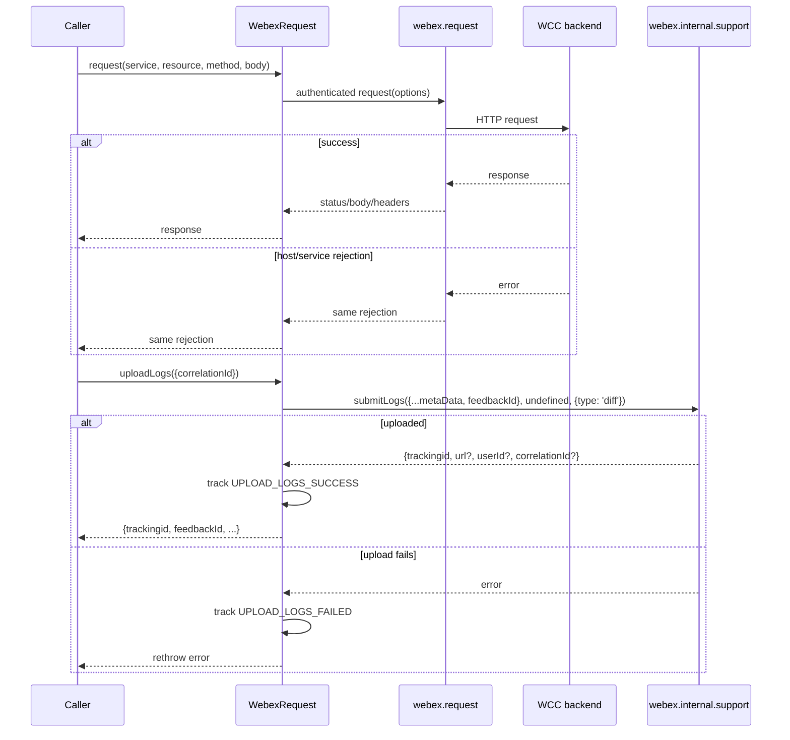
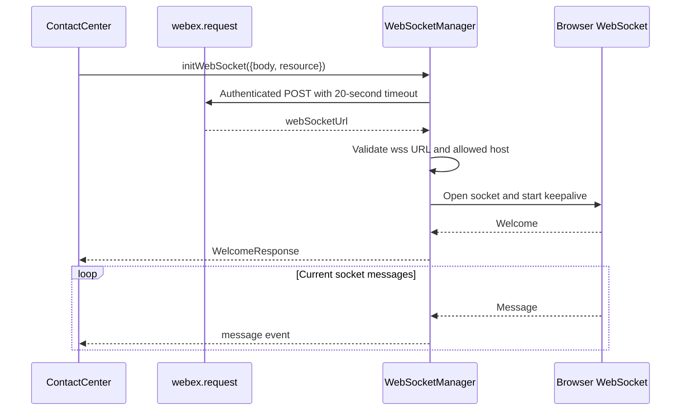
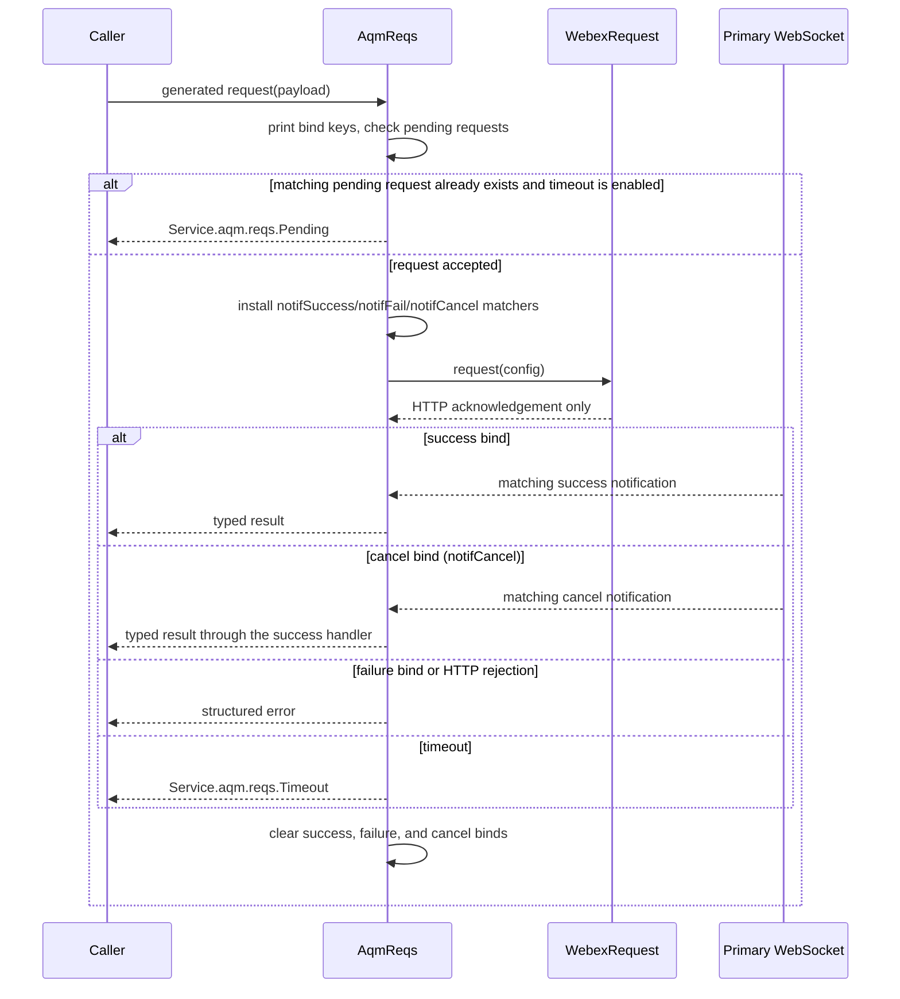
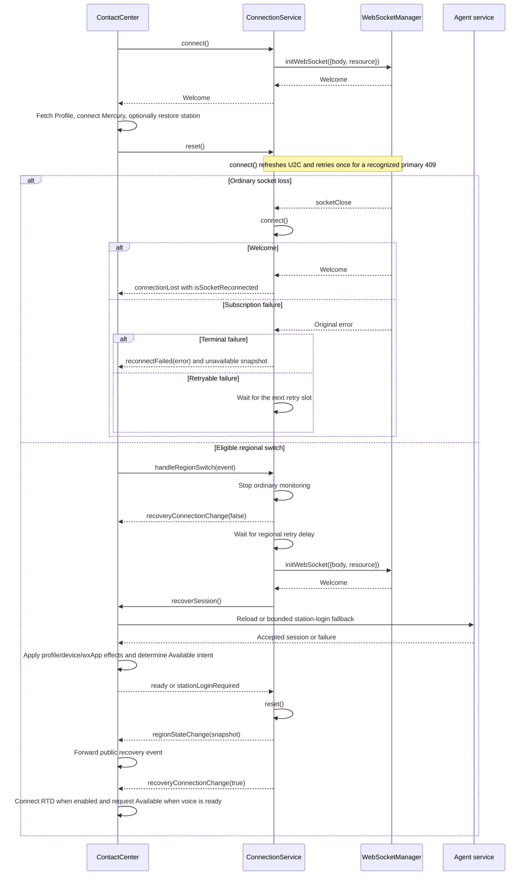
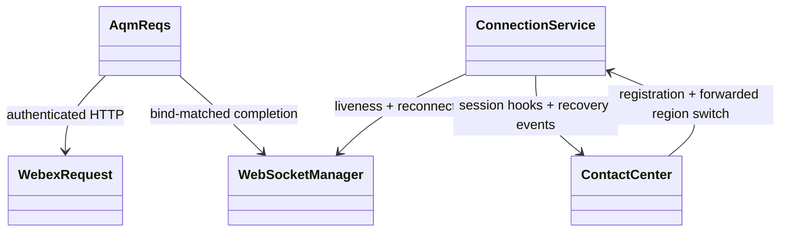
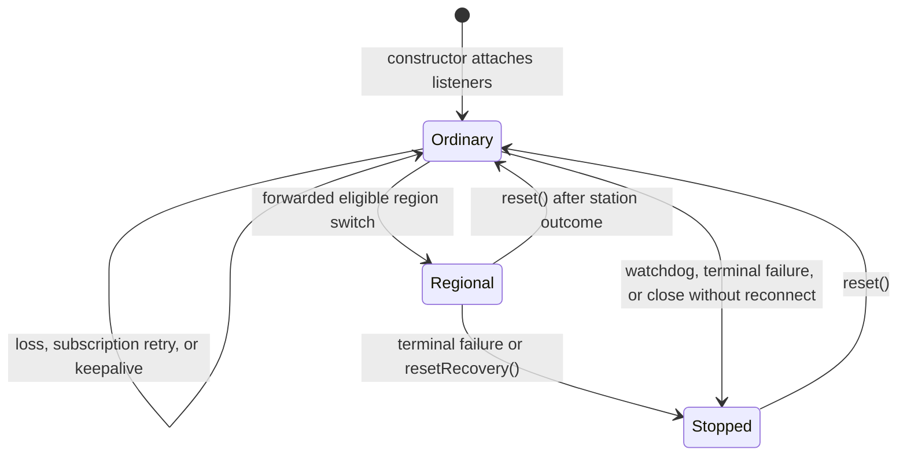
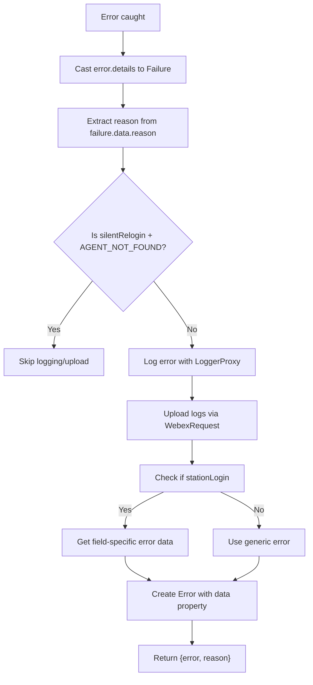

<!-- sdd-generated-metadata
doc_kind: module-spec
generated_from: module-spec@0.3.0
generated_by: claude-code
approved_by: rarajes2@cisco.com
updated_at: 2026-11-17T03:03:58Z
validation_status: pass-with-warnings
-->

# Core service

This source-local document at `src/services/core/docs/README.md` owns the stable specification for
**the core service** of `@webex/contact-center`. Core infrastructure components include WebSocket
management, HTTP requests, error handling, and utilities that the agent, config, task, dialer, and
plugin layers build on. Ground every claim in package evidence and link to the
[package architecture](../../../../docs/architecture.md) instead of repeating broader facts. The
parent [services specification](../../docs/README.md) owns the composition of these pieces into the
`Services` singleton.

Related context: [documentation index](../../../../docs/index.md) ·
[package agent instructions](../../../../AGENTS.md)

## Metadata

| Field | Value |
|---|---|
| Owner | @webex/web-sdk |
| Source path | `src/services/core` |
| Resource kind | module |
| Status | Active |
| Last verified | 2026-11-16 at `0b8c34db7f` |
| Module id | `core` |
| Parent spec | [src/services](../../docs/README.md) |
| Doc kind | Module spec |
| Coverage score | Pending coverage assessment |
| Validation status | pass-with-warnings — assessed 2026-11-17; validator runtime 01a1e76f-2293-79a0-9f8f-f060038448dd; 0 Blocking, 0 Important, 4 Minor findings. |

## Applicability

| Condition ID | Status | Evidence or reason | Owned section |
| ------------ | ------ | ------------------ | ------------- |
| `module.has_tiers` | N/A | The package defines no module tiers (`.sdd/manifest.json` profile sets has_tiers to false) | Tier |
| `module.has_ui` | N/A | No rendering code; every surface is a class, function, or event | UI use-case flow |
| `module.crosses_service_boundaries` | Applicable | `src/services/core/websocket/WebSocketManager.ts` calls the notification subscribe API and opens a WebSocket; `src/services/core/WebexRequest.ts` calls the WCC API gateway and the support log-upload service | Cross-boundary use-case flow |
| `module.holds_client_state` | Applicable | Socket, welcome, worker, pending-bind, timer, and connection flags in `src/services/core/websocket/WebSocketManager.ts`, `src/services/core/aqm-reqs.ts`, and `src/services/core/websocket/connection-service.ts` | Client state model |
| `module.enforces_domain_rules` | Applicable | The wss allow-list check, the duplicate-pending rejection, and the log-redaction rules in `src/services/core/websocket/WebSocketManager.ts` and `src/services/core/aqm-reqs.ts` | Business rules and invariants |
| `module.is_concurrent_async` | Applicable | Event-emitter fan-out, a keepalive Web Worker, and timer-driven reconnect in `src/services/core/websocket/connection-service.ts` and `src/services/core/websocket/keepalive.worker.js` | Concurrency and reactive flow |
| `module.owns_persistence` | N/A | Nothing in the module writes storage; all state is in memory | Data, schema, and migration discipline |
| `module.stateful_transitions` | Applicable | Socket lifecycle and connection-lost, reconnected, and restore-failed transitions in `src/services/core/websocket/connection-service.ts` | State machine |
| `module.exposes_wire_protocol` | Applicable | Subscribe request and response, the keepalive frame, the worker message contract, and the AQM bind matching in `src/services/core/websocket/WebSocketManager.ts` and `src/services/core/aqm-reqs.ts` | Protocol and wire format |
| `module.ui_multi_screen` | N/A | No UI | UI flow |
| `module.large_data_model` | N/A | The module's types (`src/services/core/types.ts`, `src/services/core/GlobalTypes.ts`, `src/services/core/websocket/types.ts`) are small request, message, and connection-state shapes | Data model |
| `module.returns_caller_errors` | Applicable | Err.Details and Err.Message rejections from `src/services/core/aqm-reqs.ts`, and the helpers in `src/services/core/Utils.ts` | Caller-visible failure modes |
| `module.module_specific_conventions` | Applicable | Error-helper, constants, redaction, and listener rules recorded under Module-specific rules, enforced by `src/services/core/Utils.ts` and `src/services/core/aqm-reqs.ts` | Module-specific rules |
| `module.published_package` | N/A | Core transport classes and helpers are internal; the package re-exports only the lifecycle error-reason catalog from core constants | Export stability |
| `module.embedded_in_host` | N/A | The package-level host integration is owned by the package root module | Host integration and theming |
| `module.has_design_tradeoff` | Applicable | HTTP initiation with WebSocket completion in `src/services/core/aqm-reqs.ts`; connection recovery policy with ContactCenter-owned session effects in `src/services/core/websocket/connection-service.ts` | Key design trade-off |
| `module.has_submodules` | N/A | The websocket folder is part of this module; the plugin's module_tree.py reports no child module | Sub-modules |

## Evidence register

| Evidence | What it establishes |
| -------- | ------------------- |
| `src/services/core/WebexRequest.ts` | Singleton `WebexRequest`: `getInstance`, `request` (service, resource, method, body, optional headers), and `uploadLogs` with metrics |
| `src/services/core/aqm-reqs.ts` | `AqmReqs`: `req`, `reqEmpty`, bind keys, pending maps, duplicate rejection, HTTP failure masking, timeout, and redaction |
| `src/services/core/types.ts` | `Req`, `Conf`, `ConfEmpty`, `Res`, `ResEmpty`, `CbRes`, `Pending`, `Timeout`, and the RTD request types |
| `src/services/core/websocket/WebSocketManager.ts` | Subscribe registration, the `wss` allow-list check, socket handlers, keepalive worker wiring, welcome resolution, multi-login close, and `message`/`socketClose` events |
| `src/services/core/websocket/connection-service.ts` | Ordinary liveness/reconnect, regional pacing, primary mismatch/U2C recovery, snapshots, and diagnostics; awaits ContactCenter's station restoration |
| `src/services/core/websocket/keepalive.worker.js` | The worker script, its `start`/`terminate` inputs, and its `keepalive`/`closeSocket` outputs |
| `src/services/core/websocket/types.ts` | `ConnectionServiceOptions`, `ConnectionLostDetails`, `ConnectionProp` |
| `src/services/core/constants.ts` | Timer values, `ALLOWED_ROUTING_NOTIFS_DOMAINS`, participant constants, and method-name constants |
| `src/services/core/Utils.ts`, `src/services/core/Err.ts`, `src/services/core/GlobalTypes.ts` | Error helpers, the `Err` classes and error-id types, and `Msg`, `Failure`, `TaskError`, `AugmentedError` |
| `src/services/index.ts`, `src/cc.ts` | Consumers: construction order, the second RTD `WebSocketManager`, `connectWebsocket`, `handleConnectionLost`, and the `allowAutomatedRelogin` relogin policy |
| `src/services/constants.ts`, `src/services/config/types.ts`, `src/types.ts` | `WCC_API_GATEWAY`, `SUBSCRIBE_API`, `RTD_SUBSCRIBE_API`, `CC_EVENTS`, `SubscribeResponse`, `WelcomeResponse`, and the shared request types |
| `test/unit/spec/services/core/WebexRequest.ts`, `test/unit/spec/services/core/aqm-reqs.ts`, `test/unit/spec/services/core/Utils.ts` | Unit cases for request delegation, log upload, AQM settlement and redaction, and the error and URL helpers |
| `test/unit/spec/services/core/websocket/WebSocketManager.ts`, `test/unit/spec/services/core/websocket/connection-service.ts` | Unit cases for URL validation, the INT header, close paths, multi-login, timers, and reconnect |
| `src/services/core/WebexRequest.ts`, `src/services/core/websocket/WebSocketManager.ts`, `src/services/core/aqm-reqs.ts`, `src/services/core/websocket/connection-service.ts` (Data flow extension subsections) | One sequence subsection per operation group of the Data flow inventory: WebexRequest (request and uploadLogs), Subscribe and connect, Correlated request, and Connection lifecycle |
| `src/services/index.ts` (no feature gate) | `Services` constructs `WebSocketManager`, `AqmReqs`, and `ConnectionService` unconditionally; no rollout flag gates Core. No test observes this absence |
| `jest.config.js` | The 85% global branch, function, line, and statement threshold |

## Purpose and boundary

Core is the foundational infrastructure layer that all other services depend on. It owns authenticated HTTP to the WCC API Gateway with log upload support, the realtime WebSocket lifecycle with automatic reconnection and keepalive management, AQM request correlation (HTTP requests whose responses/failures are correlated via WebSocket notifications), and shared error normalization: standardized error extraction, logging via `LoggerProxy`, and log upload.

Boundary:

- Responsibility: the four concerns above, regional transport recovery, and the shared consult and dial-number helpers in
  `src/services/core/Utils.ts`.
- In scope: every file under `src/services/core`, including `websocket/`.
- Out of scope: agent credentials, agent profile/device updates, station retries, and deferred Available (the
  ContactCenter plugin in `src/cc.ts`); composing the services (`src/services/index.ts`, parent spec);
  the meaning of individual AQM operations (the agent, task, and dialer modules that call `req`).
- Consumers: `Services` constructs `WebSocketManager`, `AqmReqs`, and `ConnectionService`; `src/cc.ts`
  configures recovery, connects the primary socket through ConnectionService, calls `initWebSocket`
  for RTD, and listens to socket and recovery events; `TaskManager`
  listens to `message` on both sockets; the agent, contact, and dialer factories call `req`; many
  service files call `WebexRequest`, `getErrorDetails`, `generateTaskErrorObject`, and the consult
  helpers.

## Structure and key files

```text
services/core/
├── aqm-reqs.ts           # AQM request handler
├── constants.ts          # Core constants
├── Err.ts                # Error classes
├── GlobalTypes.ts        # Failure, Msg<T>, etc.
├── types.ts              # Request/response types
├── Utils.ts              # Utility functions
├── WebexRequest.ts       # HTTP client
└── websocket/
    ├── WebSocketManager.ts    # Main WS handler
    ├── connection-service.ts  # Connection lifecycle
    ├── keepalive.worker.js    # Keepalive worker
    └── types.ts               # WS types
```

| Component | File | Description |
|---|---|---|
| `WebSocketManager` | [`WebSocketManager.ts`](../websocket/WebSocketManager.ts) | Subscribes, validates and connects the returned URL, waits for Welcome, dispatches messages, and manages the socket's keepalive worker. Reports explicit or admitted socket closure through `socketClose({shouldReconnect})`. |
| `ConnectionService` | [`connection-service.ts`](../websocket/connection-service.ts) | Orchestrates ordinary and regional transport recovery on top of `WebSocketManager`, including U2C refresh, snapshots, and diagnostics. ContactCenter restores the station through the awaited `recoverSession()` callback. |
| `WebexRequest` | [`WebexRequest.ts`](../WebexRequest.ts) | Singleton HTTP client that forwards service/resource/method/body options to the authenticated host request API and provides `uploadLogs` diagnostics. |
| `AqmReqs` | [`aqm-reqs.ts`](../aqm-reqs.ts) | Factory for creating request methods that send HTTP requests and wait for correlated WebSocket notifications (success or failure): the AQM request/response pattern and WebSocket notification binding, with the pending maps and timeout. Used by routing and task services to implement their API methods. |
| `Utils` | [`Utils.ts`](../Utils.ts) | Shared utility functions including `getErrorDetails()` for standardized error handling, `generateTaskErrorObject()` for task-specific errors, and `createErrDetailsObject()` for constructing error detail objects; also `getStationLoginErrorData`, `getStationRecoveryFailureCategory`, `isAllowedUrlHost`, `isValidDialNumber`, `stripDialPlanChars`, and the consult utilities (`getConsultedAgentId`, `getDestAgentIdForCBT`, `calculateDestAgentId`, `calculateDestType`, `buildConsultConferenceParamData`, `deriveConsultTransferDestinationType`). |
| `Err` | [`Err.ts`](../Err.ts) | Error class definitions: `Err.Message` and `Err.Details` error classes and the typed error-id unions. `Err.Details` carries structured error metadata (status, type, trackingId) for consistent error propagation. |
| `constants` | [`constants.ts`](../constants.ts) | Timeout values, interval durations, participant types, interaction states, method name constants, and the `ALLOWED_ROUTING_NOTIFS_DOMAINS` WebSocket host allow-list used throughout the core layer. Any new constants for core should be defined here. |
| `GlobalTypes` | [`GlobalTypes.ts`](../GlobalTypes.ts) | `Msg`, `Failure`, `TaskError`, `AugmentedError` type definitions. |
| `types` | [`types.ts`](../types.ts) | `Pending`, `Req`, `Conf`, `Res` types for AqmReqs, plus the internal RTD request types. |
| keepalive worker | [`keepalive.worker.js`](../websocket/keepalive.worker.js) | Web Worker for periodic keepalive and offline detection, exported as a script string. |
| websocket `types` | [`types.ts`](../websocket/types.ts) | `ConnectionServiceOptions`, `ConnectionLostDetails`, `ConnectionProp`. |

Files outside the source layout above:

| Path | Responsibility |
| ---- | -------------- |
| `src/services/core/docs/README.md` | This module specification |
| test/unit/spec/services/core (directory) | Unit tests mirroring the source layout, including the websocket folder |

## Public surface

The transport classes and helpers are internal to the package. `REGION_RECOVERY_ERROR_CODES` is
re-exported through the package constants for consumers. The internal consumption boundary is
contract `contact-center-core-transport` (internal SDK contract, canonical source
`src/services/core/aqm-reqs.ts`), indexed in the
[package architecture](../../../../docs/architecture.md).

| Surface | Consumer | Compatibility commitment | Source |
| ------- | -------- | ------------------------ | ------ |
| `contact-center-core-transport`: `AqmReqs` (`req`, `reqEmpty`) and the `Req` configuration | Agent, contact, and dialer factories | Internal; additive config fields only, every in-package caller updated in the same change | `src/services/core/aqm-reqs.ts`, `src/services/core/types.ts` |
| `contact-center-core-transport`: `WebexRequest.getInstance`, `request`, `uploadLogs` | `src/cc.ts`, config and other services, the error helpers | Internal; `request` returns or rejects with the host result unchanged | `src/services/core/WebexRequest.ts` |
| `contact-center-core-transport`: `WebSocketManager` (`initWebSocket`, `close`, `handleConnectionLost`, `shouldReconnect`, `isSocketClosed`, `hasUsableSocket`, `getUrl`, events `message` and `socketClose`) | `Services`, `src/cc.ts`, `TaskManager`, `AqmReqs`, `ConnectionService` | Internal; event names are string literals that listeners depend on | `src/services/core/websocket/WebSocketManager.ts` |
| `contact-center-core-transport`: `ConnectionService` (`setSessionRecoveryHandler`, `connect`, `handleRegionSwitch`, `resetRecovery`, `reset`, `stop`, `setConnectionProp`; events `connectionLost`, `reconnectFailed`, `regionStateChange`, `recoveryDiagnostic`, `recoveryConnectionChange`) | `src/cc.ts` | Internal; ContactCenter supplies session effects and forwards recovery snapshots | `src/services/core/websocket/connection-service.ts`, `src/services/core/websocket/types.ts` |
| `contact-center-core-transport`: error and utility helpers, `Err` classes, `Msg`, `Failure`, `AugmentedError` | Agent, config, task, and plugin code | Internal; error `message` and `data` shapes are observed by callers | `src/services/core/Utils.ts`, `src/services/core/Err.ts`, `src/services/core/GlobalTypes.ts` |

| Event | Data | Description |
|---|---|---|
| `message` | string (JSON) | WebSocket message received |
| `socketClose` | `{shouldReconnect: boolean}` | Reports explicit or admitted socket closure. False disables retries. |
| `connectionLost` | `ConnectionLostDetails` | Emitted by `ConnectionService` on ordinary lost, recovered, reconnected, and restore-failed transitions. A keepalive echo sets `isKeepAlive: true` and emits only in ordinary mode with no pending admission in progress. |
| `reconnectFailed` | Original error (`unknown`) | Reports connection failures; ConnectionService owns retry/terminal policy when configured. Registration failures propagate through the awaited connection promise. |
| `recoveryDiagnostic` | Metric name and normalized diagnostic payload | ContactCenter submits the mapped recovery metric through MetricsManager. |
| `regionStateChange` | `RegionRecoveryState` | Complete, deduplicated recovery snapshot from ConnectionService. ContactCenter forwards it as the public `region:stateChange` event. |

Generic message wrapper used throughout the SDK. All WebSocket messages and AQM responses conform to this shape:
`Msg<T>` in [GlobalTypes.ts](../GlobalTypes.ts) carries `type`, `orgId`, `trackingId`, and a `data` payload of type `T`, so a typed event such as a login success is declared as `Msg<{agentId, status, ...}>` and arrives as `{type, orgId, trackingId, data: {agentId, status, ...}}`.

Do not remove or reinterpret exported symbols/events without a documented consumer migration.

## Dependencies

| Dependency | Why it is required | Failure behavior |
| ---------- | ------------------ | ---------------- |
| Webex SDK service catalog and authenticated request API (`webex.request`, contracts `webex-core-plugin-runtime` and `wxcc-api-gateway`) | Every REST call and the subscribe registration; the host resolves the `service` key and adds authentication | Rejections propagate unchanged through `WebexRequest.request`; `AqmReqs` maps them (CORE-R-010) |
| Notification WebSocket (contract `wxcc-websocket-notifications`) | Delivers the welcome event, keepalive echoes, and every AQM result | Close and error handlers; recovery per Connection lifecycle |
| `webex.internal.support.submitLogs` (contract `webex-internal-support`) | `uploadLogs` diagnostics | Logged, tracked as `UPLOAD_LOGS_FAILED`, and rethrown |
| `webex.credentials.getOrgId`, `webex.internal.services.isIntegrationEnvironment` | The `X-ORGANIZATION-ID` header on the subscribe call in INT environments | A missing internal services object is treated as production (no header) |
| Browser WebSocket, Worker, URL and network-status APIs | Socket, keepalive worker (`Blob` + `URL.createObjectURL`), URL validation, `navigator.onLine` | Offline ordinary attempts skip subscribe and retry at the next five-second single-flight slot, bounded by the watchdog |
| LoggerProxy and log upload | Every diagnostic line and the error helpers' upload | Fire and forget in the helpers |
| `MetricsManager` (`src/metrics/MetricsManager.ts`) | Log-upload events and operational regional admission/station-reload outcomes | Not awaited |
| ContactCenter's station-recovery handler | Awaited `recoverSession`, registered through `setSessionRecoveryHandler`; connection notifications use `recoveryConnectionChange` | ConnectionService reuses its constructor's subscribe settings and Webex credentials; ContactCenter owns station policy and profile/device/task/RTD effects |
| `src/services/constants.ts`, `src/services/config/types.ts` | `WCC_API_GATEWAY`, `SUBSCRIBE_API`, `CC_EVENTS.WELCOME`, `SubscribeResponse`, `WelcomeResponse` | Compile-time |
| `src/types.ts` | Shared `WebexSDK`, `HTTP_METHODS`, `RequestBody`, `IHttpResponse`, `LogsMetaData`, `UploadLogsResponse`, `SubscribeRequest`, `WebexRequestPayload`, `LoginOption`, and `RegionRecoveryState` types (contract `contact-center-region-recovery`) | Compile-time |
| `src/services/task/types.ts` | Interaction and destination types for the consult helpers in `Utils.ts` | Compile-time |

## Requirements

| ID | WHAT | WHY | Source Evidence | Test / Example Evidence | Assumptions / Gaps | Confidence |
|---|---|---|---|---|---|---|
| CORE-R-001 | WebexRequest must delegate service/resource/method/body options to the authenticated host request API and return or reject with the host result unchanged. | All Contact Center REST clients share host-owned authentication and service routing without duplicating credential logic. | `src/services/core/WebexRequest.ts` | `test/unit/spec/services/core/WebexRequest.ts` | Authorization-header masking belongs to `AqmReqs` HTTP-failure handling, not `WebexRequest.request`. | PRESENT |
| CORE-R-002 | `initWebSocket({body, resource}): Promise<WelcomeResponse>` resolves on an accepted current Welcome. Application notifications, including `SYSTEM_REGION_SWITCH`, are delivered after Welcome. `AGENT_MULTI_LOGIN` can close the attempt before Welcome. | A socket must finish admission before delivering station, state, task, or region-switch messages. | `src/services/core/websocket/WebSocketManager.ts` | `test/unit/spec/services/core/websocket/WebSocketManager.ts`, `test/unit/spec/cc.ts` | Subscription failure, invalid URL, supersession, and socket close before Welcome reject initialization. | PRESENT |
| CORE-R-003 | AqmReqs must be constructed with the primary WebSocket manager and settle generated request promises from `notifSuccess`/`notifFail` binds or `TIMEOUT_REQ`. | HTTP acknowledgement alone does not represent backend operation completion. | `src/services/core/aqm-reqs.ts` | `test/unit/spec/services/core/aqm-reqs.ts` | None. | PRESENT |
| CORE-R-004 | ConnectionService owns ordinary and regional transport recovery, with one pending ordinary attempt. Its `recoverSession()` callback awaits ContactCenter station restoration before the regional outcome is published. | Transport retry scheduling stays separate from ContactCenter station policy and profile/device effects. | `src/services/core/websocket/connection-service.ts`, `src/services/core/websocket/types.ts`, `src/cc.ts` | `test/unit/spec/services/core/websocket/connection-service.ts`, `test/unit/spec/cc.ts` | None. | PRESENT |
| CORE-R-005 | The keepalive worker must use `KEEPALIVE_WORKER_INTERVAL` as its interval and `CLOSE_SOCKET_TIMEOUT` as its close-socket timeout, and AQM requests default to `TIMEOUT_REQ` unless disabled/overridden (values in the timer table under Concurrency and reactive flow). | Accurate timing is required for predictable recovery and request failure behavior. | `src/services/core/constants.ts`, `src/services/core/websocket/WebSocketManager.ts` | `test/unit/spec/services/core/aqm-reqs.ts`, `test/unit/spec/services/core/websocket/WebSocketManager.ts` | Socket tests assert the worker start values; the AQM default is asserted by its timeout cases. | PRESENT |
| CORE-R-007 | AQM routing-failure logging never emits the raw routing message payload or error verbatim; the failure-bind path logs only a fixed redacted diagnostic regardless of `redactSensitiveLogs`. When an AQM request additionally sets `redactSensitiveLogs`, timeout logs must also omit the request URL, bind key, and response while preserving settlement and cleanup behavior. | Dynamic request paths and routing messages can contain participant identifiers or phone numbers that must not enter diagnostic logs. | `src/services/core/aqm-reqs.ts`, `src/services/core/types.ts` | `test/unit/spec/services/core/aqm-reqs.ts` | The timeout flag is internal and opt-in; ordinary AQM logging remains backward compatible while routing-failure logging is unconditionally redacted. | PRESENT |
| CORE-R-008 | `WebSocketManager` opens a socket only for a subscribe/register `webSocketUrl` that parses as a `wss` URL whose host equals, or is a subdomain of, an entry in `ALLOWED_ROUTING_NOTIFS_DOMAINS`; a malformed, non-`wss`, or non-allow-listed URL is rejected with an error and no socket is opened. | A server-controlled subscribe response could otherwise direct the realtime connection to an untrusted or non-secure endpoint. | `src/services/core/websocket/WebSocketManager.ts`, `src/services/core/constants.ts` | `test/unit/spec/services/core/websocket/WebSocketManager.ts` | The allow-list is a fixed domain set; subdomain matching is exact suffix matching on the parsed hostname. | PRESENT |
| CORE-R-009 | When a pending request already holds the success bind key (or the failure bind key) and the new request's `timeout` is not `'disabled'`, the generated function rejects at once with `Err.Details('Service.aqm.reqs.Pending')` and sends no HTTP request. | The bind key is the only correlation handle, so two concurrent requests with the same bind could not be told apart; the error text says multiple requests are not allowed. | `src/services/core/aqm-reqs.ts`, `src/services/core/Err.ts` | None found | No unit case covers the duplicate rejection. | WEAK |
| CORE-R-010 | On an HTTP rejection AqmReqs clears all three bind entries, masks `headers.Authorization` to `*`, and rejects with `c.err(error)` when `err` is a function, `Err.Message(c.err)` when it is a string, and `Err.Message('Service.aqm.reqs.GenericRequestError')` otherwise. On timeout it masks the stored response's `Authorization` header and rejects with `Err.Details('Service.aqm.reqs.Timeout', {key, response})`. | The bearer token must not reach logs or surfaced errors, and each operation module chooses its own error mapping. | `src/services/core/aqm-reqs.ts` | `test/unit/spec/services/core/aqm-reqs.ts` | None. | PRESENT |
| CORE-R-011 | A `notifCancel` bind resolves the same promise as the success bind and is cleared with it. | Some operations finish with an alternate event (for example a participant leaving instead of a drop success), and the caller must still settle once. | `src/services/core/aqm-reqs.ts`, `src/services/core/types.ts` | `test/unit/spec/services/core/aqm-reqs.ts` | None. | PRESENT |
| CORE-R-012 | The subscribe call adds `X-ORGANIZATION-ID` (set to the org id) only when `webex.internal.services.isIntegrationEnvironment()` is true and an org id exists. | The in-code comment: the header is only required for INT environments. | `src/services/core/websocket/WebSocketManager.ts` | `test/unit/spec/services/core/websocket/WebSocketManager.ts` | None. | PRESENT |
| CORE-R-013 | An `AGENT_MULTI_LOGIN` message on the current socket disposes the socket and emits `socketClose({shouldReconnect: false})`, including before Welcome. The driver stops retrying. | A second login of the same agent replaces this session. Reconnecting would fight it. | `src/services/core/websocket/WebSocketManager.ts` | `test/unit/spec/services/core/websocket/WebSocketManager.ts`, `test/unit/spec/cc.ts` | None. | PRESENT |
| CORE-R-014 | `uploadLogs(metaData)` submits diff logs with a fresh `feedbackId`, tracks `UPLOAD_LOGS_SUCCESS` or `UPLOAD_LOGS_FAILED`, resolves `{trackingid, feedbackId}` plus any returned `url`, `userId`, `correlationId`, and rethrows a failure. | The JSDoc: logs are uploaded to the backend for diagnostics; the `feedbackId` and `correlationId` let support find them. | `src/services/core/WebexRequest.ts` | `test/unit/spec/services/core/WebexRequest.ts` | None. | PRESENT |
| CORE-R-015 | `getErrorDetails` and `generateTaskErrorObject` keep the error shapes and the logging and log-upload side effects specified under Caller-visible failure modes. | Callers rely on one error shape per flow for metrics, UI messages, and station-login field hints. | `src/services/core/Utils.ts` | `test/unit/spec/services/core/Utils.ts` | `generateTaskErrorObject` has no unit case in this module's tests. | PRESENT |
| CORE-R-016 | Socket initialization owns the subscription, socket, 30-second Welcome deadline after subscription, and keepalive resources. Supersession, timeout, or explicit close disposes that attempt; a late subscription response cannot open its socket. | An obsolete socket or unresolved Welcome cannot claim the current transport. | `src/services/core/websocket/WebSocketManager.ts`, `src/services/core/constants.ts` | `test/unit/spec/services/core/websocket/WebSocketManager.ts` | ConnectionService owns recovery policy. | PRESENT |
| CORE-R-017 | Ordinary reconnect uses five-second slots under a 50-second watchdog and one pending attempt. Each retry uses the existing subscribe-and-connect method. A stopped or expired attempt cannot open a late socket. When configured, ConnectionService refreshes U2C and retries once for a recognized primary subscribe mismatch, and owns terminal handling. An admitted quiet socket can still receive a late keepalive. | Socket reconnection needs bounded, serialized transport work and one owner for mismatch recovery. | `src/services/core/websocket/connection-service.ts` | `test/unit/spec/services/core/websocket/connection-service.ts`, `test/unit/spec/cc.ts` | Regional transport delays live in ConnectionService; ContactCenter owns station retry budgets. | PRESENT |
| CORE-R-018 | ContactCenter's regional station retries use the same AQM notification bindings, duplicate-request handling, and timeout as ordinary station requests; ConnectionService awaits their outcome. | The region switch changes the notification connection. | `src/services/core/aqm-reqs.ts`, `src/services/core/websocket/connection-service.ts`, `src/cc.ts` | `test/unit/spec/services/core/aqm-reqs.ts`, `test/unit/spec/cc.ts` | Live station recovery remains release verification. | PRESENT |
| CORE-R-019 | In ordinary mode without a pending admission, `ConnectionService.onPing` guards JSON parsing and object validation. Malformed JSON and non-object/array payloads produce fixed `LoggerProxy.error` diagnostics and return without changing liveness state/timers; valid objects retain keepalive and recovery handling. | One malformed server frame must not disrupt the liveness loop, and the frame must not enter logs. | `src/services/core/websocket/connection-service.ts` (onPing) | `test/unit/spec/services/core/websocket/connection-service.ts` malformed-payload and ordinary recovery cases | Stopped monitoring and a pending initialization return before parsing or logging. | PRESENT |

## Design overview

Stack: TypeScript/JavaScript, WebSocket, Web Worker keepalive, EventEmitter, Webex request client, Jest 27.

Core separates four responsibilities:

1. `WebexRequest` wraps the authenticated host request API and service-catalog routing.
2. `WebSocketManager` subscribes, validates the returned URL against the `wss` and `ALLOWED_ROUTING_NOTIFS_DOMAINS` rules, connects the socket, owns the keepalive worker, and emits raw messages/socket lifecycle events.
3. `AqmReqs` registers bind matchers on the primary WebSocket, sends HTTP through WebexRequest, and settles requests only from matching notifications, HTTP failure, or timeout.
4. `ConnectionService` owns ordinary and regional transport recovery and emits connection-state details. ContactCenter owns station restoration; regional recovery awaits its result.

Component instantiation order (`Services` constructor in `src/services/index.ts`, after the plugin
has called `WebexRequest.getInstance({webex})` in `src/cc.ts`):

1. **WebSocketManager** ([WebSocketManager.ts](../websocket/WebSocketManager.ts)) - Creates one keepalive worker and reuses it across socket connections through the existing `start`/`terminate` messages. The RTD manager has its own socket and worker.
2. **AqmReqs** ([src/services/core/aqm-reqs.ts](../aqm-reqs.ts)) - Initialized with WebSocketManager reference
3. **Service layers** (agent, contact, dialer) - Created with AqmReqs reference; config is created without it
4. **ConnectionService** ([connection-service.ts](../websocket/connection-service.ts)) - Constructed with Webex, the primary manager, and subscribe request; `reset()` restarts monitoring after a stopped lifecycle.

The AQM (Agent Queue Manager) layer provides a request/response pattern over HTTP + WebSocket. Services like **routing** and **contact** use `AqmReqs` to define API methods that:

1. Send an HTTP request to the contact center backend via `WebexRequest`
2. Wait for a correlated WebSocket notification indicating success or failure
3. Return the typed result or throw a structured error

This decouples the request initiation (HTTP) from the asynchronous result delivery (WebSocket), which matches the contact center backend's event-driven architecture.

```typescript
const aqmReqs = new AqmReqs(webSocketManager);
const setState = aqmReqs.req((p: {data: Agent.StateChange}) => ({
  host: WCC_API_GATEWAY,
  url: '/v1/agents/session/state',
  data: p.data,
  method: HTTP_METHODS.PUT,
  notifSuccess: {
    bind: {
      type: CC_EVENTS.AGENT_STATE_CHANGE,
      data: {type: CC_EVENTS.AGENT_STATE_CHANGE_SUCCESS},
    },
    msg: {} as Agent.StateChangeSuccess,
  },
  notifFail: {
    bind: {
      type: CC_EVENTS.AGENT_STATE_CHANGE,
      data: {type: CC_EVENTS.AGENT_STATE_CHANGE_FAILED},
    },
    errId: 'Service.aqm.agent.stateChange',
  },
}));
await setState({data: stateChangePayload});
```

The production `stateChange` method in `src/services/agent/index.ts` has this shape plus an `err`
mapper. `req` returns `(payload, cbRes?) => Promise`, and `reqEmpty` returns `(cbRes?) => Promise`
for configurations without parameters; the optional `cbRes` callback receives the raw HTTP
acknowledgement.

`WebexRequest` ([WebexRequest.ts](../WebexRequest.ts)) is a singleton HTTP client that all services
use to make authenticated REST API calls to the contact center backend. Its constructor is private;
the static `instance` is created by the first `getInstance({webex})` call that passes a `WebexSDK`,
and later calls, with or without options, return it. It does not resolve URLs, format requests, or
parse responses itself: `request({service, resource, method, body, headers})` forwards the service
key used by `webex.request` to resolve the target host, the API path within the service (for example
`v1/notification/subscribe`), the `HTTP_METHODS` value, the optional `RequestBody`, and `headers`
(only when given), and returns the host's `Promise<IHttpResponse>`.
`uploadLogs(metaData: LogsMetaData = {})` resolves an `UploadLogsResponse` (CORE-R-014).

```typescript
// Get singleton
const webexReq = WebexRequest.getInstance({webex});

// Make request
const response = await webexReq.request({
  service: WCC_API_GATEWAY,  // resolved to base URL by Webex SDK
  resource: '/v1/endpoint',  // appended as path
  method: HTTP_METHODS.POST,
  body: { key: 'value' },   // optional request payload
});

// Upload logs
await webexReq.uploadLogs({
  correlationId: trackingId,
});
```

`WebSocketManager` handles the raw WebSocket connection to the contact center backend. It is
instantiated by the `Services` layer; `src/cc.ts`, `TaskManager`, `AqmReqs`, and `ConnectionService`
all use the same instance directly.

```typescript
// Initialize in Services
this.webSocketManager = new WebSocketManager({webex});

// Connect
const welcomeEvent = await webSocketManager.initWebSocket({
  body: connectionConfig,
  resource: SUBSCRIBE_API,
});

// Listen for messages
webSocketManager.on('message', (event) => {
  const data = JSON.parse(event);
  // Handle event
});

// Close
webSocketManager.close(false, 'Reason');
```

## Data flow and sequence coverage

Transport: REST over `webex.request` to the `wcc-api-gateway` service, and one JSON WebSocket per
`WebSocketManager` instance. Every AQM operation starts with HTTP and completes on the primary
socket.

| Operation group | Entry and outcome | Diagram or evidence | Failure and recovery coverage |
| --------------- | ----------------- | ------------------- | ----------------------------- |
| Authenticated REST | `WebexRequest.request`; resolves the host response | Diagram WebexRequest; `src/services/core/WebexRequest.ts` | Host/service rejection is propagated unchanged; AQM applies its own error mapping separately. |
| Diagnostics upload | `WebexRequest.uploadLogs`; resolves the feedback and tracking ids | Diagram WebexRequest (upload part); `src/services/core/WebexRequest.ts` | Failure tracked as `UPLOAD_LOGS_FAILED` and rethrown; no retry. |
| WebSocket subscribe/connect | `initWebSocket({body, resource})`; resolves the welcome data | Diagram Subscribe and connect; `src/services/core/websocket/WebSocketManager.ts` | Register rejection, URL rejection, connect failure, and welcome resolution. |
| AQM operation | Generated `req` function; resolves the matching notification | Diagram Correlated request; `src/services/core/aqm-reqs.ts` | Duplicate pending request (checked before any matcher is installed), cancel-bind resolution, HTTP failure, failure bind, and timeout reject. |
| Connection lifecycle and recovery | Keepalive, liveness timers, offline close, reconnect; emits `connectionLost` | Diagram Connection lifecycle; `src/services/core/websocket/connection-service.ts` | Offline attempts retry on the next five-second slot; restored and restore-failed states are emitted to ContactCenter. |
| Error normalization | `getErrorDetails`, `generateTaskErrorObject` | getErrorDetails flow under Caller-visible failure modes; `src/services/core/Utils.ts` | Silent-relogin `AGENT_NOT_FOUND` skip; station-login field data. |

### WebexRequest



### Subscribe and connect



Callers use `SUBSCRIBE_API` for the primary notification subscription and `RTD_SUBSCRIBE_API`
for RTD. ConnectionService's `connect()` owns U2C refresh and one retry for a recognized primary
subscribe mismatch; WebSocketManager remains responsible for subscription and socket admission.

### Correlated request



### Connection lifecycle



ConnectionService owns the ordinary 8-second loss detection, five-second retry slots, and
50-second restore watchdog, plus regional transport retry timing, subscription mismatch policy,
snapshots, and diagnostics. ContactCenter owns station retry budgets, deferred Available,
profile/device changes, and task/RTD effects. Both paths reuse the existing subscribe-and-connect WebSocketManager.

## Class and component relationships

Component roles and files are catalogued under Structure and key files; this section shows how the
classes depend on each other and the members that carry the lifecycle.



### WebSocketManager members

`hasUsableSocket()` requires an open socket with an accepted Welcome. `getUrl()` returns the
subscribed URL for ConnectionService's serving-region state. Explicit close rejects a pending subscription or
Welcome wait; a late subscription reply cannot open that closed attempt. See CORE-R-002 and CORE-R-016.

### AqmReqs members

Ordinary calls use `req` or `reqEmpty` to send HTTP and wait for the matching WebSocket event or
timeout. Reconnecting the notification socket leaves that path intact. Hosts pause new station
actions using `region:stateChange`.

### ConnectionService members

- The constructor accepts `{webex, webSocketManager, subscribeRequest}` options.
- `setSessionRecoveryHandler` supplies one awaited `recoverSession` callback that restores the station
  and returns its outcome. Connection notifications use the internal `recoveryConnectionChange`
  event; subscribe settings and organization identity come from the constructor and Webex credentials.
- `connect()` subscribes to the primary socket and refreshes U2C for one retry after a recognized
  mismatch. `handleRegionSwitch()` owns eligibility, deduplication, and transport pacing.
- `reset(socketReconnected = false)` resumes liveness monitoring or ordinary subscription retries;
  `reset(true)` reports an already reconnected socket.
- `setConnectionProp({lostConnectionRecoveryTimeout})` retains the existing watchdog override.
- `stop()` clears ordinary retry timers, closes a pending socket, and removes the monitoring listeners.
  `resetRecovery()` separately cancels regional work and clears settings and snapshots for registration teardown.
- `clearStationRecovery()` owns logout's recovery cancellation, ordinary monitoring reset, and
  snapshot cleanup. ContactCenter owns pending automatic state changes.
- `regionState` and `isRecovering` expose internal recovery state to ContactCenter. It forwards
  `regionStateChange` and applies registration and RTD effects.

## Use cases and flows

| Use case | Actor or caller | Primary steps and outcome | Failure or boundary behavior | Evidence |
| -------- | --------------- | ------------------------- | ---------------------------- | -------- |
| `UC-1` Authenticated REST | Any service | Pass the service key and request options to the host and return its response or rejection unchanged. | Rejection passes through unchanged | `src/services/core/WebexRequest.ts`, `test/unit/spec/services/core/WebexRequest.ts` |
| `UC-2` Subscribe/connect | ConnectionService for primary, ContactCenter for RTD | Call `initWebSocket({body, resource})` to subscribe and await Welcome. | HTTP failure, URL rejection, socket error/early close, timeout, explicit close, or supersession reject the owning step; primary mismatch/U2C policy belongs to ConnectionService | `src/services/core/websocket/WebSocketManager.ts`, `src/services/core/websocket/connection-service.ts`, `test/unit/spec/cc.ts` |
| `UC-3` AQM correlation | Agent, contact, and dialer factories | Send HTTP but settle on matching notification/failure/timeout. | Duplicate pending, HTTP failure, failure bind, timeout | `src/services/core/aqm-reqs.ts`, `test/unit/spec/services/core/aqm-reqs.ts` |
| `UC-4` Reconnect | `ConnectionService` | Retry socket initialization. Ordinary recovery emits connection details; regional recovery awaits ContactCenter station restoration and publishes its outcome. | Offline retries; restore failure stops ordinary reconnect; regional retries use their own pacing | `src/services/core/websocket/connection-service.ts`, `test/unit/spec/services/core/websocket/connection-service.ts`, `test/unit/spec/cc.ts` |
| `UC-5` Error normalization | Agent, config, and task code | Convert a caught error into an `Error` with `data`, log it, and upload logs | Silent-relogin `AGENT_NOT_FOUND` is not logged | `src/services/core/Utils.ts`, `test/unit/spec/services/core/Utils.ts` |
| `UC-6` Diagnostics upload | Error helpers and the plugin | `uploadLogs({correlationId})` returns the feedback and tracking ids | Failure tracked and rethrown | `src/services/core/WebexRequest.ts`, `test/unit/spec/services/core/WebexRequest.ts` |

### Cross-boundary use-case flow

| Boundary | Transport and ordering | Compatibility | Timeout, retry, and recovery |
| -------- | ---------------------- | ------------- | ---------------------------- |
| Notification subscribe (`UC-2`) | HTTPS POST `v1/notification/subscribe` (or `v1/realtime/subscribe`) through `webex.request`, then the WebSocket | Response must carry a `wss` `webSocketUrl` on `cisco.com` or `ciscoccservice.com` | Subscribe and Welcome are bounded independently; the owning driver controls retry for the primary socket |
| AQM operations (`UC-3`) | HTTPS through `WebexRequest`, result on the primary socket; binds are installed before the HTTP call | Bind fields must match the event `type` and nested `data` values | `TIMEOUT_REQ` or a per-request `timeout`. `'disabled'` removes the timeout. AQM leaves retries to the caller. |
| Keepalive (`UC-4`) | `{"keepalive":"true"}` text frame every `KEEPALIVE_WORKER_INTERVAL`; the backend echo resets liveness timers and emits only in ordinary mode without a pending admission | Frame shape fixed in `WebSocketManager.ts` | Lost-connection, forced-close, and retry-slot timers from the timer table under Concurrency and reactive flow |
| Support log upload (`UC-6`) | `webex.internal.support.submitLogs(meta, undefined, {type: 'diff'})` | `feedbackId` from `crypto.randomUUID()` | No retry |

## Client state model

WebSocketManager owns socket, Welcome, and worker state. AqmReqs owns pending notification
bindings and operation settlement. ConnectionService owns ordinary and regional transport recovery state; ContactCenter owns station recovery state.

| State or slice | Owner | Initial state | Transition triggers | Reset or persistence boundary |
| -------------- | ----- | ------------- | ------------------- | ----------------------------- |
| Current `websocket`, `keepaliveWorker` and `isWelcomeReceived` | `WebSocketManager` | No socket; one worker | Subscription, Welcome, error, close, or replacement | Socket replacement or explicit close releases the timer and socket, and stops the worker's keepalive loop |
| Pending success, failure, and cancel bindings | `AqmReqs` | Empty | Dispatch, notification, host rejection, or timeout | Clear pending bindings on settlement |
| `isStopped`, `reconnectInterval`, `pending` flag and ordinary liveness timers | `ConnectionService` | Listening after construction; registration stops monitoring until setup completes | Registration reset, socket loss, region recovery or stop | Reset or stop clears ordinary timers and the pending flag; WebSocketManager closes pending initialization |
| Regional transport timer, last switch tracking ID, settings, placement, and snapshot | `ConnectionService` | No regional work; unknown settings | Accepted profile settings, forwarded switch, and subscription/session outcomes | `resetRecovery()` clears registration-scoped recovery state; completed recovery releases its active attempt |
| `WebexRequest.instance` | `WebexRequest` class | Unset until the first `getInstance({webex})` | First call with `webex` | Process lifetime |

## Business rules and invariants

| ID | Invariant | WHY | Enforcement source | Test evidence |
| -- | --------- | --- | ------------------ | ------------- |
| `INV-001` | Core must preserve its typed public/event contracts and must not invent backend states or responses. | Callers trust that a resolved AQM promise is the backend's own notification (CORE-R-003). | `src/services/core/WebexRequest.ts`, `src/services/core/aqm-reqs.ts` | `test/unit/spec/services/core/aqm-reqs.ts` |
| `INV-002` | A subscribe/register `webSocketUrl` is trusted only when it is a `wss` URL on the `ALLOWED_ROUTING_NOTIFS_DOMAINS` allow-list; otherwise `WebSocketManager` throws and never opens a socket. | CORE-R-008 | `src/services/core/websocket/WebSocketManager.ts`, `src/services/core/Utils.ts` | `test/unit/spec/services/core/websocket/WebSocketManager.ts`, `test/unit/spec/services/core/Utils.ts` |
| `INV-003` | Invalid ping input cannot alter liveness state, emit a connection event, schedule work, or leak frame data. | CORE-R-019 | `src/services/core/websocket/connection-service.ts` | `test/unit/spec/services/core/websocket/connection-service.ts` malformed-payload cases |

## Concurrency and reactive flow

AqmReqs owns pending request bindings. A duplicate bind rejects before dispatch.
ContactCenter owns station retry policy and applies accepted responses. ConnectionService awaits its result.

The ordinary driver uses the existing five-second retry interval with one in-flight attempt.
Interval ticks skip a pending attempt; offline and retryable failures wait for the next tick.
A catalogue refresh that finishes after the ordinary restore timeout does not start another subscribe.
A keepalive resets ordinary liveness timers and emits only in ordinary mode with no pending admission.
Slots are anchored to the loss time by the interval, without timestamp calculations or catch-up.
ConnectionService stops ordinary monitoring
while its regional timer reconnects and restores the station. Reset resumes ordinary monitoring.
Registration also keeps monitoring stopped until profile, Mercury, and optional station restoration complete.
Stop clears pending work and listeners.

| Constant                           | Value     | Purpose                                      |
| ---------------------------------- | --------- | -------------------------------------------- |
| `LOST_CONNECTION_RECOVERY_TIMEOUT` | 50 000 ms | Ordinary restore watchdog                    |
| `WS_DISCONNECT_ALLOWED`            | 8 000 ms  | Ordinary loss detection                      |
| `CONNECTIVITY_CHECK_INTERVAL`      | 5 000 ms  | Ordinary retry slots                         |
| `KEEPALIVE_WORKER_INTERVAL`        | 4 000 ms  | Keepalive frame interval                     |
| `CLOSE_SOCKET_TIMEOUT`             | 16 000 ms | Offline wait before the worker asks for a forced close |
| `TIMEOUT_REQ`                      | 20 000 ms | Default AQM timeout and subscribe deadline   |
| `WELCOME_TIMEOUT`                  | 30 000 ms | Deadline after subscribe returns through socket Welcome |

Regional attempts wait 100, 60, 30, then 15 seconds, with up to 50% added jitter; later attempts
retain the 15-second base. ContactCenter's station reload retries use plain waits of 2, 4, and 8 seconds
and check socket readiness before continuing. Each station-recovery call starts a fresh budget,
permits one station-login fallback, and allows one further reload after a session-already-exists response.
`resetRecovery()` clears scheduled
regional attempts and recovery state separately from the ordinary `stop()` method.

ContactCenter forwards normalized region-switch messages to `handleRegionSwitch()`. This forwarding
remains active while ordinary ping listeners are detached during regional recovery.

## State machine



Sockets become usable only after the current attempt receives Welcome. Explicit close and admitted
socket close report `socketClose({shouldReconnect})`. Multi-login and reconnect episode watchdog expiry
use false and terminate retries. An explicitly closed pending initialization can settle without an admitted socket
notification.

## Protocol and wire format

`WebSocketManager.initWebSocket` accepts `{body: SubscribeRequest, resource: string}`. It subscribes through the authenticated host request API, validates that the returned URL uses `wss` and an allowed host, and connects that socket. ConnectionService owns recognized primary mismatch handling and U2C refresh. AQM sends authenticated HTTP through WebexRequest and matches notifications by the existing event binding.

The `service` field in request options is a **service identifier string** that the Webex SDK's internal service catalog (`this.webex.request()`) resolves to a base URL at runtime. All contact center API calls use:

```typescript
import {WCC_API_GATEWAY} from '../constants';
// WCC_API_GATEWAY = 'wcc-api-gateway'
```

This constant is defined in [`services/constants.ts`](../../constants.ts). The Webex SDK maps `'wcc-api-gateway'` to the appropriate contact center API gateway URL based on the environment. The `resource` is then appended as the path.

`request` resolves the host's `IHttpResponse` ([src/types.ts](../../../types.ts)): `statusCode`,
`body`, `headers` (with `trackingid`), `method`, and `url`.

| Message or frame | Version | Producer or serializer | Consumer or parser | Compatibility and ordering rule |
| ---------------- | ------- | ---------------------- | ------------------ | ------------------------------- |
| Subscribe request body `SubscribeRequest`, response `{webSocketUrl, subscriptionId}` | — | `src/cc.ts` (body), `WebSocketManager.register` (HTTP), notification service (response) | `WebSocketManager` validates and connects the returned URL | `initWebSocket` resolves on Welcome |
| Keepalive frame `{"keepalive":"true"}` and its echo | — | `src/services/core/websocket/WebSocketManager.ts` | `src/services/core/websocket/connection-service.ts`, `src/services/core/aqm-reqs.ts` (ignored) | Sent on open and on every worker tick |
| `Welcome` event | — | Notification service | `src/services/core/websocket/WebSocketManager.ts`, `src/services/core/aqm-reqs.ts` (logged and ignored) | Resolves `initWebSocket` with `data` |
| `AGENT_MULTI_LOGIN` event | — | Notification service | `src/services/core/websocket/WebSocketManager.ts` | Closes the socket without reconnect |
| AQM notification `Msg<T>` | — | Notification service | `src/services/core/aqm-reqs.ts` | Matched against `bind`: arrays mean any-of, objects recurse, scalars must be equal and truthy, and an optional `__typeMap` adds per-`type` field conditions |

Keepalive worker message contract, inbound (main thread → worker):

| Message Type | Fields                                                                                       | Effect                                                        |
| ------------ | -------------------------------------------------------------------------------------------- | ------------------------------------------------------------- |
| `start`      | `intervalDuration` (worker default 4000ms; `WebSocketManager` sends 4000), `isSocketClosed`, `closeSocketTimeout` (worker default 5000ms; `WebSocketManager` sends 16000) | Starts periodic keepalive interval and resets offline handler |
| `terminate`  | —                                                                                            | Clears the keepalive interval and resets offline handler      |

Outbound (worker → main thread):

| Message Type  | Fields                  | Trigger                                                                              |
| ------------- | ----------------------- | ------------------------------------------------------------------------------------ |
| `keepalive`   | `onlineStatus: boolean` | Every `intervalDuration` ms, and on browser online/offline events                    |
| `closeSocket` | —                       | When offline for longer than `closeSocketTimeout` and socket hasn't closed naturally |

Source: [`keepalive.worker.js`](../websocket/keepalive.worker.js) — a Web Worker script embedded as a string and loaded via `Blob` + `URL.createObjectURL` in `WebSocketManager`. It runs alongside the WebSocket to detect connection loss and keep the socket alive: it maintains the WebSocket connection with periodic pings and monitors network status. The worker starts on `onopen`; on each `keepalive` message `WebSocketManager` sends `{keepalive: 'true'}` to the backend. The worker also listens to browser `online`/`offline` events for immediate network change detection. `WebSocketManager` acts on `closeSocket` only when `ConnectionService` has already marked the connection lost, as tracked by `isConnectionLost`.
`WebSocketManager` sends the worker's existing `terminate` message when closing a socket, then sends `start` when the next socket opens.

## Caller-visible failure modes

| Condition | Signal or result | Caller behavior | Retry or recovery | Evidence |
| --------- | ---------------- | --------------- | ----------------- | -------- |
| HTTP subscribe rejects or returns an explicit non-2xx status | `initWebSocket` rejects with the host error or response | ContactCenter handles registration failure; ConnectionService owns primary retry policy | A recognized primary 409 refreshes U2C and retries once; other failures follow ordinary or regional recovery policy | `src/services/core/websocket/WebSocketManager.ts`, `src/services/core/websocket/connection-service.ts`, `src/cc.ts` |
| Subscribe exceeds the 20-second HTTP request timeout | The host request rejects socket initialization | Registration or resubscription fails | ConnectionService applies the ordinary or regional retry policy | `src/services/core/websocket/WebSocketManager.ts`, `src/services/core/websocket/connection-service.ts` |
| No valid Welcome within 30 seconds after subscription completes | `Error('Welcome deadline exceeded')` | `register()` fails; the attempt's socket and timers are disposed, and the worker's keepalive loop is stopped | Caller retries `register()`; recovery driver applies its own retry policy | `src/services/core/websocket/WebSocketManager.ts`, `test/unit/spec/services/core/websocket/WebSocketManager.ts` (“rejects malformed Welcome data”) |
| Socket initialization is explicitly closed or superseded, including during subscription | `Error` named `AbortError` | Pending `initWebSocket` rejects and releases the socket | The caller owns subsequent attempts | `src/services/core/websocket/WebSocketManager.ts`, `test/unit/spec/services/core/websocket/WebSocketManager.ts` |
| Subscribe response URL missing, malformed, non-`wss`, or not allow-listed | `Error('Rejected webSocketUrl from RoutingNotifs registration: scheme or host not allow-listed')` | Socket admission fails | Caller handles the error | `src/services/core/websocket/WebSocketManager.ts` |
| Socket `onerror` before welcome | `initWebSocket` rejects with `Error('WebSocket connection failed')` | Registration fails | Caller retries | `src/services/core/websocket/WebSocketManager.ts` |
| Socket closes before accepted Welcome | `Error('WebSocket closed')` | Registration fails; unadmitted native close does not emit admitted `socketClose` | Current caller/driver handles the rejection | `src/services/core/websocket/WebSocketManager.ts`, `test/unit/spec/services/core/websocket/WebSocketManager.ts` |
| Duplicate pending AQM bind | `Err.Details('Service.aqm.reqs.Pending', {key, msg})` | Wait for the first request | Retry after it settles | `src/services/core/aqm-reqs.ts` |
| AQM HTTP rejection | `c.err(error)`, `Err.Message(c.err)`, or `Err.Message('Service.aqm.reqs.GenericRequestError')`. | Inspect structured details, preserve tracking id, and retry only when the operation is safe. | Caller decides | `src/services/core/aqm-reqs.ts` |
| AQM failure bind matched | `Err.Details(errId, msg)` or `notifFail.err(msg)` | Read `details.data.reason` | Caller decides | `src/services/core/aqm-reqs.ts` |
| AQM timeout | `Err.Details('Service.aqm.reqs.Timeout', {key, response})` | Follow the module-specific recovery path; never synthesize success. | Caller decides | `src/services/core/aqm-reqs.ts` |
| Log upload fails | Host error rethrown after `UPLOAD_LOGS_FAILED` | The error helpers do not await it | None | `src/services/core/WebexRequest.ts` |

`getErrorDetails` returns recognized recovery errors with the original `error.data.reason`, leaving the error and data untouched. That path skips logging, uploads and station-login field rewriting. Ordinary errors follow the flow below.

Generic HTTP errors retain the status, tracking ID, and original body in `details.msg`. Recovery
reads the backend reason and reason code from that body without copying them into the wrapper.

`Failure` in [GlobalTypes.ts](../GlobalTypes.ts) is a specific `Msg<T>` for failure responses whose
`data` holds `agentId`, `trackingId`, `reasonCode`, `orgId`, and `reason`; `AugmentedError` is an
`Error` with an optional flexible `data` record for additional context. Access error details via
`error.details` cast to `Failure` and read `failure.data?.reason` and `failure.trackingId`.



Beyond the flow above, `getErrorDetails(error, methodName, moduleName)` in [Utils.ts](../Utils.ts)
falls back to the reason `Error while performing ${methodName}`, logs
`${methodName} failed with reason: ${reason}` with the tracking id, and calls
`WebexRequest.getInstance().uploadLogs({correlationId})` with that tracking id. For `stationLogin`
the field data comes from `getStationLoginErrorData(failure, error.loginOption)` (a
`DUPLICATE_LOCATION` or `INVALID_DIAL_NUMBER` message and the login-option field name, else a generic
message and field `generic`), which is logged too. It returns `{error, reason}`, where `error` is
`new Error(reason)` with `data` `{message, fieldName}`.

`generateTaskErrorObject(error, methodName, moduleName)` takes `trackingId` from
`error.details.trackingId` or `error.trackingId`, and `errorMessage`, `errorType`, `errorData`, and
`reasonCode` from `error.details.msg`, falling back to `error.message` (else
`Error while performing ${methodName}`), `error.name` (else `Unknown Error`), an empty string, and
`0`. It logs `${methodName} failed: ${errorMessage} (${errorType})`, uploads logs, and returns an
`AugmentedError` whose message is `${errorType}: ${errorMessage}` plus ` (${errorData})` when present,
with `data` `{message, errorType, errorData, reasonCode, trackingId}`.

Standard error handler for SDK operations:

```typescript
import {getErrorDetails} from './services/core/Utils';

try {
  await operation();
} catch (error) {
  const {error: detailedError, reason} = getErrorDetails(
    error,
    'methodName',  // Method name for logging
    'ModuleName'   // Module name for logging
  );

  throw detailedError;
}
```

Error handler for task operations:

```typescript
import {generateTaskErrorObject} from './services/core/Utils';

try {
  await taskOperation();
} catch (error) {
  const taskError = generateTaskErrorObject(
    error,
    'transfer',
    'TaskModule'
  );
  throw taskError;
}
```

Building `Err` values directly ([Err.ts](../Err.ts)): `Err.Details` takes a typed id and its details;
`createErrDetailsObject` wraps a request payload as `Service.reqs.generic.failure`.

```typescript
import * as Err from './Err';

const error = new Err.Details('Service.aqm.agent.stationLogin', {
  status: 401,
  type: 'UNAUTHORIZED',
  trackingId: 'uuid',
});
```

```typescript
import {createErrDetailsObject} from './Utils';

const errDetails = createErrDetailsObject(webexRequestPayload);
// Returns Err.Details with trackingId and body
```

## Pitfalls and constraints

- `initWebSocket({body, resource})` reuses the existing subscription request and connects its returned URL; ConnectionService owns regional transport policy.
- AqmReqs installs notification binds before HTTP and never resolves from acknowledgement; duplicate binds, timeout, and cleanup ordering are correctness-critical.
- `AqmReqs` calls `WebexRequest.getInstance()` without options, so `WebexRequest.getInstance({webex})`
  must run first (the plugin does this before `Services.getInstance`); otherwise `webexRequest` is
  undefined.
- The profile's `lostConnectionRecoveryTimeout` is not passed to the transport. Ordinary recovery
  uses the 50-second `LOST_CONNECTION_RECOVERY_TIMEOUT`.
- In ordinary mode with no pending admission, `ConnectionService` can emit `connectionLost` for a keepalive with `isKeepAlive` true. Listeners must check the state flags.
- The ordinary driver observes offline and retryable admission failures and keeps the next slot bounded by the watchdog.
- Once the ordinary watchdog disables reconnect on an admitted socket, a late worker close request
  leaves that socket available for a late keepalive.
- RTD has its own WebSocket manager. After a regional switch, it subscribes through the current `wcc-api-gateway` and connects the returned `webSocketUrl`, even when station restoration requires manual login.
- WebSocket not connecting — **Cause**: Subscribe API failed or invalid URL — **Solution**: Check subscribe response and WebSocket URL, including the `wss` scheme and allow-listed host.
- Messages not received — **Cause**: Event listener not registered — **Solution**: Ensure `on('message', handler)` called before connect
- Connection drops frequently — **Cause**: Keepalive not enabled or network issues — **Solution**: Verify worker-driven keepalive is running after socket `onopen`, and check network/offline transitions

## Module-specific rules

- DO keep authentication and service resolution in the host Webex request layer; `WebexRequest.request` is a thin delegating wrapper.
- DO mask authorization headers in the `AqmReqs` HTTP-error/timeout paths before those details are logged or surfaced.
- DO enable `redactSensitiveLogs` for AQM requests whose dynamic URL or event payload can contain identity/PII.
- DO clear success/failure/cancel bind entries together when an AQM request settles.
- DO keep regional transport timing and snapshots in ConnectionService; station retry policy, deferred Available, and profile/device/task/RTD effects belong to ContactCenter.
- DON'T treat timeout constants as feature flags or reuse one timer for another lifecycle purpose: the keepalive closure, lost-connection detection, five-second single-flight ordinary retry slots, and recovery timeout in the timer table are separate controls and must not be conflated. `Services` constructs ConnectionService unconditionally; regional recovery uses the accepted organization settings.
- Do: All core-level constants (timeouts, intervals, participant types, method names) are defined in [`constants.ts`](../constants.ts). Any new constants for the core layer should be added there.
- Do: use `getErrorDetails` for agent/config-style flows (agent service operations, station
  login/logout flows) where backend failure payloads are transformed into a user-facing `Error` plus
  `reason`, with optional station-login field metadata; use `generateTaskErrorObject` for
  task/interaction flows (task service operations, interaction-related errors) where richer task error
  metadata (`errorType`, `errorData`, `reasonCode`, `trackingId`) is required on the returned
  `AugmentedError`.
- Do: Always Use Error Utilities instead of rethrowing the raw error:

```typescript
// Correct
const {error: detailedError} = getErrorDetails(error, method, module);
throw detailedError;

// Wrong - loses context
throw error;
```

- Do: Check Response Status where a caller needs exactly 200, as the config service does:

```typescript
const response = await webexReq.request({...});

if (response.statusCode !== 200) {
  throw new Error(`API call failed with ${response.statusCode}`);
}
```

- Do: Extract TrackingId from either header spelling, as `getCommonErrorDetails` does:

```typescript
const trackingId = response.headers?.trackingid ||
                   response.headers?.TrackingID;
```

- Do not: remove or rename the `message`, `socketClose`, or `connectionLost` event names, or a
  listener's bound function reference; removal with `off` needs the same reference.

## Key design trade-off

| Chosen trade-off | Preserved invariant or benefit | Cost or limitation | Decision evidence |
| ---------------- | ------------------------------ | ------------------ | ----------------- |
| Request initiation stays HTTP while completion can arrive asynchronously over WebSocket | Explicit timers and correlation preserve backend fidelity (CORE-R-003) | Increased lifecycle complexity: bind keys, pending maps, and timeouts must be cleaned up together | `src/services/core/aqm-reqs.ts` |
| ConnectionService owns transport recovery; ContactCenter owns station restoration | Ordinary and regional transport decisions share one owner without moving profile/device handling into WebSocketManager (CORE-R-004) | One awaited station-recovery callback joins the existing classes; RTD retains a separate lifecycle | `src/services/core/websocket/connection-service.ts`, `src/cc.ts` |

## Verification

Unit tests mirror module paths under `test/unit/spec/services/core`. Preserve positive and negative paths, event ordering, timeout/recovery behavior, and the package's 85% global branch/function/line/statement threshold.

| Requirement or invariant | Test level | Positive evidence | Negative or boundary evidence | Gap |
| ------------------------ | ---------- | ----------------- | ----------------------------- | --- |
| `CORE-R-001`, `CORE-R-014` | Unit | `test/unit/spec/services/core/WebexRequest.ts` request and upload cases | `test/unit/spec/services/core/WebexRequest.ts` failure cases | None |
| `CORE-R-002`, `CORE-R-008`, `CORE-R-012`, `CORE-R-013`, `INV-002` | Unit | `test/unit/spec/services/core/websocket/WebSocketManager.ts` covers subscription HTTP, URL validation, Welcome, worker startup, and multi-login. CC integration covers regional policy. | Socket tests cover invalid URLs, pre-Welcome closure, deadlines, explicit close, and replacement. `test/unit/spec/services/core/Utils.ts` covers allowed-host matching. | Live backend routing remains release verification. |
| `CORE-R-003`, `CORE-R-010`, `CORE-R-011`, `INV-001` | Unit | `test/unit/spec/services/core/aqm-reqs.ts` notif success, notifCancel, participant-left cases | `test/unit/spec/services/core/aqm-reqs.ts` notif fail, err-function, HTTP failure masking, default timeout cases | None |
| `CORE-R-004` | Unit | `test/unit/spec/services/core/websocket/connection-service.ts` reconnect and ping cases | `test/unit/spec/services/core/websocket/connection-service.ts` connection lost and restore failed cases | Policy-specific authentication and mismatch cases are covered by CC integration. |
| `CORE-R-005` | Unit | `test/unit/spec/services/core/aqm-reqs.ts` default-timeout case; WebSocketManager worker-start case | Socket deadline and reconnect timer cases | Keep timer-value assertions synchronized with constants. |
| `CORE-R-007` | Unit | `test/unit/spec/services/core/aqm-reqs.ts` redaction cases | `test/unit/spec/services/core/aqm-reqs.ts` failure without redactSensitiveLogs | None |
| `CORE-R-009` | None | None found | None found | No case for `Service.aqm.reqs.Pending` |
| `CORE-R-015` | Unit (partial) | `test/unit/spec/services/core/Utils.ts` getErrorDetails and getStationLoginErrorData cases | `test/unit/spec/services/core/Utils.ts` silent-relogin AGENT_NOT_FOUND case | `generateTaskErrorObject` has no unit case |
| `CORE-R-016` | Unit | `test/unit/spec/services/core/websocket/WebSocketManager.ts` subscription and Welcome cases | Welcome deadline, early close, explicit close, and replacement suppress obsolete callbacks | None |
| `CORE-R-017` | Unit | `test/unit/spec/services/core/websocket/connection-service.ts` ordinary resubscription, retry, and watchdog cases | One pending operation, stopped initialization, and original error forwarding | Regional mismatch and session behavior is covered by CC integration. |
| `CORE-R-018` | Unit | `test/unit/spec/cc.ts` regional station recovery cases | Existing AQM matching and timeout | Live station recovery remains release verification |
| `CORE-R-019`, `INV-003` | Unit | `test/unit/spec/services/core/websocket/connection-service.ts` ordinary ping/reconnect cases | Malformed JSON, null, array, and number payloads are ignored without throwing. | No browser execution required. |

Run `yarn workspace @webex/contact-center build:src` and then `yarn workspace @webex/contact-center test:unit` from the workspace root. A module specification is
complete only when its public surface, invariants, failure modes, and test evidence agree with the
implementation; this module stays Partial until coverage review and independent validation run.
