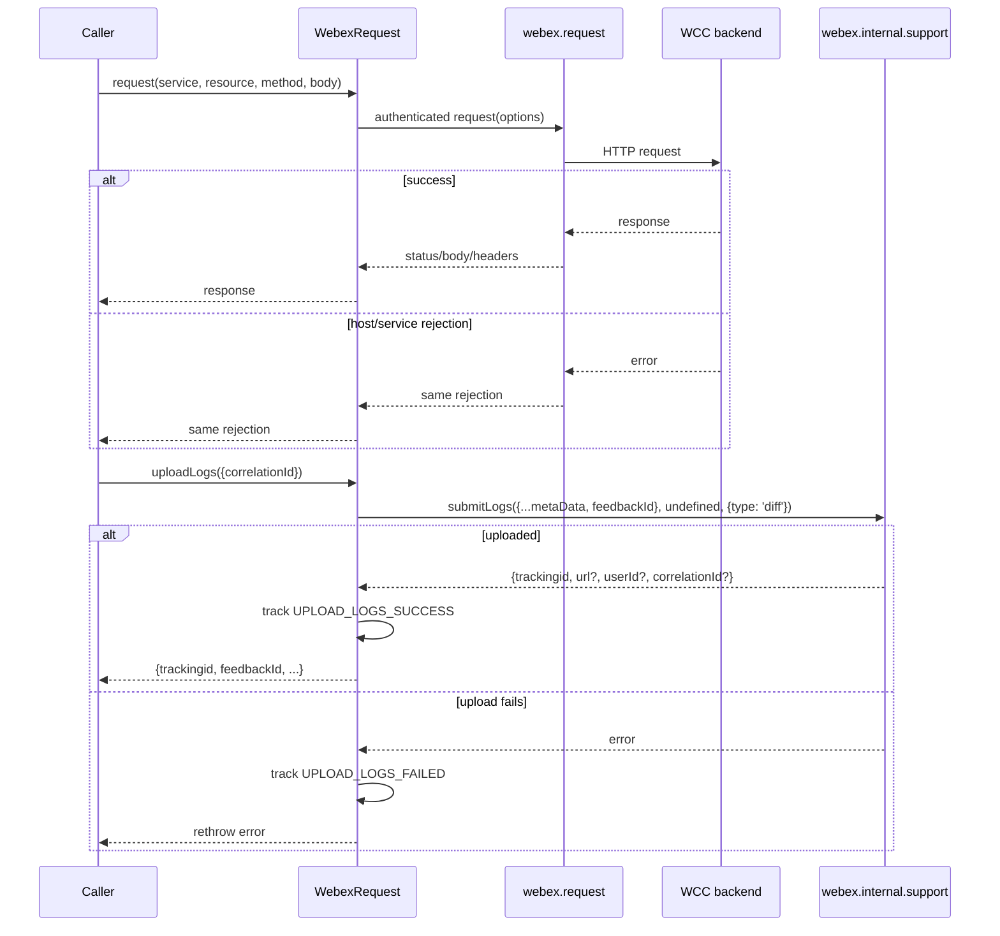
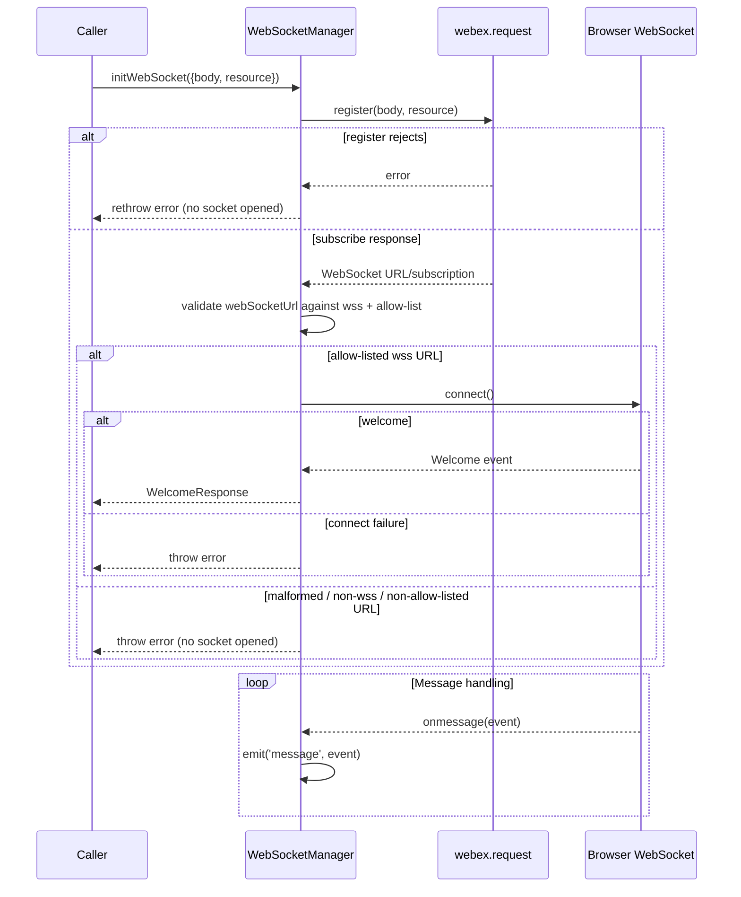
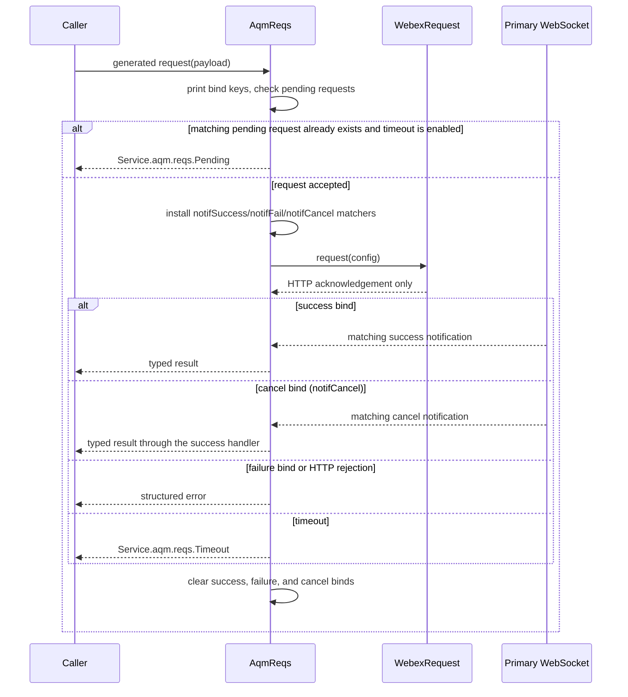
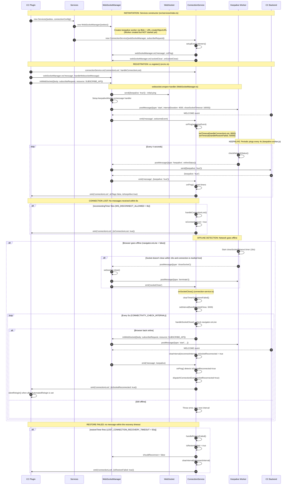
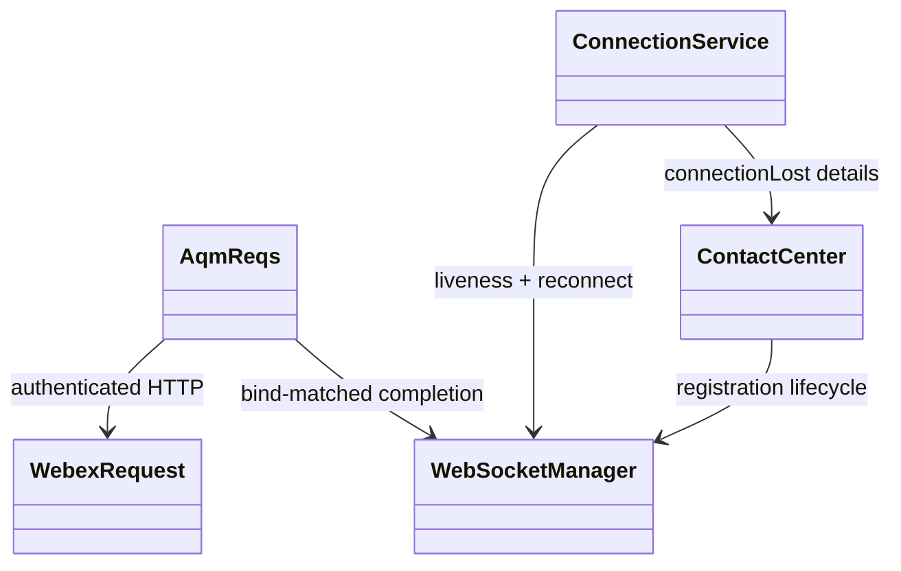
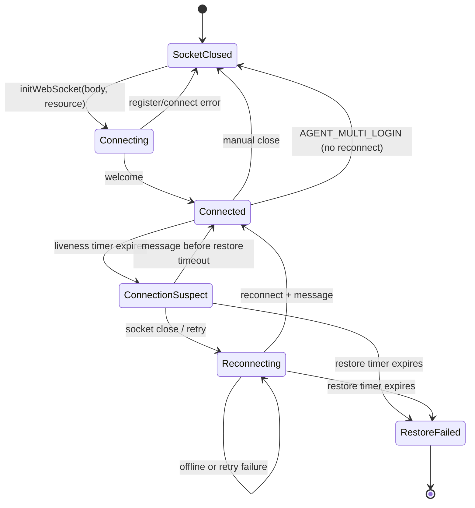
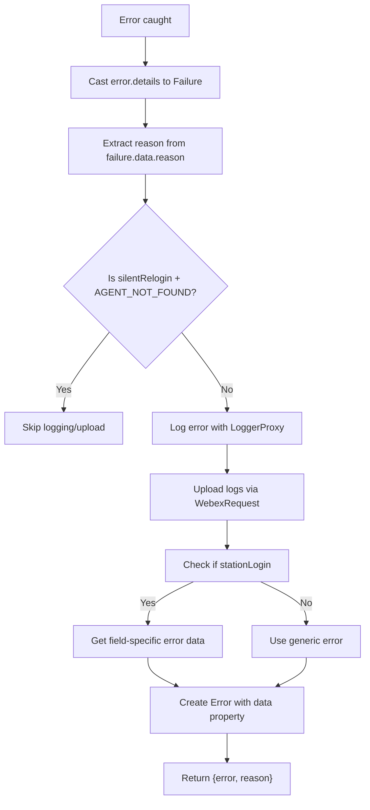

<!-- sdd-generated-metadata
doc_kind: module-spec
generated_from: module-spec@0.3.0
generated_by: claude-code
approved_by: rarajes2@cisco.com
updated_at: 2026-11-17T03:03:58Z
validation_status: pass-with-warnings
-->

# Core service

This source-local document at `src/services/core/docs/README.md` owns the stable specification for
**the core service** of `@webex/contact-center`. Core infrastructure components include WebSocket
management, HTTP requests, error handling, and utilities that the agent, config, task, dialer, and
plugin layers build on. Ground every claim in package evidence and link to the
[package architecture](../../../../docs/architecture.md) instead of repeating broader facts. The
parent [services specification](../../docs/README.md) owns the composition of these pieces into the
`Services` singleton.

Related context: [documentation index](../../../../docs/index.md) ·
[package agent instructions](../../../../AGENTS.md)

## Metadata

| Field | Value |
|---|---|
| Owner | @webex/web-sdk |
| Source path | `src/services/core` |
| Resource kind | module |
| Status | Active |
| Last verified | 2026-11-16 at `0b8c34db7f` |
| Module id | `core` |
| Parent spec | [src/services](../../docs/README.md) |
| Doc kind | Module spec |
| Coverage score | Pending coverage assessment |
| Validation status | pass-with-warnings — assessed 2026-11-17; validator runtime 01a1e76f-2293-79a0-9f8f-f060038448dd; 0 Blocking, 0 Important, 4 Minor findings. |

## Applicability

| Condition ID | Status | Evidence or reason | Owned section |
| ------------ | ------ | ------------------ | ------------- |
| `module.has_tiers` | N/A | The package defines no module tiers (`.sdd/manifest.json` profile sets has_tiers to false) | Tier |
| `module.has_ui` | N/A | No rendering code; every surface is a class, function, or event | UI use-case flow |
| `module.crosses_service_boundaries` | Applicable | `src/services/core/websocket/WebSocketManager.ts` calls the notification subscribe API and opens a WebSocket; `src/services/core/WebexRequest.ts` calls the WCC API gateway and the support log-upload service | Cross-boundary use-case flow |
| `module.holds_client_state` | Applicable | Socket, welcome, worker, pending-bind, timer, and connection flags in `src/services/core/websocket/WebSocketManager.ts`, `src/services/core/aqm-reqs.ts`, and `src/services/core/websocket/connection-service.ts` | Client state model |
| `module.enforces_domain_rules` | Applicable | The wss allow-list check, the duplicate-pending rejection, and the log-redaction rules in `src/services/core/websocket/WebSocketManager.ts` and `src/services/core/aqm-reqs.ts` | Business rules and invariants |
| `module.is_concurrent_async` | Applicable | Event-emitter fan-out, a keepalive Web Worker, and timer-driven reconnect in `src/services/core/websocket/connection-service.ts` and `src/services/core/websocket/keepalive.worker.js` | Concurrency and reactive flow |
| `module.owns_persistence` | N/A | Nothing in the module writes storage; all state is in memory | Data, schema, and migration discipline |
| `module.stateful_transitions` | Applicable | Socket lifecycle and connection-lost, reconnected, and restore-failed transitions in `src/services/core/websocket/connection-service.ts` | State machine |
| `module.exposes_wire_protocol` | Applicable | Subscribe request and response, the keepalive frame, the worker message contract, and the AQM bind matching in `src/services/core/websocket/WebSocketManager.ts` and `src/services/core/aqm-reqs.ts` | Protocol and wire format |
| `module.ui_multi_screen` | N/A | No UI | UI flow |
| `module.large_data_model` | N/A | The module's types (`src/services/core/types.ts`, `src/services/core/GlobalTypes.ts`, `src/services/core/websocket/types.ts`) are small request, message, and connection-state shapes | Data model |
| `module.returns_caller_errors` | Applicable | Err.Details and Err.Message rejections from `src/services/core/aqm-reqs.ts`, and the helpers in `src/services/core/Utils.ts` | Caller-visible failure modes |
| `module.module_specific_conventions` | Applicable | Error-helper, constants, redaction, and listener rules recorded under Module-specific rules, enforced by `src/services/core/Utils.ts` and `src/services/core/aqm-reqs.ts` | Module-specific rules |
| `module.published_package` | N/A | `src/index.ts` exports no core symbol; the module is internal to the package | Export stability |
| `module.embedded_in_host` | N/A | The package-level host integration is owned by the package root module | Host integration and theming |
| `module.has_design_tradeoff` | Applicable | HTTP initiation with WebSocket completion in `src/services/core/aqm-reqs.ts`; transport-only recovery in `src/services/core/websocket/connection-service.ts` | Key design trade-off |
| `module.has_submodules` | N/A | The websocket folder is part of this module; the plugin's module_tree.py reports no child module | Sub-modules |

## Evidence register

| Evidence | What it establishes |
| -------- | ------------------- |
| `src/services/core/WebexRequest.ts` | Singleton `WebexRequest`: `getInstance`, `request` (service, resource, method, body, optional headers), and `uploadLogs` with metrics |
| `src/services/core/aqm-reqs.ts` | `AqmReqs`: `req`, `reqEmpty`, bind keys, pending maps, duplicate rejection, HTTP failure masking, timeout, and redaction |
| `src/services/core/types.ts` | `Req`, `Conf`, `ConfEmpty`, `Res`, `ResEmpty`, `CbRes`, `Pending`, `Timeout`, and the RTD request types |
| `src/services/core/websocket/WebSocketManager.ts` | Subscribe registration, the `wss` allow-list check, socket handlers, keepalive worker wiring, welcome resolution, multi-login close, and `message`/`socketClose` events |
| `src/services/core/websocket/connection-service.ts` | Liveness timers, reconnect interval, restore failure, and the `connectionLost` event; the member subsections under Class and component relationships are justified by this file and `src/services/core/websocket/WebSocketManager.ts` |
| `src/services/core/websocket/keepalive.worker.js` | The worker script, its `start`/`terminate` inputs, and its `keepalive`/`closeSocket` outputs |
| `src/services/core/websocket/types.ts` | `ConnectionServiceOptions`, `ConnectionLostDetails`, `ConnectionProp` |
| `src/services/core/constants.ts` | Timer values, `ALLOWED_ROUTING_NOTIFS_DOMAINS`, participant constants, and method-name constants |
| `src/services/core/Utils.ts`, `src/services/core/Err.ts`, `src/services/core/GlobalTypes.ts` | Error helpers, the `Err` classes and error-id types, and `Msg`, `Failure`, `TaskError`, `AugmentedError` |
| `src/services/index.ts`, `src/cc.ts` | Consumers: construction order, the second RTD `WebSocketManager`, `connectWebsocket`, `handleConnectionLost`, and the `allowAutomatedRelogin` relogin policy |
| `src/services/constants.ts`, `src/services/config/types.ts`, `src/types.ts` | `WCC_API_GATEWAY`, `SUBSCRIBE_API`, `RTD_SUBSCRIBE_API`, `CC_EVENTS`, `SubscribeResponse`, `WelcomeResponse`, and the shared request types |
| `test/unit/spec/services/core/WebexRequest.ts`, `test/unit/spec/services/core/aqm-reqs.ts`, `test/unit/spec/services/core/Utils.ts` | Unit cases for request delegation, log upload, AQM settlement and redaction, and the error and URL helpers |
| `test/unit/spec/services/core/websocket/WebSocketManager.ts`, `test/unit/spec/services/core/websocket/connection-service.ts` | Unit cases for URL validation, the INT header, close paths, multi-login, timers, and reconnect |
| `src/services/core/WebexRequest.ts`, `src/services/core/websocket/WebSocketManager.ts`, `src/services/core/aqm-reqs.ts`, `src/services/core/websocket/connection-service.ts` (Data flow extension subsections) | One sequence subsection per operation group of the Data flow inventory: WebexRequest (request and uploadLogs), Subscribe and connect, Correlated request, and Connection lifecycle |
| `src/services/index.ts` (no feature gate) | `Services` constructs `WebSocketManager`, `AqmReqs`, and `ConnectionService` unconditionally; no rollout flag gates Core. No test observes this absence |
| `jest.config.js` | The 85% global branch, function, line, and statement threshold |

## Purpose and boundary

Core is the foundational infrastructure layer that all other services depend on. It owns authenticated HTTP to the WCC API Gateway with log upload support, the realtime WebSocket lifecycle with automatic reconnection and keepalive management, AQM request correlation (HTTP requests whose responses/failures are correlated via WebSocket notifications), and shared error normalization: standardized error extraction, logging via `LoggerProxy`, and log upload.

Boundary:

- Responsibility: the four concerns above, plus the shared consult and dial-number helpers in
  `src/services/core/Utils.ts`.
- In scope: every file under `src/services/core`, including `websocket/`.
- Out of scope: agent credentials, the agent profile, and the silent-relogin decision (the
  ContactCenter plugin in `src/cc.ts`); composing the services (`src/services/index.ts`, parent spec);
  the meaning of individual AQM operations (the agent, task, and dialer modules that call `req`).
- Consumers: `Services` constructs `WebSocketManager`, `AqmReqs`, and `ConnectionService`; `src/cc.ts`
  calls `initWebSocket`, `close`, and listens to `message` and `connectionLost`; `TaskManager`
  listens to `message` on both sockets; the agent, contact, and dialer factories call `req`; many
  service files call `WebexRequest`, `getErrorDetails`, `generateTaskErrorObject`, and the consult
  helpers.

## Structure and key files

```text
services/core/
├── aqm-reqs.ts           # AQM request handler
├── constants.ts          # Core constants
├── Err.ts                # Error classes
├── GlobalTypes.ts        # Failure, Msg<T>, etc.
├── types.ts              # Request/response types
├── Utils.ts              # Utility functions
├── WebexRequest.ts       # HTTP client
└── websocket/
    ├── WebSocketManager.ts    # Main WS handler
    ├── connection-service.ts  # Connection lifecycle
    ├── keepalive.worker.js    # Keepalive worker
    └── types.ts               # WS types
```

| Component | File | Description |
|---|---|---|
| `WebSocketManager` | [`WebSocketManager.ts`](../websocket/WebSocketManager.ts) | Manages the WebSocket connection lifecycle including initialization, message dispatch, keepalive worker integration, and graceful shutdown. Validates the subscribe/register `webSocketUrl` against the RoutingNotifs allow-list before opening a socket. Emits `message` events for incoming data and `socketClose` when the connection drops while reconnect is allowed. |
| `ConnectionService` | [`connection-service.ts`](../websocket/connection-service.ts) | Orchestrates reconnection logic and keepalive heartbeats on top of `WebSocketManager`. Detects connection loss/recovery and emits `connectionLost` details; ContactCenter owns any `silentRelogin()` policy. |
| `WebexRequest` | [`WebexRequest.ts`](../WebexRequest.ts) | Singleton HTTP client that forwards service/resource/method/body options to the authenticated host request API and provides `uploadLogs` diagnostics. |
| `AqmReqs` | [`aqm-reqs.ts`](../aqm-reqs.ts) | Factory for creating request methods that send HTTP requests and wait for correlated WebSocket notifications (success or failure): the AQM request/response pattern and WebSocket notification binding, with the pending maps and timeout. Used by routing and task services to implement their API methods. |
| `Utils` | [`Utils.ts`](../Utils.ts) | Shared utility functions including `getErrorDetails()` for standardized error handling, `generateTaskErrorObject()` for task-specific errors, and `createErrDetailsObject()` for constructing error detail objects; also `getStationLoginErrorData`, `isAllowedUrlHost`, `isValidDialNumber`, `stripDialPlanChars`, and the consult utilities (`getConsultedAgentId`, `getDestAgentIdForCBT`, `calculateDestAgentId`, `calculateDestType`, `buildConsultConferenceParamData`, `deriveConsultTransferDestinationType`). |
| `Err` | [`Err.ts`](../Err.ts) | Error class definitions: `Err.Message` and `Err.Details` error classes and the typed error-id unions. `Err.Details` carries structured error metadata (status, type, trackingId) for consistent error propagation. |
| `constants` | [`constants.ts`](../constants.ts) | Timeout values, interval durations, participant types, interaction states, method name constants, and the `ALLOWED_ROUTING_NOTIFS_DOMAINS` WebSocket host allow-list used throughout the core layer. Any new constants for core should be defined here. |
| `GlobalTypes` | [`GlobalTypes.ts`](../GlobalTypes.ts) | `Msg`, `Failure`, `TaskError`, `AugmentedError` type definitions. |
| `types` | [`types.ts`](../types.ts) | `Pending`, `Req`, `Conf`, `Res` types for AqmReqs, plus the internal RTD request types. |
| keepalive worker | [`keepalive.worker.js`](../websocket/keepalive.worker.js) | Web Worker for periodic keepalive and offline detection, exported as a script string. |
| websocket `types` | [`types.ts`](../websocket/types.ts) | `ConnectionServiceOptions`, `ConnectionLostDetails`, `ConnectionProp`. |

Files outside the source layout above:

| Path | Responsibility |
| ---- | -------------- |
| `src/services/core/docs/README.md` | This module specification |
| test/unit/spec/services/core (directory) | Unit tests mirroring the source layout, including the websocket folder |

## Public surface

The module is internal to the package: `src/index.ts` exports none of it. Its consumption boundary is
contract `contact-center-core-transport` (internal SDK contract, canonical source
`src/services/core/aqm-reqs.ts`), indexed in the
[package architecture](../../../../docs/architecture.md).

| Surface | Consumer | Compatibility commitment | Source |
| ------- | -------- | ------------------------ | ------ |
| `contact-center-core-transport`: `AqmReqs` (`req`, `reqEmpty`) and the `Req` configuration | Agent, contact, and dialer factories | Internal; additive config fields only, every in-package caller updated in the same change | `src/services/core/aqm-reqs.ts`, `src/services/core/types.ts` |
| `contact-center-core-transport`: `WebexRequest.getInstance`, `request`, `uploadLogs` | `src/cc.ts`, config and other services, the error helpers | Internal; `request` returns or rejects with the host result unchanged | `src/services/core/WebexRequest.ts` |
| `contact-center-core-transport`: `WebSocketManager` (`initWebSocket`, `close`, `handleConnectionLost`, `shouldReconnect`, `isSocketClosed`, events `message` and `socketClose`) | `Services`, `src/cc.ts`, `TaskManager`, `AqmReqs`, `ConnectionService` | Internal; event names are string literals that listeners depend on | `src/services/core/websocket/WebSocketManager.ts` |
| `contact-center-core-transport`: `ConnectionService` (`setConnectionProp`, event `connectionLost` with `ConnectionLostDetails`) | `src/cc.ts` | Internal; ContactCenter reads `isConnectionLost` and `isSocketReconnected` | `src/services/core/websocket/connection-service.ts`, `src/services/core/websocket/types.ts` |
| `contact-center-core-transport`: error and utility helpers, `Err` classes, `Msg`, `Failure`, `AugmentedError` | Agent, config, task, and plugin code | Internal; error `message` and `data` shapes are observed by callers | `src/services/core/Utils.ts`, `src/services/core/Err.ts`, `src/services/core/GlobalTypes.ts` |

| Event | Data | Description |
|---|---|---|
| `message` | string (JSON) | WebSocket message received |
| `socketClose` | - | Socket closed while reconnect is allowed |
| `connectionLost` | `ConnectionLostDetails` | Emitted by `ConnectionService` on lost, recovered, reconnected, and restore-failed transitions, and on every keepalive echo |

Generic message wrapper used throughout the SDK. All WebSocket messages and AQM responses conform to this shape:
`Msg<T>` in [GlobalTypes.ts](../GlobalTypes.ts) carries `type`, `orgId`, `trackingId`, and a `data` payload of type `T`, so a typed event such as a login success is declared as `Msg<{agentId, status, ...}>` and arrives as `{type, orgId, trackingId, data: {agentId, status, ...}}`.

Do not remove or reinterpret exported symbols/events without a documented consumer migration.

## Dependencies

| Dependency | Why it is required | Failure behavior |
| ---------- | ------------------ | ---------------- |
| Webex SDK service catalog and authenticated request API (`webex.request`, contracts `webex-core-plugin-runtime` and `wxcc-api-gateway`) | Every REST call and the subscribe registration; the host resolves the `service` key and adds authentication | Rejections propagate unchanged through `WebexRequest.request`; `AqmReqs` maps them (CORE-R-010) |
| Notification WebSocket (contract `wxcc-websocket-notifications`) | Delivers the welcome event, keepalive echoes, and every AQM result | Close and error handlers; recovery per Connection lifecycle |
| `webex.internal.support.submitLogs` (contract `webex-internal-support`) | `uploadLogs` diagnostics | Logged, tracked as `UPLOAD_LOGS_FAILED`, and rethrown |
| `webex.credentials.getOrgId`, `webex.internal.services.isIntegrationEnvironment` | The `X-ORGANIZATION-ID` header on the subscribe call in INT environments | A missing `isIntegrationEnvironment` is treated as production (no header) |
| Browser WebSocket, Worker, URL and network-status APIs | Socket, keepalive worker (`Blob` + `URL.createObjectURL`), URL validation, `navigator.onLine` | Offline reconnect attempts throw and retry on the next interval |
| LoggerProxy and log upload | Every diagnostic line and the error helpers' upload | Fire and forget in the helpers |
| `MetricsManager` (`src/metrics/MetricsManager.ts`) | `UPLOAD_LOGS_SUCCESS` and `UPLOAD_LOGS_FAILED` behavioral events | Not awaited |
| `src/services/constants.ts`, `src/services/config/types.ts` | `WCC_API_GATEWAY`, `SUBSCRIBE_API`, `CC_EVENTS.WELCOME`, `SubscribeResponse`, `WelcomeResponse` | Compile-time |
| `src/types.ts` | Shared `WebexSDK`, `HTTP_METHODS`, `RequestBody`, `IHttpResponse`, `LogsMetaData`, `UploadLogsResponse`, `SubscribeRequest`, `WebexRequestPayload`, `LoginOption` types | Compile-time |
| `src/services/task/types.ts` | Interaction and destination types for the consult helpers in `Utils.ts` | Compile-time |

## Requirements

| ID | WHAT | WHY | Source Evidence | Test / Example Evidence | Assumptions / Gaps | Confidence |
|---|---|---|---|---|---|---|
| CORE-R-001 | WebexRequest must delegate service/resource/method/body options to the authenticated host request API and return or reject with the host result unchanged. | All Contact Center REST clients share host-owned authentication and service routing without duplicating credential logic. | `src/services/core/WebexRequest.ts` | `test/unit/spec/services/core/WebexRequest.ts` | Authorization-header masking belongs to `AqmReqs` HTTP-failure handling, not `WebexRequest.request`. | PRESENT |
| CORE-R-002 | `initWebSocket` requires `{body: SubscribeRequest, resource: string}` and resolves only after WebSocket welcome or rejects on register/connect failure. | Subscription resource selection and readiness are required for a valid realtime session. | `src/services/core/websocket/WebSocketManager.ts` | `test/unit/spec/services/core/websocket/WebSocketManager.ts` | No welcome timeout: a socket that opens but never sends the welcome leaves the promise pending (`WELCOME_TIMEOUT` is defined but unused). | PRESENT |
| CORE-R-003 | AqmReqs must be constructed with the primary WebSocket manager and settle generated request promises from `notifSuccess`/`notifFail` binds or `TIMEOUT_REQ`. | HTTP acknowledgement alone does not represent backend operation completion. | `src/services/core/aqm-reqs.ts` | `test/unit/spec/services/core/aqm-reqs.ts` | None. | PRESENT |
| CORE-R-004 | ConnectionService must emit transport-state details and retry `initWebSocket({body, resource})`; ContactCenter owns relogin policy. | Separating transport detection from agent recovery prevents Core from mutating package-level session state. | `src/services/core/websocket/connection-service.ts` | `test/unit/spec/services/core/websocket/connection-service.ts` | None. | PRESENT |
| CORE-R-005 | The keepalive worker must use `KEEPALIVE_WORKER_INTERVAL` as its interval and `CLOSE_SOCKET_TIMEOUT` as its close-socket timeout, and AQM requests default to `TIMEOUT_REQ` unless disabled/overridden (values in the timer table under Concurrency and reactive flow). | Accurate timing is required for predictable recovery and request failure behavior. | `src/services/core/constants.ts`, `src/services/core/websocket/WebSocketManager.ts` | `test/unit/spec/services/core/aqm-reqs.ts` | No unit case asserts the worker `start` message values; the AQM default is asserted by the default-timeout case. | WEAK |
| CORE-R-007 | AQM routing-failure logging never emits the raw routing message payload or error verbatim; the failure-bind path logs only a fixed redacted diagnostic regardless of `redactSensitiveLogs`. When an AQM request additionally sets `redactSensitiveLogs`, timeout logs must also omit the request URL, bind key, and response while preserving settlement and cleanup behavior. | Dynamic request paths and routing messages can contain participant identifiers or phone numbers that must not enter diagnostic logs. | `src/services/core/aqm-reqs.ts`, `src/services/core/types.ts` | `test/unit/spec/services/core/aqm-reqs.ts` | The timeout flag is internal and opt-in; ordinary AQM logging remains backward compatible while routing-failure logging is unconditionally redacted. | PRESENT |
| CORE-R-008 | `WebSocketManager` opens a socket only for a subscribe/register `webSocketUrl` that parses as a `wss` URL whose host equals, or is a subdomain of, an entry in `ALLOWED_ROUTING_NOTIFS_DOMAINS`; a malformed, non-`wss`, or non-allow-listed URL is rejected with an error and no socket is opened. | A server-controlled subscribe response could otherwise direct the realtime connection to an untrusted or non-secure endpoint. | `src/services/core/websocket/WebSocketManager.ts`, `src/services/core/constants.ts` | `test/unit/spec/services/core/websocket/WebSocketManager.ts` | The allow-list is a fixed domain set; subdomain matching is exact suffix matching on the parsed hostname. | PRESENT |
| CORE-R-009 | When a pending request already holds the success bind key (or the failure bind key) and the new request's `timeout` is not `'disabled'`, the generated function rejects at once with `Err.Details('Service.aqm.reqs.Pending')` and sends no HTTP request. | The bind key is the only correlation handle, so two concurrent requests with the same bind could not be told apart; the error text says multiple requests are not allowed. | `src/services/core/aqm-reqs.ts`, `src/services/core/Err.ts` | None found | No unit case covers the duplicate rejection. | WEAK |
| CORE-R-010 | On an HTTP rejection AqmReqs clears all three bind entries, masks `headers.Authorization` to `*`, and rejects with `c.err(error)` when `err` is a function, `Err.Message(c.err)` when it is a string, and `Err.Message('Service.aqm.reqs.GenericRequestError')` otherwise. On timeout it masks the stored response's `Authorization` header and rejects with `Err.Details('Service.aqm.reqs.Timeout', {key, response})`. | The bearer token must not reach logs or surfaced errors, and each operation module chooses its own error mapping. | `src/services/core/aqm-reqs.ts` | `test/unit/spec/services/core/aqm-reqs.ts` | None. | PRESENT |
| CORE-R-011 | A `notifCancel` bind resolves the same promise as the success bind and is cleared with it. | Some operations finish with an alternate event (for example a participant leaving instead of a drop success), and the caller must still settle once. | `src/services/core/aqm-reqs.ts`, `src/services/core/types.ts` | `test/unit/spec/services/core/aqm-reqs.ts` | None. | PRESENT |
| CORE-R-012 | The subscribe call adds `X-ORGANIZATION-ID` (set to the org id) only when `webex.internal.services.isIntegrationEnvironment()` is true and an org id exists. | The in-code comment: the header is only required for INT environments. | `src/services/core/websocket/WebSocketManager.ts` | `test/unit/spec/services/core/websocket/WebSocketManager.ts` | None. | PRESENT |
| CORE-R-013 | An incoming `AGENT_MULTI_LOGIN` message closes the socket with `shouldReconnect` false and reason `multiLogin`, so no `socketClose` event and no reconnect follow. | A second login of the same agent replaces this session; reconnecting would fight it. | `src/services/core/websocket/WebSocketManager.ts` | `test/unit/spec/services/core/websocket/WebSocketManager.ts` | None. | PRESENT |
| CORE-R-014 | `uploadLogs(metaData)` submits diff logs with a fresh `feedbackId`, tracks `UPLOAD_LOGS_SUCCESS` or `UPLOAD_LOGS_FAILED`, resolves `{trackingid, feedbackId}` plus any returned `url`, `userId`, `correlationId`, and rethrows a failure. | The JSDoc: logs are uploaded to the backend for diagnostics; the `feedbackId` and `correlationId` let support find them. | `src/services/core/WebexRequest.ts` | `test/unit/spec/services/core/WebexRequest.ts` | None. | PRESENT |
| CORE-R-015 | `getErrorDetails` and `generateTaskErrorObject` keep the error shapes and the logging and log-upload side effects specified under Caller-visible failure modes. | Callers rely on one error shape per flow for metrics, UI messages, and station-login field hints. | `src/services/core/Utils.ts` | `test/unit/spec/services/core/Utils.ts` | `generateTaskErrorObject` has no unit case in this module's tests. | PRESENT |

## Design overview

Stack: TypeScript/JavaScript, WebSocket, Web Worker keepalive, EventEmitter, Webex request client, Jest 27.

Core separates four responsibilities:

1. `WebexRequest` wraps the authenticated host request API and service-catalog routing.
2. `WebSocketManager` registers a subscription using both `body` and `resource`, validates the returned `webSocketUrl` against the `ALLOWED_ROUTING_NOTIFS_DOMAINS` allow-list before connecting the socket, owns the keepalive worker, and emits raw messages/socket lifecycle events.
3. `AqmReqs` registers bind matchers on the primary WebSocket, sends HTTP through WebexRequest, and settles requests only from matching notifications, HTTP failure, or timeout.
4. `ConnectionService` observes message/socket liveness, emits connection-state details, and retries socket initialization. ContactCenter listens to those details and owns optional silent relogin.

Component instantiation order (`Services` constructor in `src/services/index.ts`, after the plugin
has called `WebexRequest.getInstance({webex})` in `src/cc.ts`):

1. **WebSocketManager** ([WebSocketManager.ts](../websocket/WebSocketManager.ts)) - Creates keepalive worker (not started); a second instance, `rtdWebSocketManager`, is created for the RTD socket and is not wired to `AqmReqs` or `ConnectionService`
2. **AqmReqs** ([src/services/core/aqm-reqs.ts](../aqm-reqs.ts)) - Initialized with WebSocketManager reference
3. **Service layers** (agent, contact, dialer) - Created with AqmReqs reference; config is created without it
4. **ConnectionService** ([connection-service.ts](../websocket/connection-service.ts)) - Wires event listeners immediately

The AQM (Agent Queue Manager) layer provides a request/response pattern over HTTP + WebSocket. Services like **routing** and **contact** use `AqmReqs` to define API methods that:

1. Send an HTTP request to the contact center backend via `WebexRequest`
2. Wait for a correlated WebSocket notification indicating success or failure
3. Return the typed result or throw a structured error

This decouples the request initiation (HTTP) from the asynchronous result delivery (WebSocket), which matches the contact center backend's event-driven architecture.

```typescript
const aqmReqs = new AqmReqs(webSocketManager);
const setState = aqmReqs.req((p: {data: Agent.StateChange}) => ({
  host: WCC_API_GATEWAY,
  url: '/v1/agents/session/state',
  data: p.data,
  method: HTTP_METHODS.PUT,
  notifSuccess: {
    bind: {
      type: CC_EVENTS.AGENT_STATE_CHANGE,
      data: {type: CC_EVENTS.AGENT_STATE_CHANGE_SUCCESS},
    },
    msg: {} as Agent.StateChangeSuccess,
  },
  notifFail: {
    bind: {
      type: CC_EVENTS.AGENT_STATE_CHANGE,
      data: {type: CC_EVENTS.AGENT_STATE_CHANGE_FAILED},
    },
    errId: 'Service.aqm.agent.stateChange',
  },
}));
await setState({data: stateChangePayload});
```

The production `stateChange` method in `src/services/agent/index.ts` has this shape plus an `err`
mapper. `req` returns `(payload, cbRes?) => Promise`, and `reqEmpty` returns `(cbRes?) => Promise`
for configurations without parameters; the optional `cbRes` callback receives the raw HTTP
acknowledgement.

`WebexRequest` ([WebexRequest.ts](../WebexRequest.ts)) is a singleton HTTP client that all services
use to make authenticated REST API calls to the contact center backend. Its constructor is private;
the static `instance` is created by the first `getInstance({webex})` call that passes a `WebexSDK`,
and later calls, with or without options, return it. It does not resolve URLs, format requests, or
parse responses itself: `request({service, resource, method, body, headers})` forwards the service
key used by `webex.request` to resolve the target host, the API path within the service (for example
`v1/notification/subscribe`), the `HTTP_METHODS` value, the optional `RequestBody`, and `headers`
(only when given), and returns the host's `Promise<IHttpResponse>`.
`uploadLogs(metaData: LogsMetaData = {})` resolves an `UploadLogsResponse` (CORE-R-014).

```typescript
// Get singleton
const webexReq = WebexRequest.getInstance({webex});

// Make request
const response = await webexReq.request({
  service: WCC_API_GATEWAY,  // resolved to base URL by Webex SDK
  resource: '/v1/endpoint',  // appended as path
  method: HTTP_METHODS.POST,
  body: { key: 'value' },   // optional request payload
});

// Upload logs
await webexReq.uploadLogs({
  correlationId: trackingId,
});
```

`WebSocketManager` handles the raw WebSocket connection to the contact center backend. It is
instantiated by the `Services` layer; `src/cc.ts`, `TaskManager`, `AqmReqs`, and `ConnectionService`
all use the same instance directly.

```typescript
// Initialize in Services
this.webSocketManager = new WebSocketManager({webex});

// Connect
const welcomeEvent = await webSocketManager.initWebSocket({
  body: connectionConfig,
  resource: SUBSCRIBE_API,
});

// Listen for messages
webSocketManager.on('message', (event) => {
  const data = JSON.parse(event);
  // Handle event
});

// Close
webSocketManager.close(false, 'Reason');
```

## Data flow and sequence coverage

Transport: REST over `webex.request` to the `wcc-api-gateway` service, and one JSON WebSocket per
`WebSocketManager` instance. Every AQM operation starts with HTTP and completes on the primary
socket.

| Operation group | Entry and outcome | Diagram or evidence | Failure and recovery coverage |
| --------------- | ----------------- | ------------------- | ----------------------------- |
| Authenticated REST | `WebexRequest.request`; resolves the host response | Diagram WebexRequest; `src/services/core/WebexRequest.ts` | Host/service rejection is propagated unchanged; AQM applies its own error mapping separately. |
| Diagnostics upload | `WebexRequest.uploadLogs`; resolves the feedback and tracking ids | Diagram WebexRequest (upload part); `src/services/core/WebexRequest.ts` | Failure tracked as `UPLOAD_LOGS_FAILED` and rethrown; no retry. |
| WebSocket subscribe/connect | `initWebSocket({body, resource})`; resolves the welcome data | Diagram Subscribe and connect; `src/services/core/websocket/WebSocketManager.ts` | Register rejection, URL rejection, connect failure, and welcome resolution. |
| AQM operation | Generated `req` function; resolves the matching notification | Diagram Correlated request; `src/services/core/aqm-reqs.ts` | Duplicate pending request (checked before any matcher is installed), cancel-bind resolution, HTTP failure, failure bind, and timeout reject. |
| Connection lifecycle and recovery | Keepalive, liveness timers, offline close, reconnect; emits `connectionLost` | Diagram Connection lifecycle; `src/services/core/websocket/connection-service.ts` | Offline attempts retry on the next interval; restored and restore-failed states are emitted to ContactCenter. |
| Error normalization | `getErrorDetails`, `generateTaskErrorObject` | getErrorDetails flow under Caller-visible failure modes; `src/services/core/Utils.ts` | Silent-relogin `AGENT_NOT_FOUND` skip; station-login field data. |

### WebexRequest



### Subscribe and connect



The register step is `POST v1/notification/subscribe` (`SUBSCRIBE_API`) on `wcc-api-gateway`; the
response body carries `webSocketUrl` and `subscriptionId`. The RTD socket uses the same flow with
`RTD_SUBSCRIBE_API`.

### Correlated request



### Connection lifecycle

This diagram shows the connection lifecycle from component instantiation through keepalive,
connection loss, offline close, reconnect, and restore failure, including when each layer is created
and engaged and the method invocation sequence.



ContactCenter logs a lost connection and, on `isSocketReconnected`, calls `silentRelogin()` only when
`allowAutomatedRelogin` is configured; an `AGENT_NOT_FOUND` failure of that relogin is not logged or
uploaded by `getErrorDetails`.

## Class and component relationships

Component roles and files are catalogued under Structure and key files; this section shows how the
classes depend on each other and the members that carry the lifecycle.



### WebSocketManager members

`WebSocketManager` extends `EventEmitter`. Its public members are `initWebSocket`, `close`,
`handleConnectionLost`, and the flags `shouldReconnect` and `isSocketClosed`; `register`, `connect`,
and `webSocketOnCloseHandler` are private.

- `initWebSocket({body, resource})`: `register()` → POST `resource` on `wcc-api-gateway` → validate and store the WebSocket URL; `connect()` → Create WebSocket → Setup handlers (onopen, onmessage, onclose, onerror)
- `websocket.onopen`: Send initial keepalive ping; Wire `keepaliveWorker.onmessage` handler; **Start keepalive worker** via `postMessage({type: 'start', intervalDuration: KEEPALIVE_WORKER_INTERVAL, isSocketClosed, closeSocketTimeout: CLOSE_SOCKET_TIMEOUT})`
- `websocket.onmessage`: emits `message` with the raw string, resolves the pending welcome promise on `Welcome`, and closes without reconnect on `AGENT_MULTI_LOGIN`
- `close(shouldReconnect, reason = 'Unknown')`: acts only while the socket is open and `shouldReconnect` is still true; stores the new `shouldReconnect`, closes the socket, and terminates the worker
- `handleConnectionLost(details)`: stores `details.isConnectionLost`, which gates the worker's forced close
- `webSocketOnCloseHandler`: marks the socket closed, terminates the worker, and, only while `shouldReconnect` is true, emits `socketClose` and logs the reason (forced close, network issue, or missing keepalive)

### ConnectionService members

Monitors WebSocket health via keepalive messages, detects disconnections, triggers reconnection attempts, and emits connection state events to the application layer. Extends `EventEmitter`.

The constructor takes `ConnectionServiceOptions` `{webSocketManager, subscribeRequest}` from
[websocket/types.ts](../websocket/types.ts), stores both, clears the four flags, and calls
`setupEventListeners()`.

| Property              | Type                             | Description                                                                                                  |
| --------------------- | -------------------------------- | ------------------------------------------------------------------------------------------------------------ |
| `connectionProp`      | `ConnectionProp`                 | Runtime configuration object (for example `lostConnectionRecoveryTimeout`) used by reconnect/restore timers. |
| `wsDisconnectAllowed` | `number`                         | Timeout window before `handleConnectionLost` is triggered when no ping/message is received.                  |
| `reconnectingTimer`   | `ReturnType<typeof setTimeout>`  | Per-message timeout that schedules lost-connection detection.                                                |
| `restoreTimer`        | `ReturnType<typeof setTimeout>`  | Timeout that marks restore failure if recovery does not complete in time.                                    |
| `reconnectInterval`   | `ReturnType<typeof setInterval>` | Periodic retry loop started after socket close to attempt reconnection.                                      |
| `isConnectionLost`    | `boolean`                        | Indicates that the connection has been marked as lost.                                                       |
| `isRestoreFailed`     | `boolean`                        | Indicates that recovery has exceeded the configured restore timeout.                                         |
| `isSocketReconnected` | `boolean`                        | Indicates that a reconnect attempt succeeded and socket is back.                                             |
| `isKeepAlive`         | `boolean`                        | Tracks whether the latest incoming message is a keepalive signal.                                            |
| `webSocketManager`    | `WebSocketManager`               | Core WebSocket dependency used for event subscription and re-initialization.                                 |
| `subscribeRequest`    | `SubscribeRequest`               | Cached subscribe payload reused during reconnect (`initWebSocket`).                                          |

The only public method in the following list is `setConnectionProp`. The remaining methods are private implementation details documented for ownership and maintenance; they are not public API contracts.

1. `setConnectionProp(prop: ConnectionProp): void` (public)
   - **Purpose**: Updates connection-level runtime settings used by timers (mainly recovery timeout behavior).
   - **Params**: `prop` - new connection config object.
   - **Returns**: `void`.
   - **Usage**: Intended to be called by higher layers when timeout behavior must be tuned after initialization; see Pitfalls and constraints for its current callers.
2. `setupEventListeners(): void` (private)
   - **Purpose**: Wires `WebSocketManager` events to internal handlers (`'message' -> onPing`, `'socketClose' -> onSocketClose`).
   - **Params**: none.
   - **Returns**: `void`.
   - **Usage**: Invoked from the constructor once, during `ConnectionService` setup.
3. `onPing(event: any): void` (private)
   - **Purpose**: Handles every incoming socket message, resets timers, updates keepalive/recovery flags, and emits recovery events when state changes.
   - **Params**: `event` - raw message payload (JSON string) received from the socket event stream.
   - **Returns**: `void`.
   - **Usage**: Triggered automatically by the `'message'` listener.
4. `onSocketClose(): void` (private)
   - **Purpose**: Starts the reconnect interval when socket close is detected.
   - **Params**: none.
   - **Returns**: `void`.
   - **Usage**: Triggered automatically by the `'socketClose'` listener.
5. `handleSocketClose(): Promise<void>` (private)
   - **Purpose**: Performs one reconnect attempt; if browser is online, reinitializes WebSocket and marks socket as reconnected.
   - **Params**: none.
   - **Returns**: `Promise<void>` (rejects when browser is offline).
   - **Usage**: Called repeatedly from `onSocketClose` interval loop.
6. `handleConnectionLost(): void` (private)
   - **Purpose**: Marks the connection as lost and dispatches a connection status event.
   - **Params**: none.
   - **Returns**: `void`.
   - **Usage**: Scheduled by `onPing` via `reconnectingTimer` after inactivity.
7. `handleRestoreFailed(): Promise<void>` (private)
   - **Purpose**: Marks restore as failed, disables reconnect, emits failure state, and clears reconnect interval.
   - **Params**: none.
   - **Returns**: `Promise<void>`.
   - **Usage**: Scheduled by `onPing` via `restoreTimer`.
8. `clearTimerOnRestoreFailed(): Promise<void>` (private)
   - **Purpose**: Stops active reconnect interval to avoid duplicate retries.
   - **Params**: none.
   - **Returns**: `Promise<void>`.
   - **Usage**: Called from reconnect/failure paths whenever interval cleanup is needed.
9. `updateConnectionData(): void` (private)
   - **Purpose**: Resets transient connection flags (`isConnectionLost`, `isRestoreFailed`, `isSocketReconnected`) after recovery.
   - **Params**: none.
   - **Returns**: `void`.
   - **Usage**: Called inside `onPing` before dispatching recovered state.
10. `dispatchConnectionEvent(socketReconnected = false): void` (private)
    - **Purpose**: Builds `ConnectionLostDetails`, forwards it to `WebSocketManager.handleConnectionLost`, and emits `'connectionLost'`.
    - **Params**: `socketReconnected` - optional override used when reconnect is explicitly detected.
    - **Returns**: `void`.
    - **Usage**: Used by lost/recovered/restore-failed paths to publish uniform connection state.

`ConnectionLostDetails` ([websocket/types.ts](../websocket/types.ts)) has four booleans:
`isConnectionLost`, `isRestoreFailed`, `isSocketReconnected` (reported true only while
`WebSocketManager.isSocketClosed` is false), and `isKeepAlive`. A listener reads them in this order:

```typescript
connectionService.on('connectionLost', (details: ConnectionLostDetails) => {
  if (details.isConnectionLost) {
    // Connection lost — waiting for recovery
  } else if (details.isRestoreFailed) {
    // Recovery timeout (50 s) exceeded
  } else if (details.isSocketReconnected) {
    // Socket successfully reconnected
  }
});
```

## Use cases and flows

| Use case | Actor or caller | Primary steps and outcome | Failure or boundary behavior | Evidence |
| -------- | --------------- | ------------------------- | ---------------------------- | -------- |
| `UC-1` Authenticated REST | Any service | Pass the service key and request options to the host and return its response or rejection unchanged. | Rejection passes through unchanged | `src/services/core/WebexRequest.ts`, `test/unit/spec/services/core/WebexRequest.ts` |
| `UC-2` Subscribe/connect | `src/cc.ts` `connectWebsocket` | Register with `{body, resource}`, connect, and wait for welcome. | Register failure, URL rejection, and socket error reject | `src/services/core/websocket/WebSocketManager.ts`, `test/unit/spec/services/core/websocket/WebSocketManager.ts` |
| `UC-3` AQM correlation | Agent, contact, and dialer factories | Send HTTP but settle on matching notification/failure/timeout. | Duplicate pending, HTTP failure, failure bind, timeout | `src/services/core/aqm-reqs.ts`, `test/unit/spec/services/core/aqm-reqs.ts` |
| `UC-4` Reconnect | `ConnectionService` | Retry socket initialization and emit state for ContactCenter-owned recovery. | Offline retries; restore failure stops reconnect | `src/services/core/websocket/connection-service.ts`, `test/unit/spec/services/core/websocket/connection-service.ts` |
| `UC-5` Error normalization | Agent, config, and task code | Convert a caught error into an `Error` with `data`, log it, and upload logs | Silent-relogin `AGENT_NOT_FOUND` is not logged | `src/services/core/Utils.ts`, `test/unit/spec/services/core/Utils.ts` |
| `UC-6` Diagnostics upload | Error helpers and the plugin | `uploadLogs({correlationId})` returns the feedback and tracking ids | Failure tracked and rethrown | `src/services/core/WebexRequest.ts`, `test/unit/spec/services/core/WebexRequest.ts` |

### Cross-boundary use-case flow

| Boundary | Transport and ordering | Compatibility | Timeout, retry, and recovery |
| -------- | ---------------------- | ------------- | ---------------------------- |
| Notification subscribe (`UC-2`) | HTTPS POST `v1/notification/subscribe` (or `v1/realtime/subscribe`) through `webex.request`, then the WebSocket | Response must carry a `wss` `webSocketUrl` on `cisco.com` or `ciscoccservice.com` | No timeout on welcome; reconnect only through `ConnectionService` for the primary socket |
| AQM operations (`UC-3`) | HTTPS through `WebexRequest`, result on the primary socket; binds are installed before the HTTP call | Bind fields must match the event `type` and nested `data` values | `TIMEOUT_REQ` or a per-request `timeout`; `'disabled'` waits forever; no retry |
| Keepalive (`UC-4`) | `{"keepalive":"true"}` text frame every `KEEPALIVE_WORKER_INTERVAL`; the backend echo resets the liveness timers | Frame shape fixed in `WebSocketManager.ts` | Lost-connection, forced-close, and reconnect timers from the timer table under Concurrency and reactive flow |
| Support log upload (`UC-6`) | `webex.internal.support.submitLogs(meta, undefined, {type: 'diff'})` | `feedbackId` from `crypto.randomUUID()` | No retry |

## Client state model

WebSocketManager owns socket/welcome/worker state. AqmReqs owns pending success/failure/cancel bind maps until settlement or timeout. ConnectionService owns liveness/reconnect timers and flags, then emits state details. It does not own agent credentials, profile, or silent relogin.

| State or slice | Owner | Initial state | Transition triggers | Reset or persistence boundary |
| -------------- | ----- | ------------- | ------------------- | ----------------------------- |
| `url`, `websocket`, `isSocketClosed`, `shouldReconnect`, `isWelcomeReceived`, `welcomePromiseResolve`, `forceCloseWebSocketOnTimeout`, `isConnectionLost` | `WebSocketManager` | No URL, empty socket, `shouldReconnect` true | Register, `onopen`, `onmessage`, `onclose`, `close`, `handleConnectionLost` | Memory; each `initWebSocket` replaces the URL and socket |
| `pendingRequests`, `pendingNotifCancelrequest` | `AqmReqs` | Empty maps keyed by printed bind | Generated request call; cleared on success, failure, cancel, HTTP rejection, or timeout | Memory; one instance per `Services` |
| Liveness timers, `reconnectInterval`, and the four flags | `ConnectionService` | Flags false, no timers | Every `message`, `socketClose`, timer expiry | Memory; flags reset by `updateConnectionData` |
| `WebexRequest.instance` | `WebexRequest` class | Unset until the first `getInstance({webex})` | First call with `webex` | Process lifetime; never replaced |

## Business rules and invariants

| ID | Invariant | WHY | Enforcement source | Test evidence |
| -- | --------- | --- | ------------------ | ------------- |
| `INV-001` | Core must preserve its typed public/event contracts and must not invent backend states or responses. | Callers trust that a resolved AQM promise is the backend's own notification (CORE-R-003). | `src/services/core/WebexRequest.ts`, `src/services/core/aqm-reqs.ts` | `test/unit/spec/services/core/aqm-reqs.ts` |
| `INV-002` | A subscribe/register `webSocketUrl` is trusted only when it is a `wss` URL on the `ALLOWED_ROUTING_NOTIFS_DOMAINS` allow-list; otherwise `WebSocketManager` throws and never opens a socket. | CORE-R-008 | `src/services/core/websocket/WebSocketManager.ts`, `src/services/core/Utils.ts` | `test/unit/spec/services/core/websocket/WebSocketManager.ts`, `test/unit/spec/services/core/Utils.ts` |

## Concurrency and reactive flow

- Execution model: one event loop plus the keepalive Web Worker. The primary WebSocket fans messages to independent AqmReqs, ContactCenter, TaskManager, and ConnectionService listeners. AqmReqs clears all correlated bind entries on settlement. The keepalive worker posts status on its interval and may request closure after the close-socket timeout offline; reconnect attempts use their separate interval (all values in the timer table below). Listener registration/removal must preserve identity.
- Ordering guarantees: listeners run in registration order, so `ConnectionService` and `AqmReqs`
  (registered in the `Services` constructor) see each message before the plugin's listener added in
  `register()`. `AqmReqs.onMessage` settles at most one pending success or failure entry per message,
  then checks every cancel entry.
- Idempotency and retry: AQM requests are never retried; a duplicate bind is rejected (CORE-R-009).
  Reconnect attempts repeat until one succeeds or the restore timer fires.
- Shared-state protection: each piece of state has one owner (Client state model); `ConnectionService`
  writes `WebSocketManager.shouldReconnect` only on restore failure.
- Blocking restrictions: keepalive and close detection run in the worker so they keep ticking while
  the main thread is busy; the reconnect callback is `async` and never awaited by `setInterval`.

On the receiving side, `ConnectionService.onPing()` listens for all WebSocket messages and resets two timers on each message:
- **`reconnectingTimer`** (`WS_DISCONNECT_ALLOWED`) — if no message arrives within that window, marks connection as lost
- **`restoreTimer`** (`connectionProp.lostConnectionRecoveryTimeout`, default `LOST_CONNECTION_RECOVERY_TIMEOUT`) — if connection isn't restored within this window, marks restore as failed

When a keepalive response arrives after a lost-connection state, `ConnectionService` resets its flags and dispatches a recovery event. If the socket fully closes, `ConnectionService` retries `initWebSocket()` every `CONNECTIVITY_CHECK_INTERVAL`.

| Constant                           | Value     | Purpose                                      |
| ---------------------------------- | --------- | -------------------------------------------- |
| `LOST_CONNECTION_RECOVERY_TIMEOUT` | 50 000 ms | Max wait before declaring restore failed     |
| `WS_DISCONNECT_ALLOWED`            | 8 000 ms  | Grace period before flagging connection lost |
| `CONNECTIVITY_CHECK_INTERVAL`      | 5 000 ms  | Interval between reconnection attempts       |
| `KEEPALIVE_WORKER_INTERVAL`        | 4 000 ms  | Keepalive frame interval                     |
| `CLOSE_SOCKET_TIMEOUT`             | 16 000 ms | Offline wait before the worker asks for a forced close |
| `TIMEOUT_REQ`                      | 20 000 ms | Default AQM request timeout; `WEBSOCKET_EVENT_TIMEOUT` (`src/services/constants.ts`) is not the AqmReqs default |

`CLOSE_SOCKET_TIMEOUT_DURATION`, `NOTIFS_RESOLVE_DELAY`, `PING_API_URL`, `WELCOME_TIMEOUT`, and
`RTD_PING_EVENT` are defined in `constants.ts` but not read by this module.

## State machine



- `Connected` is `ConnectionService` seeing messages; `ConnectionSuspect` is `isConnectionLost`;
  `Reconnecting` is a running `reconnectInterval`; `RestoreFailed` sets `isRestoreFailed` and
  `shouldReconnect` false, so a later close emits no `socketClose`.
- A manual or multi-login `close(false, ...)` sets `shouldReconnect` false, so no reconnect starts.
- Guard: `close` is a no-op once the socket is closed or `shouldReconnect` is already false.

## Protocol and wire format

`WebSocketManager.initWebSocket` accepts `{body: SubscribeRequest, resource: string}`. Subscription uses the host Webex request API; the returned `webSocketUrl` must be a `wss` URL on the `ALLOWED_ROUTING_NOTIFS_DOMAINS` allow-list or the socket is not opened. AqmReqs operational HTTP uses the WebexRequest wrapper. AQM request configs carry `host`, `url`, optional `method`/`data`, `notifSuccess.bind`, optional `notifFail.bind`, optional cancel bind, and optional timeout. HTTP acknowledgement never substitutes for the matching WebSocket operation result.

The `service` field in request options is a **service identifier string** that the Webex SDK's internal service catalog (`this.webex.request()`) resolves to a base URL at runtime. All contact center API calls use:

```typescript
import {WCC_API_GATEWAY} from '../constants';
// WCC_API_GATEWAY = 'wcc-api-gateway'
```

This constant is defined in [`services/constants.ts`](../../constants.ts). The Webex SDK maps `'wcc-api-gateway'` to the appropriate contact center API gateway URL based on the environment. The `resource` is then appended as the path.

`request` resolves the host's `IHttpResponse` ([src/types.ts](../../../types.ts)): `statusCode`,
`body`, `headers` (with `trackingid`), `method`, and `url`.

| Message or frame | Version | Producer or serializer | Consumer or parser | Compatibility and ordering rule |
| ---------------- | ------- | ---------------------- | ------------------ | ------------------------------- |
| Subscribe request body `SubscribeRequest`, response `{webSocketUrl, subscriptionId}` | — | `src/cc.ts` (body), notification service (response) | `src/services/core/websocket/WebSocketManager.ts` | `webSocketUrl` must pass the `wss` allow-list check |
| Keepalive frame `{"keepalive":"true"}` and its echo | — | `src/services/core/websocket/WebSocketManager.ts` | `src/services/core/websocket/connection-service.ts`, `src/services/core/aqm-reqs.ts` (ignored) | Sent on open and on every worker tick |
| `Welcome` event | — | Notification service | `src/services/core/websocket/WebSocketManager.ts`, `src/services/core/aqm-reqs.ts` (logged and ignored) | Resolves `initWebSocket` with `data` |
| `AGENT_MULTI_LOGIN` event | — | Notification service | `src/services/core/websocket/WebSocketManager.ts` | Closes the socket without reconnect |
| AQM notification `Msg<T>` | — | Notification service | `src/services/core/aqm-reqs.ts` | Matched against `bind`: arrays mean any-of, objects recurse, scalars must be equal and truthy, and an optional `__typeMap` adds per-`type` field conditions |

Keepalive worker message contract, inbound (main thread → worker):

| Message Type | Fields                                                                                       | Effect                                                        |
| ------------ | -------------------------------------------------------------------------------------------- | ------------------------------------------------------------- |
| `start`      | `intervalDuration` (worker default 4000ms; `WebSocketManager` sends 4000), `isSocketClosed`, `closeSocketTimeout` (worker default 5000ms; `WebSocketManager` sends 16000) | Starts periodic keepalive interval and resets offline handler |
| `terminate`  | —                                                                                            | Clears the keepalive interval and resets offline handler      |

Outbound (worker → main thread):

| Message Type  | Fields                  | Trigger                                                                              |
| ------------- | ----------------------- | ------------------------------------------------------------------------------------ |
| `keepalive`   | `onlineStatus: boolean` | Every `intervalDuration` ms, and on browser online/offline events                    |
| `closeSocket` | —                       | When offline for longer than `closeSocketTimeout` and socket hasn't closed naturally |

Source: [`keepalive.worker.js`](../websocket/keepalive.worker.js) — a Web Worker script embedded as a string and loaded via `Blob` + `URL.createObjectURL` in `WebSocketManager`. It runs alongside the WebSocket to detect connection loss and keep the socket alive: it maintains the WebSocket connection with periodic pings and monitors network status. The worker starts on `onopen`; on each `keepalive` message `WebSocketManager` sends `{keepalive: 'true'}` to the backend. The worker also listens to browser `online`/`offline` events for immediate network change detection. `WebSocketManager` acts on `closeSocket` only when `ConnectionService` has already marked the connection lost, which is the only path that sets `forceCloseWebSocketOnTimeout`.

## Caller-visible failure modes

| Condition | Signal or result | Caller behavior | Retry or recovery | Evidence |
| --------- | ---------------- | --------------- | ----------------- | -------- |
| Subscribe call rejects | `initWebSocket` rethrows the host error after an error log | `src/cc.ts` fails registration | Caller retries `register()` | `src/services/core/websocket/WebSocketManager.ts` |
| `webSocketUrl` missing, malformed, non-`wss`, or not allow-listed | `Error('Rejected webSocketUrl from RoutingNotifs registration: scheme or host not allow-listed')` | Registration fails; no socket | None | `src/services/core/websocket/WebSocketManager.ts` |
| Socket `onerror` before welcome | `initWebSocket` rejects with `undefined` | Registration fails | Caller retries | `src/services/core/websocket/WebSocketManager.ts` |
| Duplicate pending AQM bind | `Err.Details('Service.aqm.reqs.Pending', {key, msg})` | Wait for the first request | Retry after it settles | `src/services/core/aqm-reqs.ts` |
| AQM HTTP rejection | `c.err(error)`, `Err.Message(c.err)`, or `Err.Message('Service.aqm.reqs.GenericRequestError')`, with `Authorization` masked | Inspect structured details, preserve tracking id, and retry only when the operation is safe. | Caller decides | `src/services/core/aqm-reqs.ts` |
| AQM failure bind matched | `Err.Details(errId, msg)` or `notifFail.err(msg)` | Read `details.data.reason` | Caller decides | `src/services/core/aqm-reqs.ts` |
| AQM timeout | `Err.Details('Service.aqm.reqs.Timeout', {key, response})` | Follow the module-specific recovery path; never synthesize success. | Caller decides | `src/services/core/aqm-reqs.ts` |
| Log upload fails | Host error rethrown after `UPLOAD_LOGS_FAILED` | The error helpers do not await it | None | `src/services/core/WebexRequest.ts` |

This section documents shared error helpers in `Utils.ts` that normalize errors, enrich them with context, and ensure consistent logging/upload behavior across services.

`Failure` in [GlobalTypes.ts](../GlobalTypes.ts) is a specific `Msg<T>` for failure responses whose
`data` holds `agentId`, `trackingId`, `reasonCode`, `orgId`, and `reason`; `AugmentedError` is an
`Error` with an optional flexible `data` record for additional context. Access error details via
`error.details` cast to `Failure` and read `failure.data?.reason` and `failure.trackingId`.



Beyond the flow above, `getErrorDetails(error, methodName, moduleName)` in [Utils.ts](../Utils.ts)
falls back to the reason `Error while performing ${methodName}`, logs
`${methodName} failed with reason: ${reason}` with the tracking id, and calls
`WebexRequest.getInstance().uploadLogs({correlationId})` with that tracking id. For `stationLogin`
the field data comes from `getStationLoginErrorData(failure, error.loginOption)` (a
`DUPLICATE_LOCATION` or `INVALID_DIAL_NUMBER` message and the login-option field name, else a generic
message and field `generic`), which is logged too. It returns `{error, reason}`, where `error` is
`new Error(reason)` with `data` `{message, fieldName}`.

`generateTaskErrorObject(error, methodName, moduleName)` takes `trackingId` from
`error.details.trackingId` or `error.trackingId`, and `errorMessage`, `errorType`, `errorData`, and
`reasonCode` from `error.details.msg`, falling back to `error.message` (else
`Error while performing ${methodName}`), `error.name` (else `Unknown Error`), an empty string, and
`0`. It logs `${methodName} failed: ${errorMessage} (${errorType})`, uploads logs, and returns an
`AugmentedError` whose message is `${errorType}: ${errorMessage}` plus ` (${errorData})` when present,
with `data` `{message, errorType, errorData, reasonCode, trackingId}`.

Standard error handler for SDK operations:

```typescript
import {getErrorDetails} from './services/core/Utils';

try {
  await operation();
} catch (error) {
  const {error: detailedError, reason} = getErrorDetails(
    error,
    'methodName',  // Method name for logging
    'ModuleName'   // Module name for logging
  );

  throw detailedError;
}
```

Error handler for task operations:

```typescript
import {generateTaskErrorObject} from './services/core/Utils';

try {
  await taskOperation();
} catch (error) {
  const taskError = generateTaskErrorObject(
    error,
    'transfer',
    'TaskModule'
  );
  throw taskError;
}
```

Building `Err` values directly ([Err.ts](../Err.ts)): `Err.Details` takes a typed id and its details;
`createErrDetailsObject` wraps a request payload as `Service.reqs.generic.failure`.

```typescript
import * as Err from './Err';

const error = new Err.Details('Service.aqm.agent.stationLogin', {
  status: 401,
  type: 'UNAUTHORIZED',
  trackingId: 'uuid',
});
```

```typescript
import {createErrDetailsObject} from './Utils';

const errDetails = createErrDetailsObject(webexRequestPayload);
// Returns Err.Details with trackingId and body
```

## Pitfalls and constraints

- `initWebSocket` requires both `body` and `resource`; omitting `resource` registers against no durable subscription endpoint.
- AqmReqs installs notification binds before HTTP and never resolves from acknowledgement; duplicate binds, timeout, and cleanup ordering are correctness-critical.
- `AqmReqs` calls `WebexRequest.getInstance()` without options, so `WebexRequest.getInstance({webex})`
  must run first (the plugin does this before `Services.getInstance`); otherwise `webexRequest` is
  undefined.
- `Req.headers` exists in `src/services/core/types.ts` but `AqmReqs` never forwards it to
  `WebexRequest.request`.
- `setConnectionProp` has no production caller (only the unit test calls it), so the tenant's
  `lostConnectionRecoveryTimeout` from the agent profile never changes the restore timer, which stays
  at `LOST_CONNECTION_RECOVERY_TIMEOUT`.
- `ConnectionService` emits `connectionLost` on every keepalive echo with all state flags false;
  listeners must branch on the flags, not on the event alone.
- An offline reconnect attempt throws inside the `setInterval` callback, so each offline tick leaves an
  unhandled promise rejection; a failed `initWebSocket` during reconnect does the same.
- The RTD `WebSocketManager` has no `ConnectionService`: it never reconnects after a close.
- WebSocket not connecting — **Cause**: Subscribe API failed or invalid URL — **Solution**: Check subscribe response and WebSocket URL, including the `wss` scheme and allow-listed host.
- Messages not received — **Cause**: Event listener not registered — **Solution**: Ensure `on('message', handler)` called before connect
- Connection drops frequently — **Cause**: Keepalive not enabled or network issues — **Solution**: Verify worker-driven keepalive is running after socket `onopen`, and check network/offline transitions

## Module-specific rules

- DO keep authentication and service resolution in the host Webex request layer; `WebexRequest.request` is a thin delegating wrapper.
- DO mask authorization headers in the `AqmReqs` HTTP-error/timeout paths before those details are logged or surfaced.
- DO enable `redactSensitiveLogs` for AQM requests whose dynamic URL or event payload can contain identity/PII.
- DO clear success/failure/cancel bind entries together when an AQM request settles.
- DON'T move silent-relogin policy into ConnectionService; it emits transport state only.
- DON'T treat timeout constants as feature flags or reuse one timer for another lifecycle purpose: the keepalive closure, lost-connection detection, reconnect interval, and recovery timeout in the timer table are separate controls and must not be conflated. Core evaluates no feature gate; `Services` constructs it unconditionally.
- Do: All core-level constants (timeouts, intervals, participant types, method names) are defined in [`constants.ts`](../constants.ts). Any new constants for the core layer should be added there.
- Do: use `getErrorDetails` for agent/config-style flows (agent service operations, station
  login/logout flows) where backend failure payloads are transformed into a user-facing `Error` plus
  `reason`, with optional station-login field metadata; use `generateTaskErrorObject` for
  task/interaction flows (task service operations, interaction-related errors) where richer task error
  metadata (`errorType`, `errorData`, `reasonCode`, `trackingId`) is required on the returned
  `AugmentedError`.
- Do: Always Use Error Utilities instead of rethrowing the raw error:

```typescript
// Correct
const {error: detailedError} = getErrorDetails(error, method, module);
throw detailedError;

// Wrong - loses context
throw error;
```

- Do: Check Response Status where a caller needs exactly 200, as the config service does:

```typescript
const response = await webexReq.request({...});

if (response.statusCode !== 200) {
  throw new Error(`API call failed with ${response.statusCode}`);
}
```

- Do: Extract TrackingId from either header spelling, as `getCommonErrorDetails` does:

```typescript
const trackingId = response.headers?.trackingid ||
                   response.headers?.TrackingID;
```

- Do not: remove or rename the `message`, `socketClose`, or `connectionLost` event names, or a
  listener's bound function reference; removal with `off` needs the same reference.

## Key design trade-off

| Chosen trade-off | Preserved invariant or benefit | Cost or limitation | Decision evidence |
| ---------------- | ------------------------------ | ------------------ | ----------------- |
| Request initiation stays HTTP while completion can arrive asynchronously over WebSocket | Explicit timers and correlation preserve backend fidelity (CORE-R-003) | Increased lifecycle complexity: bind keys, pending maps, and timeouts must be cleaned up together | `src/services/core/aqm-reqs.ts` |
| `ConnectionService` detects and reports transport state; ContactCenter decides on relogin | Core never mutates agent session state (CORE-R-004) | Recovery needs a listener in `src/cc.ts`; the RTD socket has none | `src/services/core/websocket/connection-service.ts`, `src/cc.ts` |

## Verification

Unit tests mirror module paths under `test/unit/spec/services/core`. Preserve positive and negative paths, event ordering, timeout/recovery behavior, and the package's 85% global branch/function/line/statement threshold.

| Requirement or invariant | Test level | Positive evidence | Negative or boundary evidence | Gap |
| ------------------------ | ---------- | ----------------- | ----------------------------- | --- |
| `CORE-R-001`, `CORE-R-014` | Unit | `test/unit/spec/services/core/WebexRequest.ts` request and upload cases | `test/unit/spec/services/core/WebexRequest.ts` failure cases | None |
| `CORE-R-002`, `CORE-R-008`, `CORE-R-012`, `CORE-R-013`, `INV-002` | Unit | `test/unit/spec/services/core/websocket/WebSocketManager.ts` connect, welcome, INT header, multi-login cases | `test/unit/spec/services/core/websocket/WebSocketManager.ts` non-wss, non-allow-listed, register failure, error event; `test/unit/spec/services/core/Utils.ts` isAllowedUrlHost cases | No welcome-timeout case (none exists in code) |
| `CORE-R-003`, `CORE-R-010`, `CORE-R-011`, `INV-001` | Unit | `test/unit/spec/services/core/aqm-reqs.ts` notif success, notifCancel, participant-left cases | `test/unit/spec/services/core/aqm-reqs.ts` notif fail, err-function, HTTP failure masking, default timeout cases | None |
| `CORE-R-004` | Unit | `test/unit/spec/services/core/websocket/connection-service.ts` reconnect and ping cases | `test/unit/spec/services/core/websocket/connection-service.ts` connection lost and restore failed cases | Offline retry and the unhandled rejection are not covered |
| `CORE-R-005` | Unit (partial) | `test/unit/spec/services/core/aqm-reqs.ts` default-timeout case | None found | Keep timer-value assertions synchronized with constants; the worker `start` values are not asserted |
| `CORE-R-007` | Unit | `test/unit/spec/services/core/aqm-reqs.ts` redaction cases | `test/unit/spec/services/core/aqm-reqs.ts` failure without redactSensitiveLogs | None |
| `CORE-R-009` | None | None found | None found | No case for `Service.aqm.reqs.Pending` |
| `CORE-R-015` | Unit (partial) | `test/unit/spec/services/core/Utils.ts` getErrorDetails and getStationLoginErrorData cases | `test/unit/spec/services/core/Utils.ts` silent-relogin AGENT_NOT_FOUND case | `generateTaskErrorObject` has no unit case |

Run `yarn workspace @webex/contact-center build:src` and then `yarn workspace @webex/contact-center test:unit` from the workspace root. A module specification is
complete only when its public surface, invariants, failure modes, and test evidence agree with the
implementation; this module stays Partial until coverage review and independent validation run.
