<!-- sdd-generated-metadata
doc_kind: module-spec
generated_from: module-spec@0.3.0
generated_by: claude-code
approved_by: rarajes2@cisco.com
updated_at: 2026-11-17T03:03:58Z
validation_status: pass-with-warnings
-->

# Services

This source-local document at `src/services/docs/README.md` owns the stable specification for
**Services**, the `src/services` module of `@webex/contact-center`: the `Services` composition root
in `src/services/index.ts`, the shared constants in `src/services/constants.ts`, and the top-level
service classes beside them (AddressBook, EntryPoint, Queue, UserPreference, ApiAIAssistant,
WebCallingService, and the wxApp Better Together services). Agent, config, core, and task are
sub-modules with their own specifications. Ground every claim in package evidence and link to the
[package architecture](../../../docs/architecture.md) instead of repeating broader facts. No service
specification exists because this package is a library. The parent specification is the
[Contact Center SDK package spec](../../docs/README.md).

Related context: [documentation index](../../../docs/index.md) ·
[package agent instructions](../../../AGENTS.md)

## Metadata

| Field | Value |
| --- | --- |
| Owner | @webex/web-sdk |
| Source path | `src/services` |
| Resource kind | module |
| Status | Active |
| Last verified | 2026-11-16 at `0b8c34db7f` |
| Module id | `services` |
| Parent spec | [Contact Center SDK package spec](../../docs/README.md) |
| Doc kind | Module spec |
| Coverage score | Pending coverage assessment |
| Validation status | pass-with-warnings — assessed 2026-11-17; validator runtime 01a1e76f-2293-79a0-9f8f-f060038448dd; 0 Blocking, 0 Important, 4 Minor findings. |

## Applicability

| Condition ID | Status | Evidence or reason | Owned section |
| --- | --- | --- | --- |
| `module.has_tiers` | N/A | No tier policy exists in `package.json` or under src | Tier |
| `module.has_ui` | N/A | Every service in `src/services/index.ts` and its siblings returns promises or emits events; nothing renders | UI use-case flow |
| `module.crosses_service_boundaries` | Applicable | `src/services/AddressBook.ts`, `src/services/ApiAiAssistant.ts`, `src/services/WebexCrossClientService.ts`, and `src/services/AnswerCallOnWebexService.ts` call WCC, AI Assistant, usersub, and Hydra over HTTP; `src/services/WebCallingService.ts` drives the calling SDK | Cross-boundary use-case flow |
| `module.holds_client_state` | Applicable | The Services singleton in `src/services/index.ts`, voice connection state in `src/services/WebCallingService.ts`, usersub refresh state in `src/services/WebexCrossClientService.ts`, and pending RTD requests in `src/services/ApiAiAssistant.ts` | Client state model |
| `module.enforces_domain_rules` | Applicable | Composition order in `src/services/index.ts`, the RTMS allow-list in `src/services/WebCallingService.ts`, and wellness and transcript input validation in `src/services/ApiAiAssistant.ts` | Business rules and invariants |
| `module.is_concurrent_async` | Applicable | Promise-based HTTP calls, line registration with a timeout in `src/services/WebCallingService.ts`, and timer-driven refresh in `src/services/WebexCrossClientService.ts` | Concurrency and reactive flow |
| `module.owns_persistence` | N/A | No service under src/services writes storage; durable records stay in the backends | Data, schema, and migration discipline |
| `module.stateful_transitions` | Applicable | Singleton creation in `src/services/index.ts` and the voice line and Mobius socket states in `src/services/WebCallingService.ts` | State machine |
| `module.exposes_wire_protocol` | Applicable | Request bodies and query strings built in `src/services/Queue.ts`, `src/services/EntryPoint.ts`, `src/services/ApiAiAssistant.ts`, and `src/services/WebexCrossClientService.ts` | Protocol and wire format |
| `module.ui_multi_screen` | N/A | No UI | UI flow |
| `module.large_data_model` | N/A | Data types are owned by `src/types.ts` (parent spec) and the sub-module type files | Data model |
| `module.returns_caller_errors` | Applicable | Services rethrow request errors or throw validation errors, for example in `src/services/AddressBook.ts` and `src/services/ApiAiAssistant.ts` | Caller-visible failure modes |
| `module.module_specific_conventions` | Applicable | The AQM-versus-direct-REST split and the shared data-service shape in `src/services/Queue.ts` and siblings | Module-specific rules |
| `module.published_package` | N/A | The package export contract is owned by the parent spec; `src/index.ts` re-exports some of these classes | Export stability |
| `module.embedded_in_host` | N/A | No host embed or theme surface | Host integration and theming |
| `module.has_design_tradeoff` | Applicable | Two backend interaction patterns coexist: `src/services/core/aqm-reqs.ts` versus the direct calls in `src/services/AddressBook.ts` | Key design trade-off |
| `module.has_submodules` | Applicable | agent, config, core, and task under src/services each own a canonical spec (module_tree.py) | Sub-modules |

## Evidence register

| Evidence | What it establishes |
| --- | --- |
| `src/services/index.ts` | The `Services` singleton and its constructor wiring (What Services creates, in Design overview); a code comment on the RTD manager says its reconnection logic is still to be implemented |
| `src/services/constants.ts` | `WCC_API_GATEWAY`, `POST_AUTH`, the RTMS domain constants, `ALLOWED_RTMS_DOMAIN`, API path constants, `WEB_RTC_PREFIX`, `WEBSOCKET_EVENT_TIMEOUT`, `METHODS`, and the AI Assistant URL template and environment map |
| `src/cc.ts` | The READY callback that creates this module's collaborators, the wellness context provider, and the station-login and wxApp call sites (parent spec) |
| `src/services/AddressBook.ts`, `src/services/EntryPoint.ts`, `src/services/Queue.ts` | Direct REST paginated list services, their default policies, cache use, metrics, and error propagation |
| `src/services/UserPreference.ts` | Direct REST CRUD for user preferences |
| `src/services/ApiAiAssistant.ts` | AI Assistant events, real-time assistance, historic transcripts, wellness actions, and RTD request correlation |
| `src/services/WebCallingService.ts` | Browser calling over `@webex/calling`, line registration, voice connection state, call-to-task mapping |
| `src/services/WebexCrossClientService.ts`, `src/services/AnswerCallOnWebexService.ts`, `src/services/WxAppTelephonyMercurySync.ts`, `src/services/wxAppDiagnosticLogging.ts`, `src/services/wxAppTelephonyUtils.ts` | wxApp Better Together: usersub publish, Hydra telephony REST, Mercury mute sync, diagnostics, call-not-found classification |
| `src/services/core/Utils.ts` | `isAllowedUrlHost` (hostname equals or ends with `.` plus an allowed domain) and `getErrorDetails` used by these services |
| `test/unit/spec/cc.ts` | READY calls `Services.getInstance` (mocked); no direct test of the `Services` constructor |
| `test/unit/spec/services/AddressBook.ts`, `test/unit/spec/services/EntryPoint.ts`, `test/unit/spec/services/Queue.ts`, `test/unit/spec/services/UserPreference.ts` | Request shapes, defaults, overrides, cache behavior, metrics, and failures of the data services |
| `test/unit/spec/services/ApiAiAssistant.ts`, `test/unit/spec/services/WebCallingService.ts` | Wellness, transcript validation, RTD correlation; line registration, RTMS fallback, voice state |
| `test/unit/spec/services/WebexCrossClientService.ts`, `test/unit/spec/services/AnswerCallOnWebexService.ts`, `test/unit/spec/services/WxAppTelephonyMercurySync.ts`, `test/unit/spec/services/wxAppDiagnosticLogging.ts` | The wxApp Better Together services |
| `test/unit/spec/services/task/TaskManager.ts` | `TaskManager.getTaskManager` takes the collaborators that ContactCenter passes from this module |
| `src/services/task/TaskManager.ts`, `src/services/task/Task.ts`, `src/services/agent/index.ts`, `src/services/task/contact.ts`, `src/services/task/dialer.ts`, `src/services/core/aqm-reqs.ts` | Sub-module code consulted for the composition and factory facts; their behavior is specified in the sub-module specs |
| `jest.config.js` | The 85% global coverage threshold over branches, functions, lines, and statements |
| `src/services/index.ts`, `src/services/core/aqm-reqs.ts`, `src/services/AddressBook.ts`, `src/services/ApiAiAssistant.ts`, `src/services/WebCallingService.ts`, `src/services/WebexCrossClientService.ts`, `src/services/AnswerCallOnWebexService.ts`, `src/services/WxAppTelephonyMercurySync.ts` | Justify the extension subsections under Data flow and sequence coverage: one per operation group these files implement (READY composition, direct REST, correlated AQM, wellness action, RTD-correlated request, browser line registration, usersub publish and refresh, Hydra telephony call, Mercury mute sync, WebSocket fan-out) |

## Purpose and boundary

- Responsibility: Own composition and bootstrap order for backend request, realtime, data, and WebRTC service collaborators.
- In scope: the `Services` composition root and its singleton lifetime; the shared service
  constants; the paginated data services and UserPreference; ApiAIAssistant; WebCallingService; the
  wxApp Better Together services and their diagnostics.
- Out of scope: agent operations, configuration fetching, transport and AQM correlation, and task
  lifecycle (the sub-modules below); the public `ContactCenter` class, its READY callback and event
  re-emission, and the package exports (the parent spec); pagination contracts and `PageCache`
  (the [Utils module spec](../../utils/docs/README.md)); telemetry (`MetricsManager`, the
  [Metrics module spec](../../metrics/docs/README.md)).
- Consumers: `ContactCenter` in `src/cc.ts`, which holds the instances; applications through
  `cc.addressBook`, `cc.queue`, `cc.userPreference`, `cc.apiAIAssistant`, `cc.getEntryPoints()`,
  `cc.getQueues()`, and `cc.getVoiceConnectionState()`; TaskManager, Task, and Voice in the task
  sub-module, which use ApiAIAssistant, WebCallingService, and AnswerCallOnWebexService.

The `src/services/` directory is the service layer of the `@webex/contact-center` SDK. It sits between the public plugin class (`cc.ts`) and the backend APIs/WebSocket. Every backend interaction — HTTP requests, WebSocket messages, agent operations, task lifecycle, configuration fetching — flows through this layer. The `ContactCenter` plugin class (`cc.ts`) is the **only public entry point**. It delegates all backend work to the services layer.

This specification resolves:

- Understanding service composition and which service owns which responsibility
- Determining the correct instantiation/bootstrap order for services
- Tracing request flow from `cc.ts` through services to the backend
- Choosing between AqmReqs and direct REST patterns for a new method
- Adding a new paginated data service (AddressBook/Queue/EntryPoint pattern) or a direct REST service such as UserPreference
- Adding a new AqmReqs method to agent, task, or dialer factories
- Routing to the correct sub-module spec for task/agent/config/core changes
- Clarifying what the Services singleton creates vs what `cc.ts` creates
- Debugging **cross-service interactions** or **bootstrap failures**

## Structure and key files

| Path | Responsibility |
| --- | --- |
| `src/services/index.ts` | Central `Services` class that instantiates and provides access to the transport-facing service modules via `Services.getInstance()` |
| `src/services/constants.ts` | Shared constants (gateway id, API paths, WebRTC domains/prefixes, timeout, method-name constants, AI Assistant URLs) |
| `src/services/AddressBook.ts` | Address book entries — `getEntries()`, a standalone REST-based paginated service that caches eligible pages |
| `src/services/EntryPoint.ts` | Profile-scoped entry-point dial-number mappings (uncached), a standalone REST-based paginated service |
| `src/services/Queue.ts` | Queues — `getQueues()`, a standalone REST-based paginated service with the consult/transfer default policy, whose default policy bypasses its cache |
| `src/services/UserPreference.ts` | Direct REST CRUD service exposed as `cc.userPreference`; it resolves the default user from agent configuration and does not use PageCache |
| `src/services/ApiAiAssistant.ts` | `ApiAIAssistant` — existing transcript/suggestion requests plus direct, session-validated wellness custom-event reporting, and RTD request correlation |
| `src/services/WebCallingService.ts` | Browser-based voice calling via `@webex/calling`: line registration and deregistration, call answer/mute/decline, voice connection state |
| `src/services/WebexCrossClientService.ts` | WxApp Better Together: usersub cross-client publish (`answer-calls-on-wxcc`) and refresh for wxApp toast suppression, orchestrated from `cc.ts` when `enableWxBetterTogether` is active |
| `src/services/AnswerCallOnWebexService.ts` | WxApp Better Together: Hydra telephony REST (answer/reject/mute/DTMF/GET call) for wxApp thick-client calls |
| `src/services/WxAppTelephonyMercurySync.ts` | WxApp Better Together: Mercury mute sync for wxApp calls |
| `src/services/wxAppDiagnosticLogging.ts` | `[CC wxApp]` diagnostic log helpers and accept-reason derivation |
| `src/services/wxAppTelephonyUtils.ts` | `isWxAppCallNotFoundError` for the expected mute-backfill race |
| `src/services/docs/README.md` | This module specification |
| `test/unit/spec/services/AddressBook.ts` and the other top-level files in that folder | Unit tests that mirror the top-level service files |

The directories `src/services/agent`, `src/services/config`, `src/services/core`, and
`src/services/task` are the sub-modules listed next; their files are catalogued in their own specs. Pagination contracts and `PageCache` live in `src/utils` (Utils module spec).

## Sub-modules

Each sub-module owns its own module specification. Load the relevant sub-module spec before making
changes there.

| Sub-module | Responsibility | Specification |
| --- | --- | --- |
| `src/services/agent` | **Agent** — station login/logout, state changes, buddy agents, relogin — uses the AqmReqs factory pattern (`routingAgent`); keywords: login, logout, state change, buddy agents, station, RONA | [Agent module spec](../agent/docs/README.md) |
| `src/services/config` | **Config** — agent profile aggregation (org and user desktop-login config, aux codes, site, teams, and the dial plan when enabled), org settings, outdial ANI entries; keywords: profile, register, teams, aux codes, desktop profile, org settings, dial plan | [Config module spec](../config/docs/README.md) |
| `src/services/core` | **Core** — HTTP requests (`WebexRequest`), WebSocket management (`WebSocketManager`), connection lifecycle (`ConnectionService`), AQM request/response correlation (`AqmReqs`), error handling (`Utils`, `Err`); keywords: websocket, HTTP, connection, reconnect, aqm, utils, errors, keepalive | [Core module spec](../core/docs/README.md) |
| `src/services/task` | **Task** — task lifecycle (accept, hold, transfer, conference, wrapup), contact operations (`routingContact`), outbound dialing (`aqmDialer`), voice and digital tasks; keywords: task, hold, transfer, conference, wrapup, outdial, consult, accept, decline. The task state machine (`task/state-machine/`) is part of the Task service, not a separate service; its own spec is routed from the task spec. Load it when working on state transitions, guards, or actions | [Task module spec](../task/docs/README.md) |

## Public surface

| Contract ID | Surface | Consumer | Compatibility commitment | Source |
| --- | --- | --- | --- | --- |
| `contact-center-services` | `Services.getInstance({webex})`, `Services.subscribe(body, resource)`, and its readonly collaborator fields (`agent`, `config`, `contact`, `dialer`, `webSocketManager`, `rtdWebSocketManager`, `connectionService`) | `ContactCenter` only (`@private`, `@ignore`) | Internal; one instance per process | `src/services/index.ts` |
| `contact-center-services` | WebCallingService, WebexCrossClientService, AnswerCallOnWebexService, WxAppTelephonyMercurySync | `ContactCenter` and the task sub-module | Internal | `src/services/WebCallingService.ts`, `src/services/WebexCrossClientService.ts`, `src/services/AnswerCallOnWebexService.ts`, `src/services/WxAppTelephonyMercurySync.ts` |
| `contact-center-sdk` | `AddressBook.getEntries(params?)` through `cc.addressBook` | Applications | Semver-public: `AddressBook` is exported by `src/index.ts`; returns `AddressBookEntriesResponse` | `src/services/AddressBook.ts`, `src/index.ts` |
| `contact-center-sdk` | Existing `Queue.getQueues(ContactServiceQueueSearchParams)` and `EntryPoint.getEntryPoints(EntryPointSearchParams)` with paginated responses, through `cc.queue`, `cc.getQueues()`, and `cc.getEntryPoints()`; they apply consult/transfer telephony eligibility, profile views, and backend name ordering as overridable defaults, and EntryPoint returns the dial-number mapping projection | Applications | The defaults live on the existing methods and signatures; there is no specialized method or replacement signature | `src/services/Queue.ts`, `src/services/EntryPoint.ts`, `src/types.ts` |
| `contact-center-sdk` | `UserPreference` and `cc.userPreference`: direct REST CRUD for user preferences, separate from PageCache-based pagination services | Applications | Additive semver-public API; removals or signature changes are breaking | `src/services/UserPreference.ts`, `src/services/config/types.ts`, `src/index.ts` |
| `contact-center-sdk` | `ApiAIAssistant` through `cc.apiAIAssistant`, including `requestWellnessBreak` and `respondToWellnessBreak`, which submit validated `WellnessBreakAction` custom events through direct HTTP | Applications and the task sub-module | Additive semver-public behavior; exact action/event payload is backend-owned; `requestAndWaitForRtd`, `resolveFromRtdEvent`, `clearAllRtdRequests`, and `aiFeature` are marked internal | `src/services/ApiAiAssistant.ts`, `src/types.ts`, `src/index.ts` |
| `contact-center-cc-events` | `voice:connectionStateChange` (`VOICE_CONNECTION_EVENTS.STATE_CHANGE`) from WebCallingService, which ContactCenter re-triggers alongside `cc.getVoiceConnectionState()` | Applications | Published event name | `src/services/WebCallingService.ts`, `src/services/config/types.ts` |

All three contracts are indexed in the [package architecture](../../../docs/architecture.md).
Compatibility note: do not remove or reinterpret exported symbols/events without a documented consumer migration.

Use [`constants.ts`](../constants.ts) as the canonical source for service-level naming and routing constants:

- `WCC_API_GATEWAY` — service identifier used by `WebexRequest` calls
- `SUBSCRIBE_API`, `RTD_SUBSCRIBE_API` — notification and realtime subscription paths passed by `cc.ts` to `Services.subscribe`
- `LOGIN_API`, `STATE_CHANGE_API` — API path constants that nothing imports today; the agent factory writes its URLs inline
- `WEB_RTC_PREFIX` — `webrtc-` prefix that `cc.ts` puts before the agent id to form the browser device id
- `WEBSOCKET_EVENT_TIMEOUT` — defined as `20000` ms in `src/services/constants.ts` but not used by AqmReqs; active AQM correlation defaults to Core's `TIMEOUT_REQ = 20000`
- `DEFAULT_RTMS_DOMAIN`, `WCC_CALLING_RTMS_DOMAIN` — RTMS/WebRTC domain constants
- `ALLOWED_RTMS_DOMAIN` — trusted RTMS domain suffix (`rtmsprod.net`); a catalog-provided RTMS host is used only when its hostname equals or is a subdomain of this value, otherwise `DEFAULT_RTMS_DOMAIN` is used
- `POST_AUTH`, `DEREGISTER_WEBCALLING_LINE_MSG`, `METHODS` — catalog wait key, log message, and method name constants used by `WebCallingService`
- `AI_ASSISTANT_API_URLS`, `AI_ASSISTANT_BASE_URL_TEMPLATE`, `AI_ASSISTANT_ENV_MAP` — AI Assistant paths and the gateway-host-to-environment map used by `ApiAIAssistant`

## Dependencies

| Dependency | Why it is required | Failure behavior |
| --- | --- | --- |
| Host Webex SDK (`webex`) | Host Webex SDK READY lifecycle and authenticated request facilities: `webex.request`, `webex.credentials.getOrgId()`, `webex.internal.services`, `webex.internal.device`, `webex.internal.mercury` | Request errors propagate to the caller; a missing catalog host or Mercury is handled per service (Caller-visible failure modes) |
| `WebexRequest` (core sub-module) | `WebexRequest` initialized by ContactCenter before `Services.getInstance()`; the data services, UserPreference, AgentConfigService, and AqmReqs send through it | Rejections are rethrown unchanged |
| WCC API gateway and WebSockets (contracts `wxcc-api-gateway`, `wxcc-websocket-notifications`) | WCC REST endpoints plus primary Contact Center and RTD WebSocket transports | HTTP errors reject; socket loss is handled by ConnectionService for the primary socket only |
| `@webex/calling` (contract `webex-calling-sdk`) | `@webex/calling` for browser calling: `createClient`, the line, and `ICall` events | Registration rejects on line error or after 20 seconds |
| Mercury (contract `webex-internal-mercury`) | wxApp mute and unmute events | Subscription is skipped and a failure metric is tracked when Mercury is absent |
| AI Assistant, usersub, and Hydra telephony services | Wellness and AI events, cross-client state, wxApp call control | Errors are wrapped by `getErrorDetails` (AI, Hydra) or rethrown (usersub) |
| `MetricsManager` (metrics module) | `timeEvent` and `trackEvent` around every backend call | Telemetry only |

## Requirements

| ID | WHAT | WHY | Source Evidence | Test / Example Evidence | Assumptions / Gaps | Confidence |
| --- | --- | --- | --- | --- | --- | --- |
| SERVICES-R-001 | Build the Services singleton with agent/config/contact/dialer, two WebSocket managers, AqmReqs, and ConnectionService after WebexRequest is initialized. `subscribe(body, resource)` sends the authenticated notification or RTD POST with a 20-second timeout, adds the organization header for INT, and returns the response URL. | Collaborators share the host request client and primary message stream. HTTP subscription belongs with service calls. | `src/services/index.ts` | `test/unit/spec/cc.ts` | The real CC wiring graph exercises subscription before URL-only socket connection. | PRESENT |
| SERVICES-R-002 | Keep direct REST services, including UserPreference, separate from AQM request factories. | Direct data/config/user-preference calls complete from HTTP while AQM operations require correlated WebSocket completion. | `src/services/index.ts`, `src/services/UserPreference.ts` | `test/unit/spec/services/AddressBook.ts`, `test/unit/spec/services/UserPreference.ts` | None. | PRESENT |
| SERVICES-R-003 | Construct TaskManager, UserPreference, and other non-Services collaborators in ContactCenter's READY callback, not in `register()`. | Registration is a connection boundary; changing construction timing can duplicate listeners or access uninitialized host services. | `src/cc.ts` | `test/unit/spec/cc.ts`, `test/unit/spec/services/UserPreference.ts` | None. | PRESENT |
| SERVICES-R-004 | Pass ApiAIAssistant, contact routing, WebCallingService, primary WebSocket, and RTD WebSocket into TaskManager. | Voice, task, transcript, and suggestion behavior depend on the complete collaborator set. | `src/cc.ts` | `test/unit/spec/services/task/TaskManager.ts` | None. | PRESENT |
| SERVICES-R-005 | Inherit authenticated request identity from the host Webex SDK through Core/WebexRequest or the host `webex.request` with `addAuthHeader`; Services must not store, parse, or refresh credentials. | One host-owned authentication boundary avoids duplicate token handling and credential leakage across composed services. | `src/services/index.ts`, `src/services/core/WebexRequest.ts`, `src/services/ApiAiAssistant.ts`, `src/services/AnswerCallOnWebexService.ts` | `test/unit/spec/services/core/WebexRequest.ts` | None; authentication ownership is explicit. | PRESENT |
| SERVICES-R-006 | Treat Services composition as unconditionally created by the ContactCenter READY callback; Services owns no rollout or feature-flag decision. | Capability flags belong to the consuming config/task/calling collaborators, so the composition root must not silently gate construction. | `src/services/index.ts`, `src/cc.ts` | `test/unit/spec/cc.ts` | None; rollout applicability is explicitly N/A for Services. | PRESENT |
| SERVICES-R-007 | `Queue.getQueues` applies the inbound, active, telephony filter, desktop-profile views (`desktopProfileFilter`, `agentView`, `firstLevelView`), and `name,ASC` defaults while keeping its parameter and full-record response types; caller-supplied filter (an empty string removes it), sort, or `desktopProfileFilter` override the defaults; `sortOrder` without `sortBy` sorts by name; the default policy bypasses the simple-page cache. `EntryPoint.getEntryPoints` requests the dial-number mapping with SDK-owned `desktopProfileFilter=true` and `includeEntryPointName=true`, merges caller attributes into the required mapping fields, sorts by `entryPointName,ASC` unless the caller sorts another field, and maps each record to `id`, `name`, and an optional `number`. | Defaults on the established methods let thin consumers request consult/transfer lists without a parallel API, while existing parameters preserve specialized behavior for other consumers; the EntryPoint projection gives callers the dialled number a transfer needs. | `src/services/Queue.ts`, `src/services/EntryPoint.ts`, `src/types.ts` | `test/unit/spec/services/Queue.ts`, `test/unit/spec/services/EntryPoint.ts`, `test/unit/spec/cc.ts` | The backend honors the view flags and combined CMS sort value. | PRESENT |
| SERVICES-R-008 | ApiAIAssistant wellness requests must accept no public identity or context-mutating input, read effective enablement and non-empty SDK-owned organization/agent/session context from a read-only provider supplied at construction, then POST the exact `WellnessBreakAction` custom-event body directly to `/event`; only HTTP 202 resolves successfully. Public action unions derive from exported `as const` action-value objects. | SDK-owned live context prevents callers from supplying stale/different login identities to action calls, one value/type source prevents wire drift, and direct HTTP matches the AI event endpoint rather than AQM completion semantics. | `src/services/ApiAiAssistant.ts`, `src/types.ts`, `src/index.ts`, `src/cc.ts` | `test/unit/spec/services/ApiAiAssistant.ts`, `test/unit/spec/cc.ts` | None. | PRESENT |
| SERVICES-R-009 | `WebCallingService.getRTMSDomain()` returns a catalog-provided RTMS hostname only when it equals `ALLOWED_RTMS_DOMAIN` (`rtmsprod.net`) or is a subdomain of it; a parseable but non-allow-listed host, or a catalog value that is not a valid URL, falls back to `DEFAULT_RTMS_DOMAIN`. The rejected host is logged as a diagnostic before fallback. | The u2c service catalog is an untrusted input at the calling trust boundary; allow-listing the RTMS host prevents WebRTC registration against an attacker-controlled domain. | `src/services/WebCallingService.ts`, `src/services/constants.ts` | `test/unit/spec/services/WebCallingService.ts` | The `@webex/calling` client accepts the resolved domain string. | PRESENT |
| SERVICES-R-010 | `ApiAIAssistant.fetchHistoricTranscripts(agentId: string, interactionId: string): Promise<HistoricTranscriptsResponse>` validates both caller-supplied identifiers before building the authenticated request, accepting only non-empty strings matching the identifier format `^[A-Za-z0-9_-]{1,128}$`. Invalid inputs reject with a typed error and no request is sent. | `agentId`/`interactionId` are caller-controlled inputs on an authenticated request boundary; validating them before use rejects malformed identifiers instead of forwarding them to the backend. | `src/services/ApiAiAssistant.ts` | `test/unit/spec/services/ApiAiAssistant.ts` | Real-time transcription feature flag must already be enabled; format validation runs after that gate. | PRESENT |
| SERVICES-R-011 | `WebCallingService.registerWebCallingLine()` retires any earlier registration first, rejects with `WebCallingService Registration timed out` after 20000 ms (line status `error`, reason `REGISTRATION_TIMEOUT`, retryable), and emits `voice:connectionStateChange` with a copy of the state on every change. The state is `ready` only when browser voice is required, the line is registered or reconnected, and the Mobius socket is not disconnected. Regional restoration preserves any existing line, with Calling owning its reconnect lifecycle. When browser voice is required and no line exists, regional restoration can start registration in the background. | Consumers query `cc.getVoiceConnectionState()` and subscribe to the event. The snapshot keeps Mobius socket status separate from Contact Center WebSocket health, and `cc.setAgentState()` blocks Available only when browser voice is required and not ready. | `src/services/WebCallingService.ts`, `src/constants.ts`, `src/cc.ts` | `test/unit/spec/services/WebCallingService.ts` | None. | PRESENT |
| SERVICES-R-012 | `WebexCrossClientService.setManageWebexCallingInWxcc(enable)` publishes a usersub `cross-client-state` composition with `answer-calls-on-wxcc` for app name `wxcc`, TTL 900 s by default; while enabled it republishes 60 s before expiry and retries a failed refresh up to 3 times 30 s apart; `teardown()` stops refresh and clears the active flag. It throws before publishing when the user id or device URL is missing. | Webex App reads the `wxcc` cross-client state to suppress its native calling toasts while Contact Center answers the call, and the state expires unless refreshed. | `src/services/WebexCrossClientService.ts` | `test/unit/spec/services/WebexCrossClientService.ts` | None. | PRESENT |
| SERVICES-R-013 | `AnswerCallOnWebexService` POSTs answer, reject, mute, unmute, and transmitDtmf to the Hydra `telephony/calls` resource and GETs call details, adding `lineOwnerId` only when given; failures reject with a structured error marked `isWxAppTelephonyError` carrying `trackingId` and `status` when present, and `getCallDetails` does not log an expected call-not-found response as an error. | The wxApp thick-client answer path controls the Webex App call over REST, separate from WebRTC, and the mute backfill can race call creation. | `src/services/AnswerCallOnWebexService.ts`, `src/services/wxAppTelephonyUtils.ts` | `test/unit/spec/services/AnswerCallOnWebexService.ts` | None. | PRESENT |
| SERVICES-R-014 | `WxAppTelephonyMercurySync.subscribe(agentId, onMuteChange)` replaces any earlier subscription, listens to `event:telephony_calls.muted` and `event:telephony_calls.unmuted`, base64-decodes `actorId` and `callId`, and calls back only when all fields are present and the decoded actor id ends with the agent id; without Mercury it tracks a failure metric and does not subscribe. | Mute state changed in Webex App must be mirrored to the Contact Center task for Agent Desktop parity, without reacting to another user's calls. | `src/services/WxAppTelephonyMercurySync.ts` | `test/unit/spec/services/WxAppTelephonyMercurySync.ts` | None. | PRESENT |
| SERVICES-R-015 | `UserPreference.getUserPreference(params?)` defaults the user id to the agent id from the agent configuration; create requires `data.userId`, update (PUT) and delete require a `userId`, and each method throws an `Error` before any request when the id is missing. | User preferences are per-user records; a request without a user id would target the wrong resource. | `src/services/UserPreference.ts`, `src/cc.ts` | `test/unit/spec/services/UserPreference.ts` | None. | PRESENT |
| SERVICES-R-016 | `AddressBook.getEntries(params?)` uses `params.addressBookId` or the agent profile address book, sorts by `name,ASC` by default, and throws `AddressBook: addressBookId is not available for the current agent.` before any request when neither exists. | The code validates the address book id early to avoid bad requests, and agents normally browse their own address book. | `src/services/AddressBook.ts`, `src/cc.ts` | `test/unit/spec/services/AddressBook.ts` | None. | PRESENT |
| SERVICES-R-017 | Regional RTD interruption settles pending RTD requests for the current subscription. | Station and RTD recovery use their own transport lifecycles. | `src/services/ApiAiAssistant.ts`, `src/cc.ts` | `test/unit/spec/cc.ts`, `test/unit/spec/services/ApiAiAssistant.ts` | The façade owns the region policy. | PRESENT |

## Design overview

`Services` is a singleton composition root for transport-facing capabilities only. It constructs two `WebSocketManager` instances (primary Contact Center and RTD), creates `AqmReqs` on the primary manager, then creates config, agent, contact, dialer, and ConnectionService collaborators.

The `Services` class is the central composition root. It uses a singleton pattern:

```typescript
const services = Services.getInstance({webex: this.$webex});
```

What Services creates in its constructor:

| Component | How Created | Purpose |
| --- | --- | --- |
| `webSocketManager` | `new WebSocketManager()` | WebSocket transport for real-time messages |
| `rtdWebSocketManager` | `new WebSocketManager()` | Separate RTD WebSocket for realtime transcription, AI, and wellness events |
| `aqmReq` (internal) | `new AqmReqs(webSocketManager)` | Correlates HTTP requests with WebSocket notifications |
| `config` | `new AgentConfigService()` | REST-based profile aggregation |
| `agent` | `routingAgent(aqmReq)` | Agent operations factory |
| `contact` | `routingContact(aqmReq)` | Task/contact operations factory |
| `dialer` | `aqmDialer(aqmReq)` | Outbound dialing factory |
| `connectionService` | `new ConnectionService(webSocketManager)` | Monitors ordinary primary socket recovery using URL and error callbacks supplied by ContactCenter |

Understanding the instantiation order is essential — getting it wrong causes runtime errors. Services does not create `WebexRequest`, which is initialized by `cc.ts` before `Services.getInstance()`, nor `MetricsManager`, an independent singleton initialized by `cc.ts`. ContactCenter owns the broader READY-time graph: in its READY callback it creates WebCallingService, the three wxApp services, ApiAIAssistant, MetricsManager, TaskManager (through `TaskManager.getTaskManager`, receiving ApiAIAssistant, contact routing, calling, and both WebSocket managers, and then AnswerCallOnWebexService), EntryPoint, AddressBook, Queue, and UserPreference, in the order of the READY composition diagram. None of these collaborators is created by `register()`; registration attaches runtime listeners and connects the primary socket after READY initialization, and line registration is conditional on a `BROWSER` login with WebRTC enabled.

`Services.subscribe(body, resource)` sends the authenticated primary or RTD subscription POST with
a 20-second timeout and the organization header required in INT. It returns the response URL.
ContactCenter owns regional mismatch handling and U2C refresh. WebSocketManager validates and opens
the supplied URL.

AQM factory shape (`routingAgent`, `routingContact`, `aqmDialer`): agent and task operations use a
factory pattern where each method is defined as a `routing.req()` call. Each entry returns a
request description: `url` and `host` (`WCC_API_GATEWAY`) define the HTTP endpoint, `data` is the
request body (POST by default, GET if no data, unless `method` is set), `err` builds an `Err.Details`
from the HTTP failure, `notifSuccess.bind` names the WebSocket event type and data type that mean
success, and `notifFail.bind` names the failure event with an `errId` that maps to an `Err.Details`
error identifier (for example `Service.aqm.agent.stationLoginFailed`). The generated function
returns a `Promise` that settles when the correlated WebSocket notification arrives. Reference
files: [`agent/index.ts`](../agent/index.ts) — agent operations; [`task/contact.ts`](../task/contact.ts) —
task operations; [`task/dialer.ts`](../task/dialer.ts) — outbound dialing. The correlation itself is
specified in the core sub-module.

AddressBook, Queue, and EntryPoint have no sub-module of their own; they are specified here. They share direct REST, pagination, logging, metrics, and error propagation, but cache policy is service-owned: AddressBook/Queue use PageCache when eligible and EntryPoint always fetches its profile-scoped mapping. These services share the direct REST and pagination pattern, with service-specific request mapping and cache policy:

| Aspect | Pattern |
| --- | --- |
| **Class structure** | Standalone class with `WebexRequest`, `WebexSDK`, and `MetricsManager`; cache-enabled services additionally own `PageCache` |
| **Constructor** | `constructor(webex: WebexSDK)` — gets singletons via `.getInstance()`; AddressBook also takes a `getAddressBookId` function |
| **HTTP calls** | `this.webexRequest.request({service: WCC_API_GATEWAY, resource, method: HTTP_METHODS.GET})` |
| **Endpoints** | Uses `endPointMap` functions from `config/constants.ts` to build URL paths |
| **Pagination** | Query params with `page` and `pageSize` |
| **Caching** | AddressBook/Queue may use `PageCache<T>` for eligible pages; EntryPoint always fetches because its request is desktop-profile scoped |
| **Consult/transfer policy** | Existing Queue and EntryPoint methods apply telephony eligibility, profile views, and backend name ordering by default and accept overrides through their existing query parameters; Queue returns the full-record response unchanged and EntryPoint maps the dial-number records |
| **Metrics** | `timeEvent` on API call start, `trackEvent` on success/failure |
| **Logging** | `LoggerProxy` with `{module: 'ClassName', method: 'methodName'}` context |
| **Error handling** | try/catch with `LoggerProxy.error` + `metricsManager.trackEvent` for failures, then re-throw so callers receive the error |

Success metrics are tracked only for search requests or page 0, to reduce metric volume; Queue's
default filter makes every default call a search request. Reference files:

- [`AddressBook.ts`](../AddressBook.ts) — includes `addressBookId` parameter
- [`Queue.ts`](../Queue.ts) — includes additional query params (sortBy, sortOrder, etc.)
- [`EntryPoint.ts`](../EntryPoint.ts) — profile-scoped dial-number mapping without PageCache

`UserPreference.ts` is a separate direct REST CRUD pattern. It resolves a default user id from `agentConfig`, supports explicit user ids where applicable, and intentionally does not share PageCache behavior with the three paginated services.

ApiAIAssistant wellness reporting is also direct REST, but it reads live context through a read-only provider supplied by ContactCenter at construction rather than a separate factory or context setter. It fails closed unless wellness is effectively enabled and the SDK owns a current organization, agent, and session; public action calls do not accept identity fields.

Direct AI event requests, wellness actions, and historic transcript reads retain their HTTP
settlement during recovery. ContactCenter clears pending summary requests when it pauses the
current RTD subscription.

ApiAIAssistant resolves its base URL by looking up the `WCC_API_GATEWAY` host in
`AI_ASSISTANT_ENV_MAP` and filling `AI_ASSISTANT_BASE_URL_TEMPLATE`; an unknown host fails with
`AI_ASSISTANT_BASE_URL_NOT_AVAILABLE`. It sends through `webex.request` with `addAuthHeader`, not
through `WebexRequest`, as do AnswerCallOnWebexService (Hydra) and WebexCrossClientService (usersub).

**WebCallingService** follows a different pattern: EventEmitter-based call lifecycle orchestration around `@webex/calling` (`createClient`, line registration/deregistration, `ICall` events), `callTaskMap` tracking, and async registration flows with timeout handling. The line `REGISTERED` listener remains attached for the lifetime of a registered line so recovery registration events restore readiness; deregistration removes it with all other line listeners. Before registering the calling line it resolves the RTMS domain from the u2c service catalog through `getRTMSDomain()`, which trusts the catalog host only when it is on the `ALLOWED_RTMS_DOMAIN` allow-list and otherwise falls back to `DEFAULT_RTMS_DOMAIN`. It tracks browser voice readiness from line lifecycle and Mobius socket events; consumers query `cc.getVoiceConnectionState()` and subscribe to `voice:connectionStateChange`. The snapshot keeps Mobius socket status separate from Contact Center WebSocket health. `cc.setAgentState()` is guarded only when browser WebRTC registration is required.

ContactCenter calls `registerWebCallingLine()` for an explicit station login that requires browser
voice and for ordinary browser relogin when `disableWebRTCRegistration` is off. Regional station
restoration keeps any existing line under Calling's ownership. If browser voice is required and the
line is missing, the SDK can start line registration without delaying station readiness.

## Data flow and sequence coverage

Call styles: synchronous composition at READY; HTTPS request and response for direct REST (through
`WebexRequest` or `webex.request`); HTTP initiation plus a correlated primary-WebSocket notification
for AQM; in-process events from `@webex/calling` and Mercury.

| Operation group | Entry and outcome | Diagram or evidence | Failure and recovery coverage |
| --- | --- | --- | --- |
| READY-time composition | Host READY; ContactCenter builds WebexRequest, Services, and the other collaborators | READY composition diagram; `src/services/index.ts` | Invalid initialization prevents use of the incomplete graph. |
| Direct REST | A data, config, or user-preference call through `WebexRequest`; resolves the response body | Direct REST request diagram; `src/services/AddressBook.ts` | HTTP/service rejection is returned directly to the caller. |
| AQM | An agent, contact, or dialer factory call; resolves the correlated notification | Correlated AQM operation diagram; `src/services/core/aqm-reqs.ts` | HTTP rejection, matching failure notification, and timeout reject the operation. |
| Wellness action | `requestWellnessBreak()` or `respondToWellnessBreak({action})`; resolves on HTTP 202 | Wellness action diagram; `src/services/ApiAiAssistant.ts` | Invalid action, disabled flag, or missing org, agent, or session rejects before HTTP; a non-202 status or network error rejects with a structured error |
| RTD-correlated request | `requestAndWaitForRtd(options)` from a task AI summary; resolves the matching RTD payload | RTD-correlated request diagram; `src/services/ApiAiAssistant.ts` | HTTP failure removes the pending entry and rejects; the timer rejects with the caller's timeout error; a newer request with the same key replaces the timer; clearing rejects every pending request |
| Browser line registration | `registerWebCallingLine()`; resolves on line `REGISTERED` | Browser line registration diagram; `src/services/WebCallingService.ts` | Timeout, line error, superseded registration |
| usersub publish and refresh | `setManageWebexCallingInWxcc(enable)`; resolves after the publish | usersub publish and refresh diagram; `src/services/WebexCrossClientService.ts` | Missing user id or device URL throws; publish failure rejects; a failed refresh retries after 30 s up to 3 times; teardown during a publish discards its result |
| Hydra telephony call | Answer, reject, mute, unmute, DTMF, or call details for a wxApp call; resolves the response | Hydra telephony call diagram; `src/services/AnswerCallOnWebexService.ts` | Missing Hydra URL rejects; failures reject marked `isWxAppTelephonyError`; an expected call-not-found from call details rejects without an error log |
| Mercury mute sync | `subscribe(agentId, onMuteChange)`; calls back on each matching mute or unmute event | Mercury mute sync diagram; `src/services/WxAppTelephonyMercurySync.ts` | Missing Mercury skips the subscription with a failure metric; events with missing fields or another actor are dropped |
| WebSocket fan-out | Each primary or RTD message reaches its listeners | WebSocket fan-out block; `src/services/index.ts` | Malformed RTD messages are left to TaskManager |

There are two distinct backend patterns used across services. AQM factories return functions whose HTTP request is initiation and whose promise settles on correlated primary-WebSocket notifications. Direct config/data services return authenticated REST responses. AQM is used by `routingAgent`, `routingContact`, and `aqmDialer`: the factory sends an HTTP REST request to the backend and waits for a correlated WebSocket notification. Key detail: **The HTTP request goes directly to the backend. The WebSocket only carries the notification back.** This is NOT request-over-WebSocket. Direct REST is used by `AgentConfigService`, `AddressBook`, `Queue`, `EntryPoint`, and `UserPreference` through `WebexRequest`, and by ApiAIAssistant, AnswerCallOnWebexService, and WebexCrossClientService through `webex.request`; they make direct HTTP calls and return the response.

Direct REST: caller → AgentConfigService/AddressBook/EntryPoint/Queue/UserPreference → WebexRequest → response.

AQM: caller → routing factory → AqmReqs → WebexRequest HTTP acknowledgement → matching primary-WebSocket success/failure → promise settlement.

Realtime task/AI: the primary WebSocket reaches TaskManager directly; RTD messages reach ContactCenter, which handles wellness offers and forwards the rest to `TaskManager.handleRealtimeWebsocketEvent` → Task/state machine → typed application event.

### READY composition

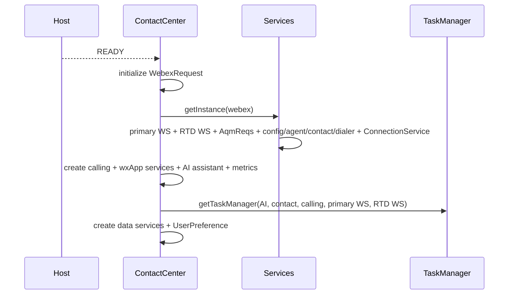

### Direct REST request

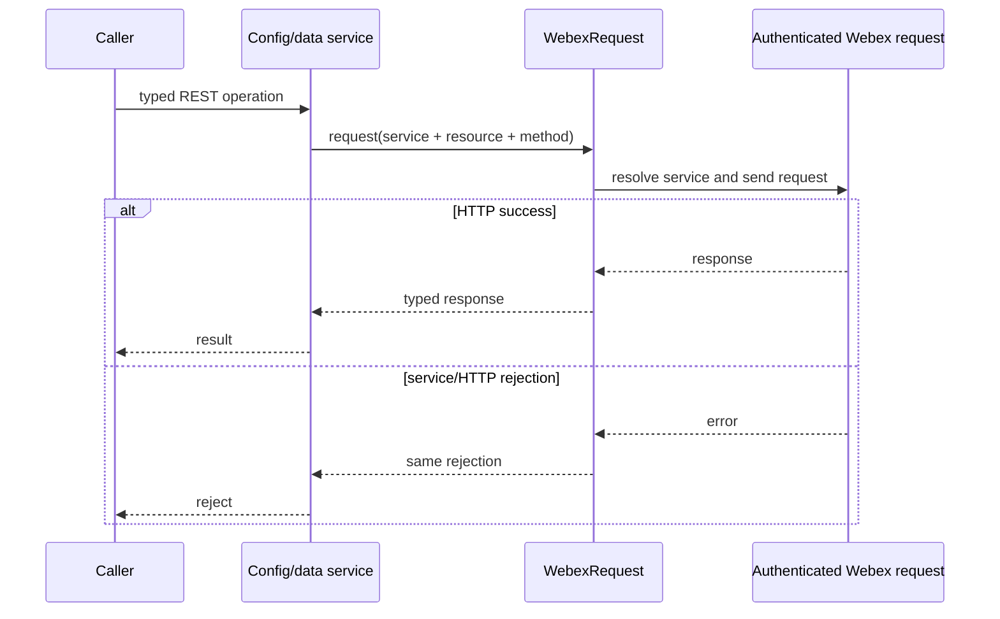

### Correlated AQM operation

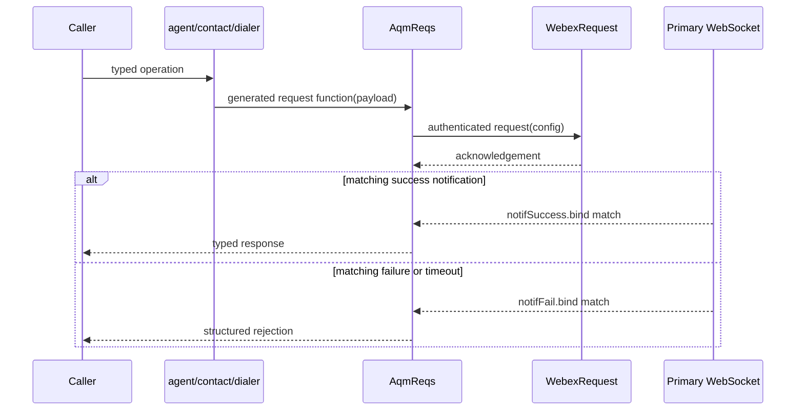

### Wellness action

```mermaid
sequenceDiagram
  participant App as Application
  participant AI as ApiAIAssistant
  participant P as ContactCenter context provider
  participant SVC as AI Assistant event API
  App->>AI: requestWellnessBreak() or respondToWellnessBreak({action})
  alt response action is not ACCEPTED, REJECTED, or NO_RESPONSE
    AI-->>App: reject WELLNESS_BREAK_ACTION_INVALID
  else action accepted for sending
    AI->>P: read isWellnessBreakEnabled, agentId, agentSessionId
    alt disabled, or org, agent, or session missing
      AI-->>App: reject WELLNESS_BREAK_NOT_ENABLED or a REQUIRED reason
    else context valid
      AI->>SVC: POST /event, CUSTOM_EVENT WellnessBreakAction
      alt status 202
        SVC-->>AI: 202
        AI-->>App: resolve; the outcome arrives later as a wellness notification
      else other status or network error
        AI-->>App: reject structured error
      end
    end
  end
```

### RTD-correlated request

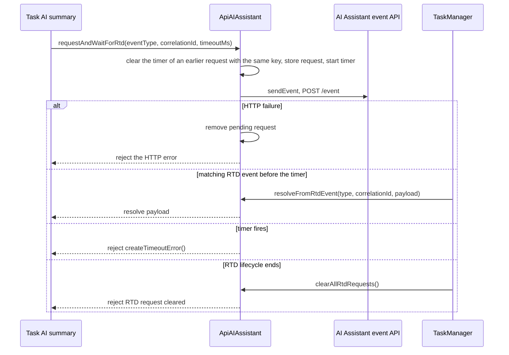

### Browser line registration

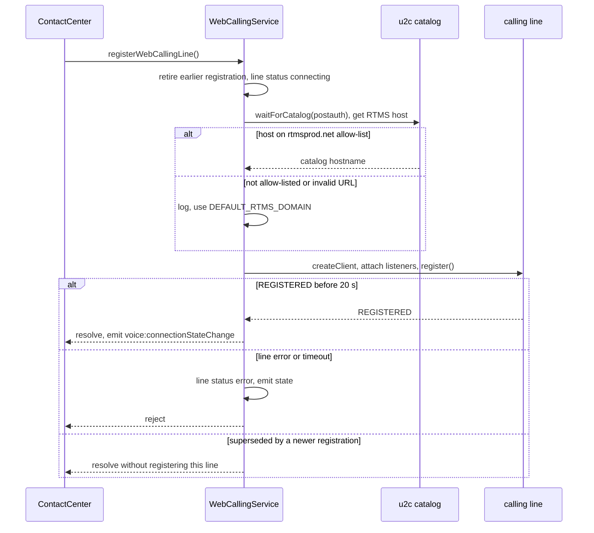

### usersub publish and refresh

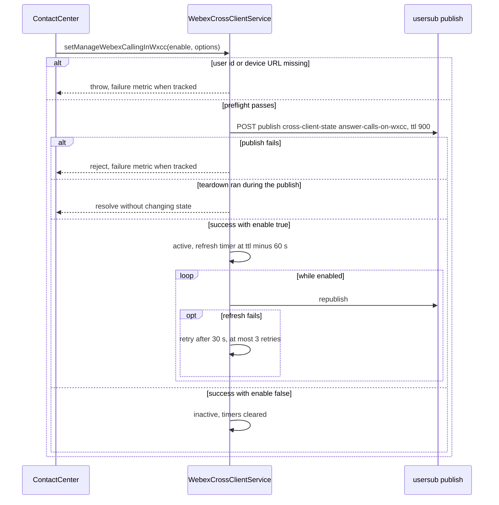

### Hydra telephony call

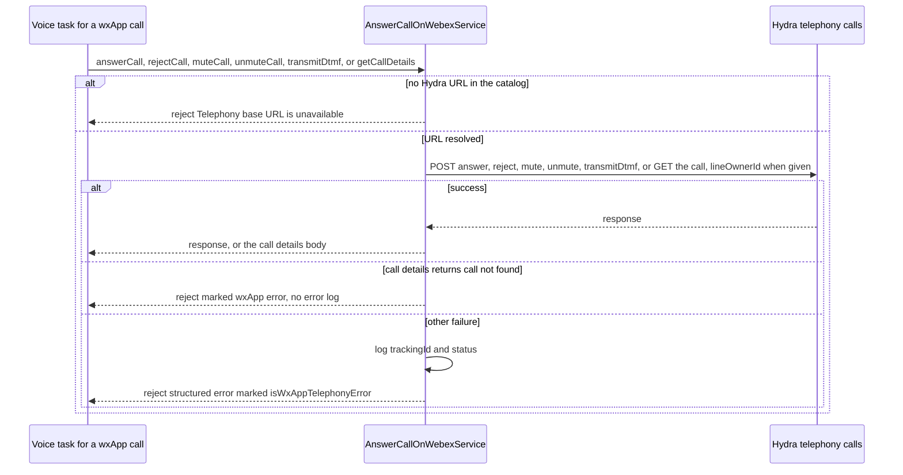

### Mercury mute sync

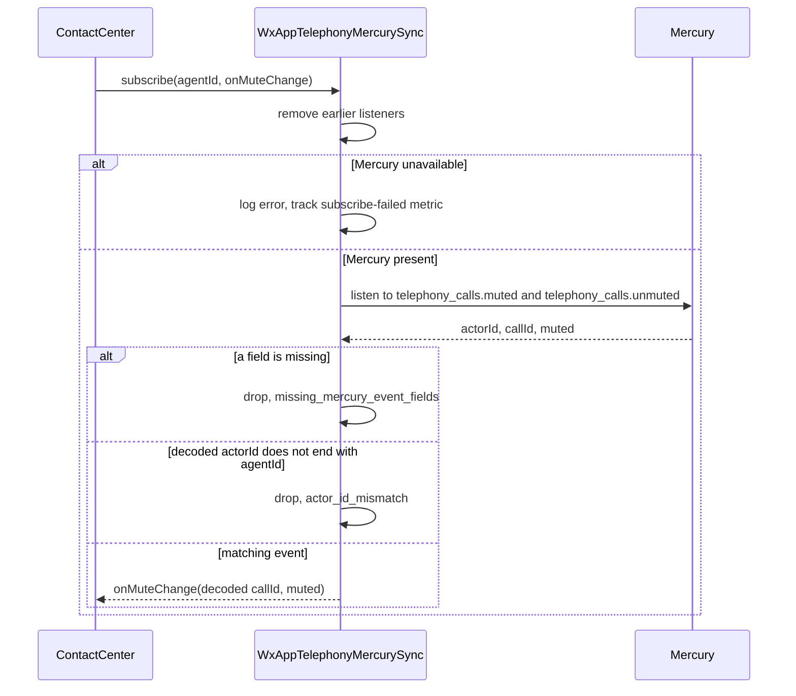

### WebSocket fan-out

WebSocket messages are fanned out to multiple independent listeners on `WebSocketManager`:

```text
CC Backend
  → primary WebSocket message arrives at Services.webSocketManager
    → WebSocketManager emits 'message'
      → AqmReqs listener (`aqm-reqs.ts`) — correlates pending request notifications
      → cc.ts listener (`cc.ts`) — handles plugin-level events:
        → allow-listed CC events and wellness offers use `this.emit(...)` (EventEmitter API)
        → task notifications from TaskManager use `this.trigger(...)` (WebexPlugin API)
      → TaskManager listener (`TaskManager.ts`) — processes task events for task lifecycle/state
      → ConnectionService listener (`connection-service.ts`) — processes connection/keepalive events
  → RTD WebSocket message arrives at Services.rtdWebSocketManager
    → cc.ts RTD listener — wellness offers, otherwise TaskManager.handleRealtimeWebsocketEvent
```

## Class and component relationships

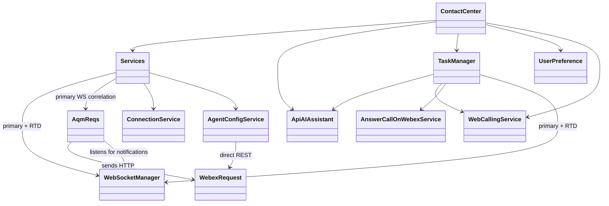

Per-method use of the Services fields by ContactCenter (the other relationships are the edges above):

```text
cc.ts
 ├─ uses → Services.agent       (stationLogin, stateChange, logout, buddyAgents, reload)
 ├─ uses → Services.config      (getAgentConfig, getWellbeingBreakIdleCode, getOutdialAniEntries)
 ├─ uses → Services.contact     (passed to TaskManager, which forwards task operations)
 └─ uses → Services.dialer      (startOutdial, acceptPreviewContact, skipPreviewContact, removePreviewContact)
```

## Use cases and flows

| Use case | Actor or caller | Primary steps and outcome | Failure or boundary behavior | Evidence |
| --- | --- | --- | --- | --- |
| `UC-001` | ContactCenter at READY | Compose services: create the transport/factory singleton once per SDK host | A second `getInstance` returns the first instance and ignores its options | `src/services/index.ts`, `test/unit/spec/cc.ts` |
| `UC-002` | Application or ContactCenter | Direct REST: configuration, data, and user-preference services return authenticated HTTP results directly | The HTTP error is logged, tracked, and rethrown | `src/services/config/index.ts`, `src/services/UserPreference.ts`, `test/unit/spec/services/config/index.ts`, `test/unit/spec/services/UserPreference.ts` |
| `UC-003` | ContactCenter or TaskManager | AQM operation: initiate HTTP and settle only on matching WebSocket notification or timeout | Failure notification or timeout rejects | `src/services/core/aqm-reqs.ts`, `test/unit/spec/services/core/aqm-reqs.ts` |
| `UC-004` | Backend through the sockets | Task/AI realtime: TaskManager consumes the primary stream directly and RTD events forwarded by ContactCenter, with ApiAIAssistant/calling collaborators | Unknown RTD correlation ids resolve nothing | `src/services/task/TaskManager.ts`, `test/unit/spec/services/task/TaskManager.ts` |
| `UC-005` | Agent application | Wellness action reporting: validate the current profile/session context and submit a direct AI custom event that completes only on HTTP 202 | Disabled, missing context, invalid action, or non-202 rejects | `src/services/ApiAiAssistant.ts`, `test/unit/spec/services/ApiAiAssistant.ts` |
| `UC-006` | ContactCenter at station login | Browser voice: register the calling line and report voice readiness | Timeout or line error rejects; RTMS host falls back to the default | `src/services/WebCallingService.ts`, `test/unit/spec/services/WebCallingService.ts` |
| `UC-007` | ContactCenter after station login with `enableWxBetterTogether` | wxApp Better Together: publish `answer-calls-on-wxcc`, subscribe to Mercury mute sync, and route wxApp call control through Hydra | Missing user id, device URL, or Mercury; publish failure; teardown on logout | `src/services/WebexCrossClientService.ts`, `src/services/WxAppTelephonyMercurySync.ts`, `src/services/AnswerCallOnWebexService.ts`, `test/unit/spec/services/WebexCrossClientService.ts` |

### Cross-boundary use-case flow

- WCC API gateway (data services, UserPreference): HTTPS through `WebexRequest` with service
  `wcc-api-gateway`; no retry in this module; the error is rethrown after a failure metric.
  EntryPoint also sends `X-ORGANIZATION-ID` and `x-ignore-internal-data: false` headers.
- AI Assistant: HTTPS POST to `/event` or `/transcripts/list` on the environment host resolved from
  the gateway; an optional `timeout` is passed through for RTD-correlated requests; errors are wrapped
  by `getErrorDetails`.
- usersub: POST `publish` on service `usersub`; refreshed on a timer while enabled (SERVICES-R-012).
- Hydra telephony: HTTPS on the Hydra service URL plus `/telephony/calls`; no retry; errors are marked as wxApp
  telephony errors (SERVICES-R-013).
- Calling SDK and Mobius: in-process `@webex/calling` client; registration times out after 20 s and
  line and socket events update the voice state (SERVICES-R-011).
- Mercury: in-process event subscription; events for other actors are dropped (SERVICES-R-014).

## Client state model

| State or slice | Owner | Initial state | Transition triggers | Reset or persistence boundary |
| --- | --- | --- | --- | --- |
| `Services.instance` | `Services` (static) | Unset | The first `getInstance` call constructs the composed graph synchronously; later calls return it | Never reset in code; lives for the process |
| Voice connection state (`status`, `lineStatus`, `mobiusSocketStatus`, `reason`, `retryable`) | `WebCallingService` | `not-required`, `unknown`, `unknown` | Browser-voice flag, line events, Mobius socket events, registration timeout or error | `deregisterWebCallingLine()` restores the default state and emits once if it changed |
| `callTaskMap`, current call | `WebCallingService` | Empty | `mapCallToTask`, incoming call | `cleanUpCall()` and deregistration |
| `answerCallsState`, refresh timers, generation | `WebexCrossClientService` | false, none, 0 | Successful publish, refresh timers | `teardown()` |
| Mercury subscription (agent id, handlers) | `WxAppTelephonyMercurySync` | None | `subscribe` | `unsubscribe()` |
| Pending RTD requests, `aiFeature` | `ApiAIAssistant` | Empty, unset | `requestAndWaitForRtd`, `setAIFeatureFlags` | Settled on event, timeout, or `clearAllRtdRequests()` |

## Business rules and invariants

| ID | Invariant | WHY | Enforcement source | Test evidence |
| --- | --- | --- | --- | --- |
| `INV-001` | The first singleton construction fixes the host SDK and connection configuration for that Services instance. | One composed graph per process keeps every factory on the same sockets | `src/services/index.ts` | `test/unit/spec/cc.ts` |
| `INV-002` | The primary WebSocket manager is used for AQM correlation and Contact Center events; the RTD manager remains a distinct TaskManager dependency. | Swapping or omitting either stream loses task or AI events | `src/services/index.ts`, `src/cc.ts` | `test/unit/spec/services/task/TaskManager.ts` |
| `INV-003` | Untrusted external inputs are validated at the service trust boundary: catalog-provided RTMS hosts must pass the `ALLOWED_RTMS_DOMAIN` allow-list before use, and caller-supplied `agentId`/`interactionId` must match the accepted identifier format before an authenticated transcript request is built. | Catalog hosts and caller ids cross a trust boundary | `src/services/WebCallingService.ts`, `src/services/ApiAiAssistant.ts` | `test/unit/spec/services/WebCallingService.ts`, `test/unit/spec/services/ApiAiAssistant.ts` |
| `INV-004` | ApiAIAssistant evaluates the current effective wellness flag and identities through its constructor-supplied read-only provider; the public object exposes no context mutator, and the Services singleton itself remains unconditionally composed. | Callers cannot inject identities into wellness actions | `src/services/ApiAiAssistant.ts` | `test/unit/spec/services/ApiAiAssistant.ts` |
| `INV-005` | Only the newest WebCallingService registration may change state: listeners from a retired registration are ignored and a superseded registration resolves without touching the line. | Overlapping station logins must not leave two lines or a stale error | `src/services/WebCallingService.ts` | `test/unit/spec/services/WebCallingService.ts` |

## Concurrency and reactive flow

- Execution model: `getInstance` composition is synchronous in the JavaScript execution turn. Direct REST promises can proceed independently, while each AQM promise remains pending until its matching primary-WebSocket notification, HTTP failure, or timeout.
- Ordering guarantees: none across services; each service awaits its own request. WebCallingService
  serializes registrations with a generation counter (INV-005).
- Idempotency and retry: no service retries an HTTP call except the usersub refresh (up to 3 tries,
  30 s apart); `requestAndWaitForRtd` replaces an earlier pending request with the same event type
  and correlation id.
- Shared-state protection: single-threaded event loop; generation counters in WebCallingService and
  WebexCrossClientService discard results of stale async work.
- Blocking restrictions: nothing blocks; timers are `setTimeout` only (registration 20 s, RTD
  `timeoutMs`, usersub refresh at TTL minus 60 s).

## State machine

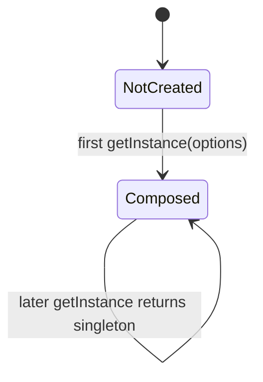

Browser voice line status (WebCallingService):

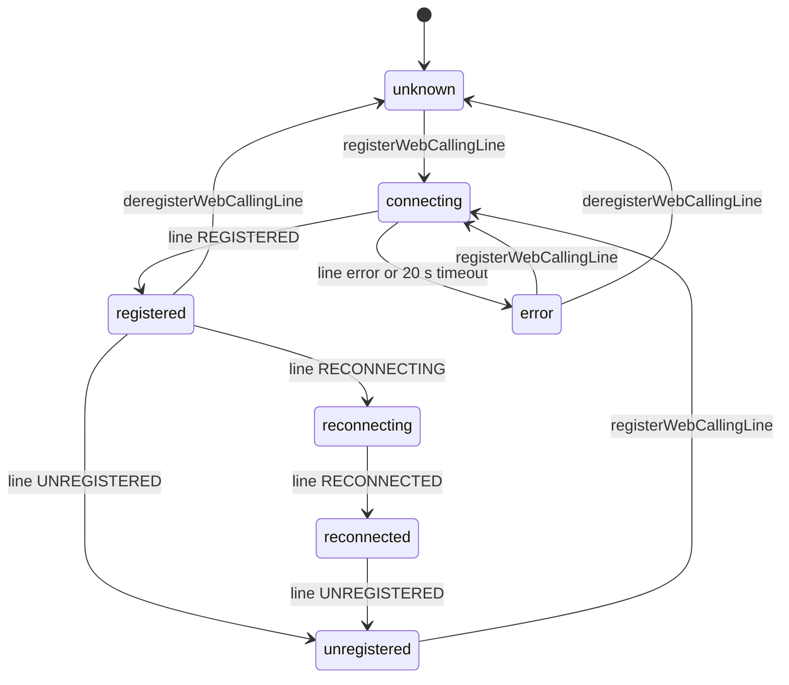

The overall voice `status` is derived, not stored separately: `not-required` when browser voice is
not required, `ready` when the line is registered or reconnected and the Mobius socket is not
disconnected, otherwise `unavailable`.

## Protocol and wire format

Request, response, and event payload ownership for the composed transports is anchored in `src/services/index.ts`. HTTP initiates backend work where applicable; WebSocket messages provide realtime events and, for AQM flows, correlated completion. Wellness actions POST `CUSTOM_EVENT` / `WellnessBreakAction` bodies directly to `/event` and accept only status 202; wellness offers arrive as `Wellness_Break_Handler` notifications on the primary or RTD WebSocket, which ContactCenter validates and emits.

| Message or frame | Version | Producer or serializer | Consumer or parser | Compatibility and ordering rule |
| --- | --- | --- | --- | --- |
| Queue list query | v2 `contact-service-queue` | `src/services/Queue.ts` | WCC gateway | `filter`, `attributes`, `search`, `sort` as field plus ASC or DESC, `desktopProfileFilter`, `provisioningView`, `singleObjectResponse`, `agentView`, `firstLevelView` appended in that order when set |
| Entry-point dial-number query | v3 `dial-number` | `src/services/EntryPoint.ts` | WCC gateway | `attributes` always includes `id,dialledNumber,entryPointId,entryPointName`; `desktopProfileFilter=true` and `includeEntryPointName=true` always sent |
| Address book entry query | v2 `address-book/{bookId}/entry` | `src/services/AddressBook.ts` | WCC gateway | `sort=name,ASC` unless overridden |
| AI Assistant event | none | `src/services/ApiAiAssistant.ts` | AI Assistant service | Body `agentId`, `orgId`, `eventType`, `eventName`, optional `publishTimestamp`, `eventDetails.data`; wellness data carries `action`, `agentSessionId`, `actionTimeStamp` |
| usersub cross-client state | none | `src/services/WebexCrossClientService.ts` | Webex App | `users`, `compositions[{type: cross-client-state, ttl, composition.devices[{deviceId, appName, state}]}]` |
| Mercury telephony mute events | none | Webex telephony | `src/services/WxAppTelephonyMercurySync.ts` | `data.actorId` and `data.callId` base64, `data.muted` boolean |

## Caller-visible failure modes

| Condition | Signal or result | Caller behavior | Retry or recovery | Evidence |
| --- | --- | --- | --- | --- |
| No address book id | `Error('AddressBook: addressBookId is not available for the current agent.')` | Pass `addressBookId` or check the profile | None | `src/services/AddressBook.ts` |
| No user id for a preference call | `Error` starting `UserPreference: userId` | Log in or pass the id | None | `src/services/UserPreference.ts` |
| Wellness disabled, missing org, agent, or session, invalid action, or non-202 status | Structured error with reasons such as `WELLNESS_BREAK_NOT_ENABLED` or `WELLNESS_BREAK_ACTION_UNEXPECTED_STATUS_` followed by the status code | Do not retry until the session or flag changes | None | `src/services/ApiAiAssistant.ts` |
| AI feature off, bad ids, or unknown gateway host | `REAL_TIME_TRANSCRIPTION_NOT_ENABLED`, `SUGGESTED_RESPONSES_NOT_ENABLED`, `INVALID_AGENT_ID_OR_INTERACTION_ID`, `AI_ASSISTANT_BASE_URL_NOT_AVAILABLE` | Check flags and inputs | None | `src/services/ApiAiAssistant.ts` |
| RTD-correlated request times out or is cleared | The caller's `createTimeoutError()` result, or `Error('RTD request cleared')`, including when ContactCenter pauses RTD during regional recovery | The task reports the summary failure | A new request may be sent when RTD resumes | `src/services/ApiAiAssistant.ts`, `src/cc.ts` |
| Calling line registration timeout | `Error('WebCallingService Registration timed out')`, state `error` with `retryable: true` | Retry station login or registration | Caller-owned | `src/services/WebCallingService.ts` |
| wxApp telephony failure | Structured error with `isWxAppTelephonyError`, `trackingId`, `status` | Task layer decides | None | `src/services/AnswerCallOnWebexService.ts` |
| usersub publish preflight failure | `Error('User ID is unavailable for cross-client publish')` or the device URL variant | ContactCenter rolls back the flag | Refresh retries only after a successful enable | `src/services/WebexCrossClientService.ts` |

## Pitfalls and constraints

- The RTD `WebSocketManager` has no ConnectionService; a code comment in `src/services/index.ts`
  says its reconnection logic is still to be implemented, and ContactCenter connects it only when an AI feature or wellness is
  enabled.
- `WEBSOCKET_EVENT_TIMEOUT`, `LOGIN_API`, and `STATE_CHANGE_API` are exported but unused; changing
  them changes nothing.

## Module-specific rules

- Do: initialize `WebexRequest` before obtaining the Services singleton.
- Do: preserve separate primary and RTD WebSocket ownership when changing composition.
- Don't: add feature-flag decisions to the Services composition root.
- Do: follow the shared data-service shape (Design overview table) for a new paginated service,
  and decide its cache policy explicitly against the Utils module spec.
- Do: add a new AqmReqs method as a `routing.req()` entry in the agent, contact, or dialer factory,
  with both `notifSuccess` and `notifFail` binds.

## Key design trade-off

| Chosen trade-off | Preserved invariant or benefit | Cost or limitation | Decision evidence |
| --- | --- | --- | --- |
| Two backend interaction patterns coexist: direct REST for immediate responses and AQM HTTP-plus-WebSocket correlation for asynchronous completion. | Operations whose result the backend reports asynchronously settle only on the real outcome | Two transport models to keep apart; an AQM call needs a connected primary socket | `src/services/core/aqm-reqs.ts` |

## Verification

Unit tests mirror module paths under `test/unit/spec/services`. Preserve positive and negative paths, event ordering, timeout/recovery behavior, and the package's 85% global branch/function/line/statement threshold. Run them with `yarn workspace @webex/contact-center test:unit` from the workspace root.

| Requirement or invariant | Test level | Positive evidence | Negative or boundary evidence | Gap |
| --- | --- | --- | --- | --- |
| `SERVICES-R-001`, `INV-001` | Unit | `test/unit/spec/cc.ts` creates the real service graph for recovery and checks subscription requests | Primary and RTD subscription failure cases | Singleton reuse is not directly asserted. |
| `SERVICES-R-002` | Unit | `test/unit/spec/services/config/index.ts`, `test/unit/spec/services/UserPreference.ts`, `test/unit/spec/services/core/aqm-reqs.ts` | `test/unit/spec/services/core/aqm-reqs.ts` failure and timeout cases | Coverage is split across direct and AQM owners. |
| `SERVICES-R-003` | Unit | `test/unit/spec/cc.ts`, `test/unit/spec/services/UserPreference.ts` | None found | None. |
| `SERVICES-R-004`, `INV-002` | Unit | `test/unit/spec/services/task/TaskManager.ts`, `test/unit/spec/cc.ts` | None found | None. |
| `SERVICES-R-005` | Unit | `test/unit/spec/services/core/WebexRequest.ts` | None found | None. |
| `SERVICES-R-006` | Unit | `test/unit/spec/cc.ts` | None found | None. |
| `SERVICES-R-007` | Unit | `test/unit/spec/services/Queue.ts`, `test/unit/spec/services/EntryPoint.ts`, `test/unit/spec/cc.ts` default and override cases | `test/unit/spec/services/Queue.ts` empty-filter, sort-order-only, and undefined-override cases | None. |
| `SERVICES-R-008`, `INV-004` | Unit | `test/unit/spec/services/ApiAiAssistant.ts` exact REQUESTED body with 202 | `test/unit/spec/services/ApiAiAssistant.ts` disabled context, missing organization, network failure, unsupported action | None. |
| `SERVICES-R-009`, `INV-003` | Unit | `test/unit/spec/services/WebCallingService.ts` custom allow-listed RTMS host | `test/unit/spec/services/WebCallingService.ts` invalid URL and non-allow-listed host fallback | No case for a catalog host exactly equal to `rtmsprod.net`; the existing allow-listed case is a subdomain. |
| `SERVICES-R-010`, `INV-003` | Unit | `test/unit/spec/services/ApiAiAssistant.ts` historic transcripts with mapped base URL | `test/unit/spec/services/ApiAiAssistant.ts` empty and disallowed-character identifiers, disabled feature | No over-length (more than 128 characters) identifier case. |
| `SERVICES-R-011`, `INV-005` | Unit | `test/unit/spec/services/WebCallingService.ts` register, reconnect, and Mobius cases | `test/unit/spec/services/WebCallingService.ts` timeout, failure, and superseded cases | None |
| `SERVICES-R-012` | Unit | `test/unit/spec/services/WebexCrossClientService.ts` publish and refresh cases | `test/unit/spec/services/WebexCrossClientService.ts` missing user id, device URL, retry, and teardown cases | None |
| `SERVICES-R-013` | Unit | `test/unit/spec/services/AnswerCallOnWebexService.ts` each POST and GET case | `test/unit/spec/services/AnswerCallOnWebexService.ts` failure and call-not-found cases | None |
| `SERVICES-R-014` | Unit | `test/unit/spec/services/WxAppTelephonyMercurySync.ts` subscribe and callback cases | `test/unit/spec/services/WxAppTelephonyMercurySync.ts` mismatch, missing fields, no Mercury | None |
| `SERVICES-R-015` | Unit | `test/unit/spec/services/UserPreference.ts` CRUD success cases | `test/unit/spec/services/UserPreference.ts` missing user id and API error cases | None |
| `SERVICES-R-016` | Unit | `test/unit/spec/services/AddressBook.ts` default and custom parameter cases | `test/unit/spec/services/AddressBook.ts` API error case | The missing-address-book-id error has no direct case |
| `SERVICES-R-017` | Unit | `test/unit/spec/cc.ts` covers RTD pause and resubscription independently of primary recovery. | `test/unit/spec/services/ApiAiAssistant.ts` covers HTTP/RTD completion, timeout, and clearing a pending RTD request. | Live RTD recovery remains release verification. |

A module specification is complete only when its public surface, invariants, failure modes, and
test evidence agree with the implementation.
