<!-- sdd-generated-metadata
doc_kind: module-spec
generated_from: module-spec@0.3.0
generated_by: claude-code
approved_by: rarajes2@cisco.com
updated_at: 2026-11-17T03:03:58Z
validation_status: pass-with-warnings
-->

# Task service

This source-local document at `src/services/task/docs/README.md` owns the stable specification for
**the task service** of `@webex/contact-center`: the `Task`, `Voice`, `WebRTC`, and `Digital` task
objects, the `TaskManager` that owns their lifecycle, the `TaskFactory` that builds them, and the
`contact.ts` and `dialer.ts` AQM request factories behind call control. Ground every claim in package
evidence and link to the [package architecture](../../../../docs/architecture.md) instead of repeating
broader facts. No service specification exists because this package is a library. The XState engine
is a sub-module with its own [state machine specification](../state-machine/docs/README.md).

Related context: [documentation index](../../../../docs/index.md) ·
[package agent instructions](../../../../AGENTS.md)

## Metadata

| Field             | Value |
| ----------------- | ----- |
| Owner             | @webex/web-sdk |
| Source path       | `src/services/task` |
| Resource kind     | module |
| Status            | Active |
| Last verified     | 2026-11-16 at `0b8c34db7f` |
| Module id         | `task` |
| Parent spec       | [Services specification](../../docs/README.md) |
| Doc kind          | Module spec |
| Coverage score    | Pending coverage assessment |
| Validation status | pass-with-warnings — assessed 2026-11-17; validator runtime 01a1e76f-2293-79a0-9f8f-f060038448dd; 0 Blocking, 0 Important, 4 Minor findings. |

## Applicability

| Condition ID                         | Status     | Evidence or reason | Owned section |
| ------------------------------------ | ---------- | ------------------ | ------------- |
| `module.has_tiers`                   | N/A        | No tier policy exists in `package.json` or under src | Tier |
| `module.has_ui`                      | N/A        | The module renders nothing; it exposes TaskUIControls state through `src/services/task/types.ts` for host applications to render | UI use-case flow |
| `module.crosses_service_boundaries`  | Applicable | `src/services/task/contact.ts` and `src/services/task/dialer.ts` call the WCC API gateway through AqmReqs; `src/services/task/TaskManager.ts` consumes the primary and RTD WebSockets and Webex Calling line events | Cross-boundary use-case flow |
| `module.holds_client_state`          | Applicable | `src/services/task/TaskManager.ts` keeps the task collection and two pending AI maps; each `src/services/task/Task.ts` instance keeps task data, an actor, and UI controls | Client state model |
| `module.enforces_domain_rules`       | Applicable | Media-type selection in `src/services/task/TaskFactory.ts`, owner-change correlation and wrap-up stamping in `src/services/task/TaskManager.ts`, and state guards in `src/services/task/voice/Voice.ts` | Business rules and invariants |
| `module.is_concurrent_async`         | Applicable | Every call-control method is async and settles on WebSocket-correlated AQM completion; `src/services/task/AutoWrapup.ts` runs a timer | Concurrency and reactive flow |
| `module.owns_persistence`            | N/A        | Nothing under `src/services/task/TaskManager.ts` or its siblings writes storage; all state is in memory | Data, schema, and migration discipline |
| `module.stateful_transitions`        | Applicable | Each task owns an XState actor created in `src/services/task/Task.ts` from `src/services/task/state-machine/index.ts` | State machine |
| `module.exposes_wire_protocol`       | Applicable | `src/services/task/contact.ts` and `src/services/task/dialer.ts` define REST routes and success or failure notification binds; `src/services/task/types.ts` defines the WebSocket payload shapes | Protocol and wire format |
| `module.ui_multi_screen`             | N/A        | No UI | UI flow |
| `module.large_data_model`            | N/A        | TaskData and Interaction in `src/services/task/types.ts` are backend payload mirrors the module does not own or migrate | Data model |
| `module.returns_caller_errors`       | Applicable | Task methods reject with getErrorDetails errors, validation errors, and Unsupported operation errors in `src/services/task/Task.ts` | Caller-visible failure modes |
| `module.module_specific_conventions` | Applicable | Initiating and success or failure actor events around remote Voice operations in `src/services/task/voice/Voice.ts` | Module-specific rules |
| `module.published_package`           | N/A        | The package, not this module, is published; `src/index.ts` re-exports Task and the task types and is specified by the package spec | Export stability |
| `module.embedded_in_host`            | N/A        | No host theme or mount API | Host integration and theming |
| `module.has_design_tradeoff`         | Applicable | A shared abstract base in `src/services/task/Task.ts` with media subclasses and a separate state engine | Key design trade-off |
| `module.has_submodules`              | Applicable | `src/services/task/state-machine/index.ts` is the root of the child module src/services/task/state-machine | Sub-modules |

## Evidence register

| Evidence | What it establishes |
| -------- | ------------------- |
| `src/services/task/Task.ts` | Abstract base: data, actor, UI controls, auto wrap-up, AI summary methods, transfer, end, wrapup, and the default `Unsupported operation` implementations |
| `src/services/task/voice/Voice.ts` | Telephony task: hold and resume, recording, consult, transfer, conference, Participant Drop, switch call, and the wxApp telephony routing |
| `src/services/task/voice/WebRTC.ts` | BROWSER telephony task: `getUserMedia` accept, decline, mute, and remote-media events |
| `src/services/task/digital/Digital.ts` | Chat, email, and social task with AQM accept |
| `src/services/task/voice/wxAppVoiceMethods.ts`, `src/services/task/voice/wxAppOfferObservability.ts`, `src/services/task/WebexCallingUtils.ts` | wxApp accept, reject, mute, DTMF, line-owner resolution, and OFFERED-state diagnostics |
| `src/services/task/TaskFactory.ts` | Media and login-option dispatch to the task subclasses and the `Unknown media type` error |
| `src/services/task/TaskManager.ts` | Singleton, primary WebSocket pipeline, RTD routing, task collection, owner-change recovery, wrap-up stamping, merge, cleanup, and AI summary buffering |
| `src/services/task/contact.ts`, `src/services/task/dialer.ts`, `src/services/task/constants.ts` | AQM routes, notification binds, timeouts, and route constants |
| `src/services/task/types.ts` | `TASK_EVENTS` (52 members), `TaskData`, `TaskUIControls`, payload types, and the `ITask`, `IVoice`, `IWebRTC`, `IDigital` interfaces |
| `src/services/task/AutoWrapup.ts`, `src/services/task/TaskUtils.ts`, `src/services/task/taskDataNormalizer.ts` | Wrap-up timer, task-state helpers, and string-to-boolean payload normalization |
| `src/cc.ts` | ContactCenter wiring: `getTaskManager`, config flags, RTD listener, preview-campaign guards, `startOutdial`, and `deregister` cleanup |
| `src/services/ApiAiAssistant.ts` | `requestAndWaitForRtd`, `resolveFromRtdEvent`, `clearAllRtdRequests`, `sendEvent`, and `aiFeature` used by the summary methods |
| `src/services/core/aqm-reqs.ts`, `src/services/core/constants.ts` | AQM correlation, `TIMEOUT_REQ` 20000 ms, and the `'disabled'` timeout value |
| `test/unit/spec/services/task/TaskManager.ts` | 191 jest tests (2026-11-16 run), including owner propagation, conference events, auto-answer, and state machine integration |
| `test/unit/spec/services/task/Task.ts`, `test/unit/spec/services/task/voice/Voice.ts`, `test/unit/spec/services/task/voice/WebRTC.ts`, `test/unit/spec/services/task/digital/Digital.ts` | Task base and AI summary (105 jest tests), Voice (92), WebRTC, and Digital cases |
| `test/unit/spec/services/task/TaskFactory.ts`, `test/unit/spec/services/task/contact.ts`, `test/unit/spec/services/task/dialer.ts`, `test/unit/spec/services/task/AutoWrapup.ts`, `test/unit/spec/services/task/TaskUtils.ts`, `test/unit/spec/services/task/WebexCallingUtils.ts` | Factory (6 jest tests), AQM factory, timer, and helper cases |
| `test/unit/spec/services/task/voice/wxAppVoiceMethods.ts`, `test/unit/spec/services/task/voice/wxAppOfferObservability.ts` | wxApp telephony and diagnostics cases |
| `test/unit/spec/cc.ts` | ContactCenter delegation to the dialer and TaskManager |
| `src/services/task/types.ts` (extension subsections) | Justifies the per-method `###` subsections under Public surface and the per-operation `###` subsections under Data flow and sequence coverage and Design overview: each names a current method, event group, or operation defined in this file, `src/services/task/Task.ts`, or `src/services/task/TaskManager.ts` |
| `src/services/task/taskDataNormalizer.ts` | No unit test file targets it directly; it runs inside every TaskManager pipeline case |

## Purpose and boundary

- Responsibility: Own task creation, media-specific behavior, call-control operations, lifecycle
  orchestration, task events, and integration with the task state machine. Manage task lifecycle
  including inbound/outbound calls, hold/resume, consult, transfer, conference, and wrapup.
- In scope: the task classes and their public methods; TaskManager's WebSocket pipeline, task
  collection, and task-level RTD routing; the AQM route definitions for task and dialer operations;
  auto wrap-up; the AI summary request and response methods; the wxApp (Webex App "better together")
  telephony routing on `Voice`; the creation and action wiring of each task's actor.
- Out of scope: the transition graph, guards, actions, UI-control computation, and the table that maps
  each CC event to a `TaskEvent` (the [state machine sub-module](../state-machine/docs/README.md),
  contract `contact-center-task-state-machine`); AQM correlation, HTTP, and socket lifecycle (the core
  module, contract `contact-center-core-transport`); the `cc.*` public methods that wrap the dialer,
  including `cc.startOutdial` and the preview-campaign methods (the [package specification](../../../docs/README.md),
  contract `contact-center-sdk`); `ApiAIAssistant`, `WebCallingService`, and `AnswerCallOnWebexService`
  (the services module, contract `contact-center-services`); the event-name enums in
  `src/services/config/types.ts` (the config module, contract `contact-center-cc-events`).
- Consumers: `src/cc.ts`, which creates the TaskManager and re-emits its task events on `webex.cc`;
  host applications, which receive `ITask` objects and call their methods; Contact Center widgets that
  bind to `task.uiControls`.

## Structure and key files

```text
src/services/task/
├── Task.ts
├── TaskManager.ts
├── TaskFactory.ts
├── contact.ts
├── dialer.ts
├── AutoWrapup.ts
├── TaskUtils.ts
├── WebexCallingUtils.ts
├── taskDataNormalizer.ts
├── types.ts
├── constants.ts
├── digital/
│   └── Digital.ts
├── voice/
│   ├── Voice.ts
│   ├── WebRTC.ts
│   ├── wxAppVoiceMethods.ts
│   └── wxAppOfferObservability.ts
├── state-machine/
└── docs/
    └── README.md
```

| Path | Responsibility |
| ---- | -------------- |
| `src/services/task/Task.ts` | Abstract base class: data reconciliation, actor creation, UI controls, auto wrap-up, AI summary methods, `transfer`, `end`, `wrapup` |
| `src/services/task/voice/Voice.ts` | Telephony subclass (PSTN and wxApp variants); the call-control surface |
| `src/services/task/voice/WebRTC.ts` | BROWSER telephony subclass over `WebCallingService` |
| `src/services/task/voice/wxAppVoiceMethods.ts` | wxApp accept, reject, outdial decline, mute, DTMF, and error mapping helpers |
| `src/services/task/voice/wxAppOfferObservability.ts` | OFFERED-state wxApp decision logging and participant-mismatch grace timer |
| `src/services/task/digital/Digital.ts` | Chat, email, and social subclass |
| `src/services/task/TaskFactory.ts` | Subclass selection (Task creation and state machine initialization) |
| `src/services/task/TaskManager.ts` | Task collection owner and event pipeline |
| `src/services/task/contact.ts` | `routingContact(aqm)` AQM request factory for task operations |
| `src/services/task/dialer.ts` | `aqmDialer(aqm)` AQM request factory for outdial and campaign preview |
| `src/services/task/AutoWrapup.ts` | Auto wrap-up timer |
| `src/services/task/TaskUtils.ts` | Conference, consult, owner, campaign, and auto-answer helpers; `createSummaryError` |
| `src/services/task/WebexCallingUtils.ts` | wxApp device details and engagement checks |
| `src/services/task/taskDataNormalizer.ts` | `normalizeTaskData`: coerces known string booleans in incoming payloads |
| `src/services/task/types.ts` | Public task events, payloads, interfaces, and enums (contract `contact-center-task-events`) |
| `src/services/task/constants.ts` | Routes, timeouts, method names, preserved fields, transcript event map |
| `src/services/task/docs/README.md` | This specification |
| `test/unit/spec/services/task/taskTestUtils.ts` | Shared fixtures for the task unit suites |

## Sub-modules

| Sub-module | Responsibility | Specification |
| ---------- | -------------- | ------------- |
| `src/services/task/state-machine` | XState task lifecycle engine: `TaskState` and `TaskEvent`, the transition graph, guards, actions, `computeUIControls`, and the CC-event to `TaskEvent` mapping table (contract `contact-center-task-state-machine`) | [state-machine/docs/README.md](../state-machine/docs/README.md) |

`Task` delegates lifecycle transitions and control-state derivation to the state machine:

- Transition graph: `state-machine/TaskStateMachine.ts`
- Transition conditions: `state-machine/guards.ts`
- Context mutation and integration hooks: `state-machine/actions.ts`
- UI control derivation: `state-machine/uiControlsComputer.ts`

For state-machine-specific implementation guidance, use the
[state machine specification](../state-machine/docs/README.md). This module owns the actor's creation
and the action overrides that turn actor actions into `TASK_EVENTS` (Task creation and state machine
initialization). `TaskManager.mapEventToTaskStateMachineEvent` lives in `TaskManager.ts`, but its
CC-event to `TaskEvent` mapping is specified in the state machine specification (Backend CC event
mapping) and not restated here.

## Public surface

| Surface | Consumer | Compatibility commitment | Source |
| ------- | -------- | ------------------------ | ------ |
| Contract `contact-center-task-events`: the `TASK_EVENTS` enum (52 members) and the payloads emitted on `task` and re-emitted on `cc` (Task events) | Host applications, widgets, `src/cc.ts` | Additive changes by default; do not remove or reinterpret exported events without a documented consumer migration | `src/services/task/types.ts` |
| Contract `contact-center-sdk`: Task, Voice, WebRTC, and Digital instances and their call-control methods (`ITask`, `IVoice`, `IWebRTC`, `IDigital` in contract `contact-center-task-events`) | Host applications receiving `task:incoming` | Additive; breaking package exports require a major-version transition | `src/services/task/types.ts`, `src/services/task/Task.ts`, `src/index.ts` |
| Contract `contact-center-task-events`: `TaskData`, `TaskId`, `TaskResponse`, `TaskUIControls`, `MEDIA_CHANNEL`, `TASK_CHANNEL_TYPE`, `VOICE_VARIANT`, `DESTINATION_TYPE`, re-exported by contract `contact-center-sdk` | TypeScript consumers through `src/index.ts` | Additive | `src/services/task/types.ts` |
| Contract `contact-center-task-events`: preview-campaign payload `PreviewContactPayload` (`interactionId`, campaign-name `campaignId`) and the dialer requests behind the contract `contact-center-sdk` methods `cc.acceptPreviewContact`, `cc.skipPreviewContact`, `cc.removePreviewContact` | `src/cc.ts` | Additive semver-public methods; removals or signature changes are breaking | `src/services/task/dialer.ts`, `src/services/task/types.ts` |
| Contract `contact-center-task-events`: `TaskUIControls.consultTransferDestinations` with ordered `consult` and `transfer` arrays (values computed by contract `contact-center-task-state-machine`) | Widgets | Additive; array order is meaningful and the first item is the default | `src/services/task/types.ts` |
| Contract `contact-center-task-events`: `task.dropConferenceParticipant(payload: DropConferenceParticipantPayload): Promise<TaskResponse>`; `participantId` is validated at runtime as a non-empty string | Host applications | Additive semver-public method and payload | `src/services/task/voice/Voice.ts`, `src/services/task/types.ts` |
| Contract `contact-center-task-events`: AI summary methods, `aiSummaryCapabilities`, the `AISummary`, `AISummaryResponse`, `AISummaryAction`, `AISummaryFeatureEnablement`, and `AISummaryCapabilities` types, `task:midCallSummaryReceived`, and `task:featureEnablement` | Host applications | Additive semver-public methods, types, and events | `src/services/task/Task.ts`, `src/services/task/TaskManager.ts` |

### Task events

The public `TASK_EVENTS` enum contains 52 members; every member is listed below from `src/services/task/types.ts`, followed by the two AI Assistant events TaskManager emits on the task. "task, then `cc`" means the task emits the event and TaskManager re-emits it for ContactCenter to trigger on `webex.cc`.

| Event | Constant | Emitted on | When emitted |
| ----- | -------- | ---------- | ------------ |
| `task:incoming` | `TASK_INCOMING` | task, then `cc` | New task offered to agent |
| `task:assigned` | `TASK_ASSIGNED` | task | Task assigned to agent |
| `task:media` | `TASK_MEDIA` | task (WebRTC) | Media stream/track updates are available (remote media track) |
| `task:unassigned` | `TASK_UNASSIGNED` | — | Declared but never emitted; `AgentContactUnassigned` maps to no actor event |
| `task:hold` | `TASK_HOLD` | task | Task placed on hold |
| `task:resume` | `TASK_RESUME` | task | Task resumed from hold |
| `task:consultEnd` | `TASK_CONSULT_END` | task | Consultation ended |
| `task:consultQueueCancelled` | `TASK_CONSULT_QUEUE_CANCELLED` | task | Queue consultation cancelled |
| `task:consultQueueFailed` | `TASK_CONSULT_QUEUE_FAILED` | task | Queue consultation failed |
| `task:ui-controls-updated` | `TASK_UI_CONTROLS_UPDATED` | task | UI controls changed due to state transition or task data |
| `task:wxapp-mute-state-updated` | `TASK_WXAPP_MUTE_STATE_UPDATED` | task (Voice) | wxApp mute state changed from Webex App (Mercury sync or call details) |
| `task:consultAccepted` | `TASK_CONSULT_ACCEPTED` | task | Consult accepted by destination party |
| `task:consulting` | `TASK_CONSULTING` | task | Consult is in progress |
| `task:consultCreated` | `TASK_CONSULT_CREATED` | task | Consultation started |
| `task:offerConsult` | `TASK_OFFER_CONSULT` | task | Consult offer received |
| `task:end` | `TASK_END` | task | Task ended |
| `task:wrapup` | `TASK_WRAPUP` | task | Task entering wrapup, only when `wrapUpRequired` is true |
| `task:wrappedup` | `TASK_WRAPPEDUP` | task | Wrapup completed |
| `task:cleanup` | `TASK_CLEANUP` | task (internal) | Internal cleanup signal emitted by state machine |
| `task:recordingStarted` | `TASK_RECORDING_STARTED` | task | Recording started |
| `task:recordingPaused` | `TASK_RECORDING_PAUSED` | task | Recording paused |
| `task:recordingPauseFailed` | `TASK_RECORDING_PAUSE_FAILED` | task (Voice) | Recording pause attempt failed |
| `task:recordingResumed` | `TASK_RECORDING_RESUMED` | task | Recording resumed |
| `task:recordingResumeFailed` | `TASK_RECORDING_RESUME_FAILED` | task (Voice) | Recording resume attempt failed |
| `task:rejected` | `TASK_REJECT` | task | Task rejected / failure path emitted; the payload is the reason |
| `task:outdialFailed` | `TASK_OUTDIAL_FAILED` | task | Outdial operation failed |
| `task:hydrate` | `TASK_HYDRATE` | task, then `cc` | Task data updated (hydrate and owner change) |
| `task:offerContact` | `TASK_OFFER_CONTACT` | task | Contact offer received/updated |
| `task:autoAnswered` | `TASK_AUTO_ANSWERED` | task | Task was auto-answered |
| `task:conferenceEstablishing` | `TASK_CONFERENCE_ESTABLISHING` | — | Declared but never emitted |
| `task:conferenceStarted` | `TASK_CONFERENCE_STARTED` | task | Conference started |
| `task:conferenceFailed` | `TASK_CONFERENCE_FAILED` | task | Conference failed to start |
| `task:conferenceEnded` | `TASK_CONFERENCE_ENDED` | task | Conference ended |
| `task:participantJoined` | `TASK_PARTICIPANT_JOINED` | task | Participant joined the conference |
| `task:participantLeft` | `TASK_PARTICIPANT_LEFT` | task | Participant left the conference |
| `task:conferenceTransferred` | `TASK_CONFERENCE_TRANSFERRED` | — | Declared but never emitted |
| `task:conferenceTransferFailed` | `TASK_CONFERENCE_TRANSFER_FAILED` | task (Voice) | Conference transfer failed |
| `task:conferenceEndFailed` | `TASK_CONFERENCE_END_FAILED` | — | Declared but never emitted |
| `task:participantLeftFailed` | `TASK_PARTICIPANT_LEFT_FAILED` | — | Declared but never emitted |
| `task:exitConference` | `TASK_EXIT_CONFERENCE` | task (Voice) | Agent initiated exit from conference |
| `task:transferConference` | `TASK_TRANSFER_CONFERENCE` | task (Voice) | Agent initiated conference transfer |
| `task:switchCall` | `TASK_SWITCH_CALL` | task (Voice) | Switched between consult and main call |
| `task:merged` | `TASK_MERGED` | `cc` only | Tasks merged (EPDN transfer) |
| `task:postCallActivity` | `TASK_POST_CALL_ACTIVITY` | task (by TaskManager) | `ParticipantPostCallActivity` received |
| `task:multiLoginHydrate` | `TASK_MULTI_LOGIN_HYDRATE` | task, then `cc` | Multi-login task update on assignment or consult |
| `task:campaignPreviewReservation` | `TASK_CAMPAIGN_PREVIEW_RESERVATION` | task, then `cc` | Campaign preview contact offered to the agent |
| `task:campaignPreviewAcceptFailed` | `TASK_CAMPAIGN_PREVIEW_ACCEPT_FAILED` | task | Accepting a campaign preview contact failed |
| `task:campaignPreviewSkipFailed` | `TASK_CAMPAIGN_PREVIEW_SKIP_FAILED` | task | Skipping a campaign preview contact failed |
| `task:campaignPreviewRemoveFailed` | `TASK_CAMPAIGN_PREVIEW_REMOVE_FAILED` | task | Removing a campaign preview contact failed |
| `task:campaignContactUpdated` | `TASK_CAMPAIGN_CONTACT_UPDATED` | task (by TaskManager) | Campaign contact updated after skip or remove |
| `task:midCallSummaryReceived` | `TASK_MID_CALL_SUMMARY_RECEIVED` | task (by TaskManager) | Mid-call summary delivered to a receiving agent |
| `task:featureEnablement` | `TASK_FEATURE_ENABLEMENT` | task (by TaskManager) | Per-task AI summary enablement flags received |
| `REAL_TIME_TRANSCRIPTION` | `CC_EVENTS.REAL_TIME_TRANSCRIPTION` | task (by TaskManager) | A realtime transcript payload is received for the task interaction |
| `SUGGESTED_RESPONSE` | `CC_EVENTS.SUGGESTED_RESPONSE` | task (by TaskManager) | A `SUGGESTED_RESPONSE` AI Assistant payload is received for the task interaction |

### `task.accept()`

Accept an incoming task.

**Returns**: `Promise<TaskResponse>`

**Example**:

```typescript
cc.on('task:incoming', async (task) => {
  await task.accept();
});
```

### `task.hold()` / `task.resume()`

Put task on hold or resume.

**Parameters**:

- Concrete `Task.hold()` / `Voice.hold()` and `Task.resume()` / `Voice.resume()` accept no parameters. The optional `mediaResourceId` exists only on the broader `ITask` compatibility declaration; the implementations derive the active media resource from task state.

**Returns**: `Promise<TaskResponse>`

**Example**:

```typescript
// Put on hold
await task.hold();

// Resume
await task.resume();
```

### `task.end()`

End the current task.

**Returns**: `Promise<TaskResponse>`

**Example**:

```typescript
await task.end();
```

### `task.wrapup(params)`

Complete task with wrapup code.

**Parameters**:

- `wrapUpReason` (string, required): Wrapup reason text
- `auxCodeId` (string, required): Wrapup code ID

**Returns**: `Promise<TaskResponse>`

**Example**:

```typescript
await task.wrapup({
  wrapUpReason: 'Customer issue resolved',
  auxCodeId: 'resolved-code',
});
```

### `task.transfer(params)`

Transfer task to another destination.

**Parameters**:

- `to` (string): Agent ID, queue ID, entry point ID, or phone number
- `destinationType` ('queue' | 'agent' | 'dialNumber' | 'entryPoint'): Destination type; `queue` and `entryPoint` use the vteam transfer route, the others the blind transfer route

**Returns**: `Promise<TaskResponse>`

**Example**:

```typescript
// Transfer to queue
await task.transfer({
  to: 'queue-123',
  destinationType: 'queue',
});

// Transfer to agent
await task.transfer({
  to: 'agent-456',
  destinationType: 'agent',
});
```

### `task.consult(params)`

Start consultation.

**Parameters**:

- `to` (string): Agent/queue/phone to consult
- `destinationType` ('queue' | 'agent' | 'dialNumber' | 'entryPoint'): Type

**Returns**: `Promise<TaskResponse>`

**Example**:

```typescript
await task.consult({
  to: 'agent-456',
  destinationType: 'agent',
});

// Later: complete transfer (consulting voice flow uses transfer())
await task.transfer({
  to: 'queue-123',
  destinationType: 'queue',
});
// Or end consult
await task.endConsult({isConsult: true, taskId: task.data.interactionId});
```

### `task.endConsult(consultEndPayload)`

End consultation without transfer.

**Parameters**:

- `consultEndPayload` (`ConsultEndPayload`: `isConsult` and `taskId` required, `isSecondaryEpDnAgent` and `queueId` optional). The base `Task.endConsult` requires the payload and `Voice.endConsult` declares it optional, but `contact.consultEnd` reads `isConsult` from it, so a call without a payload rejects.

**Returns**: `Promise<TaskResponse>`

### `task.dropConferenceParticipant(payload)`

Remove another participant from a voice conference.

**Parameters**:

- `participantId` (string, required): backend participant target identifier; blank and non-string values reject before AQM registration or telemetry.

**Returns**: `Promise<TaskResponse>` after `ParticipantLeftConference` is received for the latest `interaction.mainInteractionId || task.data.interactionId`.

**Failure**: `ParticipantDropConferenceFailed`, HTTP rejection, or the default 20-second AQM timeout rejects the promise. The operation does not add a task state-machine event or optimistically change the roster.

```typescript
await task.dropConferenceParticipant({participantId});
```

### AI summary APIs

- `requestPostCallSummary(): Promise<AISummary>` requests a post-call summary.
- `sendPostCallSummaryResponse(response: AISummaryResponse): Promise<void>` reports the agent's post-call summary outcome.
- `requestMidCallSummary(action: AISummaryAction): Promise<AISummary>` requests a consult or transfer summary.
- `sendMidCallSummaryResponse(response: AISummaryResponse, action: AISummaryAction): Promise<void>` reports the corresponding mid-call outcome.

The gating and buffering rules are TASK-R-013 and TASK-R-014; the mechanism is in Design overview (AI summary delivery).

## Dependencies

Stack: TypeScript 5.4, EventEmitter, XState 5, @webex/calling, AQM/WebSocket integrations, Jest 27.

| Dependency | Why it is required | Failure behavior |
| ---------- | ------------------ | ---------------- |
| Services contact/dialer AQM factories (`routingContact`, `aqmDialer` over core AqmReqs) | Every remote task operation; the contact dependency belongs to Task/TaskFactory-created tasks | Failure notification, HTTP rejection, or timeout rejects the promise (Caller-visible failure modes) |
| WebSocket and RTD WebSocket managers (core `WebSocketManager`) | Primary Contact Center notifications drive the pipeline; the RTD socket carries transcripts, suggestions, summaries, and feature enablement | Unparsable messages are logged and dropped; keepalives are ignored |
| WebCallingService, MetricsManager, and task state machine | BROWSER call answer, decline, mute, and call-to-task mapping; telemetry; the per-task actor | Calling errors reject `WebRTC` methods; metrics never block behavior; actor events are synchronous |
| `ApiAIAssistant` (services module) | Summary requests and responses, transcript start and stop events | Disabled, transport, and timeout errors reject the summary methods; transcript event failures are logged only |
| `AnswerCallOnWebexService` (services module) | wxApp telephony accept, reject, mute, DTMF, and call details | Errors are mapped by `mapWxAppVoiceError` and rethrown; a call-not-found error during mute sync is not logged |
| `xstate` 5.24.0, `@webex/calling` (workspace) | `createActor`, `LocalMicrophoneStream`, `LINE_EVENTS`, `CALL_EVENT_KEYS` | Import-time only |

## Requirements

| ID | WHAT | WHY | Source Evidence | Test / Example Evidence | Assumptions / Gaps | Confidence |
| --- | --- | --- | --- | --- | --- | --- |
| TASK-R-001 | Create only supported Voice/Digital Task implementations and throw `Unknown media type` for unsupported media. | Returning a generic task for unsupported channels would advertise controls the implementation cannot perform. | `src/services/task/TaskFactory.ts` | `test/unit/spec/services/task/TaskFactory.ts` | The suite covers each supported subclass; no unit case asserts the `Unknown media type` throw. | Present |
| TASK-R-002 | Concrete Task/Voice `hold()` and `resume()` implementations remain parameterless while `ITask` retains its optional compatibility parameter. | Both methods delegate to `Voice.holdResume()`, which picks hold or resume and the main-call media resource from the actor state and the main media `isHold` flag, so a caller cannot target another media leg or invert the direction; the `ITask` parameter stays so existing TypeScript callers that pass one keep compiling. | `src/services/task/Task.ts`, `src/services/task/voice/Voice.ts` | `test/unit/spec/services/task/Task.ts`, `test/unit/spec/services/task/voice/Voice.ts` | The `Cannot hold call` and `Cannot resume call` state guards are not asserted. | Present |
| TASK-R-003 | Task and media subclasses must route contact/calling operations into typed state-machine events and emit the complete TASK_EVENTS contract. | Consumers coordinate UI and interaction lifecycle from those events. | `src/services/task/Task.ts` | `test/unit/spec/services/task/Task.ts` | Five declared members have no emitter (Task events table). | Present |
| TASK-R-004 | TaskManager must consume primary/RTD streams and manage task creation, hydration, cleanup, campaign, and AI-assistant flows. | A single task owner prevents duplicate instances and inconsistent state across realtime sources. | `src/services/task/TaskManager.ts` | `test/unit/spec/services/task/TaskManager.ts` | None. | Present |
| TASK-R-005 | The contact dependency belongs to Task/TaskFactory-created tasks; dialer is an AqmReqs request factory without that constructor. | Each Task settles its call-control promises on binds for its own interaction through the injected `routingContact`; dialer requests are issued by ContactCenter before any Task exists, so an outdial or preview task is created later by TaskManager from backend events and delivered through `task:incoming`. | `src/services/task/TaskFactory.ts`, `src/services/task/dialer.ts` | `test/unit/spec/services/task/dialer.ts` | None. | Present |
| TASK-R-006 | Keep credentials and authentication outside Task; remote operations delegate through contact/dialer routing, AqmReqs, and Core/WebexRequest. | Task lifecycle objects should never duplicate host token handling or leak authentication state into interaction data. | `src/services/task/Task.ts`, `src/services/task/contact.ts`, `src/services/core/WebexRequest.ts` | `test/unit/spec/services/task/Task.ts`, `test/unit/spec/services/task/contact.ts` | None; authentication ownership is explicit. | Present |
| TASK-R-007 | Route enabled preview-campaign accept, skip, and remove operations through the dialer AQM factory using `PreviewContactPayload`, returning `Promise<TaskResponse>` from the public ContactCenter methods. Before routing skip/remove, reject the operation when the matching task's disable flag is `'true'`. | Preview reservations require typed payloads and correlated backend completion, while campaign controls must block prohibited skip/remove requests before transport begins. | `src/cc.ts`, `src/services/task/dialer.ts`, `src/services/task/types.ts` | `test/unit/spec/cc.ts`, `test/unit/spec/services/task/dialer.ts` | Public delegation and dialer requests are covered; the `campaignPreviewSkipDisabled` and `campaignPreviewRemoveDisabled` early-exit guards lack direct unit coverage. | Present |
| TASK-R-008 | Voice `dropConferenceParticipant` must validate the public target, resolve the latest main interaction, POST an empty body to the encoded participant-drop route, and settle only from `ParticipantLeftConference`, `ParticipantDropConferenceFailed`, HTTP failure, or the existing AQM timeout. | Participant removal is backend-authoritative and must preserve event-driven roster/state synchronization without exposing participant identifiers through telemetry or logs. | `src/services/task/voice/Voice.ts`, `src/services/task/contact.ts`, `src/services/task/types.ts` | `test/unit/spec/services/task/voice/Voice.ts`, `test/unit/spec/services/task/contact.ts`, `test/unit/spec/services/core/aqm-reqs.ts` | Backend authorization and media removal are remote-service responsibilities. | Present |
| TASK-R-009 | ContactCenter must inject Desktop Profile collaboration policy into TaskFactory, and every created voice/digital Task must expose ordered Consult and Transfer destination categories through `TaskUIControls.consultTransferDestinations`. | Task consumers need one already-computed policy surface and must not fetch profile flags or duplicate destination decisions. | `src/cc.ts`, `src/services/task/TaskFactory.ts`, `src/services/task/types.ts` | `test/unit/spec/cc.ts`, `test/unit/spec/services/task/TaskFactory.ts` | Host-specific UI options may only further hide an SDK-allowed category. | Present |
| TASK-R-010 | TaskManager must propagate backend owner promotion without electing an owner locally. `ContactOwnerChanged` resolves an exact task first, then one unique related task whose existing snapshot proves that the current Agent is active on `mainCall`, or whose incoming snapshot both names that Agent as `interaction.owner` and proves the same active-main-leg membership. Active membership requires a participant entry with `hasLeft !== true`. If no task exists, recovery is limited to that incoming owner=current-Agent proof: create the normal Task under the stable main interaction ID, silently HYDRATE its actor before listener installation, then process the original owner-change event so consumers receive one `task:hydrate` and no `task:incoming`. An owner-changing `ContactUpdated` uses the existing owner-change hydrate path only for an existing task, and a late `ParticipantLeftConference` cannot replace a confirmed active owner with the departed participant. | Every surviving agent must observe the backend-selected primary Agent immediately, including stale child-keyed and narrowly recoverable desynchronization cases, without duplicating tasks or exposing an uninitialized actor. Reloaded or desynchronized clients may receive the authoritative promotion before normal task creation catches up; Agent Desktop supports the same recovery path. | `src/services/task/TaskManager.ts` | `test/unit/spec/services/task/TaskManager.ts`, `test/unit/spec/services/task/Task.ts` | Backend owner selection and delivery of a complete owner-bearing `ContactOwnerChanged` payload remain remote responsibilities; missing-task `ContactUpdated` remains update-only. | Present |
| TASK-R-011 | TaskManager must stamp `wrapUpRequired` once in `prepareEventContext` on `AGENT_WRAPUP`, `AGENT_CONSULT_CONFERENCE_ENDED`, `PARTICIPANT_LEFT_CONFERENCE`, and `AGENT_CONFERENCE_TRANSFERRED` before `updateTaskData` / mapper (mapper passes the already-stamped payload through). Voice `exitConference` stamps the same flag on `EXIT_CONFERENCE_SUCCESS` (that HTTP path skips TaskManager) using `shouldWrapUpForThisAgent`, then the same empty-pending self-exit fallback as leave (true unless this agent is a consulted non-owner). Voice pending-list precedence uses the correlated HTTP response only (a cached `agentsPendingWrapUp` is ignored when the response omits the list). `AGENT_WRAPUP` is always `true`. Conference-end uses explicit signals only (`agentsPendingWrapUp`, then `wrapUpRequired` / `isWrapUp`). A nonempty `agentsPendingWrapUp` is authoritative and wins over initiator fallback: `consultingAgentId === self` and actor `transferConferenceRequested` are honored only when the list is empty or absent. On participant leave: do not stamp when the actor ignores `PARTICIPANT_LEAVE` (`CONNECTED`, `HOLD_INITIATING`, `CONF_INITIATING`); stamp only in `HELD`, `RESUME_INITIATING`, `CONSULTING`, `CONSULT_INITIATING`, or `CONFERENCING` (or when no actor snapshot exists). A named other `participantId` is never self-leave (do not infer leave from a partial `participants` map); missing-map fallback applies only when `participantId` is absent (EP-DN), and when a previous task map exists it must have contained self. Remaining agents use explicit signals only; this agent left + nonempty pending uses `includes(self)`; this agent left + empty/absent pending stamps `true` unless this agent is a consulted non-owner. Remaining conference agents stay `false`. The actor-side handling of `PARTICIPANT_LEAVE`, `EXIT_CONFERENCE_SUCCESS`, and late `TASK_WRAPUP` that consumes this flag is specified by the state machine sub-module. | Consumers rely on `task:wrapup` and `task.autoWrapup` when wrap-up starts; those surfaces only activate when ingress task data already has `wrapUpRequired === true`. | `src/services/task/TaskManager.ts`, `src/services/task/voice/Voice.ts`, `src/services/task/Task.ts` | `test/unit/spec/services/task/TaskManager.ts`, `test/unit/spec/services/task/voice/Voice.ts`, `test/unit/spec/services/task/Task.ts` | Profile auto wrap-up, interval, and default reason remain agent-config responsibilities. | Present |
| TASK-R-012 | `Task.updateTaskData` deep-merges incoming data but treats `interaction.media` and `interaction.participants` as complete snapshots, deleting entries the backend dropped. | The `pruneStaleInteractionMaps` comment: stale consult-leg media and participants left by a deep merge drove incorrect UI controls until a page refresh. | `src/services/task/Task.ts` | `test/unit/spec/services/task/Task.ts` | Every other field keeps the deep-merge path. | Present |
| TASK-R-013 | Summary requests require both the organization-level generated-summary flag (`ApiAIAssistant.aiFeature.generatedSummaries.wrapUpSummariesEnabled` or `consultTransferSummariesEnabled`; missing flags disable the corresponding request) and the task-level feature enablement flag (`aiSummaryCapabilities`). A request resolves only after the event POST succeeds and the matching RTD payload arrives within `AI_SUMMARY_DURATION_MS` (15000 ms); otherwise it rejects with `POST_CALL_SUMMARY_DISABLED`, `MID_CALL_SUMMARY_DISABLED`, `POST_CALL_SUMMARY_TIMEOUT`, `MID_CALL_SUMMARY_TIMEOUT`, or the transport error. | The `AI_SUMMARY_DURATION_MS` comment in `constants.ts` fixes the RTD result deadline at 15 seconds while the initiating HTTP acknowledgement keeps the 20-second service timeout; a summary must never be requested for an organization or task that has not enabled it. | `src/services/task/Task.ts`, `src/services/task/constants.ts`, `src/services/ApiAiAssistant.ts` | `test/unit/spec/services/task/Task.ts`, `test/unit/spec/services/ApiAiAssistant.ts` | None. | Present |
| TASK-R-014 | TaskManager buffers RTD feature-enablement frames that arrive before their task exists and receiving-agent summaries that arrive before the task exists or leaves `IDLE` or `OFFERED` (latest summary per conversation, no expiry timer); it applies the flags when the task is created or re-keyed, emits `task:midCallSummaryReceived` once the task is answered, drops a held summary when an unanswered task is removed, and empties both maps in `clearAISummaryState()`. Task-level feature flags survive `updateTaskData()`, including interaction ID changes during consults or task re-keying, remain available throughout wrapup for post-call summary requests, and are cleared when the task is removed or the session is cleaned up. | The code comments state that RTD feature frames can arrive before AQM creates the task and that a receiving summary is emitted only once the task is answered; an unanswered offer's summary must be dropped instead of emitted. | `src/services/task/TaskManager.ts`, `src/services/task/Task.ts` | `test/unit/spec/services/task/TaskManager.ts` | No expiry bounds the buffers; they are cleared only by delivery, removal, or session cleanup. | Present |

## Design overview

Task separates its stable consumption boundary from collaborators so ownership and failure behavior
stay explicit. A shared Task base preserves a stable API while media-specific subclasses and a separate
state engine enforce capability differences.

- **Event Emission and Public APIs**: Task objects register listeners, update context, emit SDK events (e.g., `task:*`), and expose public methods that delegate to `contact.ts` for call control and to the state machine for transition validation.
- **State Machine Driven UI Controls**: The `state-machine/` folder provides the XState engine (`TaskStateMachine.ts`) plus `actions.ts`, `guards.ts`, `uiControlsComputer.ts`, `constants.ts`, and `types.ts` to compute valid transitions and UI control state. Capability-level details live in the [state machine specification](../state-machine/docs/README.md).

### Task creation and state machine initialization

`TaskFactory.createTask(contact, webCallingService, data, configFlags, wrapupData?, agentId?, agentName?, answerCallOnWebexService?, apiAIAssistant?)`
returns a `Task`:

- Chooses `WebRTC` vs `Voice` for `MEDIA_CHANNEL.TELEPHONY` based on `webCallingService.loginOption`.
- Chooses `Digital` for `MEDIA_CHANNEL.CHAT`, `MEDIA_CHANNEL.EMAIL`, `MEDIA_CHANNEL.SOCIAL`.
- Throws `Error` for unknown media types (TASK-R-001).
- A missing `interaction.mediaType` defaults to telephony; `configFlags` supplies `isEndTaskEnabled`,
  `isEndConsultEnabled`, `enableWxBetterTogether`, and the `consultTransfer` Desktop Profile policy,
  and `callProcessingDetails.pauseResumeEnabled` (default true) sets `isRecordingEnabled` for voice.

| Channel | Description |
| ------- | ----------- |
| `telephony` | Voice calls |
| `chat` | Web chat |
| `email` | Email interactions |
| `social` | Social media |
| `sms` | Unsupported by TaskFactory; throws `Unknown media type` |
| `facebook` | Unsupported by TaskFactory; throws `Unknown media type` |
| `whatsapp` | Unsupported by TaskFactory; throws `Unknown media type` |

`Task.initializeStateMachine()` calls `createTaskStateMachine(this.uiControlConfig, {actions: this.getStateMachineActionOverrides()})`,
wraps it with `createActor` (held as `stateMachineService`, through which `sendStateMachineEvent` sends `TaskEvent` payloads), subscribes to snapshots (recording `state` and recomputing `uiControls`,
emitting `task:ui-controls-updated` on a state change or a control change), starts the actor, and
forces one initial UI-control emission. The action overrides are emitters such as `emitTaskIncoming`,
built by `createEmitSelfAction`, which optionally sync task data from the event and then emit the
`TASK_EVENTS` member on the task itself (see the [state machine specification](../state-machine/docs/README.md) for when each action runs).

### TaskManager lifecycle orchestration

TaskManager is a singleton (`@internal`) with these responsibilities:

- **Listener Setup**: Registers WebSocket listeners to receive CC events and map them to `TaskEvent` payloads.
- **Task Registry**: Creates tasks via `TaskFactory`, stores them in the task collection, and updates task data on incoming events.
- **Event Emission**: Re-emits `task:*` events on the task or `cc` object for SDK consumers.
- **Hydration/Recovery**: Handles state updates and transitions during reconnect/hydrate flows.
- **WebRTC call mapping**: Handles WebRTC call mapping (Telephony and WebRTC integration).

`TaskManager.getTaskManager(apiAIAssistant, contact, webCallingService, webSocketManager, rtdWebSocketManager?)`
creates the singleton on first call and returns the same instance afterwards; `src/cc.ts` calls it
when the Webex SDK emits `ready`, and sets config flags, wrap-up data, agent ID, agent name, and the
WebRTC flag through setters once the agent configuration is fetched during registration.

TaskManager maintains a map of active tasks, `taskCollection: Record<TaskId, ITask>`, keyed by
`interactionId`; `getTask(taskId)` reads one entry and `getAllTasks()` returns a shallow copy. One Task
object can be reachable under an old and a new key while it is re-keyed; `updateTaskData` removes every
alias other than the new `interactionId`, and removal deletes all aliases.

On a region switch, TaskManager retires the old tasks, stops their actors and timers, and releases
WebRTC microphone tracks. The replacement socket uses the same TaskManager listeners to hydrate
fresh tasks. Applications pause task controls during recovery and read the current tasks when the
station is ready. ContactCenter clears pending AI summaries when it pauses the old RTD subscription.
If microphone permission is granted after the old Task is retired, WebRTC releases the granted
tracks and rejects the pending `accept()` with `STALE_TASK` before answering a call.

TaskManager uses a staged pipeline in `registerTaskListeners()`. For each primary WebSocket `message`:
parse the JSON and drop keepalives (`parseWebSocketMessage`, which also runs `normalizeTaskData`); build
the event context, which resolves the task, adjusts the payload, and maps the CC event to a `TaskEvent`
(`prepareEventContext` and `mapEventToTaskStateMachineEvent`, whose mapping table is in the state machine
specification); handle lifecycle changes that create, update, or remove the task (`handleTaskLifecycleEvent`); keep
`task.data` synchronized (`updateTaskData`), also for events that map to no actor event; drive the state machine with `task.sendStateMachineEvent`,
which emits the `TASK_EVENTS`; then emit a buffered receiving summary once the task has left `IDLE` and
`OFFERED`, emit `task:postCallActivity` for `ParticipantPostCallActivity`, and send the realtime
transcript start or stop event for the CC event types in `TRANSCRIPT_EVENT_MAP`.

### AQM call control integration

`routingContact(aqm: AqmReqs)` (`contact.ts`) returns an object of AQM request methods wired to `TASK_API` and `TASK_MESSAGE_TYPE`.

**Methods**

- `accept`
- `hold`
- `unHold`
- `pauseRecording`
- `resumeRecording`
- `consult`
- `consultEnd`
- `consultAccept`
- `blindTransfer`
- `vteamTransfer`
- `consultTransfer`
- `end`
- `wrapup`
- `cancelTask`
- `cancelCtq`
- `consultConference`
- `dropConferenceParticipant`
- `exitConference`
- `conferenceTransfer`

**Notes**

- Uses `WCC_API_GATEWAY`.
- Consult with `DESTINATION_TYPE.QUEUE` uses the timeout value `'disabled'` (no AQM timeout); every other consult uses `TIMEOUT_REQ` (20000 ms).

Each method is `aqm.req(...)` over a config that names the route under `TASK_API` (`/v1/tasks/`), the
`WCC_API_GATEWAY` host, the request body, and `notifSuccess` and `notifFail` binds on
`TASK_MESSAGE_TYPE` (`RoutingMessage`) with a CC event type and, for success, the interaction ID. For
example, `accept` posts `/v1/tasks/{interactionId}/accept` and settles on `AgentContactAssigned` or
`AgentContactAssignFailed` (the `CC_EVENTS.AGENT_CONTACT_ASSIGNED` and
`CC_EVENTS.AGENT_CONTACT_ASSIGN_FAILED` bind types). `hold`, `unHold`, `consultAccept`, `cancelTask`,
`cancelCtq`, `end`, `wrapup`, `blindTransfer`, `consult`, `consultTransfer`, and the other operations
follow the same `routingContact` shape; the full route and bind list is in Protocol and wire format.

`aqmDialer(aqm: AqmReqs)` (`dialer.ts`) returns an object of AQM request methods for outbound dialing.

- `startOutdial` (success: `CC_EVENTS.AGENT_OFFER_CONTACT`, failure: `CC_EVENTS.AGENT_OUTBOUND_FAILED`)
- `acceptPreviewContact`, `skipPreviewContact`, `removePreviewContact` (Protocol and wire format)

Usage in task classes:

- Task/TaskFactory-created task instances receive `contact: ReturnType<typeof routingContact>`; `dialer.ts` has no such constructor and is an AqmReqs factory.
- `Task` (`Task.ts`) uses:
  - `contact.vteamTransfer` / `contact.blindTransfer` in `transfer(...)`.
  - `contact.end` in `end()`.
  - `contact.wrapup` in `wrapup(...)`.
- `Voice` (`voice/Voice.ts`) uses `contact` for:
  - `hold`, `unHold`
  - `pauseRecording`, `resumeRecording`
  - `consult`, `consultEnd`, `consultTransfer`
  - `consultConference`, `exitConference`, `conferenceTransfer`
  - `dropConferenceParticipant` (Voice only; base Task rejects as unsupported)
  - `cancelTask` for a wxApp outdial decline
- `Digital` (`digital/Digital.ts`) uses `contact.accept` in `accept()`.

`Voice.transfer` owns the consulting-state routing: when `interaction.state` is `consulting` it calls
`contact.consultTransfer`, and a queue consult is converted to an agent transfer to the agent that
accepted it (it rejects with `No agent has accepted this queue consult yet` when none has); otherwise it
calls the base `Task.transfer`, which chooses only between `vteamTransfer` and `blindTransfer`.

### Telephony and WebRTC integration

For BROWSER login, TaskManager integrates with WebCalling:

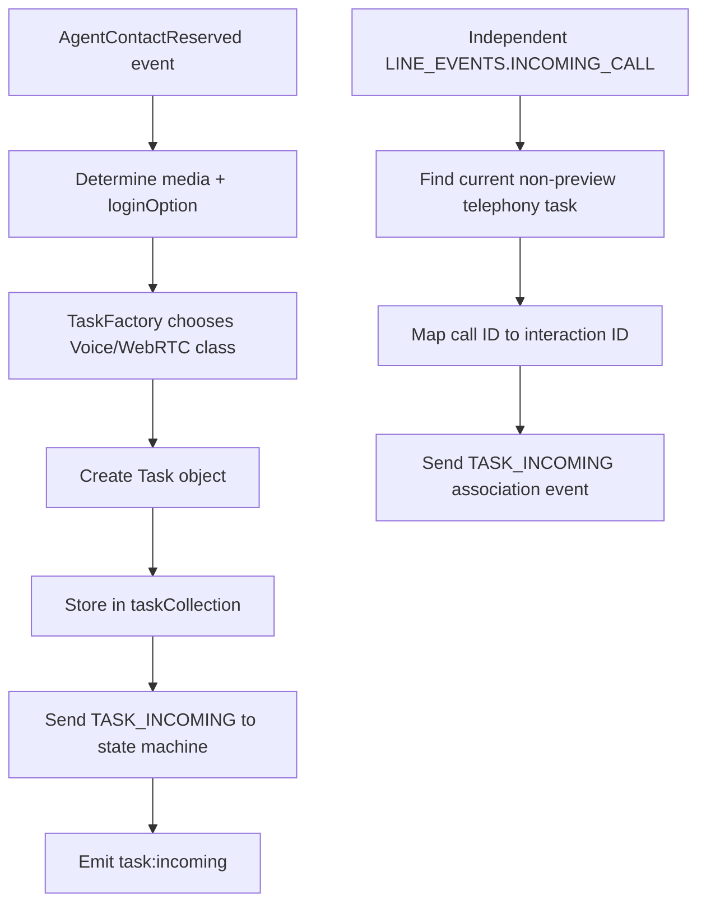

`TaskManager.handleIncomingWebCall` maps the call with `webCallingService.mapCallToTask(callId, interactionId)`
and sends the `AgentContactReserved` mapping to that task's actor. `WebRTC.accept()` then gets a
microphone track with `getUserMedia({audio: true})`, wraps it in a `LocalMicrophoneStream`, and calls
`webCallingService.answerCall(localAudioStream, interactionId)`; it resolves without a `TaskResponse`.
`WebRTC.decline()` calls `declineCall(interactionId)` and removes its media listener, and
`toggleMute()` calls `muteUnmuteCall(localAudioStream)`. Task cleanup for a BROWSER telephony `WebRTC`
task unregisters its listeners and calls `webCallingService.cleanUpCall()`.

**wxApp outdial `ContactEnded` / `AgentOutboundFailed` mapping:** Applies only when the current agent is a **wxApp-managed** outdial (`enableWxBetterTogether` + agent participant `deviceType: wxApp`). Pre-accept decline maps to `CONTACT_ENDED` when `wxAppAnswerPending` is false and `agentsPendingWrapUp` is empty — even if the backend sends misleading `interaction.state: wrapUp`. Post-accept wxApp agent end remaps to `OUTBOUND_FAILED` / `AGENT_ENDS` when `wxAppAnswerPending`, `agentsPendingWrapUp`, or `interaction.state === 'wrapUp'` indicates wrapup. **Non-wxApp** agent-terminated `AgentOutboundFailed` (`AGENT_ENDS` / `terminatingParty: Agent`) stays on `OUTBOUND_FAILED` so the OFFERED-state `shouldWrapUp` path runs; `suppressOutdialFailedPopup` on `taskData` skips the outdial-failed modal only. Non-wxApp `ContactEnded` keeps the legacy path. Other failure reasons (`CUSTOMER_BUSY`, etc.) still use `OUTBOUND_FAILED` with the popup. See `TaskManager.isWxAppManagedOutdialTask`, `isAgentTerminatedOutdialWrapup`, and the [state machine specification](../state-machine/docs/README.md).

**wxApp consumer contract (WXCC-6026):** Hosts enable `enableWxBetterTogether` at init (Phase 1 init-only; re-init to change), bind UI to `task.uiControls` (including optional `main.keypad`), and call **`task.accept()`**, **`task.decline()`**, **`task.toggleMute({ muted? })`**, **`task.transmitDtmf({ dtmf })`**. SDK routes wxApp telephony internally on `Voice`. Shared-line `lineOwnerId` defaults from the wxApp agent participant when omitted.

Outside that wxApp routing, `Voice.accept()`, `Voice.decline()`, `Voice.toggleMute()`, and
`Voice.transmitDtmf()` throw `Unsupported operation`; `WebRTC` overrides `accept`, `decline`, and
`toggleMute` with the WebCallingService implementations above.

**wxApp OFFERED diagnostics:** `Voice.updateUiControls` delegates offer-decision logging and deferred participant-mismatch WARN/metric to `voice/wxAppOfferObservability.ts` (500 ms grace; observability only). After usersub publish, `TaskManager.refreshWxAppOfferObservabilityForAllTasks()` re-invokes the observer without emitting UI controls. `removeTaskFromCollection` calls `disposeWxAppOfferObservability()` so a pending grace timer cannot emit after the task is dropped (including `CONTACT_MERGED` child removal). Dispose is terminal: the observer sets a disposed guard (timer cancel plus no-op `handleUiControlsUpdate`) so a later `updateUiControls` / refresh cannot schedule a new grace timer.

**wxApp offer UI (`uiControlsComputer`):** `wxAppAcceptInFlight` disables accept/decline during the accept REST call. `wxAppAnswerPending` additionally disables accept and decline for **inbound** offers until ASSIGN; wxApp **outdial** keeps decline enabled during the post-accept "Calling…" phase so `cancelTask` remains available. `Voice` owns both flags and copies them into `uiControlConfig`; the computation itself belongs to the state machine sub-module.

**wxApp decline observability:** Inbound wxApp offers decline via telephony `rejectCall` (`runWxAppReject` → `WXAPP_TASK_DECLINE_*`). wxApp outdial cancellations use CC routing `cancelTask` (`runWxAppOutdialDecline` → additive `WXAPP_TASK_DECLINE_*` plus existing `TASK_DECLINE_*`).

**wxApp mute backfill guard (`Voice.syncWxAppMuteFromCallDetails`):** Skips telephony `GET /calls/{callId}` when the interaction is terminated or the task is a pre-accept wxApp OFFERED offer (`wxAppAnswerPending` false). Post-accept OFFERED and engaged CONNECTED sync still run. `isWxAppEngagedForControls` and `getWebexCallingCallId` exclude `TERMINATED` and `COMPLETED`. Expected 400 / "Call not found" / `101002` responses are not logged as errors.

### Participant departure and merge

`ParticipantLeftConference` is authoritative for both a customer hangup and an
agent-initiated customer Drop. The task removes only participants absent from
the latest interaction snapshot. TaskManager first uses the exact interaction
key, then the existing reservation fallback, and finally one unique task whose
`interaction.mainInteractionId`, interaction-level `parentInteractionId`, or
`callProcessingDetails.parentInteractionId` matches an identifier carried by the
lifecycle event. Object aliases are deduplicated and all aliases are removed
during terminal cleanup; ambiguous related-interaction matches are ignored
without logging participant data. Events carrying none of those correlation
identifiers are not routed. `ContactMerged` removes the EP-DN child task,
hydrates the main-interaction task, and publishes the existing `task:merged`
event so consumers can rebind to the surviving task object. When `ContactMerged` finds no main task,
TaskManager creates it and sends an internal `HYDRATE` before installing listeners (so the hydrate does
not reach widgets as a duplicate), then emits `task:merged`.

This module's part of a departure is the correlation above and the `wrapUpRequired` stamp
(TASK-R-011). Which states handle or ignore `PARTICIPANT_LEAVE`, when the current Agent counts as
departed, and the consult-end outcomes for consultees and consult initiators are specified in the
[state machine specification](../state-machine/docs/README.md) (contract `contact-center-task-state-machine`).

### Contact owner change propagation

Owner-change propagation preserves the behavior required by Participant Drop: when the backend
promotes a new primary Agent, existing SDK tasks publish the updated owner through the existing
`task:hydrate` event so widgets immediately recompute the Primary label, icon, and Drop permission.
There is no public API, routing-event, state-machine transition, Participant Drop request, or widget
contract change. TASK-R-010 states the correlation and recovery rule; this subsection records the
mechanism and why each part exists.

- Remaining conference Agents receive `ContactUpdated`, not necessarily `ContactOwnerChanged`, so an
  owner-changing `ContactUpdated` (non-empty `interaction.owner` that differs from the current owner)
  maps to `CONTACT_OWNER_CHANGED`; the existing state-machine action synchronizes task data and emits
  `task:hydrate`. Same-owner and owner-less updates remain data-only.
- Exact-ID lookup stays first because it is the existing lookup contract. The related-task fallback
  also reads the task collection key and the `mainCall` media-map key because some supported
  owner-change payloads identify the surviving call through a child top-level ID and omit
  `mainInteractionId`.
- A local child task can be briefly stale when the owner-change payload first proves promotion, so the
  incoming snapshot's owner proof can repair a stale child-keyed snapshot. The update keeps the
  surviving main interaction identity even when the notification names a promoted-Agent child
  interaction.
- Participant Drop can deliver owner-change and participant-left notifications in either order. A late
  `ParticipantLeftConference` that still names the departed participant as owner keeps the already
  confirmed owner only when the new roster proves that confirmed owner remains active on `mainCall`
  and explicitly names the incoming owner as `participantId` or marks it `hasLeft`. Main-call omission
  alone is not departure evidence.
- Recovery additionally requires a non-terminal telephony payload and a stable main interaction ID, and
  does not use `toOwner`. A later canonical contact or merge event reuses the recovered task rather
  than creating an alias.

Owner-change correlation and recovery retain the following protections. This list is the single home
for the owner-change ignore rules; an ignored event produces no task event:

- generic lifecycle-event correlation is unchanged; collection-key and media-key matching are enabled only for `ContactOwnerChanged`;
- only a task selected by the related-interaction fallback may be re-keyed;
- conflicting task/payload main IDs are ignored;
- a stable main key already owned by a different Task causes the event to be ignored;
- an exact child task is never normalized over a distinct main task;
- aliases of the same Task object are deduplicated before uniqueness is tested;
- consult-only and ambiguous matches are ignored: a related task is a candidate only when its snapshot shows the current Agent active on `mainCall`, or the incoming payload names the current Agent as `interaction.owner` with the same active main-leg membership, and more than one candidate is ambiguous; and
- recovery is skipped whenever any related task or canonical-key occupant already exists.

These protections prevent the scenario where an exact child task could be normalized to a main key and
silently replace the actual main Task, orphaning its listeners and resources. The resulting event flow
is the Owner change diagram in Data flow and sequence coverage; `ParticipantLeftConference` continues
through its existing event/state-machine path, and no Drop completion fabricates an owner (INV-005).

### RTD and AI Assistant event routing

`TaskManager.handleRealtimeWebsocketEvent()` handles payloads arriving on the realtime subscription
socket used for AI features; `src/cc.ts` registers it on the RTD socket only when transcripts,
suggestions, a summary flag, or wellness breaks are enabled. It first routes the AI summary types:
`FEATURE_ENABLEMENT` frames are applied to the task named by `interactionId` (or buffered),
`POST_CALL_SUMMARY` and `MID_CALL_SUMMARY` resolve the pending `ApiAIAssistant` request for their
`conversationId`, and `MID_CALL_SUMMARY_RESPONSE_SUBSEQUENT_AGENT` delivers a receiving-agent summary.
For every other type it:

1. Parses the JSON websocket envelope
2. Reads `conversationId` from `payload.data.data.conversationId` and resolves the owning task
3. Emits the payload type and `payload.data` on the task for `REAL_TIME_TRANSCRIPTION`
4. Does the same for `SUGGESTED_RESPONSE`
5. Logs and returns when JSON parsing fails or the interaction has no task; other payload types, including `SUGGESTED_RESPONSE_ACKNOWLEDGE`, fall through without task emission

This keeps transcript and suggestion delivery aligned on the same per-task event surface.

TaskManager also sends a `GET_TRANSCRIPTS` custom event with action `START` (on `AgentContactAssigned`,
`AgentConsulting`, `AgentConsultConferenced`) or `STOP` (on `AgentWrapup`, `AgentConsultEnded`,
`ParticipantLeftConference`) when `aiFeature.realtimeTranscripts.enable` is true; failures are logged
and do not interrupt event processing.

### AI summary delivery

The gating and deadline rule is TASK-R-013 and the buffering rule is TASK-R-014; this subsection
records the mechanism. The dedicated request methods read the current organization flags directly from the existing `ApiAIAssistant.aiFeature` field, populated by ContactCenter from the agent configuration. No separate feature-flags argument or task-local organization configuration is needed. Receiving-agent summaries are delivered separately through `task:midCallSummaryReceived`. Summary content is application data and must not be written to logs or metrics.

Each dedicated Task summary method owns its event selection, payload construction, metrics, and error handling. The request methods call `ApiAIAssistant.requestAndWaitForRtd()`. Both response methods read `interactionId` from the current task data and use `interaction.mainInteractionId` as `conversationId`, falling back to `interactionId`. They call `ApiAIAssistant.sendEvent()` directly without caching request IDs on the task.

TaskManager reads the receiving task directly from `taskCollection[summary.conversationId]`; the RTD
conversation ID is the task's collection key (`task.data.interactionId`). The common AQM
event-processing path checks the receiving-summary map after every primary-socket event, so a held
summary follows the answer event (`AgentContactAssigned` or `AgentConsulting`); removal of an
unanswered task (RONA, decline, cancelled consult) is where it is dropped.

`task:featureEnablement` is emitted after the task's first published `task:incoming`, `task:hydrate`,
`task:assigned`, or `task:campaignPreviewReservation`, or right after `task:merged`. `Task.setFeatureEnablement` ignores a frame whose `interactionId` differs
from the task's.

`clearAISummaryState()` cancels pending summary requests, clears task feature enablement, and empties both pending maps. ContactCenter's `deregister()` removes the RTD message listener synchronously before asynchronous teardown. RTD listener registration and removal control inbound delivery; `setConfigFlags()` only supplies task configuration.

### Auto wrapup, data reconciliation, and telemetry

If enabled in agent profile, wrapup completes automatically after timeout. The timer starts only when ingress task data has `wrapUpRequired === true` (TASK-R-011).

AutoWrapup handles automatic task completion. `new AutoWrapup(interval, allowCancelAutoWrapup = false)`
keeps one `setTimeout`: `start(onComplete)` clears a running timer, records the start time, and calls
`onComplete` after `interval` ms; `clear()` cancels it; `getTimeLeft()`, `getTimeLeftSeconds()`
(rounded up), and `isRunning()` report progress. `Task.setupAutoWrapupTimer()` runs from the
constructor and every `updateTaskData`; it creates the timer only once, only when the profile
`wrapUpProps` has `autoWrapup !== false`, a positive `autoWrapupInterval`, and a default (or first)
wrap-up reason, and the timer calls `wrapup()` with that reason. `wrapup()` and task removal cancel it.

`Task.updateTaskData(updatedData, shouldOverwrite = false)` replaces the data when `shouldOverwrite` is
true and otherwise deep-merges it (arrays replace), prunes the `interaction.media` and
`interaction.participants` entries missing from the incoming snapshot (TASK-R-012), recomputes UI
controls, and re-checks auto wrap-up. TaskManager's own `updateTaskData` additionally carries the
consult destination agent and type from the actor context during a consult.

| Metric | Type | When Tracked |
| ------ | ---- | ------------ |
| `TASK_ACCEPT_SUCCESS` | operational, behavioral, business | Task accepted |
| `TASK_HOLD_SUCCESS` | operational, behavioral | Hold succeeded |
| `TASK_END_SUCCESS` | operational, behavioral, business | Task ended |
| `TASK_WRAPUP_SUCCESS` | operational, behavioral, business | Wrapup completed |
| `TASK_TRANSFER_SUCCESS` | operational, behavioral, business | Transfer completed |
| `TASK_OUTDIAL_SUCCESS` | behavioral, business, operational | Outdial completed (tracked by `src/cc.ts`) |
| `TASK_CONFERENCE_PARTICIPANT_DROP_SUCCESS` | operational, behavioral, business | Participant Drop completed |

Each success metric has a matching `_FAILED` metric; operations call `timeEvent` for both before the
request. AI summary methods track `AI_SUMMARY_*` operational metrics with a `failureCode`, and the wxApp
helpers track `WXAPP_TASK_*` operational and behavioral metrics.

## Data flow and sequence coverage

Call style: in-process async method calls on Task objects; remote operations are HTTP requests through
AqmReqs and WebexRequest to the WCC API gateway whose completion arrives as a correlated notification
on the primary Contact Center WebSocket. TaskManager consumes that WebSocket, the RTD WebSocket, and
Webex Calling `LINE_EVENTS.INCOMING_CALL` events; wxApp telephony uses `AnswerCallOnWebexService` REST
calls.

| Operation group | Entry and outcome | Diagram or evidence | Failure and recovery coverage |
| --------------- | ----------------- | ------------------- | ----------------------------- |
| Incoming task creation | `AgentContactReserved` creates the task; `cc` emits `task:incoming` | Incoming task | Unsupported media or incomplete event context prevents publication of a partial task. |
| Voice hold/resume | `hold()` or `resume()` resolves after `AgentContactHeld` or `AgentContactUnheld` | Hold or resume | Invalid state rejects before transport; failure notification/HTTP error/timeout sends the matching failure event and throws. |
| Consult/transfer/conference | Voice consult, transfer, conference, exit, and switch operations | Consult and transfer | Backend failure notifications drive explicit failure actions and preserve stable call context; a queue consult has no AQM timeout and a queue consult transfer rejects locally until an agent accepts. |
| Participant Drop | `dropConferenceParticipant` resolves on `ParticipantLeftConference` | Participant Drop | Validation rejects locally; AQM success/failure/HTTP/timeout paths settle and clean up without optimistic state changes. |
| Wrapup/end | `wrapup()` or `end()` resolves on `AgentWrappedUp` or `AgentWrapup` | Wrapup or end | Validation and backend failures throw; backend events retain distinct WRAPPING_UP/COMPLETED/TERMINATED outcomes. |
| WebRTC and digital accept | `accept()` answers the call or posts the AQM accept | Channel-specific accept | WebRTC media/calling failure and Digital AQM failure follow different rejection paths. |
| wxApp telephony | `accept`, `decline`, `toggleMute`, `transmitDtmf` on a wxApp Voice task call `AnswerCallOnWebexService` | wxApp telephony | Validation errors and REST failures are mapped and rethrown; accept clears the answer-pending flag on failure; mute sync retries 3 times at 50 ms while the call ID is unknown |
| Outdial and preview campaign | `cc.startOutdial` and the three preview methods call `aqmDialer`; the task arrives through TaskManager | Outdial and preview campaign | Disabled skip or remove throws before transport; preview accept times out at 80000 ms; failure notifications reject and emit `task:outdialFailed` or `task:campaignPreview*Failed` |
| ContactMerged and participant departure | `ContactMerged` removes the EP-DN child and publishes `task:merged`; `ParticipantLeftConference` is correlated to one task | ContactMerged and participant departure | Ambiguous related matches and events without correlation IDs are ignored |
| Owner change | `ContactOwnerChanged` or owner-changing `ContactUpdated` yields one `task:hydrate` | Owner change | Payloads that fail the owner-change protections (Contact owner change propagation) are ignored; recovery is limited to a complete promotion payload (TASK-R-010) |
| RTD transcript and suggestion routing | Transcript start or stop events go out on CC events; RTD frames are emitted on the owning task | RTD transcript routing | Parse errors and unknown tasks are logged and dropped; acknowledgement frames are not emitted; start or stop failures are logged |
| AI summary | Summary request resolves on the RTD summary frame | AI summary request | Disabled flags, POST failure, and the 15-second RTD deadline reject |

### Incoming task

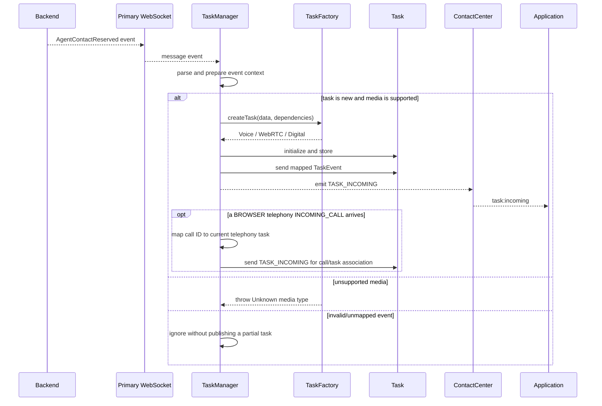

### Hold or resume

```mermaid
sequenceDiagram
  participant App
  participant Voice
  participant Actor as Task state-machine actor
  participant Contact as routingContact
  participant AQM as AqmReqs
  participant WR as WebexRequest
  participant WS as Primary WebSocket
  App->>Voice: hold() or resume()
  Voice->>Voice: derive main media resource and direction from actor state and media isHold
  alt hold outside CONNECTED, or resume outside HELD and outside CONNECTED/CONFERENCING with main media on hold
    Voice-->>App: throw before transport
  else valid state
    Voice->>Actor: HOLD_INITIATED or UNHOLD_INITIATED
    Voice->>Contact: hold/unHold({interactionId, data: {mediaResourceId}})
    Contact->>AQM: generated request with success/failure binds
    AQM->>WR: authenticated HTTP request
    WR-->>AQM: acknowledgement only
    alt matching success notification
      WS-->>AQM: AGENT_CONTACT_HELD/UNHELD
      AQM-->>Voice: TaskResponse
      Voice->>Actor: HOLD_SUCCESS or UNHOLD_SUCCESS
      Voice-->>App: resolve
    else matching failure, HTTP rejection, or timeout
      WS-->>AQM: failure notification or no completion
      Voice->>Actor: HOLD_FAILED or UNHOLD_FAILED
      Voice-->>App: throw detailed error
    end
  end
```

`Voice.holdResume()` (behind `hold()` and `resume()`) sends `HOLD_INITIATED` or `UNHOLD_INITIATED`
with the main media resource before calling `contact.hold` or `contact.unHold`, and sends
`HOLD_SUCCESS` or `UNHOLD_SUCCESS` with the same `mediaResourceId` after the AQM response. The
direction comes from the actor state and the main media `isHold` flag: `HELD` and `RESUME_INITIATING`
resume, and `CONNECTED` with media still on hold resumes on the first call. The guard then allows hold
only in `CONNECTED`, and resume only in `HELD` or in `CONNECTED` or `CONFERENCING` while the main media
is on hold; `RESUME_INITIATING` is rejected with `Cannot resume call in current state`.

### Consult and transfer

```mermaid
sequenceDiagram
  participant App
  participant Voice
  participant Actor as Task state-machine actor
  participant Contact as routingContact
  participant WS as Primary WebSocket
  App->>Voice: consult/transfer/conference operation
  alt consult outside CONNECTED/HELD/CONFERENCING
    Voice-->>App: throw Cannot initiate consult
  else queue consult transfer before an agent accepts
    Voice-->>App: throw No agent has accepted this queue consult yet
  else valid request
    Voice->>Actor: initiating event
    Voice->>Contact: correlated AQM operation (queue consult: timeout disabled)
    alt matching success notification
      WS-->>Contact: consult/transfer/conference success
      Contact-->>Voice: TaskResponse
      Voice->>Actor: success event and updated call context
      Voice-->>App: resolve
    else failure/cancel/timeout
      WS-->>Contact: failure or cancel notification
      Voice->>Actor: matching failure/end event
      Voice-->>App: throw while preserving stable main/consult context
    end
  end
```

### Participant Drop

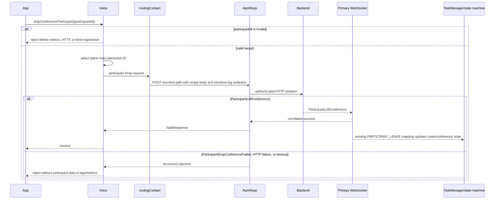

### Wrapup or end

```mermaid
sequenceDiagram
  participant App
  participant Task
  participant Contact as routingContact
  participant WS as Primary WebSocket
  participant Actor as Task state-machine actor
  App->>Task: wrapup(payload) or end()
  alt invalid wrapup payload or missing task data
    Task-->>App: throw validation error
  else valid request
    Task->>Contact: wrapup/end({interactionId, data})
    alt matching success notification
      WS-->>Contact: wrapup/end success
      Contact-->>Task: TaskResponse
      WS-->>Actor: backend event selects WRAPPING_UP/COMPLETED/TERMINATED
      Task-->>App: resolve
    else failure, HTTP rejection, or timeout
      Contact-->>Task: structured rejection
      Task-->>App: throw detailed error
    end
  end
```

`end()` sends the main interaction ID (`interaction.mainInteractionId || interactionId`) and settles on
`AgentWrapup`; `wrapup()` cancels auto wrap-up first, validates `auxCodeId` and `wrapUpReason`, and
settles on `AgentWrappedUp`.

### Channel-specific accept

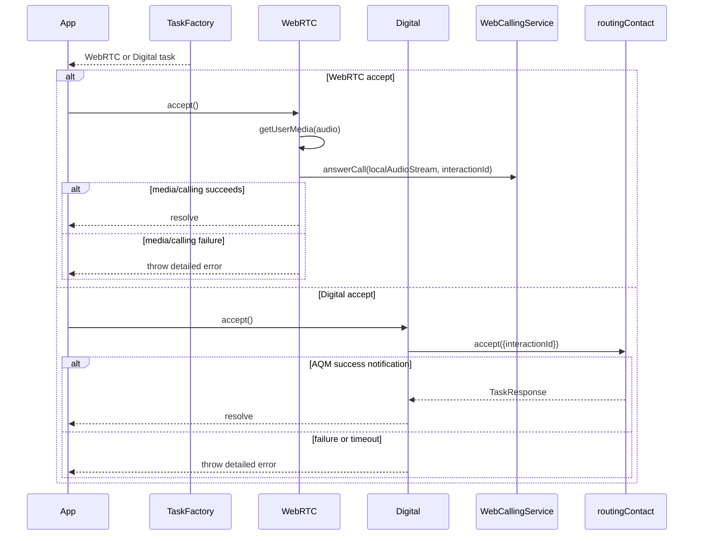

### wxApp telephony

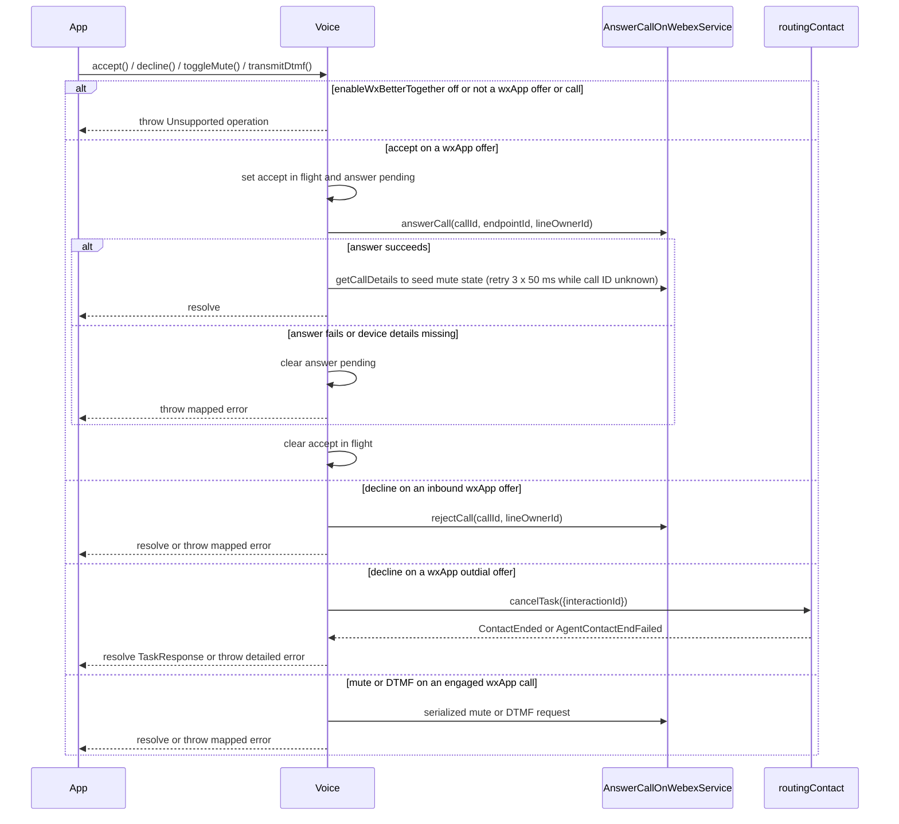

### Outdial and preview campaign

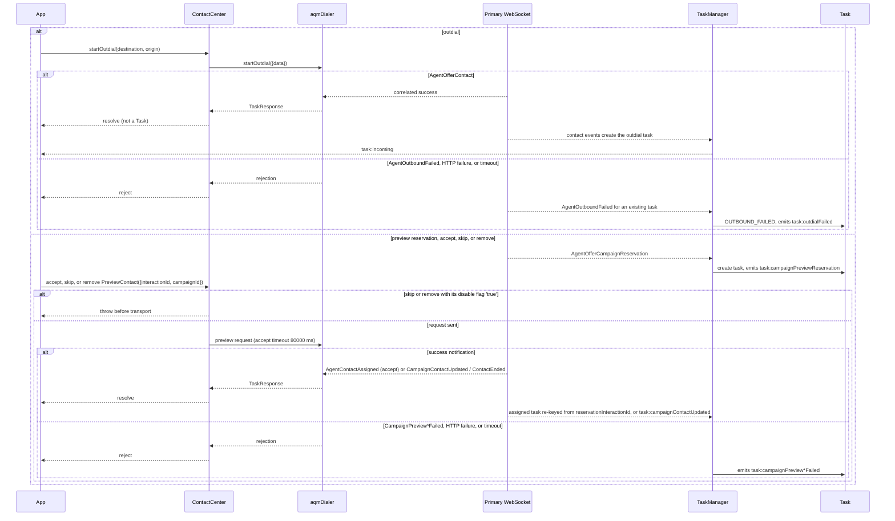

`cc.startOutdial` and the three preview methods, with their metrics, are specified by the
[package specification](../../../docs/README.md). This module owns the `aqmDialer` routes and binds, the
reservation task creation and re-keying in TaskManager, and the preview fields
(`campaignPreviewAutoAction`, `campaignPreviewOfferTimeout`, `campaignPreviewSkipDisabled`,
`campaignPreviewRemoveDisabled`) that TaskManager carries forward on `CampaignContactUpdated`.

### ContactMerged and participant departure

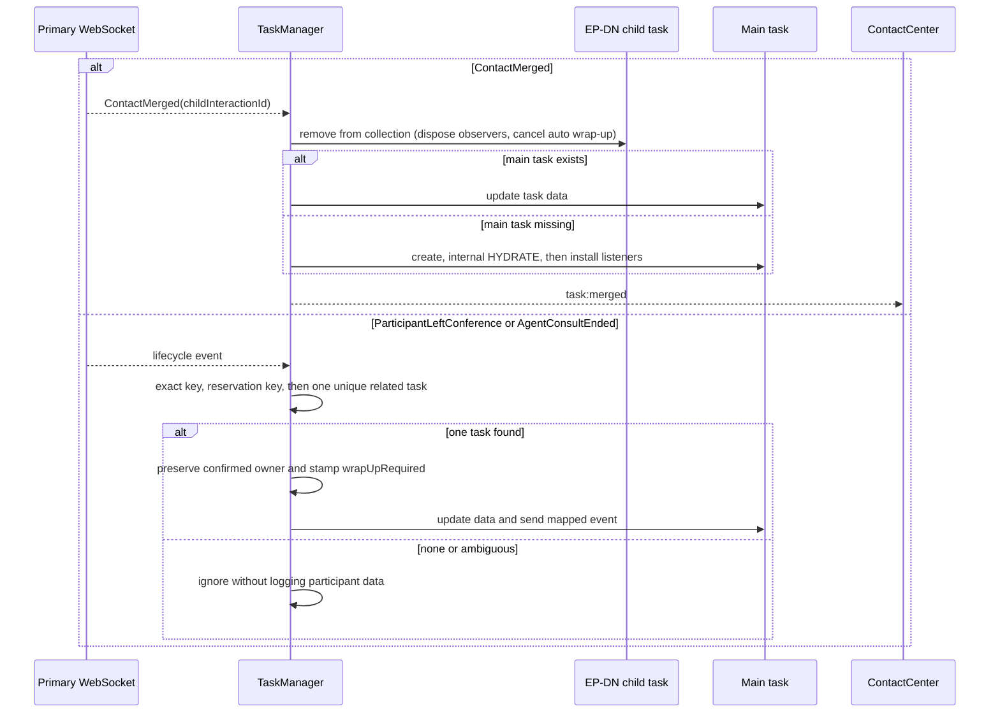

### Owner change

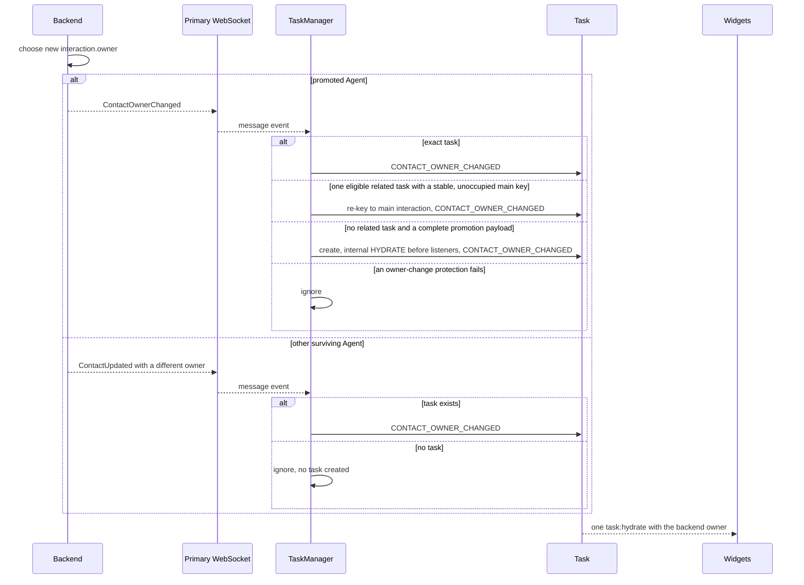

### RTD transcript routing

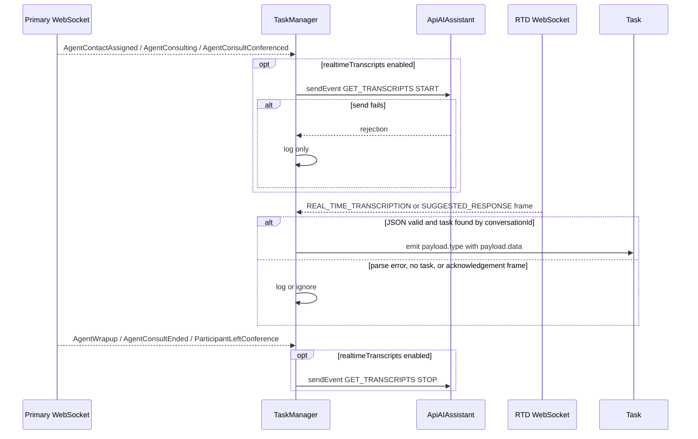

### AI summary request

```mermaid
sequenceDiagram
  participant App
  participant Task
  participant AI as ApiAIAssistant
  participant RTD as RTD WebSocket
  participant TM as TaskManager
  App->>Task: requestPostCallSummary() or requestMidCallSummary(action)
  alt organization or task flag disabled
    Task-->>App: reject *_SUMMARY_DISABLED
  else enabled
    Task->>AI: requestAndWaitForRtd(conversationId, event)
    AI->>AI: register pending request and POST event
    alt POST fails
      AI-->>Task: reject transport error
      Task-->>App: reject
    else RTD summary frame within 15 s
      RTD-->>TM: POST_CALL_SUMMARY or MID_CALL_SUMMARY
      TM->>AI: resolveFromRtdEvent(type, conversationId, data)
      AI-->>Task: AISummary
      Task-->>App: resolve AISummary
    else deadline passes
      AI-->>Task: reject *_SUMMARY_TIMEOUT
      Task-->>App: reject
    end
  end
```

## Class and component relationships

The file catalog is in Structure and key files; this section records only the relationships and the
facts the catalog does not state.

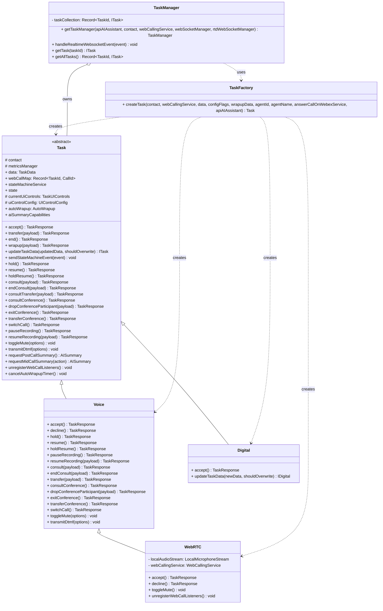

- **`Task` (base)**: Holds task data, emits SDK events, and provides default (unsupported) implementations for call control APIs. Every base method other than `accept` (abstract), `transfer`, `end`, `wrapup`, `updateTaskData`, `sendStateMachineEvent`, `cancelAutoWrapupTimer`, `unregisterWebCallListeners` (no-op plus log), the AI summary methods, `setFeatureEnablement`, `clearFeatureEnablement`, and the no-op wxApp hooks `setEnableWxBetterTogether` and `applyWxAppMuteStateFromSync` throws `Unsupported operation` through `unsupportedMethodError`. The `uiControls` getter includes ordered, action-specific `consultTransferDestinations` computed from Task profile configuration and live interaction data, and `aiSummaryCapabilities` starts with both flags false.
- **`Voice`**: Adds hold/resume and consult-related capabilities for telephony tasks. Provides `hold()` and `resume()` that delegate to `holdResume()`.
- **`WebRTC`**: Overrides `accept()`, `decline()`, and `toggleMute()` for WebRTC calls and hooks media events: emits `TASK_EVENTS.TASK_MEDIA` on remote media (`CALL_EVENT_KEYS.REMOTE_MEDIA`) and overrides `unregisterWebCallListeners()`.
- **`Digital`**: Implements `accept` and refreshes digital task data/UI controls by overriding `updateTaskData()`.
- `TaskManager` owns every Task through `taskCollection` and builds them only through `TaskFactory`.

Helper functions for task state analysis:

```typescript
// TaskUtils.ts

// Check if participant is in main interaction
isParticipantInMainInteraction(task, agentId);

// Check if conference is in progress
getIsConferenceInProgress(taskData);

// Check if agent is primary
isPrimary(task, agentId);

// Check if secondary EPDN agent
isSecondaryEpDnAgent(interaction);
```

## Use cases and flows

| Use case | Actor or caller | Primary steps and outcome | Failure or boundary behavior | Evidence |
| -------- | --------------- | ------------------------- | ---------------------------- | -------- |
| `UC-001` | Backend and TaskManager | Incoming task creation: TaskManager maps a backend offer/reservation, TaskFactory creates a supported Voice/WebRTC/Digital task, and ContactCenter emits the typed incoming event. | Unsupported media throws; unmapped events are ignored | `src/services/task/TaskManager.ts`, `src/services/task/TaskFactory.ts`, `test/unit/spec/services/task/TaskManager.ts` |
| `UC-002` | Host application | Accept/hold/resume: the Task or Voice method delegates the remote operation and sends the matching typed event to its actor (TASK-R-002). | Invalid state rejects before transport; AQM failure sends the failure event | `src/services/task/Task.ts`, `src/services/task/voice/Voice.ts`, `test/unit/spec/services/task/voice/Voice.ts` |
| `UC-003` | Host application | Consult/transfer/conference: Voice coordinates contact routing with initiating/stable actor states and emits the corresponding complete `TASK_EVENTS` contract. | Failure notifications drive failure events; queue consult transfer needs an accepting agent | `src/services/task/voice/Voice.ts`, `src/services/task/types.ts`, `test/unit/spec/services/task/voice/Voice.ts` |
| `UC-004` | Host application and backend | Wrapup/end: backend end/wrapup notifications drive WRAPPING_UP and final COMPLETED/TERMINATED outcomes without collapsing them into one result. | Missing wrap-up fields reject locally | `src/services/task/Task.ts`, `test/unit/spec/services/task/Task.ts` |
| `UC-005` | Host application on a wxApp, BROWSER, or digital login | Receives the channel-specific task TaskFactory selected (TASK-R-001) and calls the same `ITask` methods | Methods the channel does not support throw `Unsupported operation` | `src/services/task/TaskFactory.ts`, `test/unit/spec/services/task/TaskFactory.ts` |
| `UC-006` | Backend and surviving agents | Primary-Agent promotion reaches every surviving agent as one `task:hydrate` | Payloads that fail the owner-change protections are ignored | `src/services/task/TaskManager.ts`, `test/unit/spec/services/task/TaskManager.ts` |
| `UC-007` | Host application | Requests a post-call or mid-call summary and reports the agent's response | Disabled flags, POST failure, or the RTD deadline reject | `src/services/task/Task.ts`, `test/unit/spec/services/task/Task.ts` |

> **Host-application example:** This consumer callback performs task operations without logging raw interaction data.

```typescript
// Listen for incoming tasks
cc.on('task:incoming', async (task) => {
  // Accept the task
  await task.accept();

  // Task operations
  await task.hold();
  await task.resume();
  await task.end();
  await task.wrapup({
    wrapUpReason: 'Resolved',
    auxCodeId: 'wrapup-code',
  });
});
```

> **Host-application example:** `updateWrapupStatus` is a consumer-owned UI callback, not SDK package logging.

```typescript
task.on('task:wrappedup', () => {
  updateWrapupStatus('completed');
});
```

### Cross-boundary use-case flow

| Boundary | Transport and ordering | Compatibility | Timeout, retry, and recovery |
| -------- | ---------------------- | ------------- | ---------------------------- |
| WCC API gateway, through `contact.ts` and `dialer.ts` (`UC-001` to `UC-004`) | HTTP initiation through AqmReqs and WebexRequest; completion is the matching `RoutingMessage` notification on the primary WebSocket (contract `wxcc-api-gateway`, `wxcc-websocket-notifications`) | Routes and bind event names in Protocol and wire format | `TIMEOUT_REQ` 20000 ms by default, 80000 ms for preview accept, none for queue consult; no retry here |
| Primary Contact Center WebSocket | Messages processed in arrival order by one listener; keepalives dropped | Payloads normalized by `normalizeTaskData` before mapping | Unparsable messages are logged and dropped; a reconnect replays state through `AgentContact` (HYDRATE), which recreates missing tasks |
| RTD WebSocket (`UC-007`) | Separate socket registered by `src/cc.ts` when an AI or wellness feature is enabled | Frame types `FEATURE_ENABLEMENT`, `POST_CALL_SUMMARY`, `MID_CALL_SUMMARY`, `MID_CALL_SUMMARY_RESPONSE_SUBSEQUENT_AGENT`, `REAL_TIME_TRANSCRIPTION`, `SUGGESTED_RESPONSE` | 15-second summary deadline; early frames are buffered |
| Webex Calling (BROWSER login) | `LINE_EVENTS.INCOMING_CALL` maps the call to the current non-preview telephony task; `CALL_EVENT_KEYS.REMOTE_MEDIA` emits `task:media` (contract `webex-calling-sdk`) | — | Calling errors reject `WebRTC` methods; cleanup calls `cleanUpCall()` |
| Webex App telephony (wxApp) | `AnswerCallOnWebexService` REST calls for accept, reject, mute, DTMF, and call details; mute state also arrives through Mercury sync (contract `webex-internal-mercury`) | wxApp participant `deviceType: wxApp` and `deviceCallId` | Mute sync retries up to 3 times at 50 ms while the call ID is unknown; call-not-found is silent |

## Client state model

| State or slice | Owner | Initial state | Transition triggers | Reset or persistence boundary |
| -------------- | ----- | ------------- | ------------------- | ----------------------------- |
| `taskCollection` | TaskManager | Empty | Created on `AgentContactReserved`, `AgentContact` (missing task), `AgentOfferCampaignReservation`, `ContactMerged`, recoverable `ContactOwnerChanged`; re-keyed by reservation ID and main-interaction updates | Removed on cleanup per `handleTaskCleanup` and on terminal `cleanupResources`; memory only |
| `receivingSummaryBuffer`, `pendingFeatureEnablement` | TaskManager | Empty | RTD frames for a task that is missing or not yet answered | Delivery, task removal, `clearAISummaryState()` |
| `Task.data` | Each task | The creating payload | Every pipeline `updateTaskData` and actor `syncTaskDataFromEvent` | Lives with the task |
| Actor snapshot and `state` | Each task | `IDLE` | `sendStateMachineEvent` and Voice initiating events | Final states are defined by the state machine sub-module |
| `uiControls` | Each task | `getDefaultUIControls()` | Actor snapshot or data change | Recomputed, never persisted |
| `aiSummaryCapabilities` | Each task | Both false | `setFeatureEnablement` | `clearFeatureEnablement` on removal or session cleanup |
| `autoWrapup` | Each task | Undefined | `setupAutoWrapupTimer` | `wrapup()`, `cancelAutoWrapupTimer()`, removal |
| wxApp flags (`wxAppAnswerPending`, `wxAppAcceptInFlight`, `wxAppMuted`) | Each Voice task | False | wxApp accept, reject, mute, and Mercury sync | Lives with the task |

## Business rules and invariants

| ID | Invariant | WHY | Enforcement source | Test evidence |
| -- | --------- | --- | ------------------ | ------------- |
| `INV-001` | Task event names come from `TASK_EVENTS`; actor transition names come from `TaskEvent`, and callers must not substitute raw strings. | Typed constants keep the event contract and the transition contract in one place each | `src/services/task/types.ts`, `src/services/task/Task.ts` | `test/unit/spec/services/task/Task.ts` |
| `INV-002` | Task owns no credentials or authentication policy; contact/dialer factories delegate authenticated requests through AqmReqs and Core/WebexRequest. | TASK-R-006 | `src/services/task/contact.ts`, `src/services/task/dialer.ts` | `test/unit/spec/services/task/contact.ts` |
| `INV-003` | Preview skip/remove delegation is conditional: `campaignPreviewSkipDisabled === 'true'` or `campaignPreviewRemoveDisabled === 'true'` causes ContactCenter to throw before the dialer starts an HTTP or WebSocket-correlated AQM operation. Accept has no equivalent pre-guard. | TASK-R-007 | `src/cc.ts` | None found (TASK-R-007 gap) |
| `INV-004` | One Task object per interaction: TaskManager never replaces an existing task with a new one; aliases of one object are deduplicated and removed together. | TASK-R-004, TASK-R-010 | `src/services/task/TaskManager.ts` | `test/unit/spec/services/task/TaskManager.ts` |
| `INV-005` | The SDK never elects a conference owner; owner changes come only from backend payloads. | TASK-R-010 | `src/services/task/TaskManager.ts` | `test/unit/spec/services/task/TaskManager.ts` |
| `INV-006` | `wrapUpRequired` is stamped once at ingress for the four wrap-up events, before data update and mapping. | TASK-R-011 | `src/services/task/TaskManager.ts` | `test/unit/spec/services/task/TaskManager.ts` |

## Concurrency and reactive flow

- Execution model: one JavaScript event loop; call-control methods are async, WebSocket listeners are
  synchronous handlers.
- Ordering guarantees: Remote contact/dialer operations complete asynchronously through AQM correlation. Backend WebSocket notifications are separately mapped by TaskManager and delivered to the owning actor in arrival order.
- Idempotency and retry: nothing here retries a remote operation. A second identical method call sends
  a second request; the actor state guards in Voice (`Cannot hold call in current state`) reject only
  calls the current state forbids. wxApp mute toggles and DTMF sends are serialized on per-task
  promise tails.
- Shared-state protection: TaskManager is the only writer of `taskCollection`; each task is the only
  writer of its `data` and actor; the internal hydrate of a recovered or merge-created task precedes
  listener installation (TASK-R-010, Participant departure and merge).
- Blocking restrictions: metrics and transcript events are fire-and-forget; summary content is never
  logged.

## State machine

Each Task owns an XState actor and current task data. TaskManager maps backend notifications into actor events; backend task data remains authoritative for hydration. Stable interaction states and initiating/terminal states are defined by the nested task-state-machine module.

States, transitions, guards, rejected transitions, and the CC-event to `TaskEvent` mapping are specified
in the [state machine specification](../state-machine/docs/README.md) (contract
`contact-center-task-state-machine`) and are not restated here.

This module's side of the contract:

- `Task.initializeStateMachine()` creates and starts the actor with this module's action overrides
  (Task creation and state machine initialization).
- TaskManager sends the mapped event for each backend notification and updates task data even when no
  event is mapped (TaskManager lifecycle orchestration).
- Voice sends initiating, success, and failure events around its own remote calls (hold, consult,
  conference, exit, transfer conference, switch call).
- Entering a final state runs `cleanupResources`, which emits `task:cleanup` with
  `removeFromCollection: true`; TaskManager then cleans up calling resources and removes the task.

## Protocol and wire format

Request, response, and event payload ownership is anchored in `src/services/task/Task.ts`. HTTP initiates backend work where applicable; WebSocket messages provide realtime events and, for AQM flows, correlated completion.

| Message or frame | Version | Producer or serializer | Consumer or parser | Compatibility and ordering rule |
| ---------------- | ------- | ---------------------- | ------------------ | ------------------------------- |
| `POST /v1/tasks/{id}/accept`, `/hold`, `/unhold`, `/record/pause`, `/record/resume`, `/consult`, `/consult/accept`, `/consult/end`, `/transfer`, `/consult/transfer`, `/end`, `/wrapup`, `/cancelCtq`, `/consult/conference`, `/conference/exit`, `/conference/transfer` | — | `src/services/task/contact.ts` | WCC API gateway | `cancelTask` reuses `/end` and settles on `ContactEnded`; `blindTransfer` and `vteamTransfer` share `/transfer` |
| `POST /v1/tasks/{id}/conference/participants/{encodeURIComponent(participantId)}/drop` with `{}` | — | `src/services/task/contact.ts` | WCC API gateway | `redactSensitiveLogs: true`; success `ParticipantLeftConference`, failure `ParticipantDropConferenceFailed` |
| `POST /v1/tasks/` (outdial) | — | `src/services/task/dialer.ts` | WCC API gateway | Success `AgentOfferContact`, failure `AgentOutboundFailed` |
| `POST /v1/dialer/campaign/{encodeURIComponent(campaignId)}/preview-task/{interactionId}/accept`, `/skip`, `/remove` | — | `src/services/task/dialer.ts` | WCC API gateway | Accept times out at 80000 ms and settles on `AgentContactAssigned` matched by `reservationInteractionId` or `ContactEnded`; skip and remove settle on `CampaignContactUpdated` or `ContactEnded` |
| `RoutingMessage` notifications (`data.type` from `CC_EVENTS`) | — | Contact Center backend | `TaskManager.parseWebSocketMessage`, AqmReqs binds | Known string booleans are coerced; unknown types are ignored |
| RTD frames (`type`, `data.data`) | — | AI Assistant backend | `TaskManager.handleRealtimeWebsocketEvent` | Routed by `conversationId` or `interactionId` |
| AI summary CTI events (`GET_POST_CALL_SUMMARY`, `GET_MID_CALL_CONSULT_SUMMARY`, `GET_MID_CALL_TRANSFER_SUMMARY`, and the three `*_SUMMARY_RESPONSE` events) | — | `src/services/task/Task.ts` through `ApiAIAssistant.sendEvent` | AI Assistant backend | `conversationId` is `interaction.mainInteractionId` or `interactionId`; `clientType` `WxCC` |

## Caller-visible failure modes

| Condition | Signal or result | Caller behavior | Retry or recovery | Evidence |
| --------- | ---------------- | --------------- | ----------------- | -------- |
| Method not supported by the task's channel or login (for example `hold` on Digital, `accept` on a non-wxApp Voice task) | `Error` with message `Unsupported operation:` followed by the method name | Check `task.uiControls` before calling | None | `src/services/task/Task.ts`, `src/services/task/voice/Voice.ts` |
| AQM failure notification, HTTP rejection, or timeout | Detailed error from `getErrorDetails` (Participant Drop rethrows the original error); matching failure actor event for Voice operations | Inspect structured details, preserve tracking id, and retry only when the operation is safe | Never synthesize success | `src/services/task/Task.ts`, `src/services/task/voice/Voice.ts` |
| Hold, resume, consult, or exit conference in a state that forbids it | `Error` with message `Cannot hold call in current state:` followed by the state, and similar messages | Follow `task.uiControls` | Retry after the state changes | `src/services/task/voice/Voice.ts` |
| `wrapup` without `auxCodeId` or `wrapUpReason` | `Error('AuxCodeId is required')` or `Error('WrapUpReason is required')` | Supply both | — | `src/services/task/Task.ts` |
| `dropConferenceParticipant` without a non-empty string `participantId` | `Error('participantId must be a non-empty string')` before any telemetry | Supply the backend participant ID | — | `src/services/task/voice/Voice.ts` |
| Queue consult transfer before an agent accepts | `Error('No agent has accepted this queue consult yet')` | Wait for the consult to be accepted | — | `src/services/task/voice/Voice.ts` |
| Summary disabled or deadline passed | Error whose `data.errorCode` is `POST_CALL_SUMMARY_DISABLED`, `MID_CALL_SUMMARY_DISABLED`, `POST_CALL_SUMMARY_TIMEOUT`, or `MID_CALL_SUMMARY_TIMEOUT` | Hide or retry the summary action | Retry is a new request (see Pitfalls and constraints for overlapping requests) | `src/services/task/Task.ts`, `src/services/task/TaskUtils.ts` |
| Unsupported media type in a backend payload | `Error` with message `Unknown media type:` followed by the media type, thrown inside the WebSocket listener and not caught by TaskManager; no task is published | None (backend data) | — | `src/services/task/TaskFactory.ts` |
| Skip or remove on a preview contact whose disable flag is `'true'` | `Error('Skip action is disabled for this campaign preview contact')` or the remove equivalent | Hide the control | — | `src/cc.ts` |

> **Host-application example:** `showTransferFailure` represents consumer-owned error presentation. SDK package implementation must use `LoggerProxy` and avoid logging raw runtime values.

```typescript
try {
  await task.transfer({
    to: 'queue-123',
    destinationType: 'queue',
  });
} catch (error) {
  showTransferFailure(error);
}
```

Troubleshooting:

- `task:incoming` not received. **Cause**: Agent not available or TaskManager not initialized

  **Solution**:

  1. Ensure `cc.register()` completed
  2. Ensure `cc.stationLogin()` completed
  3. Ensure agent state is Available

- Task operations fail. **Cause**: Task state doesn't allow operation

  **Solution**: Check task state before operation:

```typescript
if (task.uiControls.main.hold.isEnabled) {
  await task.hold();
}

// During a consult, use the consult-leg controls instead.
if (task.uiControls.consult.hold.isEnabled) {
  // Render or enable the consult-leg hold action.
}
```

- WebRTC call not connecting. **Cause**: Call not mapped to task

  **Solution**: Ensure BROWSER login and mercury connected:

```typescript
await webex.internal.mercury.connect();
await cc.stationLogin({ loginOption: 'BROWSER', ... });
```

## Pitfalls and constraints

- AQM HTTP acknowledgement never completes a task operation; success/failure binds or timeout settle the promise and must stay aligned with actor events.
- Primary and RTD WebSockets have different ownership: TaskManager uses the RTD stream for transcript/suggestion events and must not emit acknowledgement payloads as public suggestions.
- `TaskManager.getTaskManager` returns the first instance forever; arguments passed on later calls are
  ignored, so tests and re-registration must reuse the same collaborators.
- Do not build consumer logic that waits for the declared-but-never-emitted events in the Task events
  table.
- `sendPostCallSummaryResponse` and `sendMidCallSummaryResponse` do not check that an `ApiAIAssistant`
  was injected; without one they reject with a `TypeError` tracked as `AI_SUMMARY_INVALID_RESPONSE_PAYLOAD`.
- Two overlapping summary requests of the same type for one conversation share one pending
  `ApiAIAssistant` entry: the second replaces the first and clears its timer, so the first promise never
  settles. Wait for a request to settle before sending another.
- `cc.startOutdial()` resolves with the AQM `AgentOfferContact` response; the outdial Task arrives later
  through `task:incoming` (TASK-R-005).

## Module-specific rules

- Do: send initiating and success/failure events to the task actor around remote Voice operations.
- Do not: create a generic task for unsupported media or treat `startOutdial()` as returning an ITask.
- Do not: derive hold/resume completion from the HTTP response.
- Do: correlate owner changes and main-interaction events only through the existing exact-then-unique
  related lookup, and keep recovery narrow (TASK-R-010).
- Do: stamp `wrapUpRequired` only in `prepareEventContext` (and Voice `exitConference` for its HTTP
  path), never in the mapper (TASK-R-011).
- Do not: log summary content, participant IDs on Participant Drop, or raw interaction payloads; use
  `LoggerProxy` with `module` and `method` context.

## Key design trade-off

| Chosen trade-off | Preserved invariant or benefit | Cost or limitation | Decision evidence |
| ---------------- | ------------------------------ | ------------------ | ----------------- |
| A shared Task base preserves a stable API while media-specific subclasses and a separate state engine enforce capability differences. | Every channel exposes the same `ITask` methods and events, and transition rules live in one engine | Unsupported methods fail at runtime (`Unsupported operation`) rather than at compile time | `src/services/task/Task.ts`, `src/services/task/TaskFactory.ts` |
| Backend-authoritative owner change with narrow local recovery | No client elects a successor; no duplicate tasks | A desynchronized client whose payload lacks main-leg proof stays without the task until normal events arrive | `src/services/task/TaskManager.ts` |
| Remote operations settle on WebSocket notifications, not HTTP | Actor state matches backend state | Every operation depends on notification delivery and the AQM timeout | `src/services/task/contact.ts` |

## Verification

Use `test/unit/spec/services/task/Task.ts`, `TaskFactory.ts`, `TaskManager.ts`, media-specific suites, contact/dialer suites, and state-machine suites. Cover concrete-versus-interface method signatures, every TASK_EVENTS group, unsupported media rejection, primary/RTD event ownership, injected state actions, preview-campaign accept/skip/remove payloads and failure paths, the disabled skip/remove pre-guards, Participant Drop validation/correlation/privacy, primary-owner promotion propagation, and success/failure/timeout paths.

| Requirement or invariant | Test level | Positive evidence | Negative or boundary evidence | Gap |
| ------------------------ | ---------- | ----------------- | ----------------------------- | --- |
| `TASK-R-001` | Unit (partial) | `test/unit/spec/services/task/TaskFactory.ts` creation cases | None found | No case asserts the `Unknown media type` throw |
| `TASK-R-002` | Unit | `test/unit/spec/services/task/Task.ts`, `test/unit/spec/services/task/voice/Voice.ts` | `test/unit/spec/services/task/Task.ts` unsupported-method cases | The `Cannot hold call` and `Cannot resume call` state guards are not asserted |
| `TASK-R-003`, `INV-001` | Unit | `test/unit/spec/services/task/Task.ts`, `test/unit/spec/services/task/state-machine/TaskStateMachine.ts` | `test/unit/spec/services/task/Task.ts` failure scenarios | Keep event-catalog parity checks synchronized with `TASK_EVENTS` |
| `TASK-R-004`, `INV-004` | Unit | `test/unit/spec/services/task/TaskManager.ts` | `test/unit/spec/services/task/TaskManager.ts` alias-deduplication and distinct-canonical-key cases | None |
| `TASK-R-005` | Unit | `test/unit/spec/services/task/TaskFactory.ts`, `test/unit/spec/services/task/dialer.ts` | None found | None |
| `TASK-R-006`, `INV-002` | Unit | `test/unit/spec/services/task/contact.ts`, `test/unit/spec/services/core/WebexRequest.ts` | None found | Authentication ownership is verified across routing/Core boundaries |
| `TASK-R-007`, `INV-003` | Unit | `test/unit/spec/cc.ts`, `test/unit/spec/services/task/dialer.ts` | `test/unit/spec/services/task/dialer.ts` network, server, and timeout cases | Add direct tests proving disabled skip/remove flags throw before dialer invocation |
| `TASK-R-008` | Unit | `test/unit/spec/services/task/voice/Voice.ts`, `test/unit/spec/services/task/contact.ts`, `test/unit/spec/services/core/aqm-reqs.ts`, `test/unit/spec/services/task/TaskManager.ts` | `test/unit/spec/services/task/voice/Voice.ts` invalid-payload and failure cases, `test/unit/spec/services/task/Task.ts` unsupported case | None |
| `TASK-R-009` | Unit | `test/unit/spec/cc.ts`, `test/unit/spec/services/task/TaskFactory.ts`, `test/unit/spec/services/task/state-machine/uiControlsComputer.ts` | None found | None |
| `TASK-R-010`, `INV-005` | Unit | `test/unit/spec/services/task/TaskManager.ts` (Contact owner propagation), `test/unit/spec/services/task/Task.ts` | `test/unit/spec/services/task/TaskManager.ts` consult-only, ambiguous, and distinct-canonical-key cases | None |
| `TASK-R-011`, `INV-006` | Unit | `test/unit/spec/services/task/TaskManager.ts`, `test/unit/spec/services/task/voice/Voice.ts`, `test/unit/spec/services/task/Task.ts`, `test/unit/spec/services/task/state-machine/TaskStateMachine.ts` | `test/unit/spec/services/task/TaskManager.ts` remaining-agent stamping cases | None |
| `TASK-R-012` | Unit | `test/unit/spec/services/task/Task.ts` stale media and participants case | `test/unit/spec/services/task/Task.ts` partial-update case | `normalizeTaskData` has no dedicated suite |
| `TASK-R-013` | Unit | `test/unit/spec/services/task/Task.ts` (Task AI summary APIs), `test/unit/spec/services/ApiAiAssistant.ts` | `test/unit/spec/services/task/Task.ts` disabled and timeout cases | None |
| `TASK-R-014` | Unit | `test/unit/spec/services/task/TaskManager.ts` | `test/unit/spec/services/task/TaskManager.ts` case dropping a receiving summary held for a ringing task | No expiry bounds the pending maps |

The focused TaskManager tests cover owner-changing versus data-only
`ContactUpdated`, exact and child-keyed correlation, collection-key and
`mainCall` media-key payloads, stale incoming promotion evidence, consult-only
and ambiguous ignore cases, narrow missing-task recovery, listener/alias safety,
later `AgentContact` and `ContactMerged` reuse, exact-child/main-task collision
protection, and both owner-change/participant-left orders (the Contact owner propagation block of
`test/unit/spec/services/task/TaskManager.ts`).

Unit tests run with `yarn workspace @webex/contact-center test:unit` from the workspace root. On 2026-11-16 jest ran 191 tests in `TaskManager.ts`, 105 in `Task.ts`, 92 in
`voice/Voice.ts`, and 6 in `TaskFactory.ts`, all passing. Coverage measurement and independent
validation are pending. A module specification is complete only when its public surface, invariants,
failure modes, and test evidence agree with the implementation.
