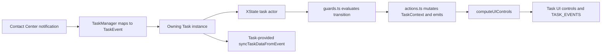
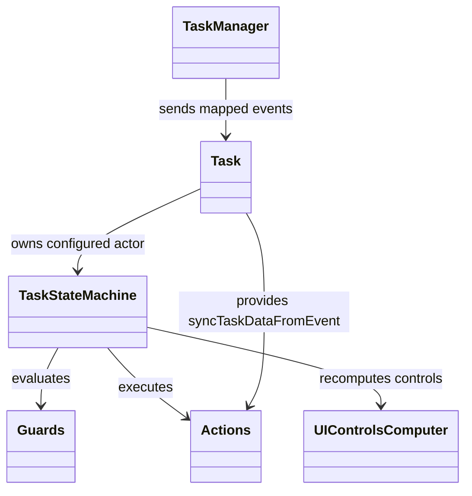

<!-- sdd-generated-metadata
doc_kind: module-spec
generated_from: module-spec@0.3.0
generated_by: claude-code
approved_by: rarajes2@cisco.com
updated_at: 2026-11-16T14:00:00Z
validation_status: not-run
-->

# Task state machine

This source-local document at `src/services/task/state-machine/docs/README.md` owns the stable
specification for **the task state machine**: the XState graph, typed `TaskEvent` contracts, pure
guards, context actions, and the UI-control computer that every contact-center `Task` runs. Ground
every claim in package evidence and link to the
[package architecture](../../../../../docs/architecture.md) and the parent
[task module specification](../../docs/README.md) instead of repeating broader facts. No service
specification exists because this package is a library.

Related context: [documentation index](../../../../../docs/index.md) ·
[package agent instructions](../../../../../AGENTS.md)

## Metadata

| Field | Value |
| ----- | ----- |
| Owner | `@webex/web-sdk` |
| Source path | `src/services/task/state-machine` |
| Resource kind | module |
| Status | Active |
| Last verified | 2026-11-16 at `0b8c34db7f` |
| Module id | `task-state-machine` |
| Parent spec | [`src/services/task/docs/README.md`](../../docs/README.md) |
| Doc kind | Module spec |
| Coverage score | Pending coverage assessment |
| Validation status | not-run — independent validation pending in another runtime |

## Applicability

| Condition ID                         | Status     | Evidence or reason | Owned section |
| ------------------------------------ | ---------- | ------------------ | ------------- |
| `module.has_tiers`                   | N/A        | No tier policy exists in `package.json` or in the module | Tier |
| `module.has_ui`                      | N/A        | `src/services/task/state-machine/uiControlsComputer.ts` returns visibility and enablement data; the module renders nothing | UI use-case flow |
| `module.crosses_service_boundaries`  | N/A        | No transport imports in `src/services/task/state-machine/TaskStateMachine.ts` or `src/services/task/state-machine/actions.ts`; Task and TaskManager own every network call | Cross-boundary use-case flow |
| `module.holds_client_state`          | Applicable | `src/services/task/state-machine/types.ts` declares TaskContext, held by each task actor | Client state model |
| `module.enforces_domain_rules`       | Applicable | `src/services/task/state-machine/guards.ts` gates every lifecycle transition | Business rules and invariants |
| `module.is_concurrent_async`         | Applicable | `src/services/task/state-machine/TaskStateMachine.ts` is an event-driven actor fed by asynchronous backend notifications | Concurrency and reactive flow |
| `module.owns_persistence`            | N/A        | `src/services/task/state-machine/actions.ts` writes only actor context; nothing is stored | Data, schema, and migration discipline |
| `module.stateful_transitions`        | Applicable | `src/services/task/state-machine/TaskStateMachine.ts` defines 13 implemented states and guarded transitions | State machine |
| `module.exposes_wire_protocol`       | N/A        | `src/services/task/TaskManager.ts` maps wire messages before they reach the machine | Protocol and wire format |
| `module.ui_multi_screen`             | N/A        | No UI | UI flow |
| `module.large_data_model`            | N/A        | `src/services/task/state-machine/types.ts` holds one context type and one event payload map; task data types belong to the task module | Data model |
| `module.returns_caller_errors`       | N/A        | `src/services/task/state-machine/TaskStateMachine.ts` never throws; unhandled events are ignored | Caller-visible failure modes |
| `module.module_specific_conventions` | Applicable | Pure guards, assign actions, and emitter placeholders in `src/services/task/state-machine/actions.ts` | Module-specific rules |
| `module.published_package`           | N/A        | Internal module; only getDefaultUIControls reaches the package root through `src/index.ts`, owned by the package spec | Export stability |
| `module.embedded_in_host`            | N/A        | No host mount or theme contract | Host integration and theming |
| `module.has_design_tradeoff`         | Applicable | Typed TaskEvent vocabulary in `src/services/task/state-machine/constants.ts` isolates the graph from transport events | Key design trade-off |
| `module.has_submodules`              | N/A        | No child module under `src/services/task/state-machine/index.ts` (module_tree.py) | Sub-modules |

## Evidence register

| Evidence | What it establishes |
| -------- | ------------------- |
| `src/services/task/state-machine/TaskStateMachine.ts` | `getTaskStateMachineConfig(uiControlConfig)`: root-level handlers, the 13 implemented states, guarded transition arrays, shared transition helpers, entry actions, and the two final states; `createTaskStateMachine(uiControlConfig, options)` merges default actions with caller overrides through `.provide` |
| `src/services/task/state-machine/constants.ts` | `TaskState` (including five declared but unimplemented states), `TaskEvent`, `INTERACTION_STATE`, `CONSULT_STATE`, `PARTICIPANT_TYPE`, `MEDIA_TYPE_CONSULT`, `MAX_PARTICIPANTS_IN_MULTIPARTY_CONFERENCE` |
| `src/services/task/state-machine/types.ts` | `UIControlConfig`, `TaskContext`, the private `TaskEventPayloadMap`, `TaskEventPayload`, `isEventOfType`, `TaskActionsMap`, `TaskActionArgs` |
| `src/services/task/state-machine/guards.ts` | The `guards` object, the helpers `getTaskDataFromEvent`, `getSelfAgentId`, `isSelfConsultingAgent`, `hasActiveConsultInPostCall`, `shouldWrapUpForThisAgent`, and the JSDoc rationale for each guard |
| `src/services/task/state-machine/actions.ts` | The default `actions` map (`assign` mutators and no-op emitter placeholders), `createInitialContext`, `deriveTaskDataUpdates`, `getTaskStateForUiControls`, `updateUIControls`. Wiring: `handleConferenceFailed`, `handleSwitchToMainCall`, and `handleSwitchToConsult` are defined in `actions.ts` and wired by `TaskStateMachine.ts`. `forceConsultInitiator` is defined in `actions.ts` but is not wired in the current graph; neither are `setConsultCallHeld`, `clearConsultCallHeld`, `setExitingConference`, `emitTaskConsultCreated`, or `emitTaskExitConference` |
| `src/services/task/state-machine/uiControlsComputer.ts` | `getDefaultUIControls`, `computeUIControls`, `haveUIControlsChanged`, and the private voice, digital, destination, and leg helpers |
| `src/services/task/state-machine/index.ts` | The module's export list consumed by the task layer |
| `src/index.ts` | Re-exports `getDefaultUIControls` directly from `uiControlsComputer.ts` |
| `src/services/task/Task.ts` | Actor bootstrap (`initializeStateMachine`), `sendStateMachineEvent`, `updateUiControls`, and the action overrides including `syncTaskDataFromEvent`, emitters, `requestAutoAnswer`, `requestCleanup`, `cleanupResources` |
| `src/services/task/voice/Voice.ts` | API-driven events (`HOLD_INITIATED`, `HOLD_SUCCESS`, `HOLD_FAILED`, `CONSULT`, `CONSULT_SUCCESS`, `MERGE_TO_CONFERENCE`, `CONFERENCE_FAILED`, `EXIT_CONFERENCE_SUCCESS`, `TRANSFER_CONFERENCE`, `TRANSFER_CONFERENCE_FAILED`, `SWITCH_TO_MAIN_CALL`, `SWITCH_TO_CONSULT`) and voice emitter overrides |
| `src/services/task/TaskManager.ts` | `mapEventToTaskStateMachineEvent` (CC event to `TaskEvent`), owner-change recovery that sends an internal `HYDRATE` before listeners are installed, and `preserveConfirmedOwner` |
| `test/unit/spec/services/task/state-machine/TaskStateMachine.ts` | 98 jest cases over transitions, wrap-up, consult, conference, hydrate, and outbound-failure paths |
| `test/unit/spec/services/task/state-machine/guards.ts` | 35 jest cases over hydrate, conference, consult, wrap-up, departure, conference-transfer, and server-state guards |
| `test/unit/spec/services/task/state-machine/uiControlsComputer.ts` | 80 jest cases over per-leg controls, destinations, conference, post-call, outdial, WebRTC, and wxApp controls |
| `test/unit/spec/services/task/state-machine/types.ts` | 2 jest cases over `isEventOfType` |
| `test/unit/spec/services/task/Task.ts`, `test/unit/spec/services/task/TaskManager.ts` | Task-side `syncTaskDataFromEvent`, owner-change hydrate, and roster synchronization behavior |
| `src/services/task/state-machine/TaskStateMachine.ts` (extension subsections) | Justifies the `###` subsections under Design overview, Data flow and sequence coverage, and State machine: one per runtime concern, operation group, shared transition group, state, and event group in the graph |

## Purpose and boundary

- Responsibility: Own deterministic task lifecycle states, transition guards/actions, typed internal events, and state-derived UI-control availability.
- In scope: internal state management for the task lifecycle: states and transitions, context mutation, guard logic, UI-control computation, and the typed event and payload contracts (one file each, listed in Structure and key files).
- Out of scope (non-goals): API contracts for external services, and Mercury or CC WebSocket protocols (see `TaskManager.ts` mapping). Logging, metrics, authentication, AQM requests, and SDK event emission belong to Task, Voice, and TaskManager.
- Consumers: `Task` (`src/services/task/Task.ts`) builds one actor per task; `Voice`, `TaskManager`, and the wxApp voice helpers import `TaskState`, `TaskEvent`, and the payload types; applications read the computed controls through `task.uiControls` and the package-root `getDefaultUIControls`.

Use this doc when implementing:

- new state transitions
- event mapping and payload extensions
- guard/action fixes
- UI control behavior changes tied to task state

## Structure and key files

```text
src/services/task/state-machine/
├── TaskStateMachine.ts
├── actions.ts
├── guards.ts
├── uiControlsComputer.ts
├── constants.ts
├── types.ts
├── index.ts
└── docs/
    └── README.md
```

| Path | Responsibility |
| ---- | -------------- |
| `src/services/task/state-machine/TaskStateMachine.ts` | **State Graph and Transition Rules**: `TaskStateMachine.ts` defines all states, transition tables, and event handlers that drive the task lifecycle. |
| `src/services/task/state-machine/actions.ts` | **Deterministic Context Updates**: `actions.ts` implements XState actions for task context mutation and provides emitter placeholders that `Task` overrides to surface SDK events. |
| `src/services/task/state-machine/guards.ts` | **Transition Eligibility**: `guards.ts` contains pure predicates that gate transitions based on current context, task data, and backend state. |
| `src/services/task/state-machine/uiControlsComputer.ts` | **UI Controls Computation**: `uiControlsComputer.ts` derives per-leg action controls and ordered Consult/Transfer destination categories from state, Task data, and injected profile policy for voice/digital channels. Consumers read `task.uiControls`; do not add a parallel policy method or UI-side decision tree. |
| `src/services/task/state-machine/constants.ts`, `src/services/task/state-machine/types.ts` | **Typed Event Contracts**: `constants.ts` and `types.ts` define `TaskState`, `TaskEvent`, and the `TaskEventPayloadMap` so transitions and payloads stay type-safe. |
| `src/services/task/state-machine/index.ts` | **Public Exports**: `index.ts` exposes the state machine factory, event enums, and types for consumption by the task layer. |
| `src/services/task/Task.ts` | Actor lifecycle, action overrides, event emission (parent module) |
| `src/services/task/TaskManager.ts` | Maps backend events to state-machine events (parent module) |
| `src/services/task/types.ts` | Shared task data structures: `TaskData`, `TaskUIControls`, `InteractionUIControls`, destination types (parent module) |
| `src/services/task/state-machine/docs/README.md` | This module specification |
| `test/unit/spec/services/task/state-machine/TaskStateMachine.ts` | Transition and action tests |
| `test/unit/spec/services/task/state-machine/guards.ts` | Guard tests |
| `test/unit/spec/services/task/state-machine/uiControlsComputer.ts` | UI-control tests |
| `test/unit/spec/services/task/state-machine/types.ts` | Event type-guard tests |

## Public surface

The module is internal to the package (contract `contact-center-task-state-machine`). Only
`getDefaultUIControls` reaches applications, through the package root (contract `contact-center-sdk`).

| Surface  | Consumer   | Compatibility commitment | Source   |
| -------- | ---------- | ------------------------ | -------- |
| `createTaskStateMachine`, type `TaskStateMachine` (`contact-center-task-state-machine`) | `Task` (module-internal Task integration) | Internal; takes `uiControlConfig` and optional `options.actions` (a partial `TaskActionsMap`); may change with its callers in the same change | `src/services/task/state-machine/index.ts` |
| `TaskState`, `TaskEvent`, `isEventOfType`, types `TaskContext`, `TaskEventPayload`, `TaskStateMachineConfig`, `UIControlConfig`, `TaskActionsMap`, `TaskActionArgs` (`contact-center-task-state-machine`) | Task, Voice, TaskManager, wxApp voice helpers | Internal; every event keeps a typed payload entry | `src/services/task/state-machine/types.ts` |
| `guards`, types `GuardParams`, `GuardFunction`; `actions`, `createInitialContext` (`contact-center-task-state-machine`) | Internal state-graph implementations and unit tests | Internal | `src/services/task/state-machine/guards.ts` |
| `getDefaultUIControls` (`contact-center-sdk`) | Applications | Published: returns `{main, consult, activeLeg: 'main', consultTransferDestinations: {consult: [], transfer: []}}` with every control hidden and disabled; exported from `uiControlsComputer.ts` and re-exported directly by package root; not exported by `state-machine/index.ts` | `src/index.ts` |
| `computeUIControls`, `haveUIControlsChanged` (`contact-center-task-state-machine`) | Task, actions | Internal | `src/services/task/state-machine/uiControlsComputer.ts` |
| `computeVoiceInteractionUIControls` / `computeDigitalInteractionUIControls` | none outside the file | private helpers; not public APIs | `src/services/task/state-machine/uiControlsComputer.ts` |

## Dependencies

| Dependency            | Why it is required | Failure behavior                    |
| --------------------- | ------------------ | ----------------------------------- |
| XState (`xstate` 5.24.0, contract `xstate-runtime`) | `setup`, `createMachine`, `.provide`, and `assign` build the actor graph | Build-time dependency; no runtime fallback |
| TaskData and task-event contracts (`src/services/task/types.ts`) | `TaskData`, `TaskUIControls`, `InteractionUIControls`, `DestinationType`, channel and voice-variant enums shape context and controls | Type-level; payload fields read defensively with optional chaining |
| Task and TaskManager event/action integration (`src/services/task/Task.ts`, `src/services/task/TaskManager.ts`) | Task owns the actor and supplies action overrides; TaskManager and Voice send mapped `TaskEvent` values | Without overrides, emitters, `requestAutoAnswer`, `requestCleanup`, and `cleanupResources` are no-ops and `syncTaskDataFromEvent` is unimplemented |
| Task utilities (`src/services/task/TaskUtils.ts`, `src/services/task/WebexCallingUtils.ts`) | Customer-in-call, conference participant counts, conference-in-progress, EP-DN pending-merge, campaign-preview, server hold, and wxApp device checks | Pure helpers; return false on missing data |
| Config constants (`src/services/config/constants.ts`, `src/services/config/types.ts`, `src/constants.ts`) | `COLLABORATION_ACCESS.NONE`, `CC_EVENTS` consult terminal events, inbound and outdial direction constants | Static constants |

## Requirements

| ID | WHAT | WHY | Source Evidence | Test / Example Evidence | Assumptions / Gaps | Confidence |
|---|---|---|---|---|---|---|
| TASK_STATE_MACHINE-R-001 | Map typed Task events through the XState graph and preserve guards/actions for offer, assignment, consult, conference, transfer, wrapup, termination, and hydration. | A deterministic event vocabulary isolates lifecycle policy from transport payloads. | `src/services/task/state-machine/TaskStateMachine.ts` | `test/unit/spec/services/task/state-machine/TaskStateMachine.ts` | None. | PRESENT |
| TASK_STATE_MACHINE-R-003 | Treat `syncTaskDataFromEvent` as a Task-supplied machine implementation, not a default action in `actions.ts`. | The reusable graph declares the action name while Task owns integration-specific data synchronization. | `src/services/task/Task.ts` | `test/unit/spec/services/task/Task.ts` | None. | PRESENT |
| TASK_STATE_MACHINE-R-004 | Compute per-leg action controls and ordered `consultTransferDestinations.consult`/`.transfer` arrays through `uiControlsComputer`, preserving the public `getDefaultUIControls` shape with empty destination arrays. Voice queue rules use Consult profile enablement or Transfer direction plus `callProcessingDetails.outdialTransferToQueueEnabled`; digital supports agent/queue only; profile `NONE` removes the matching category. | Applications depend on one deterministic Task control surface, the default order (`agent`, `queue`, `dialNumber`, `entryPoint`), and correct action/media/profile gating. | `src/services/task/state-machine/uiControlsComputer.ts` | `test/unit/spec/services/task/state-machine/uiControlsComputer.ts` | Consumers may further hide allowed categories but must not infer or enable omitted categories. | PRESENT |
| TASK_STATE_MACHINE-R-005 | Keep authentication and credentials outside the state-machine layer; it receives typed Task data/events and never invokes authenticated transport. | Pure transition logic remains reusable and cannot leak or mutate host authentication state. | `src/services/task/state-machine/TaskStateMachine.ts`, `src/services/task/state-machine/types.ts` | `test/unit/spec/services/task/state-machine/TaskStateMachine.ts` | None; security/auth applicability is explicitly N/A. | PRESENT |
| TASK_STATE_MACHINE-R-006 | Treat `UIControlConfig` values as Task-supplied capability configuration, not rollout flags evaluated or owned by the state machine. | Rollout and profile policy must be resolved before actor construction so transitions remain deterministic. | `src/services/task/state-machine/types.ts`, `src/services/task/Task.ts` | `test/unit/spec/services/task/Task.ts` | None; rollout ownership is explicit. | PRESENT |
| TASK_STATE_MACHINE-R-007 | Keep logging and metrics in Task/TaskManager integration; the state-machine implementation has no LoggerProxy or MetricsManager dependency. | Separating observability side effects from guards/actions preserves deterministic transition tests. | `src/services/task/state-machine/TaskStateMachine.ts`, `src/services/task/Task.ts` | `test/unit/spec/services/task/state-machine/TaskStateMachine.ts`, `test/unit/spec/services/task/Task.ts` | None; observability ownership is explicit. | PRESENT |
| TASK_STATE_MACHINE-R-008 | `CONTACT_OWNER_CHANGED` must synchronize task/context data and emit `task:hydrate` without transitioning state. Participant Drop must rely on the existing `ParticipantLeftConference` mapping rather than adding an initiating state event. `PARTICIPANT_LEAVE` and `CONSULT_END` end the task for the current Agent only when `guards.didCurrentAgentLeaveMainInteraction` passes; `CONSULT_END` does not use mainCall membership as self-departure evidence. Removed accepted Agents emit `task:consultEnd` plus `task:end`, surviving initiators recover to their main call, and an unaccepted OFFERED consultee emits only `task:consultEnd`. Starting Consult must preserve the prior task snapshot used by the guard. TaskManager's owner-change mapping and recovery are TASK-R-010 in the [task module specification](../../docs/README.md). | Owner-sensitive consumers must rerender promptly while participant removal and consult removal remain backend-authoritative and compatible with existing incoming-task callback behavior. | `src/services/task/state-machine/TaskStateMachine.ts`, `src/services/task/state-machine/actions.ts`, `src/services/task/state-machine/guards.ts` | `test/unit/spec/services/task/state-machine/TaskStateMachine.ts`, `test/unit/spec/services/task/state-machine/guards.ts`, `test/unit/spec/services/task/Task.ts` | Backend delivery of complete departure payloads is outside this module. | PRESENT |
| TASK_STATE_MACHINE-R-009 | Every implemented state except the final ones handles `OUTBOUND_FAILED`: `IDLE` terminates (race before `TASK_INCOMING`), and every other active state enters `WRAPPING_UP` when `guards.shouldWrapUp` passes, otherwise `TERMINATED`, always emitting `emitTaskOutdialFailed`. | An outdial failure can arrive in any phase of the call, including before the task is offered, and must never leave a task stuck in an active state. | `src/services/task/state-machine/TaskStateMachine.ts` | `test/unit/spec/services/task/state-machine/TaskStateMachine.ts` | None. | PRESENT |
| TASK_STATE_MACHINE-R-010 | `COMPLETED` and `TERMINATED` are final states; `COMPLETED` entry runs `emitTaskWrappedup` before `cleanupResources`, `TERMINATED` entry runs `cleanupResources`, and `computeUIControls` returns `getDefaultUIControls()` for both. | Subscribers must receive intact task data before cleanup removes the task from the collection, and no control may stay enabled on a finished task. | `src/services/task/state-machine/TaskStateMachine.ts`, `src/services/task/state-machine/uiControlsComputer.ts` | `test/unit/spec/services/task/state-machine/TaskStateMachine.ts` | None. | PRESENT |

## Design overview

Stack: TypeScript 5.4, XState 5 actors, pure guards, assign actions, Jest 27. The state pattern (via XState) is used to manage complex task lifecycle with clear states, transitions, guards, and actions.

It is instantiated by `Task` and receives mapped backend/user events through `sendStateMachineEvent(...)`.

TaskManager maps Contact Center notifications to `TaskEvent` values. Each Task sends those events to its XState actor built by `createTaskStateMachine()`. The configuration applies guards and named actions, updates `TaskContext`, and computes UI controls.

### Runtime integration

`Task` owns one actor per task; `Task.initializeStateMachine`, the snapshot subscription, and UI-control emission are specified in the [task module specification](../../docs/README.md).

`createTaskStateMachine(uiControlConfig, options?)` builds the graph from `getTaskStateMachineConfig(uiControlConfig)` with `setup` and calls `.provide({actions: {...actions, ...options?.actions}})`, so a caller override replaces the default action of the same name. The config has `id: 'taskStateMachine'`, `initial: TaskState.IDLE`, and `context: createInitialContext(uiControlConfig, TaskState.IDLE)`. `setup` from `xstate` types the context as `TaskContext` and events as `TaskEventPayload`, and the default `actions` and `guards` come from `./actions` and `./guards`. `getTaskStateMachineConfig(uiControlConfig)` returns root-level `on` handlers and a `states` map in which each `[TaskState.X]` node maps `[TaskEvent.Y]` to one transition object or a guarded array of `{guard, target, actions}` entries; the transitions are listed per state in State machine.

API-driven transition from `voice/Voice.ts`:

```typescript
// task.hold() / task.resume() -> holdResume()
stateMachineService.send({type: TaskEvent.HOLD_INITIATED, mediaResourceId});
// ... backend call succeeds
stateMachineService.send({type: TaskEvent.HOLD_SUCCESS, mediaResourceId});
```

Backend-driven transition from `TaskManager.ts`:

```typescript
const eventPayload = TaskManager.mapEventToTaskStateMachineEvent(
  CC_EVENTS.AGENT_CONTACT_RESERVED,
  taskData
);
if (eventPayload) {
  task.sendStateMachineEvent(eventPayload);
}
```

### Guards

Guards are boolean conditions that determine if a state transition is allowed. These functions validate the current context before allowing transitions. Each guard in the `guards` object of `src/services/task/state-machine/guards.ts` takes `{context, event}` (`GuardParams`) and reads task data through `getTaskDataFromEvent(event)`; the self agent comes from `getSelfAgentId(context, taskData)`, which prefers `context.uiControlConfig.agentId`, then `context.taskData.agentId`, then the event's `taskData.agentId`.

Principles:

- Guards must be pure and must return boolean only
- No mutation or side-effects.
- Reuse helper accessors (e.g., `getTaskDataFromEvent`).

Hydrate (state-based) guards:

- `isInteractionTerminated` checks if the interaction is in terminated state: true when `event.taskData.interaction.isTerminated === true`, or when the self participant has `isWrapUp === true`.
- `isEpDnPendingConferenceMergeHydrate` is true when `isEpDnConsultPendingConferenceMerge(taskData, selfAgentId)` reports an EP-DN consult merged to conference before the destination joined the main call.
- `isInteractionConsulting` checks if the interaction is consulting: true when `event.taskData.interaction.state === 'consulting'`; when the self participant's `consultState` is `consulting` (or `consultInitiated` with `isConsulted === false`) and a consult media leg exists; when `callProcessingDetails.relationshipType === 'consult'` while the interaction state is `connected` (EP-DN consulted agent); or when the interaction is `post_call` but the self agent is still consulting on consult media (`hasActiveConsultInPostCall`).
- `isInteractionHeld` checks if the interaction is held: true when `event.taskData.interaction.state === 'hold'` or the main media leg (`mainInteractionId` or `interactionId`) has `isHold === true`.
- `isInteractionConnected` checks if the interaction is connected: true when `event.taskData.interaction.state === 'connected'`.
- `isConferencingByParticipants` checks if conference is in progress by participants: it counts participants of the main call media whose `pType` is not `Customer` or `Supervisor` and who have not left, and returns true when `agentCount >= 2`.

Conference guards:

- `conferenceInProgressFromEvent` checks if conference is in progress from event taskData: false without `taskData.interaction`, otherwise `getIsConferenceInProgress(taskData)`.
- `isConferenceHoldParticipantFromEvent` reads `callProcessingDetails.conferenceHoldParticipant` from event or context task data and accepts boolean `true` or string `'true'`.
- `shouldDowngradeConferenceToConnected` checks if conference should downgrade to connected: using event or context task data, it returns false without a self agent or main call id, and does not downgrade while backend still reports active conference state (`interaction.state === 'conference'`); it then requires `getConferenceParticipantsCount` below 2, `getIsCustomerInCall` true, and the self agent in the main call media participants.

Consult guards:

- `didInitiateConsult` checks if current agent initiated consult: false when `event.taskData.isConsulted === true`; with `consultingAgentId` it returns `isSelfConsultingAgent(context, event.taskData)`, otherwise `context.consultInitiator === true`. It is defined but not referenced by the graph.
- `isConsultingAssignment` is true when an `ASSIGN` payload has `isConsulted === true`, `callProcessingDetails.relationshipType === 'consult'`, or interaction state `consulting`; EP-DN and consulted legs can arrive as `AGENT_CONTACT_ASSIGNED` without a preceding AgentConsulting event.
- `isCampaignReservationAccept` is true for a `TASK_INCOMING` event with `isCampaignReservationAccept === true`.

Wrapup guards:

- `shouldWrapUp` checks if this agent should move to wrapup: false without task data; for `CONFERENCE_END` it requires a self agent, then returns `agentsPendingWrapUp.includes(selfAgentId)` when that array is non-empty, otherwise `wrapUpRequired === true` or the self participant's `isWrapUp === true`; for every other event it returns `shouldWrapUpForThisAgent(context, taskData)`.
- `shouldWrapUpForThisAgent` (helper) applies the priority `agentsPendingWrapUp` > `wrapUpRequired` / participant `isWrapUp` > interaction `owner === selfAgentId` > `isConsulted === false`.
- `shouldWrapUpOrIsInitiator` checks if wrapup is required OR current agent is consult initiator: `Boolean(event.taskData?.wrapUpRequired || context.consultInitiator)`.
- `isCampaignPreviewContactEnded` is true for a `CONTACT_ENDED` on a campaign preview task when no explicit wrap-up signal exists (`wrapUpRequired`, self `isWrapUp`, self in `agentsPendingWrapUp`, or interaction state `wrapUp`).
- `didCurrentAgentLeaveMainInteraction` checks whether the current agent left the main interaction: it returns true when the event's `participantId` (or `taskData.participantId`) equals the self agent, or when the updated participants map omits the self agent. Self missing from the updated participants map is terminal (EP-DN removal). Remaining in the map with hasLeft, or disappearing only from mainCall media, is not.
- `isSelfConferenceTransferInitiator`: True when this agent initiated the conference transfer (widgets or desktop). Mirrors determineConsultInitiator — consultingAgentId === self only (not consultState). It returns true when `context.transferConferenceRequested === true`, otherwise `taskData.consultingAgentId === selfAgentId`.
- `isPassiveConferenceTransferObserver`: Passive observer: another agent transferred; refresh data only. It is false when `isSelfConferenceTransferInitiator` passes, or when the participants map omits the self agent or marks it `hasLeft`; otherwise true.

Server state guards:

- `isPrimaryMediaOnHold` checks if primary media leg is on hold: false without task data or `taskData.mediaResourceId`, otherwise `taskData.interaction.media[taskData.mediaResourceId].isHold === true`.

### Actions

Actions are side effects executed during state machine transitions from current state to target state(next state).
Actions contain:

- Context synchronization (`initializeTask`, `updateTaskData`, `syncTaskDataFromEvent`)
- Lifecycle mutations (`clearConsultState`, `markEnded`, consult/conference flags)
- Integration hooks (`requestAutoAnswer`, `requestCleanup`, emitter placeholders)

Principles:

- Context mutations should be centralized in `assign(...)` actions
- Emitter actions intentionally no-op defaults and overridden by `Task` to bridge machine transitions to SDK events.
- Deterministic updates from `taskData`.

Context update actions in `src/services/task/state-machine/actions.ts`:

- `initializeTask` initializes context for an incoming task: it resets `consultInitiator: false`, `exitingConference: false`, `consultDestinationType: null`, `consultDestinationAgentJoined: false`, then spreads `deriveTaskDataUpdates(context, event.taskData)`.
- `updateTaskData` updates taskData plus derived recording/consult fields through `deriveTaskDataUpdates(context, event.taskData)`, which stores the task data (copying `agentId` to `consultingAgentId` for `AgentConsultCreated`), derives recording flags from `callProcessingDetails`, derives `consultInitiator`, `consultFromConference`, `consultDestinationAgentJoined`, `consultDestinationType`, `consultDestinationAgentId`, `consultCallHeld`, and `hideBlindTransferForEpDnPendingMerge`, clears consult context on `AgentConsultEnded` and `AgentConsultFailed` payloads, and recomputes `uiControls` for the state inferred by `getTaskStateForUiControls`. An event without task data leaves context unchanged.
- `syncTaskDataFromEvent` keeps Task instance data in sync: it is not in the default map; the Task override in `src/services/task/Task.ts` calls `this.updateTaskFromEvent(event)`.
- `setHoldState` updates the hold flag on a specific media leg in `context.taskData.interaction.media`: it handles `HOLD_SUCCESS` and `UNHOLD_SUCCESS` for `event.mediaResourceId`, ignores events without a known media entry, and sets `consultCallHeld` when the leg is the consult media and this agent is the consult initiator.
- `setConsultInitiator` returns `consultInitiator: true` for `CONSULT`; for backend events it uses `consultingAgentId` versus the payload `agentId`, or `isConsulted === true` (not initiator), and otherwise leaves the flag.
- `setConsultDestination` runs only for `CONSULT`: it sets `consultDestinationType`, `consultDestinationAgentId` (from `destAgentId` or `destination`), resets `consultDestinationAgentJoined` and `consultFromConference`, and preserves the current interaction snapshot while recording `destAgentId`.
- `setConsultAgentJoined` sets `consultDestinationAgentJoined` on `CONSULTING_ACTIVE` when the event carries `consultDestinationAgentJoined: true` and the flag is not already set.
- Conference/consult lifecycle mutators: `handleConferenceStarted` returns `{consultInitiator: false}`; `handleConsultFailed` clears the same consult fields as `clearConsultState` and recomputes controls from event or context task data; `handleParticipantLeft`, `handleTransferConferenceSuccess`, and `handleConferenceFailed` store `event.taskData` when present, otherwise change nothing.
- Consult destination and mode flags: `setConsultFromConference` returns `{consultFromConference: true}`; `setExitingConference` returns `{exitingConference: true}`.
- Conference transfer flags: `setTransferConferenceRequested` returns `{transferConferenceRequested: true}`; `clearTransferConferenceRequested` returns `{transferConferenceRequested: false}`.
- Consult call hold flags: `setConsultCallHeld` / `handleSwitchToMainCall` set `consultCallHeld: true`; `clearConsultCallHeld` / `handleSwitchToConsult` set `consultCallHeld: false`.
- `setRecordingState` is the recording state mutator for pause/resume events: `PAUSE_RECORDING` sets `recordingControlsAvailable: true` and `recordingInProgress: false`; `RESUME_RECORDING` sets both true.
- `clearConsultState` resets consult/conference-related context: `consultDestinationType: null`, `consultDestinationAgentId: null`, `consultDestinationAgentJoined: false`, `consultInitiator: false`, `exitingConference: false`, `consultCallHeld: false`, `consultFromConference: false`, `transferConferenceRequested: false`, recomputes `hideBlindTransferForEpDnPendingMerge`, and recomputes `uiControls`.
- `markEnded` is the end-of-task cleanup for recording flags: `{recordingControlsAvailable: false, recordingInProgress: false}`.

Event emission actions: every `emitTask*` entry in the default map (incoming, campaign preview reservation and failures, hydrate, offer contact, assigned, hold, resume, end, offer consult, consult created, consulting, consult accepted, consult end, reject, wrapup, recording started/paused/resumed, wrapped up, participant left, conference started/ended/failed, exit conference, transfer conference and its failure, switch call, outdial failed) is a no-op placeholder. `Task.getStateMachineActionOverrides()` and the Voice overrides replace them: for example `emitTaskIncoming` emits `TASK_EVENTS.TASK_INCOMING`, `emitTaskAssigned` emits `TASK_EVENTS.TASK_ASSIGNED` plus `TASK_EVENTS.TASK_MULTI_LOGIN_HYDRATE`, `emitTaskHold` (Voice) emits `TASK_EVENTS.TASK_HOLD`, and `emitTaskWrapup` updates task data and emits `TASK_EVENTS.TASK_WRAPUP` only when `this.data.wrapUpRequired` is true.

Cleanup actions: `requestCleanup` and `cleanupResources` are no-op placeholders in `actions.ts` and are overridden in `Task.ts`. The `requestCleanup` override emits `TASK_EVENTS.TASK_CLEANUP` with `{removeFromCollection: false}` (keep the task object); `cleanupResources` emits it with `{removeFromCollection: true}`.

Auto-answer actions: `requestAutoAnswer` is a placeholder in `actions.ts` and is overridden in `Task.ts`, where it calls `autoAnswerIfNeeded()`. That method auto-accepts only for digital or WebRTC voice tasks whose `data.isAutoAnswering` is true.

### UI control computation

`uiControlsComputer.ts` computes `TaskUIControls` from:

- current machine state
- current context
- channel type (voice vs digital)
- call/participant metadata from `taskData`
- config flags (`isEndTaskEnabled`, recording toggles, voice variant)

This keeps all control enablement/visibility logic centralized and testable.

Transition source for controls: `computeUIControls()` in `uiControlsComputer.ts`. Inputs and output of `computeUIControls(currentState, context, fallbackTaskData?)`:

- `TaskState`
- `TaskContext` (including `taskData`)
- `UIControlConfig` (channel type, agentId, voice variant, recording flags)
- `TaskUIControls` with per-control visibility and enabled state.

The result has `main` and `consult` `InteractionUIControls` (`accept`, `decline`, `hold`, `mute`, `end`, `transfer`, `consult`, `consultTransfer`, `endConsult`, `recording`, `conference`, `wrapup`, `exitConference`, `transferConference`, `mergeToConference`, `switch`, `keypad`, each `{isVisible, isEnabled}`), an `activeLeg` of `main` or `consult`, and `consultTransferDestinations` with ordered `consult` and `transfer` arrays. Rules:

- `TERMINATED` and `COMPLETED` return `getDefaultUIControls()`; `IDLE` returns default per-leg controls; an unknown channel type returns `getDefaultUIControls()`.
- Voice: `getVoiceLegState` decides whether a consult leg exists, which leg is active (`main` when `consultCallHeld`, else `consult`), and the state each leg is computed for; the consult leg gets real controls only when it exists. Live task data passed as the fallback is preferred over the actor snapshot during multi-login sync. `end` is hidden when `isEndTaskEnabled` is false on non-WebRTC voice; `recording` needs `recordingControlsAvailable` and `isRecordingEnabled`; `consultTransfer` is always disabled; wxApp-engaged tasks get `mute` and `keypad` on the main leg only.
- Digital: `accept` in `OFFERED`; `end` and `transfer` in `CONNECTED`; `wrapup` when wrapping up or the interaction is terminated; every other control disabled, and the consult leg always default.
- Destinations: without `consultTransferConfig` both arrays are empty. Otherwise the order is `agent` (unless `accessBuddyTeam` is `NONE`), `queue` (unless `accessQueue` is `NONE`; on voice, consult needs `allowConsultToQueue` and transfer needs an inbound direction or an outdial with `callProcessingDetails.outdialTransferToQueueEnabled === true`), then on voice only `dialNumber` and `entryPoint` (unless `accessEntryPoint` is `NONE`).

### Change recipes

Adding a new event:

1. Add event in `TaskEvent` (`constants.ts`)
2. Add typed payload in `TaskEventPayloadMap` (`types.ts`)
3. Wire transitions in `TaskStateMachine.ts`
4. Add/adjust actions in `actions.ts`
5. Add guard(s) in `guards.ts` if needed
6. Update `TaskManager` event mapping and unit tests

Adding a new guard:

1. Implement pure guard in `guards.ts`
2. Use guard in `TaskStateMachine.ts` transition array
3. Keep side-effects in actions only (no side-effects in guards)
4. Add tests for positive and negative transition paths

Changing UI controls:

1. Update control logic in `computeVoiceInteractionUIControls()` or `computeDigitalInteractionUIControls()`
2. Preserve `getDefaultUIControls()` shape compatibility
3. Verify behavior across `CONNECTED`, `HELD`, `CONSULTING`, `CONFERENCING`, `WRAPPING_UP`
4. Add or update UI-control unit coverage

## Data flow and sequence coverage

Call style: in-process, synchronous XState `send` calls on one actor per task. Backend CC events from WebSocket are mapped to `TaskEvent` in `TaskManager.mapEventToTaskStateMachineEvent`. The state machine consumes only `TaskEvent` and never raw CC events. Task APIs in `Voice` send the initiating, success, and failure events of their own HTTP requests.



Sequence coverage:

| Operation group | Entry and outcome | Diagram or evidence | Failure and recovery coverage |
| --------------- | ----------------- | ------------------- | ----------------------------- |
| Offer and assignment | `TASK_INCOMING` enters OFFERED; `TASK_OFFERED` updates that state and `ASSIGN` selects CONNECTED or CONSULTING. | Offer and assignment | RONA/invite/assign failures terminate the offered task; outbound failure may wrap up instead. |
| Hold/resume | `HOLD_INITIATED`/`UNHOLD_INITIATED` enter intermediate states; success/failure selects HELD or CONNECTED. | Hold and resume | Failure transitions update task data and restore the stable state; Voice owns the thrown error and failure metric. |
| Consult | `CONSULT` enters `CONSULT_INITIATING`; local and backend success/failure/end events select CONSULTING, HELD, CONNECTED, CONFERENCING, WRAPPING_UP, or TERMINATED. | Consult | Consult failure/end actions update and clear consult context according to guards. |
| Conference/transfer | `MERGE_TO_CONFERENCE` and `CONFERENCE_START` use `CONF_INITIATING`/`CONFERENCING`; conference transfer uses the `TRANSFER_CONFERENCE*` events and blind or consult transfer uses `TRANSFER_SUCCESS`/`TRANSFER_FAILED`. | Conference and transfer | `handleConferenceFailed` returns to CONSULTING; transfer and conference-transfer failures keep the current state and clear the request flag. |
| Wrapup/termination | End/wrapup events select `WRAPPING_UP` or `TERMINATED`; `WRAPUP_COMPLETE` moves `WRAPPING_UP` to `COMPLETED`. | Wrapup and termination | Terminal states are final and cannot accept normal interaction transitions. |
| Hydrate/recovery | IDLE `HYDRATE` guards restore WRAPPING_UP, CONFERENCING, CONSULTING, HELD, or CONNECTED; otherwise remain IDLE. | Hydrate and recovery | Root-level HYDRATE on an active task updates data without incorrectly re-entering a child state. |
| Backend event mapping | TaskManager converts each CC event to one `TaskEvent` payload (or `null`) before it reaches the actor. | Backend CC event mapping (table) | Unmapped CC events return `null` and never reach the actor; `CONTACT_ENDED` remaps to `OUTBOUND_FAILED` for agent-terminated wxApp outdials. |

### Offer and assignment

```mermaid
sequenceDiagram
  participant TM as TaskManager
  participant Task
  participant Actor as XState actor
  participant Guard as guards.ts
  participant Action as actions.ts / Task override
  TM->>Task: AgentContactReserved mapping
  Task->>Actor: send(TASK_INCOMING)
  Actor->>Action: initializeTask + emit incoming/reservation
  Actor-->>Task: OFFERED
  alt offer update then assignment
    Task->>Actor: TASK_OFFERED then ASSIGN
    Actor->>Action: update data + emit offer/assignment
    Actor-->>Task: CONNECTED or guarded CONSULTING
  else RONA/invite/assign failure
    Actor->>Action: failure cleanup/event
    Actor-->>Task: TERMINATED
  end
```

### Hold and resume

```mermaid
sequenceDiagram
  participant Task
  participant Actor as XState actor
  participant Action as actions.ts
  participant UI as uiControlsComputer
  Task->>Actor: HOLD_INITIATED or UNHOLD_INITIATED
  Actor-->>Task: HOLD_INITIATING or RESUME_INITIATING
  alt success event
    Task->>Actor: HOLD_SUCCESS or UNHOLD_SUCCESS
    Actor->>Action: update media hold state; emit task event
    Actor->>UI: compute controls for HELD/CONNECTED
    Actor-->>Task: HELD or CONNECTED
  else failure event
    Task->>Actor: HOLD_FAILED or UNHOLD_FAILED
    Actor->>Action: update task data
    Actor-->>Task: CONNECTED or HELD
  end
```

### Consult

```mermaid
sequenceDiagram
  participant Task
  participant Actor as XState actor
  participant Guard as guards.ts
  participant Action as actions.ts / Task override
  Task->>Actor: CONSULT
  Actor->>Action: setConsultInitiator + setConsultDestination
  Actor-->>Task: CONSULT_INITIATING
  alt local request or backend consult succeeds
    Task->>Actor: CONSULT_SUCCESS / CONSULTING_ACTIVE
    Actor->>Action: updateTaskData + consult context actions
    Actor-->>Task: CONSULTING
  else consult failed/ended/cancelled
    Task->>Actor: CONSULT_FAILED / CTQ_CANCEL / CONSULT_END
    Actor->>Guard: consultFromConference, isPrimaryMediaOnHold, departure guards
    Actor->>Action: clear/update consult context
    Actor-->>Task: CONFERENCING, HELD, CONNECTED, or termination path
  end
```

### Conference and transfer

```mermaid
sequenceDiagram
  participant Task
  participant Actor as XState actor
  participant Action as actions.ts
  Task->>Actor: MERGE_TO_CONFERENCE
  Actor-->>Task: CONF_INITIATING
  alt conference succeeds
    Task->>Actor: CONFERENCE_START
    Actor->>Action: updateTaskData + syncTaskDataFromEvent + handleConferenceStarted + clearConsultState
    Actor-->>Task: CONFERENCING
  else conference fails
    Task->>Actor: CONFERENCE_FAILED
    Actor->>Action: handleConferenceFailed + emitTaskConferenceFailed
    Actor-->>Task: CONSULTING
  end
  Task->>Actor: TRANSFER_CONFERENCE (CONSULTING or CONFERENCING)
  Actor->>Action: setTransferConferenceRequested + emitTaskTransferConference
  alt conference transfer succeeds
    Task->>Actor: TRANSFER_CONFERENCE_SUCCESS
    Actor->>Action: handleTransferConferenceSuccess + clearTransferConferenceRequested
    Actor-->>Task: CONFERENCING, WRAPPING_UP, or TERMINATED
  else conference transfer fails
    Task->>Actor: TRANSFER_CONFERENCE_FAILED
    Actor->>Action: clearTransferConferenceRequested + emitTaskTransferConferenceFailed
    Actor-->>Task: stay in current state
  end
```

### Wrapup and termination

```mermaid
sequenceDiagram
  participant TM as TaskManager
  participant Task
  participant Actor as XState actor
  TM->>Task: end/wrapup/backend terminal event
  Task->>Actor: mapped TaskEvent
  alt wrapup required
    Actor-->>Task: WRAPPING_UP
    Task->>Actor: WRAPUP_COMPLETE
    Actor-->>Task: COMPLETED
  else contact terminated/no wrapup
    Actor-->>Task: TERMINATED
  end
  Note over Actor: terminal states do not accept normal interaction transitions
```

### Hydrate and recovery

The HYDRATE event restores state machine state after page refresh or reconnection. In `IDLE` the guarded `HYDRATE` entries choose the restored state (order and guards in State machine > IDLE); in any other state the root handler only refreshes data. TaskManager's owner-change recovery that sends this internal `HYDRATE` is specified in the [task module specification](../../docs/README.md) (TASK-R-010).

```mermaid
sequenceDiagram
  participant TM as TaskManager
  participant Task
  participant Actor as XState actor
  participant Guard as guards.ts
  participant Action as actions.ts
  TM->>Task: HYDRATE(taskData)
  Task->>Actor: send(HYDRATE)
  alt actor is IDLE
    Actor->>Guard: choose backend-represented state
    Guard-->>Actor: first passing IDLE HYDRATE guard, or default IDLE
    Actor->>Action: updateTaskData + emitTaskHydrate
  else actor already active
    Actor->>Action: root-level updateTaskData + emitTaskHydrate
    Actor-->>Task: retain current child state with updated context
  end
```

### Backend CC event mapping

Complete mapping from backend CC_EVENTS to internal TaskEvent types, as implemented by `TaskManager.mapEventToTaskStateMachineEvent` in `src/services/task/TaskManager.ts`.

| Backend CC Event                   | TaskEvent                     | Typical From State(s)                                | Target State                                                                  | Notes / Guards                    |
|---|---|---|---|---|
| `AGENT_CONTACT_RESERVED`           | `TASK_INCOMING`               | `IDLE`                                               | `OFFERED`                                                                     | Incoming task entry               |
| `AGENT_OFFER_CAMPAIGN_RESERVATION` | `TASK_INCOMING`               | `IDLE`                                               | `OFFERED`                                                                     | Sets `isCampaignReservationAccept`; `guards.isCampaignReservationAccept` emits the campaign preview reservation event instead of incoming. A campaign-preview `AGENT_CONTACT_RESERVED` sets the same flag. |
| `AGENT_OFFER_CONTACT`              | `TASK_OFFERED`                | `OFFERED`                                            | `OFFERED`                                                                     | Offer payload refresh             |
| `AGENT_CONTACT`                    | `HYDRATE`                     | `IDLE`                                               | `WRAPPING_UP` / `CONSULTING` / `HELD` / `CONNECTED` / `CONFERENCING` / `IDLE` | Guard-based restore               |
| `CONTACT_UPDATED`                  | `CONTACT_UPDATED` or `CONTACT_OWNER_CHANGED` | any                                      | same                                                                          | Owner delta uses existing hydrate path; same/missing owner is context sync only |
| `CONTACT_OWNER_CHANGED`            | `CONTACT_OWNER_CHANGED`       | any                                                  | same                                                                          | Context/data sync + `task:hydrate` |
| `AGENT_OFFER_CONSULT`              | `OFFER_CONSULT`               | `OFFERED`                                            | `OFFERED`                                                                     | Receiver-side consult offer       |
| `AGENT_CONTACT_ASSIGNED`           | `ASSIGN`                      | `OFFERED` / `CONNECTED` / `CONSULTING`               | `CONNECTED` / `CONSULTING`                                                    | Assign/reassign; from `OFFERED`, `guards.isConsultingAssignment` selects `CONSULTING` |
| `AGENT_CONTACT_HELD`               | `HOLD_SUCCESS`                | `HOLD_INITIATING`                                    | `HELD`                                                                        | Includes `mediaResourceId`        |
| `AGENT_CONTACT_UNHELD`             | `UNHOLD_SUCCESS`              | `RESUME_INITIATING`                                  | `CONNECTED`                                                                   | Includes `mediaResourceId`        |
| `AGENT_CONSULT_CREATED`            | `CONSULT_CREATED`             | varies                                               | same                                                                          | Root-level context action (`updateTaskData` + `setConsultInitiator`); no emitter action; payload stamped `isConsulted: false` |
| `AGENT_CONSULTING`                 | `CONSULTING_ACTIVE`           | `IDLE` / `OFFERED` / `CONNECTED` / `HELD` / `CONSULT_INITIATING` / `CONSULTING` / `CONFERENCING` | `CONSULTING`                              | Sets consult joined flag          |
| `AGENT_CONSULT_ENDED`              | `CONSULT_END`                 | `OFFERED` / `CONNECTED` / `HELD` / `CONSULT_INITIATING` / `CONSULTING` / `CONF_INITIATING` / `CONFERENCING` | `CONFERENCING` / `HELD` / `CONNECTED` / `WRAPPING_UP` / `TERMINATED` / same | Depends on departure, initiator, conference, and hold guards |
| `AGENT_CONSULT_FAILED`             | `CONSULT_FAILED`              | `OFFERED` / `CONSULT_INITIATING` / `CONSULTING` / `CONFERENCING` / any | `TERMINATED` / `CONFERENCING` / `HELD` / `CONNECTED` / same    | Guard-based fallback; root-level handler covers held or connected tasks |
| `AGENT_CTQ_FAILED`                 | `CONSULT_FAILED`              | `CONSULT_INITIATING`                                 | `CONFERENCING` / `HELD` / `CONNECTED`                                         | Same as consult failed            |
| `AGENT_CTQ_CANCELLED`              | `CTQ_CANCEL`                  | `CONSULT_INITIATING`                                 | `HELD` / `CONNECTED`                                                          | Guarded by hold state             |
| `AGENT_CTQ_CANCEL_FAILED`          | `CTQ_CANCEL_FAILED`           | varies                                               | same                                                                          | No transition mapping             |
| `AGENT_BLIND_TRANSFERRED`          | `TRANSFER_SUCCESS`            | `CONNECTED` / `HELD` / `CONSULTING`                  | `WRAPPING_UP` / `CONNECTED`                                                   | `shouldWrapUpOrIsInitiator`       |
| `AGENT_CONSULT_TRANSFERRED`        | `TRANSFER_SUCCESS`            | `CONNECTED` / `HELD` / `CONSULTING`                  | `WRAPPING_UP` / `CONNECTED`                                                   | Same path                         |
| `AGENT_VTEAM_TRANSFERRED`          | `TRANSFER_SUCCESS`            | `CONNECTED` / `HELD` / `CONSULTING`                  | `WRAPPING_UP` / `CONNECTED`                                                   | Same path                         |
| `AGENT_WRAPUP`                     | `TASK_WRAPUP`                 | `OFFERED` / `CONNECTED` / `HELD` / `CONSULTING`      | `WRAPPING_UP` / `TERMINATED`                                                  | `shouldWrapUp` selects wrap-up; default terminates (wxApp outdial pre-accept agent end may wrap while still `OFFERED`) |
| `AGENT_BLIND_TRANSFER_FAILED`      | `TRANSFER_FAILED`             | `CONNECTED` / `HELD` / `CONSULTING`                  | same                                                                          | Context update                    |
| `AGENT_VTEAM_TRANSFER_FAILED`      | `TRANSFER_FAILED`             | `CONNECTED` / `HELD` / `CONSULTING`                  | same                                                                          | Context update                    |
| `AGENT_CONSULT_TRANSFER_FAILED`    | `TRANSFER_FAILED`             | `CONNECTED` / `HELD` / `CONSULTING`                  | same                                                                          | Context update                    |
| `AGENT_CONFERENCE_TRANSFER_FAILED` | `TRANSFER_FAILED`             | `CONNECTED` / `HELD` / `CONSULTING`                  | same                                                                          | Context update                    |
| `CONTACT_ENDED`                    | `CONTACT_ENDED` or `OUTBOUND_FAILED` | `OFFERED` / `CONNECTED` / `HELD` / `CONSULTING` / `CONFERENCING` | `WRAPPING_UP` / `TERMINATED` / etc.                          | wxApp outdial pre-accept decline → `CONTACT_ENDED` → `TERMINATED` (no wrapup) when `wxAppAnswerPending` is false and `agentsPendingWrapUp` is empty (backend may still send `interaction.state: wrapUp`). Post-accept agent end remaps to `OUTBOUND_FAILED` (`AGENT_ENDS`) when `wxAppAnswerPending` or wrapup pending — including while SM is still `OFFERED` before `ASSIGN`. |
| `AGENT_INVITE_FAILED`              | `INVITE_FAILED`               | `OFFERED`                                            | `TERMINATED`                                                                  | Reject path                       |
| `AGENT_CONTACT_ASSIGN_FAILED`      | `ASSIGN_FAILED`               | `OFFERED`                                            | `TERMINATED`                                                                  | Reject path                       |
| `AGENT_CONTACT_OFFER_RONA`         | `RONA`                        | `OFFERED`                                            | `TERMINATED`                                                                  | Timeout path                      |
| `AGENT_OUTBOUND_FAILED`            | `OUTBOUND_FAILED`             | `IDLE` / `OFFERED` / `CONNECTED` / `HOLD_INITIATING` / `HELD` / `RESUME_INITIATING` / `CONSULT_INITIATING` / `CONSULTING` / `CONF_INITIATING` / `CONFERENCING` | `WRAPPING_UP` or `TERMINATED`                                                 | Outbound failure; wrapup when `shouldWrapUp`. Non-wxApp agent-terminated `AGENT_ENDS` sets `suppressOutdialFailedPopup` (wrapup without outdial-failed modal). `IDLE` handles race before `TASK_INCOMING`. |
| `CAMPAIGN_PREVIEW_ACCEPT_FAILED` / `CAMPAIGN_PREVIEW_SKIP_FAILED` / `CAMPAIGN_PREVIEW_REMOVE_FAILED` | same-named `TaskEvent` | `OFFERED` | same | `updateTaskData` + the matching campaign preview failure emitter |
| `CONTACT_RECORDING_STARTED`        | `RECORDING_STARTED`           | any                                                  | same                                                                          | Recording state update            |
| `CONTACT_RECORDING_PAUSED`         | `PAUSE_RECORDING`             | `CONNECTED` / `HELD`                                 | same                                                                          | Recording state update            |
| `CONTACT_RECORDING_RESUMED`        | `RESUME_RECORDING`            | `CONNECTED` / `HELD`                                 | same                                                                          | Recording state update            |
| `AGENT_WRAPPEDUP`                  | `WRAPUP_COMPLETE`             | `WRAPPING_UP`                                        | `COMPLETED`                                                                   | Final completion                  |
| `AGENT_CONSULT_CONFERENCED`        | `CONFERENCE_START`            | `CONSULTING` / `CONF_INITIATING` / `CONFERENCING`    | `CONFERENCING` / same                                                         | Conference established            |
| `AGENT_CONSULT_CONFERENCING`       | `CONFERENCE_START`            | `CONNECTED` / `HELD` / `CONSULTING` / `CONF_INITIATING` / `CONFERENCING` | `CONFERENCING` / same                                     | Conference in progress            |
| `PARTICIPANT_JOINED_CONFERENCE`    | `CONFERENCE_START`            | `CONSULTING` / `CONF_INITIATING` / `CONFERENCING`    | `CONFERENCING` / same                                                         | Conference participant joined     |
| `AGENT_CONSULT_CONFERENCE_FAILED`  | `CONFERENCE_FAILED`           | `CONF_INITIATING`                                    | `CONSULTING`                                                                  | Merge fail fallback               |
| `AGENT_CONSULT_CONFERENCE_ENDED`   | `CONFERENCE_END`              | `CONFERENCING`                                       | `WRAPPING_UP` / `CONNECTED` / `TERMINATED`                                    | Guard-driven                      |
| `PARTICIPANT_LEFT_CONFERENCE`      | `PARTICIPANT_LEAVE`           | `HELD` / `RESUME_INITIATING` / `CONSULTING` / `CONSULT_INITIATING` / `CONFERENCING` | `WRAPPING_UP` / `TERMINATED` / `CONNECTED` / same | Departure guard first; handled and ignoring states are listed in State machine > Shared transition groups |
| `AGENT_CONFERENCE_TRANSFERRED`     | `TRANSFER_CONFERENCE_SUCCESS` | `CONSULTING` / `CONFERENCING`                        | `WRAPPING_UP` / `CONFERENCING` / `TERMINATED` / same                          | Initiator/receiver dependent      |

- `AGENT_CONTACT_UNASSIGNED` -> returns `null` in mapper (`TaskManager.mapEventToTaskStateMachineEvent`); so does every CC event without a case.
- Events sent by task APIs rather than the mapper: `HOLD_INITIATED`, `UNHOLD_INITIATED`, and `HOLD_SUCCESS` / `UNHOLD_SUCCESS` after the HTTP response, plus `HOLD_FAILED` / `UNHOLD_FAILED` when the AQM hold request rejects on `AgentContactHoldFailed` or `AgentContactUnHoldFailed` (`Voice` hold and resume); `CONSULT` and `CONSULT_SUCCESS` (`task.consult()`); `MERGE_TO_CONFERENCE` and `CONFERENCE_FAILED` (`task.consultConference()`); `EXIT_CONFERENCE_SUCCESS` and `EXIT_CONFERENCE_FAILED` (`task.exitConference()`); `TRANSFER_CONFERENCE` and `TRANSFER_CONFERENCE_FAILED` (`task.transferConference()`); `SWITCH_TO_MAIN_CALL` / `SWITCH_TO_CONSULT` (`task.switchCall()`).
- API `task.dropConferenceParticipant()` sends no state event: AQM waits for backend `ParticipantLeftConference`; that event follows the existing `PARTICIPANT_LEAVE` path.

## Class and component relationships

`Task` owns one actor; `TaskStateMachine.ts` composes the default `actions` and `guards`; `actions.ts`
calls `computeUIControls` from `uiControlsComputer.ts`; `Task` and `Voice` inject action overrides.



## Use cases and flows

| Use case | Actor or caller | Primary steps and outcome     | Failure or boundary behavior | Evidence                  |
| -------- | --------------- | ----------------------------- | ---------------------------- | ------------------------- |
| `UC-1` Offer and assignment | TaskManager | map reserved/offer/assigned notifications to typed events and enter OFFERED, then CONNECTED or (for consult assignments) CONSULTING with updated task data | RONA, invite, assign, consult-failed, and contact-ended offers terminate; outbound failure and required wrap-up enter `WRAPPING_UP` | `src/services/task/state-machine/TaskStateMachine.ts`, `test/unit/spec/services/task/state-machine/TaskStateMachine.ts` |
| `UC-2` Hold/resume | Voice API, TaskManager | represent the initiating operation separately, then settle into HELD or CONNECTED from success/failure events | Remote hold or resume from another login session moves `CONNECTED` and `HELD` directly | `src/services/task/state-machine/TaskStateMachine.ts`, `test/unit/spec/services/task/state-machine/TaskStateMachine.ts` |
| `UC-3` Consult | Voice API, TaskManager | retain main/consult context while moving through CONSULT_INITIATING and CONSULTING; use the Task-supplied synchronization action for ownership changes | Consult failure, queue cancel, and consult end return the initiator to the held or connected main leg, or to the conference | `src/services/task/Task.ts`, `test/unit/spec/services/task/Task.ts` |
| `UC-4` Conference/transfer | Voice API, TaskManager | execute conference and switch actions only where the graph wires them | Conference failure returns to `CONSULTING`; transfer and conference-transfer failures stay in the current state | `src/services/task/state-machine/actions.ts`, `src/services/task/state-machine/TaskStateMachine.ts` |
| `UC-5` Wrapup/termination | TaskManager | select WRAPPING_UP, COMPLETED, or TERMINATED from backend state and wrapup requirements | Final states accept no events | `src/services/task/state-machine/TaskStateMachine.ts`, `test/unit/spec/services/task/state-machine/TaskStateMachine.ts` |
| `UC-6` Hydrate/recovery | TaskManager | use IDLE HYDRATE guards to restore backend state while active-task hydration updates context without a child-state transition | Unmatched hydrate data leaves the actor in `IDLE` | `src/services/task/state-machine/TaskStateMachine.ts`, `test/unit/spec/services/task/state-machine/TaskStateMachine.ts` |

## Client state model

`TaskContext` only stores data that cannot be derived from state machine state.

| State or slice | Owner      | Initial state | Transition triggers | Reset or persistence boundary |
| -------------- | ---------- | ------------- | ------------------- | ----------------------------- |
| `taskData` | `initializeTask`, `updateTaskData`, `setHoldState`, `setConsultDestination`, `handleParticipantLeft`, `handleTransferConferenceSuccess`, `handleConferenceFailed` | `null` | Any event carrying `taskData` | Lives with the actor; discarded when the task is cleaned up |
| `consultInitiator`, `consultFromConference`, `consultDestinationType`, `consultDestinationAgentId`, `consultDestinationAgentJoined`, `consultCallHeld` | Consult actions and `deriveTaskDataUpdates` | `false` / `null` | `CONSULT`, `CONSULT_CREATED`, `CONSULTING_ACTIVE`, hold events on the consult leg, switch events | Cleared by `clearConsultState`, `handleConsultFailed`, and consult-terminal payloads (`AgentConsultEnded`, `AgentConsultFailed`) |
| `exitingConference` | `setExitingConference` (unwired) | `false` | None in the current graph | Reset by `initializeTask` and `clearConsultState` |
| `transferConferenceRequested` | `setTransferConferenceRequested` | `false` | `TRANSFER_CONFERENCE` | Cleared on conference-transfer success or failure and by `clearConsultState` |
| `hideBlindTransferForEpDnPendingMerge` | `deriveTaskDataUpdates`, `clearConsultState`, `handleConsultFailed` | `false` | Payloads showing an EP-DN consult merged before Agent 2 joins | Recomputed on every task-data update |
| `recordingControlsAvailable`, `recordingInProgress` | `deriveTaskDataUpdates`, `setRecordingState` | `false` | `callProcessingDetails` recording fields, `PAUSE_RECORDING`, `RESUME_RECORDING` | `markEnded` sets both false |
| `uiControlConfig` | `Task` at construction | Task-supplied | None inside the machine | Immutable for the actor's life |
| `uiControls` | `createInitialContext`, `deriveTaskDataUpdates`, `clearConsultState`, `handleConsultFailed` | `computeUIControls(IDLE, context)` | Every task-data update | Task recomputes its public `uiControls` after each snapshot |

## Business rules and invariants

| ID        | Invariant                            | WHY         | Enforcement source | Test evidence |
| --------- | ------------------------------------ | ----------- | ------------------ | ------------- |
| `INV-001` | Every transition event is a declared `TaskEvent`; raw Contact Center messages are mapped by TaskManager before actor delivery. All new events must add a typed payload entry in `TaskEventPayloadMap`. | Source of truth: `TaskEventPayloadMap` in `types.ts`; typed payloads keep transitions and payloads type-safe | `src/services/task/state-machine/types.ts` | `test/unit/spec/services/task/state-machine/types.ts` |
| `INV-002` | In every `CONSULT_END` and `PARTICIPANT_LEAVE` guarded array, the current-agent departure entries come first, and in `CONFERENCING` the passive-observer entry comes first for `TRANSFER_CONFERENCE_SUCCESS`. | XState evaluates guarded arrays in order; reordering changes which agent terminates or wraps up | `src/services/task/state-machine/TaskStateMachine.ts` | `test/unit/spec/services/task/state-machine/TaskStateMachine.ts` |

## Concurrency and reactive flow

- Execution model: one XState actor per task on the JavaScript event loop; `send` runs guards and actions synchronously.
- Ordering guarantees: TaskManager serially maps each backend notification to a Task event; the actor applies guards/actions synchronously for that event, while remote operation completion arrives as later mapped events. XState evaluates guarded transition arrays in order, and the first passing entry wins.
- Idempotency and retry: no retries inside the module; repeated success events are tolerated because intermediate states consume the first one (for example `HOLD_SUCCESS` from both Voice and `AgentContactHeld`) and later states either ignore it or self-transition.
- Shared-state protection: context changes only through `assign` actions; guards never mutate. UI controls are recomputed from the resulting context/state and emitted only through the owning Task integration.
- Blocking restrictions: guards and actions must not await or call transport; the `requestAutoAnswer` override starts an async accept without blocking the transition.

## State machine

**Transition Source**: `getTaskStateMachineConfig()` in `TaskStateMachine.ts`

The actor starts at `IDLE`. Normal interaction paths cover `OFFERED`, `CONNECTED`, `HELD`, `CONSULTING`, and `CONFERENCING`, with explicit initiating states for hold, resume, consult, and conference. `WRAPPING_UP` precedes final `COMPLETED` or `TERMINATED` outcomes. Backend task data remains authoritative for HYDRATE recovery. `TaskState` also declares `CONSULT_INITIATED`, `CONSULT_COMPLETED`, `POST_CALL`, `PARKED`, and `MONITORING`, marked NOT IMPLEMENTED; the graph has no node for them. An event that the current state (and the root) does not handle is ignored, and a guarded array whose guards all fail leaves the state unchanged.

This diagram represents state-to-state lifecycle transitions for the task state machine. Labels are `TaskEvent` names with the selecting guard in brackets; the backend source of each event is in the mapping table under Data flow and sequence coverage.

```mermaid
stateDiagram-v2
    [*] --> IDLE

    %% IDLE
    IDLE --> OFFERED: TASK_INCOMING [isCampaignReservationAccept or default]
    IDLE --> WRAPPING_UP: HYDRATE [isInteractionTerminated]
    IDLE --> CONFERENCING: HYDRATE [isEpDnPendingConferenceMergeHydrate or isConferencingByParticipants]
    IDLE --> CONSULTING: HYDRATE [isInteractionConsulting] / CONSULTING_ACTIVE
    IDLE --> HELD: HYDRATE [isInteractionHeld]
    IDLE --> CONNECTED: HYDRATE [isInteractionConnected]
    IDLE --> TERMINATED: OUTBOUND_FAILED

    %% OFFERED
    OFFERED --> OFFERED: TASK_OFFERED / OFFER_CONSULT / CAMPAIGN_PREVIEW_*_FAILED
    OFFERED --> CONSULTING: ASSIGN [isConsultingAssignment] / CONSULTING_ACTIVE
    OFFERED --> CONNECTED: ASSIGN [default]
    OFFERED --> WRAPPING_UP: TASK_WRAPUP / OUTBOUND_FAILED [shouldWrapUp]
    OFFERED --> TERMINATED: TASK_WRAPUP / OUTBOUND_FAILED [default]
    OFFERED --> TERMINATED: RONA / ASSIGN_FAILED / INVITE_FAILED / CONTACT_ENDED / CONSULT_FAILED / CONSULT_END

    %% CONNECTED
    CONNECTED --> CONNECTED: ASSIGN / UNHOLD_SUCCESS / TRANSFER_SUCCESS [default] / TRANSFER_FAILED / CONSULT_END [consultInitiator] / PAUSE_RECORDING / RESUME_RECORDING
    CONNECTED --> HOLD_INITIATING: HOLD_INITIATED
    CONNECTED --> RESUME_INITIATING: UNHOLD_INITIATED
    CONNECTED --> HELD: HOLD_SUCCESS / CONSULT_END [consultInitiator and main media held]
    CONNECTED --> CONSULT_INITIATING: CONSULT
    CONNECTED --> CONSULTING: CONSULTING_ACTIVE
    CONNECTED --> CONFERENCING: CONFERENCE_START / CONTACT_ENDED [conferenceInProgressFromEvent]
    CONNECTED --> WRAPPING_UP: TRANSFER_SUCCESS [shouldWrapUpOrIsInitiator] / CONTACT_ENDED, OUTBOUND_FAILED, EXIT_CONFERENCE_SUCCESS [shouldWrapUp] / TASK_WRAPUP / CONSULT_END [self left and shouldWrapUp]
    CONNECTED --> TERMINATED: CONTACT_ENDED [isCampaignPreviewContactEnded or default] / OUTBOUND_FAILED, EXIT_CONFERENCE_SUCCESS [default] / CONSULT_END [self left]

    %% HOLD_INITIATING
    HOLD_INITIATING --> HELD: HOLD_SUCCESS
    HOLD_INITIATING --> CONNECTED: HOLD_FAILED
    HOLD_INITIATING --> WRAPPING_UP: TASK_WRAPUP / OUTBOUND_FAILED [shouldWrapUp]
    HOLD_INITIATING --> TERMINATED: OUTBOUND_FAILED [default]

    %% HELD
    HELD --> HELD: PAUSE_RECORDING / RESUME_RECORDING / TRANSFER_FAILED / CONSULT_END [default] / PARTICIPANT_LEAVE [default]
    HELD --> RESUME_INITIATING: UNHOLD_INITIATED
    HELD --> CONNECTED: UNHOLD_SUCCESS / TRANSFER_SUCCESS [default]
    HELD --> CONSULT_INITIATING: CONSULT
    HELD --> CONSULTING: CONSULTING_ACTIVE
    HELD --> CONFERENCING: CONFERENCE_START / CONTACT_ENDED [conferenceInProgressFromEvent]
    HELD --> WRAPPING_UP: TRANSFER_SUCCESS [shouldWrapUpOrIsInitiator] / CONTACT_ENDED, OUTBOUND_FAILED, EXIT_CONFERENCE_SUCCESS [shouldWrapUp] / TASK_WRAPUP / CONSULT_END or PARTICIPANT_LEAVE [self left and shouldWrapUp]
    HELD --> TERMINATED: CONTACT_ENDED [isCampaignPreviewContactEnded or default] / OUTBOUND_FAILED, EXIT_CONFERENCE_SUCCESS [default] / CONSULT_END or PARTICIPANT_LEAVE [self left]

    %% RESUME_INITIATING
    RESUME_INITIATING --> CONNECTED: UNHOLD_SUCCESS
    RESUME_INITIATING --> HELD: UNHOLD_FAILED
    RESUME_INITIATING --> RESUME_INITIATING: PARTICIPANT_LEAVE [default]
    RESUME_INITIATING --> WRAPPING_UP: TASK_WRAPUP / OUTBOUND_FAILED [shouldWrapUp] / PARTICIPANT_LEAVE [self left and shouldWrapUp]
    RESUME_INITIATING --> TERMINATED: OUTBOUND_FAILED [default] / PARTICIPANT_LEAVE [self left]

    %% CONSULT_INITIATING
    CONSULT_INITIATING --> CONSULT_INITIATING: HOLD_SUCCESS / PARTICIPANT_LEAVE [default]
    CONSULT_INITIATING --> CONSULTING: CONSULT_SUCCESS / CONSULTING_ACTIVE
    CONSULT_INITIATING --> CONFERENCING: CONSULT_FAILED [consultFromConference]
    CONSULT_INITIATING --> HELD: CONSULT_FAILED / CTQ_CANCEL / CONSULT_END [isPrimaryMediaOnHold]
    CONSULT_INITIATING --> CONNECTED: HOLD_FAILED / CONSULT_FAILED / CTQ_CANCEL / CONSULT_END [default]
    CONSULT_INITIATING --> WRAPPING_UP: TASK_WRAPUP / OUTBOUND_FAILED [shouldWrapUp] / CONSULT_END or PARTICIPANT_LEAVE [self left and shouldWrapUp]
    CONSULT_INITIATING --> TERMINATED: OUTBOUND_FAILED [default] / CONSULT_END or PARTICIPANT_LEAVE [self left]

    %% CONSULTING
    CONSULTING --> CONSULTING: CONSULTING_ACTIVE / SWITCH_TO_MAIN_CALL / SWITCH_TO_CONSULT / HOLD_SUCCESS / UNHOLD_SUCCESS / TRANSFER_FAILED / TRANSFER_CONFERENCE / TRANSFER_CONFERENCE_FAILED / PARTICIPANT_LEAVE [default]
    CONSULTING --> CONFERENCING: CONSULT_FAILED [consultFromConference] / CONSULT_END [consultInitiator and conference in progress] / TRANSFER_CONFERENCE_SUCCESS [not self initiator] / CONFERENCE_START
    CONSULTING --> HELD: CONSULT_FAILED [isPrimaryMediaOnHold] / CONSULT_END [conference downgraded on hold, or consultInitiator]
    CONSULTING --> CONNECTED: CONSULT_FAILED [default] / CONSULT_END [conference downgraded, or consultCallHeld] / PARTICIPANT_LEAVE [shouldDowngradeConferenceToConnected] / TRANSFER_SUCCESS [default] / ASSIGN
    CONSULTING --> CONF_INITIATING: MERGE_TO_CONFERENCE
    CONSULTING --> WRAPPING_UP: CONSULT_END [customer left and wrap-up] / TRANSFER_SUCCESS [shouldWrapUpOrIsInitiator] / TRANSFER_CONFERENCE_SUCCESS, OUTBOUND_FAILED [shouldWrapUp] / CONTACT_ENDED / TASK_WRAPUP / CONSULT_END or PARTICIPANT_LEAVE [self left and shouldWrapUp]
    CONSULTING --> TERMINATED: CONSULT_END [consulted agent] / TRANSFER_CONFERENCE_SUCCESS, OUTBOUND_FAILED [default] / CONSULT_END or PARTICIPANT_LEAVE [self left]

    %% CONF_INITIATING
    CONF_INITIATING --> CONFERENCING: CONFERENCE_START
    CONF_INITIATING --> CONSULTING: CONFERENCE_FAILED
    CONF_INITIATING --> CONNECTED: CONSULT_END [default]
    CONF_INITIATING --> WRAPPING_UP: CONSULT_END [isTerminated, or self left and shouldWrapUp] / TASK_WRAPUP / OUTBOUND_FAILED [shouldWrapUp]
    CONF_INITIATING --> TERMINATED: OUTBOUND_FAILED [default] / CONSULT_END [self left]

    %% CONFERENCING
    CONFERENCING --> CONFERENCING: CONFERENCE_START / CONSULT_END [default] / HOLD_SUCCESS, UNHOLD_SUCCESS, PARTICIPANT_LEAVE [default] / TRANSFER_CONFERENCE / TRANSFER_CONFERENCE_SUCCESS [passive observer or not self initiator] / TRANSFER_CONFERENCE_FAILED / CONTACT_ENDED / CONSULT_FAILED
    CONFERENCING --> CONSULT_INITIATING: CONSULT
    CONFERENCING --> CONSULTING: CONSULTING_ACTIVE
    CONFERENCING --> HELD: HOLD_SUCCESS [shouldDowngradeConferenceToConnected]
    CONFERENCING --> CONNECTED: UNHOLD_SUCCESS, PARTICIPANT_LEAVE [shouldDowngradeConferenceToConnected] / CONFERENCE_END [customerInCall]
    CONFERENCING --> WRAPPING_UP: EXIT_CONFERENCE_SUCCESS, TRANSFER_CONFERENCE_SUCCESS, CONFERENCE_END, TASK_WRAPUP, OUTBOUND_FAILED [shouldWrapUp] / CONSULT_END [isTerminated and wrap-up, or self left and shouldWrapUp] / PARTICIPANT_LEAVE [self left and shouldWrapUp]
    CONFERENCING --> TERMINATED: EXIT_CONFERENCE_SUCCESS, TRANSFER_CONFERENCE_SUCCESS, CONFERENCE_END, OUTBOUND_FAILED [default] / CONSULT_END or PARTICIPANT_LEAVE [self left]

    %% WRAPPING_UP / FINAL
    WRAPPING_UP --> WRAPPING_UP: TASK_WRAPUP
    WRAPPING_UP --> COMPLETED: WRAPUP_COMPLETE
    COMPLETED --> [*]
    TERMINATED --> [*]
```



The full diagram above is the source of truth.

### Root-level handlers

These handlers sit on the machine root, so they run in any non-final state whose own `on` map does not handle the event, and never change the active state:

- `RECORDING_STARTED`: `updateTaskData`, `emitTaskRecordingStarted`
- `CONTACT_UPDATED`: `updateTaskData`, `syncTaskDataFromEvent`
- `CONTACT_OWNER_CHANGED`: `updateTaskData`, `syncTaskDataFromEvent`, `emitTaskHydrate`
- `HYDRATE`: `updateTaskData`, `emitTaskHydrate` (state restoration with transitions is handled in `IDLE`, because root-level events cannot transition to child states)
- `CONSULT_CREATED`: `updateTaskData`, `setConsultInitiator` (AgentConsultCreated while already HELD/CONNECTED, an external consult)
- `CONSULT_FAILED`: `updateTaskData`, `handleConsultFailed` (AgentConsultFailed while HELD/CONNECTED without passing through `CONSULT_INITIATING`)

### Shared transition groups

`TaskStateMachine.ts` builds three helper arrays (`currentAgentParticipantLeaveTransitions`, `currentAgentConsultEndTransitions`, `exitConferenceSuccessTransitions`) and reuses them so lifecycle handling stays consistent across active states; the outbound-failure pair is repeated inline in each state:

- Outbound failure (`OUTBOUND_FAILED`, inline in `OFFERED`, `CONNECTED`, `HOLD_INITIATING`, `HELD`, `RESUME_INITIATING`, `CONSULT_INITIATING`, `CONSULTING`, `CONF_INITIATING`, `CONFERENCING`): Guard `guards.shouldWrapUp` -> `WRAPPING_UP` with `updateTaskData`, `markEnded`, `emitTaskOutdialFailed`, `emitTaskWrapup`; default -> `TERMINATED` with `updateTaskData`, `markEnded`, `emitTaskOutdialFailed`, `emitTaskEnd`.
- Current-agent participant leave (`currentAgentParticipantLeaveTransitions`, first entries of every `PARTICIPANT_LEAVE` array): Guard `guards.didCurrentAgentLeaveMainInteraction && guards.shouldWrapUp` -> `WRAPPING_UP` with `updateTaskData`, `handleParticipantLeft`, `markEnded`, `clearConsultState`, `emitTaskParticipantLeft`; Guard `guards.didCurrentAgentLeaveMainInteraction` -> `TERMINATED` with the same actions plus `emitTaskEnd`.
- Current-agent consult end (`currentAgentConsultEndTransitions`, first entries of every `CONSULT_END` array except `OFFERED`): Guard `guards.didCurrentAgentLeaveMainInteraction && guards.shouldWrapUp` -> `WRAPPING_UP` with `updateTaskData`, `markEnded`, `clearConsultState`, `emitTaskConsultEnd`, `emitTaskWrapup`; Guard `guards.didCurrentAgentLeaveMainInteraction` -> `TERMINATED` with `updateTaskData`, `markEnded`, `clearConsultState`, `emitTaskConsultEnd`, `emitTaskEnd`.
- Exit conference success (`exitConferenceSuccessTransitions`, in `CONNECTED`, `HELD`, `CONFERENCING`): Guard `guards.shouldWrapUp` -> `WRAPPING_UP` with `updateTaskData`, `markEnded`, `clearConsultState`; default -> `TERMINATED` with `updateTaskData`, `markEnded`, `clearConsultState`, `emitTaskEnd`.

`PARTICIPANT_LEAVE` is handled in `HELD`, `RESUME_INITIATING`, `CONSULTING`, `CONSULT_INITIATING`, and `CONFERENCING`; `CONNECTED`, `HOLD_INITIATING`, and `CONF_INITIATING` ignore the event.

### IDLE

**Description**: Initial state before a task is offered or restored.

**How this state is reached (incoming transitions)**:

- Machine start -> `IDLE` (no event, no actions)

**Valid transitions from `IDLE` state**:

- `TASK_INCOMING` -> `OFFERED` (campaign preview reservation)
  - Guard: `guards.isCampaignReservationAccept`
  - Actions: `initializeTask`, `emitTaskCampaignPreviewReservation`
- `TASK_INCOMING` -> `OFFERED`
  - Guard: default
  - Actions: `initializeTask`, `emitTaskIncoming`
`HYDRATE` entries are evaluated in the order listed below; the first passing guard wins, and each entry updates context with hydrated data and emits TASK_HYDRATE (`emitTaskHydrate`).

- `HYDRATE` -> `WRAPPING_UP`
  - Guard: `guards.isInteractionTerminated`
  - Actions: `updateTaskData`, `markEnded`, `emitTaskHydrate`
- `HYDRATE` -> `CONFERENCING` (EP-DN consult merged before Agent 2 joins)
  - Guard: `guards.isEpDnPendingConferenceMergeHydrate`
  - Actions: `updateTaskData`, `emitTaskHydrate`
- `HYDRATE` -> `CONSULTING`
  - Guard: `guards.isInteractionConsulting`
  - Actions: `updateTaskData`, `emitTaskHydrate`
- `HYDRATE` -> `HELD`
  - Guard: `guards.isInteractionHeld`
  - Actions: `updateTaskData`, `emitTaskHydrate`
- `HYDRATE` -> `CONNECTED`
  - Guard: `guards.isInteractionConnected`
  - Actions: `updateTaskData`, `emitTaskHydrate`
- `HYDRATE` -> `CONFERENCING`
  - Guard: `guards.isConferencingByParticipants`
  - Actions: `updateTaskData`, `emitTaskHydrate`
- `HYDRATE` -> stay `IDLE` (default hydrate branch)
  - Guard: default
  - Actions: `updateTaskData`, `emitTaskHydrate`
- `OUTBOUND_FAILED` -> `TERMINATED` (AgentOutboundFailed can arrive before `TASK_INCOMING` due to race conditions)
  - Guard: none
  - Actions: `updateTaskData`, `markEnded`, `emitTaskOutdialFailed`, `emitTaskEnd`
- `CONSULTING_ACTIVE` -> `CONSULTING` (EP-DN split-leg ordering can deliver AgentConsulting before HYDRATE/TASK_INCOMING)
  - Guard: none
  - Actions: `setConsultInitiator`, `setConsultDestination`, `setConsultFromConference`, `setConsultAgentJoined`, `updateTaskData`, `emitTaskConsultAccepted`, `emitTaskConsulting`

### OFFERED

**Description**: Task has been offered/reserved and is waiting for assignment or termination paths. Reached from `IDLE` by `TASK_INCOMING`.

**Valid transitions from `OFFERED`**:

- `TASK_OFFERED` -> Stay `OFFERED`
  - Guard: none
  - Actions: `updateTaskData`, `emitTaskOfferContact`, `requestAutoAnswer`
- `OFFER_CONSULT` -> Stay `OFFERED`
  - Guard: none
  - Actions: `updateTaskData`, `emitTaskOfferConsult`, `requestAutoAnswer`
- `ASSIGN` -> `CONSULTING`
  - Guard: `guards.isConsultingAssignment`
  - Actions: `updateTaskData`, `emitTaskConsultAccepted`, `emitTaskConsulting`
- `ASSIGN` -> `CONNECTED`
  - Guard: default
  - Actions: `updateTaskData`, `emitTaskAssigned`
- `CONSULTING_ACTIVE` -> `CONSULTING`
  - Guard: none
  - Actions: `setConsultAgentJoined`, `setConsultDestination`, `updateTaskData`, `emitTaskConsultAccepted`, `emitTaskConsulting`
- `TASK_WRAPUP` -> `WRAPPING_UP`
  - Guard: `guards.shouldWrapUp`
  - Actions: `updateTaskData`, `markEnded`; `WRAPPING_UP` entry emits `task:wrapup`
- `TASK_WRAPUP` -> `TERMINATED` (default branch)
  - Guard: default (when wrap-up is not required)
  - Actions: `updateTaskData`, `markEnded`, `emitTaskEnd`
- `CONTACT_ENDED` -> `TERMINATED` (customer disconnects before the agent answers)
  - Guard: none
  - Actions: `updateTaskData`, `markEnded`, `emitTaskEnd`
- `RONA` / `ASSIGN_FAILED` / `INVITE_FAILED` -> `TERMINATED`
  - Guard: none
  - Actions: `updateTaskData`, `markEnded`, `emitTaskReject`
- `OUTBOUND_FAILED` -> `WRAPPING_UP` or `TERMINATED` (outbound failure group)
- `CAMPAIGN_PREVIEW_ACCEPT_FAILED` / `CAMPAIGN_PREVIEW_SKIP_FAILED` / `CAMPAIGN_PREVIEW_REMOVE_FAILED` -> Stay `OFFERED`
  - Guard: none
  - Actions: `updateTaskData`, and `emitTaskCampaignPreviewAcceptFailed` / `emitTaskCampaignPreviewSkipFailed` / `emitTaskCampaignPreviewRemoveFailed`
- `CONSULT_FAILED` -> `TERMINATED` (consulted agent does not answer or declines)
  - Guard: none
  - Actions: `updateTaskData`, `clearConsultState`, `emitTaskReject`
- `CONSULT_END` -> `TERMINATED` (initiator ends the consult before the consulted agent accepts)
  - Guard: none
  - Actions: `updateTaskData`, `clearConsultState`, `emitTaskConsultEnd`

### CONNECTED

**Description**: Agent is connected on the main customer interaction leg. Reached from `OFFERED` (`ASSIGN`), `IDLE` (`HYDRATE`), `HOLD_INITIATING` (`HOLD_FAILED`), `HELD` (`UNHOLD_SUCCESS`, `TRANSFER_SUCCESS`), `RESUME_INITIATING` (`UNHOLD_SUCCESS`), `CONSULT_INITIATING`, `CONSULTING`, `CONF_INITIATING`, and `CONFERENCING` branches.

**Valid transitions from `CONNECTED`**:

- `ASSIGN` -> `CONNECTED` (self-transition)
  - Guard: none
  - Actions: `updateTaskData`, `emitTaskAssigned`
- `HOLD_INITIATED` -> `HOLD_INITIATING`
  - Guard: none
  - Actions: none
- `HOLD_SUCCESS` -> `HELD` (remote hold from another login session)
  - Guard: none
  - Actions: `updateTaskData`, `setHoldState`, `emitTaskHold`
- `UNHOLD_INITIATED` -> `RESUME_INITIATING`
  - Guard: none
  - Actions: none
- `UNHOLD_SUCCESS` -> Stay `CONNECTED` (main media still on hold after a consult RONA or decline)
  - Guard: none
  - Actions: `updateTaskData`, `setHoldState`, `emitTaskResume`
- `CONSULT` -> `CONSULT_INITIATING`
  - Guard: none
  - Actions: `setConsultInitiator`, `setConsultDestination`
- `CONSULTING_ACTIVE` -> `CONSULTING`
  - Guard: none
  - Actions: `setConsultInitiator`, `setConsultDestination`, `setConsultAgentJoined`, `updateTaskData`, `emitTaskConsultAccepted`, `emitTaskConsulting`
- `CONFERENCE_START` -> `CONFERENCING`
  - Guard: none
  - Actions: `updateTaskData`, `syncTaskDataFromEvent`, `clearConsultState`, `emitTaskConferenceStarted`
- `TRANSFER_SUCCESS` -> `WRAPPING_UP`
  - Guard: `guards.shouldWrapUpOrIsInitiator`
  - Actions: `updateTaskData`, `markEnded`, `clearConsultState`, `emitTaskWrapup`
- `TRANSFER_SUCCESS` -> Stay `CONNECTED` (receiver/default branch)
  - Guard: default
  - Actions: `updateTaskData`, `clearConsultState`
- `TRANSFER_FAILED` -> Stay `CONNECTED`
  - Guard: none
  - Actions: `updateTaskData`
- `CONSULT_END` -> `WRAPPING_UP` or `TERMINATED` (current-agent consult end group)
- `CONSULT_END` -> `HELD`
  - Guard: inline `context.consultInitiator === true` and the main media leg `isHold === true`
  - Actions: `updateTaskData`, `clearConsultState`, `emitTaskConsultEnd`
- `CONSULT_END` -> Stay `CONNECTED`
  - Guard: inline `context.consultInitiator === true`
  - Actions: `updateTaskData`, `clearConsultState`, `emitTaskConsultEnd`
- `CONTACT_ENDED` -> `TERMINATED` (campaign preview)
  - Guard: `guards.isCampaignPreviewContactEnded`
  - Actions: `updateTaskData`, `markEnded`, `emitTaskEnd`
- `CONTACT_ENDED` -> `CONFERENCING`
  - Guard: `guards.conferenceInProgressFromEvent`
  - Actions: `updateTaskData`, `emitTaskConferenceStarted`, `requestCleanup`
- `CONTACT_ENDED` -> `WRAPPING_UP`
  - Guard: `guards.shouldWrapUp`
  - Actions: `updateTaskData`, `markEnded`, `emitTaskWrapup`, `requestCleanup`
- `CONTACT_ENDED` -> `TERMINATED` (default branch)
  - Guard: default
  - Actions: `updateTaskData`, `markEnded`, `emitTaskEnd`
- `TASK_WRAPUP` -> `WRAPPING_UP`
  - Guard: none
  - Actions: `updateTaskData`, `markEnded`; `WRAPPING_UP` entry emits `task:wrapup`
- `OUTBOUND_FAILED` -> `WRAPPING_UP` or `TERMINATED` (outbound failure group)
- `PAUSE_RECORDING` / `RESUME_RECORDING` -> Stay `CONNECTED`
  - Guard: none
  - Actions: `updateTaskData`, `setRecordingState`, `emitTaskRecordingPaused` / `emitTaskRecordingResumed`
- `EXIT_CONFERENCE_SUCCESS` -> `WRAPPING_UP` or `TERMINATED`
  - Guard: `guards.shouldWrapUp` (wrap-up branch) or default (terminate)
  - Actions: `updateTaskData`, `markEnded`, `clearConsultState`, or `emitTaskEnd`; `WRAPPING_UP` entry emits `task:wrapup` (same as `CONFERENCING`; Voice `exitConference()` while actor stays `CONNECTED` with conference in task data)

### HOLD_INITIATING

**Description**: Hold request has been sent and is awaiting backend confirmation. Reached from `CONNECTED` by `HOLD_INITIATED`.

**Valid transitions from `HOLD_INITIATING`**:

- `HOLD_SUCCESS` -> `HELD`
  - Guard: none
  - Actions: `updateTaskData`, `setHoldState`, `emitTaskHold`
- `HOLD_FAILED` -> `CONNECTED`
  - Guard: none
  - Actions: `updateTaskData`
- `TASK_WRAPUP` -> `WRAPPING_UP`
  - Guard: none
  - Actions: `updateTaskData`, `markEnded` (`WRAPPING_UP` entry emits `task:wrapup`)
- `OUTBOUND_FAILED` -> `WRAPPING_UP` or `TERMINATED` (outbound failure group)

### HELD

**Description**: Main call is on hold. Reached from `IDLE` (`HYDRATE`), `CONNECTED` (`HOLD_SUCCESS`, `CONSULT_END`), `HOLD_INITIATING` (`HOLD_SUCCESS`), `RESUME_INITIATING` (`UNHOLD_FAILED`), `CONSULT_INITIATING` and `CONSULTING` (consult failure, cancel, or end while the primary media is held), and `CONFERENCING` (`HOLD_SUCCESS` after a downgrade).

**Valid transitions from `HELD`**:

- `UNHOLD_INITIATED` -> `RESUME_INITIATING`
  - Guard: none
  - Actions: none
- `UNHOLD_SUCCESS` -> `CONNECTED` (remote resume from another login session)
  - Guard: none
  - Actions: `updateTaskData`, `setHoldState`, `emitTaskResume`
- `CONSULT` -> `CONSULT_INITIATING`
  - Guard: none
  - Actions: `setConsultInitiator`, `setConsultDestination`
- `CONSULTING_ACTIVE` -> `CONSULTING`
  - Guard: none
  - Actions: `setConsultInitiator`, `setConsultDestination`, `setConsultAgentJoined`, `updateTaskData`, `emitTaskConsultAccepted`, `emitTaskConsulting`
- `CONFERENCE_START` -> `CONFERENCING` (conference merged while this agent is held after refresh or recovery)
  - Guard: none
  - Actions: `updateTaskData`, `syncTaskDataFromEvent`, `clearConsultState`, `emitTaskConferenceStarted`
- `PAUSE_RECORDING` / `RESUME_RECORDING` -> Stay `HELD`
  - Guard: none
  - Actions: `updateTaskData`, `setRecordingState`, `emitTaskRecordingPaused` / `emitTaskRecordingResumed`
- `TRANSFER_SUCCESS` -> `WRAPPING_UP`
  - Guard: `guards.shouldWrapUpOrIsInitiator`
  - Actions: `updateTaskData`, `markEnded`, `emitTaskWrapup`
- `TRANSFER_SUCCESS` -> `CONNECTED` (receiver/default branch)
  - Guard: default
  - Actions: `updateTaskData`, `clearConsultState`
- `TRANSFER_FAILED` -> stay `HELD`
  - Guard: none
  - Actions: `updateTaskData`
- `CONTACT_ENDED` -> `TERMINATED` (campaign preview)
  - Guard: `guards.isCampaignPreviewContactEnded`
  - Actions: `updateTaskData`, `markEnded`, `emitTaskEnd`
- `CONTACT_ENDED` -> `CONFERENCING`
  - Guard: `guards.conferenceInProgressFromEvent`
  - Actions: `updateTaskData`, `emitTaskConferenceStarted`, `requestCleanup`
- `CONTACT_ENDED` -> `WRAPPING_UP`
  - Guard: `guards.shouldWrapUp`
  - Actions: `updateTaskData`, `markEnded`, `emitTaskWrapup`, `requestCleanup`
- `CONTACT_ENDED` -> `TERMINATED` (default branch)
  - Guard: default
  - Actions: `updateTaskData`, `markEnded`, `emitTaskEnd`
- `CONSULT_END` -> `WRAPPING_UP` or `TERMINATED` (current-agent consult end group), otherwise stay `HELD`
  - Guard: default
  - Actions: `updateTaskData`, `clearConsultState`, `emitTaskConsultEnd`
- `PARTICIPANT_LEAVE` -> `WRAPPING_UP` or `TERMINATED` (current-agent participant leave group), otherwise stay `HELD`
  - Guard: default
  - Actions: `updateTaskData`, `handleParticipantLeft`, `emitTaskParticipantLeft`
- `TASK_WRAPUP` -> `WRAPPING_UP`
  - Guard: none
  - Actions: `updateTaskData`, `markEnded`; `WRAPPING_UP` entry emits `task:wrapup`
- `OUTBOUND_FAILED` -> `WRAPPING_UP` or `TERMINATED` (outbound failure group)
- `EXIT_CONFERENCE_SUCCESS` -> `WRAPPING_UP` or `TERMINATED`
  - Guard: `guards.shouldWrapUp` or default
  - Actions: `updateTaskData`, `markEnded`, `clearConsultState`, or `emitTaskEnd`; `WRAPPING_UP` entry emits `task:wrapup` (shared with `CONNECTED` / `CONFERENCING`)

### RESUME_INITIATING

**Description**: Resume/unhold request has been sent and is awaiting backend confirmation. Reached from `HELD` by `UNHOLD_INITIATED`, and from `CONNECTED` by `UNHOLD_INITIATED`.

**Valid transitions from `RESUME_INITIATING`**:

- `UNHOLD_SUCCESS` -> `CONNECTED`
  - Guard: none
  - Actions: `updateTaskData`, `setHoldState`, `emitTaskResume`
- `UNHOLD_FAILED` -> `HELD`
  - Guard: none
  - Actions: none
- `PARTICIPANT_LEAVE` -> `WRAPPING_UP` or `TERMINATED` (current-agent participant leave group), otherwise stay `RESUME_INITIATING`
  - Guard: default
  - Actions: `updateTaskData`, `handleParticipantLeft`, `emitTaskParticipantLeft`
- `TASK_WRAPUP` -> `WRAPPING_UP`
  - Guard: none
  - Actions: `updateTaskData`, `markEnded` (`WRAPPING_UP` entry emits `task:wrapup`)
- `OUTBOUND_FAILED` -> `WRAPPING_UP` or `TERMINATED` (outbound failure group)

### CONSULT_INITIATING

**Description**: Consult request is in-flight. Reached from `CONNECTED`, `HELD`, and `CONFERENCING` by `CONSULT`; from `CONFERENCING` the actions add `setConsultFromConference`.

**Valid transitions from `CONSULT_INITIATING`**:

- `CONSULT_SUCCESS` -> `CONSULTING`
  - Guard: none
  - Actions: `updateTaskData`, `setConsultInitiator` (`consultDestinationAgentJoined` waits for `CONSULTING_ACTIVE`)
- `CONSULTING_ACTIVE` -> `CONSULTING`
  - Guard: none
  - Actions: `setConsultInitiator`, `setConsultDestination`, `setConsultAgentJoined`, `updateTaskData`, `emitTaskConsultAccepted`, `emitTaskConsulting`
- `CONSULT_FAILED` -> `CONFERENCING`
  - Guard: inline `context.consultFromConference === true`
  - Actions: `updateTaskData`, `handleConsultFailed`
- `CONSULT_FAILED` -> `HELD`
  - Guard: `guards.isPrimaryMediaOnHold`
  - Actions: `updateTaskData`, `handleConsultFailed`
- `CONSULT_FAILED` -> `CONNECTED` (default branch)
  - Guard: default
  - Actions: `updateTaskData`, `handleConsultFailed`
- `CTQ_CANCEL` -> `HELD`
  - Guard: `guards.isPrimaryMediaOnHold`
  - Actions: `updateTaskData`, `clearConsultState`
- `CTQ_CANCEL` -> `CONNECTED` (default branch)
  - Guard: default
  - Actions: `updateTaskData`, `clearConsultState`
- `CONSULT_END` -> `WRAPPING_UP` or `TERMINATED` (current-agent consult end group), then `HELD` when `guards.isPrimaryMediaOnHold` passes, otherwise `CONNECTED`
  - Guard: `guards.isPrimaryMediaOnHold` or default
  - Actions: `updateTaskData`, `clearConsultState`, `emitTaskConsultEnd`
- `HOLD_SUCCESS` -> stay `CONSULT_INITIATING`
  - Guard: none
  - Actions: `updateTaskData`
- `HOLD_FAILED` -> `CONNECTED`
  - Guard: none
  - Actions: `updateTaskData`, `handleConsultFailed`
- `PARTICIPANT_LEAVE` -> `WRAPPING_UP` or `TERMINATED` (current-agent participant leave group), otherwise stay `CONSULT_INITIATING`
  - Guard: default
  - Actions: `updateTaskData`, `handleParticipantLeft`, `emitTaskParticipantLeft`
- `TASK_WRAPUP` -> `WRAPPING_UP`
  - Guard: none
  - Actions: `updateTaskData`, `markEnded`
- `OUTBOUND_FAILED` -> `WRAPPING_UP` or `TERMINATED` (outbound failure group)

### CONSULTING

**Description**: Agent is in active consult leg. Reached from `IDLE` (`HYDRATE`, `CONSULTING_ACTIVE`), `OFFERED` (`ASSIGN` for a consult assignment, `CONSULTING_ACTIVE`), `CONNECTED`, `HELD`, and `CONFERENCING` (`CONSULTING_ACTIVE`), `CONSULT_INITIATING` (`CONSULT_SUCCESS`, `CONSULTING_ACTIVE`), and `CONF_INITIATING` (`CONFERENCE_FAILED`).

**Valid transitions from `CONSULTING`**:

- `CONSULTING_ACTIVE` -> stay `CONSULTING`
  - Guard: none
  - Actions: `setConsultAgentJoined`, `setConsultDestination`, `updateTaskData`, `emitTaskConsulting`
- `CONSULT_FAILED` -> `CONFERENCING`, `HELD`, or `CONNECTED` (RONA or consultee decline while the initiator is already consulting)
  - Guard: inline `context.consultFromConference === true`, then `guards.isPrimaryMediaOnHold`, then default
  - Actions: `updateTaskData`, `handleConsultFailed`
- `CONSULT_END` -> `WRAPPING_UP` or `TERMINATED` (current-agent consult end group), then in order:
- `CONSULT_END` -> `CONFERENCING`
  - Guard: inline `context.consultInitiator === true && guards.conferenceInProgressFromEvent`
  - Actions: `updateTaskData`, `clearConsultState`, `emitTaskConsultEnd`
- `CONSULT_END` -> `HELD` (conference consult ended after a downgrade while the main leg is held)
  - Guard: inline `context.consultInitiator === true && context.consultFromConference === true`, no conference in progress, and `guards.isConferenceHoldParticipantFromEvent`
  - Actions: `updateTaskData`, `clearConsultState`, `emitTaskConsultEnd`
- `CONSULT_END` -> `CONNECTED` (conference consult ended after a downgrade while the main leg is connected)
  - Guard: the same, with `!guards.isConferenceHoldParticipantFromEvent`
  - Actions: `updateTaskData`, `clearConsultState`, `emitTaskConsultEnd`
- `CONSULT_END` -> `CONNECTED` (initiator already switched back to the main leg)
  - Guard: inline `context.consultInitiator === true && context.consultCallHeld === true`
  - Actions: `updateTaskData`, `clearConsultState`, `emitTaskConsultEnd`
- `CONSULT_END` -> `WRAPPING_UP` (interaction terminated during consult because the customer left)
  - Guard: inline `callProcessingDetails.hasCustomerLeft === 'true'`, `interaction.isTerminated === true`, and `shouldWrapUpForThisAgent`
  - Actions: `updateTaskData`, `markEnded`, `clearConsultState`, `emitTaskWrapup`, `requestCleanup`
- `CONSULT_END` -> `HELD`
  - Guard: inline `context.consultInitiator === true`
  - Actions: `updateTaskData`, `clearConsultState`, `emitTaskConsultEnd`
- `CONSULT_END` -> `TERMINATED` (default branch, consulted agent)
  - Guard: default
  - Actions: `updateTaskData`, `markEnded`, `clearConsultState`, `emitTaskConsultEnd`, `emitTaskEnd`
- `SWITCH_TO_MAIN_CALL` -> stay `CONSULTING`
  - Guard: none
  - Actions: `handleSwitchToMainCall`, `emitTaskSwitchCall`
- `SWITCH_TO_CONSULT` -> stay `CONSULTING`
  - Guard: none
  - Actions: `handleSwitchToConsult`, `emitTaskSwitchCall`
- `HOLD_SUCCESS` -> stay `CONSULTING`
  - Guard: none
  - Actions: `updateTaskData`, `setHoldState`, `emitTaskHold`
- `UNHOLD_SUCCESS` -> stay `CONSULTING`
  - Guard: none
  - Actions: `updateTaskData`, `setHoldState`, `emitTaskResume`
- `TRANSFER_SUCCESS` -> `WRAPPING_UP`
  - Guard: `guards.shouldWrapUpOrIsInitiator`
  - Actions: `updateTaskData`, `markEnded`, `clearConsultState`, `emitTaskWrapup`
- `TRANSFER_SUCCESS` -> `CONNECTED` (receiver/default branch)
  - Guard: default
  - Actions: `updateTaskData`, `clearConsultState`
- `TRANSFER_FAILED` -> stay `CONSULTING`
  - Guard: none
  - Actions: `updateTaskData`
- `TRANSFER_CONFERENCE` -> stay `CONSULTING`
  - Guard: none
  - Actions: `setTransferConferenceRequested`, `emitTaskTransferConference`
- `TRANSFER_CONFERENCE_SUCCESS` -> `WRAPPING_UP`
  - Guard: `guards.shouldWrapUp`
  - Actions: `updateTaskData`, `markEnded`, `clearConsultState`, `handleTransferConferenceSuccess`, `clearTransferConferenceRequested`; `WRAPPING_UP` entry emits `task:wrapup`
- `TRANSFER_CONFERENCE_SUCCESS` -> `CONFERENCING`
  - Guard: `!guards.isSelfConferenceTransferInitiator`
  - Actions: `updateTaskData`, `clearConsultState`, `handleTransferConferenceSuccess`, `clearTransferConferenceRequested`
- `TRANSFER_CONFERENCE_SUCCESS` -> `TERMINATED` (default branch)
  - Guard: default
  - Actions: `updateTaskData`, `markEnded`, `clearConsultState`, `handleTransferConferenceSuccess`, `clearTransferConferenceRequested`, `emitTaskEnd`
- `TRANSFER_CONFERENCE_FAILED` -> stay `CONSULTING`
  - Guard: none
  - Actions: `clearTransferConferenceRequested`, `emitTaskTransferConferenceFailed`
- `PARTICIPANT_LEAVE` -> `WRAPPING_UP`
  - Guard: `guards.didCurrentAgentLeaveMainInteraction && guards.shouldWrapUp`
  - Actions: `updateTaskData`, `handleParticipantLeft`, `markEnded`, `clearConsultState`, `emitTaskParticipantLeft` (entry emits `task:wrapup`)
- `PARTICIPANT_LEAVE` -> `TERMINATED`
  - Guard: `guards.didCurrentAgentLeaveMainInteraction`
  - Actions: `updateTaskData`, `handleParticipantLeft`, `markEnded`, `clearConsultState`, `emitTaskParticipantLeft`, `emitTaskEnd`
- `PARTICIPANT_LEAVE` -> `CONNECTED`
  - Guard: `guards.shouldDowngradeConferenceToConnected` (after current-agent departure guards)
  - Actions: `updateTaskData`, `handleParticipantLeft`, `clearConsultState`, `emitTaskParticipantLeft`, `emitTaskConferenceEnded`
- `PARTICIPANT_LEAVE` -> stay `CONSULTING` (default)
  - Guard: default
  - Actions: `updateTaskData`, `handleParticipantLeft`, `emitTaskParticipantLeft`
- `ASSIGN` -> `CONNECTED`
  - Guard: none
  - Actions: `updateTaskData`, `emitTaskAssigned`
- `CONTACT_ENDED` -> `WRAPPING_UP`
  - Guard: none
  - Actions: `updateTaskData`, `markEnded`, `clearConsultState`, `emitTaskWrapup`, `requestCleanup`
- `TASK_WRAPUP` -> `WRAPPING_UP`
  - Guard: none
  - Actions: `updateTaskData`, `markEnded`, `clearConsultState`; `WRAPPING_UP` entry emits `task:wrapup`
- `OUTBOUND_FAILED` -> `WRAPPING_UP` or `TERMINATED` (outbound failure group)
- `MERGE_TO_CONFERENCE` -> `CONF_INITIATING`
  - Guard: none
  - Actions: none
- `CONFERENCE_START` -> `CONFERENCING`
  - Guard: none
  - Actions: `updateTaskData`, `syncTaskDataFromEvent`, `handleConferenceStarted`, `clearConsultState`

### CONF_INITIATING

**Description**: Conference merge is being established. Reached from `CONSULTING` by `MERGE_TO_CONFERENCE` (no guard, no actions).

**Valid transitions from `CONF_INITIATING`**:

- `CONFERENCE_START` -> `CONFERENCING`
  - Guard: none
  - Actions: `updateTaskData`, `syncTaskDataFromEvent`, `handleConferenceStarted`, `clearConsultState`
- `CONFERENCE_FAILED` -> `CONSULTING`
  - Guard: none
  - Actions: `handleConferenceFailed`, `emitTaskConferenceFailed`
- `CONSULT_END` -> `WRAPPING_UP` or `TERMINATED` (current-agent consult end group; call ended before the conference completes)
- `CONSULT_END` -> `WRAPPING_UP`
  - Guard: inline `interaction.isTerminated === true`
  - Actions: `updateTaskData`, `markEnded`, `clearConsultState`, `emitTaskWrapup`
- `CONSULT_END` -> `CONNECTED` (default branch)
  - Guard: default
  - Actions: `updateTaskData`, `clearConsultState`
- `TASK_WRAPUP` -> `WRAPPING_UP`
  - Guard: none
  - Actions: `updateTaskData`, `markEnded`
- `OUTBOUND_FAILED` -> `WRAPPING_UP` or `TERMINATED` (outbound failure group)

### CONFERENCING

**Description**: Active conference call state. Reached from `IDLE` (`HYDRATE`), `CONNECTED` and `HELD` (`CONFERENCE_START`, or `CONTACT_ENDED` with `guards.conferenceInProgressFromEvent`), `CONSULTING` (`CONFERENCE_START`, `CONSULT_FAILED`, `CONSULT_END`, `TRANSFER_CONFERENCE_SUCCESS` with `!guards.isSelfConferenceTransferInitiator`), `CONSULT_INITIATING` (`CONSULT_FAILED` from a conference), and `CONF_INITIATING` (`CONFERENCE_START`).

**Valid transitions from `CONFERENCING`**:

- `CONSULT` -> `CONSULT_INITIATING`
  - Guard: none
  - Actions: `setConsultInitiator`, `setConsultDestination`, `setConsultFromConference`
- `CONSULTING_ACTIVE` -> `CONSULTING`
  - Guard: none
  - Actions: `setConsultInitiator`, `setConsultDestination`, `setConsultFromConference`, `setConsultAgentJoined`, `updateTaskData`, `emitTaskConsultAccepted`, `emitTaskConsulting`
- `CONFERENCE_START` -> stay `CONFERENCING`
  - Guard: none
  - Actions: `updateTaskData`, `syncTaskDataFromEvent`, `clearConsultState`, `emitTaskConferenceStarted`
- `EXIT_CONFERENCE_SUCCESS` -> `WRAPPING_UP` or `TERMINATED`
  - Guard: `guards.shouldWrapUp` or default
  - Actions: `updateTaskData`, `markEnded`, `clearConsultState`, or `emitTaskEnd` on terminate; `WRAPPING_UP` entry emits `task:wrapup` (shared helper on `CONNECTED`, `HELD`, and `CONFERENCING` for Voice HTTP exit)
- `CONSULT_END` -> `WRAPPING_UP` or `TERMINATED` (current-agent consult end group; every agent in a conference receives this event)
- `CONSULT_END` -> `WRAPPING_UP`
  - Guard: inline `interaction.isTerminated === true` and `shouldWrapUpForThisAgent`
  - Actions: `updateTaskData`, `markEnded`, `clearConsultState`, `emitTaskWrapup`
- `CONSULT_END` -> stay `CONFERENCING`
  - Guard: none
  - Actions: `updateTaskData`, `clearConsultState`
- `HOLD_SUCCESS` -> `HELD` (conference already downgraded, so the UI renders resume)
  - Guard: `guards.shouldDowngradeConferenceToConnected`
  - Actions: `updateTaskData`, `setHoldState`, `emitTaskHold`
- `HOLD_SUCCESS` -> stay `CONFERENCING`
  - Guard: default
  - Actions: `updateTaskData`, `setHoldState`, `emitTaskHold`
- `UNHOLD_SUCCESS` -> `CONNECTED` (conference already downgraded, so hold is available again)
  - Guard: `guards.shouldDowngradeConferenceToConnected`
  - Actions: `updateTaskData`, `syncTaskDataFromEvent`, `setHoldState`, `emitTaskResume`
- `UNHOLD_SUCCESS` -> stay `CONFERENCING`
  - Guard: default
  - Actions: `updateTaskData`, `syncTaskDataFromEvent`, `setHoldState`, `emitTaskResume`
- `TRANSFER_CONFERENCE` -> stay `CONFERENCING`
  - Guard: none
  - Actions: `setTransferConferenceRequested`, `emitTaskTransferConference`
- `TRANSFER_CONFERENCE_SUCCESS` -> stay `CONFERENCING`
  - Guard: `guards.isPassiveConferenceTransferObserver`
  - Actions: `updateTaskData`, `handleTransferConferenceSuccess`, `clearTransferConferenceRequested`
- `TRANSFER_CONFERENCE_SUCCESS` -> `WRAPPING_UP`
  - Guard: `guards.shouldWrapUp`
  - Actions: `updateTaskData`, `markEnded`, `clearConsultState`, `handleTransferConferenceSuccess`, `clearTransferConferenceRequested`; `WRAPPING_UP` entry emits `task:wrapup`
- `TRANSFER_CONFERENCE_SUCCESS` -> `CONFERENCING`
  - Guard: `!guards.isSelfConferenceTransferInitiator`
  - Actions: `updateTaskData`, `clearConsultState`, `handleTransferConferenceSuccess`, `clearTransferConferenceRequested`
- `TRANSFER_CONFERENCE_SUCCESS` -> `TERMINATED` (default branch)
  - Guard: default
  - Actions: `updateTaskData`, `markEnded`, `clearConsultState`, `handleTransferConferenceSuccess`, `clearTransferConferenceRequested`, `emitTaskEnd`
- `TRANSFER_CONFERENCE_FAILED` -> stay `CONFERENCING`
  - Guard: none
  - Actions: `clearTransferConferenceRequested`, `emitTaskTransferConferenceFailed`
- `PARTICIPANT_LEAVE` -> `WRAPPING_UP`
  - Guard: `guards.didCurrentAgentLeaveMainInteraction && guards.shouldWrapUp`
  - Actions: `updateTaskData`, `handleParticipantLeft`, `markEnded`, `clearConsultState`, `emitTaskParticipantLeft` (entry emits `task:wrapup`)
- `PARTICIPANT_LEAVE` -> `TERMINATED`
  - Guard: `guards.didCurrentAgentLeaveMainInteraction`
  - Actions: `updateTaskData`, `handleParticipantLeft`, `markEnded`, `clearConsultState`, `emitTaskParticipantLeft`, `emitTaskEnd`
- `PARTICIPANT_LEAVE` -> `CONNECTED`
  - Guard: `guards.shouldDowngradeConferenceToConnected`
  - Actions: `updateTaskData`, `handleParticipantLeft`, `clearConsultState`, `emitTaskParticipantLeft`, `emitTaskConferenceEnded`
- `PARTICIPANT_LEAVE` -> stay `CONFERENCING` (default)
  - Guard: default
  - Actions: `updateTaskData`, `handleParticipantLeft`, `emitTaskParticipantLeft`

  Customer hangup and agent-initiated customer Drop share this backend event.
  When two or more active conference participants survive on the main leg, the
  customer is removed from the authoritative snapshot while the task remains
  `CONFERENCING`; no `task:conferenceEnded` event is emitted. When another
  agent/endpoint leaves, the same rule preserves the remaining conference, and
  the guarded `CONNECTED` branch is used only after the conference participant
  count falls below two while the customer remains.

- `CONFERENCE_END` -> `WRAPPING_UP`
  - Guard: `guards.shouldWrapUp`
  - Actions: `updateTaskData`, `markEnded`, `clearConsultState`; `WRAPPING_UP` entry emits `task:wrapup`
- `CONFERENCE_END` -> `CONNECTED`
  - Guard: inline `!context.exitingConference && customerInCall`
  - Actions: `updateTaskData`, `clearConsultState`, `emitTaskConferenceEnded`
- `CONFERENCE_END` -> `TERMINATED` (default branch)
  - Guard: default
  - Actions: `updateTaskData`, `markEnded`, `clearConsultState`, `emitTaskEnd`
- `CONTACT_ENDED` -> stay `CONFERENCING`
  - Guard: none
  - Actions: `updateTaskData`, `requestCleanup`
- `CONSULT_FAILED` -> stay `CONFERENCING`
  - Guard: none
  - Actions: `updateTaskData`, `handleConsultFailed`
- `TASK_WRAPUP` -> `WRAPPING_UP`
  - Guard: `guards.shouldWrapUp`
  - Actions: `updateTaskData`, `markEnded`, `clearConsultState`; `WRAPPING_UP` entry emits `task:wrapup`
- `OUTBOUND_FAILED` -> `WRAPPING_UP` or `TERMINATED` (outbound failure group)

### WRAPPING_UP

**Description**: Post-interaction work (ACW) is in progress.

**How this state is reached (incoming transitions)**:

- Reached from `IDLE` (`HYDRATE`) and from every active state via `CONTACT_ENDED`, `TASK_WRAPUP`, `TRANSFER_SUCCESS`, `TRANSFER_CONFERENCE_SUCCESS`, `PARTICIPANT_LEAVE`, `CONSULT_END`, `CONFERENCE_END`, `EXIT_CONFERENCE_SUCCESS`, or `OUTBOUND_FAILED` branches
- Entry always emits wrapup event after transition; the Task override publishes `task:wrapup` only when `wrapUpRequired` is true

**Entry Actions**:

- `emitTaskWrapup`

**Valid transitions from `WRAPPING_UP`**:

- `TASK_WRAPUP` -> stay `WRAPPING_UP`
  - Guard: if `context.taskData.wrapUpRequired === true` before the event, actions are `updateTaskData` only; otherwise `updateTaskData`, `emitTaskWrapup` (late AgentWrapup after wrap-up was already published)
- `WRAPUP_COMPLETE` -> `COMPLETED`
  - Guard: none
  - Actions: `updateTaskData`

### COMPLETED

**Description**: Final wrapped-up terminal state. Reached from `WRAPPING_UP` by `WRAPUP_COMPLETE` (actions `updateTaskData`).

**Entry Actions** (order matters — `emitTaskWrappedup` before `cleanupResources` so subscribers receive intact task data):

- `emitTaskWrappedup`
- `cleanupResources`

**Valid transitions from `COMPLETED`**: None (final state)

**Guards**: None

### TERMINATED

**Description**: Final terminated terminal state.

**Entry Actions**:

- `cleanupResources`

**How this state is reached (incoming transitions)**:

- Reached from `IDLE` (`OUTBOUND_FAILED`), `OFFERED`, `CONNECTED`, `HOLD_INITIATING`, `HELD`, `RESUME_INITIATING`, `CONSULT_INITIATING`, `CONSULTING`, `CONF_INITIATING`, and `CONFERENCING` via terminating branches (`TASK_WRAPUP` default in `OFFERED`, failure paths, current-agent departure, and default end-of-contact/conference branches)

**Valid transitions from `TERMINATED`**: None (final state)

**Guards**: None

### Events

Event names below are from `TaskEvent` in `constants.ts`.

- `TASK_INCOMING`, `TASK_OFFERED`, `HYDRATE`
- `CONTACT_UPDATED`, `CONTACT_OWNER_CHANGED`
- `ASSIGN`, `CONTACT_ENDED`, `TASK_WRAPUP`, `WRAPUP_COMPLETE`
- `HOLD_INITIATED`, `HOLD_SUCCESS`, `HOLD_FAILED`
- `UNHOLD_INITIATED`, `UNHOLD_SUCCESS`, `UNHOLD_FAILED`
- `OFFER_CONSULT`, `CONSULT`, `CONSULT_SUCCESS`, `CONSULT_CREATED`
- `CONSULTING_ACTIVE`, `CONSULT_END`, `CONSULT_FAILED`
- `CTQ_CANCEL`, `CTQ_CANCEL_FAILED`
- `MERGE_TO_CONFERENCE`, `CONFERENCE_START`, `CONFERENCE_FAILED`, `CONFERENCE_END`
- `PARTICIPANT_LEAVE`
- `TRANSFER_CONFERENCE`, `TRANSFER_CONFERENCE_SUCCESS`, `TRANSFER_CONFERENCE_FAILED`
- `EXIT_CONFERENCE`, `EXIT_CONFERENCE_SUCCESS`, `EXIT_CONFERENCE_FAILED`
- `TRANSFER_SUCCESS`, `TRANSFER_FAILED`
- `RECORDING_STARTED`, `PAUSE_RECORDING`, `RESUME_RECORDING`
- `RONA`, `INVITE_FAILED`, `ASSIGN_FAILED`, `OUTBOUND_FAILED`
- `CAMPAIGN_PREVIEW_ACCEPT_FAILED`, `CAMPAIGN_PREVIEW_SKIP_FAILED`, `CAMPAIGN_PREVIEW_REMOVE_FAILED`
- `SWITCH_TO_MAIN_CALL`, `SWITCH_TO_CONSULT`
- `ACCEPT`, `DECLINE`, `END`

Declared but not handled by any state or the root: `EXIT_CONFERENCE`, `EXIT_CONFERENCE_FAILED`, `CTQ_CANCEL_FAILED`, `ACCEPT`, `DECLINE`, and `END`. Sending one is a no-op.

## Pitfalls and constraints

- Root-level handlers run only when the active state has no handler for that event. Adding a child handler for `HYDRATE`, `CONSULT_FAILED`, or `CONTACT_UPDATED` silently replaces the root behavior for that state (`src/services/task/state-machine/TaskStateMachine.ts`).
- A root-level event cannot move the actor into a child state, which is why state-restoring `HYDRATE` lives in `IDLE`; a `HYDRATE` on an active task only refreshes data and emits `task:hydrate`.
- Guarded handlers without a default branch drop the event when no guard passes: `CONSULT_END` in `CONNECTED` for a non-initiator, and `TASK_WRAPUP` in `CONFERENCING` when `guards.shouldWrapUp` fails.
- `setExitingConference` is not wired, so `context.exitingConference` stays false and the `CONFERENCE_END` -> `CONNECTED` guard depends only on the customer being in the main call.
- `AGENT_CONFERENCE_TRANSFER_FAILED` maps to `TRANSFER_FAILED`, not `TRANSFER_CONFERENCE_FAILED`; `CONFERENCING` has no `TRANSFER_FAILED` handler, so the backend failure is ignored there (`src/services/task/TaskManager.ts`).
- `TaskState` lists five NOT IMPLEMENTED states; do not route events to them without adding graph nodes and UI-control rules.
- `PAUSE_RECORDING` and `RESUME_RECORDING` are handled only in `CONNECTED` and `HELD`; recording changes in other states arrive only through `deriveTaskDataUpdates` on the next payload.

## Module-specific rules

- Do: map backend notifications to typed `TaskEvent` values before sending them to the actor.
- Do: preserve initiating states separately from success/failure stable states.
- Do: keep side effects in Task or Voice overrides of the emitter and integration placeholders, and keep the defaults in `actions.ts` as no-ops.
- Do not: export or document the private UI-control helpers (`computeVoiceInteractionUIControls`, `computeDigitalInteractionUIControls`) as public APIs; consumers read `task.uiControls`.

## Key design trade-off

| Chosen trade-off | Preserved invariant or benefit | Cost or limitation | Decision evidence |
| ---------------- | ------------------------------ | ------------------ | ----------------- |
| Backend events are mapped into a typed internal event vocabulary before transition evaluation, isolating the state graph from transport details. | The graph is testable with synthetic events and survives backend renames in one mapper | Every new CC event needs a mapper case and a typed payload entry, and several CC events collapse into one `TaskEvent` | `src/services/task/state-machine/constants.ts`, `src/services/task/TaskManager.ts` |
| Emitters and integration hooks are no-op placeholders that Task and Voice override through `createTaskStateMachine(config, {actions})` | The graph stays free of SDK event, logging, and request dependencies | Behavior visible to applications lives in two places: the graph decides when, the overrides decide what | `src/services/task/state-machine/actions.ts`, `src/services/task/Task.ts` |

## Verification

Use `test/unit/spec/services/task/state-machine/TaskStateMachine.ts`, `guards.ts`, and `uiControlsComputer.ts` to cover every documented transition/action/guard/control claim. Use `test/unit/spec/services/task/Task.ts` for injected `syncTaskDataFromEvent` behavior. Run `yarn test:unit` from the package directory (equivalent to `yarn workspace @webex/contact-center test:unit` from the monorepo root); run `yarn build:src` first because the legacy tests may import built output.

| Requirement or invariant | Test level                    | Positive evidence | Negative or boundary evidence | Gap                    |
| ------------------------ | ----------------------------- | ----------------- | ----------------------------- | ---------------------- |
| `TASK_STATE_MACHINE-R-001` | Unit | `test/unit/spec/services/task/state-machine/TaskStateMachine.ts` | `test/unit/spec/services/task/state-machine/TaskStateMachine.ts` (ignored PARTICIPANT_LEAVE in CONNECTED and HOLD_INITIATING) | Keep transition coverage synchronized with all mapped TaskEvent groups. |
| `TASK_STATE_MACHINE-R-003` | Unit | `test/unit/spec/services/task/Task.ts` | none found | None. |
| `TASK_STATE_MACHINE-R-004` | Unit | `test/unit/spec/services/task/state-machine/uiControlsComputer.ts` | `test/unit/spec/services/task/state-machine/uiControlsComputer.ts` (profile NONE, digital) | None. |
| `TASK_STATE_MACHINE-R-005`, `TASK_STATE_MACHINE-R-007` | Static (imports) | None (static) | none found | No test; transport, auth, and observability absence is verified only by reading the module's imports. |
| `TASK_STATE_MACHINE-R-006` | Unit | `test/unit/spec/services/task/Task.ts` | none found | None. |
| `TASK_STATE_MACHINE-R-008` | Unit | `test/unit/spec/services/task/state-machine/TaskStateMachine.ts`, `test/unit/spec/services/task/Task.ts` | `test/unit/spec/services/task/state-machine/guards.ts` (partial payloads, hasLeft) | None. |
| `TASK_STATE_MACHINE-R-009` | Unit | `test/unit/spec/services/task/state-machine/TaskStateMachine.ts` | `test/unit/spec/services/task/state-machine/TaskStateMachine.ts` (no-wrap-up branches) | None. |
| `TASK_STATE_MACHINE-R-010` | Unit | `test/unit/spec/services/task/state-machine/TaskStateMachine.ts` | none found | Default controls in final states are covered only indirectly. |
| `INV-001` | Unit | `test/unit/spec/services/task/state-machine/types.ts` | none found | Payload completeness is enforced by the TypeScript compiler, not tests. |
| `INV-002` | Unit | `test/unit/spec/services/task/state-machine/TaskStateMachine.ts` | `test/unit/spec/services/task/state-machine/TaskStateMachine.ts` (passive observer stays in CONFERENCING) | No test pins the array order itself. |

A module specification is complete only when its public surface, invariants, failure modes, and test
evidence agree with the implementation.
