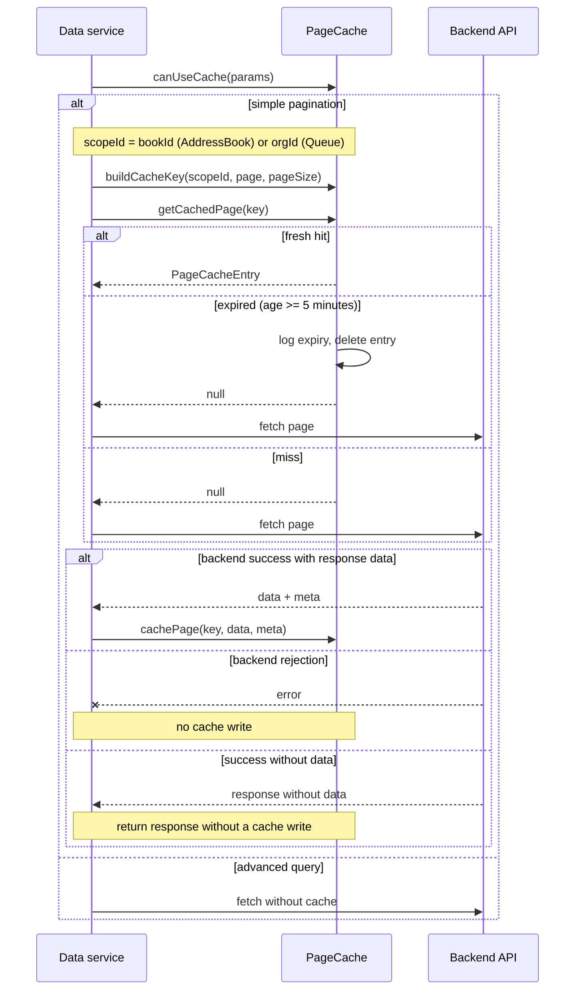
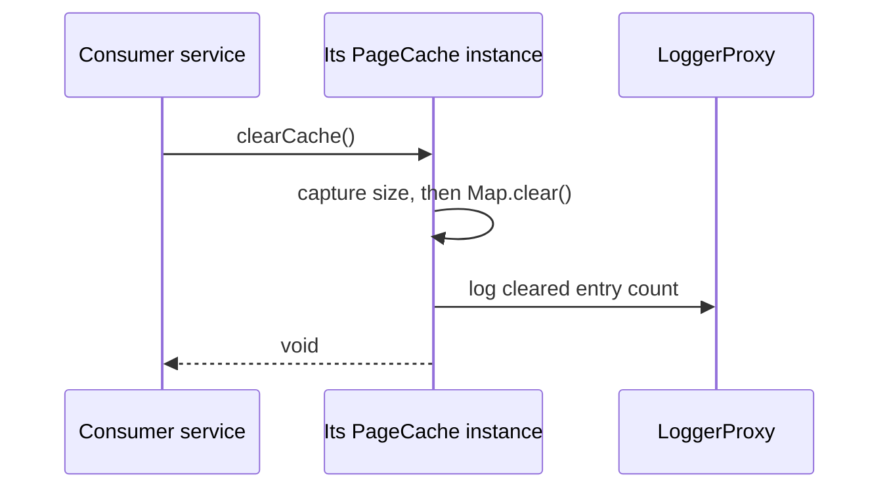
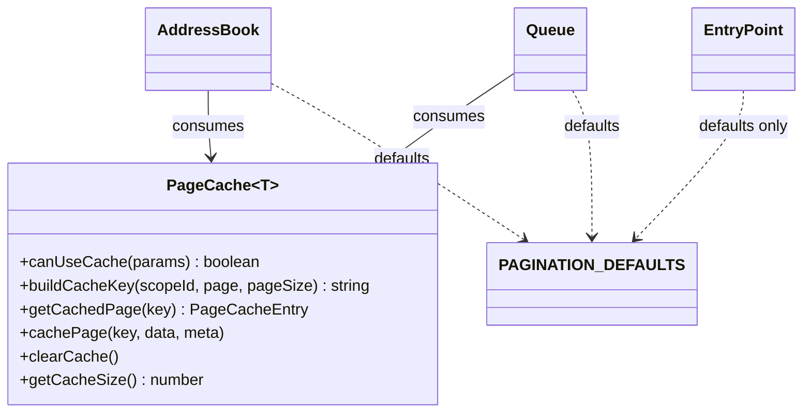

<!-- sdd-generated-metadata
doc_kind: module-spec
generated_from: module-spec@0.3.0
generated_by: claude-code
approved_by: rarajes2@cisco.com
updated_at: 2026-11-17T00:00:00Z
validation_status: blocked
-->

# Utils

This source-local document at `src/utils/docs/README.md` owns the stable specification for
**Utils**, the `src/utils` module of `@webex/contact-center`. It covers shared pagination/cache
contracts used by data services: the pagination types and defaults in `src/utils/PageCache.ts` and
the bounded in-memory `PageCache<T>` that AddressBook and Queue use. Ground every claim in package
evidence and link to the [package architecture](../../../docs/architecture.md) instead of repeating
broader facts. No service specification exists because this package is a library. The parent
specification is the [Contact Center SDK package spec](../../docs/README.md).

Related context: [documentation index](../../../docs/index.md) ·
[package agent instructions](../../../AGENTS.md)

## Metadata

| Field | Value |
| --- | --- |
| Owner | @webex/web-sdk |
| Source path | `src/utils` |
| Resource kind | module |
| Status | Active |
| Last verified | 2026-11-16 at `0b8c34db7f` |
| Module id | `utils` |
| Parent spec | [Contact Center SDK package spec](../../docs/README.md) |
| Doc kind | Module spec |
| Coverage score | Pending coverage assessment |
| Validation status | blocked — assessed 2026-11-17; validator runtime 01a1e76f-2293-79a0-9f8f-f060038448dd; package gate has 3 Blocking findings (A0, MET-B5, TASK-T-02). |

## Applicability

| Condition ID | Status | Evidence or reason | Owned section |
| --- | --- | --- | --- |
| `module.has_tiers` | N/A | No tier policy exists in `package.json` or under src | Tier |
| `module.has_ui` | N/A | `src/utils/PageCache.ts` holds types, constants, and one class; nothing renders | UI use-case flow |
| `module.crosses_service_boundaries` | N/A | `src/utils/PageCache.ts` makes no request; the consuming services own the backend calls | Cross-boundary use-case flow |
| `module.holds_client_state` | Applicable | `src/utils/PageCache.ts` keeps a per-instance Map of cached pages with timestamps | Client state model |
| `module.enforces_domain_rules` | Applicable | Cache eligibility, the key format, and the five-minute expiry in `src/utils/PageCache.ts` | Business rules and invariants |
| `module.is_concurrent_async` | N/A | Every PageCache method in `src/utils/PageCache.ts` is synchronous | Concurrency and reactive flow |
| `module.owns_persistence` | N/A | The cache lives in memory only; `src/utils/PageCache.ts` writes no storage | Data, schema, and migration discipline |
| `module.stateful_transitions` | N/A | A cache entry is only present, fresh, or expired-and-deleted in `src/utils/PageCache.ts`; no state machine | State machine |
| `module.exposes_wire_protocol` | N/A | No serializer or parser in `src/utils/PageCache.ts`; query strings are built by the consumers | Protocol and wire format |
| `module.ui_multi_screen` | N/A | No UI | UI flow |
| `module.large_data_model` | N/A | Six small exports in `src/utils/PageCache.ts` | Data model |
| `module.returns_caller_errors` | N/A | No PageCache method throws or rejects in `src/utils/PageCache.ts`; a miss returns null | Caller-visible failure modes |
| `module.module_specific_conventions` | Applicable | Bypass, key, and logging conventions every consumer of `src/utils/PageCache.ts` must follow | Module-specific rules |
| `module.published_package` | N/A | `src/index.ts` does not re-export `src/utils/PageCache.ts`; the package-level export contract is owned by the parent spec | Export stability |
| `module.embedded_in_host` | N/A | No host embed or theme surface | Host integration and theming |
| `module.has_design_tradeoff` | Applicable | `src/utils/PageCache.ts` caches only simple page browsing and bypasses every variant query | Key design trade-off |
| `module.has_submodules` | N/A | The src/utils directory has no child module (module_tree.py reports none) | Sub-modules |

## Evidence register

| Evidence | What it establishes |
| --- | --- |
| `src/utils/PageCache.ts` | The exports `PaginationMeta`, `PaginatedResponse<T>`, `BaseSearchParams`, `PAGINATION_DEFAULTS`, `PageCacheEntry<T>`, `CacheValidationParams`, and the `PageCache<T>` class (named and default export); the private `DEFAULT_CACHE_TTL_MINUTES = 5`; the JSDoc that states intent ("consistent caching behavior across all Contact Center APIs") |
| `src/services/AddressBook.ts` | Owns one `PageCache<AddressBookEntry>('AddressBook')`; keys pages by `bookId`; treats the default `name`/`asc` order as cacheable and passes `sortBy` to `canUseCache` only for a custom sort |
| `src/services/Queue.ts` | Owns one `PageCache<ContactServiceQueue>('Queue')`; keys pages by `orgId`; its default filter, `sortBy` `name`, and `desktopProfileFilter` `true` all make `canUseCache` return false |
| `src/services/EntryPoint.ts` | Imports only `PAGINATION_DEFAULTS`; owns no PageCache and fetches every request |
| `src/types.ts` | Builds `AddressBookEntriesResponse`, `EntryPointListResponse`, and `ContactServiceQueuesResponse` on `PaginatedResponse<T>`, and the three search-parameter types on `BaseSearchParams` |
| `src/index.ts` | Exports those response and search aliases at the package root, not the PageCache module itself |
| `src/logger-proxy.ts` | `LoggerProxy`, the only runtime dependency of `src/utils/PageCache.ts` |
| `test/unit/spec/services/AddressBook.ts` | Cache hit on a repeat simple call, cache miss on a new page, custom-sort bypass |
| `test/unit/spec/services/Queue.ts` | Default-policy bypass, sort-order-only bypass, explicit false flags still bypassed by the default filter, cache miss call shape |
| `test/unit/spec/services/EntryPoint.ts` | Every profile-scoped request is issued directly |
| `jest.config.js` | The 85% global coverage threshold that applies to `src/utils/PageCache.ts` through the consumer tests |
| `src/utils/PageCache.ts` | Justifies the extension subsections Cache lifecycle and Clear all entries under Data flow and sequence coverage: lookup-fetch-store (with expiry) and clearing are its two operation groups |

## Purpose and boundary

- Responsibility: Own shared pagination contracts and the bounded in-memory page cache used by Contact Center data services.
- In scope: the pagination metadata, response, and search-parameter types; `PAGINATION_DEFAULTS`;
  cache eligibility (`canUseCache`), key construction, TTL lookup, page insertion, clearing, and size.
- Out of scope: request execution, query-string building, metrics, and error handling (the
  consuming services and Core); the package-root response aliases, which `src/types.ts` builds on
  these types and the parent spec owns.
- Consumers: the AddressBook, EntryPoint, and Queue consumers listed below, plus `src/types.ts`.

The utils scope currently provides shared pagination and cache behavior for contact-center data services:

- **Typed Pagination Contracts**: Reusable interfaces for response metadata and query params
- **Generic In-Memory Page Caching**: `PageCache<T>` utility for simple pagination reuse
- **Cache Safety Rules**: Explicit bypass behavior for query variants and enabled result/response-shape flags

Current consumers of `PageCache` and defaults:

| Consumer | File | Usage |
| --- | --- | --- |
| `AddressBook` | [`../services/AddressBook.ts`](../../services/AddressBook.ts) | Caches paged address-book responses |
| `EntryPoint` | [`../services/EntryPoint.ts`](../../services/EntryPoint.ts) | Uses `PAGINATION_DEFAULTS` only; every profile-scoped entry-point request is fetched, never cached |
| `Queue` | [`../services/Queue.ts`](../../services/Queue.ts) | Owns a queue page cache keyed by `orgId`; its default queue policy (default filter, name sort, desktop-profile views) always bypasses it, so a page is reused only when the caller clears the filter and sort and disables desktop-profile filtering |
| `Public type contracts` | [`../types.ts`](../../types.ts) | Builds the SDK-facing response and search types on the pagination/search contracts |

Cross-scope mention: the Services-layer spec references utils caching contracts at
[Services module spec](../../services/docs/README.md).

## Structure and key files

| Path | Responsibility |
| --- | --- |
| `src/utils/PageCache.ts` | Authoritative PageCache implementation plus pagination/cache contracts and defaults |
| `src/utils/docs/README.md` | This module specification |
| `test/unit/spec/services/AddressBook.ts`, `test/unit/spec/services/Queue.ts`, `test/unit/spec/services/EntryPoint.ts` | Consumer tests that exercise PageCache and the defaults; there is no dedicated PageCache test file |

## Public surface

All public contracts for utils are defined in [`PageCache.ts`](../PageCache.ts). Every export is
module-internal: `src/index.ts` does not re-export the module, and package-root types reach callers
only through the aliases in `src/types.ts`.

| Contract ID | Surface | Consumer | Compatibility commitment | Source |
| --- | --- | --- | --- | --- |
| `contact-center-page-cache` | `PageCache<T>` (named and default export): `constructor(apiName)` creates a typed cache instance and stores `apiName` for `LoggerProxy` context; synchronous `canUseCache(params)` (boolean), `buildCacheKey(orgId, page, pageSize)` (string), `getCachedPage(cacheKey)` (entry or `null`), `cachePage(cacheKey, data, meta?)`, `clearCache()` clears all entries and logs cleared entry count, `getCacheSize()` returns current in-memory entry count | AddressBook, Queue | Internal; not re-exported by the package root | `src/utils/PageCache.ts` |
| `contact-center-page-cache` | `PaginationMeta`, `PaginatedResponse<T>` (required `data` array of `T` items and required `meta` of type `PaginationMeta`), and `BaseSearchParams` (optional `search`, `filter`, `attributes`, `page`, `pageSize`, `sortBy`, and `sortOrder` `'asc'` or `'desc'`) | `src/types.ts`, AddressBook, EntryPoint, Queue | Internal, but the package-root response and search aliases are built on them, so a field change is a package API change owned by the parent spec | `src/utils/PageCache.ts`, `src/types.ts`, `src/index.ts` |
| `contact-center-page-cache` | `PAGINATION_DEFAULTS` (`as const`): `PAGE: 0` and `PAGE_SIZE: 100` | AddressBook, EntryPoint, Queue | Internal; a change moves every list default | `src/utils/PageCache.ts` |
| `contact-center-page-cache` | `PageCacheEntry<T>` returned by `getCachedPage()`: `data: T[]`, `timestamp: number` (epoch milliseconds), and optional `totalMeta` with optional `totalPages` and `totalRecords` | AddressBook, Queue | Internal | `src/utils/PageCache.ts` |
| `contact-center-page-cache` | `CacheValidationParams` passed to `canUseCache()` (fields below) | AddressBook, Queue | Internal; a new field must also be added to the bypass rule | `src/utils/PageCache.ts` |

Note: `clearCache()` and `getCacheSize()` are available for future use and are not currently called by existing consumers.

`PaginationMeta`: Common pagination metadata used across list APIs. Every field is optional.

| Field | Type | Notes |
| --- | --- | --- |
| `orgid` | `string` | Organization identifier |
| `page` / `currentPage` | `number` | Current page aliases |
| `pageSize` | `number` | Items per page |
| `totalPages` | `number` | Total page count |
| `totalRecords` / `totalItems` | `number` | Total item aliases |
| `links` | `Record<string, string>` | Pagination link map |

`CacheValidationParams` fields, all optional:

- `search?: string`
- `filter?: string`
- `attributes?: string`
- `sortBy?: string`
- `desktopProfileFilter?: boolean`
- `provisioningView?: boolean`
- `singleObjectResponse?: boolean`

## Dependencies

| Dependency | Why it is required | Failure behavior |
| --- | --- | --- |
| `LoggerProxy` (`src/logger-proxy.ts`) | Logs expiry, insertion, and clearing with `{module: apiName, method}` context | Logging only; no PageCache result depends on it |
| In-memory Map and wall clock | The Map holds entries per instance; `Date.now()` stamps entries and measures their age | None; a cleared or lost Map only causes misses |

## Requirements

| ID | WHAT | WHY | Source Evidence | Test / Example Evidence | Assumptions / Gaps | Confidence |
| --- | --- | --- | --- | --- | --- | --- |
| UTILS-R-001 | Use cache only for simple pagination requests without search, filter, attributes, sortBy, or enabled desktop-profile/provisioning/single-object flags. Explicit `false` flags remain cache-compatible because they do not change the base result or response shape. | Parameterized or enabled variant queries cannot safely reuse a page keyed only by scope/page/pageSize, while a disabled boolean is semantically the same as omission. | `src/utils/PageCache.ts` | `test/unit/spec/services/AddressBook.ts`, `test/unit/spec/services/Queue.ts` | None. | PRESENT |
| UTILS-R-002 | Build cache keys from a caller-defined `scopeId` plus `page:pageSize`: `bookId` for AddressBook and `orgId` for Queue. EntryPoint builds no key because it never caches. | Consumer scope and page boundaries prevent cross-scope or cross-page reuse. | `src/utils/PageCache.ts`, `src/services/AddressBook.ts`, `src/services/Queue.ts` | `test/unit/spec/services/AddressBook.ts`, `test/unit/spec/services/Queue.ts` | `PageCache.buildCacheKey` names its first implementation parameter `orgId`, but runtime callers establish the broader `scopeId` semantics. | PRESENT |
| UTILS-R-003 | Expire entries after the configured five-minute TTL and delete them on stale lookup. | Bounded staleness prevents indefinite reuse of remote service data. | `src/utils/PageCache.ts` | None | Direct fake-clock expiration coverage is absent from current consumer tests. | PRESENT |
| UTILS-R-004 | Cache data with total-page/record metadata and allow owning consumers to clear the cache. | Paginated services need consistent metadata without transferring ownership of remote records to the SDK. | `src/utils/PageCache.ts` | `test/unit/spec/services/AddressBook.ts` | Cache hit/miss and metadata are exercised through consumers; `clearCache()` has no direct assertion. | PRESENT |
| UTILS-R-005 | Accept already-fetched page values from consuming services and never store or process credentials; use the consumer's scope value only as part of the in-memory key. | Authentication remains in Services/Core and scope-separated keys prevent unrelated pages from colliding. | `src/utils/PageCache.ts`, `src/services/core/WebexRequest.ts`, `src/services/AddressBook.ts`, `src/services/Queue.ts` | `test/unit/spec/services/AddressBook.ts` | None; security/auth ownership is explicit. | PRESENT |
| UTILS-R-006 | Keep PageCache free of rollout flags; consuming services decide whether to invoke it and query parameters determine cache eligibility. | Cache correctness must depend on request shape, not hidden deployment state. | `src/utils/PageCache.ts` | `test/unit/spec/services/AddressBook.ts`, `test/unit/spec/services/Queue.ts` | None; rollout applicability is explicitly N/A. | PRESENT |
| UTILS-R-007 | Export `PAGINATION_DEFAULTS` with `PAGE` 0 and `PAGE_SIZE` 100; AddressBook, EntryPoint, and Queue use them when the caller omits `page` or `pageSize`. | The JSDoc names them the default pagination constants used across all APIs, so every list method starts from the same first page and size. | `src/utils/PageCache.ts`, `src/services/AddressBook.ts`, `src/services/EntryPoint.ts`, `src/services/Queue.ts` | `test/unit/spec/services/AddressBook.ts`, `test/unit/spec/services/EntryPoint.ts`, `test/unit/spec/services/Queue.ts` | None; the default-parameter cases assert page=0 and pageSize=100 in the request URL. | PRESENT |

## Design overview

Utils separates its stable consumption boundary from collaborators so ownership and failure
behavior stay explicit: PageCache never issues a request, so a consumer decides when to look up,
fetch, and store. Each consumer constructs its own instance, so state is owned per service.

Builds deterministic cache key format:

```text
${scopeId}:${page}:${pageSize}
```

`getCachedPage` behavior:

1. Returns `null` if key not found
2. Computes cache age in minutes
3. If age is `>= 5`, logs expiry, deletes entry, returns `null`
4. Otherwise returns cached entry

`cachePage` stores entry with:

- `data`
- `timestamp`
- `totalMeta.totalPages`
- `totalMeta.totalRecords` mapped from `meta.totalRecords || meta.totalItems`

When `meta` is absent, `totalMeta` is `undefined`. A consumer rebuilds the response `meta` from the
requested `page` and `pageSize` plus `totalMeta` on a hit (Queue also adds `orgid`).

Reference usage (the AddressBook and Queue pattern):

```typescript
import PageCache, {PAGINATION_DEFAULTS} from '../utils/PageCache';

const cache = new PageCache<MyItem>('MyService');

const page = PAGINATION_DEFAULTS.PAGE;
const pageSize = PAGINATION_DEFAULTS.PAGE_SIZE;
const cacheKey = cache.buildCacheKey(scopeId, page, pageSize);

// Include every supported result- or shape-changing input.
const canUseCache = cache.canUseCache({
  search,
  filter,
  attributes,
  sortBy,
  desktopProfileFilter,
  provisioningView,
  singleObjectResponse,
});

if (canUseCache) {
  const cachedEntry = cache.getCachedPage(cacheKey);
  if (cachedEntry) {
    return {
      data: cachedEntry.data,
      meta: {
        page,
        pageSize,
        ...cachedEntry.totalMeta,
      },
    };
  }
}

const response = await fetchPageFromApi();

if (canUseCache && response.data) {
  cache.cachePage(cacheKey, response.data, response.meta);
}

return response;
```

## Data flow and sequence coverage

Call style: synchronous in-process method calls on a consumer-owned `PageCache` instance; the
consumer's own HTTP call through `WebexRequest` sits between lookup and store.

| Operation group | Entry and outcome | Diagram or evidence | Failure and recovery coverage |
| --- | --- | --- | --- |
| Eligible lookup, fetch, and store | `canUseCache`, `buildCacheKey`, `getCachedPage`, then the consumer fetch and `cachePage`; returns a cached or fresh page | Cache lifecycle diagram; `src/utils/PageCache.ts` | Advanced queries bypass cache; misses and expired entries (deleted at five minutes or more) fetch from the backend; failed backend calls and responses without data never reach `cachePage`. |
| Explicit cache clearing | `clearCache()`; empties the instance | Clear all entries diagram; `src/utils/PageCache.ts` | `clearCache` removes all entries from that consumer-owned PageCache instance and logs the prior size; no consumer calls it today. |

### Cache lifecycle



### Clear all entries



## Class and component relationships



## Use cases and flows

| Use case | Actor or caller | Primary steps and outcome | Failure or boundary behavior | Evidence |
| --- | --- | --- | --- | --- |
| `UC-001` | AddressBook or Queue | Cache eligibility: the service asks `canUseCache` with every result- or shape-changing input before any lookup | A bypassed request goes straight to the backend; EntryPoint never asks | `src/utils/PageCache.ts`, `test/unit/spec/services/AddressBook.ts`, `test/unit/spec/services/Queue.ts` |
| `UC-002` | AddressBook or Queue | Cache-key construction: a simple page lookup builds `scopeId:page:pageSize` from the consumer's own scope value | Different scope or page values never share an entry | `src/utils/PageCache.ts`, `src/services/AddressBook.ts`, `src/services/Queue.ts` |
| `UC-003` | Consuming service | TTL lookup/expiry: a fresh cached entry is returned; an expired entry is deleted and treated as a miss | No direct expiration test currently exists | `src/utils/PageCache.ts` |
| `UC-004` | Consuming service | Page insertion and clearing: successful page data and normalized totals are cached, while `clearCache()` removes all entries for that service instance | Consumer tests cover insertion/hit behavior, but not direct clearing | `src/utils/PageCache.ts`, `test/unit/spec/services/AddressBook.ts` |

## Client state model

Utils retains only in-memory runtime state. Durable domain records remain owned by remote Webex
services. State changes are driven by explicit calls from the owning consumer.

| State or slice | Owner | Initial state | Transition triggers | Reset or persistence boundary |
| --- | --- | --- | --- | --- |
| Page entries (`Map<string, PageCacheEntry<T>>`) | Each `PageCache` instance, one per AddressBook or Queue | Empty Map | `cachePage` sets or replaces an entry; `getCachedPage` deletes an entry whose age is 5 minutes or more; `clearCache` empties the Map | Lost with the instance; the consumers are created once per SDK READY callback and never persisted |
| `apiName` | Each `PageCache` instance | Constructor argument (`'AddressBook'`, `'Queue'`) | None | Fixed for the instance lifetime |

## Business rules and invariants

| ID | Invariant | WHY | Enforcement source | Test evidence |
| --- | --- | --- | --- | --- |
| `INV-001` | Don't add query dimensions without either extending the cache key or making `canUseCache` bypass them. | The key holds only scope, page, and page size, so any other result- or shape-changing input would return a wrong page | `src/utils/PageCache.ts` | `test/unit/spec/services/AddressBook.ts`, `test/unit/spec/services/Queue.ts` |
| `INV-002` | Each consuming service owns a separate `PageCache` instance and passes its own stable scope value into `buildCacheKey`. | Separate Maps keep AddressBook and Queue pages apart even when a scope value repeats | `src/services/AddressBook.ts`, `src/services/Queue.ts` | `test/unit/spec/services/AddressBook.ts` |
| `INV-003` | `getCachedPage` returns only an entry a consumer stored with `cachePage` and still younger than five minutes; otherwise it returns `null`. | AddressBook and Queue return a hit's `data` and `totalMeta` to the caller as the backend page without refetching, so an entry older than `DEFAULT_CACHE_TTL_MINUTES` (5) is deleted rather than served | `src/utils/PageCache.ts` | `test/unit/spec/services/AddressBook.ts` |

`canUseCache` returns `true` only when all of these are absent:

- `search`
- `filter`
- `attributes`
- `sortBy`
- `desktopProfileFilter`, `provisioningView`, or `singleObjectResponse` when `true`

An explicit `false` boolean remains eligible because it is semantically identical to omitting that flag. Services must pass an effective `sortBy` whenever `sortOrder` changes the wire order; Queue normalizes a direction-only request to `sortBy=name` before cache validation. `sortOrder` is not a `CacheValidationParams` field, and AddressBook passes `sortBy` only when the order differs from its `name`/`asc` default, so its default order stays cacheable.

## Pitfalls and constraints

- AddressBook looks up the cache before it validates `bookId`; with no address book id the key
  begins with `undefined`, nothing was ever stored under it, so the lookup misses and the request
  then fails with the missing-addressBookId error.

## Module-specific rules

- Do: preserve the five-minute `>=` expiry boundary and the `totalRecords || totalItems` compatibility mapping.
- Do: keep credentials, request execution, and backend-error handling in the consuming service/Core layers.
- Don't: claim `clearCache()` or TTL expiry is directly unit-tested until dedicated assertions exist.

When changing `src/utils` behavior or contracts, verify cache TTL, bypass rules, and key schema, and confirm:

- Public types remain backward-compatible or migration is documented
- `PAGINATION_DEFAULTS` changes are intentional and propagated to consumers
- Cache TTL behavior remains explicit, and TTL tests are added or kept
- `canUseCache()` bypass conditions are unchanged or intentionally updated
- `totalRecords`/`totalItems` mapping behavior is preserved
- Logging still uses `LoggerProxy` with `module` and `method`
- AddressBook/Queue cache integration remains correct; EntryPoint remains explicitly uncached

## Key design trade-off

| Chosen trade-off | Preserved invariant or benefit | Cost or limitation | Decision evidence |
| --- | --- | --- | --- |
| Caching is intentionally limited to simple page browsing; search/filter/sort requests bypass cache to prevent incorrect reuse. | A cached page is always the page the same simple request would return within five minutes | Variant queries, and Queue under its default policy, always pay a backend call; the cache cannot be invalidated by backend changes inside the TTL | `src/utils/PageCache.ts` |

## Verification

PageCache has no dedicated unit file; current consumer tests in `test/unit/spec/services/AddressBook.ts`, `EntryPoint.ts`, and `Queue.ts` cover request shaping, and AddressBook also covers cache hit/miss behavior while Queue and EntryPoint cover bypass. Add direct PageCache tests for the five-minute expiry boundary, entry deletion, metadata normalization, clearing, and key construction with both `bookId` and `orgId` scope values.

| Requirement or invariant | Test level | Positive evidence | Negative or boundary evidence | Gap |
| --- | --- | --- | --- | --- |
| `UTILS-R-001`, `INV-001` | Unit (through consumers) | `test/unit/spec/services/AddressBook.ts` repeat simple-pagination hit; AddressBook, EntryPoint, and Queue consumer tests exercise advanced query parameters and simple pagination | `test/unit/spec/services/AddressBook.ts` custom-sort bypass; `test/unit/spec/services/Queue.ts` sort-order-only and default-policy bypass | Add a direct `canUseCache` table test for each bypass field and `sortOrder` alone. |
| `UTILS-R-002`, `INV-002` | Unit (through consumers) | `test/unit/spec/services/AddressBook.ts` repeat/miss tests exercise bookId-scoped caching | `test/unit/spec/services/Queue.ts` shows its default policy bypasses the orgId-keyed cache | Add direct key-string assertions for both runtime scope kinds; no test that two consumer instances stay separate. |
| `UTILS-R-003`, `INV-003` | None | None found | None found | Add fake-clock tests at just below and exactly five minutes, including deletion. |
| `UTILS-R-004` | Unit (through consumers) | `test/unit/spec/services/AddressBook.ts` verifies a repeat-call hit and response metadata | `test/unit/spec/services/AddressBook.ts` and `test/unit/spec/services/Queue.ts` verify misses | Add direct metadata fallback and `clearCache`/`getCacheSize` assertions. |
| `UTILS-R-005` | None | None found | None found | Static ownership check only: `src/utils/PageCache.ts` has no credential or request dependency; no runtime credential test is needed. |
| `UTILS-R-006` | None | None found | None found | Static check only: `src/utils/PageCache.ts` has no feature-flag dependency; consumer tests cover invocation choices; no direct rollout test is applicable. |
| `UTILS-R-007` | Unit | `test/unit/spec/services/AddressBook.ts`, `test/unit/spec/services/EntryPoint.ts`, `test/unit/spec/services/Queue.ts` default-parameter cases | None found | None |

Run the consumer tests with `yarn test:unit` from the package directory (equivalent to
`yarn workspace @webex/contact-center test:unit` from the monorepo root). A module specification is
complete only when its public surface, invariants, failure modes, and test evidence agree with the
implementation.
