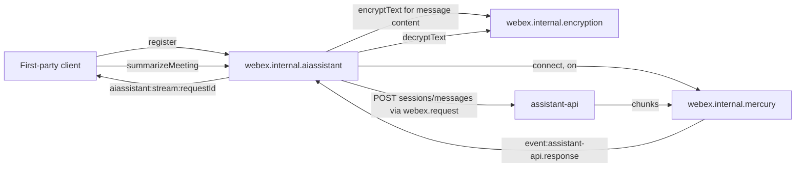
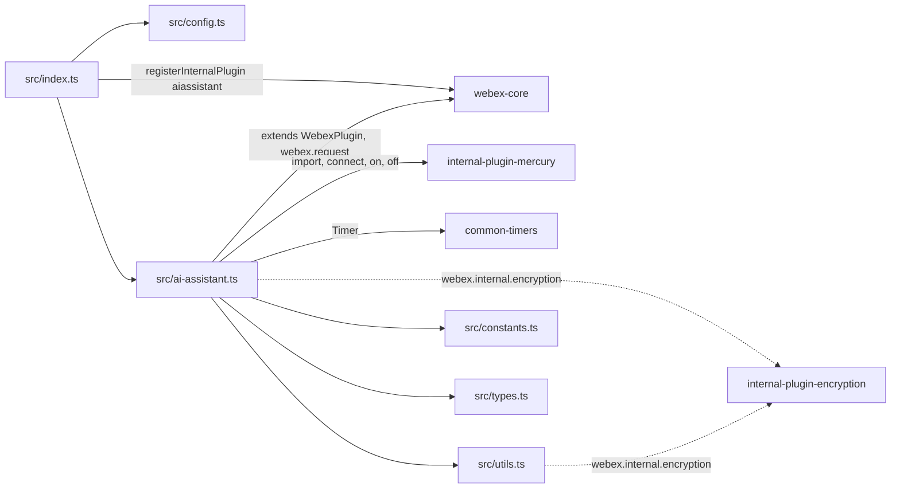
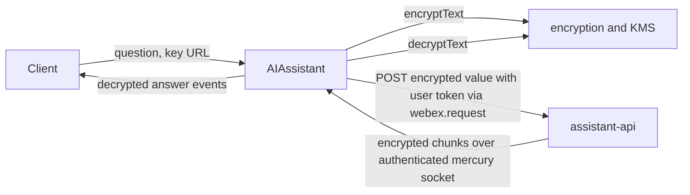

<!-- sdd-generated-metadata
doc_kind: standing-doc
generated_from: architecture@0.3.0
generated_by: claude-code
approved_by: rarajes2@cisco.com
updated_at: 2026-11-12T09:49:19Z
validation_status: pass-with-warnings
-->

# @webex/internal-plugin-ai-assistant architecture

Canonical architecture for this package. Flow behavior lives in the
[AI assistant plugin specification](../src/docs/README.md). This page owns package boundaries, the
plugin registration, the contract index, and how the package meets the rest of the SDK.

Related context: [specification registry](specs/README.md) ·
[package agent instructions](../AGENTS.md)

## Applicability

| Condition ID                         | Status     | Evidence or reason | Owned section |
| ------------------------------------ | ---------- | ------------------ | ------------- |
| `repo.owns_datastore`                | N/A        | No database, file store, or migration in `src/ai-assistant.ts` | Repository data and schema |
| `repo.holds_client_state`            | Applicable | The `registered` flag and per-request listeners and timers in `src/ai-assistant.ts` | Client state model |
| `repo.components_interact`           | Applicable | `src/ai-assistant.ts` drives mercury, encryption, and `webex.request` from webex-core | Dependency and interaction topology |
| `repo.domain_data_across_components` | Applicable | Meeting questions and answers pass between the caller, KMS, the assistant-api service, and mercury in `src/ai-assistant.ts` | Object and data ownership |
| `repo.caches_data`                   | N/A        | `src/ai-assistant.ts` keeps no cache | Caching catalog |
| `repo.observability_convention`      | Applicable | Log lines through `this.logger` with the `AI assistant-><method>#<LEVEL>` prefix in `src/ai-assistant.ts` | Observability patterns |
| `repo.deploys_to_infra`              | N/A        | Library published to npm (`package.json`). No service runtime | Runtime and infrastructure |
| `repo.shared_base_libs`              | Applicable | Extends WebexPlugin from webex-core and uses the legacy build, lint, and test stack (`babel.config.js`, `jest.config.js`, `.eslintrc.js`) | Shared and base libraries |
| `repo.is_monorepo`                   | N/A        | This SDD root is one package. The workspace around it is out of scope | Package map and inter-package dependencies |
| `repo.multi_platform`                | N/A        | `src/ai-assistant.ts` uses no platform-specific API; `process` declares only `{browser: true}` | Platform matrix |
| `repo.published_package`             | Applicable | `package.json` name is @webex/internal-plugin-ai-assistant and deploy:npm publishes it | Release and versioning |
| `repo.embedded_in_host`              | N/A        | No host theme or embed API in `src/ai-assistant.ts` | Host integration and theming |
| `repo.exposes_commands_or_artifacts` | Applicable | build:src in `package.json` writes dist | Commands and generated artifacts |
| `repo.cross_repo_deps_material`      | Applicable | Behavior depends on the assistant-api service and KMS (`src/ai-assistant.ts`, `src/constants.ts`) | Cross-repository topology |
| `repo.security_arch_warranted`       | Applicable | Meeting questions, answers, citations, and attendee emails pass through `src/ai-assistant.ts` and `src/utils.ts` | Security architecture |

## Design overview

`@webex/internal-plugin-ai-assistant` is a published TypeScript library with one module. Importing
it registers `AIAssistant` as the internal plugin `aiassistant`, reached as
`webex.internal.aiassistant`, with a default `requestTimeout` of 60000 ms. No package in this
repository imports it at runtime; first-party clients import it to get the plugin.

The plugin asks the meeting assistant about a meeting. A request is an HTTP POST to the
`assistant-api` service that returns at once with the session and message ids; the answer then
streams back as chunks over the shared mercury socket. The plugin matches each chunk to its request
by the client request id it sent, decrypts the chunk's content with the meeting's KMS key, and emits
it on `aiassistant:stream:<requestId>`. An inactivity timer ends a stream that goes silent with a
plugin-generated timeout event.

`register()` must run first: it connects mercury and subscribes to the assistant-api events. The
package serves no routes and persists nothing.

## Resource inventory and responsibilities

| Resource | Kind | Responsibility | Owner | Source | Detailed specification |
| -------- | ---- | -------------- | ----- | ------ | ---------------------- |
| AI assistant plugin | package (one module) | Registration, assistant-api requests, chunk-to-stream mapping, inactivity timeout, content encryption and decryption | @webex/web-sdk | `src` | [`src/docs/README.md`](../src/docs/README.md) |

## Interaction and execution flows

Representative end-to-end flow: a client registers once, asks for a meeting summary, and receives
the answer as stream events.

| From | To | Interaction or transport | Purpose | Failure or compatibility behavior |
| ---- | -- | ------------------------ | ------- | --------------------------------- |
| Client | `webex.internal.aiassistant` | In-process calls and event listeners | Register, send requests, receive streams | Rejections propagate; stream errors ride on events |
| `AIAssistant` | assistant-api | HTTPS POST through `webex.request` | Start or continue an assistant session | No retry here; webex-core interceptors apply |
| assistant-api | `AIAssistant` | Mercury `event:assistant-api.response` | Response chunks | Inactivity timeout after `requestTimeout` |
| `AIAssistant` | KMS through `webex.internal.encryption` | In-process calls | Encrypt questions; decrypt answers | Encryption rejects the call; decryption failure is reported on the stream event |

## Dependency topology

| Dependency | Type | Used by | Purpose | Version, failure, or fallback policy |
| ---------- | ---- | ------- | ------- | ------------------------------------ |
| `@webex/webex-core` | Internal | `src/index.ts`, `src/ai-assistant.ts` | Registration, plugin base, `webex.request`, config lookup | `workspace:*` in `package.json` |
| `@webex/internal-plugin-mercury` | Internal | `src/ai-assistant.ts` | Registration side effect; connect and event subscription | `workspace:*` |
| `@webex/internal-plugin-encryption` | Internal, undeclared | `src/ai-assistant.ts`, `src/utils.ts` | `encryptText`, `decryptText` | Not in `package.json`; the host must load it |
| `@webex/common-timers` | Internal | `src/ai-assistant.ts` | `Timer` | `workspace:*` |
| `@webex/common` | Internal, unused | None in `src/` | Declared only | `workspace:*` |
| `uuid` | External | `src/ai-assistant.ts` | Request ids | `^3.3.2` in `package.json` |
| `lodash` | External | `src/ai-assistant.ts`, `src/utils.ts` | `get`, `set`, `merge` | `^4.17.21` |
| assistant-api service | External service | `src/ai-assistant.ts` | Assistant requests and chunks | Resolved through the service catalog as `assistant-api` |

No import cycle exists: none of the packages this one imports imports it back.

## Public and consumer surfaces

| Surface | Type | Owner | Consumers | Compatibility policy | Source |
| ------- | ---- | ----- | --------- | -------------------- | ------ |
| `ai-assistant-internal-sdk` — package @webex/internal-plugin-ai-assistant, `webex.internal.aiassistant`, its methods and `aiassistant:*` events | SDK, published to npm, internal | AI assistant plugin | First-party clients; no runtime consumer in this repository | The README states that internal plugins do not strictly follow semantic versioning; no deprecation rule is declared | `package.json`, `src/index.ts`, `src/ai-assistant.ts`, `src/constants.ts`, `src/types.ts` |

The assistant-api request body, the mercury event envelopes, and the stream event payload are
protocols this package speaks with services and clients, described under *Protocol and wire format*
in the [module specification](../src/docs/README.md#protocol-and-wire-format). The other contracts
this package requires are registered in `.sdd/manifest.json` `contract_catalog`.

## Client state model

| State or slice | Owner | Transition triggers | Persistence or reset boundary |
| -------------- | ----- | ------------------- | ----------------------------- |
| `registered` | `AIAssistant` | `register`, `unregister` | In memory |
| Per-request listener and timer | `AIAssistant` request closure | Chunks, `finished`, expiry | Ends with the stream |
| Mercury connection | `@webex/internal-plugin-mercury` | `register` connects it | Never disconnected by this package |

Full detail is in the module specification's *Client state model*.

## Cross-cutting architecture

### Security

- Trust boundaries and identity flow: see [Security architecture](#security-architecture).
- Sensitive surfaces and data classes: free-text questions, answers, citation and source names,
  schedule-meeting titles, links, descriptions, and attendee emails.
- Encryption and secret boundaries: see [Security architecture](#security-architecture).

### Observability and operations

- Logging and correlation: see [Observability patterns](#observability-patterns).
- Metrics, traces, and audit signals: see [Observability patterns](#observability-patterns).
- Ownership and operational entry points: `.github/CODEOWNERS` at the workspace root has no line for
  this package, so its default rule assigns it to `@webex/web-sdk`. No dashboards or runbooks are
  recorded in this package.

### Quality attributes

- Compatibility: clients rely on the registered name `aiassistant`, the stream event name, the
  resolve shape, and the timeout error name and code.
- Footprint: six source files; runtime imports are webex-core, mercury, common-timers, uuid, and
  lodash.
- Test confidence: 31 unit cases pass; the registration, the four meeting helpers, and the default
  timeout duration have no case. No coverage threshold is enforced.

## Dependency and interaction topology

| From | To | Kind | Purpose | Ordering or failure boundary |
| ---- | -- | ---- | ------- | ---------------------------- |
| `src/index.ts` | webex-core | Call at import | Register `aiassistant` | First registration wins |
| `src/ai-assistant.ts` | mercury | Calls and listeners | Connect and receive chunks | `register` before requests |
| `src/ai-assistant.ts` | `webex.request` | Call | assistant-api POST | Rejection reaches the method's promise |
| `src/ai-assistant.ts`, `src/utils.ts` | `webex.internal.encryption` | Calls by property, no import | Encrypt and decrypt | The host must have registered it |

## Object and data ownership

| Object or state | System of record | May write | May read | Movement or lifecycle |
| --------------- | ---------------- | --------- | -------- | --------------------- |
| Assistant sessions and messages | assistant-api service | The service, on this package's requests | This package, then the client | Created per request; the client keeps `sessionId` for follow-ups |
| Encryption keys | KMS | KMS | `webex.internal.encryption` | The caller supplies the key URL; this package holds no key |
| Meeting identity (instance id, site, key URL) | Locus or the meeting container | — | The caller passes it in | Not stored here |

## Observability patterns

| Signal  | Convention or required fields | Propagation or naming rule | Primary evidence |
| ------- | ----------------------------- | -------------------------- | ---------------- |
| Logs    | `this.logger.error` and `this.logger.info` with the prefix `AI assistant-><method>#ERROR` or `#INFO`; messages carry error messages or the unknown content name, never request or response content | No correlation id is logged; the request id travels only in events | `src/ai-assistant.ts` |
| Metrics | None | — | `src/ai-assistant.ts` |
| Traces  | None | — | `src/ai-assistant.ts` |
| Audit   | None | — | `src/ai-assistant.ts` |

## Shared and base libraries

| Library | Inherited responsibility | Consumers | Version floor | Compatibility rule |
| ------- | ------------------------ | --------- | ------------- | ------------------ |
| `@webex/webex-core` `WebexPlugin` | `webex`, `logger`, `config`, ampersand events | `AIAssistant` | `workspace:*` | Keep namespace `AIAssistant` so `this.config` reads `webex.config.aiassistant` |
| `@webex/common-timers` `Timer` | Start, reset, cancel | `AIAssistant` | `workspace:*` | `reset` and `cancel` only while running |
| `@webex/babel-config-legacy`, `@webex/eslint-config-legacy`, `@webex/jest-config-legacy`, `@webex/legacy-tools` | Build, lint, and test stack through one-line config files | Package tooling | `workspace:*` | Do not fork the config locally |

## Release and versioning

| Artifact | Publish target | Versioning rule | Deprecation window | Changelog or migration obligation |
| -------- | -------------- | --------------- | ------------------ | --------------------------------- |
| @webex/internal-plugin-ai-assistant | npm through `deploy:npm` | Internal plugin; the README says semantic versioning is not strictly followed | None declared | None declared in the package; the workspace owns changelog generation |

## Commands and generated artifacts

| Command or artifact | Owner | Inputs | Output or side effect | Compatibility boundary |
| ------------------- | ----- | ------ | --------------------- | ---------------------- |
| `yarn workspace @webex/internal-plugin-ai-assistant build:src` | Package scripts | `src` | Writes `dist/` (JavaScript and source maps) through `webex-legacy-tools` | `dist/` is generated and never edited by hand |
| `yarn workspace @webex/internal-plugin-ai-assistant build` | Package scripts | `src` | Runs `build:src` | Same output |
| `yarn workspace @webex/internal-plugin-ai-assistant test:unit` | Package scripts | `test/unit/spec` | Jest run | The spec imports this package's `dist/` by name |
| `yarn workspace @webex/internal-plugin-ai-assistant test:style` | Package scripts | `src` | ESLint run | The shared config ignores `docs/**` and `*.md` |

## Cross-repository topology

| Repository or external system | Relationship | Exchanged contract or artifact | Owner | Sequencing constraint |
| ----------------------------- | ------------- | ------------------------------ | ----- | --------------------- |
| `@webex/webex-core` (workspace sibling; module spec consulted) | Consumes | `registerInternalPlugin`, `WebexPlugin`, `webex.request`, `canAuthorize` | @webex/web-client, @webex/web-sdk | None beyond registration |
| `@webex/internal-plugin-mercury` (workspace sibling; module spec consulted and stale on sessions, code used) | Consumes | `connect`, `on`, `off`, emitted event names | @webex/web-client, @webex/web-sdk | `register` connects before chunks can arrive |
| `@webex/internal-plugin-encryption` (workspace sibling, no spec; code used) | Consumes | `encryptText`, `decryptText` | @webex/web-sdk | See Dependency topology |
| `@webex/common-timers` (workspace sibling; module spec consulted) | Consumes | `Timer` | @webex/web-sdk | None |
| assistant-api service | Consumes | Session message POST and response chunks | Not recorded in this repository | Mercury connected first |
| KMS | Consumes, through encryption | Keys for the caller's key URL | Not recorded in this repository | Key URL supplied by the caller |

## Security architecture

- This package holds no credential or key. Requests reuse `webex.request`, which adds the user's
  authorization through webex-core; `register` refuses to run when the SDK cannot authorize.
- Free-text questions are encrypted with the caller's `encryptionKeyUrl` before they leave the
  client; action names are sent in clear (`INV-003` in the module spec).
- Response content arrives encrypted and is decrypted in place before it is emitted; the plugin
  passes the plaintext to listeners, keeps none of it, and does not log it.

## Domain language

| Term | Repository-specific meaning | Authoritative source |
| ---- | --------------------------- | -------------------- |
| assistant-api | The Webex AI assistant service, reached through the service catalog | `src/constants.ts` |
| Session | A conversation with the assistant; `sessionId` continues it on later requests | `src/ai-assistant.ts` |
| Client request id | The `requestId` sent as `clientRequestId` and echoed on every chunk | `src/ai-assistant.ts` |
| Chunk | One `event:assistant-api.response` payload; the last has `finished` true | `src/ai-assistant.ts` |
| Action | A fixed assistant verb such as `SUMMARIZE_FOR_ME`, sent as content type `action` | `src/constants.ts` |
| Context resource | `{id, type: 'meeting', url}` naming the meeting the request is about | `src/types.ts` |
| Response content name | The content type of a chunk (`message`, `cited_answer`, `tool_use`, and others), which selects its decryption | `src/constants.ts` |
| Activity | An assistant-api activity event re-emitted as `aiassistant:activityReceived` | `src/ai-assistant.ts` |

## References and maintenance

- Decisions: [adr/](adr/index.md)
- Instantiated specifications and routing: [specs/README.md](specs/README.md)
- Repository rules and patterns: [package agent instructions](../AGENTS.md)
- Update this document in the same change that alters package boundaries, resource ownership,
  cross-resource interaction, or cross-cutting architecture.
