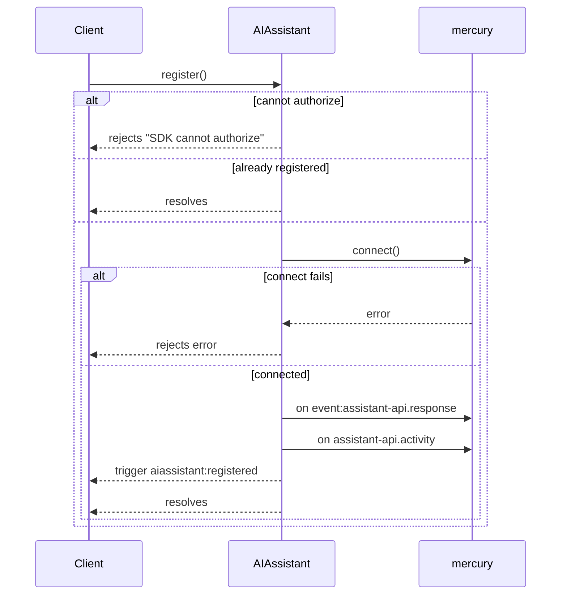
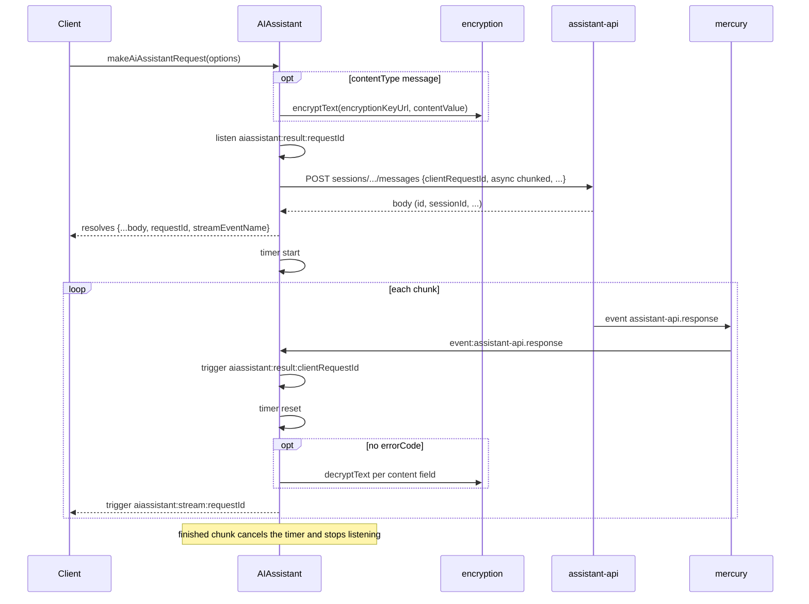
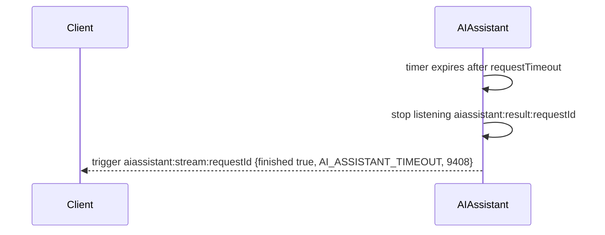
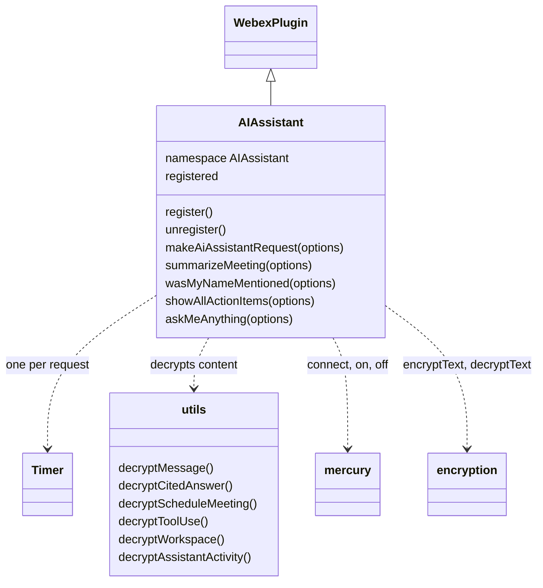
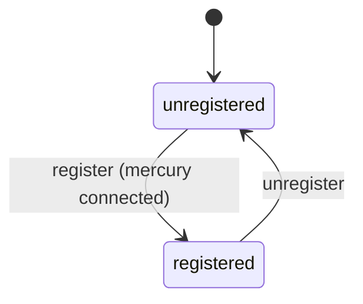
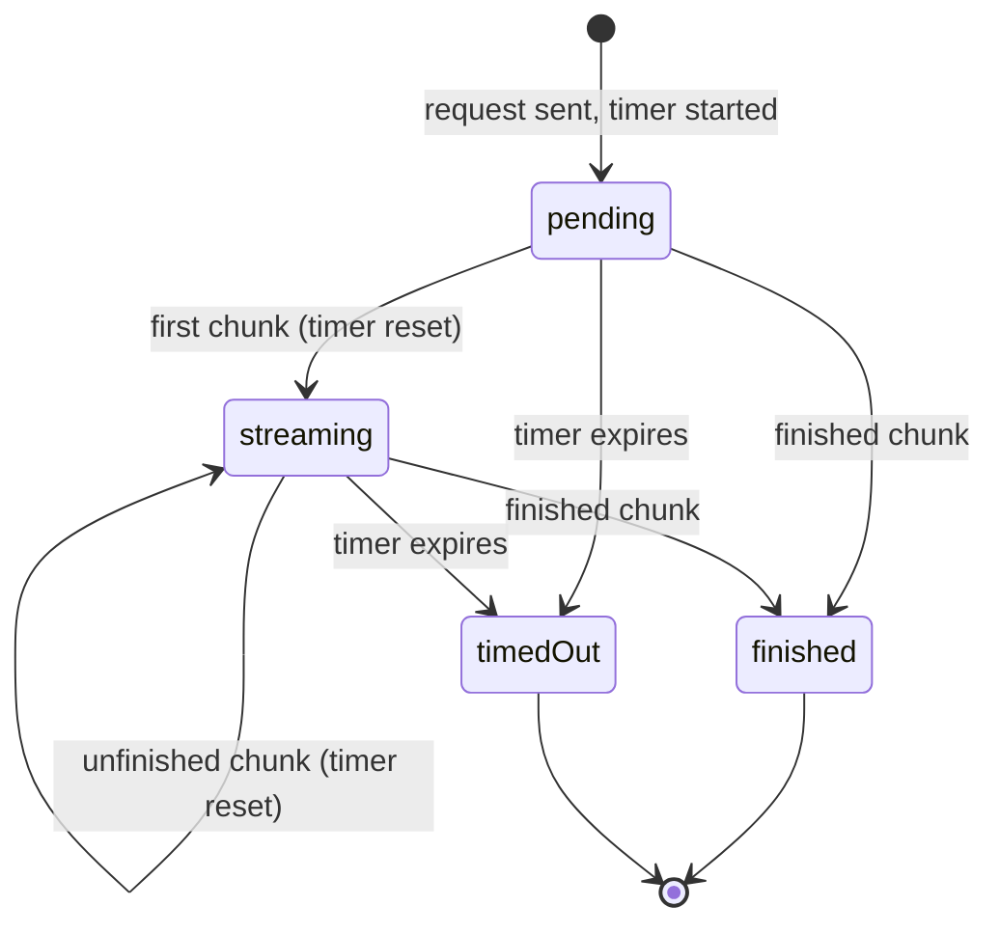

<!-- sdd-generated-metadata
doc_kind: module-spec
generated_from: module-spec@0.3.0
generated_by: claude-code
approved_by: rarajes2@cisco.com
updated_at: 2026-11-12T09:54:37Z
validation_status: pass-with-warnings
-->

# AI assistant plugin

This source-local document at `src/docs/README.md` owns the stable specification for **the AI
assistant plugin**: the internal plugin `webex.internal.aiassistant`. It connects the shared mercury
socket, sends meeting-assistant requests to the `assistant-api` service, and turns the response
chunks that arrive over mercury into one stream event per request, decrypting each chunk's content
with the caller's KMS key. Ground every claim in package evidence and link to the
[package architecture](../../docs/architecture.md) instead of repeating broader facts. No service
specification exists because this package is a library.

Related context: [documentation index](../../docs/index.md) ·
[package agent instructions](../../AGENTS.md)

## Metadata

| Field             | Value |
| ----------------- | ----- |
| Owner             | @webex/web-sdk |
| Source path       | `src` |
| Resource kind     | package |
| Status            | Draft |
| Last verified     | 2026-11-12 at `ecd5af12a1` |
| Module id         | `internal-plugin-ai-assistant` |
| Parent spec       | — |
| Doc kind          | Module spec |
| Coverage score    | 93.3% assessed 2026-11-12 by the generator — 14 of 15 mandatory fields PRESENT, critical 8 of 8; test strategy is WEAK because the registration, the four meeting helpers, the default timeout duration, decryption failure, and the activity delivery path have no case, although 31 unit cases pass |
| Validation status | Pass with warnings — assessed 2026-11-12 by validator runtime `01a1cf26-9718-72e0-96ff-72c856cd61fc`; 0 Blocking, 1 Important finding (accepted command-source warning) |

## Applicability

| Condition ID                         | Status     | Evidence or reason | Owned section |
| ------------------------------------ | ---------- | ------------------ | ------------- |
| `module.has_tiers`                   | N/A        | No tier policy exists in `package.json` or `src/ai-assistant.ts` | Tier |
| `module.has_ui`                      | N/A        | `src/ai-assistant.ts` sends requests and emits events; it renders nothing | UI use-case flow |
| `module.crosses_service_boundaries`  | Applicable | `src/ai-assistant.ts` POSTs to the assistant-api service, receives its chunks over mercury, and calls KMS through internal-plugin-encryption | Cross-boundary use-case flow |
| `module.holds_client_state`          | Applicable | The registered flag and the per-request listener and timer in `src/ai-assistant.ts` | Client state model |
| `module.enforces_domain_rules`       | Applicable | Message content is encrypted and action content is not; content is decrypted only without an error code; lastMinutes is sent only when set (`src/ai-assistant.ts`) | Business rules and invariants |
| `module.is_concurrent_async`         | Applicable | Asynchronous chunk handling, an inactivity Timer, and event-driven responses in `src/ai-assistant.ts` | Concurrency and reactive flow |
| `module.owns_persistence`            | N/A        | `src/ai-assistant.ts` stores nothing outside memory | Data, schema, and migration discipline |
| `module.stateful_transitions`        | Applicable | Registration state and the per-request stream lifecycle in `src/ai-assistant.ts` | State machine |
| `module.exposes_wire_protocol`       | Applicable | The assistant-api request body, the mercury event names and envelopes, and the stream event payload in `src/ai-assistant.ts` and `src/constants.ts` | Protocol and wire format |
| `module.ui_multi_screen`             | N/A        | No UI | UI flow |
| `module.large_data_model`            | N/A        | `src/types.ts` declares a few option and response shapes, covered under Protocol and wire format | Data model |
| `module.returns_caller_errors`       | Applicable | Rejected promises from register and the request methods, and errors carried in stream events (`src/ai-assistant.ts`) | Caller-visible failure modes |
| `module.module_specific_conventions` | Applicable | The aiassistant: event names, the AI assistant-> log prefix, and per-content-type decrypt helpers in `src/ai-assistant.ts` and `src/utils.ts` | Module-specific rules |
| `module.published_package`           | Applicable | `package.json` names the package @webex/internal-plugin-ai-assistant and defines deploy:npm | Export stability |
| `module.embedded_in_host`            | N/A        | No host theme or embed API | Host integration and theming |
| `module.has_design_tradeoff`         | Applicable | An acknowledged HTTP request plus a mercury response stream keyed by a client request id, guarded by an inactivity timer, in `src/ai-assistant.ts` | Key design trade-off |
| `module.has_submodules`              | N/A        | The src directory has no child module | Sub-modules |

## Evidence register

| Evidence | What it establishes |
| -------- | ------------------- |
| `src/index.ts` | `registerInternalPlugin('aiassistant', AIAssistant, {config})` at import time; the only export is the default `AIAssistant` |
| `src/config.ts` | Default configuration `{aiassistant: {requestTimeout: 60000}}`; its JSDoc calls it the timeout before a request fails, in milliseconds |
| `src/ai-assistant.ts` | `AIAssistant` extends `WebexPlugin` in namespace `AIAssistant`: registration, mercury listeners, the request and stream flow, the inactivity timer, content decryption dispatch, and the four meeting helpers. Its JSDoc is the only recorded rationale |
| `src/utils.ts` | `decryptInPlace` and one decrypt helper per response content type (`message`, `cited_answer`, `schedule_meeting`, `tool_use`, `workspace`) plus assistant activities |
| `src/constants.ts` | Event names, the `assistant-api` service name, error names and codes, action types, content types, context resource types, and response content names |
| `src/types.ts` | `RequestResponse`, `StreamEvent`, `RequestOptions`, `ContextResource`, `SummarizeMeetingOptions`, `AiAssistantRequestOptions` |
| `package.json` | Name, `main` (`dist/index.js`), `devMain` (`src/index.ts`), `engines` (`node >=16`), dependencies, and scripts |
| `test/unit/spec/ai-assistant.ts` | 31 unit cases in one suite: `#register()` (3), `#unregister()` (2), `#_request` (12), `#makeAiAssistantRequest` (14); a MockWebex with stub mercury, request, and encryption |
| `test/unit/data/messages.ts` | Recorded assistant-api chunk fixtures for markdown, tool use and tool result, workspace, schedule meeting, cited answer, and an assistant activity |
| `README.md` | Retained npm page; context only. Its differences from code are recorded in `docs/adr/0001-retain-product-readme.md` |
| Sibling package webex-core, file src/docs/README.md | Module spec consulted, agrees with code. `registerInternalPlugin` keys the plugin by its raw name and the first registration wins; `this.config` is `webex.config[namespace.toLowerCase()]`, so `this.config.requestTimeout` reads `webex.config.aiassistant.requestTimeout`; `webex.request` resolves `service` through the service catalog |
| Sibling package common-timers, file src/docs/README.md | Module spec consulted, agrees with code. `start` is allowed only from `init`; `reset` and `cancel` only while `running`; an undefined timeout fires at once |
| Sibling package internal-plugin-mercury, file src/docs/README.md | Module spec consulted; stale on the session model, accurate on the emit scheme. Each inbound envelope is emitted as `event`, `event:<namespace>`, and `event:<eventType>` |
| Sibling package internal-plugin-mercury, files src/mercury.js, src/mercury-plugin.ts | Source consulted as referee. `connect()` resolves at once when connected and shares one socket per webex; no bare `assistant-api.activity` name is ever emitted; `off(name)` without a handler removes every listener for that name |
| Sibling package internal-plugin-encryption, file src/encryption.js | Source consulted (no spec). `encryptText(key, plaintext)` and `decryptText(key, ciphertext)` resolve strings and reject on KMS or JOSE errors |
| Observation, no stated WHY | Behavior the code shows without stating a reason is recorded once, under Pitfalls and constraints |

## Purpose and boundary

- Responsibility: let a Webex client ask the meeting assistant about a meeting — summarize it, check
  whether the user was mentioned, list action items, or answer a free question — and receive the
  answer as a stream of decrypted chunks on one event name per request.
- In scope: registration and its mercury listeners; `makeAiAssistantRequest` and the four meeting
  helpers; the assistant-api request body and headers; mapping response chunks to stream events;
  the inactivity timeout; per-content-type decryption of chunk fields; decryption and re-emission
  of assistant activities.
- Out of scope: the mercury WebSocket, its connection lifecycle, and event naming
  (`@webex/internal-plugin-mercury`); key retrieval, encryption, and decryption
  (`@webex/internal-plugin-encryption` through `webex.internal.encryption`); service-catalog lookup,
  HTTP transport, retries, and authentication (`webex.request` in `@webex/webex-core`); obtaining the
  meeting instance id, site, and encryption key URL (the caller, from Locus or the meeting
  container, as the README states); rendering the answer.
- Consumers: no package in this repository calls `webex.internal.aiassistant` at runtime; the
  plugin is reached by first-party clients that import this package.

## Structure and key files

| Path | Responsibility |
| ---- | -------------- |
| `src/index.ts` | Registers internal plugin `aiassistant` and exports the class as default |
| `src/ai-assistant.ts` | `AIAssistant`, where every behavior lives |
| `src/utils.ts` | Path-based in-place decrypt helpers per content type |
| `src/constants.ts` | Event names, service name, error names and codes, enums |
| `src/types.ts` | Option and response interfaces |
| `src/config.ts` | Default `requestTimeout` |
| `package.json` | Package name, entry points, scripts, and dependencies |
| `babel.config.js`, `jest.config.js` | Re-exports of the legacy Babel and Jest configurations |
| `.eslintrc.js` | Sets `root: true` and extends `@webex/eslint-config-legacy` |
| `process` | Package-root file exporting `{browser: true}`; not imported by `src/` |
| `src/docs/README.md` | This module specification; ignored by the build and by lint |
| `test/unit/spec/ai-assistant.ts` | Unit spec for `AIAssistant` |
| `test/unit/data/messages.ts` | Chunk and activity fixtures |
| dist/ (generated) | Build output of `build:src`; ignored by Git and never edited by hand |

## Public surface

| Surface | Consumer | Compatibility commitment | Source |
| ------- | -------- | ------------------------ | ------ |
| Import side effect: internal plugin `aiassistant` with default config `requestTimeout` 60000 | First-party clients | First registration of the name wins; reached as `webex.internal.aiassistant` | `src/index.ts`, `src/config.ts` |
| `register()`, `unregister()`, the `registered` property | First-party clients | Promise-returning; idempotent through `registered` | `src/ai-assistant.ts` |
| `makeAiAssistantRequest(options)` | First-party clients | Resolves `RequestResponse` with `requestId`, `sessionId`, `streamEventName`; options in `AiAssistantRequestOptions` | `src/ai-assistant.ts`, `src/types.ts` |
| `summarizeMeeting`, `wasMyNameMentioned`, `showAllActionItems`, `askMeAnything` | First-party clients | Same resolve shape; options in `SummarizeMeetingOptions` (plus `question` for `askMeAnything`) | `src/ai-assistant.ts`, `src/types.ts` |
| Events on the plugin: `aiassistant:registered`, `aiassistant:unregistered`, `aiassistant:activityReceived`, `aiassistant:stream:<requestId>` | First-party clients | Payloads under Protocol and wire format | `src/constants.ts`, `src/ai-assistant.ts` |
| Default export `AIAssistant` | Unit specs and clients that mount the class themselves | The entry exports nothing else | `src/index.ts` |

Contract ID `ai-assistant-internal-sdk` is indexed in the
[package architecture](../../docs/architecture.md#public-and-consumer-surfaces) and registered in
`.sdd/manifest.json`. Export stability is under [Export stability](#export-stability).

## Dependencies

| Dependency | Why it is required | Failure behavior |
| ---------- | ------------------ | ---------------- |
| `@webex/webex-core` plugin host (module spec consulted) | `registerInternalPlugin`, `WebexPlugin` (`webex`, `logger`, `config`, `listenTo`, `stopListening`, `trigger`), `webex.request`, `webex.canAuthorize` | Request rejections reach the method's promise; an unknown service rejects from the service interceptor |
| `@webex/internal-plugin-mercury` (module spec consulted and stale on sessions; code consulted) | Imported for registration; `connect`, `on`, `off` on `webex.internal.mercury` | A connect failure rejects `register` |
| `@webex/internal-plugin-encryption` (no spec; code consulted) | `webex.internal.encryption.encryptText` and `decryptText` | Encryption failure rejects the request method; decryption failure becomes the chunk's `errorMessage` (`MOD-009`) |
| `@webex/common-timers` (module spec consulted) | `Timer` for the per-request inactivity timeout | Not applicable |
| `uuid` | `uuid.v4()` request ids | Not applicable |
| `lodash` | `get`, `set`, `merge` | Not applicable |
| assistant-api service (external) | Accepts requests and streams chunks over mercury | Silence produces the plugin timeout event (`MOD-008`) |

`@webex/internal-plugin-encryption` is not declared in `package.json` and no import of this package
registers it; the host must load it. `@webex/common` is declared in `package.json`, but no file in
`src/` imports it.

## Requirements

| ID | WHAT | WHY | Source evidence | Test or example evidence | Assumptions or gaps | Confidence |
| -- | ---- | --- | --------------- | ------------------------ | ------------------- | ---------- |
| `MOD-001` | Importing the package registers `AIAssistant` as internal plugin `aiassistant` with config `{aiassistant: {requestTimeout: 60000}}`, so the plugin is `webex.internal.aiassistant` and `this.config.requestTimeout` defaults to 60000 ms. | The JSDoc of `src/config.ts` names `requestTimeout` as the timeout before an AI assistant request fails. | `src/index.ts`, `src/config.ts` | None: the unit spec mounts the class as `aiAssistant` through MockWebex | No case imports the entry or reads the default timeout | Weak |
| `MOD-002` | `register()` rejects with `SDK cannot authorize` (after an error log) when `webex.canAuthorize` is false; resolves without connecting when already registered; otherwise calls `mercury.connect()`, then subscribes the mercury listeners (`MOD-003`), triggers `aiassistant:registered`, and sets `registered` true. A connect failure is logged and rejects with the original error. | The JSDoc: register sets the plugin up by connecting to mercury and listening for AI assistant events. | `src/ai-assistant.ts` | `test/unit/spec/ai-assistant.ts` #register() three cases | The connect-failure path has no case | Present |
| `MOD-003` | The mercury listeners pass `envelope.data` of `event:assistant-api.response` to the result dispatcher (`MOD-005`) and `envelope.data` of `assistant-api.activity` to the activity handler (`MOD-006`). | Responses for every request arrive on one mercury event and are fanned out by request id. | `src/ai-assistant.ts`, `src/constants.ts` | `test/unit/spec/ai-assistant.ts` "registers correctly" asserts the two names | The envelope unwrapping has no case; see Pitfalls for the activity name | Present |
| `MOD-004` | `unregister()` resolves when not registered; otherwise calls `mercury.off` for both event names without a handler, triggers `aiassistant:unregistered`, sets `registered` false, and resolves. It does not disconnect mercury. | The JSDoc: unregister tears down by stopping the AI assistant event listeners. | `src/ai-assistant.ts` | `test/unit/spec/ai-assistant.ts` #unregister() two cases | None | Present |
| `MOD-005` | Each `event:assistant-api.response` payload is re-triggered on the plugin as `aiassistant:result:<clientRequestId>` with the payload unchanged. | The JSDoc: the result event name is how the plugin listens for the result of a particular request. | `src/ai-assistant.ts` | `test/unit/spec/ai-assistant.ts` "handles a markdown response" | None | Present |
| `MOD-006` | Each assistant activity decrypts `activity.content.value.message` with `activity.encryptionKeyUrl` in place, then triggers `aiassistant:activityReceived` with the whole payload. | The JSDoc: an incoming activity from the assistant API is turned into an event for consumers. | `src/ai-assistant.ts`, `src/utils.ts` | `test/unit/spec/ai-assistant.ts` "handles an activity" calls the handler directly | A decrypt failure rejects inside the listener and no event follows; untested | Present |
| `MOD-007` | Every request uses `requestId` = the caller's `requestId` or `uuid.v4()`, subscribes to `aiassistant:result:<requestId>`, and POSTs through `webex.request` with service `assistant-api`, the given resource, `contentType` `application/json`, body `{clientRequestId: requestId, ...params}`, and the given headers. It resolves with the response body plus `requestId` and `streamEventName` (`aiassistant:stream:<requestId>`) and rejects with the request error. | The JSDoc: the call resolves with the ids the caller needs to listen for the stream; the service echoes `clientRequestId` on each chunk (`MOD-005`). | `src/ai-assistant.ts` | `test/unit/spec/ai-assistant.ts` "makes a request to the assistant API", "makes a request with additional headers", "handles request rejection", "generates UUID when requestId is not provided" | None | Present |
| `MOD-008` | A `Timer` of `requestTimeout` starts after the request is sent and is reset by every chunk; the `finished` chunk cancels it and stops the per-request listener. On expiry the listener is stopped and the stream event receives `{requestId, finished: true, errorMessage: 'AI_ASSISTANT_TIMEOUT', errorCode: 9408}`. | `src/constants.ts` marks this error name and code as generated by the plugin, not the service: it tells the caller the stream has gone silent. | `src/ai-assistant.ts`, `src/constants.ts` | `test/unit/spec/ai-assistant.ts` "rejects with AIAssistantTimeoutError…", "handles timeout when no streaming response comes back", "resets timer when streaming responses are received", "starts timer when making a request" | Default duration not verified; see Pitfalls | Present |
| `MOD-009` | For each chunk the plugin takes `response.content` (default `{}`), decrypts it by content name (`MOD-010`) only when the chunk has no `errorCode`, and triggers the stream event with `merge({}, response, {responseType, requestId, finished, errorMessage, errorCode})`, where `errorMessage` is the service's or else the decryption error's message. | The service reports errors in the chunk; the caller gets one event shape for content, errors, and completion. | `src/ai-assistant.ts` | `test/unit/spec/ai-assistant.ts` "decrypts and emits data when receiving event data" and both "includes error information…" cases | A decryption failure has no case | Present |
| `MOD-010` | Decryption replaces encrypted fields in place with `decryptText(content.encryptionKeyUrl, value)`, skipping any field or key that is absent: `message` → `value`; `cited_answer` → each `value.citations[i].name`, each `value.sources[i].name`, and `value.value`; `schedule_meeting` → `parameters.commentary`, each `value.results.data.attendees[i].email`, and `value.results.data` `title`, `inScopeReply`, `meetingLink`, `description`; `tool_use` and `workspace` → `value.value`; `tool_result` → nothing. Any other name logs an error and is emitted undecrypted. | Response content is encrypted with the meeting's KMS key; `tool_result` carries no encrypted content (inline comment). | `src/ai-assistant.ts`, `src/utils.ts`, `src/constants.ts` | `test/unit/spec/ai-assistant.ts` markdown, chunked json, workspace, schedule meeting, and cited answer with sources cases | An unknown content name has no case | Present |
| `MOD-011` | `makeAiAssistantRequest(options)` encrypts `contentValue` with `encryptionKeyUrl` when `contentType` is `message` and sends it unchanged otherwise; builds `content` `{context: {resources: contextResources}, encryptionKeyUrl, type, value, parameters?}`; POSTs to `sessions/<sessionId>/messages`, or `sessions/messages` without a session id; and sends params `{async: 'chunked', locale (default en_US), content, entryPoint?, assistant?}`, the caller's `requestId`, and header `AI-Assistant-Render-Protocol` when `renderProtocolVersion` is set. | The JSDoc: one common method for AI assistant requests; the first request has no session id, later ones continue the session. | `src/ai-assistant.ts` | `test/unit/spec/ai-assistant.ts` #makeAiAssistantRequest action, message, locale, endpoint, parameters, assistant, entryPoint, and render-protocol cases | None | Present |
| `MOD-012` | `summarizeMeeting(options)` sends action `SUMMARIZE_FOR_ME` with context `[{id: meetingInstanceId, type: 'meeting', url: meetingSite}]`, adding `parameters: {lastMinutes}` only when `lastMinutes` is truthy. | The JSDoc: without `lastMinutes` the meeting is summarized from its start. | `src/ai-assistant.ts`, `src/constants.ts` | None found | No case calls this method | Weak |
| `MOD-013` | `wasMyNameMentioned(options)` and `showAllActionItems(options)` send actions `WAS_MY_NAME_MENTIONED` and `SHOW_ALL_ACTION_ITEMS` with the same single meeting context. | The JSDoc of each method states the question it asks of the meeting. | `src/ai-assistant.ts`, `src/constants.ts` | None found | No case calls these methods | Weak |
| `MOD-014` | `askMeAnything(options)` sends content type `message` with `options.question` as the value and the same meeting context, so the question is encrypted (`MOD-011`). | The JSDoc: ask any question about the meeting content. | `src/ai-assistant.ts` | None found | No case calls this method | Weak |

## Design overview

`AIAssistant` is a single `WebexPlugin`. Its only lasting state is `registered`; each request keeps
its own listener and timer in a closure inside `_request`, so concurrent requests never share state.

A request has two halves. The HTTP POST is only an acknowledgement: it returns the message and
session ids at once. The answer then arrives in chunks over mercury, on one shared event for every
request. The plugin re-triggers each chunk under a name that carries the client request id, and the
request's closure listens on that name, decrypts the chunk, and emits it on the caller's stream event.
An inactivity timer reset by every chunk ends a stream that goes silent.

The four meeting helpers are thin wrappers that build the context resource and action or message
for `makeAiAssistantRequest`.

## Data flow and sequence coverage

Call style: in-process method calls on `webex.internal.aiassistant`; outbound HTTPS through
`webex.request`; inbound chunks as mercury events; KMS calls through `webex.internal.encryption`. Three
operation groups differ in actors, ordering, or outcome, and each has a diagram. The remaining
methods are wrappers over the request flow.

| Operation group | Entry and outcome | Diagram or evidence | Failure and recovery coverage |
| --------------- | ----------------- | ------------------- | ----------------------------- |
| Register | `register` connects mercury and subscribes | Diagram 1; `src/ai-assistant.ts` | No authorization or connect failure rejects |
| Request and stream | `makeAiAssistantRequest` resolves ids; chunks become stream events | Diagram 2; `src/ai-assistant.ts` | Request failure rejects; chunk errors ride on the stream event |
| Silent stream | No chunk within `requestTimeout` | Diagram 3; `src/ai-assistant.ts` | Plugin timeout event |
| Meeting helpers | `summarizeMeeting`, `wasMyNameMentioned`, `showAllActionItems`, `askMeAnything` | MOD-012 to MOD-014; `src/ai-assistant.ts` | As the request flow |

Diagram 1 — register:

Diagram 2 — request and stream:

Diagram 3 — silent stream:

## Class and component relationships

The helpers in `src/utils.ts` receive the webex instance and reach `webex.internal.encryption`
themselves; they hold no state.

## Use cases and flows

| Use case | Actor or caller | Primary steps and outcome | Failure or boundary behavior | Evidence |
| -------- | --------------- | ------------------------- | ---------------------------- | -------- |
| `UC-001` | Client starting the feature | `register()` once; then requests | Rejects without authorization or on connect failure | `src/ai-assistant.ts`, `test/unit/spec/ai-assistant.ts` |
| `UC-002` | User asking for a meeting summary | `summarizeMeeting` with the meeting instance id, site, key URL, and optional `lastMinutes`; listen on `streamEventName` until `finished` | Timeout event when chunks stop | `src/ai-assistant.ts` |
| `UC-003` | User asking a free question | `askMeAnything` with `question`; pass the returned `sessionId` on follow-ups | Encryption failure rejects | `src/ai-assistant.ts` |
| `UC-004` | Client with a custom request | `makeAiAssistantRequest` with its own context, content type, assistant, entry point, or render protocol | As the request flow | `src/ai-assistant.ts`, `test/unit/spec/ai-assistant.ts` |
| `UC-005` | Client stopping the feature | `unregister()` | Leaves mercury connected; see Pitfalls | `src/ai-assistant.ts`, `test/unit/spec/ai-assistant.ts` |

### Cross-boundary use-case flow

| Boundary | Transport and ordering | Compatibility | Timeout, retry, and recovery |
| -------- | ---------------------- | ------------- | ---------------------------- |
| assistant-api request (`UC-002` to `UC-004`) | HTTPS POST through `webex.request`, service `assistant-api` from the catalog | Body under Protocol and wire format | No retry in this module; webex-core interceptors apply |
| assistant-api chunks (`UC-002` to `UC-004`) | Mercury `event:assistant-api.response`, matched by `clientRequestId` | Envelope under Protocol and wire format | Inactivity timeout `requestTimeout` (`MOD-008`); no resend |
| KMS (`UC-002` to `UC-004`) | `webex.internal.encryption` | Compact JWE strings | Encryption rejects the call; decryption failure is reported on the stream event |

## Client state model

| State or slice | Owner | Initial state | Transition triggers | Reset or persistence boundary |
| -------------- | ----- | ------------- | ------------------- | ----------------------------- |
| `registered` | `AIAssistant` | false | `register` success; `unregister` | In memory for the plugin's lifetime |
| Mercury listeners for the two event names | `webex.internal.mercury`, added by this plugin | none | `register`; removed by `unregister` | See Pitfalls for removal scope |
| Per-request result listener and `Timer` | Closure in `_request` | Created per request | Chunks reset; `finished` or expiry removes | See Pitfalls for a rejected request |
| Mercury connection | `@webex/internal-plugin-mercury` | — | `register` connects | Never disconnected by this plugin |

## Business rules and invariants

| ID | Invariant | WHY | Enforcement source | Test evidence |
| -- | --------- | --- | ------------------ | ------------- |
| `INV-001` | Chunks reach only the stream event of the request whose id they echo. | Concurrent requests share one mercury event. | `src/ai-assistant.ts` | `test/unit/spec/ai-assistant.ts` |
| `INV-002` | A chunk that arrives after the `finished` chunk or after a timeout is not handled for that request id. | The caller treats `finished` as the end of the stream. | `src/ai-assistant.ts` | `test/unit/spec/ai-assistant.ts` "resets timer…" |
| `INV-003` | Message content (free text) is sent encrypted with the caller's key; action names are sent in clear. | Questions are meeting content; actions are fixed service verbs. | `src/ai-assistant.ts` | `test/unit/spec/ai-assistant.ts` action and message cases |
| `INV-004` | Content is decrypted only for chunks without an `errorCode`. | Error chunks carry no encrypted content. | `src/ai-assistant.ts` | `test/unit/spec/ai-assistant.ts` error cases assert no error log |
| `INV-005` | Every stream event carries `requestId` and `finished`. | The caller needs both to correlate and to end the stream. | `src/ai-assistant.ts` | `test/unit/spec/ai-assistant.ts` |

## Concurrency and reactive flow

- Execution model: one JavaScript event loop; methods return promises; chunks arrive as ampersand
  events from mercury and are re-triggered on the plugin.
- Ordering guarantees: none across chunks. Each chunk's listener invocation awaits its own
  decryption before emitting, so a chunk with slower decryption can be emitted after a later one,
  including after the `finished` chunk (inferred from code; no test).
- Idempotency and retry: `register` and `unregister` are idempotent through `registered`; nothing is
  retried.
- Fire-and-forget work: the per-request listener's async callback and the activity handler are not
  awaited by anyone; a rejection inside them is unhandled.
- Shared-state protection: none; see Pitfalls for concurrent `register` calls.

## State machine

Registration. `register` while registered and `unregister` while unregistered resolve without change.

Per-request stream. Both end states stop the result listener; only `timedOut` emits the plugin
timeout event.

## Protocol and wire format

| Message or frame | Version | Producer or serializer | Consumer or parser | Compatibility and ordering rule |
| ---------------- | ------- | ---------------------- | ------------------ | ------------------------------- |
| `POST <assistant-api>/sessions/messages` or `/sessions/<sessionId>/messages`, body `{clientRequestId, async: 'chunked', locale, content: {context: {resources: [{id, type, url}]}, encryptionKeyUrl, type, value, parameters?}, entryPoint?, assistant?}` | Unversioned | `makeAiAssistantRequest` through `_request` | assistant-api | `type` is `action` or `message`; `locale` defaults to `en_US` |
| Header `AI-Assistant-Render-Protocol` | Caller value | `makeAiAssistantRequest` | assistant-api | Sent only when `renderProtocolVersion` is set |
| Response body `{id, url, sessionId, sessionUrl, creatorId, createdAt}` | Unversioned | assistant-api | `_request` | Returned with `requestId` and `streamEventName` added (`RequestResponse` in `src/types.ts`) |
| Mercury `event:assistant-api.response`, `envelope.data` `{clientRequestId, finished, responseType, response: {content: {name, value, encryptionKeyUrl, ...}, errorMessage?, errorCode?, sessionId, messageId, ...}}` | Unversioned | assistant-api via mercury | `_handleEvent` | `content.name` values in `RESPONSE_NAMES` (`src/constants.ts`) |
| Mercury `assistant-api.activity`, `envelope.data` `{activity: {content: {value: {message}}, encryptionKeyUrl, ...}}` | Unversioned | assistant-api (expected) | `_handleAssistantActivity` | See Pitfalls: mercury never emits this bare name |
| Event `aiassistant:stream:<requestId>` | — | `AIAssistant` | Clients | Merged `response` plus `responseType`, `requestId`, `finished`, `errorMessage`, `errorCode`; the timeout event carries only the last four of these |
| Event `aiassistant:activityReceived` | — | `AIAssistant` | Clients | The activity payload with `message` decrypted |
| Events `aiassistant:registered`, `aiassistant:unregistered` | — | `AIAssistant` | Clients | No payload |
| Internal event `aiassistant:result:<clientRequestId>` | — | `_handleEvent` | The request closure | Not a consumer contract |

## Caller-visible failure modes

| Condition | Signal or result | Caller behavior | Retry or recovery | Evidence |
| --------- | ---------------- | --------------- | ----------------- | -------- |
| `register` without authorization | Rejection `SDK cannot authorize` | Authorize first | Call again | `src/ai-assistant.ts`, `test/unit/spec/ai-assistant.ts` |
| Mercury connect fails | The connect rejection, unchanged | Handle the connection error | Call `register` again | `src/ai-assistant.ts` |
| Encryption of a message fails | Rejection from `encryptText`; nothing is sent | Check the key URL | Call again | `src/ai-assistant.ts` |
| assistant-api request fails | The `webex.request` rejection | Handle the HTTP error | Call again | `src/ai-assistant.ts`, `test/unit/spec/ai-assistant.ts` |
| Service reports an error in a chunk | Stream event with the service `errorMessage` and `errorCode`; content not decrypted | Show the error; stop on `finished` | New request | `src/ai-assistant.ts`, `test/unit/spec/ai-assistant.ts` |
| Decryption of a chunk fails | Stream event with the decryption error's message as `errorMessage` | Treat the chunk as failed | None | `src/ai-assistant.ts` |
| No chunk within `requestTimeout` | Stream event `{finished: true, errorMessage: 'AI_ASSISTANT_TIMEOUT', errorCode: 9408}` | End the stream | New request | `src/ai-assistant.ts`, `test/unit/spec/ai-assistant.ts` |
| Requests made before `register` | The POST succeeds but no chunk reaches the plugin, so only the timeout event follows | Register first | Register, then call again | `src/ai-assistant.ts` |

## Pitfalls and constraints

- The activity listener subscribes to the bare name `assistant-api.activity`. Mercury emits inbound
  envelopes only as `event`, `event:<namespace>`, and `event:<eventType>`, so this listener never
  fires from mercury and `aiassistant:activityReceived` is not produced in a running client (inferred
  from the mercury code; the unit case calls the handler directly).
- `unregister` calls `mercury.off(name)` without a handler, which removes every listener for
  `event:assistant-api.response` and `assistant-api.activity`, including any added by another
  subscriber.
- Two `register` calls made before the first resolves both pass the `registered` check and subscribe
  twice, so every chunk is handled and emitted twice (inferred from code; no test).
- `aiassistant:registered` is triggered before `registered` becomes true, so a listener of that event
  still reads `registered` false.
- A rejected request does not cancel its timer or listener, so the timeout stream event still fires
  `requestTimeout` later for a call whose promise already rejected (inferred from code; no test).
- The unit spec sets `webex.config.aiassistant` to the whole `config` object, so `this.config` is
  `{aiassistant: {...}}` and `requestTimeout` is `undefined`; the specs' timer therefore has no
  duration and fires on the first fake-clock advance, and the "Default timeout + 1ms" tick of 30001 ms matches neither the test nor the 60000 ms
  default.
- The unit spec mounts the plugin as `aiAssistant` through MockWebex; a running client reaches it as
  `aiassistant`.
- The unit spec imports the package by name, which resolves to `dist/index.js`, so a stale `dist/`
  tests old code; `config` and `constants` are imported from `src` directly.
- A chunk with no `response.content` and no `errorCode` logs `Unknown response content name:
  undefined` and is still emitted.
- `lastMinutes: 0` sends no `parameters`, because the check is truthiness. The helpers spread all
  caller options into `makeAiAssistantRequest`, so `locale`, `assistant`, `entryPoint`,
  `renderProtocolVersion`, and `parameters` also pass through them.
- `src/types.ts` lags the code: `StreamEvent` declares `message` and `error`, but stream events carry
  `errorMessage`, `errorCode`, `responseType`, and the response fields; `RequestOptions` requires an
  unused `dataPath` and declares unused `foundPath` and `notFoundPath`; `SummarizeMeetingOptions`
  requires `sessionId`, which the first request does not have.
- Only `AI_ASSISTANT_TIMEOUT` (9408) of `AI_ASSISTANT_ERRORS` and `AI_ASSISTANT_ERROR_CODES` is used;
  the other names and codes are not referenced by `src/`.
- `package.json` `test` runs `yarn test:integration`, which this package does not define, and there is
  no `test/integration` directory, so `test` and `test:browser` verify nothing beyond unit tests.
- `test:style` reports a `no-restricted-exports` warning for `export {default}` in `src/index.ts`, and a
  "File ignored" warning for this specification.

## Module-specific rules

- Do: add a response content name to `RESPONSE_NAMES` together with its decrypt helper in
  `src/utils.ts` and its case in `_decryptContent` (`MOD-010`).
- Do: build new meeting helpers on `makeAiAssistantRequest` with a `CONTEXT_RESOURCE_TYPES` context,
  as the four existing helpers do (`MOD-012` to `MOD-014`).
- Do: prefix log lines `AI assistant-><method>#<LEVEL>` and log no request or response content.
- Do: keep event names under the `aiassistant:` prefix in `src/constants.ts`.
- Do not: emit on `aiassistant:stream:<requestId>` without `requestId` and `finished` (`INV-005`).

## Export stability

| Export or entry point | Consumer | Stability | Versioning and deprecation rule | Declaration or API report |
| --------------------- | -------- | --------- | ------------------------------- | ------------------------- |
| Import side effect: internal plugin `aiassistant` | First-party clients | Internal | The README states that internal plugins do not strictly follow semantic versioning | `src/index.ts` |
| Default export `AIAssistant` and its public methods | First-party clients | Internal | Same | `src/index.ts`, `src/ai-assistant.ts` |
| Event names `aiassistant:*` | First-party clients | Internal; values relied on by listeners | Changing a name breaks listeners | `src/constants.ts` |

The build writes JavaScript only; `package.json` has no `types` entry and the package has no
`tsconfig.json`, so no declarations or API report are published.

## Key design trade-off

| Chosen trade-off | Preserved invariant or benefit | Cost or limitation | Decision evidence |
| ---------------- | ------------------------------ | ------------------ | ----------------- |
| An acknowledged POST plus chunks over the shared mercury socket, matched by `clientRequestId` | Long answers stream incrementally without holding an HTTP response open, and many requests share one socket | Streaming needs a prior `register` (see Caller-visible failure modes); ordering and completion need the inactivity timer and the `finished` flag | `src/ai-assistant.ts` |
| An inactivity timer reset per chunk, not a total deadline | A long answer that keeps streaming is never cut off | A stream that keeps sending unfinished chunks never times out | `src/ai-assistant.ts` |

## Verification

| Requirement or invariant | Test level | Positive evidence | Negative or boundary evidence | Gap |
| ------------------------ | ---------- | ----------------- | ----------------------------- | --- |
| `MOD-001` | Unit | None found | None found | Registration and the default timeout untested |
| `MOD-002` | Unit | `test/unit/spec/ai-assistant.ts` "registers correctly" | `test/unit/spec/ai-assistant.ts` "rejects when it cannot authorize", "resolves immediately when already registered" | Connect failure untested |
| `MOD-003` | Unit | `test/unit/spec/ai-assistant.ts` "registers correctly" | None found | Envelope unwrapping untested |
| `MOD-004` | Unit | `test/unit/spec/ai-assistant.ts` "unregisters correctly" | `test/unit/spec/ai-assistant.ts` "resolves immediately when not registered" | None |
| `MOD-005`, `INV-001` | Unit | `test/unit/spec/ai-assistant.ts` "handles a markdown response" | None found | A chunk for another request id untested |
| `MOD-006` | Unit | `test/unit/spec/ai-assistant.ts` "handles an activity" | None found | Mercury delivery and decrypt failure untested |
| `MOD-007` | Unit | `test/unit/spec/ai-assistant.ts` request and headers cases | `test/unit/spec/ai-assistant.ts` "handles request rejection" | None |
| `MOD-008`, `INV-002` | Unit | `test/unit/spec/ai-assistant.ts` timer start, reset, and cancel cases | `test/unit/spec/ai-assistant.ts` two timeout cases | Timeout duration not exercised; timer left running after rejection untested |
| `MOD-009`, `INV-004`, `INV-005` | Unit | `test/unit/spec/ai-assistant.ts` "decrypts and emits data when receiving event data" | `test/unit/spec/ai-assistant.ts` both error cases | Decryption failure untested |
| `MOD-010` | Unit | `test/unit/spec/ai-assistant.ts` markdown, chunked json, workspace, schedule meeting, cited answer cases | None found | Unknown content name untested |
| `MOD-011`, `INV-003` | Unit | `test/unit/spec/ai-assistant.ts` #makeAiAssistantRequest cases | `test/unit/spec/ai-assistant.ts` default locale, no assistant, no entryPoint cases | Encryption failure untested |
| `MOD-012` | Unit | None found | None found | Method untested |
| `MOD-013` | Unit | None found | None found | Methods untested |
| `MOD-014` | Unit | None found | None found | Method untested |

The unit suite (31 cases in one file) passed under Node 22.14 after `build:src` on 2026-11-12. A
module specification is complete only when its public surface, invariants, failure modes, and test
evidence agree with the implementation. Generator-side field measurement is complete (93.3%, assessed
2026-11-12). Independent semantic validation passed with warnings on 2026-11-12 under validator runtime
`01a1cf26-9718-72e0-96ff-72c856cd61fc` (0 Blocking, 1 Important finding). The Important finding is
the accepted command-source warning recorded in `.sdd/manifest.json` `modules[0].coverage_evidence`.
A characterization baseline and promotion past Partial remain pending.
