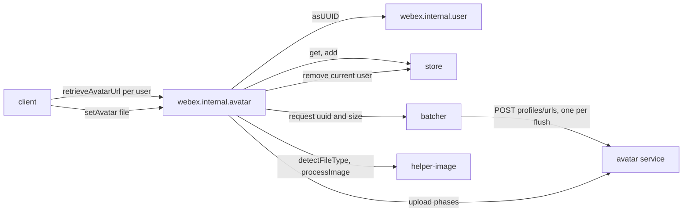
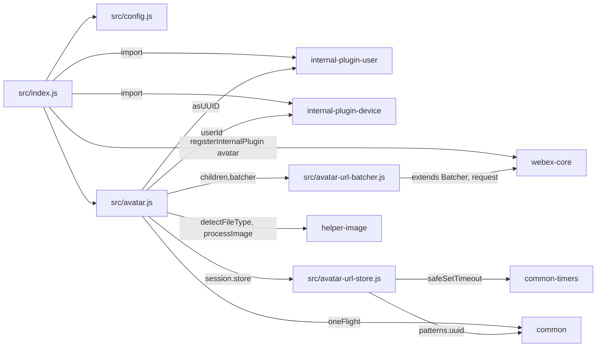
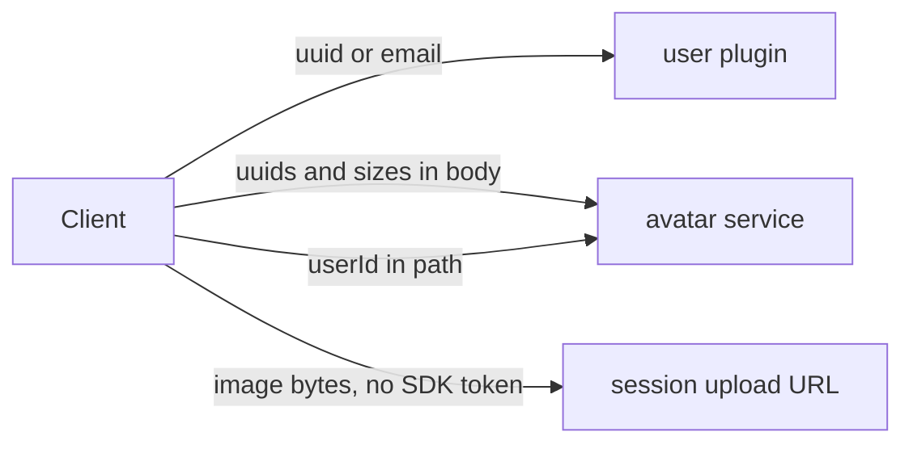

<!-- sdd-generated-metadata
doc_kind: standing-doc
generated_from: architecture@0.3.0
generated_by: claude-code
approved_by: rarajes2@cisco.com
updated_at: 2026-11-12T15:45:09Z
validation_status: pass
-->

# @webex/internal-plugin-avatar architecture

Canonical architecture for this package. Flow behavior lives in the
[Avatar plugin specification](../src/docs/README.md). This page owns package boundaries, the plugin
registration, the contract index, and how the package meets the rest of the SDK.

Related context: [specification registry](specs/README.md) ·
[package agent instructions](../AGENTS.md)

## Applicability

| Condition ID                         | Status     | Evidence or reason | Owned section |
| ------------------------------------ | ---------- | ------------------ | ------------- |
| `repo.owns_datastore`                | N/A        | No database, file store, or migration; `src/avatar-url-store.js` is an in-memory map | Repository data and schema |
| `repo.holds_client_state`            | Applicable | `src/avatar-url-store.js` keeps avatar URLs per webex instance; `src/avatar.js` declares the store and enableThumbnails session properties | Client state model |
| `repo.components_interact`           | Applicable | `src/avatar.js` mounts the batcher child and owns the store; it calls the user, device, and helper-image packages | Dependency and interaction topology |
| `repo.domain_data_across_components` | Applicable | Avatar items pass from the avatar service through `src/avatar-url-batcher.js` into `src/avatar-url-store.js` and back to callers | Object and data ownership |
| `repo.caches_data`                   | Applicable | `src/avatar-url-store.js` caches URLs with a TTL from `src/config.js` | Caching catalog |
| `repo.observability_convention`      | N/A        | One warning in `src/avatar-url-batcher.js` and the logger handed to helper-image in `src/avatar.js`; no metric, trace, or logging convention | Observability patterns |
| `repo.deploys_to_infra`              | N/A        | Library published to npm (`package.json`). No service runtime | Runtime and infrastructure |
| `repo.shared_base_libs`              | Applicable | Extends WebexPlugin and Batcher and uses the legacy build, lint, and test stack (`babel.config.js`, `jest.config.js`, `.eslintrc.js`) | Shared and base libraries |
| `repo.is_monorepo`                   | N/A        | This SDD root is one package. The workspace around it is out of scope | Package map and inter-package dependencies |
| `repo.multi_platform`                | Applicable | setAvatar in `src/avatar.js` runs a Node or a browser image pipeline, chosen by the helper-image package's browser field; `process` declares {browser: true} | Platform matrix |
| `repo.published_package`             | Applicable | `package.json` name is @webex/internal-plugin-avatar and deploy:npm publishes it | Release and versioning |
| `repo.embedded_in_host`              | N/A        | No host theme or embed API in `src/avatar.js` | Host integration and theming |
| `repo.exposes_commands_or_artifacts` | Applicable | build:src in `package.json` writes dist | Commands and generated artifacts |
| `repo.cross_repo_deps_material`      | Applicable | Behavior depends on the avatar service and its upload sessions (`src/avatar-url-batcher.js`, `src/avatar.js`) | Cross-repository topology |
| `repo.security_arch_warranted`       | Applicable | User identifiers and the current user id reach request bodies and paths, and the image bytes go to a session URL without the SDK token (`src/avatar.js`) | Security architecture |

## Design overview

`@webex/internal-plugin-avatar` is a published JavaScript library with one module. Importing it
registers the user and device plugins and then `Avatar` as the internal plugin `avatar`, reached as
`webex.internal.avatar`. Inside this repository `@webex/webex-server` and
`@webex/recipe-private-web-client` import it to register it; no workspace package calls it, so its
callers are first-party clients.

An avatar is the picture the avatar service holds for a user, served at a URL per size. The plugin
answers "URL for this user at this size" from an in-memory store when it can, and otherwise through a
batcher that sends one lookup for every caller in a short window. A miss also prefetches every
standard size of that user. The store expires entries after a client-side TTL, one hour by default.
The plugin also uploads a new avatar for the current user and clears that user's cached sizes.

The package serves no routes and persists nothing.

## Resource inventory and responsibilities

| Resource | Kind | Responsibility | Owner | Source | Detailed specification |
| -------- | ---- | -------------- | ----- | ------ | ---------------------- |
| Avatar plugin | package (one module) | Registration; URL lookup, batching, and caching; avatar upload | @webex/web-sdk | src | [`src/docs/README.md`](../src/docs/README.md) |

## Interaction and execution flows

Representative end-to-end flow: a client renders a list of users, then the current user changes their
avatar.

| From | To | Interaction or transport | Purpose | Failure or compatibility behavior |
| ---- | -- | ------------------------ | ------- | --------------------------------- |
| Client | `webex.internal.avatar` | In-process calls | URL lookup and avatar upload | Rejections propagate |
| `Avatar` | User plugin | In-process call | uuid for an email or user object | Its rejection rejects the lookup |
| `Avatar` | Device plugin | Property read | Current user id for the upload path | Read at call time |
| `Avatar` | helper-image | In-process calls | File type and resized image | A non-image resolves undefined |
| `AvatarUrlBatcher`, `Avatar` | Avatar service | HTTPS through `webex.request` and `webex.upload` | Batched URL lookup; upload sessions | No retry here except the webex-core upload phase |

## Dependency topology

| Dependency | Type | Used by | Purpose | Version, failure, or fallback policy |
| ---------- | ---- | ------- | ------- | ------------------------------------ |
| `@webex/webex-core` | Internal | `src/index.js`, `src/avatar.js`, `src/avatar-url-batcher.js` | Registration, plugin base, `Batcher`, `webex.request`, `webex.upload` | `workspace:*` in `package.json` |
| `@webex/internal-plugin-user` | Internal | `src/index.js`, `src/avatar.js` | `asUUID` | `workspace:*` |
| `@webex/internal-plugin-device` | Internal | `src/index.js`, `src/avatar.js` | `userId` | `workspace:*` |
| `@webex/helper-image` | Internal | `src/avatar.js` | `detectFileType`, `processImage` | `workspace:*` |
| `@webex/common` | Internal | `src/avatar.js`, `src/avatar-url-store.js` | `oneFlight`, `patterns.uuid` | `workspace:*` |
| `@webex/common-timers` | Internal | `src/avatar-url-store.js` | `safeSetTimeout` | `workspace:*` |
| `lodash` | External | `src/avatar.js`, `src/avatar-url-batcher.js` | `defaults`, `uniq` | `^4.17.21` |
| Avatar service | External service | `src/avatar-url-batcher.js`, `src/avatar.js` | URL lookup and upload sessions | Resolved through the service catalog as `avatar` |

Every dependency `package.json` declares is imported by `src/`. No import cycle exists: none of the
packages this one imports imports it back.

## Public and consumer surfaces

| Surface | Type | Owner | Consumers | Compatibility policy | Source |
| ------- | ---- | ----- | --------- | -------------------- | ------ |
| `avatar-internal-sdk` — package @webex/internal-plugin-avatar, `webex.internal.avatar` with `retrieveAvatarUrl`, `setAvatar`, `enableThumbnails`, and the config | SDK, published to npm, internal | Avatar plugin | `@webex/webex-server` and `@webex/recipe-private-web-client`, which register it; first-party clients | The README states that internal plugins do not strictly follow semantic versioning; no deprecation rule is declared | `package.json`, `src/index.js`, `src/avatar.js`, `src/config.js` |

The batch lookup and upload-session requests are protocols this package speaks with the avatar
service, described under *Protocol and wire format* in the
[module specification](../src/docs/README.md#protocol-and-wire-format). The other contracts this
package requires are registered in `.sdd/manifest.json` `contract_catalog`.

## Client state model

| State or slice | Owner | Transition triggers | Persistence or reset boundary |
| -------------- | ----- | ------------------- | ----------------------------- |
| Avatar URL store | Avatar plugin (`store` session property) | Lookup results add entries; TTL timers and `setAvatar` remove them | In memory per webex instance; never persisted; see the Caching catalog |
| `enableThumbnails` | Avatar plugin | Set by the host | In memory; default `true` |

Entry-level transitions, pending lookups, and in-flight de-duplication are specified in the module
specification's [Client state model](../src/docs/README.md#client-state-model).

## Cross-cutting architecture

### Security

- Trust boundaries and identity flow: see [Security architecture](#security-architecture).
- Sensitive surfaces and data classes: user uuids and emails, avatar URLs, and the uploaded image.
- Encryption and secret boundaries: see [Security architecture](#security-architecture).

### Observability and operations

- Logging and correlation: one warning when the service substitutes a size; it prints the two sizes
  only. Request tracking comes from the webex-core interceptors.
- Metrics, traces, and audit signals: none.
- Ownership and operational entry points: `.github/CODEOWNERS` at the workspace root has no line for
  this package, so its default rule assigns it to `@webex/web-sdk`. No dashboards or runbooks are
  recorded in this package.

### Quality attributes

- Compatibility: clients rely on the registered name `avatar`, the two public methods and their
  options, `null` for a hidden default avatar, the default size 80, and the one-hour TTL.
- Efficiency: lookups from all callers in a flush window become one request, and a miss caches every
  standard size of the user (`INV-002` in the module specification).
- Test confidence: 23 unit cases cover retrieval, batching, the fingerprints, and the store guards;
  registration, the HTTP error path, missing sizes, the TTL timer, and `setAvatar` have no unit case.
  No coverage threshold is enforced.

## Dependency and interaction topology

| From | To | Kind | Purpose | Ordering or failure boundary |
| ---- | -- | ---- | ------- | ---------------------------- |
| `src/index.js` | webex-core | Call at import | Register `avatar` | First registration wins |
| `src/avatar.js` | `src/avatar-url-batcher.js` | `children` map | Mount `batcher` | Created with each `Avatar` instance |
| `src/avatar.js` | `src/avatar-url-store.js` | Session property default | One store per instance | Created with each `Avatar` instance |
| `src/avatar.js` | User plugin | Call | uuid resolution | Before any store or batcher call |
| `src/avatar-url-store.js` | common-timers | Call | Expiry timer per entry | Unref-ed on Node |

## Object and data ownership

| Object or state | System of record | May write | May read | Movement or lifecycle |
| --------------- | ---------------- | --------- | -------- | --------------------- |
| Avatar image and its per-size URLs | Avatar service | The current user, through `setAvatar` | Any client, through `retrieveAvatarUrl` | Fetched per miss; cached here for the TTL |
| Avatar item `{uuid, size, url, hasDefaultAvatar, cacheControl}` | This package (derived from the service response) | `AvatarUrlBatcher`, then `AvatarUrlStore.add` | `retrieveAvatarUrl` | Lives in the store until its TTL ends or `setAvatar` removes it |
| User uuid | User service, through the user plugin | The user plugin | This package | Resolved per call |
| Current user id | Device plugin | The device plugin | `setAvatar` | Read per call |

## Caching catalog

| Cache | Owner | Backend | Contents | TTL or bound | Invalidation trigger | Failure behavior |
| ----- | ----- | ------- | -------- | ------------ | -------------------- | ---------------- |
| Avatar URL store | `AvatarUrlStore` (`src/avatar-url-store.js`) | In-memory `Map` per webex instance | Avatar items keyed by uuid and size | `options.cacheControl` seconds, default `config.cacheControl` (3600); no size bound | The entry's timer; `setAvatar` removes the current user's eight standard sizes | A miss falls through to a batched lookup; a stale entry is served until its timer fires (`INV-001` in the module specification) |

## Shared and base libraries

| Library | Inherited responsibility | Consumers | Version floor | Compatibility rule |
| ------- | ------------------------ | --------- | ------------- | ------------------ |
| `@webex/webex-core` `WebexPlugin` | `webex`, `children`, `session`, `config`, `logger`, `request`, `upload` | `Avatar` | `workspace:*` | Keep the registered name `avatar` and the namespace `Avatar` |
| `@webex/webex-core` `Batcher` | Fingerprint de-duplication, capped debounce, deferred bookkeeping | `AvatarUrlBatcher` | `workspace:*` | The `avatar` config must keep the three batcher timing keys |
| `@webex/babel-config-legacy`, `@webex/eslint-config-legacy`, `@webex/jest-config-legacy`, `@webex/legacy-tools` | Build, lint, and test stack through one-line config files | Package tooling | `workspace:*` | Do not fork the config locally |

## Platform matrix

| Platform | Shared versus platform-specific boundary | Entry or build | Support and compatibility constraints |
| -------- | ---------------------------------------- | -------------- | ------------------------------------- |
| Browser | `retrieveAvatarUrl` is shared. `setAvatar` gets the canvas `processImage` from `@webex/helper-image`, which squares the avatar dimensions (`isAvatar`) | `package.json` browserify transforms; the helper-image browser field | Needs `Image`, `Blob`, and canvas |
| Node | `retrieveAvatarUrl` is shared. `setAvatar` gets the GraphicsMagick `processImage`, which ignores `isAvatar`; store timers are unref-ed | `package.json` `main` (`dist/index.js`) | Needs GraphicsMagick for `setAvatar`; without it `setAvatar` rejects |

## Release and versioning

| Artifact | Publish target | Versioning rule | Deprecation window | Changelog or migration obligation |
| -------- | -------------- | --------------- | ------------------ | --------------------------------- |
| @webex/internal-plugin-avatar | npm through `deploy:npm` | Internal plugin; the README says semantic versioning is not strictly followed | None declared | None declared in the package; the workspace owns changelog generation |

## Commands and generated artifacts

| Command or artifact | Owner | Inputs | Output or side effect | Compatibility boundary |
| ------------------- | ----- | ------ | --------------------- | ---------------------- |
| `yarn build:src` | Package scripts | `src` | Writes `dist/` (JavaScript and source maps) through `webex-legacy-tools` | `dist/` is generated and never edited by hand |
| `yarn build` | Package scripts | `src` | Runs `build:src` | Same output |
| `yarn test:unit` | Package scripts | `test/unit/spec`, `dist/` | Jest run | Run `build:src` first |
| `yarn test:style` | Package scripts | `src` | ESLint run | The shared config ignores `docs/**` and `*.md` |

## Cross-repository topology

| Repository or external system | Relationship | Exchanged contract or artifact | Owner | Sequencing constraint |
| ----------------------------- | ------------- | ------------------------------ | ----- | --------------------- |
| `@webex/webex-core` (workspace sibling; module spec consulted) | Consumes | `registerInternalPlugin`, `WebexPlugin`, `Batcher`, `upload` | @webex/web-sdk | Registered before the first instance |
| `@webex/internal-plugin-user` (workspace sibling; module spec consulted) | Consumes | `asUUID` | @webex/web-sdk | Imported before registration |
| `@webex/internal-plugin-device` (workspace sibling; module spec consulted) | Consumes | `userId` | @webex/web-sdk | Device registered before `setAvatar` |
| `@webex/helper-image` (workspace sibling; module spec consulted) | Consumes | `detectFileType`, `processImage` | @webex/web-sdk | None |
| `@webex/common`, `@webex/common-timers` (workspace siblings; module specs consulted) | Consumes | `oneFlight`, `patterns`, `safeSetTimeout` | @webex/web-sdk | None |
| `@webex/webex-server`, `@webex/recipe-private-web-client` (workspace siblings) | Consumed by | The plugin registration | @webex/web-sdk | None |
| Avatar service | Consumes | Batch URL lookup; upload sessions | Not recorded in this repository | Initialize, upload, then finalize |

## Security architecture

- This package holds no credential and no key. Lookups and the session requests carry the SDK
  authorization added by webex-core; the upload phase sends the image to the session URL without it
  (webex-core MOD-039).
- `setAvatar` writes to the current user's profile only: the path is built from
  `webex.internal.device.userId`, never from a caller argument.
- User uuids reach the lookup body, and emails reach the user plugin; the package logs neither.
- Avatar URLs are cached in memory only and dropped with the webex instance.

## Domain language

| Term | Repository-specific meaning | Authoritative source |
| ---- | --------------------------- | -------------------- |
| Avatar item | The cached record `{uuid, size, url, hasDefaultAvatar, cacheControl}` for one user and size | `src/avatar-url-batcher.js` |
| Standard sizes | `config.sizes`: 40, 50, 80, 110, 135, 192, 640, and 1600 pixels, all prefetched on a miss | `src/config.js` |
| Default avatar | A service placeholder for a user with no picture, flagged `defaultAvatar` in the response and hidden by `hideDefaultAvatar` | `src/avatar.js` |
| Size substitution | The service answering a different size than requested; logged and accepted | `src/avatar-url-batcher.js` |
| Flush | One batcher send of every lookup queued since the last one | `src/avatar-url-batcher.js` |
| `cacheControl` | Client TTL in seconds for a store entry; not the service field of the same name | `src/config.js` |

## References and maintenance

- Decisions: [adr/](adr/index.md)
- Instantiated specifications and routing: [specs/README.md](specs/README.md)
- Repository rules and patterns: [package agent instructions](../AGENTS.md)
- Update this document in the same change that alters package boundaries, resource ownership,
  cross-resource interaction, or cross-cutting architecture.
