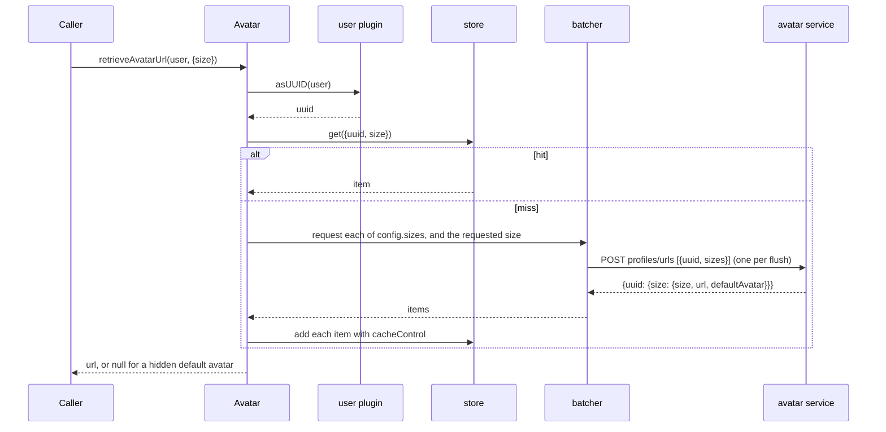
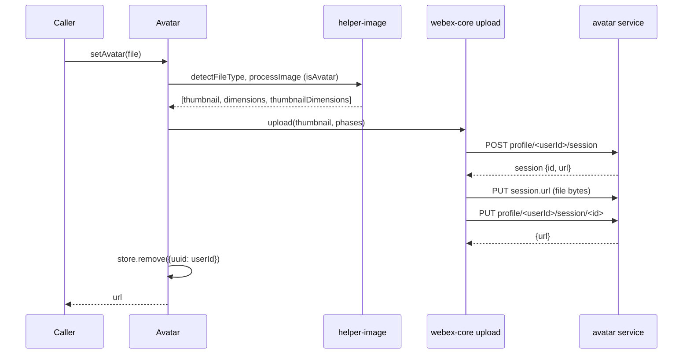
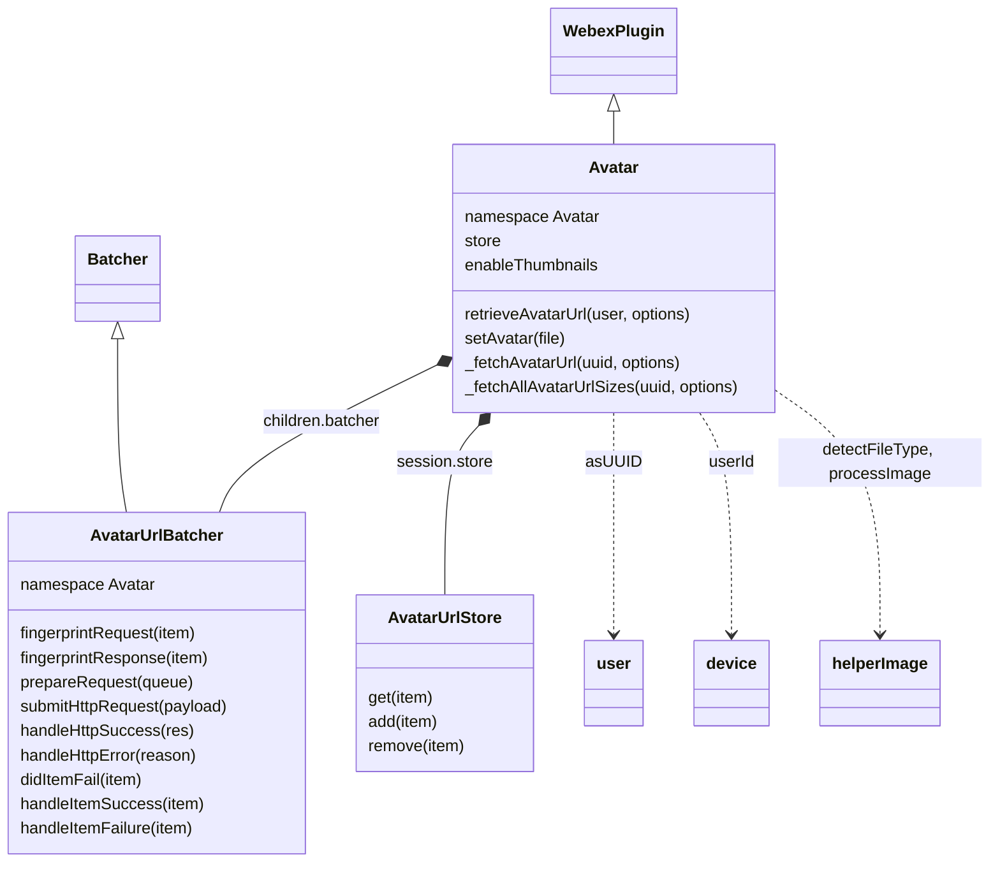

<!-- sdd-generated-metadata
doc_kind: module-spec
generated_from: module-spec@0.3.0
generated_by: claude-code
approved_by: rarajes2@cisco.com
updated_at: 2026-11-12T15:52:01Z
validation_status: pass
-->

# Avatar plugin

This source-local document at `src/docs/README.md` owns the stable specification for **the Avatar
plugin**: the internal plugin `webex.internal.avatar`, its `batcher` child, and its in-memory URL
store. It resolves a user (uuid, email, or user object) to an avatar URL of a requested size through
the avatar service, batches lookups for many users into one request, caches every standard size for a
fixed time, and uploads a new avatar for the current user. Ground every claim in package evidence and
link to the [package architecture](../../docs/architecture.md) instead of repeating broader facts. No
service specification exists because this package is a library.

Related context: [documentation index](../../docs/index.md) ·
[package agent instructions](../../AGENTS.md)

## Metadata

| Field             | Value |
| ----------------- | ----- |
| Owner             | @webex/web-sdk |
| Source path       | `src` |
| Resource kind     | package |
| Status            | Draft |
| Last verified     | 2026-11-12 at `6a61caf21b` |
| Module id         | `internal-plugin-avatar` |
| Parent spec       | — |
| Doc kind          | Module spec |
| Coverage score    | 100% assessed 2026-11-12 by the generator — 14 of 14 mandatory fields PRESENT, critical 7 of 7; `test:unit` runs 23 passing cases and 1 skipped case in `test/unit/spec/avatar.js`, `test/unit/spec/avatar-url-batcher.js`, and `test/unit/spec/avatar-url-store.js`, which cover URL retrieval and batching, `hideDefaultAvatar`, the fingerprints, the request, `didItemFail`, and the store guards; no case covers registration, the config defaults, `handleHttpError`, missing sizes in a response, the store timer, or `setAvatar` |
| Validation status | Pass — independent validation rerun 2026-11-12; 0 Blocking, 0 Important; prior A16 command catalog findings rechecked as fixed |

## Applicability

| Condition ID                         | Status     | Evidence or reason | Owned section |
| ------------------------------------ | ---------- | ------------------ | ------------- |
| `module.has_tiers`                   | N/A        | No tier policy exists in `package.json` or `src/avatar.js` | Tier |
| `module.has_ui`                      | N/A        | `src/avatar.js` resolves URLs and uploads a file; it renders nothing | UI use-case flow |
| `module.crosses_service_boundaries`  | Applicable | `src/avatar-url-batcher.js` and `src/avatar.js` call the avatar service; `src/avatar.js` calls the user and device plugins | Cross-boundary use-case flow |
| `module.holds_client_state`          | Applicable | `src/avatar-url-store.js` keeps a per-instance map of avatar URLs with expiry timers; `src/avatar.js` declares the store and enableThumbnails session properties | Client state model |
| `module.enforces_domain_rules`       | Applicable | Store guards and the uuid pattern check in `src/avatar-url-store.js`; the size list and TTL in `src/config.js` | Business rules and invariants |
| `module.is_concurrent_async`         | Applicable | `src/avatar.js` de-duplicates concurrent fetches with oneFlight; `src/avatar-url-batcher.js` debounces lookups into batches; `src/avatar-url-store.js` expires entries on timers | Concurrency and reactive flow |
| `module.owns_persistence`            | N/A        | `src/avatar-url-store.js` holds an in-memory map only; nothing is written to storage | Data, schema, and migration discipline |
| `module.stateful_transitions`        | N/A        | A store entry is either present or absent (`src/avatar-url-store.js`); no entity moves through states | State machine |
| `module.exposes_wire_protocol`       | Applicable | The batch request and response read in `src/avatar-url-batcher.js` and the upload session paths in `src/avatar.js` | Protocol and wire format |
| `module.ui_multi_screen`             | N/A        | No UI | UI flow |
| `module.large_data_model`            | N/A        | One item shape {uuid, size, url, hasDefaultAvatar, cacheControl} in `src/avatar-url-batcher.js`; covered under Protocol and wire format | Data model |
| `module.returns_caller_errors`       | Applicable | Guard, lookup, batch, and upload failures reject from `src/avatar.js` and `src/avatar-url-store.js` | Caller-visible failure modes |
| `module.module_specific_conventions` | Applicable | The store key format and the fixed size list in `src/avatar-url-store.js` and `src/config.js` | Module-specific rules |
| `module.published_package`           | Applicable | `package.json` names the package @webex/internal-plugin-avatar and defines deploy:npm | Export stability |
| `module.embedded_in_host`            | N/A        | No host theme or embed API | Host integration and theming |
| `module.has_design_tradeoff`         | Applicable | The all-sizes prefetch in `src/avatar.js` and the client-side TTL in `src/config.js` | Key design trade-off |
| `module.has_submodules`              | N/A        | The src directory has no child module | Sub-modules |

## Evidence register

| Evidence | What it establishes |
| -------- | ------------------- |
| `src/index.js` | Imports `@webex/internal-plugin-user` and `@webex/internal-plugin-device`, then `registerInternalPlugin('avatar', Avatar, {config})` at import time; re-exports only the default `Avatar` |
| `src/avatar.js` | `Avatar` extends `WebexPlugin` in namespace `Avatar` with child `batcher`, session properties `store` and `enableThumbnails`, the `oneFlight`-decorated `_fetchAllAvatarUrlSizes` and `_fetchAvatarUrl`, and the public `retrieveAvatarUrl` and `setAvatar`; its comments and JSDoc are the only recorded rationale for the prefetch, the size fallback, and the cache invalidation |
| `src/avatar-url-batcher.js` | `AvatarUrlBatcher` extends the webex-core `Batcher` in namespace `Avatar`: fingerprints, payload grouping, the `profiles/urls` request, response mapping, size-substitution warning, and error fan-out |
| `src/avatar-url-store.js` | `AvatarUrlStore`: a `WeakMap`-held `Map` keyed by uuid and size, with `get`, `add` (guards and expiry timer), and `remove` (one size or a fixed list of eight) |
| `src/config.js` | The default `avatar` config: batcher timings, `cacheControl` (seconds, commented as the store TTL), `defaultAvatarSize`, `sizes`, and the thumbnail bounds |
| `package.json` | Name, `main` (`dist/index.js`), `devMain` (`src/index.js`), `engines` (`node >=16`), dependencies, and scripts; `test:unit` exists, `test:integration` does not |
| `test/unit/spec/avatar.js` | 15 cases (one skipped) through `retrieveAvatarUrl` with a stubbed `webex.request`: single and grouped retrieval, non-default and non-standard sizes, duplicates, `hideDefaultAvatar`, and a rejection passed through from a stubbed `_fetchAvatarUrl`; each grouped case asserts exactly one request |
| `test/unit/spec/avatar-url-batcher.js` | 6 cases: fingerprints, the `submitHttpRequest` options, and `didItemFail` |
| `test/unit/spec/avatar-url-store.js` | 3 cases: the `add` and `get` guards, and add, get, and remove including remove-all-sizes |
| `test/integration/spec/avatar.js` | Creates two test users and registers devices; every `describe` and `it` is commented out, so it holds no case; run only by `test:browser` |
| `README.md` | Retained npm page; context only. Its Usage block shows a placeholder member and no method; see `docs/adr/0001-retain-product-readme.md` |
| Sibling package webex-core, file src/docs/README.md | Module spec consulted, agrees with code. `registerInternalPlugin` keys the plugin by its raw name and the first registration wins (MOD-013) and merges `config` into the defaults (MOD-008); `WebexPlugin.config` is the lowercased namespace key (MOD-044); `Batcher` de-duplicates by fingerprint (MOD-050), flushes on a capped debounce from three config keys its subclass must provide (MOD-051), and settles every queued deferred on failure (MOD-052); `upload` phases and result (MOD-038 to MOD-042) |
| Sibling package common, file src/docs/README.md | Module spec consulted, agrees with code. The code shows `oneFlight` keys a flight by method name plus `keyFactory(...args)` per instance and drops it on settle unless `cacheSuccesses` or `cacheFailures` is set, and `patterns.uuid` matches lowercase hex only |
| Sibling package common-timers, file src/docs/README.md | Module spec consulted, agrees with code: `safeSetTimeout` forwards to `setTimeout` and unrefs the handle where supported (MOD-001, MOD-002) and names avatar as a consumer |
| Sibling package helper-image, file src/docs/README.md | Module spec consulted, agrees with code: `detectFileType` resolves a MIME type or `null`; `processImage` resolves undefined for a non-image (MOD-007) or the triple `[thumbnail, fileDimensions, thumbnailDimensions]` (MOD-008); the thumbnail is empty when `enableThumbnails` is off (MOD-009); `isAvatar` is honored only in the browser (MOD-013) |
| Sibling package internal-plugin-user, file src/docs/README.md | Module spec consulted, agrees with code: `asUUID` rejects a missing user, returns a uuid unchanged, and resolves an email through the user batcher (MOD-002, MOD-004) |
| Sibling package internal-plugin-device, file src/docs/README.md | Module spec consulted: `userId` is a registration property other plugins read from `webex.internal.device` |
| Observation, no stated WHY | Behavior the code shows without stating a reason is recorded once, under Pitfalls and constraints |

## Purpose and boundary

- Responsibility: give Webex clients an avatar URL for any user at a requested size with as few
  avatar-service calls as possible, and let the current user replace their avatar.
- In scope: registration of `avatar` and its config; `retrieveAvatarUrl` and `setAvatar`; the
  underscore-prefixed `_fetchAvatarUrl` and `_fetchAllAvatarUrlSizes`; the `batcher` child
  (`AvatarUrlBatcher`); the `store` session property (`AvatarUrlStore`) and its expiry; the
  `enableThumbnails` session property.
- Out of scope: resolving emails and user objects to uuids (`@webex/internal-plugin-user`); device
  registration and the current user id (`@webex/internal-plugin-device`); batching mechanics, the
  upload pipeline, service-catalog resolution, and request interceptors (`@webex/webex-core`); file-type
  detection and image resizing (`@webex/helper-image`); downloading or rendering the image at the
  returned URL; what the avatar service stores.
- Consumers: in this repository `@webex/webex-server` and `@webex/recipe-private-web-client` import the
  package to register it; no workspace package calls its methods. First-party clients reach the plugin
  as `webex.internal.avatar`.

## Structure and key files

| Path | Responsibility |
| ---- | -------------- |
| `src/index.js` | Imports the user and device plugins, registers internal plugin `avatar` with its config, and re-exports the class as default |
| `src/avatar.js` | `Avatar`: public methods, the two `oneFlight` fetch helpers, the `batcher` child, and the `store` and `enableThumbnails` session properties |
| `src/avatar-url-batcher.js` | `AvatarUrlBatcher`: groups lookups into one `POST profiles/urls` and maps the response back to each caller |
| `src/avatar-url-store.js` | `AvatarUrlStore`: in-memory URL cache with per-entry expiry |
| `src/config.js` | The `avatar` config defaults |
| `package.json` | Package name, entry points, scripts, and dependencies |
| `babel.config.js`, `jest.config.js` | Re-exports of the legacy Babel and Jest configurations |
| `.eslintrc.js` | Sets `root: true` and extends `@webex/eslint-config-legacy` |
| `process` | Package-root file exporting `{browser: true}`; not imported by `src/` |
| `src/docs/README.md` | This module specification; ignored by the build and by lint |
| `test/unit/spec/avatar.js`, `test/unit/spec/avatar-url-batcher.js`, `test/unit/spec/avatar-url-store.js` | Unit cases run by `test:unit` |
| `test/integration/spec/avatar.js` | Live-service setup only, run by `test:browser`; all cases are commented out |
| dist/ (generated) | Build output of `build:src`; ignored by Git and never edited by hand |

## Public surface

| Surface | Consumer | Compatibility commitment | Source |
| ------- | -------- | ------------------------ | ------ |
| Import side effect: internal plugin `avatar` with the `avatar` config, and the user and device plugins | `@webex/webex-server`, `@webex/recipe-private-web-client` | First registration of the name wins; reached as `webex.internal.avatar` | `src/index.js`, `src/config.js` |
| `retrieveAvatarUrl(user, options)` | First-party clients | Resolves a URL string, or `null` with `options.hideDefaultAvatar` for a default avatar | `src/avatar.js` |
| `setAvatar(file)` | First-party clients | Resolves the `url` of the finalize response | `src/avatar.js` |
| `enableThumbnails` session property | First-party clients | Boolean, default `true`; passed to `processImage` by `setAvatar` | `src/avatar.js` |
| `store` session property (`get`, `add`, `remove`) and `batcher` child | The unit specs | Reachable on the instance; not documented as entries for callers | `src/avatar.js`, `src/avatar-url-store.js`, `src/avatar-url-batcher.js` |
| `_fetchAvatarUrl(uuid, options)`, `_fetchAllAvatarUrlSizes(uuid, options)` | `retrieveAvatarUrl` | Underscore-prefixed; reachable on the instance but not supported entries | `src/avatar.js` |
| Default export `Avatar` | The unit specs; clients that mount the class themselves | The entry exports nothing else; `config` is not exported | `src/index.js` |

Contract ID `avatar-internal-sdk` is indexed in the
[package architecture](../../docs/architecture.md#public-and-consumer-surfaces) and registered in
`.sdd/manifest.json`. Export stability is under [Export stability](#export-stability).

## Dependencies

| Dependency | Why it is required | Failure behavior |
| ---------- | ------------------ | ---------------- |
| `@webex/webex-core` plugin host (module spec consulted) | `registerInternalPlugin`, `WebexPlugin` (`webex`, `children`, `session`, namespaced config, `logger`, `upload`), and `webex.request` | A request or upload rejection rejects the method |
| `@webex/webex-core` `Batcher` (module spec consulted) | Base of `AvatarUrlBatcher`: fingerprint de-duplication, capped debounce, deferred bookkeeping, and failure fan-out | A failed flush settles every queued deferred (webex-core MOD-052) |
| `@webex/webex-core` services (resolved through `api: 'avatar'`) | Maps `api: 'avatar'` with a resource to the avatar service URL | A missing catalog entry rejects the request |
| `@webex/internal-plugin-user` (module spec consulted) | `asUUID(user)` turns an email or user object into a uuid | Its rejection propagates; see Caller-visible failure modes |
| `@webex/internal-plugin-device` (module spec consulted) | `userId` names the current user for `setAvatar` | An unset `userId` puts `undefined` in the upload path |
| `@webex/helper-image` (module spec consulted) | `detectFileType` and `processImage` for `setAvatar` | Resolves undefined for a non-image; see Caller-visible failure modes |
| `@webex/common` (module spec consulted; code consulted for `oneFlight`) | `oneFlight` de-duplicates concurrent fetches; `patterns.uuid` validates store keys | Not applicable |
| `@webex/common-timers` (module spec consulted) | `safeSetTimeout` schedules store expiry without holding a Node process open | Not applicable |
| `lodash` | `defaults` for options and items; `uniq` for sizes | Not applicable |
| Avatar service (external) | Batch URL lookup and avatar upload sessions | Errors propagate |

## Requirements

| ID | WHAT | WHY | Source evidence | Test or example evidence | Assumptions or gaps | Confidence |
| -- | ---- | --- | --------------- | ------------------------ | ------------------- | ---------- |
| `MOD-001` | Importing the package imports `@webex/internal-plugin-user` and `@webex/internal-plugin-device`, then registers `Avatar` as internal plugin `avatar` with `config` from `src/config.js`, so the plugin is `webex.internal.avatar`. The entry re-exports only the default `Avatar`. | `retrieveAvatarUrl` calls `webex.internal.user.asUUID` and `setAvatar` reads `webex.internal.device.userId`, so both plugins must be registered (inferred from the calls). | `src/index.js`, `src/avatar.js` | `test/unit/spec/avatar.js` imports the package but mounts the class through a mock children map, so registration is not asserted | WHY inferred from the calls | Weak |
| `MOD-002` | The default config is `avatar: {batcherWait: 100, batcherMaxCalls: 100, batcherMaxWait: 1500, cacheControl: 3600, defaultAvatarSize: 80, sizes: [40, 50, 80, 110, 135, 192, 640, 1600], thumbnailMaxHeight: 960, thumbnailMaxWidth: 640}`. `Avatar` and `AvatarUrlBatcher` both use namespace `Avatar`, so both read `config.avatar`. | The config comments: `cacheControl` is the store TTL in seconds and lets avatar updates eventually propagate; `defaultAvatarSize` applies when no size is given. The webex-core `Batcher` takes its timings from the subclass namespace (webex-core MOD-051). | `src/config.js`, `src/avatar.js`, `src/avatar-url-batcher.js` | `test/unit/spec/avatar.js` overrides the batcher, cache, and size keys in beforeEach, so the defaults are not asserted | The thumbnail comments describe image sharing, not avatars | Present |
| `MOD-003` | `Avatar` declares child `batcher: AvatarUrlBatcher` and session properties `store` (a new `AvatarUrlStore` per instance, type `any`) and `enableThumbnails` (boolean, default `true`). | Each webex instance gets its own cache and batch queue (inferred from the per-instance default). | `src/avatar.js` | `test/unit/spec/avatar-url-store.js` and `test/unit/spec/avatar-url-batcher.js` reach webex.internal.avatar.store and webex.internal.avatar.batcher | WHY inferred | Present |
| `MOD-004` | `retrieveAvatarUrl(user, options)` rejects with `'user' is a required parameter` when `user` is falsy. Otherwise it fills `options` with lodash `defaults` (`cacheControl: config.cacheControl`, `size: config.defaultAvatarSize`, only where the key is `undefined`), resolves the uuid with `webex.internal.user.asUUID(user)`, fetches through `_fetchAvatarUrl` (`MOD-005`), and resolves the item's `url`; when `options.hideDefaultAvatar` is truthy and the item's `hasDefaultAvatar` is truthy it resolves `null` instead. | The JSDoc: retrieves an avatar from a cache or the API on misses; `hideDefaultAvatar` does not return a default avatar URL. | `src/avatar.js` | `test/unit/spec/avatar.js` guard case, single and grouped retrieval, and both hideDefaultAvatar cases | The JSDoc says size defaults to 80 "if falsy"; see Pitfalls | Present |
| `MOD-005` | `_fetchAvatarUrl(uuid, options)` resolves the stored item for `{uuid, size: options.size}` when the store has one, with no request. On a miss it runs `_fetchAllAvatarUrlSizes(uuid, options)` (`MOD-006`) and `batcher.request({uuid, size: options.size})` together, waits for both, then adds the requested-size item to the store with `cacheControl: options.cacheControl` and resolves what `store.add` resolves. It is decorated with `oneFlight` keyed by `uuid + String(options.size)`. | The code comments: fetch all possible sizes and store them; the extra request covers a size outside the predefined list. | `src/avatar.js` | `test/unit/spec/avatar.js` single non-default and non-standard cases assert the URL; the grouped non-default, non-standard, and multiple-sizes cases assert one request | — | Present |
| `MOD-006` | `_fetchAllAvatarUrlSizes(uuid, options)` requests every size in `config.sizes` through the batcher and adds each result to the store with `cacheControl: options.cacheControl`. It is decorated with `oneFlight` keyed by `uuid` alone, and it rejects if any one size rejects. | The code comment: fetch all possible sizes of the avatar and store them in the cache, so a later request for another size is a store hit. | `src/avatar.js` | `test/unit/spec/avatar.js` multiple-sizes case | The skipped case `rejects each avatar missing from the response` covers the partial-response path | Present |
| `MOD-007` | The batcher fingerprints both a request item and a response item as `<uuid>-<size>`. `prepareRequest` groups the queue by uuid in first-seen order into `[{uuid, sizes}]`, with sizes de-duplicated by lodash `uniq` in insertion order, and `submitHttpRequest` POSTs that payload as the body to service `avatar`, resource `profiles/urls`. | One lookup per uuid and size, and one request for every user in a flush (inferred from the grouping and webex-core MOD-050). | `src/avatar-url-batcher.js` | `test/unit/spec/avatar-url-batcher.js` fingerprint and request cases; `test/unit/spec/avatar.js` grouped and duplicate cases assert one request | The `fingerprintResponse` case calls `fingerprintRequest`; see Pitfalls | Present |
| `MOD-008` | `handleHttpSuccess(res)` walks the sent payload in `res.options.body` and, for each uuid and size, accepts `res.body[uuid][size]` or `undefined`. An item without a response fails and its caller rejects with `Failed to retrieve avatar`. An item whose response `size` differs from the requested size logs `Avatar: substituted size "<response size>" for "<requested size>"` as a warning and succeeds. A successful item resolves `{hasDefaultAvatar: response.defaultAvatar, uuid, size, url: response.url}`, where `size` is the requested size. | The service may answer a different size than asked; the warning records the substitution (inferred from the log text). Walking the sent payload settles every caller even when the response omits a size (inferred). | `src/avatar-url-batcher.js` | `test/unit/spec/avatar-url-batcher.js` three didItemFail cases; `test/unit/spec/avatar.js` retrieval cases | The missing-size case is `it.skip` | Present |
| `MOD-009` | `handleHttpError(reason)` takes `reason.message`, else `reason.body`, else `reason`, and rejects the deferred of every uuid and size in `reason.options.body` with it, wrapped in `new Error` unless it is already an `Error`. | Every caller in a failed batch gets a rejection (inferred; webex-core MOD-052 adds a fallback when this handler itself fails). | `src/avatar-url-batcher.js` | `test/unit/spec/avatar.js` rejects each requested avatar if the api call fails stubs _fetchAvatarUrl, so it does not reach this handler | No case exercises it | Weak |
| `MOD-010` | `store.get(item)` and `store.add(item)` reject, in this order, with `` `item` is required ``, `` `item.uuid` is required ``, `` `item.size` is required ``, and `` `item.uuid` does not appear to be a uuid `` (`patterns.uuid`); `add` then rejects with `` `item.url` is required `` and `` `item.cacheControl` is required `` (any falsy value, including `0`). `get` resolves the stored object for key `<uuid> - <size>` or rejects with `No URL found by specified id: <JSON of item>`. `add` schedules `remove(item)` after `cacheControl * 1000` ms with `safeSetTimeout`, stores the item under its key, and resolves it. | The JSDoc: get resolves the avatar item or rejects on a bad param or a miss; add rejects on bad params. The TTL lets avatar updates eventually propagate (config comment). | `src/avatar-url-store.js` | `test/unit/spec/avatar-url-store.js` add and get guard cases and the set, get, remove case | The expiry timer is not asserted | Present |
| `MOD-011` | `store.remove(item)` deletes key `<uuid> - <size>` when `item.size` is truthy; otherwise it deletes the keys for the fixed sizes 40, 50, 80, 110, 135, 192, 640, and 1600. It resolves `true` and has no guard. | The JSDoc: remove the URL for the uuid and size, or the URLs of all sizes when no size is given. | `src/avatar-url-store.js` | `test/unit/spec/avatar-url-store.js` set, get, remove case, including remove by uuid only | The list is not read from `config.sizes`; see Pitfalls | Present |
| `MOD-012` | `setAvatar(file)` calls `detectFileType(file, logger)`, then `processImage({file, type, thumbnailMaxWidth, thumbnailMaxHeight, enableThumbnails: this.enableThumbnails, logger, isAvatar: true})`, then `upload` with `api: 'avatar'`, resource `profile/<device.userId>/session`, `file: processedImage[0]`, an upload phase whose `uri` is the session `url`, and a finalize phase `PUT` to `profile/<device.userId>/session/<session.id>`. After the upload resolves it calls `store.remove({uuid: device.userId})` and resolves the response `url`. | The JSDoc: upload a new avatar for the current user and resolve the URL of the full-sized avatar. The code comment: invalidate the user's cached avatar. | `src/avatar.js` | None found; the integration cases are commented out | Untested. `processedImage[0]` is the generated thumbnail (helper-image MOD-008), so what is uploaded is the resized image | Present |

## Design overview

`Avatar` is a `WebexPlugin` that turns "which user, which size" into a URL while keeping the avatar
service traffic low. Three layers do the work. `retrieveAvatarUrl` normalizes the arguments and the
user. `_fetchAvatarUrl` answers from the store when it can; on a miss it fetches the requested size and
every standard size at once, so the next size asked for the same user is a store hit. The `batcher`
child collects lookups from all callers for up to 1.5 seconds and sends them as one `POST
profiles/urls`, grouped by uuid.

The store is a plain in-memory map keyed by uuid and size. Every entry expires after
`options.cacheControl` seconds, one hour by default, so a changed avatar shows up within the TTL.
`setAvatar` is the one write path: it shrinks the image through `@webex/helper-image`, uploads it
through the webex-core three-phase upload, and drops the current user's cached sizes.

## Data flow and sequence coverage

Call style: in-process method calls on `webex.internal.avatar`; outbound HTTPS through `webex.request`
(batched lookups) and `webex.upload` (avatar upload); uuid resolution through the user plugin. Two
operation groups differ in actors and outcome, and each has a diagram.

| Operation group | Entry and outcome | Diagram or evidence | Failure and recovery coverage |
| --------------- | ----------------- | ------------------- | ----------------------------- |
| Retrieve a URL | `retrieveAvatarUrl` resolves a uuid, then answers from the store or from one batched lookup that also prefetches every standard size | Diagram 1; `src/avatar.js`, `src/avatar-url-batcher.js`, `src/avatar-url-store.js` | Guard rejects first; a lookup error or a missing size rejects every affected caller |
| Set the current user's avatar | `setAvatar` resizes the image, uploads it in three phases, and invalidates the user's cached sizes | Diagram 2; `src/avatar.js` | Image, upload, and finalize errors reject; the cache is cleared only on success |

Diagram 1 — retrieve a URL:

Diagram 2 — set the current user's avatar:

## Class and component relationships

## Use cases and flows

| Use case | Actor or caller | Primary steps and outcome | Failure or boundary behavior | Evidence |
| -------- | --------------- | ------------------------- | ---------------------------- | -------- |
| `UC-001` | Client rendering one user | `retrieveAvatarUrl(uuidOrEmail)` resolves the 80 px URL; a second call for another standard size of the same user is answered from the store | Missing user rejects; lookup errors reject | `src/avatar.js`, `test/unit/spec/avatar.js` |
| `UC-002` | Client rendering a list of users | Many `retrieveAvatarUrl` calls inside one flush window become one `POST profiles/urls` | Every caller in a failed batch rejects | `src/avatar-url-batcher.js`, `test/unit/spec/avatar.js` |
| `UC-003` | Client that shows initials instead of a placeholder | `retrieveAvatarUrl(user, {hideDefaultAvatar: true})` resolves `null` for a default avatar | — | `src/avatar.js`, `test/unit/spec/avatar.js` |
| `UC-004` | Current user changing their picture | `setAvatar(file)` resolves the new URL and drops the user's cached sizes | A non-image file rejects with a `TypeError`; see Caller-visible failure modes | `src/avatar.js` |

### Cross-boundary use-case flow

| Boundary | Transport and ordering | Compatibility | Timeout, retry, and recovery |
| -------- | ---------------------- | ------------- | ---------------------------- |
| User plugin (`UC-001` to `UC-003`) | In-process `asUUID` before any avatar lookup | Owned by `@webex/internal-plugin-user` | Its rejection rejects the call; no retry here |
| Avatar service lookup (`UC-001` to `UC-003`) | HTTPS `POST` through `webex.request`, catalog service `avatar`, one per batcher flush | Request under Protocol and wire format | No retry or timeout in this module; webex-core interceptors apply |
| Avatar service upload (`UC-004`) | Three-phase `webex.upload`: initialize, upload to the session URL, finalize | Session shape under Protocol and wire format | The webex-core upload retries the upload phase (webex-core MOD-042); nothing else is retried |
| Helper-image (`UC-004`) | In-process; the bundler picks the Node or browser `processImage` | Owned by `@webex/helper-image` | A non-image resolves undefined, which `setAvatar` does not handle |

## Client state model

| State or slice | Owner | Initial state | Transition triggers | Reset or persistence boundary |
| -------------- | ----- | ------------- | ------------------- | ----------------------------- |
| URL store map, key `<uuid> - <size>`, value the item | `AvatarUrlStore` (`store` session property) | Empty `Map`, held in a module-level `WeakMap` keyed by the store | `add` sets an entry; its timer, `remove`, or `setAvatar` deletes it | In memory per `Avatar` instance; never persisted; gone when the instance is collected |
| Expiry timers | `AvatarUrlStore.add` | None | One `safeSetTimeout` per `add`, firing `remove(item)` after `cacheControl` seconds | Never cleared; unref-ed on Node (common-timers MOD-002) |
| `enableThumbnails` | `Avatar` session property | `true` | Set by the caller | Not persisted |
| Pending lookups | webex-core `Batcher` deferreds keyed by fingerprint | Empty | `request` adds; settlement removes | Per batcher instance |
| In-flight fetches | `oneFlight` (module-level `WeakMap` keyed by the `Avatar` instance) | None | A fetch starts a flight; settlement removes it | Successes and failures are not cached |

## Business rules and invariants

| ID | Invariant | WHY | Enforcement source | Test evidence |
| -- | --------- | --- | ------------------ | ------------- |
| `INV-001` | A store entry is keyed by uuid and requested size, and it lives for `options.cacheControl` seconds (default `config.cacheControl`, 3600); the service's own `cacheControl` field is never read. | The TTL lets avatar updates eventually propagate (config comment). | `src/avatar-url-store.js`, `src/avatar.js`, `src/config.js` | `test/unit/spec/avatar-url-store.js` set, get, remove case; the timer is not asserted |
| `INV-002` | Concurrent `retrieveAvatarUrl` calls for the same uuid and size share one `_fetchAvatarUrl` flight, concurrent misses for the same uuid share one all-sizes prefetch, and every uuid and size reaches the batcher once per flight, so a burst of lookups produces one request per flush. | Duplicate lookups would multiply service traffic (inferred from `oneFlight` and the fingerprints). | `src/avatar.js`, `src/avatar-url-batcher.js` | `test/unit/spec/avatar.js` duplicate-request case asserts one request |
| `INV-003` | Every lookup deferred in a flush settles: it resolves with its item, rejects with `Failed to retrieve avatar` when its size is missing, or rejects with the HTTP error. | A caller must never wait forever on a batched lookup (inferred; webex-core MOD-052). | `src/avatar-url-batcher.js` | `test/unit/spec/avatar-url-batcher.js` didItemFail cases; the HTTP error path is untested |
| `INV-004` | A store guard rejects before the map is read or written, and `add` stores only an item with a lowercase-hex uuid, a size, a URL, and a truthy `cacheControl`. | The store must not hold an entry it cannot expire or look up (inferred from the guard order). | `src/avatar-url-store.js` | `test/unit/spec/avatar-url-store.js` guard cases |
| `INV-005` | `setAvatar` clears the current user's cached sizes only after the upload resolves. | A failed upload leaves the old avatar valid (inferred from the promise order). | `src/avatar.js` | None found |

## Concurrency and reactive flow

- Execution model: one JavaScript event loop; every public method returns a promise. `store.remove`
  without an argument throws synchronously (see Caller-visible failure modes).
- Ordering guarantees: `retrieveAvatarUrl` resolves the uuid before any store or batcher call;
  `_fetchAvatarUrl` stores the requested size only after both the prefetch and its own lookup settle;
  `setAvatar` runs detection, processing, upload, and invalidation strictly in order.
- Parallel work: on a miss the requested size and the eight standard sizes are requested together; the
  batcher flushes after `batcherWait` (100 ms) of quiet, at most `batcherMaxWait` (1500 ms) after the
  first item, or at `batcherMaxCalls` (100) items (webex-core MOD-051).
- Idempotency and retry: lookups are read-only and safe to repeat; nothing is retried here. The upload
  phase is retried by webex-core (MOD-042).
- Fire-and-forget work: the expiry timer of each `add` (see Client state model).
- Shared-state protection: `oneFlight` and the batcher fingerprints serialize duplicate work; the store
  map is only touched from promise callbacks on the one event loop.

## Protocol and wire format

| Message or frame | Version | Producer or serializer | Consumer or parser | Compatibility and ordering rule |
| ---------------- | ------- | ---------------------- | ------------------ | ------------------------------- |
| `POST <avatar>/profiles/urls`, body `[{uuid, sizes: [size, ...]}]` | Unversioned | `submitHttpRequest` (payload from `prepareRequest`) | Avatar service | One entry per uuid in first-seen order; sizes de-duplicated |
| Response body `{<uuid>: {<size>: {size, url, defaultAvatar, cacheControl}}}` | Unversioned | Avatar service | `handleHttpSuccess` | `url`, `size`, and `defaultAvatar` are read; a missing uuid or size fails that item; a different `size` is accepted with a warning |
| `POST <avatar>/profile/<userId>/session` | Unversioned | `setAvatar` through `webex.upload` (initialize phase) | Avatar service | Response is the session, with at least `id` and `url` |
| `PUT <session.url>`, body the processed image | Unversioned | `webex.upload` (upload phase) | Upload endpoint | No SDK authorization header (webex-core MOD-039) |
| `PUT <avatar>/profile/<userId>/session/<session.id>` | Unversioned | `setAvatar` through `webex.upload` (finalize phase) | Avatar service | Response `url` is what `setAvatar` resolves |

## Caller-visible failure modes

| Condition | Signal or result | Caller behavior | Retry or recovery | Evidence |
| --------- | ---------------- | --------------- | ----------------- | -------- |
| `user` is missing or falsy | `retrieveAvatarUrl` rejects with `'user' is a required parameter` before any call | Pass a uuid, email, or user object | Call again with it | `src/avatar.js`, `test/unit/spec/avatar.js` |
| `asUUID` fails (not an email or uuid, or the lookup fails) | Rejects with the user plugin's error | Pass a valid identifier | Call again | `src/avatar.js` |
| The batch request fails | Every caller in that flush rejects with an `Error` built from the HTTP error's message (`MOD-009`) | Handle the error; the status code is not on the new `Error` | Call again | `src/avatar-url-batcher.js` |
| The response lacks the requested size, or any standard size of that user | Rejects with `Failed to retrieve avatar` (`MOD-006`, `MOD-008`) | Fall back to a placeholder | Call again | `src/avatar-url-batcher.js`, `src/avatar.js` |
| `options.cacheControl` is `0` | The lookups are sent, then `store.add` rejects with `` `item.cacheControl` is required `` (`MOD-010`) | Leave the option unset to get the default | Call again without it | `src/avatar.js`, `src/avatar-url-store.js` |
| `options.size` is `null` or `0` | The store guard misses, a lookup is sent for that size, and the call rejects: with `Failed to retrieve avatar` when the response has no such size, else with `` `item.size` is required `` from `store.add` | Leave the option unset to get the default size | Call again without it | `src/avatar.js`, `src/avatar-url-store.js` |
| `setAvatar` gets a non-image, an undetectable type, or runs on Node without GraphicsMagick | `processImage` resolves undefined and `setAvatar` rejects with a `TypeError` reading index 0 | Pass an image; install GraphicsMagick on Node | Call again | `src/avatar.js` |
| `setAvatar` while `enableThumbnails` is `false` | The thumbnail slot is empty and the upload rejects with `` `options.file` is required `` (webex-core MOD-038) | Keep `enableThumbnails` on | Call again | `src/avatar.js` |
| The upload or finalize request fails | Rejects with that error; the cache is unchanged (`INV-005`) | Handle the error | Call again | `src/avatar.js` |
| `store.remove()` with no argument | Throws `TypeError` synchronously | Pass `{uuid}` | — | `src/avatar-url-store.js` |

## Pitfalls and constraints

- The `retrieveAvatarUrl` JSDoc says size defaults to 80 "if falsy", but lodash `defaults` fills only
  `undefined` keys, and it writes `cacheControl` and `size` into the caller's own `options` object.
- `store.remove` without a size deletes a fixed list of eight sizes, not `config.sizes`, so a
  non-standard size cached for the current user survives `setAvatar` until its TTL ends, as does every
  size when `config.sizes` is changed.
- Adding the same key twice (the requested size, when it is a standard size, is added by both the
  prefetch and `_fetchAvatarUrl`) leaves the first timer armed, so the entry can expire up to one TTL early.
- `handleItemFailure` builds its message from `item.response || ...`, but it runs only when
  `item.response` is falsy, so the message is always `Failed to retrieve avatar`.
- The `AvatarUrlStore.get` JSDoc lists `{uuid, url, size, cacheControl}`; stored items also carry
  `hasDefaultAvatar`.
- `test/unit/spec/avatar-url-batcher.js` titles a case `fingerprintResponse` but calls
  `fingerprintRequest`, and `test/unit/spec/avatar.js` sets `config.defaultMaxAge`, which no code reads.
- `test:style` reports 13 warnings and no errors (missing JSDoc on the batcher and fetch helpers and
  one unused variable in `src/avatar.js`), plus "File ignored" for this specification.

## Module-specific rules

- Do: keep the store key `<uuid> - <size>` consistent across `get`, `add`, and `remove`, and the
  batcher fingerprint `<uuid>-<size>` consistent across requests and responses; they are separate
  formats, and the response fingerprint must match the request fingerprint for a caller to settle.
- Do: change `config.sizes` and the list in `AvatarUrlStore.remove` together (see Pitfalls).
- Do: route every lookup through the batcher so `INV-002` holds; do not call `webex.request` for
  `profiles/urls` directly.
- Do not: read the service `cacheControl` field without updating `INV-001` and the config comment.
- Do not: log user ids or avatar URLs; the only log line today is the size-substitution warning, which
  prints sizes only.

## Export stability

| Export or entry point | Consumer | Stability | Versioning and deprecation rule | Declaration or API report |
| --------------------- | -------- | --------- | ------------------------------- | ------------------------- |
| Import side effect: internal plugin `avatar` and its config | `@webex/webex-server`, `@webex/recipe-private-web-client` | Internal | The README states that internal plugins do not strictly follow semantic versioning | `src/index.js` |
| Default export `Avatar` and its public methods `retrieveAvatarUrl` and `setAvatar` | First-party clients | Internal | Same | `src/index.js`, `src/avatar.js` |

The build writes JavaScript only; `package.json` has no `types` entry, so no declarations or API
report are published.

## Key design trade-off

| Chosen trade-off | Preserved invariant or benefit | Cost or limitation | Decision evidence |
| ---------------- | ------------------------------ | ------------------ | ----------------- |
| On a miss, fetch every standard size of the user, not only the requested one | A later request for any standard size of that user is a store hit with no request | Each miss asks for up to nine sizes, and one missing size rejects the size the caller asked for (`MOD-006`) | `src/avatar.js` comments on _fetchAllAvatarUrlSizes and the extra request |
| Batch lookups for all callers through the webex-core `Batcher` | One request per flush for many users (`INV-002`) | Each lookup waits up to 1.5 seconds for its batch | `src/avatar-url-batcher.js`, `src/config.js` |
| Expire entries on a client-side TTL instead of the service's cache header | Avatar changes reach every client within one TTL (`INV-001`) | The service's own cache field has no effect on expiry | `src/config.js` cacheControl comment, `src/avatar-url-store.js` |

## Verification

| Requirement or invariant | Test level | Positive evidence | Negative or boundary evidence | Gap |
| ------------------------ | ---------- | ----------------- | ----------------------------- | --- |
| `MOD-001`, `MOD-002` | None | None found | None found | Registration, the user and device imports, and the config defaults are untested |
| `MOD-003` | Unit (indirect) | `test/unit/spec/avatar-url-store.js`, `test/unit/spec/avatar-url-batcher.js` reach the store and the batcher | None found | `enableThumbnails` default untested |
| `MOD-004` | Unit | `test/unit/spec/avatar.js` retrieval and hideDefaultAvatar cases | `test/unit/spec/avatar.js` missing-user case | Options mutation and the null-size path untested |
| `MOD-005`, `MOD-006`, `INV-002` | Unit | `test/unit/spec/avatar.js` non-default, non-standard, multiple-size, and duplicate cases | None found | The partial-response case is skipped |
| `MOD-007` | Unit | `test/unit/spec/avatar-url-batcher.js` fingerprint and request cases | None found | `prepareRequest` grouping is asserted only through the request count |
| `MOD-008`, `INV-003` | Unit | `test/unit/spec/avatar-url-batcher.js` didItemFail cases | None found | No case for a missing size or the warning text |
| `MOD-009` | None | None found | None found | Untested |
| `MOD-010`, `MOD-011`, `INV-004` | Unit | `test/unit/spec/avatar-url-store.js` set, get, remove case | `test/unit/spec/avatar-url-store.js` guard cases | The expiry timer and `INV-001` are untested |
| `MOD-012`, `INV-005` | None | None found | None found | Untested; the integration cases are commented out |

`yarn test:unit`, run from the package directory, passed 23 cases and skipped 1 on 2026-11-12 under
Node 22.14 after `build:src`. The unit specs import `@webex/internal-plugin-avatar` by name, so they
test `dist/`; run `build:src` first. `test:browser` runs the one integration spec through karma and
reported 0 tests on 2026-11-12 because the bundle failed to parse `isbot`; the spec holds no live case
anyway. `package.json` has no `test:integration` script, so the aggregate `test` script exits 1 there. A
module specification is complete only when its public surface, invariants, failure modes, and test
evidence agree with the implementation. Generator-side field measurement is complete (100%, assessed
2026-11-12); independent validation rerun on 2026-11-12 passed with 0 Blocking and 0 Important findings. The prior A16 command catalog findings were rechecked as fixed: `yarn test:browser` is catalogued as `commands.browser-test`, and the docs identify the aggregate `test` script only as something not to run.
