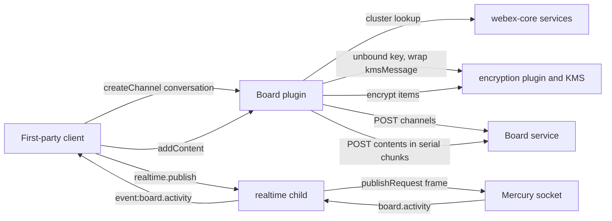
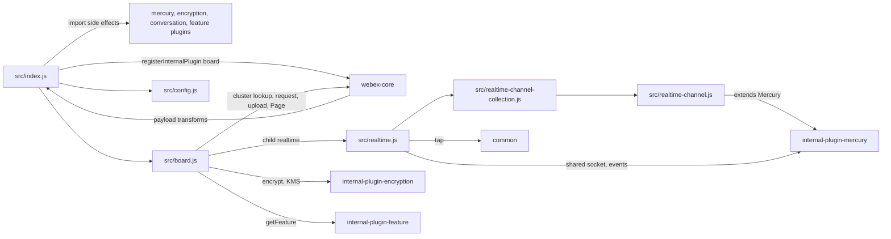
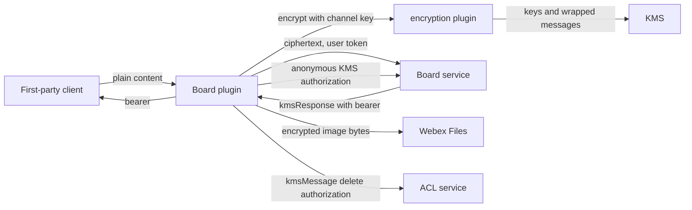

<!-- sdd-generated-metadata
doc_kind: standing-doc
generated_from: architecture@0.3.0
generated_by: claude-code
approved_by: rarajes2@cisco.com
updated_at: 2026-11-12T07:38:37Z
validation_status: pass
-->

# @webex/internal-plugin-board architecture

Canonical architecture for this package. Flow behavior lives in the
[board plugin specification](../src/docs/README.md). This page owns package boundaries, the plugin
registration, the contract index, and how the package meets the rest of the SDK.

Related context: [specification registry](specs/README.md) ·
[package agent instructions](../AGENTS.md)

## Applicability

| Condition ID                         | Status     | Evidence or reason | Owned section |
| ------------------------------------ | ---------- | ------------------ | ------------- |
| `repo.owns_datastore`                | N/A        | No database, file store, or migration; channels and contents live in the board service (`src/board.js`) | Repository data and schema |
| `repo.holds_client_state`            | Applicable | The realtimeChannels collection and per-channel session properties in `src/realtime.js` and `src/realtime-channel.js` | Client state model |
| `repo.components_interact`           | Applicable | `src/board.js` and `src/realtime.js` call the encryption, services, mercury, feature, and device plugins, and the payload transformer in `src/index.js` runs inside webex-core | Dependency and interaction topology |
| `repo.domain_data_across_components` | Applicable | Channel keys come from KMS through the encryption plugin and conversation ACLs come from conversation objects (`src/board.js`, `src/index.js`) | Object and data ownership |
| `repo.caches_data`                   | N/A        | No cache; the realtime collection holds connections, not data (`src/realtime.js`) | Caching catalog |
| `repo.observability_convention`      | Applicable | `src/realtime.js` logs with a board realtime: prefix | Observability patterns |
| `repo.deploys_to_infra`              | N/A        | Library published to npm (`package.json`). No service runtime | Runtime and infrastructure |
| `repo.shared_base_libs`              | Applicable | Extends WebexPlugin from webex-core and Mercury from internal-plugin-mercury, and uses the legacy build, lint, and test stack (`babel.config.js`, `jest.config.js`, `.eslintrc.js`) | Shared and base libraries |
| `repo.is_monorepo`                   | N/A        | This SDD root is one package. The workspace around it is out of scope | Package map and inter-package dependencies |
| `repo.multi_platform`                | N/A        | One JavaScript source set; Node runs the unit specs and karma browsers run `test:browser` against the same code (`package.json`) | Platform matrix |
| `repo.published_package`             | Applicable | `package.json` name is @webex/internal-plugin-board and deploy:npm publishes it | Release and versioning |
| `repo.embedded_in_host`              | N/A        | No host theme or embed API in `src/board.js` | Host integration and theming |
| `repo.exposes_commands_or_artifacts` | Applicable | build:src in `package.json` writes dist | Commands and generated artifacts |
| `repo.cross_repo_deps_material`      | Applicable | Behavior depends on the board, ACL, Files, KMS, and Mercury services (`src/board.js`, `src/realtime.js`) | Cross-repository topology |
| `repo.security_arch_warranted`       | Applicable | Board content keys, KMS messages, encrypted content, and transcoder bearer tokens pass through `src/board.js` and `src/index.js` | Security architecture |

## Design overview

`@webex/internal-plugin-board` is a published internal library with one module. Importing it
registers `Board` as the internal plugin `board` (with child `realtime`) and, as side effects, the
internal `mercury`, `encryption`, `conversation`, and `feature` plugins. `@webex/webex-server` and
`@webex/recipe-private-web-client` import it; first-party clients then call `webex.internal.board`.

The plugin is a request builder for the Webex board service. A board channel is bound to a
conversation's ACL and KMS resource; its content key is created when the channel is created, and every
content item is encrypted with that key before it is stored or published. Reads come back through the
SDK payload transformer, which decrypts them. Live drawing is exchanged as `board.activity` frames over
Mercury, either on a board socket of its own or on the shared Mercury socket when the server allows it.

The package makes outbound HTTP and web socket calls only. It serves no routes and persists nothing.

## Resource inventory and responsibilities

| Resource | Kind | Responsibility | Owner | Source | Detailed specification |
| -------- | ---- | -------------- | ----- | ------ | ---------------------- |
| Board plugin | package (one module) | Board channels, encrypted contents, image upload, transcoder authorization, live board activity | @webex/web-sdk | `src` | [`src/docs/README.md`](../src/docs/README.md) |

## Interaction and execution flows

Representative end-to-end flow: a client creates a board for a conversation, stores strokes, and
shares them live with other participants.

| From | To | Interaction or transport | Purpose | Failure or compatibility behavior |
| ---- | -- | ------------------------ | ------- | --------------------------------- |
| First-party client | Board plugin | In-process calls | Channels, contents, images, live activity | Rejections propagate; media-injector errors resolve as values |
| Board plugin | Board service | HTTPS through `webex.request` | Channels, contents, locks, spaces, registrations, share policies | No plugin-local retry |
| Board plugin | ACL service | HTTPS PUT to the channel `aclUrl` | Remove the conversation link on delete | Rejection propagates |
| Board plugin | Webex Files | `webex.upload` three-phase upload | Encrypted image bytes | Rejection propagates |
| Board plugin | encryption plugin and KMS | In-process calls | Content keys, encryption, transcoder authorization | Rejection propagates |
| realtime child | Mercury | Web socket frames | Live board activity | Reconnect owned by Mercury |
| webex-core payload transformer | Board plugin | Transform callbacks | Decrypt content reads; create channel keys | Transform rejection fails the request |

## Dependency topology

| Dependency | Type | Used by | Purpose | Version, failure, or fallback policy |
| ---------- | ---- | ------- | ------- | ------------------------------------ |
| `@webex/webex-core` | Internal | `src/index.js`, `src/board.js`, `src/realtime.js` | Plugin base, registration, `Page`, request, upload, services, payload transformer | Workspace version (`workspace:*` in `package.json`) |
| `@webex/internal-plugin-encryption` | Internal | `src/index.js`, `src/board.js` | Content and image encryption, KMS keys and authorizations | Workspace version |
| `@webex/internal-plugin-mercury` | Internal | `src/index.js`, `src/realtime-channel.js`, `src/realtime.js` | `Mercury` base class and the shared socket | Workspace version |
| `@webex/internal-plugin-feature` | Internal | `src/index.js`, `src/board.js` | `web-shared-mercury` developer toggle | Workspace version |
| `@webex/internal-plugin-conversation` | Internal | `src/index.js` | Import side effect registering `conversation` | Workspace version |
| `@webex/internal-plugin-device` | Internal, undeclared | `src/board.js` through `webex.internal.device` | `deviceType`, `webSocketUrl` | Not in `package.json`; registered by the mercury plugin import |
| `@webex/common` | Internal | `src/realtime.js` | `tap` | Workspace version |
| `ampersand-collection` | External | `src/realtime-channel-collection.js` | Realtime channel collection | `^2.0.2` in `package.json` |
| `es6-promise-series` | External | `src/board.js` | Serial content chunks | `^0.2.2` in `package.json` |
| `lodash` | External | `src/index.js`, `src/board.js` | Object helpers | `^4.17.21` in `package.json` |
| `uuid` | External | `src/realtime.js` | Frame ids | `^3.3.2` in `package.json` |
| Board, ACL, Files, KMS, Mercury services | External services | `src/board.js`, `src/realtime.js` | Storage, access control, upload, keys, sockets | URLs from the services catalog and from channel objects |

Every runtime dependency in `package.json` is imported by `src/`. No import cycle exists: this package
imports its siblings, and none of them imports this package.

## Public and consumer surfaces

| Surface | Type | Owner | Consumers | Compatibility policy | Source |
| ------- | ---- | ----- | --------- | -------------------- | ------ |
| `board-internal-sdk` — package @webex/internal-plugin-board, the `webex.internal.board` and `webex.internal.board.realtime` APIs, and `webex.config.board` | SDK, published to npm | Board plugin | `@webex/webex-server`, `@webex/recipe-private-web-client`, first-party clients | Internal plugin; the README says it does not strictly follow semver | `package.json`, `src/index.js`, `src/board.js`, `src/realtime.js`, `src/config.js` |

The board service, ACL, Files, and Mercury shapes are protocols this package consumes, described under
*Protocol and wire format* in the
[module specification](../src/docs/README.md#protocol-and-wire-format), not published contracts of this
package. They are registered as internal requires-contracts in `.sdd/manifest.json`.

## Client state model

| State or slice | Owner | Transition triggers | Persistence or reset boundary |
| -------------- | ----- | ------------------- | ----------------------------- |
| `realtimeChannels` | realtime child | Connect and disconnect methods | In memory for the instance |
| `isSharingMercury`, `socket` per channel | `RealtimeChannel` | Shared registration; Mercury `online` | In memory |
| Socket connection state | Mercury base class | `connect`, `disconnect`, reconnect | Owned by Mercury |

## Cross-cutting architecture

### Security

- Trust boundaries and identity flow: see [Security architecture](#security-architecture). The
  plugin builds requests; webex-core adds the user token and the encryption plugin talks to KMS.
- Sensitive surfaces and data classes: board contents (curves, text, image metadata), image bytes,
  content keys and their KMS resource bindings, and transcoder bearer tokens.
- Encryption and secret boundaries: content is encrypted with the channel's key before it leaves the
  client, image bytes are encrypted before upload, and KMS messages are wrapped by the encryption
  plugin.

### Observability and operations

- Logging and correlation: two `this.logger.info` messages in `src/realtime.js`, prefixed
  `board realtime:`; the Mercury base class logs under namespace `Board`.
- Metrics, traces, and audit signals: none emitted here.
- Ownership and operational entry points: `.github/CODEOWNERS` at the workspace root has no entry for
  this package, so the default rule routes it to `@webex/web-sdk`. No dashboards or runbooks are
  recorded in this package.

### Quality attributes

- Compatibility: other clients read the same encrypted content and frames, so their shapes are
  cross-client contracts.
- Footprint: six source files; runtime imports are webex-core, common, four sibling plugins, and four
  npm libraries.
- Test confidence: 58 unit cases pass; the payload transformer, the media-injector methods,
  `processActivityEvent`, and the shared-socket refresh have no test, and two of three integration
  specs are skipped. No coverage threshold is enforced.

## Dependency and interaction topology

| From | To | Kind | Purpose | Ordering or failure boundary |
| ---- | -- | ---- | ------- | ---------------------------- |
| `src/index.js` | sibling plugins, `src/board.js`, `src/config.js` | Import | Build and register the plugin | Registration at import time; first registration wins |
| `src/board.js` | encryption plugin | Call | Keys, encryption, KMS authorizations | Rejections propagate except in media-injector methods |
| `src/board.js` | webex-core | Call | Request, upload, services, `Page` | Rejections propagate |
| `src/realtime.js` | mercury plugin | Call and events | Shared socket and activity | Handlers attached once |
| `src/realtime-channel.js` | mercury plugin | Inheritance | Socket lifecycle | Config from namespace `Board` |
| webex-core | `src/index.js` transforms | Callback | Decrypt reads, create channel keys | Transform failure fails the request |

## Object and data ownership

| Object or state | System of record | May write | May read | Movement or lifecycle |
| --------------- | ---------------- | --------- | -------- | --------------------- |
| Board channel | Board service | This plugin (create, patch snapshot, delete) | Conversation participants | Bound to the conversation ACL until deleted |
| Board contents | Board service | This plugin, other clients | Conversation participants with the key | Encrypted on write, decrypted on read |
| Channel content key | KMS | The `encryptChannel` transform (create) | Holders of the conversation KMS authorization | Created with the channel |
| Board images | Webex Files | This plugin | Holders of the SCR | Encrypted upload; SCR stored as content |
| Realtime channels | This plugin (memory) | realtime child | realtime child | Created on connect, removed on disconnect |

## Observability patterns

| Signal  | Convention or required fields | Propagation or naming rule | Primary evidence |
| ------- | ----------------------------- | -------------------------- | ---------------- |
| Logs    | `info` messages when a realtime channel is created | Prefix `board realtime:`; no content or keys are logged | `src/realtime.js` |
| Metrics | None | N/A | `src/board.js` |
| Traces  | None | N/A | `src/board.js` |
| Audit   | None | N/A | `src/board.js` |

## Shared and base libraries

| Library | Inherited responsibility | Consumers | Version floor | Compatibility rule |
| ------- | ------------------------ | --------- | ------------- | ------------------ |
| `@webex/webex-core` `WebexPlugin` | `webex`, `request`, `upload`, namespaced `config`, `logger`, children, collections | `Board`, `RealtimeService` | `workspace:*` | Keep namespace `Board` |
| `@webex/internal-plugin-mercury` `Mercury` | Socket connect, disconnect, ping/pong, reconnect, envelope routing | `RealtimeChannel` | `workspace:*` | Board config must declare every Mercury key board sockets need |
| `@webex/babel-config-legacy`, `@webex/eslint-config-legacy`, `@webex/jest-config-legacy`, `@webex/legacy-tools` | Build, lint, and test stack through one-line config files | Package tooling | `workspace:*` | Do not fork the config locally |

## Release and versioning

| Artifact | Publish target | Versioning rule | Deprecation window | Changelog or migration obligation |
| -------- | -------------- | --------------- | ------------------ | --------------------------------- |
| @webex/internal-plugin-board | npm through `deploy:npm` | None declared; the README says internal plugins do not strictly follow semver | None declared | None declared in the package; the workspace owns changelog generation |

## Commands and generated artifacts

| Command or artifact | Owner | Inputs | Output or side effect | Compatibility boundary |
| ------------------- | ----- | ------ | --------------------- | ---------------------- |
| `yarn workspace @webex/internal-plugin-board build:src` | Package scripts | `src` | Writes `dist/` through `webex-legacy-tools` (JavaScript, TypeScript, source maps) | `dist/` is generated and never edited by hand; unit tests load it |
| `yarn workspace @webex/internal-plugin-board test:unit` | Package scripts | `test/unit/spec` | Jest run | Requires a current `dist/` |
| `yarn workspace @webex/internal-plugin-board test:style` | Package scripts | `src` | ESLint run | The shared config ignores `docs/**` and `*.md` |
| `yarn workspace @webex/internal-plugin-board test:browser` | Package scripts | `test/unit/spec`, `test/integration/spec` | Karma run against live services | Needs test-user credentials; not a routine verification command |

## Cross-repository topology

| Repository or external system | Relationship | Exchanged contract or artifact | Owner | Sequencing constraint |
| ----------------------------- | ------------ | ------------------------------ | ----- | --------------------- |
| `@webex/webex-core` (workspace sibling; module specs consulted) | Consumes | `WebexPlugin`, `registerInternalPlugin`, payload transformer, services, `Page`, request, upload | @webex/web-sdk | None beyond plugin registration |
| `@webex/internal-plugin-mercury` (workspace sibling; module spec consulted) | Consumes and extends | `Mercury` class, shared socket, events | @webex/web-sdk | Shared mode needs a registered Mercury connection |
| `@webex/internal-plugin-encryption` (workspace sibling; no spec, code consulted) | Consumes | Encryption and KMS API, `encryptKmsMessage` transform | @webex/web-sdk | `encryptChannel` runs before `encryptKmsMessage` |
| `@webex/internal-plugin-feature` (workspace sibling; module spec consulted) | Consumes | `web-shared-mercury` toggle | @webex/web-sdk | None |
| `@webex/internal-plugin-conversation` (workspace sibling; no spec, code consulted) | Consumes | Import side effect; conversation objects | @webex/web-client, @webex/web-sdk | None |
| `@webex/internal-plugin-device` (workspace sibling; module spec consulted) | Consumes, undeclared | `deviceType`, `webSocketUrl` | @webex/web-client, @webex/web-sdk | Registered through mercury |
| `@webex/common` (workspace sibling; module spec consulted) | Consumes | `tap` | @webex/web-client, @webex/web-sdk | None |
| `@webex/webex-server`, `@webex/recipe-private-web-client` (workspace siblings, no spec) | Provides to | Import side effect registering `board` | @webex/web-sdk | None |
| Board, ACL, Files, KMS, and Mercury services | Consumes | REST and socket shapes under Protocol and wire format | Not recorded in this repository | Cluster-local board URL for create and list |

## Security architecture

- Board content, image metadata, and image bytes are encrypted on the client; the board service and
  Files store ciphertext. Decryption needs the channel key, which KMS releases to holders of the
  conversation's authorization.
- Channel creation authorizes the conversation's KMS resource (`kmsMessage.userIds`) to the new
  channel key; deletion removes that authorization and the ACL link.
- `authorizeMediaInjector` creates an anonymous KMS authorization for the transcoder and returns its
  bearer to the caller; treat it as a secret. `unauthorizeMediaInjector` removes every authorization
  on the board's KRO.
- The user token and transport security come from webex-core; KMS cryptography comes from the
  encryption plugin.

## Domain language

| Term | Repository-specific meaning | Authoritative source |
| ---- | --------------------------- | -------------------- |
| Board, channel | A whiteboard stored by the board service and bound to a conversation ACL | `src/board.js` |
| Content | One encrypted board item (curve, text, or image reference), typed `STRING` or `FILE` | `src/board.js` |
| SCR | Secure content reference: the encrypted locator and key material of an uploaded file | encryption plugin (sibling package) |
| Binding | The Mercury route of a board, `board.` plus the transformed channel id | `src/realtime.js` |
| Shared Mercury | Carrying board activity on the SDK's main Mercury socket | `src/realtime.js` |
| Media injector, transcoder | The service that renders a shared whiteboard for mobile receivers | `src/board.js` |

## References and maintenance

- Decisions: [adr/](adr/index.md)
- Instantiated specifications and routing: [specs/README.md](specs/README.md)
- Repository rules and patterns: [package agent instructions](../AGENTS.md)
- Update this document in the same change that alters package boundaries, resource ownership,
  cross-resource interaction, or cross-cutting architecture.
