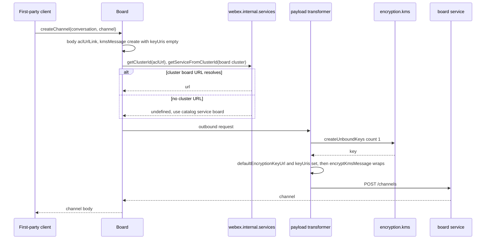
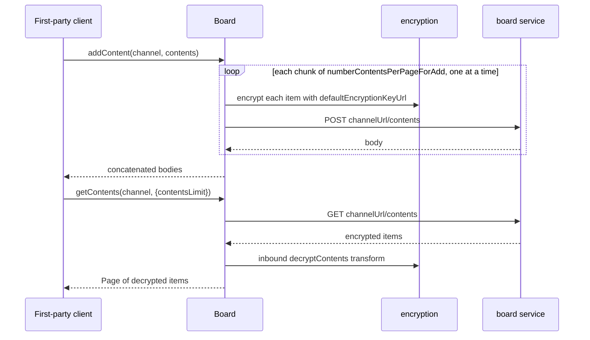
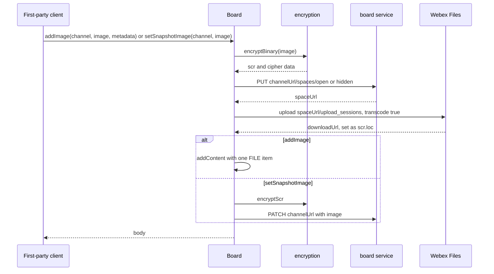
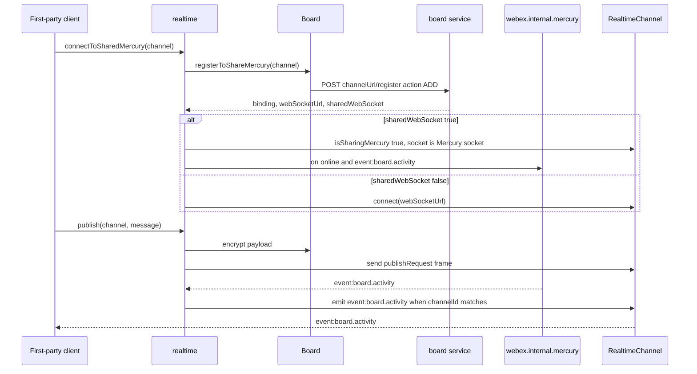
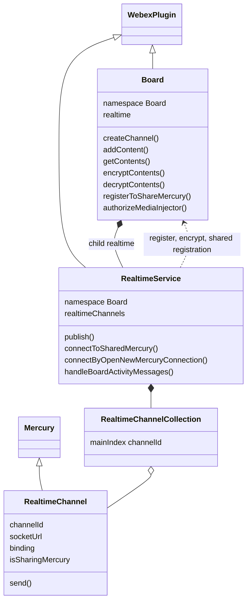

<!-- sdd-generated-metadata
doc_kind: module-spec
generated_from: module-spec@0.3.0
generated_by: claude-code
approved_by: rarajes2@cisco.com
updated_at: 2026-11-12T07:38:37Z
validation_status: pass
-->

# Board plugin

This source-local document at `src/docs/README.md` owns the stable specification for **the board
plugin**: the internal `webex.internal.board` plugin that creates and manages whiteboard channels on
the Webex board service, encrypts and decrypts board content with KMS keys, uploads board images to
Webex Files, and carries live board activity over Mercury web sockets through its `realtime` child.
Ground every claim in package evidence and link to the [package architecture](../../docs/architecture.md)
instead of repeating broader facts. No service specification exists because this package is a library.

Related context: [documentation index](../../docs/index.md) ·
[package agent instructions](../../AGENTS.md)

## Metadata

| Field             | Value |
| ----------------- | ----- |
| Owner             | @webex/web-sdk |
| Source path       | `src` |
| Resource kind     | package |
| Status            | Draft |
| Last verified     | 2026-11-12 at `ecd5af12a1` |
| Module id         | `internal-plugin-board` |
| Parent spec       | — |
| Doc kind          | Module spec |
| Coverage score    | 93.3% assessed 2026-11-12 — 14 of 15 mandatory fields PRESENT, critical 8 of 8; test strategy is WEAK because the payload transformer, the media-injector methods, `processActivityEvent`, and the shared-socket refresh have no test, and the realtime integration suites are `describe.skip` |
| Validation status | Pass — zero Blocking findings; validator 01a1cea3-02b3-7c72-ac41-7a08f195b1f3, assessed 2026-11-12 |

## Applicability

| Condition ID                         | Status     | Evidence or reason | Owned section |
| ------------------------------------ | ---------- | ------------------ | ------------- |
| `module.has_tiers`                   | N/A        | No tier policy exists in this package or its `package.json` | Tier |
| `module.has_ui`                      | N/A        | `src/board.js` and `src/realtime.js` make requests and send socket frames; nothing is rendered | UI use-case flow |
| `module.crosses_service_boundaries`  | Applicable | `src/board.js` calls the board service, the ACL service, Webex Files, and KMS; `src/realtime.js` publishes over Mercury sockets | Cross-boundary use-case flow |
| `module.holds_client_state`          | Applicable | The realtimeChannels collection in `src/realtime.js` and the per-channel session properties in `src/realtime-channel.js` | Client state model |
| `module.enforces_domain_rules`       | Applicable | Cluster-local board URL selection, serial content chunks, the binding format, and the transformer predicates in `src/board.js`, `src/realtime.js`, and `src/index.js` | Business rules and invariants |
| `module.is_concurrent_async`         | Applicable | Serial chunk posting, parallel encryption, socket events, and Mercury reconnect handling in `src/board.js` and `src/realtime.js` | Concurrency and reactive flow |
| `module.owns_persistence`            | N/A        | `src/board.js` stores nothing locally; channels and contents live in the board service | Data, schema, and migration discipline |
| `module.stateful_transitions`        | N/A        | Socket state belongs to the Mercury base class; this module only toggles isSharingMercury in `src/realtime.js`, covered under Client state model | State machine |
| `module.exposes_wire_protocol`       | Applicable | The board REST bodies in `src/board.js` and the publishRequest frame in `src/realtime.js` | Protocol and wire format |
| `module.ui_multi_screen`             | N/A        | No UI | UI flow |
| `module.large_data_model`            | N/A        | Channel and content objects are server-owned shapes passed through `src/board.js`; the module defines no entity types | Data model |
| `module.returns_caller_errors`       | Applicable | Rejections and synchronous throws from `src/board.js` and `src/realtime.js` | Caller-visible failure modes |
| `module.module_specific_conventions` | Applicable | The Board config namespace, the board. binding prefix, and the decorator-free promise style in `src/config.js` and `src/realtime.js` | Module-specific rules |
| `module.published_package`           | Applicable | `package.json` names the package @webex/internal-plugin-board and defines deploy:npm | Export stability |
| `module.embedded_in_host`            | N/A        | No host theme or embed API | Host integration and theming |
| `module.has_design_tradeoff`         | Applicable | Errors swallowed by the media-injector methods and the shared-versus-own socket choice in `src/board.js` and `src/realtime.js` | Key design trade-off |
| `module.has_submodules`              | N/A        | The src directory has no child module | Sub-modules |

## Evidence register

| Evidence | What it establishes |
| -------- | ------------------- |
| `src/index.js` | Side-effect imports of the mercury, encryption, conversation, and feature plugins; `registerInternalPlugin('board', Board, {config, payloadTransformer})` with the `decryptContents` and `encryptChannel` predicates and transforms; exports default `Board`, named `config`, named `RealtimeChannel` |
| `src/board.js` | The `Board` plugin (namespace `Board`, child `realtime`): channel, content, image, lock, keep-alive, registration, shared-Mercury, and media-injector methods. Its JSDoc and inline comments are the only recorded rationale |
| `src/realtime.js` | `RealtimeService` (namespace `Board`, collection `realtimeChannels`): publish, channel creation, own-socket and shared-socket connect and disconnect, activity routing |
| `src/realtime-channel.js` | `RealtimeChannel`, a `Mercury.extend` subclass in namespace `Board` with props `channelId`, `socketUrl`, `binding` and session `isSharingMercury`, `socket`; `send(data)` forwards to `socket.send` |
| `src/realtime-channel-collection.js` | Ampersand collection of `RealtimeChannel` keyed by `channelId` |
| `src/config.js` | `webex.config.board` defaults: content page sizes, socket timers read from `MERCURY_*` environment variables, and the `board.` binding prefix |
| `package.json` | Name, `main` (`dist/index.js`), `devMain` (`src/index.js`), `engines` (`node >=16`), dependencies, and scripts; the aggregate `test` script calls an undefined `test:integration` |
| `process` | Package-root module exporting `{browser: true}`; nothing in `src/` imports it and no package script names it |
| `test/unit/spec/board.js` | Unit cases for content, snapshot, channel creation and cluster routing, delete, lock, keep-alive, upload, get, register, and shared-Mercury registration. It imports the package by name, so it loads `dist/` |
| `test/unit/spec/encryption.js` | Unit cases for `decryptContents` and `encryptContents`, including FILE metadata and the device type |
| `test/unit/spec/realtime.js` | Unit cases for publish, own-socket connect and disconnect, shared-socket connect and disconnect, binding format, activity routing, and socket message emission |
| `test/integration/spec/board.js` | Live-service cases for the REST and image methods; the "#deletePartialContent()" block is `describe.skip` |
| `test/integration/spec/realtime.js` | Live-service realtime cases, including the board config check; the whole file is `describe.skip` |
| `test/integration/spec/sharing-mercury.js` | Live-service shared-socket cases; the whole file is `describe.skip` |
| `README.md` | Retained npm page; context only. Its usage block is the placeholder `webex.internal.board.WHATEVER`; see `docs/adr/0001-retain-product-readme.md` |
| Sibling package webex-core, file src/docs/README.md | Module spec consulted. `registerInternalPlugin` merges `config` and concatenates `payloadTransformer` predicates and transforms into the default config (MOD-008); `transform(direction, object)` runs predicates whose direction matches (MOD-037); `WebexPlugin.config` is the lowercased namespace key of `webex.config` (MOD-044); `Page` wraps one list response and follows Link headers (MOD-054); `webex.upload` runs the three-phase upload |
| Sibling package webex-core, file src/lib/services/docs/README.md | Module spec consulted. `getServiceFromUrl` matches a URL by origin and path (SVC-014); `getClusterId` and `getServiceFromClusterId` map between URLs, cluster ids, and services (SVC-018) |
| Sibling package webex-core, file src/webex-core.js | Source consulted for the transform lookup: a predicate or transform without a `direction` matches every direction |
| Sibling package internal-plugin-mercury, file src/docs/README.md | Module spec consulted. `connect(webSocketUrl)` registers the device when needed and resolves when online (MOD-002); socket timers come from the plugin's own config (MOD-004); envelopes are emitted as `event:<eventType>` (MOD-009); `localClusterServiceUrls` is stored from `mercury.registration_status` (MOD-010); `disconnect()` closes the socket (MOD-011); it lists this package's `RealtimeChannel` as a `Mercury.extend` subclass |
| Sibling package internal-plugin-feature, file src/docs/README.md | Module spec consulted. `getFeature(keyType, key)` resolves the toggle value, or `null` when the key is unknown (MOD-003, MOD-004) |
| Sibling package internal-plugin-device, file src/docs/README.md | Module spec consulted. `webex.internal.device` exposes `webSocketUrl` and the registration `deviceType`; it is reached through the mercury plugin, which imports it |
| Sibling package common, file src/docs/README.md | Module spec consulted. `tap` passes the original value through and never rejects, even when its callback throws (MOD-003) |
| Sibling package internal-plugin-encryption, files src/encryption.js, src/kms.js, src/index.js | Source consulted (no spec). `encryptText`, `decryptText`, `encryptScr` (rejects when `scr.loc` is unset), `decryptScr`, `encryptBinary` resolving `{scr, cdata}`; `kms.createUnboundKeys`, `prepareRequest`, `decryptKmsMessage`, `listAuthorizations`, `removeAuthorization`; the `encryptKmsMessage` predicate skips a `kmsMessage` whose `keyUris` is empty, and the transform wraps the message |
| Sibling package internal-plugin-conversation, file src/index.js | Source consulted (no spec). Imported only for its side effect of registering internal plugin `conversation`; this module reads `aclUrl` and `kmsResourceObjectUrl` from conversation objects the caller passes in |
| Sibling package eslint-config-legacy, file static/ignore-patterns.js | Source consulted. `docs/**` and `*.md` are ignored, so this specification is not linted; no source file of this package is on the decorator list |
| npm package es6-promise-series | Source consulted. Called with an array of functions, it runs them one at a time and resolves the concatenation of their results |
| Observation, no stated WHY | The `encryptChannel` transform declares `direciton` instead of `direction`; `authorizeMediaInjector` and `unauthorizeMediaInjector` create a rejected promise for a missing board but do not return it; `keepActive` resolves the whole response while sibling methods resolve the body; `getContents` and `getChannels` call `this.request` while the others call `this.webex.request` |

## Purpose and boundary

- Responsibility: give first-party clients a whiteboard API on `webex.internal.board`. That means
  creating, listing, reading, locking, keeping alive, and deleting board channels tied to a
  conversation; adding, reading, and clearing encrypted board contents; uploading board images and
  snapshots to Webex Files; authorizing a transcoder for whiteboard sharing to mobile; and exchanging
  live board activity over Mercury, either on a socket of the board's own or on the shared Mercury
  socket.
- In scope: every method of `Board` and `RealtimeService`; the board REST request shapes; content
  encryption and decryption; the board `payloadTransformer` predicates and transforms; the
  `publishRequest` frame and the `board.activity` routing; the `webex.config.board` defaults.
- Out of scope: KMS key creation, wrapping, and JWE cryptography (the encryption plugin); socket
  lifecycle, backoff, and ping/pong (the Mercury base class); service catalog lookups and cluster maps
  (webex-core services); feature toggles (the feature plugin); device registration (the device plugin);
  conversation objects and their ACL (the conversation plugin and its services); drawing and rendering
  of curves, text, and images (the host client; the board service stores opaque encrypted payloads).
- Consumers: `@webex/webex-server` and `@webex/recipe-private-web-client`, which import this package
  for its side effect, and first-party clients that call `webex.internal.board`.

## Structure and key files

| Path | Responsibility |
| ---- | -------------- |
| `src/index.js` | Imports four sibling plugins, registers internal plugin `board` with `config` and the payload transformer, and re-exports `Board` (default), `config`, and `RealtimeChannel` |
| `src/board.js` | The `Board` plugin, built with `WebexPlugin.extend` in namespace `Board`, with child `realtime` |
| `src/realtime.js` | The `RealtimeService` child plugin and its `realtimeChannels` collection |
| `src/realtime-channel.js` | `RealtimeChannel`, one board's Mercury connection or shared-socket handle |
| `src/realtime-channel-collection.js` | Collection of `RealtimeChannel` keyed by `channelId` |
| `src/config.js` | `webex.config.board` defaults |
| `process` | Package-root file exporting `{browser: true}`; not imported by `src/` |
| `package.json` | Package name, entry points, scripts, and dependencies |
| `babel.config.js`, `jest.config.js` | Re-exports of the legacy Babel and Jest configurations |
| `.eslintrc.js` | Sets `root: true` and extends `@webex/eslint-config-legacy` |
| `src/docs/README.md` | This module specification; ignored by the build and by lint |
| `test/unit/spec/board.js`, `test/unit/spec/encryption.js`, `test/unit/spec/realtime.js` | Unit specs run by Jest through `webex-legacy-tools` |
| `test/integration/spec/board.js`, `test/integration/spec/realtime.js`, `test/integration/spec/sharing-mercury.js` | Live-service specs run only by `test:browser` (karma); the last two are skipped |
| dist/ (generated) | Build output of `build:src`; ignored by Git and never edited by hand |

## Public surface

| Surface | Consumer | Compatibility commitment | Source |
| ------- | -------- | ------------------------ | ------ |
| Import side effect: internal plugins `mercury`, `encryption`, `conversation`, `feature`, and `board`, plus the board payload transformer | `@webex/webex-server`, `@webex/recipe-private-web-client`, first-party clients | First registration of a name wins | `src/index.js` |
| Default export `Board`, named exports `config` and `RealtimeChannel` | Unit specs and packages that build on the class | No versioning rule is declared; the README states the plugin does not strictly follow semver | `src/index.js` |
| Channel methods `createChannel`, `getChannel`, `getChannels`, `deleteChannel`, `lockChannelForDeletion`, `keepActive`, `getClusterBoardServiceUrl` | First-party clients | Resolve the response body (`keepActive` resolves the whole response; list methods resolve a `Page`) | `src/board.js` |
| Content methods `addContent`, `addImage`, `setSnapshotImage`, `getContents`, `deleteAllContent`, `deletePartialContent`, `encryptContents`, `decryptContents`, `encryptSingleContent`, `encryptSingleFileContent`, `decryptSingleContent`, `decryptSingleFileContent`, `processActivityEvent` | First-party clients and the realtime child | Content objects are opaque client shapes encrypted as JSON | `src/board.js` |
| Registration methods `ping`, `register`, `registerToShareMercury`, `unregisterFromSharedMercury` | The realtime child and first-party clients | Resolve the response body | `src/board.js` |
| Transcoder methods `authorizeMediaInjector`, `unauthorizeMediaInjector` | First-party clients sharing a whiteboard to mobile | Never reject once started; errors resolve as values | `src/board.js` |
| `webex.internal.board.realtime` methods `publish`, `publishEncrypted`, `createRealtimeChannel`, `connectByOpenNewMercuryConnection`, `disconnectMercuryConnection`, `connectToSharedMercury`, `disconnectFromSharedMercury`, `handleBoardActivityMessages`, `refreshMercurySocketReference`, and the `realtimeChannels` collection | First-party clients | Each `RealtimeChannel` emits `event:board.activity` | `src/realtime.js` |
| `webex.config.board` keys `numberContentsPerPageForAdd`, `numberContentsPerPageForGet`, `pingInterval`, `pongTimeout`, `forceCloseDelay`, `mercuryBindingPrefix` | Integrators through `Webex.init` config | Defaults below under Requirements `MOD-002` | `src/config.js` |

Methods prefixed with `_` (`_prepareChannel`, `_addContentChunk`, `_uploadImage`, `_getSpaceUrl`,
`_uploadImageToWebexFiles`, `_boardChannelIdToMercuryBinding`) are internal; only `_uploadImage` is
marked `@private` in its JSDoc. Contract ID `board-internal-sdk` is indexed in the
[package architecture](../../docs/architecture.md#public-and-consumer-surfaces) and registered in
`.sdd/manifest.json`. Export stability is under [Export stability](#export-stability).

## Dependencies

| Dependency | Why it is required | Failure behavior |
| ---------- | ------------------ | ---------------- |
| `@webex/webex-core` plugin host (module spec consulted) | `WebexPlugin`, `registerInternalPlugin`, `Page`, `this.webex.request`, `this.webex.upload`, namespaced `config`, `logger`, and the payload transformer | Request and upload rejections propagate, except inside the media-injector methods |
| `@webex/webex-core` services (module spec consulted) | `getClusterId` and `getServiceFromClusterId` for the cluster-local board URL; `getServiceFromUrl` in the `encryptChannel` predicate | An unresolved cluster falls back to the catalog `board` service |
| `@webex/internal-plugin-encryption` (code consulted; no spec) | Text, SCR, and binary encryption; KMS unbound keys, request wrapping, authorization listing and removal | Rejections propagate, except inside the media-injector methods |
| `@webex/internal-plugin-mercury` (module spec consulted) | `Mercury` base class for `RealtimeChannel`; the shared socket, its `online` event, `event:board.activity`, and `localClusterServiceUrls` | `connect()` rejections propagate to the caller |
| `@webex/internal-plugin-feature` (module spec consulted) | Developer toggle `web-shared-mercury` | A disabled toggle rejects `registerToShareMercury` |
| `@webex/internal-plugin-conversation` (code consulted; no spec) | Imported for its side effect; callers pass conversation objects carrying `aclUrl` and `kmsResourceObjectUrl` | Not applicable |
| `@webex/internal-plugin-device` (module spec consulted; not declared in `package.json`) | `deviceType` stamped on encrypted contents; `webSocketUrl` sent when sharing Mercury | Undefined values are sent as-is |
| `@webex/common` (module spec consulted) | `tap` around collection removal after disconnect | Never rejects |
| Board service (external) | Channels, contents, locks, spaces, registrations, share policies | HTTP errors propagate |
| ACL service (external) | Removing the conversation-to-board ACL link on delete | HTTP errors propagate |
| Webex Files (external) | Encrypted image upload through the board space URL | Upload errors propagate |
| `ampersand-collection` | `RealtimeChannelCollection` | Not applicable |
| `es6-promise-series` | Serial chunk posting in `addContent` | The first rejected chunk rejects the call; later chunks are not sent |
| `lodash` | `assign`, `defaults`, `chunk`, `pick`, `has`, `get` | Not applicable |
| `uuid` | Version 4 frame ids in `publishEncrypted` | Not applicable |
| Node `querystring` | The `authId` query on the delete KMS message | Not applicable |

## Requirements

| ID | WHAT | WHY | Source evidence | Test or example evidence | Assumptions or gaps | Confidence |
| -- | ---- | --- | --------------- | ------------------------ | ------------------- | ---------- |
| `MOD-001` | Importing the package imports the mercury, encryption, conversation, and feature plugins, then registers internal plugin `board` (with child `realtime`) with the package config and the payload transformer. It exports `Board` (default), `config`, and `RealtimeChannel`. | The board needs sockets, encryption, conversations, and toggles on every instance, so it pulls those plugins in rather than relying on the host's import order. | `src/index.js`, `src/board.js` | `test/unit/spec/board.js` "has a child of realtime"; every unit spec imports the package by name | The unit specs mount `Board` through MockWebex children, so `registerInternalPlugin` and the transformer registration are not exercised | Present |
| `MOD-002` | `webex.config.board` defaults to `numberContentsPerPageForAdd` 150, `numberContentsPerPageForGet` 1000, `pingInterval` `MERCURY_PING_INTERVAL` or 15000, `pongTimeout` `MERCURY_PONG_TIMEOUT` or 14000, `forceCloseDelay` `MERCURY_FORCE_CLOSE_DELAY` or 2000, and `mercuryBindingPrefix` `board.`. | The JSDoc: page sizes bound each add and get request; the timers govern board sockets; the prefix forms the board binding. `RealtimeChannel` shares namespace `Board`, so its Mercury config is this block. | `src/config.js`, `src/realtime-channel.js` | `test/unit/spec/board.js` page-size cases; `test/integration/spec/realtime.js` "shares board values" (skipped) | An environment value arrives as a string, not a number; Mercury keys such as `backoffTimeMax` are undefined for board sockets | Present |
| `MOD-003` | The inbound `decryptContents` predicate fires only when the response body has a non-empty `items`, `items[0].contentId`, `items[0].encryptionKeyUrl`, and `items[0].payload` or `items[0].file`; its transform replaces `body.items` with `decryptContents(body)`. | Board content responses arrive encrypted, and the transformer lets every request path (including `Page.next`) return decrypted items. | `src/index.js` | `test/integration/spec/board.js` "#getContents()" cases read plaintext back | No unit case; only the first item is inspected | Weak |
| `MOD-004` | The outbound `encryptChannel` predicate fires when the request URI resolves to service `board` and the body has `aclUrlLink`; its transform creates one KMS unbound key, sets `defaultEncryptionKeyUrl` to the key URI, pushes it onto `kmsMessage.keyUris`, and then applies `encryptKmsMessage`. | A new channel needs its own content key bound to a KMS resource; the encryption plugin skips a `kmsMessage` with empty `keyUris`, so this transform fills the key before wrapping. | `src/index.js` | `test/integration/spec/board.js` creates channels in its setup | No unit case. The transform spells `direciton`, so it has no direction and matches either direction by name; only the outbound predicate triggers it | Weak |
| `MOD-005` | `getClusterBoardServiceUrl(conversation)` returns `undefined` without `conversation.aclUrl` or a cluster id, else the `url` of the service whose cluster id is the ACL cluster id with its last segment replaced by `board`. `createChannel` and `getChannels` send to `<that url>/channels` when it resolves, else to catalog service `board`, resource `/channels`. | In-code comment: board data lives in the cluster encoded by the ACL URL, and the home board cluster answers with a cross-cluster 307 the browser cannot follow. | `src/board.js` | `test/unit/spec/board.js` "#createChannel()" and "#getChannels()" cluster and fallback cases | No direct unit case for the helper | Present |
| `MOD-006` | `createChannel(conversation, channel)` POSTs `{aclUrlLink: conversation.aclUrl, kmsMessage: {method: 'create', uri: '/resources', userIds: [conversation.kmsResourceObjectUrl when set], keyUris: []}, ...channel}` and resolves the body. | The board must be bound to the conversation ACL and authorized to the conversation's KMS resource; spreading `channel` lets callers create ambiguous (PMR) or annotated channels. | `src/board.js` | `test/unit/spec/board.js` "supports creating ambiguous channels for PMR support" | Caller fields override the defaults, including `kmsMessage` | Present |
| `MOD-007` | `getChannels(conversation, options)` rejects `` `conversation` is required `` without a conversation, else GETs with `qs.aclUrlLink` plus `channelsLimit` and `type` from options and resolves a `Page`. `getChannel(channel)` GETs `channelUrl` and resolves the body. | Channels are listed per conversation ACL; paging keeps large lists bounded. | `src/board.js` | `test/unit/spec/board.js` "#getChannels()" cases, "requires conversationId", "#getChannel()"; `test/integration/spec/board.js` "#getChannels()" multi-page case | None | Present |
| `MOD-008` | `getContents(channel, options)` GETs `<channelUrl>/contents` with `contentsLimit` from `options.contentsLimit`, else `numberContentsPerPageForGet`, and resolves a `Page`. | The JSDoc: retrieve contents of a channel page by page. | `src/board.js` | `test/unit/spec/board.js` default and client page-size cases; `test/integration/spec/board.js` large data sets | Decryption is left to `MOD-003` | Present |
| `MOD-009` | `addContent(channel, contents)` splits contents into chunks of `numberContentsPerPageForAdd`, and for each chunk in turn encrypts it and POSTs it to `<channelUrl>/contents`; it resolves the concatenation of the response bodies, `[]` for no contents. | In-code comment: each chunk waits for the previous one, or there would be race conditions among patches. | `src/board.js` | `test/unit/spec/board.js` "requests POST all contents to contents", "sends large data using multiple requests" | A failed chunk stops the series; earlier chunks stay stored | Present |
| `MOD-010` | `encryptContents(keyUrl, contents)` encrypts each item in parallel and returns `{device: webex.internal.device.deviceType, type, encryptionKeyUrl}` plus `file` and `payload`. An item with `file` is `FILE`: its `file.scr` is encrypted in place and its `metadata`, merged with `displayName`, becomes the encrypted `payload`. Any other item is `STRING`: the whole item, as JSON, becomes the encrypted `payload`. | The JSDoc: the existence of an SCR determines a FILE; the board service stores only ciphertext and needs the key URL and type to hand content back. | `src/board.js` | `test/unit/spec/encryption.js` "#encryptContents" cases including "sets the device to config deviceType" | The FILE path mutates the caller's object | Present |
| `MOD-011` | `decryptContents(contents)` decrypts each of `contents.items` in parallel: a `FILE` item decrypts `file.scr` and, when present, its `payload` as metadata (unparsable metadata becomes `{}`, `displayName` is copied up); any other item decrypts `payload` and parses it as JSON. `payload` and `encryptionKeyUrl` are removed and the decrypted fields take precedence over the remaining item fields. | Reverse of `MOD-010`, returning client-shaped content. | `src/board.js` | `test/unit/spec/encryption.js` "#decryptContents" cases including "does not require payload when type is FILE" and "decrypts FILE metadata displayName" | A non-JSON STRING payload rejects | Present |
| `MOD-012` | `_uploadImage(channel, file, options)` encrypts the binary, PUTs `<channelUrl>/spaces/open` (or `/spaces/hidden` with `hiddenSpace`) to get `spaceUrl`, uploads to `<spaceUrl>/upload_sessions` with `transcode: true` and `fileSize` from `length`, else `size`, else `byteLength`, and resolves the SCR with `loc` set to the `downloadUrl`. `addImage` adds that as one `FILE` content with `mimeType`, `scr`, `size`, `url`, and caller `metadata`. | The JSDoc: upload the image to Webex Files and add SCR plus download URL to the persistence service. | `src/board.js` | `test/unit/spec/board.js` "#_uploadImage()", "#_uploadImageToWebexFiles()" cases; `test/integration/spec/board.js` "#addImage()" cases | `addImage` has no unit case | Present |
| `MOD-013` | `setSnapshotImage(channel, image)` uploads to the hidden space, encrypts the SCR with `channel.defaultEncryptionKeyUrl`, PATCHes `channelUrl` with `image: {url, height (default 900), width (default 1600), mimeType (default image/png), scr, encryptionKeyUrl, fileSize}`, and resolves the body. | The JSDoc: set a snapshot image for a board; the hidden space keeps snapshots out of the open content space. | `src/board.js` | `test/unit/spec/board.js` "requests PATCH to board service"; `test/integration/spec/board.js` "#setSnapshotImage()" | None | Present |
| `MOD-014` | `deleteChannel(conversation, channel, options)` PUTs `<channel.aclUrl>/links` with `{aclLinkType: 'INCOMING', linkedAcl: conversation.aclUrl, kmsMessage: {method: 'delete', uri: '<kmsResourceUrl>/authorizations?authId=<conversation.kmsResourceObjectUrl>'}, aclLinkOperation: 'DELETE'}` and resolves the body; with `preventDeleteActiveChannel` it first calls `lockChannelForDeletion`. | In-code comments: remove the ACL link between conversation and board and remove the conversation's authorization from the board KRO. | `src/board.js` | `test/unit/spec/board.js` "#deleteChannel()" cases; `test/integration/spec/board.js` "#deleteChannel()" cases | None | Present |
| `MOD-015` | `lockChannelForDeletion(channel)` POSTs `<channelUrl>/lock?intent=delete` and resolves the body; `keepActive(channel)` POSTs `<channelUrl>/keepAlive` and resolves the whole response. | The JSDoc: a channel in use answers 409 Conflict to the lock, and keep-alive keeps a channel active so others cannot delete it. | `src/board.js` | `test/unit/spec/board.js` "#lockChannelForDeletion()", "#keepActive()"; `test/integration/spec/board.js` "does not delete when a channel is being used" | None | Present |
| `MOD-016` | `deleteAllContent(channel)` DELETEs `<channelUrl>/contents`; `deletePartialContent(channel, keep)` POSTs `[{contentId}]` for each kept item to `<channelUrl>/contents?clearBoard=true`. Both resolve the body. | The JSDoc: clear a board, or clear all but the listed contents. | `src/board.js` | `test/unit/spec/board.js` "#deleteAllContent()", "#deletePartialContent()"; `test/integration/spec/board.js` "#deleteAllContent()" | In-code note: the partial-delete API has changed and the method needs updating; its integration block is `describe.skip` | Weak |
| `MOD-017` | `ping()` GETs board service `/ping`; `register(data)` POSTs `data` to board service `/registrations`. Both resolve the body. | `register` obtains the Mercury `webSocketUrl` and bindings for a board socket (`MOD-021`). | `src/board.js` | `test/unit/spec/board.js` "#register()"; `test/integration/spec/board.js` "#ping()" | `ping` has no unit case | Present |
| `MOD-018` | `registerToShareMercury(channel)` reads developer toggle `web-shared-mercury`, rejects `` `localClusterServiceUrls` is not defined, make sure mercury is connected `` when Mercury has no `localClusterServiceUrls`, rejects `` `web-shared-mercury` is not enabled `` when the toggle is off, and otherwise POSTs `{mercuryConnectionServiceClusterUrl, webSocketUrl: device.webSocketUrl, action: 'ADD'}` to `<channelUrl>/register`. `unregisterFromSharedMercury(channel, binding)` POSTs `{binding, webSocketUrl, action: 'REMOVE'}` to the same URL. Both resolve the body. | Sharing lets a board ride the existing Mercury connection; the server needs the client's Mercury cluster and socket to add or remove the board binding. | `src/board.js` | `test/unit/spec/board.js` "#registerToShareMercury()" cases | `unregisterFromSharedMercury` is only stubbed in unit specs | Present |
| `MOD-019` | `authorizeMediaInjector(board)` prepares a KMS `create /authorizations` request for `board.kmsResourceUrl` with `anonymous: 1`, PUTs its wrapped form to `<channelUrl>/sharePolicies/transcoder`, decrypts `kmsResponse`, and resolves the first authorization's `bearer`, else `undefined`. Any error resolves as the error object. `unauthorizeMediaInjector(board)` lists the KRO's authorizations and removes each, resolving the removed `authId`s and error objects, or `[]`; a listing failure rejects. | In-code comments: errors resolve so whiteboard sharing still works except for mobile receivers, and removal also clears earlier authorizations that were not cleared. | `src/board.js` | None found | No test. A missing `board` throws a `TypeError` instead of the intended rejection | Weak |
| `MOD-020` | `processActivityEvent(message)` decrypts `message.payload` with `message.envelope.encryptionKeyUrl` as FILE or STRING by `message.contentType`, replaces `payload`, and resolves the message. | Activity frames carry the same encrypted shapes as stored contents (`MOD-021`). | `src/board.js` | None found | No caller in this package and no test | Weak |
| `MOD-021` | `createRealtimeChannel(channel)` registers binding `mercuryBindingPrefix` + `channelId` with every `-` replaced by `.` and every `_` by `#`, adds `RealtimeChannel {channelId, socketUrl: webSocketUrl, binding: bindings[0]}`, and resolves it. `connectByOpenNewMercuryConnection(channel)` creates the channel when missing and calls its `connect(socketUrl)`. `disconnectMercuryConnection(channel)` rejects `Realtime Channel not found!` when missing, else disconnects and removes it. | The JSDoc: make the channel id compatible with Mercury bindings. | `src/realtime.js` | `test/unit/spec/realtime.js` "#_boardChannelIdToMercuryBinding", "#connectByOpenNewMercuryConnection()", "#disconnectMercuryConnection" cases | None | Present |
| `MOD-022` | `publish(channel, message)` encrypts `message.payload` as FILE (when it has `file`) or STRING with `channel.defaultEncryptionKeyUrl` and calls `publishEncrypted`. `publishEncrypted` rejects `Realtime Channel not found` when no channel is held, else sends the `publishRequest` frame under Protocol and wire format and resolves the socket `send` result. | The JSDoc: send a message on the board socket, with `contentType` as a decryption hint. | `src/realtime.js`, `src/realtime-channel.js` | `test/unit/spec/realtime.js` "#publish()", "#publishEncrypted()" cases | None | Present |
| `MOD-023` | `connectToSharedMercury(channel)` calls `registerToShareMercury`, adds the channel with the returned `binding` and `webSocketUrl`, and, when `sharedWebSocket` is false, connects the channel's own socket. When it is true, it sets `isSharingMercury`, points `socket` at `webex.internal.mercury.socket`, and subscribes once each to Mercury `online` (to refresh every channel's socket) and `event:board.activity` (to route activity). It resolves the registration body. | In-code comments: refresh the socket reference when Mercury reconnects, and keep only one handler. | `src/realtime.js` | `test/unit/spec/realtime.js` "#connectToSharedMercury" cases | `refreshMercurySocketReference` has no test | Present |
| `MOD-024` | `handleBoardActivityMessages(event)` emits `event:board.activity` with the event on the channel whose `channelId` equals `event.data.envelope.channelId` and ignores unknown channels. A channel on its own socket emits the same event from Mercury's envelope routing. | One shared socket carries every board's activity, so each channel must receive only its own. | `src/realtime.js`, `src/realtime-channel.js` | `test/unit/spec/realtime.js` "finds the realtimeChannel from the envelope", "emits message" | None | Present |
| `MOD-025` | `disconnectFromSharedMercury(channel)` disconnects the channel's own socket when it is not sharing and its socket is connected; otherwise it calls `unregisterFromSharedMercury` with the channel binding. Either way the channel is removed from the collection. | The two connect paths need the matching teardown. | `src/realtime.js` | `test/unit/spec/realtime.js` "#disconnectFromSharedMercury()" cases | An unknown channel throws a `TypeError` synchronously | Present |

## Design overview

`Board` extends `WebexPlugin` in namespace `Board`, so `this.config` is `webex.config.board`. It is a
stateless request builder: every channel, content, and image lives in the board service, and the
caller passes channel and conversation objects back in. Encryption keys come from the conversation and
the channel: a channel's `defaultEncryptionKeyUrl` is created by the `encryptChannel` transform at
creation time, and every content item is encrypted with it before it leaves the client.

The payload transformer registered in `src/index.js` makes encryption transparent on two paths:
channel creation (outbound, fills and wraps the KMS message) and content reads (inbound, decrypts
items). Writes call `encryptContents` explicitly.

The `realtime` child keeps one `RealtimeChannel` per connected board. A channel either opens its own
Mercury socket, registered through the board service, or rides the SDK's main Mercury socket when the
`web-shared-mercury` toggle is on and the server answers `sharedWebSocket: true`. `RealtimeChannel`
reuses the whole Mercury implementation under namespace `Board`, so socket timers come from the board
config.

## Data flow and sequence coverage

Call style: in-process calls on `webex.internal.board`; outbound HTTPS through `webex.request` and
`webex.upload`; frames over Mercury web sockets. Four operation groups differ in actors, ordering, or
outcome, and each has a diagram. Single-request methods (`getChannel`, locks, keep-alive, content
deletes, `ping`) follow the same request-and-resolve-body shape and are covered by Requirements.

| Operation group | Entry and outcome | Diagram or evidence | Failure and recovery coverage |
| --------------- | ----------------- | ------------------- | ----------------------------- |
| Create a channel | `createChannel` resolves the channel with its content key | Create diagram; `src/board.js`, `src/index.js` | Request or KMS rejection propagates |
| Add and read contents | `addContent` posts encrypted chunks; `getContents` returns decrypted pages | Content diagram; `src/board.js` | First failed chunk rejects |
| Upload an image | `addImage` and `setSnapshotImage` store encrypted image references | Image diagram; `src/board.js` | Upload rejection propagates |
| Live activity | `connectToSharedMercury` or `connectByOpenNewMercuryConnection`, then `publish` and `event:board.activity` | Realtime diagram; `src/realtime.js` | Missing channel rejects; shared registration rejects when the toggle or cluster URLs are missing |

### Create a channel

### Add and read contents

### Upload an image

### Live activity

## Class and component relationships

`Board` and `RealtimeService` reach encryption, services, mercury, feature, and device through
`this.webex.internal` at call time, so they hold no references of their own.

## Use cases and flows

| Use case | Actor or caller | Primary steps and outcome | Failure or boundary behavior | Evidence |
| -------- | --------------- | ------------------------- | ---------------------------- | -------- |
| `UC-001` | Client opening a whiteboard in a space | `createChannel`, then `getContents` page by page | Cluster URL falls back to the catalog board service | `src/board.js`, `test/unit/spec/board.js` |
| `UC-002` | Client drawing | `addContent` for persistence, and `realtime.publish` for live peers | A failed chunk stops later chunks | `src/board.js`, `src/realtime.js` |
| `UC-003` | Client receiving live strokes | `connectToSharedMercury` (or an own socket), then listen for `event:board.activity` on the channel | Toggle off or Mercury not registered rejects | `src/realtime.js`, `test/unit/spec/realtime.js` |
| `UC-004` | Client sharing a whiteboard to mobile | `authorizeMediaInjector`, then `unauthorizeMediaInjector` when sharing stops | Errors resolve so sharing continues without mobile | `src/board.js` |
| `UC-005` | Client deleting a board | `deleteChannel` with `preventDeleteActiveChannel` locks first | A board in use answers 409 to the lock | `src/board.js`, `test/integration/spec/board.js` |

### Cross-boundary use-case flow

| Boundary | Transport and ordering | Compatibility | Timeout, retry, and recovery |
| -------- | ---------------------- | ------------- | ---------------------------- |
| Board service (`UC-001` to `UC-005`) | HTTPS through `webex.request`; cluster-local URL for create and list | Request shapes under Protocol and wire format | No plugin-local retry; webex-core interceptors apply |
| ACL service (`UC-005`) | HTTPS PUT to the channel's `aclUrl` | `aclLinkType`, `aclLinkOperation`, KMS delete message | None |
| KMS through the encryption plugin (`UC-001`, `UC-002`, `UC-004`) | In-process calls that send KMS requests | Key URIs and KRO URLs from conversation and channel | Rejections propagate, except in the media-injector methods |
| Webex Files (`UC-002`) | Three-phase `webex.upload` | `fileSize` in initialize and finalize | webex-core upload retries the upload phase |
| Mercury (`UC-002`, `UC-003`) | Web socket frames; activity is unordered across boards | `publishRequest` frame and `board.activity` envelope | Reconnect is Mercury's; shared channels refresh their socket on `online` |

## Client state model

| State or slice | Owner | Initial state | Transition triggers | Reset or persistence boundary |
| -------------- | ----- | ------------- | ------------------- | ----------------------------- |
| `realtimeChannels` collection | RealtimeService | empty | Added by `createRealtimeChannel` and `connectToSharedMercury`; removed by the disconnect methods | In memory for the instance |
| `RealtimeChannel` props `channelId`, `socketUrl`, `binding` | RealtimeChannel | set on add | None after add | In memory |
| `isSharingMercury` (session) | RealtimeChannel | `false` | Set `true` by a shared registration | In memory |
| `socket` (session) | RealtimeChannel | unset | The Mercury socket for shared channels, refreshed on Mercury `online`; the own socket after `connect` | In memory |
| Mercury connection state of a channel | Mercury base class | per Mercury | `connect`, `disconnect`, reconnects | Owned by the Mercury implementation |

## Business rules and invariants

| ID | Invariant | WHY | Enforcement source | Test evidence |
| -- | --------- | --- | ------------------ | ------------- |
| `INV-001` | Board content leaves the client only as ciphertext keyed by `channel.defaultEncryptionKeyUrl`. | The board service stores opaque encrypted payloads. | `src/board.js`, `src/realtime.js` | `test/unit/spec/encryption.js`, `test/unit/spec/realtime.js` |
| `INV-002` | Create and list target the board cluster that matches the conversation ACL cluster when one resolves. | In-code comment: the home cluster answers with a cross-cluster 307 the browser cannot follow. | `src/board.js` | `test/unit/spec/board.js` |
| `INV-003` | Content chunks are posted one at a time, in order. | In-code comment: avoid race conditions among patches. | `src/board.js` | `test/unit/spec/board.js` |
| `INV-004` | A board binding is `mercuryBindingPrefix` + the channel id with `-` mapped to `.` and `_` to `#`. | The JSDoc: Mercury bindings do not accept the raw channel id. | `src/realtime.js` | `test/unit/spec/realtime.js` |
| `INV-005` | At most one `online` and one `event:board.activity` handler from this module is attached to the shared Mercury plugin. | In-code comment: make sure there is only one handler. | `src/realtime.js` | None found |

## Concurrency and reactive flow

- Execution model: single event loop; every method returns a promise except
  `handleBoardActivityMessages`, `refreshMercurySocketReference`, and `getClusterBoardServiceUrl`.
- Ordering guarantees: `addContent` chunks are serial (`INV-003`), while items inside a chunk are
  encrypted in parallel. `decryptContents` decrypts items in parallel and keeps their order.
- Idempotency and retry: no method deduplicates concurrent calls. A second `createRealtimeChannel`
  for the same `channelId` re-registers and adds again; the collection keeps one entry per id. No
  plugin-local retry exists; webex-core interceptors and Mercury own retries.
- Shared-state protection: `connectToSharedMercury` removes its handlers before adding them, so
  repeated calls keep one handler each (`INV-005`). Shared channels' `socket` references are replaced
  on every Mercury `online`.
- Blocking restrictions: none in this module.

## Protocol and wire format

| Message or frame | Version | Producer or serializer | Consumer or parser | Compatibility and ordering rule |
| ---------------- | ------- | ---------------------- | ------------------ | ------------------------------- |
| `POST /channels` body `{aclUrlLink, kmsMessage: {method: create, uri: /resources, userIds, keyUris}, defaultEncryptionKeyUrl, ...channel}` | Unversioned | `createChannel` and the `encryptChannel` transform | Board service | `kmsMessage` is wrapped by `encryptKmsMessage` after the key is added |
| `GET /channels?aclUrlLink=&channelsLimit=&type=` | Unversioned | `getChannels` | Board service | Paged through Link headers |
| `POST <channelUrl>/contents` body: array of `{device, type: STRING or FILE, encryptionKeyUrl, payload, file}` | Unversioned | `addContent` | Board service | Serial chunks |
| `GET <channelUrl>/contents?contentsLimit=` response `items[]` with `contentId`, `encryptionKeyUrl`, `payload` or `file` | Unversioned | Board service | `decryptContents` transform | Paged through Link headers |
| `PATCH <channelUrl>` body `{image: {url, height, width, mimeType, scr, encryptionKeyUrl, fileSize}}` | Unversioned | `setSnapshotImage` | Board service | `scr` is encrypted |
| `PUT <aclUrl>/links` body `{aclLinkType: INCOMING, linkedAcl, kmsMessage: {method: delete, uri}, aclLinkOperation: DELETE}` | Unversioned | `deleteChannel` | ACL service | Optional lock first |
| `POST <channelUrl>/register` body `{mercuryConnectionServiceClusterUrl, webSocketUrl, action: ADD}` or `{binding, webSocketUrl, action: REMOVE}`; response `{binding, webSocketUrl, sharedWebSocket}` | Unversioned | `registerToShareMercury`, `unregisterFromSharedMercury` | Board service | ADD before publish |
| `PUT <channelUrl>/sharePolicies/transcoder` body `{kmsMessage}`; response `{kmsResponse}` | Unversioned | `authorizeMediaInjector` | Board service | Bearer read from the first authorization |
| Mercury frame `{id: uuid v4, type: publishRequest, recipients: [{alertType: none, route: binding, headers: {}}], data: {eventType: board.activity, contentType, payload, envelope: {encryptionKeyUrl, channelId}}}`; for `FILE`, `data.payload` is `{file, payload}` | Unversioned | `publishEncrypted` | Mercury service, then peers' `board.activity` events | Routed by `envelope.channelId` on a shared socket |

## Caller-visible failure modes

| Condition | Signal or result | Caller behavior | Retry or recovery | Evidence |
| --------- | ---------------- | --------------- | ----------------- | -------- |
| `getChannels` without a conversation | Rejected `Error` `` `conversation` is required `` | Pass the conversation | None | `src/board.js`, `test/unit/spec/board.js` |
| `publishEncrypted` for a channel not in the collection | Rejected `Error` `Realtime Channel not found` | Connect first | None | `src/realtime.js`, `test/unit/spec/realtime.js` |
| `disconnectMercuryConnection` for an unknown channel | Rejected `Error` `Realtime Channel not found!` | None needed | None | `src/realtime.js`, `test/unit/spec/realtime.js` |
| `disconnectFromSharedMercury` for an unknown channel | Synchronous `TypeError` | Track connected channels | None | `src/realtime.js` |
| Shared Mercury requested before Mercury registration | Rejected `Error` naming `localClusterServiceUrls` | Connect Mercury first | Retry after `online` | `src/board.js`, `test/unit/spec/board.js` |
| `web-shared-mercury` toggle off | Rejected `Error` `` `web-shared-mercury` is not enabled `` | Use `connectByOpenNewMercuryConnection` | None | `src/board.js`, `test/unit/spec/board.js` |
| Board, ACL, or Files request fails | The `webex.request` or `webex.upload` rejection, unchanged | Handle the HTTP error; 409 on lock means the board is in use | Caller may retry | `src/board.js` |
| A content chunk fails in `addContent` | Rejection; later chunks are not sent | Re-add the remaining contents | Caller may retry | `src/board.js` |
| Encryption or KMS fails | The encryption plugin's rejection | Handle as an encryption error | Caller may retry | `src/board.js` |
| `authorizeMediaInjector` fails at any step | Resolves with the error object instead of a bearer | Check the type of the result | Share continues without mobile | `src/board.js` |
| `unauthorizeMediaInjector` cannot remove one authorization | That entry resolves as the error object | Inspect the array | None | `src/board.js` |
| A media-injector method called without a board | Synchronous `TypeError`, plus an unhandled rejected promise | Pass the board | None | `src/board.js` |

## Pitfalls and constraints

- The `encryptChannel` transform in `src/index.js` declares `direciton: 'outbound'`. webex-core
  matches a transform without `direction` in every direction, so behavior is the same today because
  only the outbound predicate names it.
- `authorizeMediaInjector` and `unauthorizeMediaInjector` build `Promise.reject(...)` for a missing
  board but never return it; the next line reads `board.kmsResourceUrl` and throws.
- `authorizeMediaInjector` resolves with the error object on failure, so a caller cannot tell a
  bearer string from an error without checking its type.
- `deletePartialContent` carries an in-code note that its server API has changed and the method needs
  updating; its integration block is skipped. Treat it as unverified.
- `keepActive` resolves the whole response, unlike the sibling methods that resolve `res.body`.
- `RealtimeChannel` uses namespace `Board`, so its Mercury config is `webex.config.board`: the board
  socket timers apply, and Mercury keys the board config does not declare (for example
  `backoffTimeMax`) are undefined for board sockets.
- `pingInterval`, `pongTimeout`, and `forceCloseDelay` are strings when their environment variables
  are set.
- `encryptSingleFileContent` and `decryptSingleFileContent` mutate the content object they receive.
- `webex.internal.device` is used but `@webex/internal-plugin-device` is not a dependency in
  `package.json`; it is registered because the mercury plugin imports it.
- `processActivityEvent` has no caller in this package; it is kept for clients.
- `package.json` `test` runs `yarn test:integration`, which is not defined, so the aggregate `test`
  script fails at that step. The integration specs run only through `test:browser` (karma).
- The unit specs import `@webex/internal-plugin-board` by name, which loads `dist/`. Run `build:src`
  before `test:unit`, or the tests run against stale output.

## Module-specific rules

- Do: encrypt every content item with `channel.defaultEncryptionKeyUrl` before it leaves the client
  (`INV-001`).
- Do: keep create and list on the cluster-local board URL with the catalog fallback (`INV-002`).
- Do: keep `addContent` serial (`INV-003`) and keep the binding format (`INV-004`).
- Do: remove a Mercury handler before adding it in shared mode (`INV-005`).
- Do: log through `this.logger` with the `board realtime:` prefix and never log decrypted content,
  keys, or bearer tokens (`src/realtime.js`).
- Do not: return a rejection from the media-injector methods for a service error without a design
  change; whiteboard sharing relies on them resolving (`MOD-019`).

## Export stability

| Export or entry point | Consumer | Stability | Versioning and deprecation rule | Declaration or API report |
| --------------------- | -------- | --------- | ------------------------------- | ------------------------- |
| Default export `Board`, named `config` and `RealtimeChannel` | Packages building on the class; unit specs | Internal | The README says internal plugins do not strictly follow semver; no deprecation rule is declared | `src/index.js` |
| Import side effect: internal plugin `board` and its payload transformer | `@webex/webex-server`, `@webex/recipe-private-web-client` | Internal | Same | `src/index.js`, `package.json` |
| Plugin API `webex.internal.board.*` and `webex.internal.board.realtime.*` | First-party clients | Internal | Same | `src/board.js`, `src/realtime.js` |

No TypeScript declaration or API report is shipped; `package.json` has no `types` field and the
source is JavaScript.

## Key design trade-off

| Chosen trade-off | Preserved invariant or benefit | Cost or limitation | Decision evidence |
| ---------------- | ------------------------------ | ------------------ | ----------------- |
| Media-injector failures resolve instead of rejecting | Whiteboard sharing continues when the transcoder cannot be authorized | Callers receive an error object as a success value | `src/board.js` |
| Share the main Mercury socket when the server allows it, else open a board socket | One connection serves many boards when possible | Two code paths for connect and disconnect, and socket references that must be refreshed on reconnect | `src/realtime.js` |
| Serial content chunks | Server-side patch order matches client order | Large adds take one round trip per chunk | `src/board.js` |
| Transformer-based decryption of reads | Every read path, including `Page.next`, returns plaintext | Decryption runs only when the first item matches the predicate | `src/index.js` |

## Verification

| Requirement or invariant | Test level | Positive evidence | Negative or boundary evidence | Gap |
| ------------------------ | ---------- | ----------------- | ----------------------------- | --- |
| `MOD-001` | Unit | `test/unit/spec/board.js` "has a child of realtime" | None found | Registration and transformer options not exercised |
| `MOD-002` | Unit, integration | `test/unit/spec/board.js` page-size cases; `test/integration/spec/realtime.js` config case (skipped) | None found | Environment overrides untested |
| `MOD-003`, `MOD-004` | Integration | `test/integration/spec/board.js` content and channel setup | None found | No unit case for either predicate or transform |
| `MOD-005`, `MOD-006`, `INV-002` | Unit | `test/unit/spec/board.js` "#createChannel()", "#getChannels()" | `test/unit/spec/board.js` fallback cases | None |
| `MOD-007`, `MOD-008` | Unit, integration | `test/unit/spec/board.js` "#getChannel()", "#getChannels()", "#getContents()" | `test/unit/spec/board.js` "requires conversationId" | None |
| `MOD-009`, `INV-003` | Unit | `test/unit/spec/board.js` "#addContent()" | None found | Chunk failure untested |
| `MOD-010`, `MOD-011`, `INV-001` | Unit | `test/unit/spec/encryption.js` | `test/unit/spec/encryption.js` "does not require payload when type is FILE" | Unparsable STRING payload untested |
| `MOD-012`, `MOD-013` | Unit, integration | `test/unit/spec/board.js` upload and snapshot cases; `test/integration/spec/board.js` "#addImage()" | None found | `addImage` unit case missing |
| `MOD-014`, `MOD-015` | Unit, integration | `test/unit/spec/board.js` delete, lock, keep-alive | `test/integration/spec/board.js` "does not delete when a channel is being used" | None |
| `MOD-016` | Unit | `test/unit/spec/board.js` "#deleteAllContent()", "#deletePartialContent()" | None found | Partial-delete integration block skipped; server API changed per in-code note |
| `MOD-017` | Unit, integration | `test/unit/spec/board.js` "#register()"; `test/integration/spec/board.js` "#ping()" | None found | `ping` unit case missing |
| `MOD-018` | Unit | `test/unit/spec/board.js` "#registerToShareMercury()" | `test/unit/spec/board.js` rejection cases | `unregisterFromSharedMercury` request untested |
| `MOD-019`, `MOD-020` | None | None found | None found | No test |
| `MOD-021`, `INV-004` | Unit | `test/unit/spec/realtime.js` binding and own-socket cases | `test/unit/spec/realtime.js` "rejects if channel not found" | None |
| `MOD-022` | Unit | `test/unit/spec/realtime.js` "#publish()", "#publishEncrypted()" | `test/unit/spec/realtime.js` "rejects when socket not found" | None |
| `MOD-023`, `MOD-025`, `INV-005` | Unit | `test/unit/spec/realtime.js` shared-socket cases | None found | Socket refresh on `online` and single-handler rule untested; `test/integration/spec/sharing-mercury.js` skipped |
| `MOD-024` | Unit | `test/unit/spec/realtime.js` "finds the realtimeChannel from the envelope", "emits message" | Unknown channel ignored in the same case | None |

Coverage gaps are recorded above. The 58 unit cases pass under Node 22.14 after `build:src`. The
integration suites need live Webex services and test users, and two of the three are skipped, so they
are not routine coverage evidence. Generator-side field measurement is complete (93.3%, assessed
2026-11-12). Independent semantic validation passed on 2026-11-12 with zero Blocking findings. A characterization baseline and promotion past Partial remain pending.
