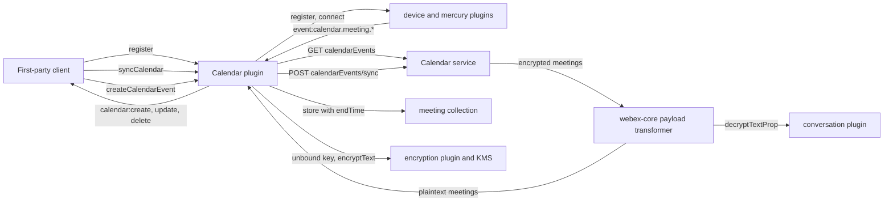
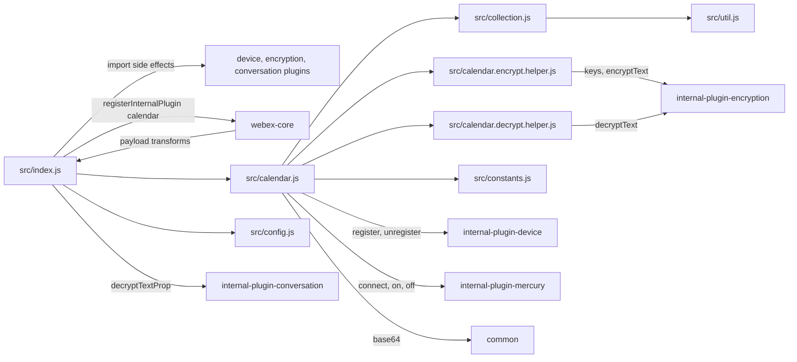
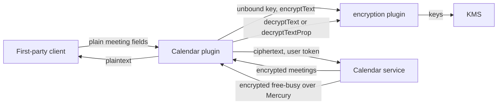

<!-- sdd-generated-metadata
doc_kind: standing-doc
generated_from: architecture@0.3.0
generated_by: claude-code
approved_by: rarajes2@cisco.com
updated_at: 2026-11-12T08:24:55Z
validation_status: pass-with-warnings
-->

# @webex/internal-plugin-calendar architecture

Canonical architecture for this package. Flow behavior lives in the
[calendar plugin specification](../src/docs/README.md). This page owns package boundaries, the plugin
registration, the contract index, and how the package meets the rest of the SDK.

Related context: [specification registry](specs/README.md) ·
[package agent instructions](../AGENTS.md)

## Applicability

| Condition ID                         | Status     | Evidence or reason | Owned section |
| ------------------------------------ | ---------- | ------------------ | ------------- |
| `repo.owns_datastore`                | N/A        | No database, file store, or migration; meetings live in the calendar service (`src/calendar.js`) | Repository data and schema |
| `repo.holds_client_state`            | Applicable | The meeting collection in `src/collection.js` and the registration flag, pending free-busy map, and cached key in `src/calendar.js` | Client state model |
| `repo.components_interact`           | Applicable | `src/calendar.js` calls the device, mercury, and encryption plugins, and the payload transformer in `src/index.js` runs inside webex-core and calls the conversation transform | Dependency and interaction topology |
| `repo.domain_data_across_components` | Applicable | Meeting keys come from KMS through the encryption plugin, and meeting updates arrive through Mercury (`src/calendar.js`, `src/calendar.encrypt.helper.js`) | Object and data ownership |
| `repo.caches_data`                   | Applicable | `src/collection.js` keeps synced and pushed meetings in memory and serves `getAll` and `getByType` from them | Caching catalog |
| `repo.observability_convention`      | Applicable | `src/calendar.js` logs with `calendar->` and `webex.internal.calendar -` prefixes | Observability patterns |
| `repo.deploys_to_infra`              | N/A        | Library published to npm (`package.json`). No service runtime | Runtime and infrastructure |
| `repo.shared_base_libs`              | Applicable | Extends WebexPlugin from webex-core and uses the legacy build, lint, and test stack (`babel.config.js`, `jest.config.js`, `.eslintrc.js`) | Shared and base libraries |
| `repo.is_monorepo`                   | N/A        | This SDD root is one package. The workspace around it is out of scope | Package map and inter-package dependencies |
| `repo.multi_platform`                | N/A        | One JavaScript source set; Node runs the unit specs and karma browsers run `test:browser` against the same code (`package.json`) | Platform matrix |
| `repo.published_package`             | Applicable | `package.json` name is @webex/internal-plugin-calendar and deploy:npm publishes it | Release and versioning |
| `repo.embedded_in_host`              | N/A        | No host theme or embed API in `src/calendar.js` | Host integration and theming |
| `repo.exposes_commands_or_artifacts` | Applicable | build:src in `package.json` writes dist | Commands and generated artifacts |
| `repo.cross_repo_deps_material`      | Applicable | Behavior depends on the calendar, KMS, and Mercury services and on four sibling plugins (`src/index.js`, `src/calendar.js`) | Cross-repository topology |
| `repo.security_arch_warranted`       | Applicable | Meeting subjects, notes, attendee emails, join links, and KMS keys pass through `src/calendar.encrypt.helper.js`, `src/calendar.decrypt.helper.js`, and `src/index.js` | Security architecture |

## Design overview

`@webex/internal-plugin-calendar` is a published internal library with one module. Importing it
registers `Calendar` as the internal plugin `calendar` and, as side effects, the internal `device`,
`encryption`, and `conversation` plugins. `webex`, `webex-node`, `@webex/webex-server`, and
`@webex/recipe-private-web-client` import it; first-party clients then call `webex.internal.calendar`.

The plugin is a request builder for the Webex calendar service plus a small in-memory meeting
collection. After `register()` it listens to Mercury calendar events and keeps the collection current;
`syncCalendar` fills it from the service. Meeting text is encrypted under KMS keys: reads are decrypted
by the SDK payload transformer or by explicit helpers, and writes are encrypted with one key the plugin
creates on first use. Free-busy lookups are sent over HTTPS and answered over Mercury.

The package makes outbound HTTP calls and receives Mercury events only. It serves no routes and
persists nothing.

## Resource inventory and responsibilities

| Resource | Kind | Responsibility | Owner | Source | Detailed specification |
| -------- | ---- | -------------- | ----- | ------ | ---------------------- |
| Calendar plugin | package (one module) | Meeting sync and collection, notes and participants, scheduler data, encrypted event writes, free-busy | @webex/web-sdk | `src` | [`src/docs/README.md`](../src/docs/README.md) |

## Interaction and execution flows

Representative end-to-end flow: a client shows upcoming meetings, keeps them current, and creates a
new one.

| From | To | Interaction or transport | Purpose | Failure or compatibility behavior |
| ---- | -- | ------------------------ | ------- | --------------------------------- |
| First-party client | Calendar plugin | In-process calls and plugin events | Meetings, scheduling, free-busy | Rejections propagate; `getByType` throws synchronously |
| Calendar plugin | Calendar service | HTTPS through `webex.request` | Meetings, notes, participants, scheduler data, writes, free-busy | No plugin-local retry |
| Calendar plugin | device and mercury plugins | In-process calls and Mercury events | Event subscription and free-busy answers | Connect failure rejects `register` |
| Calendar plugin | encryption plugin and KMS | In-process calls | Key creation, encryption, helper decryption | Rejection propagates |
| webex-core payload transformer | Calendar plugin transforms | Transform callbacks | Decrypt meeting reads | Field failures become a placeholder string |

## Dependency topology

| Dependency | Type | Used by | Purpose | Version, failure, or fallback policy |
| ---------- | ---- | ------- | ------- | ------------------------------------ |
| `@webex/webex-core` | Internal | `src/index.js`, `src/calendar.js` | Plugin base, registration, request, transform | Workspace version (`workspace:*` in `package.json`) |
| `@webex/internal-plugin-device` | Internal | `src/index.js`, `src/calendar.js` | Device registration around Mercury | Workspace version |
| `@webex/internal-plugin-encryption` | Internal | `src/index.js`, the encrypt and decrypt helpers | KMS keys, encryption, decryption | Workspace version |
| `@webex/internal-plugin-conversation` | Internal | `src/index.js` | Import side effect; its `decryptTextProp` transform | Workspace version |
| `@webex/internal-plugin-mercury` | Internal, undeclared | `src/calendar.js` through `webex.internal.mercury` | Connect, disconnect, calendar events | Not in `package.json`; registered by the encryption plugin import |
| `@webex/common` | Internal, undeclared | `src/calendar.js` | `base64.encode` for event ids | Not in `package.json`; resolved through the workspace |
| `lodash` | External | `src/index.js`, `src/collection.js`, `src/calendar.encrypt.helper.js` | `has`, `find`, `isArray` | `^4.17.21` in `package.json` |
| `uuid` | External, unused by `src` | `test/integration/spec/calendar.js` | Test ids | `^3.3.2` in `package.json` dependencies |
| Calendar, KMS, and Mercury services | External services | `src/calendar.js` | Meetings, keys, events | URLs from the services catalog and from meeting objects |

No import cycle exists: this package imports its siblings, and none of them imports this package.

## Public and consumer surfaces

| Surface | Type | Owner | Consumers | Compatibility policy | Source |
| ------- | ---- | ----- | --------- | -------------------- | ------ |
| `calendar-internal-sdk` — package @webex/internal-plugin-calendar, the `webex.internal.calendar` API and its `calendar:*` events, and `webex.config.calendar` | SDK, published to npm | Calendar plugin | `webex`, `webex-node`, `@webex/webex-server`, `@webex/recipe-private-web-client`, first-party clients | Internal plugin; the README says it does not strictly follow semver | `package.json`, `src/index.js`, `src/calendar.js`, `src/constants.js`, `src/config.js` |

The calendar service REST shapes and the Mercury calendar event shapes are protocols this package
consumes, described under *Protocol and wire format* in the
[module specification](../src/docs/README.md#protocol-and-wire-format), not published contracts of this
package. They are registered as internal requires-contracts in `.sdd/manifest.json`.

## Client state model

| State or slice | Owner | Transition triggers | Persistence or reset boundary |
| -------------- | ----- | ------------------- | ----------------------------- |
| Meeting collection | `src/collection.js` module | `syncCalendar`; Mercury create, update, delete | In memory for the process, shared by every SDK instance |
| `registered` | Calendar instance | `register`, `unregister` | In memory |
| `rpcEventRequests` | Calendar prototype | `getFreeBusy`; matching free-busy event | In memory, shared by every SDK instance |
| `encryptionKeyUrl` | Calendar instance | First create, update, or free-busy call with emails | In memory; never rotated |

## Cross-cutting architecture

### Security

- Trust boundaries and identity flow: see [Security architecture](#security-architecture).
- Sensitive surfaces and data classes: meeting subjects, locations, notes, organizer and participant
  names and emails, join URLs and URIs, schedule-on-behalf identities, free-busy emails, and KMS keys.
- Encryption and secret boundaries: see [Security architecture](#security-architecture).

### Observability and operations

- Logging and correlation: see [Observability patterns](#observability-patterns); the free-busy
  message logs the `requestId` as its only correlation value.
- Metrics, traces, and audit signals: none emitted here.
- Ownership and operational entry points: `.github/CODEOWNERS` at the workspace root has no entry for
  this package, so the default rule routes it to `@webex/web-sdk`. No dashboards or runbooks are
  recorded in this package.

### Quality attributes

- Compatibility: other clients read the same encrypted meetings, so the encrypted field set and the
  key URL in each payload are cross-client contracts.
- Footprint: eight source files; runtime imports are webex-core, common, four sibling plugins, and
  lodash.
- Test confidence: 28 unit cases pass; the payload transformer, `getFreeBusy`, `getByType`,
  `processMeetingEvent`, and attendee encryption have no test, and the integration spec is skipped. No
  coverage threshold is enforced.

## Dependency and interaction topology

| From | To | Kind | Purpose | Ordering or failure boundary |
| ---- | -- | ---- | ------- | ---------------------------- |
| `src/index.js` | sibling plugins, `src/calendar.js`, `src/config.js` | Import | Build and register the plugin | Registration at import time; first registration wins |
| `src/calendar.js` | device and mercury plugins | Call and events | Subscription lifecycle | Device registers before Mercury connects |
| `src/calendar.js` | encrypt and decrypt helpers | Call | Payload encryption and helper decryption | Rejections propagate |
| Helpers | encryption plugin | Call | Keys, encryption, decryption | Rejections propagate |
| webex-core | `src/index.js` transforms | Callback | Decrypt reads | Field failures become a placeholder |
| `src/index.js` transforms | conversation plugin | Named transform | Per-field decryption | Needs `includeDecryptionTransforms` |

## Object and data ownership

| Object or state | System of record | May write | May read | Movement or lifecycle |
| --------------- | ---------------- | --------- | -------- | --------------------- |
| Calendar meeting | Calendar service | This plugin (create, update, delete); other writers are not recorded in this repository | Holders of the meeting key | Encrypted on write, decrypted on read |
| Meeting key | KMS | The encrypt helper (create) | Holders of the key | Created once per plugin instance |
| Free-busy answer | Calendar service | Calendar service | The requesting client | Delivered once over Mercury |
| Meeting collection | This plugin (memory) | `syncCalendar` and Mercury handlers | `getAll`, `getByType` | Kept until replaced or deleted |

## Caching catalog

| Cache  | Owner      | Backend   | Contents | TTL or bound | Invalidation trigger | Failure behavior |
| ------ | ---------- | --------- | -------- | ------------ | -------------------- | ---------------- |
| `CalendarCollection` | `src/collection.js` | Module-level JavaScript object | Meetings keyed by `id`, each with derived `endTime` | None; unbounded | Mercury delete removes one item; `syncCalendar` and create or update events replace items; `reset()` exists but has no caller | Stale or missed items until the next sync |

## Observability patterns

| Signal  | Convention or required fields | Propagation or naming rule | Primary evidence |
| ------- | ----------------------------- | -------------------------- | ---------------- |
| Logs    | `error` and `info` on register and unregister, `log` on free-busy events | Prefix `calendar->` or `webex.internal.calendar -`; no meeting content or keys are logged | `src/calendar.js` |
| Metrics | None | N/A | `src/calendar.js` |
| Traces  | None | N/A | `src/calendar.js` |
| Audit   | None | N/A | `src/calendar.js` |

## Shared and base libraries

| Library | Inherited responsibility | Consumers | Version floor | Compatibility rule |
| ------- | ------------------------ | --------- | ------------- | ------------------ |
| `@webex/webex-core` `WebexPlugin` | `webex`, `request`, namespaced `config`, `logger`, events | `Calendar` | `workspace:*` | Keep namespace `Calendar` |
| `@webex/babel-config-legacy`, `@webex/eslint-config-legacy`, `@webex/jest-config-legacy`, `@webex/legacy-tools` | Build, lint, and test stack through one-line config files | Package tooling | `workspace:*` | Do not fork the config locally |

## Release and versioning

| Artifact | Publish target | Versioning rule | Deprecation window | Changelog or migration obligation |
| -------- | -------------- | --------------- | ------------------ | --------------------------------- |
| @webex/internal-plugin-calendar | npm through `deploy:npm` | None declared; the README says internal plugins do not strictly follow semver | None declared | None declared in the package; the workspace owns changelog generation |

## Commands and generated artifacts

| Command or artifact | Owner | Inputs | Output or side effect | Compatibility boundary |
| ------------------- | ----- | ------ | --------------------- | ---------------------- |
| `yarn workspace @webex/internal-plugin-calendar build:src` | Package scripts | `src` | Writes `dist/` through `webex-legacy-tools` (JavaScript, TypeScript, source maps) | `dist/` is generated and never edited by hand; unit tests load it |
| `yarn workspace @webex/internal-plugin-calendar test:unit` | Package scripts | `test/unit/spec` | Jest run | Requires a current `dist/` |
| `yarn workspace @webex/internal-plugin-calendar test:style` | Package scripts | `src` | ESLint run | The shared config ignores `docs/**` and `*.md` |
| `yarn workspace @webex/internal-plugin-calendar test:browser` | Package scripts | `test/unit/spec`, `test/integration/spec` | Karma run against live services | Needs test-user credentials; not a routine verification command |

## Cross-repository topology

| Repository or external system | Relationship | Exchanged contract or artifact | Owner | Sequencing constraint |
| ----------------------------- | ------------ | ------------------------------ | ----- | --------------------- |
| `@webex/webex-core` (workspace sibling; module specs consulted) | Consumes | `WebexPlugin`, `registerInternalPlugin`, payload transformer, request, `canAuthorize` | @webex/web-sdk | None beyond plugin registration |
| `@webex/internal-plugin-mercury` (workspace sibling; module spec consulted) | Consumes, undeclared | `connect`, `disconnect`, `on`, `off`, calendar events | @webex/web-sdk | Device registration first |
| `@webex/internal-plugin-device` (workspace sibling; module spec consulted) | Consumes | `register`, `unregister` | @webex/web-sdk | Before Mercury connect |
| `@webex/internal-plugin-encryption` (workspace sibling; no spec, code consulted) | Consumes | `encryptText`, `decryptText`, `kms.createUnboundKeys` | @webex/web-sdk | None |
| `@webex/internal-plugin-conversation` (workspace sibling; no spec, code consulted) | Consumes | `decryptTextProp` transform | @webex/web-sdk | Added on webex `ready` |
| `@webex/common` (workspace sibling; module spec consulted) | Consumes, undeclared | `base64.encode` | @webex/web-sdk | None |
| `webex`, `webex-node`, `@webex/webex-server`, `@webex/recipe-private-web-client` (workspace siblings) | Provides to | Import side effect registering `calendar` | @webex/web-sdk | None |
| Calendar, KMS, and Mercury services | Consumes | REST and event shapes under Protocol and wire format | Not recorded in this repository | `register` before free-busy |

## Security architecture

- Meeting text and free-busy emails are encrypted in the client with a KMS key whose URL travels with
  the payload; the calendar service stores and returns ciphertext.
- One key is created per plugin instance and reused for every write until the instance goes away.
- Attendee `displayName` and `email` encryption is started but not awaited before the request is
  built, so those fields may leave the client in plaintext; recorded in the module specification and
  not changed by onboarding.
- The user token and transport security come from webex-core; KMS cryptography comes from the
  encryption plugin.

## Domain language

| Term | Repository-specific meaning | Authoritative source |
| ---- | --------------------------- | -------------------- |
| Meeting, calendar event | One scheduled meeting from the user's calendar, keyed by `id` with `seriesId`, `start`, `durationMinutes` | `src/calendar.js` |
| `calendarMeetingExternal` | The meeting object inside a Mercury calendar event | `src/calendar.js` |
| Scheduler data | Scheduling preferences and meeting data for a Webex site, including schedule-on-behalf entries | `src/calendar.js` |
| Free-busy | Availability of a set of users for a time range, answered over Mercury | `src/calendar.js` |
| Minimal event | The `.minimal` variant of a create or update Mercury event, handled like the full one | `src/calendar.js` |

## References and maintenance

- Decisions: [adr/](adr/index.md)
- Instantiated specifications and routing: [specs/README.md](specs/README.md)
- Repository rules and patterns: [package agent instructions](../AGENTS.md)
- Update this document in the same change that alters package boundaries, resource ownership,
  cross-resource interaction, or cross-cutting architecture.
