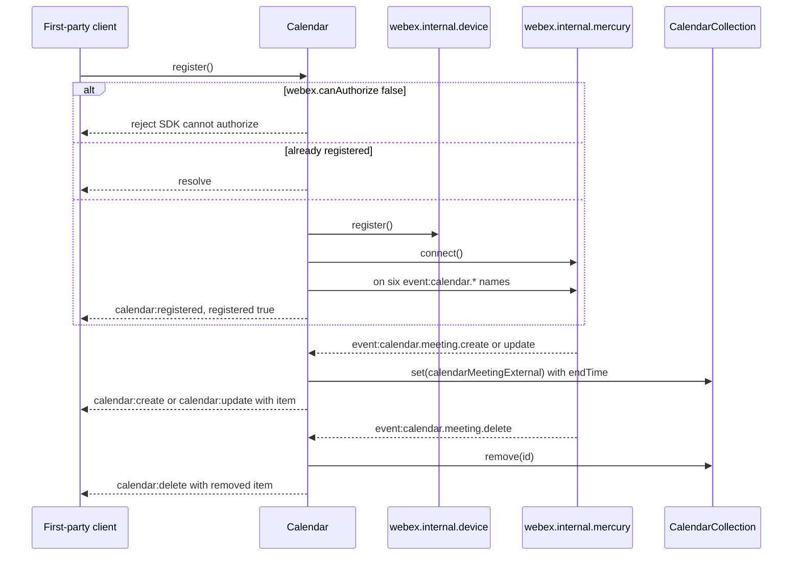
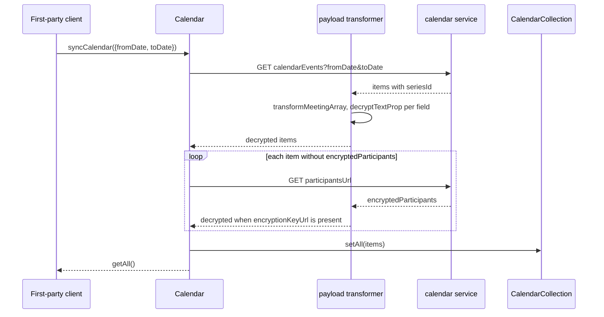
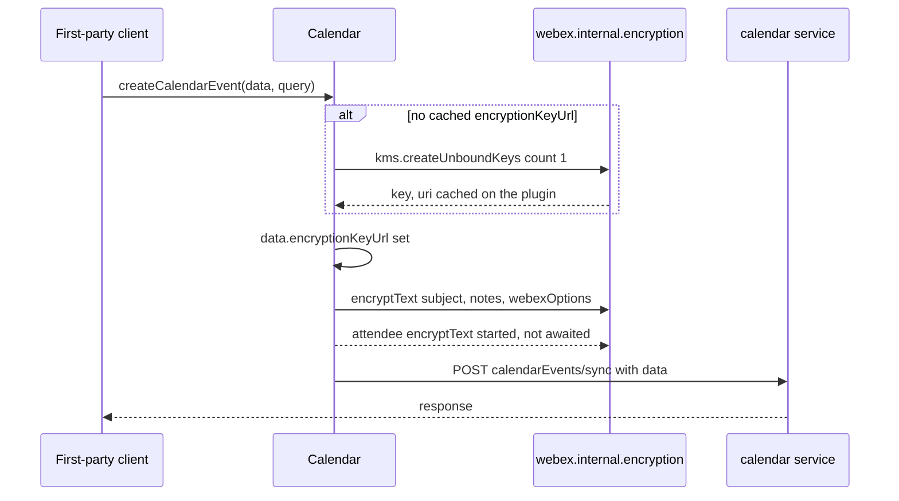
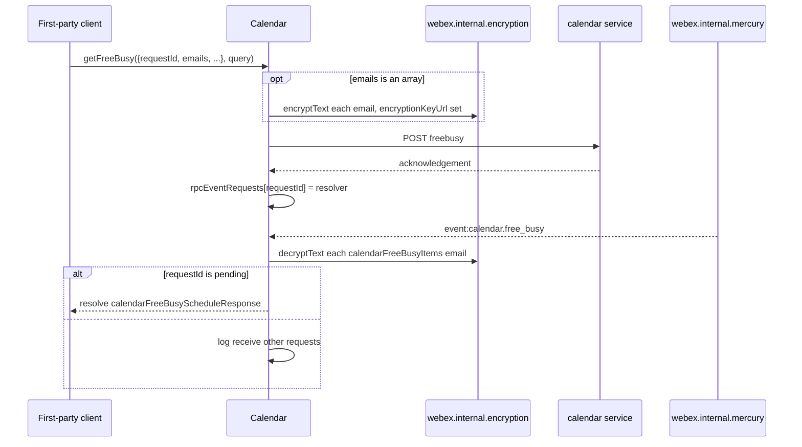
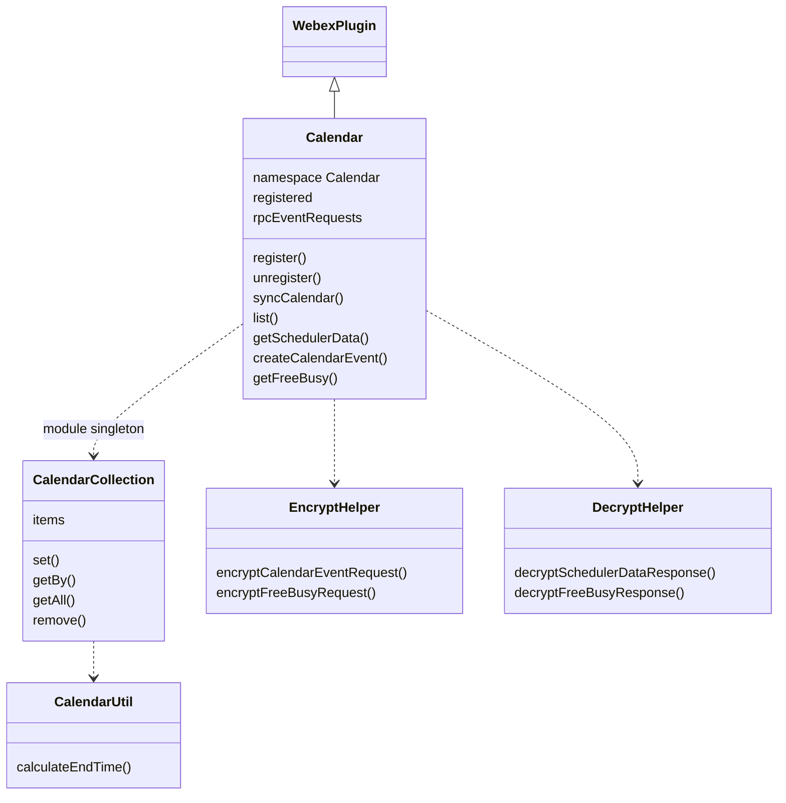

<!-- sdd-generated-metadata
doc_kind: module-spec
generated_from: module-spec@0.3.0
generated_by: claude-code
approved_by: rarajes2@cisco.com
updated_at: 2026-11-12T08:24:55Z
validation_status: pass-with-warnings
-->

# Calendar plugin

This source-local document at `src/docs/README.md` owns the stable specification for **the calendar
plugin**: the internal `webex.internal.calendar` plugin that lists and syncs a user's calendar
meetings from the Webex calendar service, keeps them in an in-memory collection updated by Mercury
calendar events, reads meeting notes, participants, and scheduler data, creates, updates, and deletes
calendar events with KMS-encrypted payloads, and runs free-busy lookups whose answer arrives over
Mercury. Ground every claim in package evidence and link to the
[package architecture](../../docs/architecture.md) instead of repeating broader facts. No service
specification exists because this package is a library.

Related context: [documentation index](../../docs/index.md) ·
[package agent instructions](../../AGENTS.md)

## Metadata

| Field             | Value |
| ----------------- | ----- |
| Owner             | @webex/web-sdk |
| Source path       | `src` |
| Resource kind     | package |
| Status            | Draft |
| Last verified     | 2026-11-12 at `ecd5af12a1` |
| Module id         | `internal-plugin-calendar` |
| Parent spec       | — |
| Doc kind          | Module spec |
| Coverage score    | 93.3% assessed 2026-11-12 — 14 of 15 mandatory fields PRESENT, critical 8 of 8; test strategy is WEAK because the payload transformer, `getFreeBusy` and the free-busy event, `getByType`, `processMeetingEvent`, the participants fetch in `list`, attendee encryption, and the failure paths of `register` have no unit case, and the only integration spec is `describe.skip` |
| Validation status | Pass with warnings — 0 Blocking, 1 Important; validator runtime 01a1cec9-0225-7283-9212-f70c182f1a3e; 2026-11-12 |

## Applicability

| Condition ID                         | Status     | Evidence or reason | Owned section |
| ------------------------------------ | ---------- | ------------------ | ------------- |
| `module.has_tiers`                   | N/A        | No tier policy exists in this package or its `package.json` | Tier |
| `module.has_ui`                      | N/A        | `src/calendar.js` makes requests and emits events; nothing is rendered | UI use-case flow |
| `module.crosses_service_boundaries`  | Applicable | `src/calendar.js` calls the calendar service over HTTPS, listens to Mercury calendar events, and requests KMS keys through the encryption plugin | Cross-boundary use-case flow |
| `module.holds_client_state`          | Applicable | The meeting collection in `src/collection.js`, plus the registered flag, the rpcEventRequests map, and the cached encryptionKeyUrl in `src/calendar.js` and `src/calendar.encrypt.helper.js` | Client state model |
| `module.enforces_domain_rules`       | Applicable | The schedulerData exclusion in the transformer predicates (`src/index.js`), the free-busy encryption rule (`src/calendar.encrypt.helper.js`), the getByType key list and the derived end time (`src/calendar.js`, `src/util.js`) | Business rules and invariants |
| `module.is_concurrent_async`         | Applicable | Parallel field encryption and decryption in the helpers, and the free-busy request that resolves from a later Mercury event in `src/calendar.js` | Concurrency and reactive flow |
| `module.owns_persistence`            | N/A        | Nothing is written to storage; meetings live in the calendar service and in memory (`src/collection.js`) | Data, schema, and migration discipline |
| `module.stateful_transitions`        | N/A        | The only state flag is registered in `src/calendar.js`, a two-value flag covered under Client state model | State machine |
| `module.exposes_wire_protocol`       | Applicable | The calendar REST requests in `src/calendar.js` and the Mercury event envelopes it reads | Protocol and wire format |
| `module.ui_multi_screen`             | N/A        | No UI | UI flow |
| `module.large_data_model`            | N/A        | Meeting objects are server-owned shapes passed through `src/calendar.js`; the module defines no entity types | Data model |
| `module.returns_caller_errors`       | Applicable | Rejections and the synchronous throw of getByType in `src/calendar.js` | Caller-visible failure modes |
| `module.module_specific_conventions` | Applicable | The Calendar config namespace, the calendar: event names in `src/constants.js`, and the calendar-> log prefix in `src/calendar.js` | Module-specific rules |
| `module.published_package`           | Applicable | `package.json` names the package @webex/internal-plugin-calendar and defines deploy:npm | Export stability |
| `module.embedded_in_host`            | N/A        | No host theme or embed API | Host integration and theming |
| `module.has_design_tradeoff`         | Applicable | Transformer-based decryption for reads versus explicit helper decryption for scheduler data and free-busy, and the request-then-event free-busy design in `src/index.js` and `src/calendar.js` | Key design trade-off |
| `module.has_submodules`              | N/A        | The src directory has no child module | Sub-modules |

## Evidence register

| Evidence | What it establishes |
| -------- | ------------------- |
| `src/index.js` | Side-effect imports of the device, encryption, and conversation plugins; `registerInternalPlugin('calendar', Calendar, {config, payloadTransformer})` with five inbound predicates (`transformMeetingNotes`, `transformMeetingParticipants`, `transformMeetingArray`, and `transformMeeting` twice) and four transforms; exports default `Calendar` only |
| `src/calendar.js` | The `Calendar` plugin (`WebexPlugin.extend`, namespace `Calendar`): `register`, `unregister`, Mercury event handling, `syncCalendar`, `list`, `getByType`, `getAll`, `processMeetingEvent`, notes and participants reads, create, update, delete, `getSchedulerData`, `getFreeBusy`. Its JSDoc is the main recorded rationale |
| `src/collection.js` | `CalendarCollection`, a module-level object holding meetings keyed by `id`, with `get`, `getBy`, `set`, `setAll`, `getAll`, `remove`, `reset` |
| `src/util.js` | `calculateEndTime` adds `endTime` from `start` and `durationMinutes`; its comment gives the reason |
| `src/calendar.encrypt.helper.js` | Encryption of create and update payloads and of free-busy emails, and the lazy creation of one KMS unbound key cached on the plugin |
| `src/calendar.decrypt.helper.js` | Decryption of scheduler-data responses and free-busy responses with `encryption.decryptText` |
| `src/config.js` | `webex.config.calendar` defaults `fromDate` and `toDate` |
| `src/constants.js` | Event names `calendar:registered`, `calendar:unregistered`, `calendar:create`, `calendar:update`, `calendar:delete`, and the collection namespace `CALENDAR` |
| `package.json` | Name, `main` (`dist/index.js`), `devMain` (`src/index.js`), `engines` (`node >=18`), dependencies, and scripts; the aggregate `test` script calls an undefined `test:integration` |
| `process` | Package-root module exporting `{browser: true}`; nothing in `src/` imports it and no package script names it |
| `test/unit/spec/calendar.js` | Unit cases for `register`, `unregister`, the create, update, and delete events, `syncCalendar`, `list`, `getNotes`, `getParticipants`, `getNotesByUrl`, `getSchedulerData`, and create, update, and delete requests. It imports the package by name, so it loads `dist/` |
| `test/unit/spec/calendar.encrypt.helper.js` | Unit cases for free-busy email encryption with and without `emails` |
| `test/unit/spec/calendar.decrypt.helper.js` | Unit cases for scheduler-data and free-busy decryption, including the early returns |
| `test/unit/spec/utils.js` | Unit case for `calculateEndTime` |
| `test/integration/spec/calendar.js` | Live-service cases for `list`, Mercury create events, `getNotes`, and `getParticipants`; the whole file is `describe.skip` |
| `README.md` | Retained npm page; context only. Its usage block is the placeholder `webex.internal.calendar.WHATEVER`; see `docs/adr/0001-retain-product-readme.md` |
| Sibling package webex-core, file src/docs/README.md | Module spec consulted. `registerInternalPlugin` merges `config` and concatenates `payloadTransformer` predicates and transforms into the default config (MOD-008); `canAuthorize` is proxied from credentials (MOD-015); `transform(direction, object)` runs predicates whose direction matches and applies named transforms (MOD-037); `WebexPlugin.config` is the lowercased namespace key of `webex.config` (MOD-044); `WebexPlugin.logger` is `webex.logger` (MOD-045) |
| Sibling package webex-core, file src/interceptors/docs/README.md | Module spec consulted. `PayloadTransformerInterceptor` runs `transform('inbound', response)` on every response unless `options.disableTransform` is set, and a transform rejection fails the request (INT-018) |
| Sibling package internal-plugin-mercury, file src/docs/README.md | Module spec consulted. `connect()` registers the device when needed and resolves when online (MOD-002); envelopes are emitted as `event:<eventType>` (MOD-009); `disconnect()` closes the socket (MOD-011) |
| Sibling package internal-plugin-device, file src/docs/README.md | Module spec consulted. `register()` on a registered device refreshes it (MOD-005); `unregister()` deletes the registration and clears local state (MOD-011) |
| Sibling package common, file src/docs/README.md | Module spec consulted. `base64.encode` is base64url encoding over `urlsafe-base64` (the `base64` row of its public surface) |
| Sibling package internal-plugin-conversation, files src/decryption-transforms.js, src/conversation.js, src/config.js | Source consulted (no spec). The inbound `decryptTextProp` transform decrypts one field and, on failure, logs a warning and writes `decryptionFailureMessage` ('This message cannot be decrypted') instead of rejecting. `Conversation.initialize` appends these transforms on webex `ready` only when `conversation.includeDecryptionTransforms` is true (the default) |
| Sibling package internal-plugin-encryption, files src/encryption.js, src/kms.js, src/index.js | Source consulted (no spec). `encryptText(key, plaintext)` and `decryptText(key, ciphertext)` resolve JWE strings; `kms.createUnboundKeys({count})` resolves an array of keys with `uri`. Its `src/index.js` imports `@webex/internal-plugin-mercury`, which is how `webex.internal.mercury` exists for this package |
| Sibling package eslint-config-legacy, file static/ignore-patterns.js | Source consulted. `docs/**` and `*.md` are ignored, so this specification is not linted; no source file of this package is on the decorator list |
| Generator observation in a temporary unit case under Node 22.14 (not committed) | Two `MockWebex` instances share one `rpcEventRequests` array and one meeting collection; `encryptCalendarEventRequest` resolves while an attendee `email` is still plaintext |
| `src/calendar.js`, `src/calendar.encrypt.helper.js` | The four operation groups that the extension subsections under Data flow and sequence coverage (Register and receive events, Sync meetings, Write an event, Free-busy) each diagram once; every subsection maps to one row of that section's inventory table |
| Observation, no stated WHY | `list` calls `this.webex.request` while the others call `this.request`; the JSDoc event-name mismatch and the unused free-busy `reject` are recorded under Pitfalls and constraints |

## Purpose and boundary

- Responsibility: give first-party clients a calendar API on `webex.internal.calendar`. That means
  registering for Mercury calendar events and keeping an in-memory meeting collection current from
  them; listing and syncing meetings for a date window; reading notes, participants, and scheduler
  data; creating, updating, and deleting calendar events with encrypted payloads; and asking for
  free-busy status, whose answer arrives as a Mercury event.
- In scope: every method of `Calendar`; the collection and end-time helper; the encrypt and decrypt
  helpers; the calendar `payloadTransformer` predicates and transforms; the calendar REST request
  shapes and the Mercury calendar event shapes this module reads; the `webex.config.calendar` defaults.
- Out of scope: KMS key creation and JWE cryptography (the encryption plugin); the `decryptTextProp`
  transform and its failure substitution (the conversation plugin); socket lifecycle and envelope
  routing (the mercury plugin); device registration (the device plugin); the request pipeline and the
  transform engine (webex-core); rendering meetings and joining them (the host client and the meetings
  plugin).
- Consumers: `webex`, `webex-node`, `@webex/webex-server`, and `@webex/recipe-private-web-client`,
  which import this package for its side effect, and first-party clients that call
  `webex.internal.calendar`.

## Structure and key files

| Path | Responsibility |
| ---- | -------------- |
| `src/index.js` | Imports three sibling plugins, registers internal plugin `calendar` with `config` and the payload transformer, and re-exports `Calendar` as default |
| `src/calendar.js` | The `Calendar` plugin, built with `WebexPlugin.extend` in namespace `Calendar` |
| `src/collection.js` | The module-level meeting collection |
| `src/util.js` | `calculateEndTime` |
| `src/calendar.encrypt.helper.js` | Request-payload encryption and the cached KMS key |
| `src/calendar.decrypt.helper.js` | Scheduler-data and free-busy response decryption |
| `src/config.js` | `webex.config.calendar` defaults |
| `src/constants.js` | Event names and the collection namespace |
| `process` | Package-root file exporting `{browser: true}`; not imported by `src/` |
| `package.json` | Package name, entry points, scripts, and dependencies |
| `babel.config.js`, `jest.config.js` | Re-exports of the legacy Babel and Jest configurations |
| `.eslintrc.js` | Sets `root: true` and extends `@webex/eslint-config-legacy` |
| `src/docs/README.md` | This module specification; ignored by the build and by lint |
| `test/unit/spec/calendar.js`, `test/unit/spec/calendar.encrypt.helper.js`, `test/unit/spec/calendar.decrypt.helper.js`, `test/unit/spec/utils.js` | Unit specs run by Jest through `webex-legacy-tools` (28 cases) |
| `test/integration/spec/calendar.js` | Live-service spec run only by `test:browser` (karma); the whole file is skipped |
| dist/ (generated) | Build output of `build:src`; ignored by Git and never edited by hand |

## Public surface

| Surface | Consumer | Compatibility commitment | Source |
| ------- | -------- | ------------------------ | ------ |
| Import side effect: internal plugins `device`, `encryption`, `conversation`, and `calendar`, plus the calendar payload transformer | `webex`, `webex-node`, `@webex/webex-server`, `@webex/recipe-private-web-client` | First registration of a name wins | `src/index.js` |
| Default export `Calendar` | Unit specs and packages that build on the class | No versioning rule is declared; the README states the plugin does not strictly follow semver | `src/index.js` |
| Lifecycle methods `register`, `unregister` and the `registered` flag | First-party clients | Both are no-ops when already in the target state | `src/calendar.js` |
| Collection methods `syncCalendar`, `getAll`, `getByType` | First-party clients | Items carry a derived `endTime` | `src/calendar.js`, `src/collection.js` |
| Read methods `list`, `getNotes`, `getNotesByUrl`, `getParticipants`, `getSchedulerData`, `processMeetingEvent` | First-party clients | `list` resolves the items array; the others resolve the whole response or the event | `src/calendar.js` |
| Write methods `createCalendarEvent`, `updateCalendarEvent`, `deleteCalendarEvent` | First-party clients | Resolve the whole response; the caller's `data` object is encrypted in place | `src/calendar.js` |
| `getFreeBusy(data, query)` | First-party clients | Resolves from a later Mercury event matched by `data.requestId` | `src/calendar.js` |
| Plugin events `calendar:registered`, `calendar:unregistered`, `calendar:create`, `calendar:update`, `calendar:delete` | First-party clients through `webex.internal.calendar.on` | Names in `src/constants.js` | `src/constants.js`, `src/calendar.js` |
| `webex.config.calendar` keys `fromDate`, `toDate` | Integrators through `Webex.init` config | Defaults under Requirements `MOD-002` | `src/config.js` |

Methods prefixed with `_` (`_handleCreate`, `_handleUpdate`, `_handleDelete`, `_handleFreeBusy`) and
`listenForEvents`, `stopListeningForEvents` are marked `@private` in their JSDoc. Contract ID
`calendar-internal-sdk` is indexed in the
[package architecture](../../docs/architecture.md#public-and-consumer-surfaces) and registered in
`.sdd/manifest.json`. Export stability is under [Export stability](#export-stability).

## Dependencies

| Dependency | Why it is required | Failure behavior |
| ---------- | ------------------ | ---------------- |
| `@webex/webex-core` plugin host (module spec consulted) | `WebexPlugin`, `registerInternalPlugin`, `this.request`, `this.webex.request`, `this.webex.transform`, namespaced `config`, `logger`, `canAuthorize`, and the payload transformer interceptor | Request rejections propagate; an inbound transform rejection fails the request |
| `@webex/internal-plugin-mercury` (module spec consulted; not declared in `package.json`, registered because the encryption plugin imports it) | `connect`, `disconnect`, `on`, `off` and the `event:calendar.*` events | `connect()` rejections reject `register` |
| `@webex/internal-plugin-device` (module spec consulted) | `register` and `unregister` around the Mercury connection | Rejections propagate from `register` and `unregister` |
| `@webex/internal-plugin-encryption` (code consulted; no spec) | `encryptText`, `decryptText`, `kms.createUnboundKeys` | Rejections propagate, except inside `decryptTextProp` |
| `@webex/internal-plugin-conversation` (code consulted; no spec) | The `decryptTextProp` transform that every calendar transform calls | A field that fails to decrypt becomes 'This message cannot be decrypted'. The transform is appended only on webex `ready`, and not at all while `conversation.includeDecryptionTransforms` is false |
| `@webex/common` (module spec consulted; not declared in `package.json`, resolved through the workspace) | `base64.encode` for event ids in resource paths | Not applicable |
| Calendar service (external) | Meetings, notes, scheduler data, event writes, free-busy | HTTP errors propagate |
| `lodash` | `has` in predicates, `find` in the collection, `isArray` in the encrypt helper | Not applicable |
| `uuid` | Declared in `package.json` dependencies but imported only by `test/integration/spec/calendar.js` | Not applicable |

## Requirements

| ID | WHAT | WHY | Source evidence | Test or example evidence | Assumptions or gaps | Confidence |
| -- | ---- | --- | --------------- | ------------------------ | ------------------- | ---------- |
| `MOD-001` | Importing the package imports the device, encryption, and conversation plugins, then registers internal plugin `calendar` with the package config and the payload transformer. It exports `Calendar` as default and nothing else. | The calendar needs device registration, Mercury, KMS, and the conversation decrypt transform on every instance, so it pulls those plugins in rather than relying on the host's import order. | `src/index.js` | `test/unit/spec/calendar.js` imports the package by name | The unit specs mount `Calendar` through MockWebex children, so `registerInternalPlugin` and the transformer registration are not exercised | Present |
| `MOD-002` | `webex.config.calendar` defaults `fromDate` to now minus one day and `toDate` to now plus seven days, both computed once when `src/config.js` is first evaluated. `syncCalendar()` without arguments uses them. | The `syncCalendar` JSDoc: defaults to 1 day before and 7 days ahead. | `src/config.js`, `src/calendar.js` | None found | The window is fixed at module load, so a long-lived page syncs a stale window | Weak |
| `MOD-003` | `register()` rejects `Error('SDK cannot authorize')` when `webex.canAuthorize` is false and resolves at once when `registered` is true. Otherwise it calls `device.register()`, then `mercury.connect()`, subscribes to six Mercury events (`MOD-005`, `MOD-015`), triggers `calendar:registered`, and sets `registered` true. A failure is logged as `calendar->register#ERROR` and rejected unchanged. | The JSDoc: explicitly sets up the plugin by registering the device, connecting to Mercury, and listening for calendar events. | `src/calendar.js` | `test/unit/spec/calendar.js` "on calendar register call mercury registration", "should trigger `calendar:register` event" | The cannot-authorize, already-registered, and failure paths have no case | Present |
| `MOD-004` | `unregister()` resolves at once when `registered` is false. Otherwise it calls `mercury.off(name)` for the six event names, then `mercury.disconnect()`, then `device.unregister()`, triggers `calendar:unregistered`, and sets `registered` false. | The JSDoc: explicitly tears down the plugin by deregistering the device, disconnecting from Mercury, and stopping the calendar listeners. | `src/calendar.js` | `test/unit/spec/calendar.js` "#unregister()" cases | Teardown side effects beyond calendar are under Pitfalls and constraints | Present |
| `MOD-005` | Mercury `event:calendar.meeting.create` and `event:calendar.meeting.create.minimal` store `data.calendarMeetingExternal` in the collection and trigger `calendar:create` with the stored item; the two `update` variants do the same and trigger `calendar:update`; `event:calendar.meeting.delete` removes the item by `calendarMeetingExternal.id` and triggers `calendar:delete` with the removed item. | The JSDoc of the handlers: trigger after the collection updates, so listeners read the current item. | `src/calendar.js`, `src/collection.js` | `test/unit/spec/calendar.js` "trigger `calendar:update` event", "trigger `calendar:create` event", "trigger `calendar:delete` event" | The `.minimal` variants have no case. Items are stored as received, without decryption; a delete for an unknown id triggers with `undefined` | Present |
| `MOD-006` | The collection keys items by `id` and stores a copy with `endTime = new Date(start + durationMinutes * 60000)`. `getAll()` returns every stored item; `getByType(key, value)` returns the first item whose `key` equals `value` for `spaceURI`, `spaceMeetURL`, or `conversationId` and throws `Error('key must be one of, spaceURI, spaceMeetURL, or conversationId')` for any other key; a falsy value returns `null`. | The `src/util.js` comment: store the end time on the item so clients display start and end without calculating. The key list limits lookups to the fields that identify a meeting's space. | `src/collection.js`, `src/util.js`, `src/calendar.js` | `test/unit/spec/utils.js` "return the end time for meeting"; `test/unit/spec/calendar.js` "#syncCalendar()" reads `getAll` | `getByType` has no case. A missing `start` or `durationMinutes` yields an invalid `endTime` | Present |
| `MOD-007` | `list(options)` GETs service `calendar`, resource `calendarEvents`, with `qs` = `options` (default `{}`). For every returned item without `encryptedParticipants` it GETs the item's `participantsUrl` and copies `body.encryptedParticipants` onto the item; it resolves the items array after all those requests settle. | The JSDoc: retrieve meetings for a time range. Participants are fetched separately when the list omits them, so every listed meeting carries participants. | `src/calendar.js` | `test/unit/spec/calendar.js` "#list()" cases | Every fixture already has `encryptedParticipants`, so the participants fetch has no case; one failed fetch rejects the whole list | Present |
| `MOD-008` | `syncCalendar(options)` calls `list({fromDate, toDate})`, stores every item in the collection, and resolves `getAll()`, which includes items from earlier syncs and events. | The JSDoc: retrieve calendars for the request window, then serve them from the collection. | `src/calendar.js`, `src/collection.js` | `test/unit/spec/calendar.js` "should sync from calendar service" | Items outside the new window are never evicted | Present |
| `MOD-009` | `getNotes(id)` GETs service `calendar`, resource `calendarEvents/<base64url(id)>/notes`; `getNotesByUrl(url)` and `getParticipants(url)` GET `uri`. All three resolve the whole response. | The JSDoc: fetch notes or participants of one meeting, by id or by the URL the meeting object carries. | `src/calendar.js` | `test/unit/spec/calendar.js` "#getNotes()", "#getParticipants()", "#getNotesByUrl()" | Decryption is left to `MOD-010` and `MOD-011` | Present |
| `MOD-010` | Five inbound predicates select payloads: `transformMeetingNotes` when the body has `encryptedNotes`, `transformMeetingParticipants` when it has `encryptedParticipants`, and `transformMeeting` when it has `seriesId`, each skipped when the response options are service `calendar`, method `GET`, resource `schedulerData`; `transformMeetingArray` when `body.items[0].seriesId` exists, extracting `body.items`; and `transformMeeting` when the object has `calendarMeetingExternal`, extracting it. | Inbound transforms let every read path return plaintext without explicit calls. The schedulerData exclusion keeps those responses for `getSchedulerData`, which decrypts them itself (`MOD-014`); no comment states this, it is read from the code. | `src/index.js`, `src/calendar.js` | `test/integration/spec/calendar.js` (skipped) | No unit case. Only the first list item is inspected | Weak |
| `MOD-011` | The transforms require `encryptionKeyUrl` and call `decryptTextProp` in parallel. `transformMeeting` decrypts `encryptedSubject`, `encryptedLocation`, `encryptedNotes`, `webexURI`, `webexURL`, `spaceMeetURL`, `spaceURI`, `spaceURL`, the `encryptedOrganizer` and every `encryptedParticipants` entry's `encryptedEmailAddress` and `encryptedName`, and `meetingJoinInfo.meetingJoinURI` and `meetingJoinURL`. `transformMeetingNotes` decrypts `encryptedNotes`; `transformMeetingParticipants` decrypts the participant fields; `transformMeetingArray` applies `transformMeeting` to each item. Fields keep their names after decryption. | Meeting text is stored encrypted under the meeting's key, and these are the fields that carry user content or join links. | `src/index.js` | `test/integration/spec/calendar.js` (skipped) | No unit case. A field that fails to decrypt becomes the conversation `decryptionFailureMessage` rather than rejecting | Weak |
| `MOD-012` | `processMeetingEvent(event)` runs `webex.transform('inbound', event)` and resolves the same event, so an event carrying `calendarMeetingExternal` has that meeting decrypted in place. | The JSDoc: decrypt an encrypted incoming calendar event. Mercury handlers store events without decrypting (`MOD-005`). | `src/calendar.js`, `src/index.js` | None found | No caller in this repository and no test | Weak |
| `MOD-013` | `createCalendarEvent(data, query)` POSTs to `calendarEvents/sync`; `updateCalendarEvent(id, data, query)` PATCHes `calendarEvents/<base64url(id)>/sync`; both first encrypt `data` in place. `deleteCalendarEvent(id, query)` DELETEs `calendarEvents/<base64url(id)>/sync`. All use service `calendar`, `qs` = `query` or `{}`, and resolve the whole response. Encryption creates one KMS unbound key when the plugin has no `encryptionKeyUrl`, caches its `uri` on the plugin, sets `data.encryptionKeyUrl` to it (replacing a caller value), and encrypts `subject`, `notes`, and `webexOptions`, plus `displayName` and `email` of each `attendees` entry. | The JSDoc: create, update, or delete a calendar event; the payload carries its key URL so the service and other clients can decrypt it. | `src/calendar.js`, `src/calendar.encrypt.helper.js` | `test/unit/spec/calendar.js` "#createCalendarEvent()", "#updateCalendarEvent()", "#deleteCalendarEvent()" | Attendee encryption is started but not awaited (see Pitfalls). The cases assert `body: data` against the same mutated object, so they do not check ciphertext | Weak |
| `MOD-014` | `getSchedulerData(query)` GETs service `calendar`, resource `schedulerData`, with `qs` = `query` or `{}`, decrypts the body with `decryptSchedulerDataResponse`, and resolves the whole response. When the body has `encryptionKeyUrl`, that helper decrypts the same top-level fields, organizer, participants, and `meetingJoinInfo` as `MOD-011`, plus `encryptedEmail` and `encryptedDisplayName` of every `encryptedScheduleFor` entry, with `encryption.decryptText` directly. | The typedef: scheduler data serves scheduling, including schedule-on-behalf (`organizerCIUserId`), so the `encryptedScheduleFor` map must be decrypted too, which the transforms do not do. | `src/calendar.js`, `src/calendar.decrypt.helper.js` | `test/unit/spec/calendar.js` "#getSchedulerData()"; `test/unit/spec/calendar.decrypt.helper.js` "#decryptSchedulerDataResponse" cases | The `getSchedulerData` case has no `encryptionKeyUrl`, so the call path skips decryption; one failed field rejects the call | Present |
| `MOD-015` | `getFreeBusy(data, query)` encrypts each entry of `data.emails` with the cached or newly created key and sets `data.encryptionKeyUrl` only when `data.emails` is an array; otherwise the body is sent as given. It POSTs `data` to service `calendar`, resource `freebusy`, then resolves only when Mercury `event:calendar.free_busy` delivers a `calendarFreeBusyScheduleResponse` whose `requestId` equals `data.requestId`. That response is decrypted (each `calendarFreeBusyItems[].email`), loses `encryptionKeyUrl`, and is the resolved value; the pending entry is deleted. | The `encryptFreeBusyRequest` JSDoc: the calendar service validates that the key URL and the sensitive data are both present, and returns 400 otherwise, so a request without emails must carry neither. The answer is produced asynchronously and pushed over Mercury. | `src/calendar.js`, `src/calendar.encrypt.helper.js`, `src/calendar.decrypt.helper.js` | `test/unit/spec/calendar.encrypt.helper.js` both cases; `test/unit/spec/calendar.decrypt.helper.js` "#decryptFreeBusyResponse" cases | `getFreeBusy` and `_handleFreeBusy` have no case. Pending and duplicate-`requestId` behavior is under Concurrency and reactive flow and Caller-visible failure modes | Weak |

## Design overview

`Calendar` extends `WebexPlugin` in namespace `Calendar`, so `this.config` is `webex.config.calendar`.
It is mostly a request builder for the calendar service, with one piece of local state: a meeting
collection that `syncCalendar` fills from `list` and that Mercury create, update, and delete events
keep current after `register()`.

Encryption runs in two styles. Reads that pass through the SDK request pipeline are decrypted by the
inbound payload transformer registered in `src/index.js`, which delegates each field to the
conversation plugin's `decryptTextProp`. Scheduler data and free-busy answers are decrypted by
`src/calendar.decrypt.helper.js`, because scheduler data carries a schedule-on-behalf map the
transforms do not handle and free-busy answers arrive over Mercury, not as HTTP responses. Writes call
`src/calendar.encrypt.helper.js` explicitly, with one KMS key created on first use and reused by the
plugin instance afterwards.

`getFreeBusy` is a request-then-event exchange: the POST only starts the lookup, and the result comes
back as a Mercury event matched by the caller's `requestId`.

## Data flow and sequence coverage

Call style: in-process calls on `webex.internal.calendar`; outbound HTTPS through `webex.request`;
inbound Mercury events. Four operation groups differ in actors, ordering, or outcome, and each has a
diagram. Single-request reads (`getNotes`, `getNotesByUrl`, `getParticipants`) and
`deleteCalendarEvent` follow the same request-and-resolve-response shape and are covered by
Requirements.

| Operation group | Entry and outcome | Diagram or evidence | Failure and recovery coverage |
| --------------- | ----------------- | ------------------- | ----------------------------- |
| Register and receive events | `register` subscribes; Mercury events update the collection and trigger plugin events | Register diagram; `src/calendar.js` | Cannot-authorize and connect failures reject |
| Sync meetings | `syncCalendar` lists, fetches missing participants, stores, and resolves the collection | Sync diagram; `src/calendar.js`, `src/index.js` | Any failed request rejects |
| Write an event | `createCalendarEvent` or `updateCalendarEvent` encrypts, then sends | Write diagram; `src/calendar.encrypt.helper.js` | KMS or request rejection propagates |
| Free-busy | `getFreeBusy` POSTs, then resolves from `event:calendar.free_busy` | Free-busy diagram; `src/calendar.js` | No timeout; an unmatched event is logged and ignored |

### Register and receive events

### Sync meetings

### Write an event

### Free-busy

## Class and component relationships

`Calendar` reaches device, mercury, and encryption through `this.webex.internal` at call time. The
helpers take the plugin as their `ctx` argument, so the cached `encryptionKeyUrl` lives on the plugin.

## Use cases and flows

| Use case | Actor or caller | Primary steps and outcome | Failure or boundary behavior | Evidence |
| -------- | --------------- | ------------------------- | ---------------------------- | -------- |
| `UC-001` | Client showing upcoming meetings | `register`, then `syncCalendar`, then `getAll` and the `calendar:*` events | Cannot-authorize rejects; items are kept until replaced or deleted | `src/calendar.js`, `test/unit/spec/calendar.js` |
| `UC-002` | Client opening a meeting's space | `getByType('spaceURI', uri)` or `conversationId` | Another key throws | `src/calendar.js` |
| `UC-003` | Client reading meeting detail | `getNotes`, `getNotesByUrl`, `getParticipants` | HTTP errors propagate | `src/calendar.js`, `test/unit/spec/calendar.js` |
| `UC-004` | Client scheduling a meeting | `getSchedulerData`, then `createCalendarEvent` or `updateCalendarEvent`, or `deleteCalendarEvent` | KMS or HTTP errors propagate | `src/calendar.js`, `src/calendar.encrypt.helper.js` |
| `UC-005` | Client checking attendee availability | `getFreeBusy` after `register` | Never settles without a matching Mercury event | `src/calendar.js` |

### Cross-boundary use-case flow

| Boundary | Transport and ordering | Compatibility | Timeout, retry, and recovery |
| -------- | ---------------------- | ------------- | ---------------------------- |
| Calendar service (`UC-001` to `UC-005`) | HTTPS through `webex.request` with catalog service `calendar`, or the meeting's own URLs | Request shapes under Protocol and wire format | No plugin-local retry; webex-core interceptors apply |
| KMS through the encryption plugin (`UC-004`, `UC-005`) | In-process calls that send KMS requests | Key URI cached per plugin instance | Rejections propagate |
| Mercury (`UC-001`, `UC-005`) | Web socket events after `register` | `calendarMeetingExternal` and `calendarFreeBusyScheduleResponse` envelopes | Reconnect is Mercury's; events missed while offline are not replayed by this module |

## Client state model

| State or slice | Owner | Initial state | Transition triggers | Reset or persistence boundary |
| -------------- | ----- | ------------- | ------------------- | ----------------------------- |
| `CalendarCollection.items` | `src/collection.js` module-level object | `{}` | `syncCalendar`, Mercury create, update, and delete events | In memory for the JavaScript module, so every SDK instance in the process shares the same meetings; `reset()` exists but nothing calls it |
| `registered` | Calendar | `false` | `true` after a successful `register`, `false` after `unregister` | In memory per instance |
| `rpcEventRequests` | Calendar prototype (declared in the `WebexPlugin.extend` body) | `[]` used as a map | Entry added by `getFreeBusy`, removed by the matching free-busy event | In memory, so every SDK instance in the process shares the same pending free-busy requests |
| `encryptionKeyUrl` | Calendar instance | unset | Set by the first create, update, or free-busy call with emails | In memory for the instance; never rotated |

## Business rules and invariants

| ID | Invariant | WHY | Enforcement source | Test evidence |
| -- | --------- | --- | ------------------ | ------------- |
| `INV-001` | `subject`, `notes`, `webexOptions`, and free-busy `emails` are KMS-encrypted in place before the request is sent, and the payload carries the key's `encryptionKeyUrl`. | The calendar service stores and checks ciphertext under the named key. | `src/calendar.encrypt.helper.js`, `src/calendar.js` | `test/unit/spec/calendar.encrypt.helper.js` |
| `INV-002` | A free-busy payload carries `encryptionKeyUrl` only when it carries an `emails` array. | The `encryptFreeBusyRequest` JSDoc: the service returns 400 unless both are present together. | `src/calendar.encrypt.helper.js` | `test/unit/spec/calendar.encrypt.helper.js` "not include emails" |
| `INV-003` | A scheduler-data response is decrypted once, by `decryptSchedulerDataResponse`, and never by the meeting predicates. | Double decryption would fail on plaintext; read from the predicate exclusions and the explicit helper call. | `src/index.js`, `src/calendar.js` | `test/unit/spec/calendar.decrypt.helper.js` |
| `INV-004` | Every stored meeting has `endTime` derived from `start` and `durationMinutes`. | The `src/util.js` comment: clients display start and end without calculating. | `src/collection.js`, `src/util.js` | `test/unit/spec/utils.js` |
| `INV-005` | `register` while registered and `unregister` while unregistered do nothing and resolve. | The JSDoc log messages: already registered, already unregistered. | `src/calendar.js` | None found |

## Concurrency and reactive flow

- Execution model: single event loop; every public method returns a promise except `getAll` and
  `getByType`.
- Ordering guarantees: field encryption and decryption run in parallel inside one call. `list`
  fetches missing participants in parallel and resolves after all of them. Mercury events are applied
  to the collection in arrival order, and the plugin event fires after the collection change.
- Idempotency and retry: `register` checks `registered` before its async chain and sets it only at the
  end, so two overlapping `register` calls both subscribe and each Mercury event is then handled twice.
  No plugin-local retry exists.
- Shared-state protection: none for the process-wide state under Client state model. A second
  `getFreeBusy` with the same `requestId` replaces the first resolver, which then never settles.
- Blocking restrictions: none in this module; the pending `getFreeBusy` outcomes are under
  Caller-visible failure modes.

## Protocol and wire format

| Message or frame | Version | Producer or serializer | Consumer or parser | Compatibility and ordering rule |
| ---------------- | ------- | ---------------------- | ------------------ | ------------------------------- |
| `GET calendarEvents?fromDate=&toDate=` response `{items: [meeting]}` | Unversioned | `list` | Calendar service, then `transformMeetingArray` | Items carry `seriesId`, `encryptionKeyUrl`, `participantsUrl` |
| `GET <participantsUrl>` response `{encryptedParticipants}` | Unversioned | `getParticipants`, `list` | Calendar service | Decrypted by `transformMeetingParticipants` when `encryptionKeyUrl` is present |
| `GET calendarEvents/<base64url(id)>/notes`, `GET <notesUrl>` response `{encryptedNotes, encryptionKeyUrl}` | Unversioned | `getNotes`, `getNotesByUrl` | Calendar service | Decrypted by `transformMeetingNotes` |
| `POST calendarEvents/sync`, `PATCH calendarEvents/<base64url(id)>/sync` body `{encryptionKeyUrl, subject, notes, webexOptions, attendees: [{displayName, email}], ...}` | Unversioned | `createCalendarEvent`, `updateCalendarEvent` | Calendar service | Text fields are ciphertext |
| `DELETE calendarEvents/<base64url(id)>/sync` | Unversioned | `deleteCalendarEvent` | Calendar service | `qs` passed through |
| `GET schedulerData?siteName=&id=&clientMeetingId=&scheduleTemplateId=&sessionTypeId=&organizerCIUserId=&usmPreference=&webexMeetingId=&eventId=&icalUid=&thirdPartyType=` response with the meeting fields and `encryptedScheduleFor` map | Unversioned | `getSchedulerData` | Calendar service, then `decryptSchedulerDataResponse` | Query keys from the `QuerySchedulerDataOptions` typedef |
| `POST freebusy` body `{requestId, emails, encryptionKeyUrl, ...}` | Unversioned | `getFreeBusy` | Calendar service | `encryptionKeyUrl` only with `emails` (`INV-002`) |
| Mercury `calendar.meeting.create`, `.create.minimal`, `.update`, `.update.minimal`, `.delete` with `data.calendarMeetingExternal` | Unversioned | Calendar service through Mercury | `_handleCreate`, `_handleUpdate`, `_handleDelete` | Keyed by `calendarMeetingExternal.id` |
| Mercury `calendar.free_busy` with `data.calendarFreeBusyScheduleResponse {requestId, encryptionKeyUrl, calendarFreeBusyItems: [{email, ...}]}` | Unversioned | Calendar service through Mercury | `_handleFreeBusy` | Matched by `requestId` |

## Caller-visible failure modes

| Condition | Signal or result | Caller behavior | Retry or recovery | Evidence |
| --------- | ---------------- | --------------- | ----------------- | -------- |
| `register` before the SDK can authorize | Rejected `Error` `SDK cannot authorize`, logged | Authorize first | Call again | `src/calendar.js` |
| Device registration or Mercury connect fails in `register` | The original rejection, logged as `calendar->register#ERROR` | Handle the error; `registered` stays false | Call again | `src/calendar.js` |
| `getByType` with another key | Synchronous `Error` `key must be one of, spaceURI, spaceMeetURL, or conversationId` | Use one of the three keys | None | `src/calendar.js` |
| Calendar service request fails | The `webex.request` rejection, unchanged | Handle the HTTP error | Caller may retry | `src/calendar.js` |
| A participants fetch inside `list` fails | `list` and `syncCalendar` reject | Retry the list | Caller may retry | `src/calendar.js` |
| KMS key creation or encryption fails | The encryption plugin's rejection; the request is not sent | Handle as an encryption error | Caller may retry | `src/calendar.encrypt.helper.js` |
| A scheduler-data field fails to decrypt | `getSchedulerData` rejects | Handle as an encryption error | Caller may retry | `src/calendar.decrypt.helper.js` |
| A meeting field fails to decrypt in a transform | The field reads 'This message cannot be decrypted'; no rejection | Treat that string as a decryption failure | None | `src/index.js`; sibling package internal-plugin-conversation, file src/decryption-transforms.js |
| No matching free-busy event arrives | `getFreeBusy` stays pending | Apply a caller-side timeout | Call again with a new `requestId` | `src/calendar.js` |
| A free-busy event fails to decrypt | Unhandled rejection; the pending `getFreeBusy` never settles | Apply a caller-side timeout | None | `src/calendar.js` |

## Pitfalls and constraints

- `encryptCalendarEventRequest` passes the attendee promises to `Promise.all` as one nested array, so
  it does not wait for them. It resolves, and `createCalendarEvent` or `updateCalendarEvent` builds the
  request, while attendee `displayName` and `email` may still be plaintext. A temporary unit case under
  Node 22.14 showed `email` unchanged at the moment the helper resolved.
- Two SDK instances in one process share meetings and pending free-busy requests; see Client state
  model.
- `unregister` calls `mercury.off(name)` with no callback, which removes every listener on those six
  event names, including listeners another component added. It then disconnects Mercury and
  unregisters the device for the whole SDK instance.
- Before reading the text of a meeting delivered by Mercury (`MOD-005`), call `processMeetingEvent`
  (`MOD-012`) or re-sync.
- The event JSDoc in `src/calendar.js` names `calendar:meeting:create`, `calendar:meeting:update`, and
  `calendar:meeting:delete`; the emitted names are `calendar:create`, `calendar:update`, and
  `calendar:delete` from `src/constants.js`.
- `getFreeBusy` stores a `reject` that is never called, and its `.catch` only rethrows.
- `package.json` `test` runs `yarn test:integration`, which is not defined, so the aggregate `test`
  script fails at that step. The integration spec runs only through `test:browser` (karma) and is
  skipped.
- The unit specs import `@webex/internal-plugin-calendar` by name, which loads `dist/`. Run
  `build:src` before `test:unit`, or the tests run against stale output.

## Module-specific rules

- Do: encrypt every user-content field with the plugin's `encryptionKeyUrl` before it leaves the
  client, and send that URL with the payload (`INV-001`).
- Do: send `encryptionKeyUrl` with a free-busy request only together with `emails` (`INV-002`).
- Do: keep the schedulerData exclusion in the three meeting predicates while `getSchedulerData`
  decrypts explicitly (`INV-003`).
- Do: emit plugin events with the names in `src/constants.js`, after the collection changes.
- Do: log through `this.logger` with the `calendar->` or `webex.internal.calendar -` prefix, and never
  log decrypted meeting content, emails, or keys (`src/calendar.js`).
- Do not: change `getByType` keys or the derived `endTime` without updating consumers (`MOD-006`).

## Export stability

| Export or entry point | Consumer | Stability | Versioning and deprecation rule | Declaration or API report |
| --------------------- | -------- | --------- | ------------------------------- | ------------------------- |
| Default export `Calendar` | Packages building on the class; unit specs | Internal | The README says internal plugins do not strictly follow semver; no deprecation rule is declared | `src/index.js` |
| Import side effect: internal plugin `calendar` and its payload transformer | `webex`, `webex-node`, `@webex/webex-server`, `@webex/recipe-private-web-client` | Internal | Same | `src/index.js`, `package.json` |
| Plugin API `webex.internal.calendar.*` and its `calendar:*` events | First-party clients | Internal | Same | `src/calendar.js`, `src/constants.js` |

No TypeScript declaration or API report is shipped; `package.json` has no `types` field and the
source is JavaScript.

## Key design trade-off

| Chosen trade-off | Preserved invariant or benefit | Cost or limitation | Decision evidence |
| ---------------- | ------------------------------ | ------------------ | ----------------- |
| Transformer-based decryption for meeting reads | Every read path returns plaintext without explicit calls | Decryption failures become a placeholder string; Mercury events bypass it | `src/index.js` |
| Explicit helper decryption for scheduler data and free-busy | The schedule-on-behalf map and Mercury-delivered answers are decrypted | Two decryption paths with different failure behavior (`INV-003`) | `src/calendar.js`, `src/calendar.decrypt.helper.js` |
| Free-busy as POST plus Mercury event | The service can answer asynchronously | Callers depend on `register` and on Mercury delivery for completion (`MOD-015`) | `src/calendar.js` |
| One KMS key per plugin instance, created lazily | One KMS round trip for all writes | Every event written by the instance shares one key, never rotated | `src/calendar.encrypt.helper.js` |
| A module-level meeting collection | Simple lookup by any field | Process-wide and never evicted (Client state model) | `src/collection.js` |

## Verification

| Requirement or invariant | Test level | Positive evidence | Negative or boundary evidence | Gap |
| ------------------------ | ---------- | ----------------- | ----------------------------- | --- |
| `MOD-001` | Unit | `test/unit/spec/calendar.js` imports the package by name | None found | Registration and transformer options not exercised |
| `MOD-002` | None | None found | None found | No test of the default window |
| `MOD-003`, `INV-005` | Unit | `test/unit/spec/calendar.js` "#register()" cases | None found | Cannot-authorize, already-registered, and failure paths untested |
| `MOD-004` | Unit | `test/unit/spec/calendar.js` "#unregister()" cases | None found | Already-unregistered path untested |
| `MOD-005` | Unit | `test/unit/spec/calendar.js` "Events" cases | None found | `.minimal` variants and unknown-id delete untested |
| `MOD-006`, `INV-004` | Unit | `test/unit/spec/utils.js` "return the end time for meeting" | None found | `getByType` and its throw untested |
| `MOD-007`, `MOD-008` | Unit | `test/unit/spec/calendar.js` "#list()", "#syncCalendar()" | None found | Participants fetch path untested |
| `MOD-009` | Unit | `test/unit/spec/calendar.js` "#getNotes()", "#getParticipants()", "#getNotesByUrl()" | None found | None |
| `MOD-010`, `MOD-011`, `MOD-012` | Integration | `test/integration/spec/calendar.js` (skipped) | None found | No unit case for any predicate, transform, or `processMeetingEvent` |
| `MOD-013`, `INV-001` | Unit | `test/unit/spec/calendar.js` create, update, and delete cases | None found | Ciphertext not asserted; attendee path and the unawaited encryption untested |
| `MOD-014`, `INV-003` | Unit | `test/unit/spec/calendar.decrypt.helper.js` scheduler-data cases; `test/unit/spec/calendar.js` "#getSchedulerData()" | `test/unit/spec/calendar.decrypt.helper.js` early-return cases | Call path with `encryptionKeyUrl` untested |
| `MOD-015`, `INV-002` | Unit | `test/unit/spec/calendar.encrypt.helper.js`, `test/unit/spec/calendar.decrypt.helper.js` free-busy cases | `test/unit/spec/calendar.encrypt.helper.js` "not include emails" | `getFreeBusy` and the free-busy event untested |

Coverage gaps are recorded above. The 28 unit cases in four suites pass under Node 22.14 after
`build:src`. The integration spec needs live Webex services and test users and is skipped, so it is
not routine coverage evidence. Generator-side field measurement is complete (93.3%, assessed
2026-11-12). Independent validation passed with warnings on 2026-11-12 (runtime 01a1cec9-0225-7283-9212-f70c182f1a3e); the conformance report has zero Blocking findings. The module-map confirmation is recorded in the approved file-touch plan. A
characterization baseline and promotion past Partial also remain pending.
