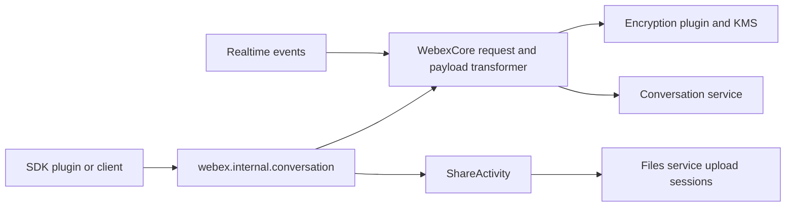
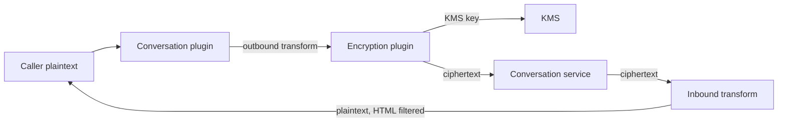

<!-- sdd-generated-metadata
doc_kind: standing-doc
generated_from: architecture@0.3.0
generated_by: claude-code
approved_by: pending
updated_at: 2026-10-16T01:43:45Z
validation_status: pass
-->

# @webex/internal-plugin-conversation architecture

Canonical architecture for the `@webex/internal-plugin-conversation` package. This document owns
facts that span the package as a whole; module-local behavior lives in the
[module specification](../src/docs/README.md).

Related context: [specification registry](specs/README.md) ·
[repository agent instructions](../AGENTS.md)

## Applicability

| Condition ID                         | Status     | Evidence or reason | Owned section                       |
| ------------------------------------ | ---------- | ------------------ | ----------------------------------- |
| `repo.owns_datastore`                | N/A        | No store, schema, or migration exists; conversations live in the conversation service | Repository data and schema |
| `repo.holds_client_state`            | Applicable | `src/conversation.js` keeps a process-wide id-to-URL map and generator state | Client state model |
| `repo.components_interact`           | N/A        | One module; the representative flow below is sufficient | Dependency and interaction topology |
| `repo.domain_data_across_components` | N/A        | One module owns all package code | Object and data ownership |
| `repo.caches_data`                   | Applicable | `src/conversation.js` caches conversation URLs; `src/share-activity.js` memoizes space URLs | Caching catalog |
| `repo.observability_convention`      | Applicable | `src/decryption-transforms.js` and `src/encryption-transforms.js` prefix warnings with the plugin name | Observability patterns |
| `repo.deploys_to_infra`              | N/A        | A library; `package.json` declares no deployable | Runtime and infrastructure |
| `repo.shared_base_libs`              | Applicable | `package.json` depends on webex-core, common, and the legacy config packages | Shared and base libraries |
| `repo.is_monorepo`                   | N/A        | The onboarding scope is this one package | Package map and dependencies |
| `repo.multi_platform`                | Applicable | `package.json` declares browserify transforms and `process` is a browser shim; tests run under Node and Karma | Platform matrix |
| `repo.published_package`             | Applicable | `package.json` declares main and deploy:npm | Release and versioning |
| `repo.embedded_in_host`              | Applicable | `src/index.js` registers into a WebexCore host | Host integration and theming |
| `repo.exposes_commands_or_artifacts` | Applicable | `package.json` scripts build `dist` | Commands and generated artifacts |
| `repo.cross_repo_deps_material`      | Applicable | `src/conversation.js` and `src/share-activity.js` call external Webex services | Cross-repository topology |
| `repo.security_arch_warranted`       | Applicable | `src/encryption-transforms.js` and `src/decryption-transforms.js` implement end-to-end encryption; `src/config.js` holds HTML allow-lists | Security architecture |

## Design overview

The package is a single internal WebexCore plugin. Importing it registers
`webex.internal.conversation` and a set of payload-transformer predicates and transforms. Methods
build plaintext Activity Streams-style activities and send them through WebexCore's request
pipeline; the outbound transform encrypts them with KMS keys and the inbound transform decrypts and
normalizes every conversation object returned, whether by HTTP response or realtime event. This
keeps cryptography out of every caller while letting a host disable it through configuration. A
thread-ordering reader on top of the activity APIs returns displayable thread order. See the
[module specification](../src/docs/README.md) for the full design.

## Resource inventory and responsibilities

| Resource | Kind | Responsibility | Owner | Source | Detailed specification |
| -------- | ---- | -------------- | ----- | ------ | ---------------------- |
| Conversation plugin | module | Conversation client, payload transforms, file sharing, and thread ordering | Cisco Webex for Developers (maintainer); CODEOWNERS @webex/web-client and @webex/web-sdk | `src` | `src/docs/README.md` |
| Package manifest | package | Entry points, dependencies, and scripts | Cisco Webex for Developers | `package.json` | N/A |

## Interaction and execution flows

| From | To | Interaction or transport | Purpose | Failure or compatibility behavior |
| ---- | -- | ------------------------ | ------- | --------------------------------- |
| Caller | Conversation plugin | Method call | Conversation and activity operations | Guard errors throw or reject |
| Conversation plugin | Conversation service | HTTPS through WebexCore | Read and write conversations and activities | Errors reject; key-rotation codes trigger one background re-send |
| Payload transformer | Encryption plugin | Import | Encrypt outbound and decrypt inbound fields | Text decryption failures become a placeholder |
| ShareActivity | Files service | HTTPS upload sessions | Upload encrypted files and thumbnails | Upload failure rejects the share |
| Realtime events | Payload transformer | Event payload | Decrypt incoming activities | Same as inbound decryption |

## Dependency topology

| Dependency | Type | Used by | Purpose | Version, failure, or fallback policy |
| ---------- | ---- | ------- | ------- | ------------------------------------ |
| @webex/webex-core | Internal | Conversation plugin | Plugin base, requests, uploads, catalog, payload transformer | workspace:*; unknown transform names are no-ops |
| @webex/internal-plugin-encryption | Internal | Payload transforms, download, share | KMS and SCR cryptography | workspace:*; text failures substituted |
| @webex/internal-plugin-user | Internal | create, add, leave, moderators, normalizePerson | UUID resolution | workspace:*; rejects unless partial creation |
| @webex/common | Internal | Events, tap, patterns, Exception | Shared utilities | workspace:*; module spec present in that package |
| @webex/helper-html | Internal | normalizePropContent | HTML sanitization | workspace:* |
| @webex/helper-image | Internal | download, ShareActivity | EXIF, type detection, thumbnails | workspace:*; module spec present in that package |
| crypto-js, node-scr, lodash, uuid | External | Conversation plugin, ShareActivity | Hashing, SCR, utilities, ids | Ranges in `package.json` |

No cycles: this package depends on the platform packages and is consumed by higher-level plugins.

## Public and consumer surfaces

This section is the contract index (`contract_catalog.index_path`).

| Surface | Type | Owner | Consumers | Compatibility policy | Source |
| ------- | ---- | ----- | --------- | -------------------- | ------ |
| conversation-package-entry | SDK | Conversation plugin | npm and workspace consumers | Published; internal plugin without strict semver | `package.json` |
| conversation-plugin-sdk | SDK | Conversation plugin | Workspace SDK plugins and first-party clients | Internal | `src/conversation.js` |
| conversation-payload-transforms | SDK | Conversation plugin | WebexCore payload transformer | Internal | `src/index.js` |
| conversation-share-activity | SDK | Conversation plugin | Messaging and board plugins | Internal | `src/share-activity.js` |
| conversation-config | SDK | Conversation plugin | Host applications | Internal; defaults overridable | `src/config.js` |
| conversation-service-http | API | Conversation service (external) | Conversation plugin | Externally owned | External |
| files-upload-http | API | Files service (external) | ShareActivity | Externally owned | External |

## Client state model

| State or slice | Owner | Transition triggers | Persistence or reset boundary |
| -------------- | ----- | ------------------- | ----------------------------- |
| Conversation id-to-URL map | Conversation plugin | create, get, list, listLeft | Process lifetime; shared across WebexCore instances |
| Thread-ordering generator state | Conversation plugin | getOlder, getNewer, jumpToActivity | Lifetime of one facade or generator |

## Cross-cutting architecture

### Security

- Trust boundaries and identity flow: requests are authorized by WebexCore credentials; the plugin
  adds no auth of its own. The default actor is the current device user.
- Sensitive surfaces and data classes: message text, file metadata, card inputs, and display names
  are encrypted end to end; inbound and outbound `content` is HTML-filtered with configured
  allow-lists and URL schemes, and `javascript`, `vbscript`, and `data` schemes are always blocked.
- Encryption and secret boundaries: keys and KMS messages are owned by the encryption plugin; this
  package only selects keys and substitutes KMS placeholders.

### Observability and operations

- Logging and correlation: warnings through the WebexCore logger prefixed `plugin-conversation:` or
  `conversation:`; decrypted content is never logged.
- Metrics, traces, and audit signals: none emitted by this package; `submit` triggers the host
  `user-activity` event.
- Ownership and operational entry points: no dashboards or runbooks are owned here.

### Quality attributes

The package must run in Node and browser bundles, keep encryption transparent to callers, and
bound thread-ordering fetches (at most 100 fetch loops per batch, default 20 visible activities).

## Caching catalog

| Cache | Owner | Backend | Contents | TTL or bound | Invalidation trigger | Failure behavior |
| ----- | ----- | ------- | -------- | ------------ | -------------------- | ---------------- |
| idToUrl | Conversation plugin | In-memory Map | conversation id to URL | Unbounded, process lifetime | Overwritten on the next fetch of that id | Missing id throws in getConvoUrl |
| Space URL memo | ShareActivity | Properties on the caller's conversation object | space and hidden-space upload URLs | Object lifetime | none | Retrieval failure rejects the upload |

## Observability patterns

| Signal | Convention or required fields | Propagation or naming rule | Primary evidence |
| ------ | ----------------------------- | -------------------------- | ---------------- |
| Logs | Warning level with an error reason or URL, never plaintext | Prefix `plugin-conversation:` or `conversation:` | `src/decryption-transforms.js` |
| Metrics | none | N/A | `src/conversation.js` |
| Traces | none | N/A | `src/conversation.js` |
| Audit | Host `user-activity` trigger on submit | Host-defined | `src/conversation.js` |

## Shared and base libraries

| Library | Inherited responsibility | Consumers | Version floor | Compatibility rule |
| ------- | ------------------------ | --------- | ------------- | ------------------ |
| @webex/webex-core | WebexPlugin lifecycle, requests, payload transformer | All source files | workspace | Plugin must register through registerInternalPlugin |
| @webex/eslint-config-legacy, @webex/babel-config-legacy, @webex/jest-config-legacy | Lint, transpile, and test configuration | `.eslintrc.js`, `babel.config.js`, `jest.config.js` | workspace | No package-local overrides |

## Platform matrix

| Platform | Shared versus platform-specific boundary | Entry or build | Support and compatibility constraints |
| -------- | ---------------------------------------- | -------------- | ------------------------------------- |
| Node | All source shared | `package.json` main | Unit tests run under Jest in Node |
| Browser | All source shared; `process` shim and browserify transforms | `package.json` browserify field | Integration specs run under Karma |

## Release and versioning

| Artifact | Publish target | Versioning rule | Deprecation window | Changelog or migration obligation |
| -------- | -------------- | --------------- | ------------------ | --------------------------------- |
| @webex/internal-plugin-conversation | npm via deploy:npm | Released with the monorepo; internal plugin without strict semver | None declared | Changelog owned at the monorepo root |

## Host integration and theming

| Host or integration | Mount or entry contract | Required providers or peers | Theming and accessibility constraints |
| ------------------- | ----------------------- | --------------------------- | ------------------------------------- |
| WebexCore | registerInternalPlugin conversation with payloadTransformer and config | Services, device, user, encryption, feature plugins | N/A |

## Commands and generated artifacts

| Command or artifact | Owner | Inputs | Output or side effect | Compatibility boundary |
| ------------------- | ----- | ------ | --------------------- | ---------------------- |
| build:src | Package | `src` | `dist` with source maps | Consumers resolve main to dist |
| test:unit | Package | `test/unit/spec` | Jest results | none |
| test:style | Package | `src` | ESLint results | none |
| deploy:npm | Package | `dist` | npm publish | Monorepo release process |

## Cross-repository topology

| Repository or external system | Relationship | Exchanged contract or artifact | Owner | Sequencing constraint |
| ----------------------------- | ------------ | ------------------------------ | ----- | --------------------- |
| Webex conversation service | Consumes | conversation-service-http | Conversation service team | none |
| Webex files service | Consumes | files-upload-http | Files service team | Space URL must be retrieved before upload |
| KMS (through the encryption plugin) | Consumes | Keys and KMS messages | Encryption owners | Key must exist before an activity is encrypted |

## Security architecture

With the crypto transforms enabled (the default), ciphertext is the only form of encrypted fields
that crosses the service boundary and plaintext exists only on the client between the caller and the
transforms. A host can disable either transform set through configuration, and `deferDecrypt` lists
stay encrypted until each item's bound decrypt runs. Meeting-container policy updates and already-encrypted
activities are deliberately skipped by the outbound transform.

## Domain language

| Term | Repository-specific meaning | Authoritative source |
| ---- | --------------------------- | -------------------- |
| conversation | A Webex space; addressed by its URL | `src/conversation.js` |
| activity | One verb applied to an object in a conversation | `src/conversation.js` |
| thread parent | thread parent, parent - an activity that has replies | `src/activities.js` |
| root activity | root activity, root - an activity that is or could be a thread parent | `src/activities.js` |
| child activity | child activity, child - an activity that points to a parent activity, but not necessarily a root | `src/activities.js` |
| thread reply | thread reply, thread - an activity that is a reply to a root activity | `src/activities.js` |
| orphan | orphan - a child activity whose parent has not been fetched | `src/activities.js` |
| KRO | KMS resource object URL bound to a conversation, substituted for the `<KRO>` placeholder | `src/encryption-transforms.js` |
| SCR | Encrypted file reference carrying the key and location of uploaded content | `src/share-activity.js` |

## References and maintenance

- Decisions: [adr/](adr/index.md)
- Instantiated specifications and routing: [specs/README.md](specs/README.md)
- Repository rules and patterns: the repository-root `AGENTS.md`
- Update this document in the same change that alters package boundaries, resource ownership,
  external interactions, or cross-cutting architecture.
