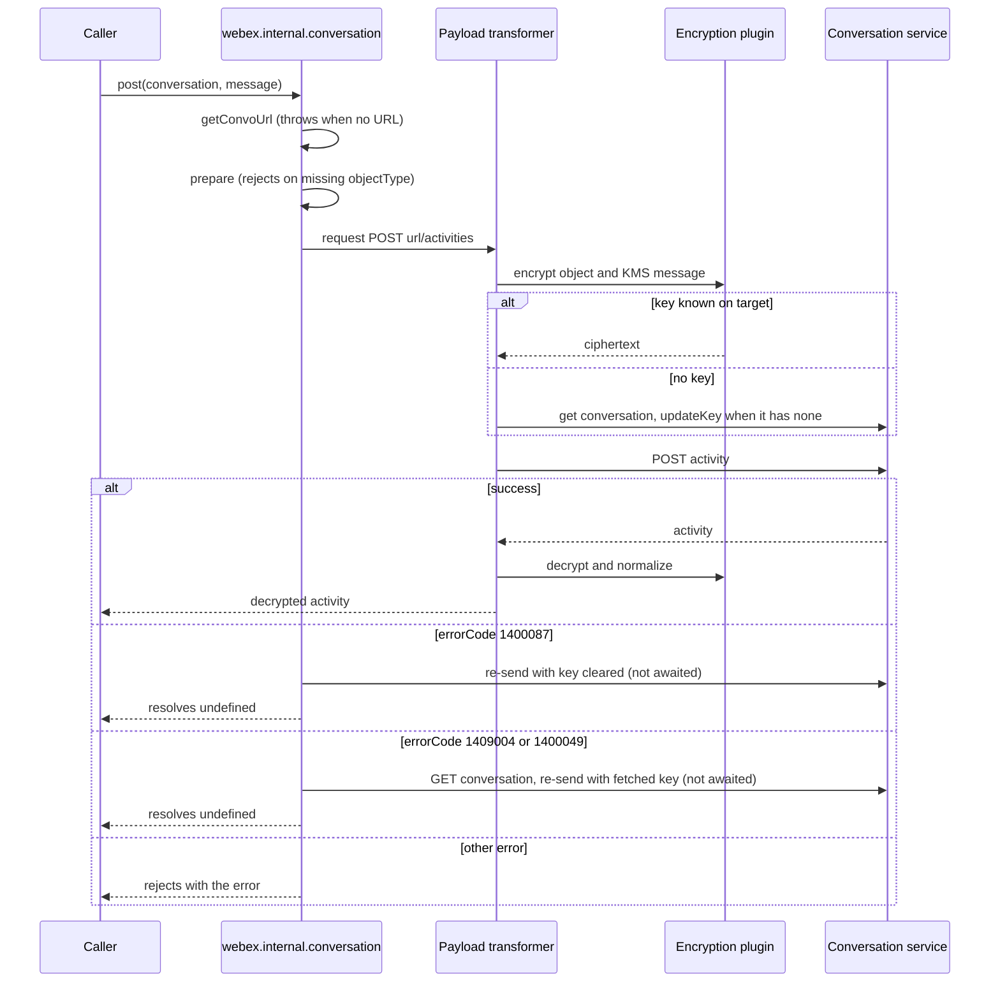
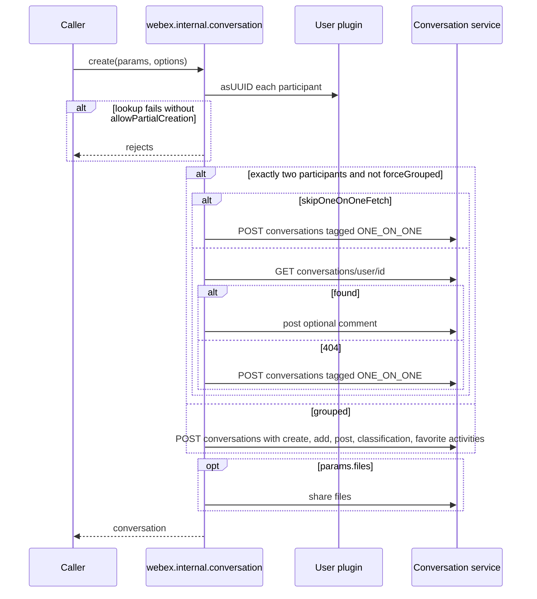
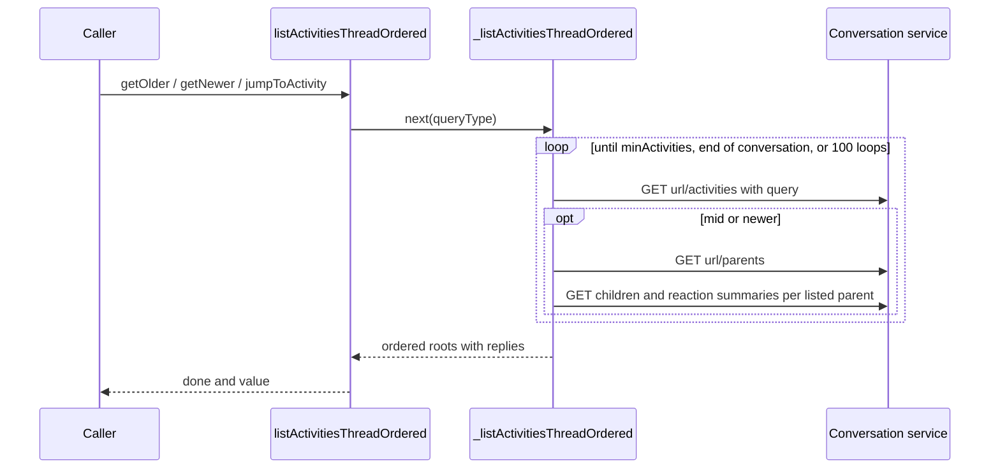
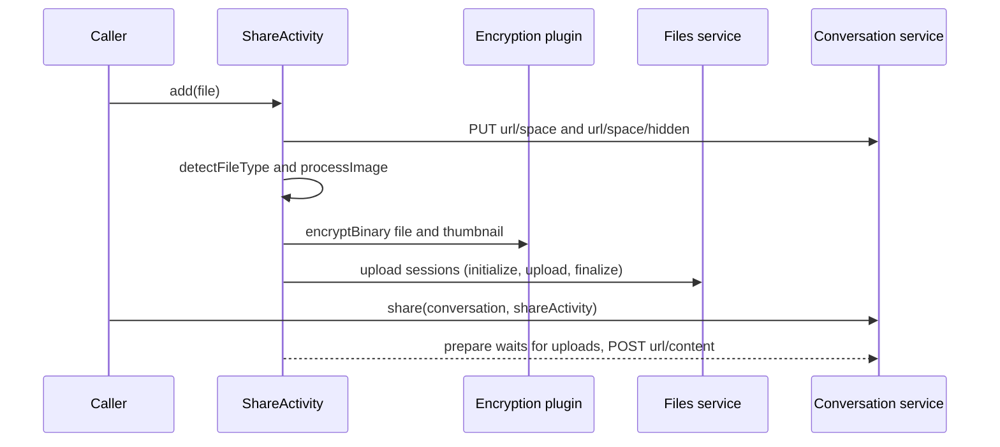
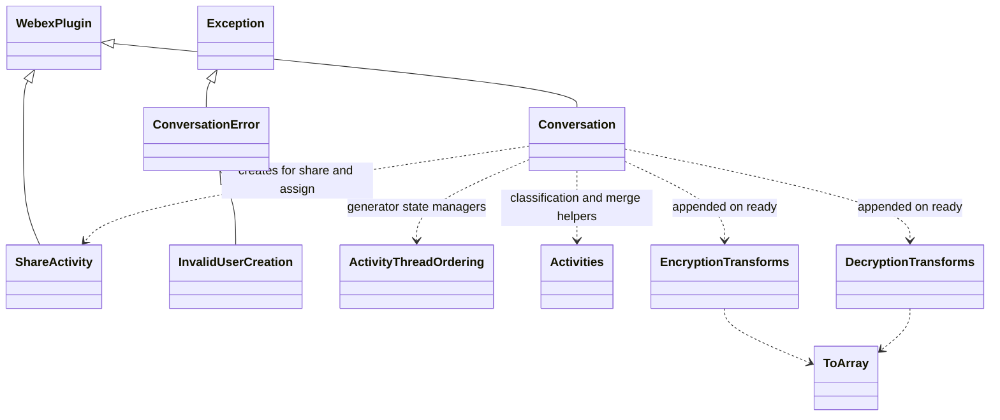
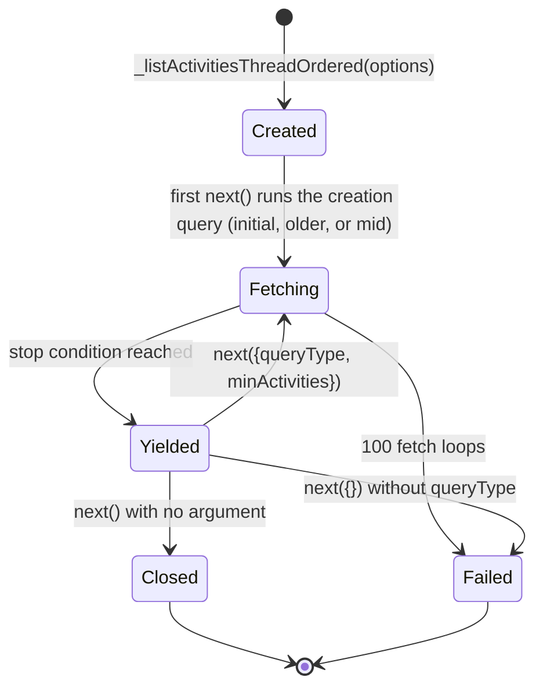

<!-- sdd-generated-metadata
doc_kind: module-spec
generated_from: module-spec@0.3.0
generated_by: claude-code
approved_by: pending
updated_at: 2026-10-16T01:43:45Z
validation_status: pass
-->

# internal-plugin-conversation conversation plugin

This source-local document at `src/docs/README.md` owns the stable specification for the
**conversation plugin** of `@webex/internal-plugin-conversation`: the `webex.internal.conversation`
namespace that creates, reads, and mutates Webex conversations (spaces) and their activities, the
payload transforms that encrypt outbound and decrypt inbound conversation objects through KMS, the
`ShareActivity` file-share builder, and the thread-ordered activity reader.

All implementation lives flat in `src/`. There is no sub-module, no persisted store, and no UI.

Related context: [repository architecture](../../docs/architecture.md) ·
[documentation index](../../docs/index.md) · [agent instructions](../../AGENTS.md) ·
[specification registry](../../docs/specs/README.md)

## Metadata

| Field             | Value                                                                                                 |
| ----------------- | ----------------------------------------------------------------------------------------------------- |
| Owner             | Cisco Webex for Developers (CODEOWNERS: @webex/web-client, @webex/web-sdk)                            |
| Source path       | `src`                                                                                                 |
| Resource kind     | Internal SDK plugin module                                                                            |
| Status            | Active                                                                                                |
| Last verified     | 2026-10-15 at `d2e34dabee`                                                                            |
| Module id         | `src`                                                                                                 |
| Parent spec       | —                                                                                                     |
| Doc kind          | Module spec                                                                                           |
| Coverage score | 93% assessed 2026-10-15; 13 of 14 mandatory fields present and 6 of 6 critical fields present. Generator-side field measurement is complete; test and characterization coverage remains weak. Independent revalidation passed 2026-10-16: 0 Blocking, 0 warnings |
| Validation status | pass; validator `01a13fa3-fe4d-7852-9680-59b67b1829e4`; revalidated 2026-10-16; 0 Blocking, 0 warnings; all prior findings closed in the assessed scope |

## Applicability

| Condition ID                         | Status     | Evidence or reason                                                                                                                         | Owned section                 |
| ------------------------------------ | ---------- | ------------------------------------------------------------------------------------------------------------------------------------------ | ----------------------------- |
| `module.has_tiers`                   | N/A        | `package.json` declares no tier, SLO, or tiered review rule                                                                                | Tier                          |
| `module.has_ui`                      | N/A        | No component, template, or style exists in `src/index.js` or its imports; the module renders nothing                                                        | UI use-case flow              |
| `module.crosses_service_boundaries`  | Applicable | `src/conversation.js` and `src/share-activity.js` issue HTTP requests to the conversation and files services; transforms call KMS           | Cross-boundary use-case flow  |
| `module.holds_client_state`          | Applicable | `src/conversation.js` keeps a module-level id-to-URL map and thread-ordering generator state; `src/share-activity.js` keeps an uploads map | Client state model            |
| `module.enforces_domain_rules`       | Applicable | `src/conversation.js` validates activity shape before submit; `src/activity-thread-ordering.js` resolves the newest edit and reaction       | Business rules and invariants |
| `module.is_concurrent_async`         | Applicable | Service operations in `src/conversation.js` return promises and run parallel child fetches inside an async generator; URL helpers and builders are synchronous | Concurrency and reactive flow |
| `module.owns_persistence`            | N/A        | Nothing is written to a store, file, or schema; conversations live in the conversation service                                             | Data, schema, and migration   |
| `module.stateful_transitions`        | Applicable | The thread-ordering generator in `src/conversation.js` moves between initial, older, newer, and mid queries and closes on an empty resume   | State machine                 |
| `module.exposes_wire_protocol`       | Applicable | `src/conversation.js` builds activity payloads with KMS message placeholders and a reaction HMAC whose byte layout must match other clients | Protocol and wire format      |
| `module.ui_multi_screen`             | N/A        | Gated by module.has_ui, which is N/A                                                                                                       | UI flow                       |
| `module.large_data_model`            | N/A        | Conversation and activity entities are owned by the conversation service; this module only normalizes and classifies them                  | Data model                    |
| `module.returns_caller_errors`       | Applicable | Guard clauses in `src/conversation.js`, `src/share-activity.js`, and `src/encryption-transforms.js` throw or reject; `src/convo-error.js` exports error classes | Caller-visible failure modes  |
| `module.module_specific_conventions` | Applicable | `src/index.js`, `src/encryption-transforms.js`, and `src/decryption-transforms.js` dispatch transforms by a name built from objectType or verb | Module-specific rules         |
| `module.published_package`           | Applicable | `package.json` declares main, devMain, and deploy:npm                                                                                      | Export stability              |
| `module.embedded_in_host`            | Applicable | `src/index.js` registers the plugin into the WebexCore host and contributes payload-transformer predicates and transforms                  | Host integration and theming  |
| `module.has_design_tradeoff`         | Applicable | `src/conversation.js` thread ordering keeps per-batch roots but generator-lifetime children; `src/config.js` toggles crypto transforms      | Key design trade-off          |
| `module.has_submodules`              | N/A        | No other module path is a direct child of the src module                                                                                   | Sub-modules                   |

## Evidence register

| Evidence                                    | What it establishes                                                                                                   |
| ------------------------------------------- | --------------------------------------------------------------------------------------------------------------------- |
| `src/index.js`                              | Plugin registration under the conversation namespace, every payload-transformer predicate, the normalize transforms, and the package exports |
| `src/conversation.js`                       | The complete `webex.internal.conversation` method surface, URL resolution, submit and key-rotation handling, listing, and thread ordering |
| `src/activities.js`                         | Activity classification constants and the helpers that merge edits and replies into their parents                    |
| `src/activity-thread-ordering.js`           | The thread-ordering state managers, batch-size constants, loop failsafe, and query builder                           |
| `src/encryption-transforms.js`              | Outbound encryption dispatch, key selection, and KMS message placeholder substitution                                |
| `src/decryption-transforms.js`              | Inbound decryption dispatch and the decryption-failure substitution rule                                             |
| `src/share-activity.js`                     | File and GIF share building, thumbnail generation, encrypted upload, and content-category derivation                 |
| `src/config.js`                             | Every configuration default, including HTML allow-lists, thumbnail limits, and the two crypto transform toggles      |
| `src/constants.js`                          | The three conversation-service error codes that trigger key-rotation retries                                         |
| `src/convo-error.js`                        | The exported error classes                                                                                            |
| `src/to-array.js`                           | How transform maps become directional transform arrays                                                               |
| `package.json`                              | Published entry points, workspace dependencies, Node floor, and every command                                        |
| `test/unit/spec/conversation.js`            | Reactions, prepare, event processing, URL inference, cluster URLs, pagination, child fetches, thread ordering, delete, and transform toggles |
| `test/unit/spec/decrypt-transforms.js`      | Decryption of comments, microapp instances, previous values, threads, reactions, links, and meeting containers       |
| `test/unit/spec/encryption-transforms.js`   | Encryption skips for already-encrypted and meeting-container policy activities, and delete key selection             |
| `test/unit/spec/share-activity.js`          | Content-category derivation, upload body shape, and GIF handling                                                     |
| `test/integration/spec/create.js`           | Live creation of grouped and 1:1 conversations, partial creation, and forced grouping                                 |
| `test/integration/spec/get.js`              | Live download, get, list, pagination, mentions, threads, bulk fetch, parent and child fetches, and thread ordering    |
| `test/integration/spec/verbs.js`            | Live add, assign, leave, post, update, updateKey, typing status, tag, space-property, and mute verbs                  |
| `test/integration/spec/share.js`            | Live share, makeShare, transcoded content, and GIF sharing                                                           |
| `test/integration/spec/encryption.js`       | Live behavior against non-encrypted conversations and under insufficient encryption data                             |
| `test/integration/spec/mercury.js`          | Inbound decryption and normalization of activities received over the realtime event channel                          |

Prior authored design material for thread ordering was reconciled into the Design overview, State
machine, Use cases, and Key design trade-off sections. Statements the current code disproves are
recorded as corrections in those sections rather than carried forward. The `Thread ordering`
subsection under Design overview is a module-specific extension for that reconciled design detail;
its claims are verified against `src/conversation.js`, `src/activity-thread-ordering.js`, and
`src/activities.js`, and the package readme was reconciled into the standing documentation.

## Purpose and boundary

- Responsibility: expose `webex.internal.conversation`, the client for the Webex conversation
  service, and keep every conversation object that crosses the HTTP or realtime boundary encrypted on
  the way out and decrypted and normalized on the way in.
- In scope: conversation creation (grouped and 1:1), fetch and listing (including federated
  `additionalUrls` and pagination), activity submission for every supported verb, reactions, card
  actions, typing status, file and GIF sharing, avatar assign/unassign, key rotation, child-activity
  fetches, thread-ordered activity reading, file download with EXIF handling, and the inbound and
  outbound payload transforms.
- Out of scope: KMS key management and SCR cryptography (`@webex/internal-plugin-encryption`), user
  UUID resolution (`@webex/internal-plugin-user`), service-catalog URL resolution and the payload
  transformer engine (`@webex/webex-core`), HTML sanitization primitives (`@webex/helper-html`),
  image processing (`@webex/helper-image`), and realtime socket management (the mercury plugin).
- Consumers: other SDK packages that declare this package as a dependency — `plugin-messages`,
  `plugin-rooms`, `plugin-memberships`, `plugin-attachment-actions`, `plugin-meetings`, and the
  internal board, calendar, ediscovery, flag, lyra, search, task, and team plugins, plus
  `webex-server` and `recipe-private-web-client` — and first-party Webex clients.

## Structure and key files

| Path                              | Responsibility                                                                                              |
| --------------------------------- | ----------------------------------------------------------------------------------------------------------- |
| `src/index.js`                    | Package entry. Registers the plugin with its payload-transformer predicates and normalize transforms, and re-exports the plugin, `ShareActivity`, and the error classes |
| `src/conversation.js`             | The `Conversation` WebexPlugin: every public method, URL resolution, the id-to-URL cache, submit retries, listing, and the thread-ordering generator |
| `src/activities.js`               | Activity type classification and the constructors that merge edits and replies into displayable activities |
| `src/activity-thread-ordering.js` | Closure-based state managers and the query builder used by the thread-ordering generator                    |
| `src/encryption-transforms.js`    | Outbound transforms: per-objectType and per-verb encryption plus KMS message preparation                    |
| `src/decryption-transforms.js`    | Inbound transforms: per-objectType decryption with failure-message substitution                             |
| `src/share-activity.js`           | `ShareActivity`: file and GIF upload staging and the `share` activity builder                               |
| `src/config.js`                   | Plugin configuration defaults under the `conversation` key                                                  |
| `src/constants.js`                | Conversation-service error codes that drive key-rotation retries                                            |
| `src/convo-error.js`              | `ConversationError` and `InvalidUserCreation`                                                               |
| `src/to-array.js`                 | Helper that turns a name-keyed transform map into the directional array the payload transformer expects    |
| `src/docs/README.md`              | This canonical module specification                                                                         |

## Public surface

Exact signatures and JSDoc live in the source files named below; this table summarizes ownership and
compatibility only.

| Surface | Consumer | Compatibility commitment | Source |
| ------- | -------- | ------------------------ | ------ |
| Package default export (the Conversation plugin class) plus named exports ShareActivity, ConversationError, InvalidUserCreation | SDK packages importing the package | Internal plugin; no strict semver promise. Renames break dependent workspace packages | `src/index.js` |
| Plugin registration as webex.internal.conversation | Any WebexCore instance that imports the package | Importing the package is what registers the namespace and the payload transforms | `src/index.js` |
| Conversation lifecycle: create, get, list, listLeft, paginate, leave, add, updateKey | Messaging, rooms, memberships, and team plugins | Shapes differ per method, all after inbound transforms: `create` and `get` resolve one conversation object (the response body; create's 1:1 reuse path resolves the fetched conversation with any posted comment or shared files appended to `activities.items`); `list` and `listLeft` resolve the item arrays extracted by `_list`, not the service body; `paginate` resolves `{page}` for a continuation and `{page, additionalUrls}` (additionalUrls only when the service returns it) for the first request, and rejects when the passed page has no next link; `leave`, `add`, and `updateKey` resolve the submitted activity like the verb methods | `src/conversation.js` |
| Activity submission: post, update, delete, acknowledge, share, assign, unassign, cardAction, submit, prepare, prepareConversation, expand | Messaging, attachment-actions, and meetings plugins | Verb methods go through prepare then submit and resolve the posted activity; expand and prepareConversation return plain objects synchronously | `src/conversation.js` |
| Simple verbs generated on the prototype: favorite, hide, lock, mute, unfavorite, unhide, unlock, unmute, assignModerator, unassignModerator, setSpaceProperty, unsetSpaceProperty, tag, untag | Rooms, memberships, and team plugins | Names are generated from string lists at module load | `src/conversation.js` |
| Tag helpers: muteMentions, unmuteMentions, muteMessages, unmuteMessages, ignore, unignore, removeAllMuteTags | Notification-settings callers | Fixed tag strings per helper | `src/conversation.js` |
| Reactions: addReaction, deleteReaction, sendReaction, createReactionHmac, getReactionSummaryByParentId | Messaging clients | The HMAC must match other Webex clients byte for byte | `src/conversation.js` |
| Activity reads: listActivities, listMentions, listThreads, bulkActivitiesFetch, listParentActivityIds, listChildActivitiesByParentId, listAllChildActivitiesByParentId | Messaging, search, and ediscovery plugins | Shapes differ per method: listActivities, listMentions, and listThreads resolve item arrays with each cluster's page oldest first and clusters concatenated; bulkActivitiesFetch resolves the successful multistatus activities in response order; listParentActivityIds resolves the response body grouped by child type; listChildActivitiesByParentId resolves the full HTTP response; listAllChildActivitiesByParentId resolves every child oldest first | `src/conversation.js` |
| Thread-ordered reads: listActivitiesThreadOrdered returning getOlder, getNewer, jumpToActivity | Messaging clients | The facade is returned synchronously (and throws synchronously without a URL or id); each returned function resolves an iterator-protocol object with done and value | `src/conversation.js` |
| Realtime helpers: processActivityEvent, processInmeetingchatEvent, updateTypingStatus | Clients handling mercury events | Event handlers run the inbound transform and resolve the same event | `src/conversation.js` |
| Files: download, makeShare, ShareActivity.create, add, addGif, remove, getFiles | Messaging and board plugins | download resolves a file whose progress events are proxied; makeShare and ShareActivity.create return an instance and getFiles returns an array, all synchronously | `src/share-activity.js` |
| URL helpers: getConvoUrl, getUrlFromClusterId, getConversationUrl | Every caller of a conversation method | getConvoUrl throws synchronously when no URL can be found | `src/conversation.js` |
| Configuration under webex.config.conversation | Host applications | Defaults may be overridden per WebexCore instance | `src/config.js` |

## Dependencies

| Dependency | Why it is required | Failure behavior |
| ---------- | ------------------ | ---------------- |
| `@webex/webex-core` (code; no spec exists in that package) | WebexPlugin base, `registerInternalPlugin`, `Page`, `request`/`upload`, service catalog lookups, and the payload-transformer engine | Request failures reject the caller's promise; an unknown transform name resolves as a no-op |
| `@webex/internal-plugin-encryption` (code; no spec exists) | KMS keys, text/binary/SCR encryption and decryption, `encryptKmsMessage`, and `unboundedStorage` for reaction keys | Text decryption failures are replaced by the configured failure message; SCR failures and key-creation failures reject |
| `@webex/internal-plugin-user` (code; no spec exists) | `asUUID` for participants and moderators, and `recordUUID` for participant caching | `asUUID` failures reject unless `allowPartialCreation`; `recordUUID` failures are logged and ignored |
| `@webex/common` (its module spec is the reference) | `proxyEvents`, `transferEvents`, `tap`, `patterns`, and the `Exception` base class | `tap` never breaks the chain; event proxies only copy listeners |
| `@webex/helper-html` (code; no spec exists) | `filter` and `filterEscape` for inbound and outbound `content` sanitization | Filter rejections reject the transform and therefore the request |
| `@webex/helper-image` (its module spec is the reference) | `readExifData` on download, and `detectFileType` and `processImage` for share thumbnails | A rejection fails the download or the upload promise |
| Device, feature, and services plugins reached through `webex.internal` | `device.userId` as the default actor, the `web-high-availability` developer feature, and cluster URL lookups | Loaded transitively by the encryption and user plugins; absence surfaces as a TypeError |
| `crypto-js`, `node-scr`, `lodash`, `uuid` | HMAC and SHA-256 hashing, GIF SCR creation, object utilities, and `clientTempId` generation | Synchronous library errors propagate |
| Webex conversation service (external HTTP) | System of record for conversations and activities | Errors reject; three error codes trigger a key-rotation retry |
| Webex files service (external HTTP, via space URLs) | Upload sessions for shared files and thumbnails | Upload failures reject the share |

## Requirements

| ID        | WHAT | WHY | Source evidence | Test or example evidence | Assumptions or gaps | Confidence |
| --------- | ---- | --- | --------------- | ------------------------ | ------------------- | ---------- |
| `MOD-001` | Importing the package registers `webex.internal.conversation` with the payload-transformer predicates and normalize transforms, and on the host `ready` event appends the decryption and encryption transform sets according to `includeDecryptionTransforms` and `includeEncryptionTransforms` | Consumers gain encryption-transparent conversation objects by import alone, and hosts that handle crypto elsewhere can opt out | `src/index.js`, `src/conversation.js`, `src/config.js` | `test/unit/spec/conversation.js` parametrizes all four toggle combinations | none | Present |
| `MOD-002` | Every activity sent through an activity-submission method is built by `prepare` (defaults for verb, objectType, clientTempId, actor; parent and recipients carried over) and sent by `submit` to `<conversation url>/activities`, or `/content` with transcode for `share`. Conversation creation is excluded: it embeds `expand`-built activities in the `_create` POST body, and `updateTypingStatus` posts its status request directly | One code path guarantees consistent activity shape and the user-activity trigger that resets the logout timer | `src/conversation.js` | `test/unit/spec/conversation.js` prepare and delete cases; `test/integration/spec/verbs.js` | none | Present |
| `MOD-003` | `prepare` rejects an activity whose actor, object, or target lacks objectType, and one whose object has `content` without `displayName` | The conversation service requires typed objects and a plaintext fallback for rich content | `src/conversation.js` | none found | No unit case covers the two rejections | Weak |
| `MOD-004` | `create` resolves participant UUIDs, adds the current user, deduplicates, routes exactly two participants to a 1:1 flow unless `forceGrouped`, reuses an existing 1:1 (posting the optional comment) or creates one on 404, and otherwise creates a grouped conversation with create/add/post/classification/favorite activities and a KMS create message | Reusing 1:1 spaces avoids duplicate direct conversations, and the KMS message binds participants to the new key | `src/conversation.js` | `test/integration/spec/create.js` | none | Present |
| `MOD-005` | `getConvoUrl` returns a team's general-conversation URL, then an explicit `url`, then a cluster-derived URL, then a cached URL for an id, and throws otherwise | Federated conversations live on different clusters, so the URL is the stable address | `src/conversation.js` | `test/unit/spec/conversation.js` getConvoUrl and getUrlFromClusterId cases | none | Present |
| `MOD-006` | `get`, `list`, `listLeft`, and `create` record id-to-URL pairs in a module-level map shared by every plugin instance | Later id-only calls can still be routed to the right cluster | `src/conversation.js` | none found | Cache sharing across WebexCore instances is untested | Weak |
| `MOD-007` | `_list` defaults query parameters, reverses each newest-first page to oldest first, follows `additionalUrls` while dividing any remaining `conversationsLimit` across them, concatenates the home cluster's items before each additional cluster's items without a global merge, and records participant UUIDs | Callers receive data from every federated cluster in one array; ordering is chronological only within each cluster's segment | `src/conversation.js` | `test/integration/spec/get.js` | Federation splitting is not exercised in unit tests | Weak |
| `MOD-008` | Outbound conversation objects are normalized, encrypted, and have their KMS message encrypted; inbound objects are decrypted then normalized, including multistatus bulk results and `/threads` child activities | Plaintext does not leave the client and callers receive decrypted objects, except when a host disables the crypto transforms, a list is fetched with `deferDecrypt` (items stay encrypted until their bound decrypt runs), or a meeting-container policies or inMeetingSummary update is sent unencrypted by design | `src/index.js`, `src/encryption-transforms.js`, `src/decryption-transforms.js` | `test/unit/spec/decrypt-transforms.js`, `test/unit/spec/encryption-transforms.js`, `test/integration/spec/mercury.js` | none | Present |
| `MOD-009` | A text or card-input decryption failure replaces the value with `decryptionFailureMessage` and logs a warning instead of rejecting | One undecryptable field must not hide the rest of a conversation | `src/decryption-transforms.js`, `src/config.js` | none found | No unit case makes decryption reject or asserts `decryptionFailureMessage`; the decrypt suite only checks dispatch | Weak |
| `MOD-010` | `encryptActivity` skips meeting-container `policies` and `inMeetingSummary` updates and activities already carrying `encryptionKeyUrl` or `object.created === 'True'` | Those payloads are server-encrypted or must stay plaintext; re-encryption would corrupt them | `src/encryption-transforms.js` | `test/unit/spec/encryption-transforms.js` | none | Present |
| `MOD-011` | When an activity has no key, the target's `defaultActivityEncryptionKeyUrl` and `kmsResourceObjectUrl` are used, otherwise the conversation is fetched and, if it has no key, `updateKey` creates one | Callers may pass partial conversation objects and still produce encrypted activities | `src/encryption-transforms.js` | `test/integration/spec/encryption.js` | none | Present |
| `MOD-012` | `<KRO>` and `<KEYURL>` placeholders in a KMS message are replaced from the target and key; without a key the KMS message is removed, and a `<KRO>` with no target KRO throws | Unencrypted conversations must still accept leave or delete, while encrypted ones must never send unresolved placeholders | `src/encryption-transforms.js` | `test/unit/spec/encryption-transforms.js` delete case; `test/unit/spec/conversation.js` delete cases | none | Present |
| `MOD-013` | `submit` retries with a cleared key on error 1400087 and with a freshly fetched key on 1409004 or 1400049, and rethrows every other error | The service signals key rotation through these codes and the post should still land | `src/conversation.js`, `src/constants.js` | `test/integration/spec/verbs.js` key-rotation case | The retry is fire-and-forget and the integration case does not await its promise | Weak |
| `MOD-014` | `addReaction` computes an HMAC over the ordered JWK fields, parent id, and display name (skipped when encryption transforms are disabled); `deleteReaction` sends a delete verb; both default the actor to the device user and add recipients when given | Deterministic HMACs let every client deduplicate the same reaction | `src/conversation.js` | `test/unit/spec/conversation.js` addReaction and deleteReaction cases | The unit cases stub createReactionHmac, so the JWK field order and HMAC computation have no executing test | Weak |
| `MOD-015` | `listActivitiesThreadOrdered` returns getOlder, getNewer, and jumpToActivity over a generator that jumpToActivity replaces; each resolves `{done, value}` where value is roots in published order, each followed by its replies, with the latest edit and reactions merged | Clients need displayable thread order without implementing it themselves | `src/conversation.js`, `src/activity-thread-ordering.js`, `src/activities.js` | `test/unit/spec/conversation.js`; `test/integration/spec/get.js` | Reply reaction summaries are not fetched by the secondary path (see Pitfalls); the jumpToActivity rejection unit cases do not await their assertions | Weak |
| `MOD-016` | A thread-ordered fetch stops at `minActivities` visible activities, at the conversation's create activity, at an empty newer page, or throws after 100 fetch loops | Bounded fetching prevents runaway request loops | `src/conversation.js`, `src/activity-thread-ordering.js` | `test/unit/spec/conversation.js` getLoopCounterFailsafe and noMoreActivitiesManager cases | none | Present |
| `MOD-017` | `ShareActivity.add` detects type, builds a thumbnail, encrypts the file and thumbnail, uploads them to the space and hidden-space upload sessions, and `prepare` waits for every upload and derives `contentCategory` | Shares carry encrypted content and correct categories for client rendering | `src/share-activity.js` | `test/unit/spec/share-activity.js`; `test/integration/spec/share.js` | none | Present |
| `MOD-018` | `assign` rejects avatars over 1 MiB and uploads with the `spaceAvatar` role and thumbnails disabled | The service enforces the avatar size and role | `src/conversation.js` | `test/integration/spec/verbs.js` | No unit case covers the size rejection | Weak |
| `MOD-019` | `download` uses encrypted download when `scr.key` exists, otherwise a buffer request, proxies progress events, applies EXIF data unless `shouldNotAddExifData`, and fills missing name and type | Callers get usable, correctly oriented files from one API | `src/conversation.js` | `test/integration/spec/get.js` | none | Present |
| `MOD-020` | Inbound and outbound `content` is passed through the configured HTML filter, and person objects normalize email and UUID or resolve the UUID from email | Rendering safety and stable participant identity | `src/index.js`, `src/config.js` | `test/integration/spec/get.js` | No unit case covers sanitization or normalizePerson | Weak |

## Design overview

The module is one WebexPlugin (`src/conversation.js`) plus pure helpers. Every activity-submission
method follows the same shape: resolve the conversation URL, build an activity with `prepare`, and
`submit` it. Conversation creation (`_create` with activities built by `expand`) and typing status
(`updateTypingStatus`) send their requests directly instead. Encryption is
not called directly by the methods; it happens in the outbound payload transform when the request is
sent, and decryption happens in the inbound transform when the response returns. This is why a
method can accept a plaintext message and still post ciphertext.

`src/index.js` contributes predicates that decide which transform runs: a response or request body
with `objectType` is transformed as one object, a realtime event with `activity` transforms that
activity, a `multistatus` body transforms each activity, a list of `items` is transformed in place or
— with `deferDecrypt` — only normalized and given a bound `decrypt` method, and `/threads` items are
transformed as thread objects. The crypto transform sets are appended on the host `ready` event so a
host can drop them through configuration.

Shared state is minimal: a module-level `idToUrl` map, the `_spaceUrl` and `_hiddenSpaceUrl`
memoized onto a conversation object by `ShareActivity`, and generator-scoped state for thread
ordering.

### Thread ordering

Activity thread ordering (or "threading") is the act of flattening the hierarchical relationship of thread parents and thread replies.

When a client fetches activities from conversation service, convo returns chronologically ordered
activities (by published date). If you are a client that attempts to display activities to a user,
this is mostly useless. For example, a chronological page of ten activities can read:

1. reaction
2. root
3. reaction
4. reply
5. edit
6. edit
7. reply
8. reaction
9. meeting
10. reply

By contrast, thread ordering returns activities in _thread order_, otherwise known as _useful order_.
The same request in thread order reads:

1. root 4
2. reply to root 4
3. reply to root 4
4. root 3
5. reply to root 3
6. reply to root 3
7. root 2
8. reply to root 2
9. reply to root 2
10. root 1 (newest root activity)

Thread ordering is useful and difficult to implement; the fewer clients that are forced to implement
thread ordering themselves, the better. Thread ordering methods live in the internal conversation
plugin, reached as `webex.internal.conversation`. There are two methods that compose thread
ordering, a public and private method. The public method is simply a facade of the private method,
abstracting the complexity away from the caller. The public facade exposes wrappers for ease of
managing an instance of the generator: getOlder, getNewer, and jumpToActivity, all of which
implement the iterator protocol.

The `_listActivitiesThreadOrdered` method is a stateful async generator function that fetches thread ordered activities.
Calling it returns the generator instance and does not execute any work. The generator's `next`
method begins the first round of work and resolves a `done` boolean and a `value`, the asked-for
thread ordered activities. The generator internally tracks the oldest and newest activities it has
fetched, using them as the timestamps to query the next set of results in either direction, thus the
caller is not required to maintain any state to fetch older and newer activities. This method does
not cache all fetched activities, therefore the caller is still required to store their fetched
activities or be forced to refetch them. Each yielded batch is resumable rather than infinite:
resuming `next` with no argument returns from the generator and closes it.

The generator's returned `next` method accepts arguments as well, which allows the caller to change
the direction of their querying from newer messages to older ones without creating a new generator
instance.

Generator initialization options:

- `url`: the conversation's convo URL.
- `minActivities`: the minimum number of activities you would like in your batch (default 20).
- `queryType`: the direction to fetch activities, one of `initial`, `older`, `newer`, or `mid`; a
  `newer` value at creation is coerced to `initial` because it must fetch initially before getting
  newer activities. The public facade passes a caller-supplied `queryType` through unchanged, so
  the default first query is initial only when the caller omits it.
- `search`: a server activity object to return as the middle point of the batch, along with its
  surrounding activities. It is used only by a `mid` query. Callers may pass `queryType: 'mid'` with
  `search` when creating the facade for an initial MID search; `jumpToActivity` is the later route,
  replacing the generator with a new MID one.
- `includeChildren`: passed to each activity fetch so parents carry child objects.

Parameters accepted by the generator's `next` method are `queryType` and `minActivities`. `search`
is fixed when the generator is created; `jumpToActivity` creates a new generator to change it.

There are 3 main phases of the method, with one major subphase:

1. initialization: up to the `while (true)` loop
2. execution: the `while (true)` loop
3. (subphase of execution) fetching: the `while (!getNoMoreActs())` loop
4. re-calculation: after the `yield`

**Initialization.** Parsing the arguments and initializing state is done in this first phase, before
the generator's first execution. State that must be retained independent of each execution loop is
instantiated here and maintained for the life of the generator:

- oldestAct - the oldest activity (by published date) that has been fetched by the generator instance
- newestAct - the newest activity that has been fetched by the generator instance
- batchSize - the number of activities to fetch to achieve minActivities. This value is set lower in cases where we fetch children, because adding the children to their parents may help us reach minActivities count. It equals `minActivities` for initial and older queries and `max(10, ceil(minActivities / 2))` otherwise.
- query - initialize fetching query from the creation `queryType`. An omitted or `newer` query type becomes `initial`, which fetches the newest activities in a space to initialize the activity states; an explicit `older` or `mid` is used as given. A `mid` first query centres on `search` (its parent's published date for a reply or edit), so a caller can start with a MID search directly; a `search` passed with any other query type does not affect the first query
- child activity hashes: cache objects for children activities. These caches store all child activity types (replies, edits, reactions, self reactions) returned from convo fetches in order to keep track of "orphans", or child activities that come in before their parent activity

**Execution.** The execution phase will be run for every call to the `next` method. Its job is to
fetch activities until the minimum activity limit is reached, then it will build the ordered list of
activities and yield them to the caller. Execution-phase state declared outside the fetching loop:

- rootActivityHash - the data structure used to track root activities we have fetched in a given batch
- helpers - many helper functions are declared. They close over state variables and are used to group functionality used by the fetching loop, and for self-documenting purposes
- fetch loop counter - counts fetch loops for the current execution and throws `max fetches reached` after 100 loops, the failsafe for the unlikely case that the same query is fetched over and over

**Fetching.** The fetching phase is contained within the execution phase, and is a loop that will run
until we run out of activities to fetch, or explicitly break the loop when we reach the
minActivities count with what we've fetched so far. Each fetch loop sets up the query and passes
options to `listActivities`. All query types depend on a first query to activities to get N root
activities. midDate queries (aliased MID) and sinceDate queries (aliased NEWER) also fetch the parent
ID lists and then the children of each listed parent, to ensure we don't return to the caller a root
activity that is missing children. Those children fetches use `listAllChildActivitiesByParentId`,
which pages through every child of a given type rather than forcing the caller to page children
itself.

Activities returned to us by convo fetches are sorted and placed into maps based off their activity
type. Root activities are stored on a per-batch basis, whereas children are stored globally (prevents
orphans). Root activities are keyed by their ID, where children are keyed by their parent's ID
(`activity.parent.id`). Delete activities are ignored.

When reactions are fetched, however, we call a different convo API
(`getReactionSummaryByParentId`) that helps us reduce server roundtrips, which is why the fetch for
reactions differs from the fetch for edits and replies. The code also attempts a
reaction-summary fetch for replies that are themselves reaction parents, but it filters the
per-parent reply arrays by an `id` property that arrays do not carry, so for normal responses that
secondary fetch is skipped and reply reaction summaries are not fetched by this path.

The fetching loop is broken out of when we have the necessary activities for the current batch. If we
don't have enough activities, a new query is derived from the former query and the loop returns to the
top to continue building the list; mid queries also grow the batch size by 10 per loop to include
activities on both sides.

**Execution (revisited).** After a successful series of fetches, an empty ordered list is created.
The current batch's root activities are sorted by their published date and, in that order, each root
ID is used to check all the child hashes (keyed by parent ID) to build the yielded entry. When a root
activity has replies, a similar process is undergone for each reply: sorting by published date,
checking its ID against the edits and reactions hashes, and sanitizing it. Replies are added to the
ordered list after their root and before the next root. We have successfully finished a batch, and
the ordered list is yielded to the caller.

**Recalculation.** The generator's `next` method accepts arguments in order to alter the behavior of
the existing generator; the value assigned from `yield` captures them. `next` accepts a new value for
minActivities, as well as an override for queryType, so the same generator and its state can serve
multiple queries that build one upon another. The first call to `next` always runs the creation-time
query; the argument passed to that first call is ignored by the language. A later call with no
argument closes the generator, and a later call with an object that omits queryType has no response
handler and rejects.

Each yielded batch is `{done, value}` where value is an array of IActivity entries: `id` (string),
`activity` (the server activity — the latest edit or the original, extended with `editParent` and
`replyParent` where applicable), `reaction` (server ReactionSummary), and `reactionSelf` (server
ReactionSelfSummary), each an empty object when absent; nested `replies` are removed because replies
are spread beneath the parent. See the generator and
the entry builders in `src/conversation.js` and `src/activities.js`.

## Data flow and sequence coverage

All calls are promise-based HTTP requests through WebexCore `request`/`upload`, with payload
transforms applied by the WebexCore payload-transformer interceptor.

| Operation group | Entry and outcome | Diagram or evidence | Failure and recovery coverage |
| --------------- | ----------------- | ------------------- | ----------------------------- |
| Activity submission | A verb method resolves the URL, prepares, transforms outbound, POSTs, transforms the response inbound, and resolves the activity | Activity submission diagram; `src/conversation.js` | Guard rejections, sync URL throws, and key-rotation retries are drawn |
| Conversation creation | create resolves UUIDs, then reuses or creates a 1:1 or creates a grouped conversation, then optionally shares files | Creation diagram; `src/conversation.js` | 404 fallback and partial creation are drawn |
| Listing and federation | list-style methods GET the home cluster, then follow additionalUrls | `src/conversation.js` | Empty pages and zero remaining limit stop the fan-out |
| Thread-ordered read | getOlder, getNewer, or jumpToActivity resumes the generator, which loops fetches until a stop condition | Thread-ordering diagram; State machine | Loop failsafe and closed generator are drawn |
| File share | ShareActivity.add uploads encrypted file and thumbnail; share prepares and submits | File share diagram; `src/share-activity.js` | Upload rejection fails the share |
| Inbound realtime event | processActivityEvent runs the inbound transform over event.activity | `src/conversation.js`; `test/integration/spec/mercury.js` | Decryption failures become the failure message |

Activity submission:

Conversation creation:

Thread-ordered read:

File share:

## Class and component relationships

## Use cases and flows

| Use case | Actor or caller | Primary steps and outcome | Failure or boundary behavior | Evidence |
| -------- | --------------- | ------------------------- | ---------------------------- | -------- |
| `UC-001` | Messaging plugin | post a plaintext or rich message; resolves the encrypted-then-decrypted activity | Missing URL throws; content without displayName rejects | `src/conversation.js`, `test/integration/spec/verbs.js` |
| `UC-002` | Rooms plugin | create a grouped or 1:1 conversation | Invalid other participant raises InvalidUserCreation; 404 creates a 1:1 | `src/conversation.js`, `test/integration/spec/create.js` |
| `UC-003` | Client UI | getOlder: the first call returns the most recent batch; each later call returns activities older than the oldest fetched, with done true once the oldest root in the batch is the conversation's create activity. This first-call behavior holds when the facade options omit `queryType` | A short conversation can report done on the first call; an explicit `queryType` in the facade options changes the first query (see Pitfalls) | `src/conversation.js`, `test/unit/spec/conversation.js` |
| `UC-004` | Client UI | jumpToActivity(search): returns the searched activity as the middle activity in a batch with older and newer activities surrounding, always with done true; a reply or edit centres on its parent's published date | Rejects without a search object or without its target URL | `src/conversation.js`, `test/unit/spec/conversation.js` |
| `UC-005` | Client UI | getNewer: returns most recent activities, then any newer activities than the newest fetched, with done true when none were returned. getNewer is of limited use at first, but in conjunction with jumpToActivity it continues forward from the searched batch | none | `src/conversation.js`, `test/integration/spec/get.js` |
| `UC-006` | Messaging plugin | share files or a GIF; uploads encrypted content then submits a share activity | Share with no files throws | `src/share-activity.js`, `test/integration/spec/share.js` |
| `UC-007` | Client handling realtime events | processActivityEvent decrypts and normalizes an incoming activity | Undecryptable fields become the failure message | `src/conversation.js`, `test/integration/spec/mercury.js` |
| `UC-008` | Messaging client | addReaction or deleteReaction on an activity | Missing stored key for the parent rejects the HMAC | `src/conversation.js`, `test/unit/spec/conversation.js` |

### Cross-boundary use-case flow

- Boundary: HTTPS to the conversation service (home cluster URL from the service catalog, or a
  cluster-derived or explicit conversation URL) and to files-service upload sessions obtained from
  `PUT <conversation url>/space`. KMS traffic is delegated to the encryption plugin.
- Ordering: `_list` concatenates the home cluster's items before each `additionalUrls` cluster's
  items, each reversed to oldest first. Parallel child fetches in thread ordering are awaited together
  before a batch is built.
- Compatibility: requests carry `personRefresh=true` and, for reads, `uuidEntryFormat=true`;
  `get` defaults `includeParticipants=false` unless the caller passes `participantAckFilter` or
  `participantsLimit`.
- Timeout and retry: no timeout is set here; the only retries are the key-rotation re-sends in
  `submit`. When the `web-high-availability` developer feature is on, `_inferConversationUrl`
  recomputes the URL on every use because the host may have changed.

## Client state model

| State or slice | Owner | Initial state | Transition triggers | Reset or persistence boundary |
| -------------- | ----- | ------------- | ------------------- | ----------------------------- |
| idToUrl map | `src/conversation.js` module scope | empty | create, get, list, listLeft record id to url | Lives for the JavaScript module lifetime and is shared by every plugin instance in the process |
| Thread-ordering bookends and child hashes | generator instance | empty | each fetched batch | Discarded when the generator is closed or replaced by jumpToActivity |
| Thread-ordering root hash | one execution of next | empty | each fetch loop | Rebuilt per batch |
| ShareActivity uploads | ShareActivity instance | empty Map | add, addGif, remove | Lives with the instance |
| Space URL memo | conversation object passed in | absent | first ShareActivity for that object | Lives on the caller's object |

## Business rules and invariants

| ID        | Invariant | WHY | Enforcement source | Test evidence |
| --------- | --------- | --- | ------------------ | ------------- |
| `INV-001` | Only the newest edit and the newest reaction summary per parent are kept. The tombstone guard compares the activity verb with the uppercase classified type `TOMBSTONE`, but the wire verb is lowercase `tombstone`, so lowercase tombstone edits are kept and a newer one replaces the stored edit | The display must show the latest state of a message | `src/activity-thread-ordering.js`, `src/activities.js` | `test/unit/spec/conversation.js` (uses an uppercase fixture only) |
| `INV-002` | An edit of a reply is classified as a reply edit only when its parent is a known reply | Edited replies otherwise look identical to edits | `src/activities.js` | `test/unit/spec/conversation.js` |
| `INV-003` | A parsed activity whose parent is absent from the supplied hash throws instead of rendering an orphan | Orphans would render without context | `src/conversation.js` | `test/unit/spec/conversation.js` |
| `INV-004` | Room avatars larger than 1 MiB are rejected; exactly 1 MiB is accepted | Service limit | `src/conversation.js` | `test/integration/spec/verbs.js` |
| `INV-005` | A share needs at least one file | A share without content is meaningless to the service | `src/share-activity.js` | none found |
| `INV-006` | Content category is images or videos only when every file shares that MIME family, otherwise documents; a whiteboard action forces documents | Clients render galleries by category | `src/share-activity.js` | `test/unit/spec/share-activity.js` |

## Concurrency and reactive flow

- Execution model: single-threaded event loop. Service operations return promises; `getConvoUrl`,
  `getUrlFromClusterId`, `expand`, `prepareConversation`, `makeShare`, `ShareActivity.create`,
  `getFiles`, and `listActivitiesThreadOrdered` facade construction are synchronous and may throw
  synchronously. Thread ordering is an async generator resumed by the facade.
- Ordering guarantees: only the `_list`-based reads (`list`, `listLeft`, `listActivities`,
  `listMentions`, `listThreads`) reverse each newest-first page to oldest first and concatenate
  cluster segments without a global merge; `listAllChildActivitiesByParentId` returns children oldest
  first; `bulkActivitiesFetch` keeps the successful multistatus response order; `paginate` and the
  other reads return the service order unchanged. Thread-ordered batches are roots in published
  order with replies in published order beneath each root.
- Idempotency and retry: `clientTempId` is generated per prepared activity unless supplied; a
  `ShareActivity.add` of the same file returns the in-flight upload promise.
- Shared-state protection: none beyond closure scoping; concurrent calls on one thread-ordering facade
  share one generator, so callers must not overlap getOlder, getNewer, and jumpToActivity.
- Blocking restrictions: decryption of large lists can be deferred with `deferDecrypt`, which binds a
  per-item `decrypt` method instead of decrypting eagerly.

## State machine

The thread-ordering generator owns the only non-trivial lifecycle.

`jumpToActivity` abandons the current generator and creates a new one in mid mode, so older and newer
queries afterwards are relative to that single set of timestamps.

## Protocol and wire format

| Message or frame | Version | Producer or serializer | Consumer or parser | Compatibility and ordering rule |
| ---------------- | ------- | ---------------------- | ------------------ | ------------------------------- |
| Activity body (verb, objectType activity, actor, object, target, clientTempId, optional parent, recipients, kmsMessage) | unversioned | `src/conversation.js` | Conversation service | target carries only id, url, objectType, kmsResourceObjectUrl, defaultActivityEncryptionKeyUrl |
| KMS message with `<KRO>`/`<KEYURL>` placeholders | unversioned | `src/conversation.js` | `src/encryption-transforms.js`, then the encryption plugin | Placeholders are substituted before encryption or the message is dropped when unencrypted |
| Reaction HMAC | unversioned | `src/conversation.js` | Other Webex clients | Hex HMAC-SHA256 keyed by parent id over JSON of k, kid, kty in that order, then parent id, then display name |
| Upload session phases | unversioned | `src/share-activity.js` | Files service | initialize body fileSize, claimedFileType, optional role; finalize body fileSize and SHA-256 fileHash |

## Caller-visible failure modes

| Condition | Signal or result | Caller behavior | Retry or recovery | Evidence |
| --------- | ---------------- | --------------- | ----------------- | -------- |
| No resolvable URL | Synchronous Error "The space needs a `url` property" or "Could not find the `url` from the given `id`"; get rejects instead | Pass the full conversation object | none | `src/conversation.js` |
| Non-object object or reaction payload | Rejects "`object` must be an object" | Fix the call | none | `src/conversation.js` |
| Non-string space-property tag | Rejects "`tag` must be a string" | Fix the call | none | `src/conversation.js` |
| create without participants | Rejects "`params.participants` is required" | Fix the call | none | `src/conversation.js` |
| Invalid other 1:1 participant with allowPartialCreation | Rejects InvalidUserCreation | Report invalid user | none | `src/convo-error.js` |
| Missing objectType, or content without displayName | Rejects with the named property | Fix the activity | none | `src/conversation.js` |
| Avatar over 1 MiB | Rejects "Room avatars must be less than 1MB" | Resize | none | `src/conversation.js` |
| Share without files | Throws "Cannot submit a share activity without at least one file" | Add a file | none | `src/share-activity.js` |
| No key or conversation URL for encryption | Rejects with the encryption-key message | Pass encryption properties | none | `src/encryption-transforms.js` |
| Unresolvable KRO placeholder | Throws "encrypter: cannot determine kro" | Pass kmsResourceObjectUrl | none | `src/encryption-transforms.js` |
| Image file without SCR | Rejects "`file.image` must have an `scr`" | Upload through ShareActivity | none | `src/encryption-transforms.js` |
| Person without email or UUID | Rejects "cannot determine id without an `emailAddress` or `entryUUID` property" | Supply an identifier | none | `src/index.js` |
| Pagination past the last page | Rejects "No link to follow for the provided page" | Stop paginating | none | `src/conversation.js` |
| Thread ordering without URL or id | Throws "must provide a conversation URL or conversation ID" | Pass a URL | none | `src/conversation.js` |
| Thread ordering loop runaway | Rejects "max fetches reached" | Create a new facade | none | `src/activity-thread-ordering.js` |
| Key rotation error codes | Resolves undefined while a re-send runs in the background | Do not rely on the resolved value | Automatic single re-send | `src/conversation.js` |
| Text decryption failure | Field becomes decryptionFailureMessage | Show the placeholder | none | `src/decryption-transforms.js` |

## Pitfalls and constraints

- Most methods call `getConvoUrl` before returning a promise, so a missing URL throws synchronously;
  only `get` converts it into a rejection.
- On key-rotation errors `submit` does not await or return the re-sent request, so the caller's
  promise resolves `undefined` and a failed re-send is unobserved. The 1409004/1400049 branch reads
  `defaultActivityEncryptionkeyUrl` (lowercase k) from the fetched conversation, which differs from the
  property name used everywhere else. Recorded as current behavior, not fixed here.
- `getConversationUrl` falls back to `webex.internal.waitForCatalog('postauth')`, which no package in
  this workspace defines; the fallback therefore fails with a TypeError. Recorded as current behavior.
- The public facade forwards caller-supplied `queryType` and `search` into the generator's first
  query. Omitted means initial and `newer` is coerced to initial; an explicit `mid` with `search` is a
  supported initial MID search. An explicit `older` builds `maxDate` from an absent oldest activity,
  and a `search` without `queryType: 'mid'` is ignored by the first query.
- Tombstone edits are matched by comparing the lowercase wire verb `tombstone` with the uppercase
  classified type `TOMBSTONE` in `src/activity-thread-ordering.js`, so the intended skip never fires
  for real tombstones; recorded as current behavior.
- The secondary reaction-summary fetch for reply parents filters reply arrays by `id` and is skipped
  for normal responses; recorded as current behavior.
- Some cited unit cases have weak assertions: the orphan case accepts any thrown error, the
  jumpToActivity rejection cases and the pagination rejection case do not await or return their
  promises, so a regression there can pass silently.
- `idToUrl` is module-global, so two WebexCore instances in one process share cached URLs.
- `processActivityEvent` and `processInmeetingchatEvent` have no caller inside this package; the
  realtime pipeline reaches the inbound transform through the `activity` predicate.
- The `test` script runs `test:integration`, which this package does not define and resolves to the
  workspace-root script; integration specs need live test users.

## Module-specific rules

- Do: name a new transform `encrypt<ObjectType>`, `decrypt<ObjectType>`, `normalize<ObjectType>`, or
  `encrypt<Verb>Activity` (lodash `capitalize`, so `meetingContainer` becomes `Meetingcontainer`),
  because dispatch builds the name at runtime in `src/encryption-transforms.js`,
  `src/decryption-transforms.js`, and `src/index.js`.
- Do not: assume a missing transform fails loudly; WebexCore resolves an unknown transform name as a
  no-op, so a new objectType or verb without its transform is sent unencrypted or returned undecrypted.
- Do: route every new verb through `prepare` and `submit` so KMS placeholders, `clientTempId`, and
  the user-activity trigger stay consistent.

## Export stability

| Export or entry point | Consumer | Stability | Versioning and deprecation rule | Declaration or API report |
| --------------------- | -------- | --------- | ------------------------------- | ------------------------- |
| Default export Conversation | Workspace SDK packages | Internal | Internal plugin; no strict semver per the package README | `src/index.js` |
| ShareActivity | Messaging and board plugins | Internal | Same | `src/index.js` |
| ConversationError, InvalidUserCreation | Callers catching creation errors | Internal | Same | `src/convo-error.js` |
| main dist/index.js, devMain src/index.js | npm and workspace resolution | Published | Released with the monorepo | `package.json` |

## Host integration and theming

- Mount or entry contract: `registerInternalPlugin('conversation', Conversation, {payloadTransformer, config})`
  in `src/index.js`; the namespace is `webex.internal.conversation`.
- Required providers, peers, or host versions: a WebexCore host with the payload-transformer
  interceptor, services catalog, and the device, user, encryption, and feature plugins; the crypto
  transforms are appended only when `webex.config.payloadTransformer.transforms` is an array at
  `ready`.
- Theme and design-token contract: not applicable; the module renders nothing.
- Accessibility and lifecycle obligations: listens once for the host `ready` event; no teardown.

## Key design trade-off

| Chosen trade-off | Preserved invariant or benefit | Cost or limitation | Decision evidence |
| ---------------- | ------------------------------ | ------------------ | ----------------- |
| Thread ordering as a resumable generator that keeps children for its lifetime but roots per batch | Callers never track timestamps, and children that arrive before their parent are not lost | Callers must store fetched activities themselves; concurrent calls on one facade interfere | `src/conversation.js` |
| Encryption and decryption as payload transforms instead of explicit calls | Every request and response is protected without per-method code | Unknown objectTypes silently skip crypto; hosts must keep transforms configured | `src/index.js`, `src/config.js` |
| deferDecrypt binds a per-item decrypt method | Large conversation lists render before decryption completes | Callers must remember to call decrypt | `src/index.js` |

## Verification

| Requirement or invariant | Test level | Positive evidence | Negative or boundary evidence | Gap |
| ------------------------ | ---------- | ----------------- | ----------------------------- | --- |
| `MOD-001` | Unit | `test/unit/spec/conversation.js` | `test/unit/spec/conversation.js` | none |
| `MOD-002` | Unit / Integration | `test/unit/spec/conversation.js` | none found | No unit case for share submit query |
| `MOD-003` | Unit | none found | none found | Both rejections untested |
| `MOD-004` | Integration | `test/integration/spec/create.js` | `test/integration/spec/create.js` | No unit coverage |
| `MOD-005` | Unit | `test/unit/spec/conversation.js` | `test/unit/spec/conversation.js` | none |
| `MOD-006` | none | none found | none found | Cache sharing untested |
| `MOD-007` | Integration | `test/integration/spec/get.js` | none found | Federation split untested |
| `MOD-008` | Unit / Integration | `test/unit/spec/decrypt-transforms.js` | `test/integration/spec/encryption.js` | none |
| `MOD-009` | Unit | none found | none found | Failure substitution has no executing test |
| `MOD-010` | Unit | `test/unit/spec/encryption-transforms.js` | `test/unit/spec/encryption-transforms.js` | none |
| `MOD-011` | Integration | `test/integration/spec/encryption.js` | `test/integration/spec/encryption.js` | No unit coverage |
| `MOD-012` | Unit | `test/unit/spec/conversation.js` | `test/unit/spec/encryption-transforms.js` | KRO throw untested |
| `MOD-013` | Integration | `test/integration/spec/verbs.js` | none found | Retry promise is not awaited by the test |
| `MOD-014` | Unit | `test/unit/spec/conversation.js` | `test/unit/spec/conversation.js` | HMAC computation is stubbed; byte layout untested |
| `MOD-015` | Unit / Integration | `test/unit/spec/conversation.js` | `test/unit/spec/conversation.js` | Rejection cases do not await; reply reaction path untested |
| `MOD-016` | Unit | `test/unit/spec/conversation.js` | `test/unit/spec/conversation.js` | none |
| `MOD-017` | Unit / Integration | `test/unit/spec/share-activity.js` | `test/integration/spec/share.js` | none |
| `MOD-018` | Integration | `test/integration/spec/verbs.js` | none found | Size rejection untested |
| `MOD-019` | Integration | `test/integration/spec/get.js` | none found | No unit coverage |
| `MOD-020` | Integration | `test/integration/spec/get.js` | none found | Sanitization and normalizePerson untested |
| `INV-001` | Unit | `test/unit/spec/conversation.js` | none found | Fixture uses uppercase `TOMBSTONE`; lowercase wire verb untested |
| `INV-002` | Unit | `test/unit/spec/conversation.js` | none found | none |
| `INV-003` | Unit | `test/unit/spec/conversation.js` | `test/unit/spec/conversation.js` | The case accepts any thrown error |
| `INV-006` | Unit | `test/unit/spec/share-activity.js` | `test/unit/spec/share-activity.js` | none |

`paginate` belongs to the lifecycle Public surface and has no MOD requirement; its only unit case,
the no-next-link rejection in `test/unit/spec/conversation.js`, does not return its promise, so the
rejection is not asserted.

The unit suite (4 files, 97 cases) passes with `yarn workspace @webex/internal-plugin-conversation test:unit`.
No characterization baseline exists for this module; one is required before risky modification of
the key-rotation, URL-fallback, or thread-ordering paths.
