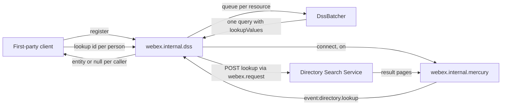
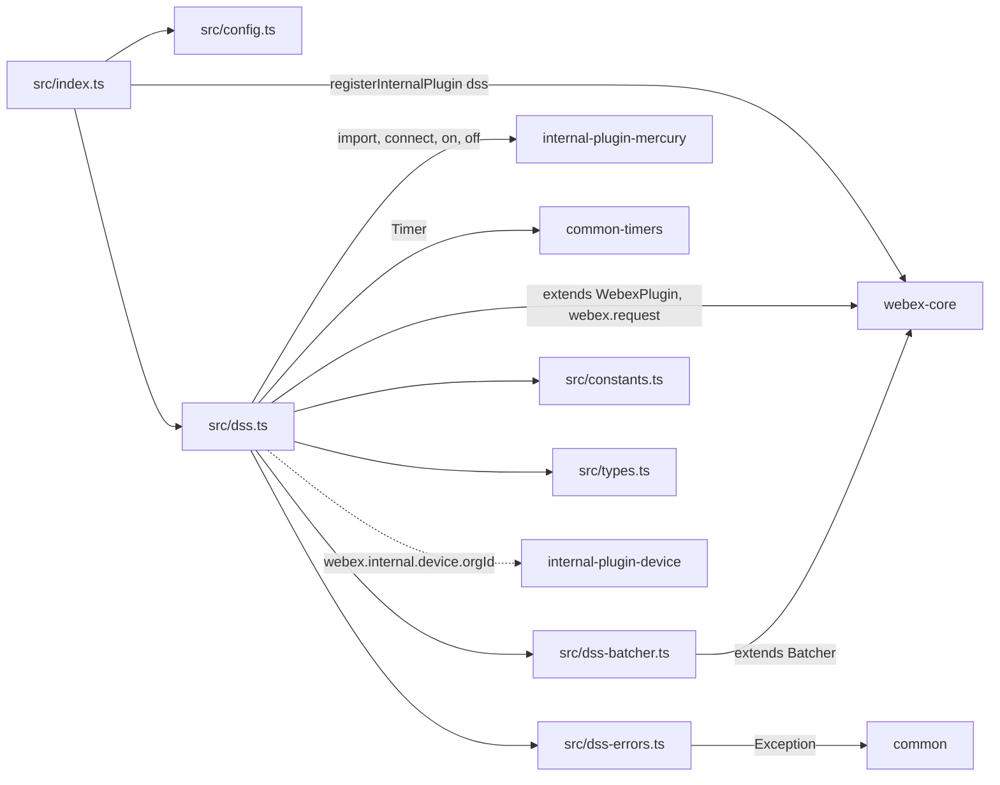
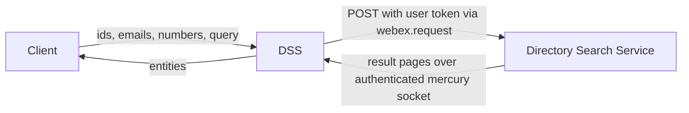

<!-- sdd-generated-metadata
doc_kind: standing-doc
generated_from: architecture@0.3.0
generated_by: claude-code
approved_by: rarajes2@cisco.com
updated_at: 2026-11-12T10:21:50Z
validation_status: pass-with-warnings
-->

# @webex/internal-plugin-dss architecture

Canonical architecture for this package. Flow behavior lives in the
[DSS plugin specification](../src/docs/README.md). This page owns package boundaries, the plugin
registration, the contract index, and how the package meets the rest of the SDK.

Related context: [specification registry](specs/README.md) ·
[package agent instructions](../AGENTS.md)

## Applicability

| Condition ID                         | Status     | Evidence or reason | Owned section |
| ------------------------------------ | ---------- | ------------------ | ------------- |
| `repo.owns_datastore`                | N/A        | No database, file store, or migration in `src/dss.ts` | Repository data and schema |
| `repo.holds_client_state`            | Applicable | The `registered` flag, the per-resource batchers, and per-query listeners and timers in `src/dss.ts` | Client state model |
| `repo.components_interact`           | Applicable | `src/dss.ts` drives mercury, the webex-core `Batcher`, and `webex.request` | Dependency and interaction topology |
| `repo.domain_data_across_components` | Applicable | Directory entities, emails, and phone numbers pass between the caller, the Directory Search Service, and mercury in `src/dss.ts` | Object and data ownership |
| `repo.caches_data`                   | N/A        | `src/dss.ts` keeps no result cache; the batcher holds only pending requests | Caching catalog |
| `repo.observability_convention`      | Applicable | Log lines through `this.logger` with the `DSS-><method>#<LEVEL>` prefix in `src/dss.ts` | Observability patterns |
| `repo.deploys_to_infra`              | N/A        | Library published to npm (`package.json`). No service runtime | Runtime and infrastructure |
| `repo.shared_base_libs`              | Applicable | Extends WebexPlugin and Batcher from webex-core and uses the legacy build, lint, and test stack (`babel.config.js`, `jest.config.js`, `.eslintrc.js`) | Shared and base libraries |
| `repo.is_monorepo`                   | N/A        | This SDD root is one package. The workspace around it is out of scope | Package map and inter-package dependencies |
| `repo.multi_platform`                | N/A        | `src/dss.ts` uses no platform-specific API; `process` declares only `{browser: true}` | Platform matrix |
| `repo.published_package`             | Applicable | `package.json` name is @webex/internal-plugin-dss and deploy:npm publishes it | Release and versioning |
| `repo.embedded_in_host`              | N/A        | No host theme or embed API in `src/dss.ts` | Host integration and theming |
| `repo.exposes_commands_or_artifacts` | Applicable | build:src in `package.json` writes dist | Commands and generated artifacts |
| `repo.cross_repo_deps_material`      | Applicable | Behavior depends on the Directory Search Service (`src/dss.ts`, `src/constants.ts`) | Cross-repository topology |
| `repo.security_arch_warranted`       | Applicable | Organization directory data (names, emails, phone numbers) passes through `src/dss.ts` | Security architecture |

## Design overview

`@webex/internal-plugin-dss` is a published TypeScript library with one module. Importing it
registers `DSS` as the internal plugin `dss`, reached as `webex.internal.dss`, with a default
`requestTimeout` of 6000 ms and batcher limits of 50 ms, 50 values, and 150 ms. Inside this
repository only the `webex` bundle loads it (`packages/webex/src/webex.js`); first-party clients call
its methods.

The plugin queries the Directory Search Service for the user's organization: lookups by identity id,
email, or phone number, and searches for people, devices, rooms, robots, and places. A query is an
HTTP POST to the `directorySearch` service whose response the plugin never reads; the result comes
back as numbered pages over the shared mercury socket. The plugin matches pages to the query by the
request id it sent, waits for the page marked `finished` and every earlier sequence, and resolves the
concatenated result. An inactivity timer rejects a query that goes silent with `DssTimeoutError`.
`lookup` calls are batched per resource by default.

`register()` must run first: it connects mercury and subscribes to the two directory events. The
package serves no routes and persists nothing.

## Resource inventory and responsibilities

| Resource | Kind | Responsibility | Owner | Source | Detailed specification |
| -------- | ---- | -------------- | ----- | ------ | ---------------------- |
| DSS plugin | package (one module) | Registration, directory lookups and searches, page assembly, inactivity timeout, lookup batching | @webex/web-sdk | `src` | [`src/docs/README.md`](../src/docs/README.md) |

## Interaction and execution flows

Representative end-to-end flow: a client registers once, looks up several people, and receives one
entity or `null` per id.

| From | To | Interaction or transport | Purpose | Failure or compatibility behavior |
| ---- | -- | ------------------------ | ------- | --------------------------------- |
| Client | `webex.internal.dss` | In-process calls | Register, look up, search | Rejections propagate; not found resolves `null` |
| `DSS` | Directory Search Service | HTTPS POST through `webex.request` | Start a lookup or search | Response not read; no retry here; webex-core interceptors apply |
| Directory Search Service | `DSS` | Mercury `event:directory.lookup`, `event:directory.search` | Result pages | Inactivity timeout after `requestTimeout` |
| `DSS` | `DssBatcher` | In-process | Coalesce `lookup` calls per resource | A failed query rejects every caller in the batch |

## Dependency topology

| Dependency | Type | Used by | Purpose | Version, failure, or fallback policy |
| ---------- | ---- | ------- | ------- | ------------------------------------ |
| `@webex/webex-core` | Internal | `src/index.ts`, `src/dss.ts`, `src/dss-batcher.ts` | Registration, plugin base, `Batcher`, `webex.request`, config lookup | `workspace:*` in `package.json` |
| `@webex/internal-plugin-mercury` | Internal | `src/dss.ts` | Registration side effect; connect and event subscription | `workspace:*` |
| `@webex/internal-plugin-device` | Internal, undeclared | `src/dss.ts` | `webex.internal.device.orgId` | Not in `package.json`; the host must load it |
| `@webex/common` | Internal | `src/dss-errors.ts` | `Exception` | `workspace:*` |
| `@webex/common-timers` | Internal | `src/dss.ts` | `Timer` | `workspace:*` |
| `uuid` | External | `src/dss.ts` | Request ids | `^3.3.2` in `package.json` |
| `lodash` | External | `src/dss.ts` | `get`, `range`, `isEqual` | `^4.17.21` |
| Directory Search Service | External service | `src/dss.ts` | Lookups, searches, and result pages | Resolved through the service catalog as `directorySearch` |

No import cycle exists: none of the packages this one imports imports it back.

## Public and consumer surfaces

| Surface | Type | Owner | Consumers | Compatibility policy | Source |
| ------- | ---- | ----- | --------- | -------------------- | ------ |
| `dss-internal-sdk` — package @webex/internal-plugin-dss, `webex.internal.dss`, its methods, `DssTimeoutError` rejections, and `dss:*` events | SDK, published to npm, internal | DSS plugin | First-party clients; in this repository the `webex` bundle loads it without calling it | The README states that internal plugins do not strictly follow semantic versioning; no deprecation rule is declared | `package.json`, `src/index.ts`, `src/dss.ts`, `src/constants.ts`, `src/types.ts`, `src/dss-errors.ts` |

The DSS request bodies, the mercury page envelopes, and the result paths are protocols this package
speaks with the service, described under *Protocol and wire format* in the
[module specification](../src/docs/README.md#protocol-and-wire-format). The other contracts this
package requires are registered in `.sdd/manifest.json` `contract_catalog`.

## Client state model

| State or slice | Owner | Transition triggers | Persistence or reset boundary |
| -------------- | ----- | ------------------- | ----------------------------- |
| `registered` | `DSS` | `register`, `unregister` | In memory |
| `batchers` (one per resource) | `DSS` | First `lookup` on a resource | Never cleared |
| Per-query listener, timer, and page store | `DSS` query closure | Pages, completion, expiry | Ends with the query |
| Mercury connection | `@webex/internal-plugin-mercury` | `register` connects it | Never disconnected by this package |

Full detail is in the module specification's *Client state model*.

## Cross-cutting architecture

### Security

- Trust boundaries and identity flow: see [Security architecture](#security-architecture).
- Sensitive surfaces and data classes: organization directory entities, email addresses, phone
  numbers, and search query strings.
- Encryption and secret boundaries: see [Security architecture](#security-architecture).

### Observability and operations

- Logging and correlation: see [Observability patterns](#observability-patterns).
- Metrics, traces, and audit signals: see [Observability patterns](#observability-patterns).
- Ownership and operational entry points: `.github/CODEOWNERS` at the workspace root has no line for
  this package, so its default rule assigns it to `@webex/web-sdk`. No dashboards or runbooks are
  recorded in this package.

### Quality attributes

- Compatibility: clients rely on the registered name `dss`, the method signatures and resolve
  shapes, the `DssTimeoutError` message, and the default timeout and batcher limits.
- Footprint: seven source files; runtime imports are webex-core, mercury, common, common-timers,
  uuid, and lodash.
- Test confidence: 60 of 61 unit cases pass (1 skipped); registration through the entry, the
  connect-failure path, HTTP failure, and a batch timeout have no running case. No coverage threshold
  is enforced.

## Dependency and interaction topology

| From | To | Kind | Purpose | Ordering or failure boundary |
| ---- | -- | ---- | ------- | ---------------------------- |
| `src/index.ts` | webex-core | Call at import | Register `dss` | First registration wins |
| `src/dss.ts` | mercury | Calls and listeners | Connect and receive pages | `register` before queries |
| `src/dss.ts` | `webex.request` | Call, not awaited | DSS POST | A rejection is not observed |
| `src/dss-batcher.ts` | `src/dss.ts` | `parent._request` | Send a batch | Rejection fails the batch |
| `src/dss.ts` | `webex.internal.device` | Property read, no import | `orgId` for resource paths | The host must have registered the device |

## Object and data ownership

| Object or state | System of record | May write | May read | Movement or lifecycle |
| --------------- | ---------------- | --------- | -------- | --------------------- |
| Directory entities (people, machines, contacts, devices, rooms, places) | Directory Search Service and its providers (`CI_USER`, `CI_MACHINE`, `CONTACTS`, `CSDM`) | — | This package, then the caller | Returned per query; not stored here |
| Organization id | Device registration (WDM) | `@webex/internal-plugin-device` | This package | Read on each query |
| Lookup values and query strings | The caller | The caller | This package, the service | Sent per query; not stored here |

## Observability patterns

| Signal  | Convention or required fields | Propagation or naming rule | Primary evidence |
| ------- | ----------------------------- | -------------------------- | ---------------- |
| Logs    | `this.logger.error` and `this.logger.info` with the prefix `DSS-><method>#ERROR` or `#INFO` (one `dss->register#INFO` line is lowercase); messages carry error messages or counts, never lookup values or entities | No correlation id is logged; the request id travels only in the body and in `DssTimeoutError` | `src/dss.ts` |
| Metrics | None | — | `src/dss.ts` |
| Traces  | None | — | `src/dss.ts` |
| Audit   | None | — | `src/dss.ts` |

## Shared and base libraries

| Library | Inherited responsibility | Consumers | Version floor | Compatibility rule |
| ------- | ------------------------ | --------- | ------------- | ------------------ |
| `@webex/webex-core` `WebexPlugin` | `webex`, `logger`, `config`, ampersand events | `DSS` | `workspace:*` | Keep namespace `DSS` so `this.config` reads `webex.config.dss` |
| `@webex/webex-core` `Batcher` | Debounce, duplicate sharing, deferreds | `DssBatcher` | `workspace:*` | Keep namespace `DSS` so the batcher limits come from `webex.config.dss` |
| `@webex/common` `Exception` | Message from `parse`, `name` from the class | `DssTimeoutError` | `workspace:*` | Keep the message format; tests match it |
| `@webex/common-timers` `Timer` | Start, reset, cancel | `DSS` | `workspace:*` | `reset` and `cancel` only while running |
| `@webex/babel-config-legacy`, `@webex/eslint-config-legacy`, `@webex/jest-config-legacy`, `@webex/legacy-tools` | Build, lint, and test stack through one-line config files | Package tooling | `workspace:*` | Do not fork the config locally |

## Release and versioning

| Artifact | Publish target | Versioning rule | Deprecation window | Changelog or migration obligation |
| -------- | -------------- | --------------- | ------------------ | --------------------------------- |
| @webex/internal-plugin-dss | npm through `deploy:npm` | Internal plugin; the README says semantic versioning is not strictly followed | None declared | None declared in the package; the workspace owns changelog generation |

## Commands and generated artifacts

| Command or artifact | Owner | Inputs | Output or side effect | Compatibility boundary |
| ------------------- | ----- | ------ | --------------------- | ---------------------- |
| `yarn workspace @webex/internal-plugin-dss build:src` | Package scripts | `src` | Writes `dist/` (JavaScript and source maps) through `webex-legacy-tools` | `dist/` is generated and never edited by hand |
| `yarn workspace @webex/internal-plugin-dss build` | Package scripts | `src` | Runs `build:src` | Same output |
| `yarn workspace @webex/internal-plugin-dss test:unit` | Package scripts | `test/unit/spec` | Jest run | The spec imports this package's `dist/` by name |
| `yarn workspace @webex/internal-plugin-dss test:style` | Package scripts | `src` | ESLint run | The shared config ignores `docs/**` and `*.md` |

## Cross-repository topology

| Repository or external system | Relationship | Exchanged contract or artifact | Owner | Sequencing constraint |
| ----------------------------- | ------------- | ------------------------------ | ----- | --------------------- |
| `@webex/webex-core` (workspace sibling; module spec consulted) | Consumes | `registerInternalPlugin`, `WebexPlugin`, `Batcher`, `webex.request`, `canAuthorize` | @webex/web-sdk | None beyond registration |
| `@webex/internal-plugin-mercury` (workspace sibling; module spec consulted and stale on sessions, code used) | Consumes | `connect`, `on`, `off`, emitted event names | @webex/web-sdk | `register` connects before pages can arrive |
| `@webex/internal-plugin-device` (workspace sibling; spec consulted and silent on `orgId`, code used) | Consumes | `orgId` | @webex/web-sdk | Device registered before queries |
| `@webex/common`, `@webex/common-timers` (workspace siblings; module specs consulted) | Consumes | `Exception`, `Timer` | @webex/web-sdk | None |
| `webex` (workspace sibling) | Consumed by | The plugin registration through `require` | @webex/web-sdk | None |
| Directory Search Service | Consumes | Lookup and search POSTs and result pages | Not recorded in this repository | Mercury connected first |

## Security architecture

- This package holds no credential or key. Queries reuse `webex.request`, which adds the user's
  authorization through webex-core; `register` refuses to run when the SDK cannot authorize.
- Every query is scoped to the organization id from the registered device (`INV-006` in the module
  spec); the service decides what that user may see.
- Entities are passed to the caller and kept only until the query resolves; the logging rule is
  under [Observability patterns](#observability-patterns).

## Domain language

| Term | Repository-specific meaning | Authoritative source |
| ---- | --------------------------- | -------------------- |
| DSS | Directory Search Service, reached through the service catalog as `directorySearch` | `src/constants.ts` |
| Lookup | A query for known identities by id, email, or phone number | `src/dss.ts` |
| Search | A query string matched against entities of the requested types, or against places | `src/dss.ts` |
| Entity provider type | The directory source of an identity: `CI_USER`, `CI_MACHINE`, `CONTACTS`, `CSDM` | `src/types.ts` |
| Search type | `PERSON`, `CALLING_SERVICE`, `EXTERNAL_CALLING`, `ROOM`, `ROBOT` | `src/types.ts` |
| Page | One mercury payload for a query, carrying `requestId` and `sequence`; the last has `finished` | `src/dss.ts` |
| Lookup values | The list of ids, emails, or numbers sent in one lookup body | `src/constants.ts` |
| Batcher | The per-resource `DssBatcher` that coalesces `lookup` calls | `src/dss-batcher.ts` |

## References and maintenance

- Decisions: [adr/](adr/index.md)
- Instantiated specifications and routing: [specs/README.md](specs/README.md)
- Repository rules and patterns: [package agent instructions](../AGENTS.md)
- Update this document in the same change that alters package boundaries, resource ownership,
  cross-resource interaction, or cross-cutting architecture.
