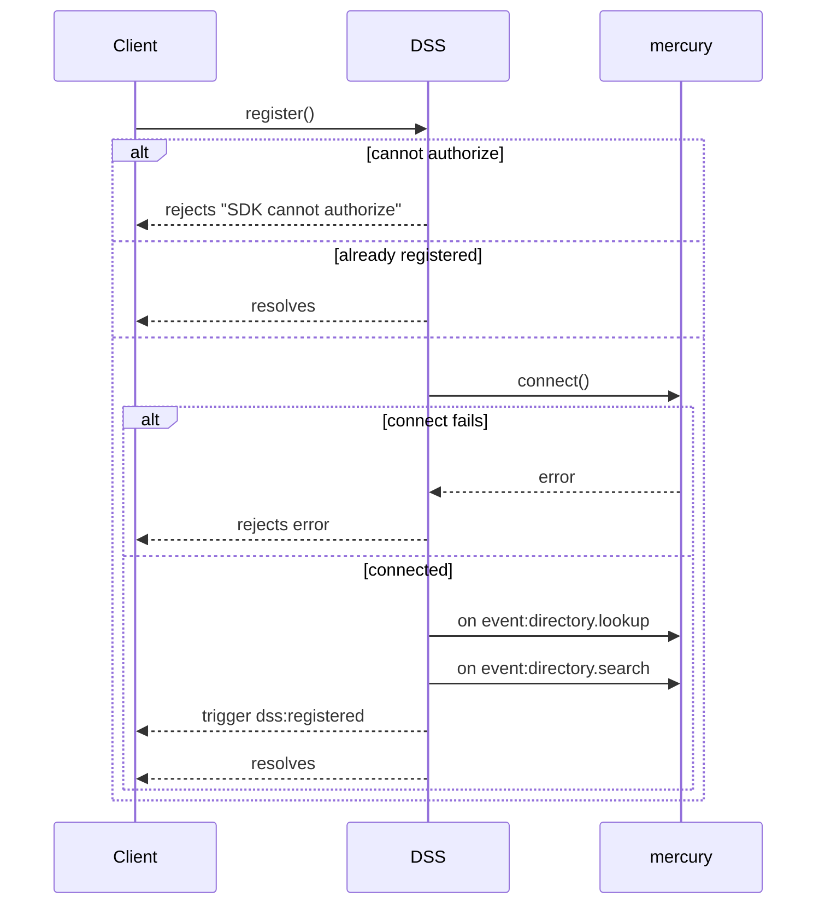
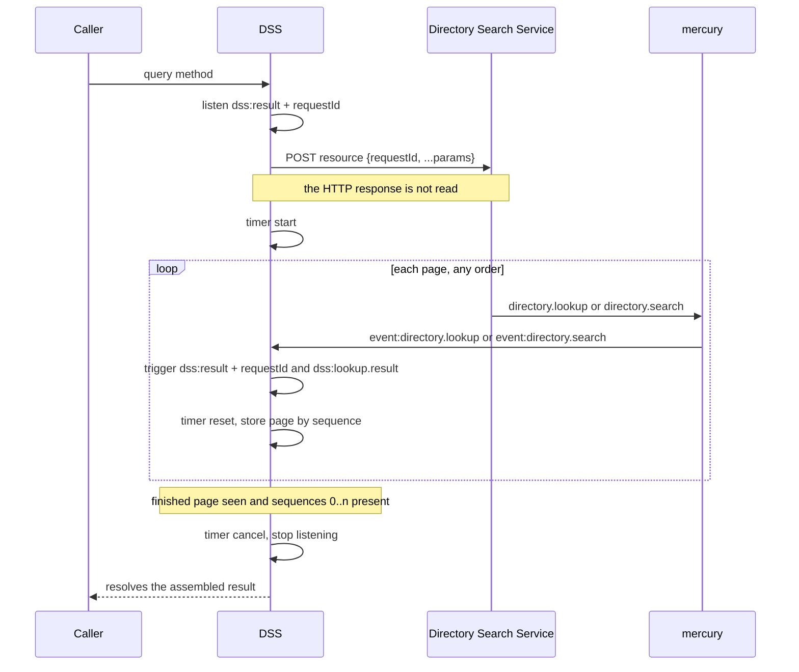
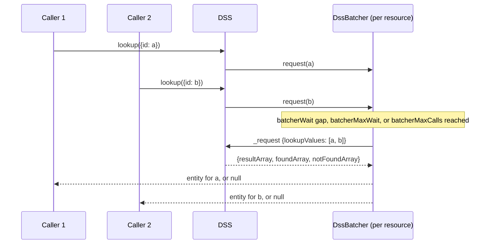
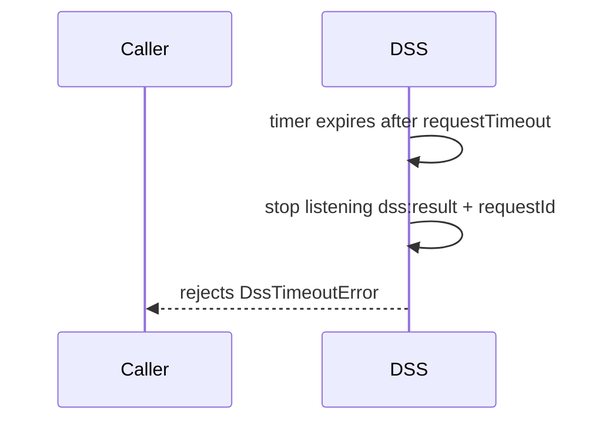
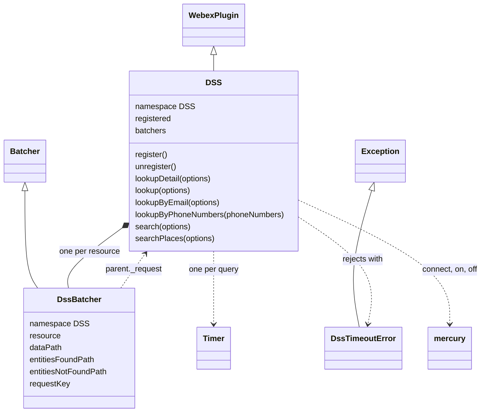
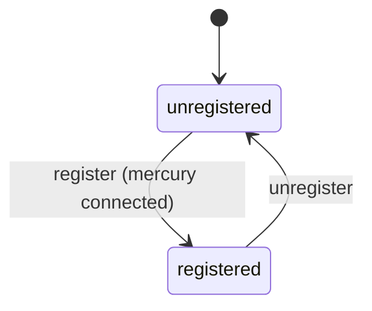
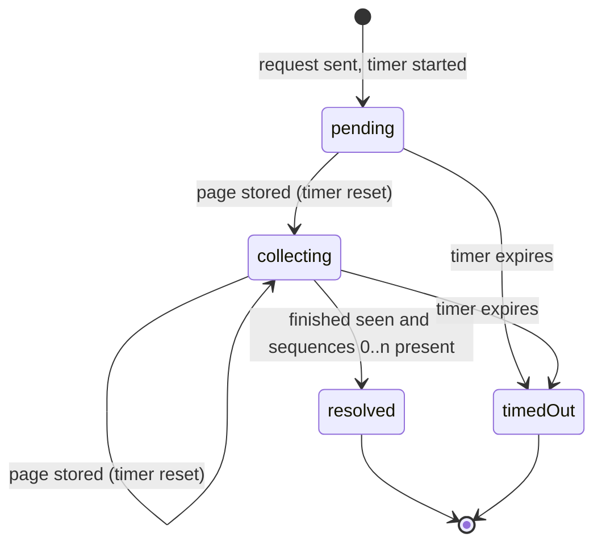

<!-- sdd-generated-metadata
doc_kind: module-spec
generated_from: module-spec@0.3.0
generated_by: claude-code
approved_by: rarajes2@cisco.com
updated_at: 2026-11-12T10:36:02Z
validation_status: pass-with-warnings
-->

# DSS plugin

This source-local document at `src/docs/README.md` owns the stable specification for **the DSS
plugin**: the internal plugin `webex.internal.dss`. It connects the shared mercury socket, sends
lookup and search queries to the Directory Search Service (catalog service `directorySearch`), and
assembles the sequenced result pages that arrive over mercury into one result per query, batching
single-identity lookups per resource. Ground every claim in package evidence and link to the
[package architecture](../../docs/architecture.md) instead of repeating broader facts. No service
specification exists because this package is a library.

Related context: [documentation index](../../docs/index.md) ·
[package agent instructions](../../AGENTS.md)

## Metadata

| Field             | Value |
| ----------------- | ----- |
| Owner             | @webex/web-sdk |
| Source path       | `src` |
| Resource kind     | package |
| Status            | Draft |
| Last verified     | 2026-11-12 at `ecd5af12a1` |
| Module id         | `internal-plugin-dss` |
| Parent spec       | — |
| Doc kind          | Module spec |
| Coverage score    | 93.3% assessed 2026-11-12 by the generator — 14 of 15 mandatory fields PRESENT, critical 8 of 8; test strategy is WEAK because registration through the entry, the already-registered and connect-failure paths, `webex.request` failure, a batch timeout, and the `searchPlaces` result have no case, although 60 of 61 unit cases pass (1 skipped) |
| Validation status | Pass with warnings — assessed 2026-11-12 by validator runtime `01a1cf44-b40f-7ee2-ab94-d19b99d9fd43`; 0 Blocking, 1 Important finding (accepted command-source warning) |

## Applicability

| Condition ID                         | Status     | Evidence or reason | Owned section |
| ------------------------------------ | ---------- | ------------------ | ------------- |
| `module.has_tiers`                   | N/A        | No tier policy exists in `package.json` or `src/dss.ts` | Tier |
| `module.has_ui`                      | N/A        | `src/dss.ts` sends queries and resolves promises; it renders nothing | UI use-case flow |
| `module.crosses_service_boundaries`  | Applicable | `src/dss.ts` POSTs to the Directory Search Service and receives its result pages over mercury | Cross-boundary use-case flow |
| `module.holds_client_state`          | Applicable | The registered flag, the per-resource batchers, and the per-query listener and timer in `src/dss.ts` | Client state model |
| `module.enforces_domain_rules`       | Applicable | At most 5 phone numbers per call, not-found resolves null, and every resource is scoped to the device org (`src/dss.ts`) | Business rules and invariants |
| `module.is_concurrent_async`         | Applicable | Event-driven result pages, an inactivity Timer, and debounced batching in `src/dss.ts` and `src/dss-batcher.ts` | Concurrency and reactive flow |
| `module.owns_persistence`            | N/A        | `src/dss.ts` stores nothing outside memory | Data, schema, and migration discipline |
| `module.stateful_transitions`        | Applicable | Registration state and the per-query page-collection lifecycle in `src/dss.ts` | State machine |
| `module.exposes_wire_protocol`       | Applicable | The DSS request bodies, the mercury event names and page envelopes, and the result paths in `src/dss.ts` and `src/constants.ts` | Protocol and wire format |
| `module.ui_multi_screen`             | N/A        | No UI | UI flow |
| `module.large_data_model`            | N/A        | `src/types.ts` declares a few option and result shapes, covered under Protocol and wire format | Data model |
| `module.returns_caller_errors`       | Applicable | Rejected promises from register, the timeout error, and the phone-number limit in `src/dss.ts` and `src/dss-errors.ts` | Caller-visible failure modes |
| `module.module_specific_conventions` | Applicable | The dss: event names, the DSS-> log prefix, and the result-path constants in `src/dss.ts` and `src/constants.ts` | Module-specific rules |
| `module.published_package`           | Applicable | `package.json` names the package @webex/internal-plugin-dss and defines deploy:npm | Export stability |
| `module.embedded_in_host`            | N/A        | No host theme or embed API | Host integration and theming |
| `module.has_design_tradeoff`         | Applicable | An unread HTTP POST plus result pages over mercury keyed by a client request id, guarded by an inactivity timer, and debounced lookup batching in `src/dss.ts` | Key design trade-off |
| `module.has_submodules`              | N/A        | The src directory has no child module | Sub-modules |

## Evidence register

| Evidence | What it establishes |
| -------- | ------------------- |
| `src/index.ts` | `registerInternalPlugin('dss', DSS, {config})` at import time; the only export is the default `DSS` |
| `src/config.ts` | Default configuration `{dss: {requestTimeout: 6000, batcherWait: 50, batcherMaxCalls: 50, batcherMaxWait: 150}}`; its JSDoc defines each value |
| `src/dss.ts` | `DSS` extends `WebexPlugin` in namespace `DSS`: registration, mercury listeners, `_request` page assembly with the inactivity timer, `_batchedLookup`, and the six query methods. Its JSDoc and one to-do comment are the only recorded rationale |
| `src/dss-batcher.ts` | `DssBatcher` extends the webex-core `Batcher` in namespace `DSS`: submits batched `lookupValues` through the parent's `_request` and maps found and not-found values to entities or `null` |
| `src/dss-errors.ts` | `DssTimeoutError` extends `Exception` and builds its message from the timeout, request id, resource, and params |
| `src/constants.ts` | `dss:` event names, mercury event names, the `directorySearch` service name, `SEARCH_TYPES`, and the lookup and search result paths |
| `src/types.ts` | `RequestOptions`, `RequestResult`, the option interfaces of each method, `BatcherOptions`, and the `EntityProviderType` and `SearchType` enums |
| `package.json` | Name, `main` (`dist/index.js`), `devMain` (`src/index.ts`), `engines` (`node >=16`), dependencies, and scripts |
| `test/unit/spec/dss.ts` | 53 unit cases (1 skipped): `#register()` (2), `#unregister()` (2), `#lookupDetail` (5), `#lookup` (14), `#lookupByEmail` (5), `#lookupByPhoneNumbers` (10), `#search` (6), `#_request` (3), `#_batchedLookup` (4, one skipped), `#searchPlaces` (2); MockWebex with a stub mercury that captures the listeners, a stub `webex.request`, and fake timers |
| `test/unit/spec/dss-batcher.ts` | 8 unit cases for the `DssBatcher` hooks |
| `test/integration/spec/dss.js` | Two MockWebex cases for register and unregister, run only by `test:browser`; the unregister case expects `mercury.disconnect`, which the code never calls |
| `README.md` | Retained npm page; context only. Its differences from code are recorded in `docs/adr/0001-retain-product-readme.md` |
| Sibling package webex-core, file src/docs/README.md | Module spec consulted, agrees with code. `registerInternalPlugin` keys the plugin by its raw name and the first registration wins; `this.config` is `webex.config[namespace.toLowerCase()]`; `this.logger` is `webex.logger`; events are ampersand-events. The Batcher section agrees on duplicate sharing, debounce, and rejection of a failed batch |
| Sibling package webex-core, file src/lib/batcher.js | Source consulted as referee where the spec is silent. Batcher config is read once, on the first request of each batcher; a response value with no pending request throws `Could not find pending request for received response`; a non-HTTP rejection rejects every queued deferred |
| Sibling package common, file src/docs/README.md | Module spec consulted, agrees with code. `Exception` builds its message from the subclass `parse`; `cappedDebounce` resets on each call, arms `maxWait` on the first call, and flushes at `maxCalls` |
| Sibling package common-timers, file src/docs/README.md | Module spec consulted, agrees with code. `start` is allowed only from `init`; `reset` and `cancel` only while `running` |
| Sibling package internal-plugin-mercury, file src/docs/README.md | Module spec consulted; stale on the session model, accurate on the emit scheme. Each inbound envelope is emitted as `event`, `event:<namespace>`, and `event:<eventType>` |
| Sibling package internal-plugin-mercury, files src/mercury.js, src/mercury-plugin.ts | Source consulted as referee. `connect()` resolves at once when connected and shares one socket per webex; `directory.lookup` arrives as `event:directory.lookup` with the whole envelope; `off(name)` without a handler removes every listener for that name |
| Sibling package internal-plugin-device, files src/docs/README.md, src/device.js | Spec consulted, silent on `orgId`. Source: `orgId` is not a declared property; it exists only when the WDM registration body carries it, and is cleared on unregister |
| Observation, no stated WHY | Behavior the code shows without stating a reason is recorded once, under Pitfalls and constraints |

## Purpose and boundary

- Responsibility: let a Webex client resolve directory entities in the user's organization — by
  identity id, email, or phone number — and search people, devices, rooms, robots, and places, with
  each query answered as one assembled result.
- In scope: registration and its two mercury listeners; the six query methods; the resource path and
  body of each query; assembling sequenced result pages into one result; the inactivity timeout and
  its error; batching of `lookup` per resource; the phone-number limit.
- Out of scope: the mercury WebSocket, its connection lifecycle, and event naming
  (`@webex/internal-plugin-mercury`); service-catalog lookup, HTTP transport, retries, and
  authentication (`webex.request` in `@webex/webex-core`); the debounce, deduplication, and deferred
  bookkeeping of the generic `Batcher` (`@webex/webex-core`); the device registration that supplies
  `webex.internal.device.orgId` (`@webex/internal-plugin-device`); caching results; the shape of a
  returned entity, which the service owns.
- Consumers: inside this repository only the `webex` bundle loads the package, through `require` in
  `packages/webex/src/webex.js`; nothing in the repository calls its methods. First-party clients
  reach the plugin as `webex.internal.dss`.

## Structure and key files

| Path | Responsibility |
| ---- | -------------- |
| `src/index.ts` | Registers internal plugin `dss` and exports the class as default |
| `src/dss.ts` | `DSS`, where registration, the query methods, and page assembly live |
| `src/dss-batcher.ts` | `DssBatcher`, the lookup batcher |
| `src/dss-errors.ts` | `DssTimeoutError` |
| `src/constants.ts` | Event names, service name, search types, result paths |
| `src/types.ts` | Option and result interfaces and enums |
| `src/config.ts` | Default timeout and batcher limits |
| `package.json` | Package name, entry points, scripts, and dependencies |
| `babel.config.js`, `jest.config.js` | Re-exports of the legacy Babel and Jest configurations |
| `.eslintrc.js` | Sets `root: true` and extends `@webex/eslint-config-legacy` |
| `process` | Package-root file exporting `{browser: true}`; not imported by `src/` |
| `src/docs/README.md` | This module specification; ignored by the build and by lint |
| `test/unit/spec/dss.ts` | Unit spec for `DSS` |
| `test/unit/spec/dss-batcher.ts` | Unit spec for `DssBatcher` |
| `test/integration/spec/dss.js` | MockWebex register and unregister spec run by `test:browser` |
| dist/ (generated) | Build output of `build:src`; ignored by Git and never edited by hand |

## Public surface

| Surface | Consumer | Compatibility commitment | Source |
| ------- | -------- | ------------------------ | ------ |
| Import side effect: internal plugin `dss` with default config (`requestTimeout` 6000, `batcherWait` 50, `batcherMaxCalls` 50, `batcherMaxWait` 150) | First-party clients; the `webex` bundle | First registration of the name wins; reached as `webex.internal.dss` | `src/index.ts`, `src/config.ts` |
| `register()`, `unregister()`, the `registered` property | First-party clients | Promise-returning; idempotent through `registered` | `src/dss.ts` |
| `lookupDetail({id})`, `lookup({id, entityProviderType?, shouldBatch?})`, `lookupByEmail({email})` | First-party clients | Resolve one entity or `null` | `src/dss.ts`, `src/types.ts` |
| `lookupByPhoneNumbers(phoneNumbers)` | First-party clients | Resolves `RequestResult` `{resultArray, foundArray, notFoundArray}`; at most 5 numbers | `src/dss.ts`, `src/types.ts` |
| `search(options)` | First-party clients | Resolves an array of entities; options in `SearchOptions` | `src/dss.ts`, `src/types.ts` |
| `searchPlaces(options)` | First-party clients | Resolves `RequestResult` `{resultArray}`; options in `SearchPlaceOptions` | `src/dss.ts`, `src/types.ts` |
| `DssTimeoutError` rejection of every query method | First-party clients | Message format under `MOD-006` | `src/dss-errors.ts` |
| Events on the plugin: `dss:registered`, `dss:unregistered`, `dss:lookup.result` | First-party clients | Payloads under Protocol and wire format; no listener exists in this repository | `src/constants.ts`, `src/dss.ts` |
| Default export `DSS` | Unit specs and clients that mount the class themselves | The entry exports nothing else | `src/index.ts` |

Contract ID `dss-internal-sdk` is indexed in the
[package architecture](../../docs/architecture.md#public-and-consumer-surfaces) and registered in
`.sdd/manifest.json`. Export stability is under [Export stability](#export-stability).

## Dependencies

| Dependency | Why it is required | Failure behavior |
| ---------- | ------------------ | ---------------- |
| `@webex/webex-core` plugin host (module spec consulted) | `registerInternalPlugin`, `WebexPlugin` (`webex`, `logger`, `config`, `listenTo`, `stopListening`, `trigger`), `webex.request`, `webex.canAuthorize` | A `webex.request` rejection is not observed by `_request` (see Pitfalls) |
| `@webex/webex-core` `Batcher` (module spec consulted; code consulted) | Debounce, duplicate sharing, and deferred bookkeeping behind `DssBatcher` | A rejected batch rejects every caller queued in it |
| `@webex/internal-plugin-mercury` (module spec consulted and stale on sessions; code consulted) | Imported for registration; `connect`, `on`, `off` on `webex.internal.mercury` | A connect failure rejects `register` |
| `@webex/internal-plugin-device` (spec consulted, silent; code consulted) | `webex.internal.device.orgId` in every resource path | Read as-is; see Pitfalls for an unregistered device |
| `@webex/common` (module spec consulted) | `Exception`, the base of `DssTimeoutError` | Not applicable |
| `@webex/common-timers` (module spec consulted) | `Timer` for the per-query inactivity timeout | Not applicable |
| `uuid` | `uuid.v4()` request ids | Not applicable |
| `lodash` | `get` for result paths, `range` and `isEqual` for page completeness | Not applicable |
| Directory Search Service (external) | Accepts queries and streams result pages over mercury | Silence produces `DssTimeoutError` (`MOD-005`) |

`@webex/internal-plugin-device` is not declared in `package.json`; the plugin reads
`webex.internal.device` by property, and the host bundle registers it.

## Requirements

| ID | WHAT | WHY | Source evidence | Test or example evidence | Assumptions or gaps | Confidence |
| -- | ---- | --- | --------------- | ------------------------ | ------------------- | ---------- |
| `MOD-001` | Importing the package registers `DSS` as internal plugin `dss` with config `{dss: {requestTimeout: 6000, batcherWait: 50, batcherMaxCalls: 50, batcherMaxWait: 150}}`, so the plugin is `webex.internal.dss` and `this.config` reads `webex.config.dss`. | The JSDoc of `src/config.ts` defines `requestTimeout` as the time before a DSS request fails, `batcherWait` as the gap between lookups that triggers a request, `batcherMaxCalls` as the queue size that triggers one, and `batcherMaxWait` as the time from the first lookup that triggers one. | `src/index.ts`, `src/config.ts` | `test/unit/spec/dss.ts` assigns `config.dss` to `webex.config.dss`; the "fails with default timeout" cases tick 6000 ms and "Single batched lookup is made after 50 ms and works" ticks 50 ms | No case imports the entry and checks the registered name | Present |
| `MOD-002` | `register()` rejects with `SDK cannot authorize` (after an error log) when `webex.canAuthorize` is false; resolves without connecting when already registered (info log); otherwise calls `mercury.connect()`, then subscribes the mercury listeners (`MOD-003`), triggers `dss:registered`, and sets `registered` true. A connect failure is logged and rejects with the original error. | The JSDoc: register explicitly sets up the plugin by connecting to mercury and listening for DSS events. | `src/dss.ts` | `test/unit/spec/dss.ts` "registers correctly", "rejects when it cannot authorize" | The already-registered and connect-failure paths have no unit case | Present |
| `MOD-003` | The mercury listeners pass `envelope.data` of `event:directory.lookup` and of `event:directory.search` to `_handleEvent`, which triggers `dss:result<requestId>` (no separator) and then `dss:lookup.result` on the plugin, both with the page data. | Every query's pages arrive on two shared mercury events; the per-request event name routes each page to the query that sent it (JSDoc of `_getResultEventName` and `_handleEvent`). | `src/dss.ts`, `src/constants.ts` | `test/unit/spec/dss.ts` "registers correctly" asserts both names; every request case drives pages through the captured listeners | None | Present |
| `MOD-004` | `unregister()` resolves when not registered (info log); otherwise calls `mercury.off` for both event names without a handler, triggers `dss:unregistered`, sets `registered` false, and resolves. It does not disconnect mercury. | The JSDoc: unregister tears down the plugin and stops listening to DSS events. | `src/dss.ts` | `test/unit/spec/dss.ts` "unregisters correctly", "handles unregister when it is not registered" | The JSDoc and README also say it disconnects mercury; the code does not | Present |
| `MOD-005` | `_request({resource, params, dataPath, foundPath?, notFoundPath?})` generates `requestId` with `uuid.v4()`, listens on `dss:result<requestId>`, sends `webex.request({service: 'directorySearch', resource, method: 'POST', contentType: 'application/json', body: {requestId, ...params}})` without reading its result, and starts a `Timer` of `requestTimeout`. Each page resets the timer and stores `get(data, dataPath, [])` (and `get(data, foundPath, [])`) under `data.sequence`; the page with `finished` fixes the expected sequences `0..sequence` and supplies `get(data, notFoundPath, [])`. When the stored sequences equal the expected ones, the timer is cancelled, the listener stopped, and the promise resolves `{resultArray, foundArray?, notFoundArray?}` with arrays concatenated in sequence order. On expiry the listener is stopped and the promise rejects with `DssTimeoutError` (`MOD-006`). | The JSDoc: the result arrays hold the found entities and, when paths are given, the lookup values found and not found; the service splits a result across pages and marks the last one. | `src/dss.ts`, `src/types.ts` | `test/unit/spec/dss.ts` #_request three cases, including out-of-order pages; "handles multiple sequences correctly"; every "fails with default timeout" and "fails with timeout when request only partially resolved" case | A `webex.request` rejection has no case; see Pitfalls | Present |
| `MOD-006` | `DssTimeoutError` extends `Exception`; its message is `The DSS did not respond within <timeout> ms.` followed by `\n Request Id: <requestId>`, `\n Resource: <resource>`, and `\n Params: <JSON.stringify(params)>`, which prints `undefined` when the query has no params. | The class JSDoc: thrown when an expected DSS response is not received in a timely manner. | `src/dss-errors.ts` | `test/unit/spec/dss.ts` timeout cases assert the full message, including `Params: undefined` for `lookupDetail` | None | Present |
| `MOD-007` | `lookupDetail({id})` queries `/lookup/orgid/<orgId>/identity/<id>/detail` with no params, data path `lookupResult.entities`, and found path `lookupResult.entitiesFound`, and resolves `resultArray[0]` when `foundArray[0] === id`, else `null`. | The JSDoc: retrieves detailed information about an entity and resolves `null` when it is not found. | `src/dss.ts`, `src/constants.ts` | `test/unit/spec/dss.ts` #lookupDetail five cases | An in-code to-do comment says the returned shape is not confirmed | Present |
| `MOD-008` | `lookup({id, entityProviderType, shouldBatch = true})` uses resource `/lookup/orgid/<orgId>/entityprovidertype/<entityProviderType>` when a provider is given, else `/lookup/orgid/<orgId>/identities`. With `shouldBatch` it returns `_batchedLookup` (`MOD-009`); otherwise it queries with `{lookupValues: [id]}` and the lookup data and found paths and resolves `resultArray[0]` when `foundArray[0] === id`, else `null`. | The JSDoc: basic information about an entity in the organization; batching is the default, and `shouldBatch: false` gives a single immediate result; naming the provider speeds the query (README). | `src/dss.ts`, `src/types.ts` | `test/unit/spec/dss.ts` #lookup fourteen cases, unbatched and batched, with and without provider | None | Present |
| `MOD-009` | `_batchedLookup({resource, lookupValue})` keeps one `DssBatcher` per resource in `batchers`, created on first use with the lookup data, found, and not-found paths, and returns its `request(lookupValue)`. The batcher flushes after `batcherWait` ms without a new value, `batcherMaxWait` ms after the first, or at `batcherMaxCalls` values; an identical pending value shares one promise. A flush sends `{lookupValues: [...]}` through the parent's `_request`; each found value resolves with the entity at the same index of `resultArray`, each not-found value resolves `null`, and a rejected `_request` rejects every caller in that batch with the same error. | Concurrent lookups of single identities against one resource become one DSS query (config JSDoc). | `src/dss.ts`, `src/dss-batcher.ts`, `src/config.ts` | `test/unit/spec/dss.ts` batched lookup cases (one value, two values, two resources, mixed found and not-found) and #_batchedLookup; `test/unit/spec/dss-batcher.ts` eight hook cases | A batch timeout has no running case: the case for it is `it.skip` with a Jira reference in `test/unit/spec/dss.ts` | Present |
| `MOD-010` | `lookupByEmail({email})` queries `/lookup/orgid/<orgId>/emails` with `{lookupValues: [email]}` and resolves `resultArray[0]` when `foundArray[0] === email`, else `null`. It is never batched. | The JSDoc: basic information about an entity in the organization, by email. | `src/dss.ts` | `test/unit/spec/dss.ts` #lookupByEmail five cases | The JSDoc says it rejects when not found; the code and the "fails correctly if lookup fails" case resolve `null` | Present |
| `MOD-011` | `lookupByPhoneNumbers(phoneNumbers)` resolves `{resultArray: [], foundArray: [], notFoundArray: []}` without a request for a missing or empty array; rejects with `Error` `lookupByPhoneNumbers accepts a maximum of 5 phone numbers. Received: <n>. Please batch requests on the client side if needed.` (after an error log) for more than 5; otherwise queries `/lookup/orgid/<orgId>/phonenumbers` with `{lookupValues: phoneNumbers}` and the lookup data, found, and not-found paths, and resolves the whole `RequestResult`. A query failure is logged and rejects with the original error. | The JSDoc: at most 5 phone numbers per request; larger sets must be chunked by the client. | `src/dss.ts` | `test/unit/spec/dss.ts` #lookupByPhoneNumbers ten cases, including empty input, 6 numbers, exactly 5, several pages, and partial pages | The JSDoc asks for E.164 numbers; nothing validates the format | Present |
| `MOD-012` | `search(options)` queries `/search/orgid/<orgId>/entities` with `{queryString, resultSize, requestedTypes, includeCommonAreaPhones, includeOnlyPairableDevices, includePersonalDevices}` and data path `directoryEntities`, and resolves `resultArray`. | The JSDoc: search entities of the requested types; the query string is matched against username, given name, family name, display name, and email; `resultSize` caps each provider; the three flags add personal devices, common area phones, or only pairable devices. | `src/dss.ts`, `src/types.ts` | `test/unit/spec/dss.ts` #search six cases, including the optional flags | None | Present |
| `MOD-013` | `searchPlaces({resultSize, queryString, isOnlySchedulableRooms})` queries `/search/orgid/<orgId>/places` with those three values and data path `directoryEntities`, and resolves the whole `RequestResult` `{resultArray}`. A query failure is logged and rejects with the original error. | The JSDoc: search places; the query string is matched against place name and display name. | `src/dss.ts` | `test/unit/spec/dss.ts` #searchPlaces "calls _request correctly", "works correctly" | No case completes a query and checks the resolved value | Weak |

## Design overview

`DSS` is a single `WebexPlugin`. Its lasting state is `registered` and the `batchers` map; each query
keeps its own listener, timer, and page store in a closure inside `_request`, so concurrent queries
never share state.

A query has two halves. The HTTP POST only starts the work: the plugin never reads its response. The
service then sends the result as numbered pages over mercury, on one of two shared events for every
query. The plugin re-triggers each page under a name that carries the request id, and the query's
closure stores it by sequence number. When the page marked `finished` has arrived and no earlier
sequence is missing, the closure concatenates the pages in order and resolves. An inactivity timer
reset by every page rejects a query that goes silent.

`lookup` adds a batching layer: single-identity lookups against the same resource are queued in a
`DssBatcher` and sent together as one query, and each caller receives its own entity or `null`. The
other five query methods are direct wrappers over `_request` that choose the resource, params, and
result paths and shape the resolved value.

## Data flow and sequence coverage

Call style: in-process method calls on `webex.internal.dss`; outbound HTTPS through `webex.request`;
inbound result pages as mercury events. Four operation groups differ in actors, ordering, or
outcome, and each has a diagram. The remaining methods follow the query flow.

| Operation group | Entry and outcome | Diagram or evidence | Failure and recovery coverage |
| --------------- | ----------------- | ------------------- | ----------------------------- |
| Register | `register` connects mercury and subscribes | Diagram 1; `src/dss.ts` | No authorization or connect failure rejects |
| Query and pages | `_request` sends; pages assemble into one result | Diagram 2; `src/dss.ts` | Missing pages or silence end in `DssTimeoutError` |
| Batched lookup | `lookup` values queue per resource and share one query | Diagram 3; `src/dss-batcher.ts` | A failed query rejects every caller in the batch |
| Silent query | No page within `requestTimeout` | Diagram 4; `src/dss.ts` | `DssTimeoutError` |
| Direct query methods | `lookupDetail`, unbatched `lookup`, `lookupByEmail`, `lookupByPhoneNumbers`, `search`, `searchPlaces` | MOD-007 to MOD-013; `src/dss.ts` | As the query flow |

Diagram 1 — register:

Diagram 2 — query and pages:

Diagram 3 — batched lookup:

Diagram 4 — silent query:

## Class and component relationships

`DssBatcher` reaches the webex instance and `webex.config.dss` through its `parent` chain, so it
shares the plugin's configuration and logger.

## Use cases and flows

| Use case | Actor or caller | Primary steps and outcome | Failure or boundary behavior | Evidence |
| -------- | --------------- | ------------------------- | ---------------------------- | -------- |
| `UC-001` | Client starting the feature | `register()` once; then queries | Rejects without authorization or on connect failure | `src/dss.ts`, `test/unit/spec/dss.ts` |
| `UC-002` | UI resolving many people ids, for example a roster | `lookup({id})` per id; calls within the batcher window share one query | `null` per unknown id; a timeout rejects the whole batch | `src/dss.ts`, `src/dss-batcher.ts`, `test/unit/spec/dss.ts` |
| `UC-003` | Client resolving one identity at once | `lookup({id, shouldBatch: false})`, `lookupDetail`, or `lookupByEmail` | `null` when not found; `DssTimeoutError` | `src/dss.ts`, `test/unit/spec/dss.ts` |
| `UC-004` | Calling client matching numbers to people | `lookupByPhoneNumbers` with up to 5 numbers; read `foundArray`, `resultArray`, and `notFoundArray` | Rejects over 5 numbers | `src/dss.ts`, `test/unit/spec/dss.ts` |
| `UC-005` | Typeahead or picker | `search` with the requested types, query string, and result size; `searchPlaces` for rooms | `DssTimeoutError` | `src/dss.ts`, `test/unit/spec/dss.ts` |
| `UC-006` | Client stopping the feature | `unregister()` | Leaves mercury connected (`MOD-004`) | `src/dss.ts`, `test/unit/spec/dss.ts` |

### Cross-boundary use-case flow

| Boundary | Transport and ordering | Compatibility | Timeout, retry, and recovery |
| -------- | ---------------------- | ------------- | ---------------------------- |
| DSS query (`UC-002` to `UC-005`) | HTTPS POST through `webex.request`, service `directorySearch` from the catalog | Body under Protocol and wire format | No retry in this module; webex-core interceptors apply; the response is not read |
| DSS result pages (`UC-002` to `UC-005`) | Mercury `event:directory.lookup` or `event:directory.search`, matched by `requestId`, ordered by `sequence` | Envelope under Protocol and wire format | Inactivity timeout `requestTimeout` (`MOD-005`); no resend |

## Client state model

| State or slice | Owner | Initial state | Transition triggers | Reset or persistence boundary |
| -------------- | ----- | ------------- | ------------------- | ----------------------------- |
| `registered` | `DSS` | false | `register` success; `unregister` | In memory for the plugin's lifetime |
| Mercury listeners for the two event names | `webex.internal.mercury`, added by this plugin | none | `register`; removed by `unregister` | See Pitfalls for removal scope |
| `batchers` | `DSS` | `{}` (set in `initialize`) | First `lookup` per resource creates one | Never cleared, including by `unregister` |
| Per-query listener, `Timer`, and page store | Closure in `_request` | Created per query | Pages reset the timer; completion or expiry removes the listener | Ends with the query |
| Mercury connection | `@webex/internal-plugin-mercury` | — | `register` connects | Never disconnected by this plugin |

## Business rules and invariants

| ID | Invariant | WHY | Enforcement source | Test evidence |
| -- | --------- | --- | ------------------ | ------------- |
| `INV-001` | A page reaches only the query whose `requestId` it carries. | Every query shares the two mercury events. | `src/dss.ts` | `test/unit/spec/dss.ts` "Two unrelated lookups are made after 50 ms and work" |
| `INV-002` | Results are concatenated in `sequence` order, whatever order the pages arrive in. | The service splits one ordered result across pages. | `src/dss.ts` | `test/unit/spec/dss.ts` #_request cases deliver sequence 1, 2, then 0 |
| `INV-003` | A query resolves only when the `finished` page has arrived and every lower sequence is present; otherwise it times out. | A partial result must not look complete. | `src/dss.ts` | `test/unit/spec/dss.ts` "fails with timeout when request only partially resolved" |
| `INV-004` | Single-identity lookups (`lookupDetail`, `lookup`, `lookupByEmail`) resolve `null` for a value the service did not find; they do not reject. | Not found is a normal answer, not an error. | `src/dss.ts`, `src/dss-batcher.ts` | `test/unit/spec/dss.ts` "fails correctly if lookup fails" cases |
| `INV-005` | `lookupByPhoneNumbers` sends at most 5 numbers. | The method JSDoc sets the limit and leaves chunking to the client. | `src/dss.ts` | `test/unit/spec/dss.ts` "rejects when more than 5 phone numbers provided", "works correctly with exactly 5 phone numbers" |
| `INV-006` | Every resource path is scoped to `webex.internal.device.orgId`. | Directory queries are per organization. | `src/dss.ts` | `test/unit/spec/dss.ts` resource assertions use `userOrgId` |

## Concurrency and reactive flow

- Execution model: one JavaScript event loop; methods return promises; pages arrive as ampersand
  events from mercury and are re-triggered on the plugin.
- Ordering guarantees: pages may arrive in any order; `INV-002` restores order. Page handling is
  synchronous, so completion is decided on the page that fills the last gap.
- Batching: `lookup` calls on one resource coalesce inside the `cappedDebounce` window of the
  generic `Batcher`; each flush takes at most `batcherMaxCalls` values.
- Idempotency and retry: `register` and `unregister` are idempotent through `registered`; nothing is
  retried.
- Fire-and-forget work: the `webex.request` promise in `_request`; see Pitfalls.
- Shared-state protection: none; see Pitfalls for concurrent `register` calls.

## State machine

Registration. `register` while registered and `unregister` while unregistered resolve without change.

Per-query collection. Both end states stop the result listener; only `timedOut` rejects.

## Protocol and wire format

| Message or frame | Version | Producer or serializer | Consumer or parser | Compatibility and ordering rule |
| ---------------- | ------- | ---------------------- | ------------------ | ------------------------------- |
| `POST <directorySearch>/lookup/orgid/<orgId>/identity/<id>/detail`, body `{requestId}` | Unversioned | `lookupDetail` | Directory Search Service | No params |
| `POST .../lookup/orgid/<orgId>/identities` or `.../entityprovidertype/<CI_USER, CI_MACHINE, CONTACTS, or CSDM>`, body `{requestId, lookupValues: [id, ...]}` | Unversioned | `lookup` and `DssBatcher` | Directory Search Service | Several values only through the batcher |
| `POST .../lookup/orgid/<orgId>/emails`, body `{requestId, lookupValues: [email]}` | Unversioned | `lookupByEmail` | Directory Search Service | One value |
| `POST .../lookup/orgid/<orgId>/phonenumbers`, body `{requestId, lookupValues: [up to 5 numbers]}` | Unversioned | `lookupByPhoneNumbers` | Directory Search Service | `INV-005` |
| `POST .../search/orgid/<orgId>/entities`, body `{requestId, queryString, resultSize, requestedTypes, includeCommonAreaPhones?, includeOnlyPairableDevices?, includePersonalDevices?}` | Unversioned | `search` | Directory Search Service | `requestedTypes` values are `PERSON`, `CALLING_SERVICE`, `EXTERNAL_CALLING`, `ROOM`, `ROBOT` (`SearchType`) |
| `POST .../search/orgid/<orgId>/places`, body `{requestId, queryString, resultSize, isOnlySchedulableRooms}` | Unversioned | `searchPlaces` | Directory Search Service | — |
| Mercury `event:directory.lookup`, `envelope.data` `{requestId, sequence, finished?, lookupResult: {entities, entitiesFound, entitiesNotFound}}` | Unversioned | Directory Search Service via mercury | `_handleEvent`, `_request` | Paths in `src/constants.ts`; `entitiesNotFound` is read from the `finished` page only |
| Mercury `event:directory.search`, `envelope.data` `{requestId, sequence, finished?, directoryEntities}` | Unversioned | Directory Search Service via mercury | `_handleEvent`, `_request` | — |
| Event `dss:lookup.result` | — | `_handleEvent` | Clients | The page data of every lookup and search page, unchanged |
| Events `dss:registered`, `dss:unregistered` | — | `DSS` | Clients | No payload |
| Internal event `dss:result<requestId>` | — | `_handleEvent` | The query closure | Not a consumer contract |

## Caller-visible failure modes

| Condition | Signal or result | Caller behavior | Retry or recovery | Evidence |
| --------- | ---------------- | --------------- | ----------------- | -------- |
| `register` without authorization | Rejection `SDK cannot authorize` | Authorize first | Call again | `src/dss.ts`, `test/unit/spec/dss.ts` |
| Mercury connect fails | The connect rejection, unchanged | Handle the connection error | Call `register` again | `src/dss.ts` |
| No page, or a missing page, within `requestTimeout` | `DssTimeoutError` (`MOD-006`) | Treat the query as failed | New query | `src/dss.ts`, `test/unit/spec/dss.ts` |
| A batched query times out | Every `lookup` in that batch rejects with the same `DssTimeoutError` | As above | New `lookup` calls | `src/dss-batcher.ts`; webex-core Batcher |
| Identity, email, or batched value not found | Resolves `null` | Show not found | None | `src/dss.ts`, `test/unit/spec/dss.ts` |
| More than 5 phone numbers | Rejection `Error` with the limit message; nothing is sent | Chunk into groups of 5 | Call again with fewer numbers | `src/dss.ts`, `test/unit/spec/dss.ts` |
| `webex.request` fails | No signal from the method until `DssTimeoutError` after `requestTimeout` | As a timeout | New query | `src/dss.ts` |
| Queries made before `register` | The POST is sent but no page reaches the plugin, so the query times out | Register first | Register, then call again | `src/dss.ts` |

## Pitfalls and constraints

- `_request` neither awaits nor catches `webex.request`, so an HTTP failure also surfaces in the host
  as an unhandled promise rejection, besides the late timeout listed under Caller-visible failure
  modes (inferred from code; no test).
- Resource paths embed `webex.internal.device.orgId` as read at call time. The device plugin defines
  no such property; it exists only after a WDM registration whose body carries it, so a query before
  device registration targets `/orgid/undefined/...` (inferred from the device code; no test).
- `unregister` calls `mercury.off(name)` without a handler, which removes every listener for
  `event:directory.lookup` and `event:directory.search`, including any added by another subscriber.
  No other package in this repository listens on those names.
- Two `register` calls made before the first resolves both pass the `registered` check and subscribe
  twice, so every page is handled twice and `dss:lookup.result` fires twice per page (inferred from
  code; no test).
- `dss:registered` is triggered before `registered` becomes true, so a listener of that event still
  reads `registered` false.
- A batched value that the service lists in neither `entitiesFound` nor `entitiesNotFound` leaves its
  caller's promise pending forever, because the query has already resolved and the batcher has no
  timeout of its own. A found value that was never requested makes the webex-core `Batcher` throw
  `Could not find pending request for received response`, which rejects every caller of that batch
  that is still pending (inferred from webex-core code; no test).
- The webex-core `Batcher` reads `batcherWait`, `batcherMaxCalls`, and `batcherMaxWait` once, on the
  first request of each batcher, so a later config change does not reach an existing batcher, and a
  host without `webex.config.dss` rejects every batched lookup (from webex-core and common code).
- The found check is a strict equality between `foundArray[0]` and the caller's value, so an entity
  the service reports under a different spelling of the same email resolves `null` (inferred from
  code; no test).
- `search` resolves the entity array, while `searchPlaces` and `lookupByPhoneNumbers` resolve the
  whole `RequestResult` object. `searchPlaces` spells its data path as the literal
  `'directoryEntities'` instead of `SEARCH_DATA_PATH`.
- `DssBatcher` declares a `requestKey` property but `submitHttpRequest` always sends `lookupValues`.
- `SEARCH_TYPES` in `src/constants.ts` duplicates the `SearchType` enum in `src/types.ts`; neither
  they nor any type is exported from `src/index.ts`.
- `test/unit/spec/dss.ts` imports the package by name, which resolves to `dist/index.js`, so a stale
  `dist/` tests old code; `config` and `DssBatcher` are imported from `src` directly.
- `test/integration/spec/dss.js` expects `unregister` to call `mercury.disconnect`, which the code
  does not do; its `test:browser` run currently fails to bundle and reports zero tests while exiting
  zero. `package.json` `test` runs `yarn test:integration`, which this package does not define.
- `test:style` reports four warnings: three in `src/dss-errors.ts` and `no-restricted-exports` for
  `export {default}` in `src/index.ts`, plus "File ignored" for this specification.

## Module-specific rules

- Do: build a new query on `_request` with a resource `/<lookup or search>/orgid/<orgId>/...` and a
  result-path constant from `src/constants.ts`.
- Do: route single-value lookups that should coalesce through `_batchedLookup` (`MOD-009`), and keep
  not-found answers resolving `null` (`INV-004`).
- Do: prefix log lines `DSS-><method>#<LEVEL>` and log no ids, emails, phone numbers, query strings,
  or entities.
- Do: keep event names under the `dss:` prefix in `src/constants.ts`.
- Do not: read the `webex.request` response for results; they come only from mercury (`MOD-005`).

## Export stability

| Export or entry point | Consumer | Stability | Versioning and deprecation rule | Declaration or API report |
| --------------------- | -------- | --------- | ------------------------------- | ------------------------- |
| Import side effect: internal plugin `dss` | First-party clients; the `webex` bundle | Internal | The README states that internal plugins do not strictly follow semantic versioning | `src/index.ts` |
| Default export `DSS` and its public methods | First-party clients | Internal | Same | `src/index.ts`, `src/dss.ts` |
| Event names `dss:*` | First-party clients | Internal; values relied on by listeners | Changing a name breaks listeners | `src/constants.ts` |

The build writes JavaScript only; `package.json` has no `types` entry and the package has no
`tsconfig.json`, so no declarations or API report are published.

## Key design trade-off

| Chosen trade-off | Preserved invariant or benefit | Cost or limitation | Decision evidence |
| ---------------- | ------------------------------ | ------------------ | ----------------- |
| An unread POST plus result pages over the shared mercury socket, matched by `requestId` and ordered by `sequence` | Large results arrive in pages without holding an HTTP response open, and many queries share one socket | Queries need a prior `register` and an HTTP failure surfaces only as a timeout (both under Caller-visible failure modes); completion needs the `finished` page and every sequence | `src/dss.ts` |
| An inactivity timer reset per page, not a total deadline | A long result that keeps arriving is never cut off | A query that keeps receiving pages without completing never times out | `src/dss.ts` |
| Debounced per-resource batching for `lookup`, on by default | Many concurrent single-identity lookups become one query | Each lookup waits up to `batcherMaxWait`; one timeout fails the whole batch | `src/dss.ts`, `src/dss-batcher.ts`, `src/config.ts` |

## Verification

| Requirement or invariant | Test level | Positive evidence | Negative or boundary evidence | Gap |
| ------------------------ | ---------- | ----------------- | ----------------------------- | --- |
| `MOD-001` | Unit | `test/unit/spec/dss.ts` default 6000 ms timeout and 50 ms batcher cases | None found | Registration through the entry untested |
| `MOD-002` | Unit | `test/unit/spec/dss.ts` "registers correctly" | `test/unit/spec/dss.ts` "rejects when it cannot authorize" | Already-registered and connect-failure paths untested |
| `MOD-003`, `INV-001` | Unit | `test/unit/spec/dss.ts` "registers correctly" and the captured-listener request cases | `test/unit/spec/dss.ts` "Two unrelated lookups are made after 50 ms and work" | `dss:lookup.result` untested |
| `MOD-004` | Unit | `test/unit/spec/dss.ts` "unregisters correctly" | `test/unit/spec/dss.ts` "handles unregister when it is not registered" | None |
| `MOD-005`, `INV-002`, `INV-003` | Unit | `test/unit/spec/dss.ts` #_request three cases, "handles multiple sequences correctly" | `test/unit/spec/dss.ts` timeout and partial-pages cases | `webex.request` rejection untested |
| `MOD-006` | Unit | `test/unit/spec/dss.ts` timeout message assertions | None found | None |
| `MOD-007` | Unit | `test/unit/spec/dss.ts` #lookupDetail "works correctly" | `test/unit/spec/dss.ts` #lookupDetail not-found and timeout cases | None |
| `MOD-008` | Unit | `test/unit/spec/dss.ts` #lookup request and provider cases | `test/unit/spec/dss.ts` #lookup not-found and timeout cases | None |
| `MOD-009` | Unit | `test/unit/spec/dss.ts` batched lookup and #_batchedLookup cases; `test/unit/spec/dss-batcher.ts` | `test/unit/spec/dss.ts` batched not-found cases | Batch timeout case is skipped; unlisted values untested |
| `MOD-010` | Unit | `test/unit/spec/dss.ts` #lookupByEmail "works correctly" | `test/unit/spec/dss.ts` #lookupByEmail not-found and timeout cases | None |
| `MOD-011`, `INV-005` | Unit | `test/unit/spec/dss.ts` #lookupByPhoneNumbers found and multi-page cases | `test/unit/spec/dss.ts` empty input, 6 numbers, timeout, partial pages | Query-failure log path untested |
| `MOD-012` | Unit | `test/unit/spec/dss.ts` #search "works correctly", optional flags | `test/unit/spec/dss.ts` #search timeout cases | None |
| `MOD-013` | Unit | `test/unit/spec/dss.ts` #searchPlaces request cases | None found | Resolved value and failure path untested |
| `INV-004` | Unit | `test/unit/spec/dss.ts` "fails correctly if lookup fails" cases | None found | None |
| `INV-006` | Unit | `test/unit/spec/dss.ts` resource assertions | None found | Undefined `orgId` untested |

The unit suites (61 cases in two files, 60 passed and 1 skipped) passed under Node 22.14 after
`build:src` on 2026-11-12. A module specification is complete only when its public surface,
invariants, failure modes, and test evidence agree with the implementation. Generator-side field
measurement is complete (93.3%, assessed 2026-11-12). Independent semantic validation passed with
warnings on 2026-11-12 under validator runtime `01a1cf44-b40f-7ee2-ab94-d19b99d9fd43` (0 Blocking, 1
Important finding). The Important finding is the accepted command-source warning recorded in
`.sdd/manifest.json` `modules[0].coverage_evidence`. A characterization baseline and promotion past
Partial remain pending.
