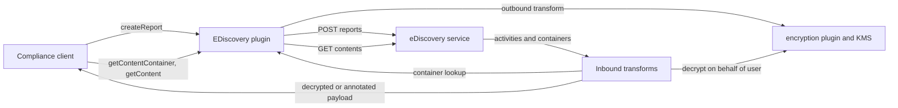
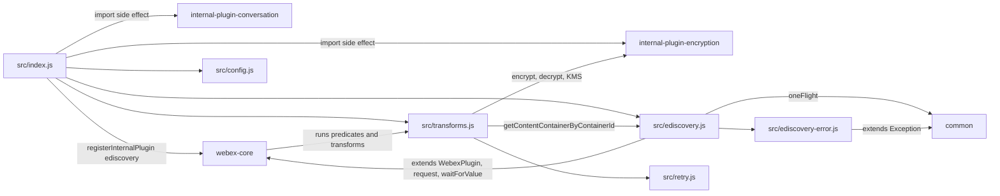
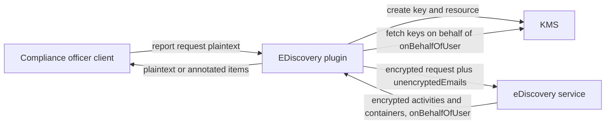

<!-- sdd-generated-metadata
doc_kind: standing-doc
generated_from: architecture@0.3.0
generated_by: claude-code
approved_by: rarajes2@cisco.com
updated_at: 2026-11-12T06:44:53Z
validation_status: pass
-->

# @webex/internal-plugin-ediscovery architecture

Canonical architecture for this package. Request and transform behavior lives in the
[eDiscovery plugin specification](../src/docs/README.md). This page owns package boundaries, the plugin
registration, the contract index, and how the package meets the rest of the SDK and its services.

Related context: [specification registry](specs/README.md) ·
[package agent instructions](../AGENTS.md)

## Applicability

| Condition ID                         | Status     | Evidence or reason | Owned section |
| ------------------------------------ | ---------- | ------------------ | ------------- |
| `repo.owns_datastore`                | N/A        | No database, file store, or migration; the cache in `src/ediscovery.js` is in memory | Repository data and schema |
| `repo.holds_client_state`            | Applicable | Session property contentContainerCache in `src/ediscovery.js` | Client state model |
| `repo.components_interact`           | Applicable | `src/index.js` wires `src/transforms.js` into webex-core, and the transforms call back into `src/ediscovery.js` | Dependency and interaction topology |
| `repo.domain_data_across_components` | Applicable | Containers fetched by `src/ediscovery.js` supply the key user that `src/transforms.js` needs to decrypt activities | Object and data ownership |
| `repo.caches_data`                   | Applicable | contentContainerCache in `src/ediscovery.js` | Caching catalog |
| `repo.observability_convention`      | Applicable | this.logger and ctx.webex.logger messages in `src/ediscovery.js` and `src/transforms.js`; console.error in `src/retry.js` | Observability patterns |
| `repo.deploys_to_infra`              | N/A        | Library published to npm (`package.json`). No service runtime | Runtime and infrastructure |
| `repo.shared_base_libs`              | Applicable | Extends WebexPlugin from webex-core and uses the legacy build, lint, and test stack (`babel.config.js`, `jest.config.js`, `.eslintrc.js`) | Shared and base libraries |
| `repo.is_monorepo`                   | N/A        | This SDD root is one package. The workspace around it is out of scope | Package map and inter-package dependencies |
| `repo.multi_platform`                | N/A        | No platform-specific code path in `src/index.js`, `src/ediscovery.js`, or `src/transforms.js`; the browserify transform in `package.json` only packages the same source | Platform matrix |
| `repo.published_package`             | Applicable | `package.json` name is @webex/internal-plugin-ediscovery and deploy:npm publishes it | Release and versioning |
| `repo.embedded_in_host`              | N/A        | No host theme or embed API in `src/ediscovery.js` | Host integration and theming |
| `repo.exposes_commands_or_artifacts` | Applicable | build:src in `package.json` writes dist | Commands and generated artifacts |
| `repo.cross_repo_deps_material`      | Applicable | Behavior depends on the eDiscovery service, KMS through the encryption plugin, and the webex-core transform pipeline (`src/ediscovery.js`, `src/transforms.js`) | Cross-repository topology |
| `repo.security_arch_warranted`       | Applicable | Report search terms, compliance content, KMS keys, and decryption on behalf of other users pass through `src/transforms.js` | Security architecture |

## Design overview

`@webex/internal-plugin-ediscovery` is a published internal plugin library with one module. Importing it
registers the encryption and conversation plugins and then `EDiscovery` as the internal plugin
`ediscovery`, together with a payload transformer of seven predicates and transforms. No other package in
this monorepo imports it; first-party compliance clients do.

The package owns the client side of the eDiscovery service: report record calls, paged content and
container reads by report UUID or remote report URL, and the encryption and decryption that make those
payloads usable. Report execution and storage stay in the service; key storage and cryptography stay in
the encryption plugin and KMS; transport and transform orchestration stay in webex-core.

The package makes outbound calls only. It serves no routes and persists nothing; its one piece of state is
an in-memory container cache.

## Resource inventory and responsibilities

| Resource | Kind | Responsibility | Owner | Source | Detailed specification |
| -------- | ---- | -------------- | ----- | ------ | ---------------------- |
| eDiscovery plugin | package (one module) | Report record calls, content and container reads, container cache, report-request encryption, report, activity, and container decryption | @webex/web-sdk | src | [`src/docs/README.md`](../src/docs/README.md) |

## Interaction and execution flows

Representative end-to-end flow: a compliance client creates a report, then downloads its content.

| From | To | Interaction or transport | Purpose | Failure or compatibility behavior |
| ---- | -- | ------------------------ | ------- | --------------------------------- |
| Compliance client | eDiscovery plugin | In-process calls | Manage reports, read content and containers | Argument errors and HTTP errors reject |
| eDiscovery plugin | eDiscovery service | HTTPS through `webex.request`, by service name or report URL | Reports, content, containers, client config, audit event | No retry; 30 s default timeout |
| webex-core transforms | `src/transforms.js` | Registered predicates and transforms | Encrypt outbound report requests, decrypt inbound payloads | Encryption failure rejects; decryption failure annotates the payload |
| `src/transforms.js` | eDiscovery plugin | `getContentContainerByContainerId` | Container data for activity decryption | Lookup failure annotates the activity |
| `src/transforms.js` | Encryption plugin and KMS | In-process calls | Keys, JWE text, SCRs | 429, 502, 503, 504 retried up to three times |

## Dependency topology

| Dependency | Type | Used by | Purpose | Version, failure, or fallback policy |
| ---------- | ---- | ------- | ------- | ------------------------------------ |
| `@webex/webex-core` | Internal | `src/index.js`, `src/ediscovery.js` | Plugin base, registration, request, `waitForValue`, transform pipeline | Workspace version (`workspace:*` in `package.json`) |
| `@webex/common` | Internal | `src/ediscovery.js`, `src/ediscovery-error.js` | `oneFlight`, `Exception` | Workspace version |
| `@webex/internal-plugin-encryption` | Internal | `src/index.js`, `src/transforms.js` (through `webex.internal.encryption`) | Encryption, decryption, KMS keys | Workspace version |
| `@webex/internal-plugin-conversation` | Internal | `src/index.js` | Import side effect registering internal plugin `conversation` | Workspace version |
| `@webex/internal-plugin-mercury` | Internal | Not imported by `src/` (only `test/unit/spec/report.js`) | None at runtime | Workspace version |
| `lodash` | External | `src/index.js` | `has` | `^4.17.21` in `package.json` |
| `uuid` | External | Not imported by `src/` (only `test/integration/spec/ediscovery.js`) | None at runtime | `^3.3.2` in `package.json` |
| eDiscovery service | External service | `src/ediscovery.js` | Report and content API | Service name `ediscovery` from the catalog, or the report URL |
| KMS | External service | `src/transforms.js` through the encryption plugin | Keys | Retries in `src/retry.js` |

No import cycle exists: this package imports webex-core, common, encryption, and conversation, and none of
them imports this package.

## Public and consumer surfaces

| Surface | Type | Owner | Consumers | Compatibility policy | Source |
| ------- | ---- | ----- | --------- | -------------------- | ------ |
| `ediscovery-sdk` — package @webex/internal-plugin-ediscovery: import side effect registering internal plugin `ediscovery` and its seven payload predicates and transforms | SDK, published to npm as an internal plugin | eDiscovery plugin | First-party compliance clients | Internal plugin; `README.md` states it does not strictly follow semantic versioning | `package.json`, `src/index.js` |
| `ediscovery-sdk` — package exports: default `EDiscovery`; named `ReportRequest`, `EdiscoveryError`, `InvalidEmailAddressError`, and `config` (resolves to `undefined`) | SDK export | eDiscovery plugin | First-party compliance clients | Same | `src/index.js`, `src/report-request.js`, `src/ediscovery-error.js`, `src/config.js` |
| `ediscovery-sdk` — report record methods on `webex.internal.ediscovery`: `createReport`, `getReport`, `getReports`, `deleteReport`, `restartReport`, `getClientConfig`, `postAuditLog` | SDK plugin API | eDiscovery plugin | First-party compliance clients | Same | `src/ediscovery.js` |
| `ediscovery-sdk` — content methods on `webex.internal.ediscovery`: `getContent`, `getContentContainer`, `getContentContainerByContainerId` (report UUID or report URL) | SDK plugin API | eDiscovery plugin | First-party compliance clients; the activity decryption transform calls `getContentContainerByContainerId` | Same | `src/ediscovery.js`, `src/transforms.js` |
| `ediscovery-sdk` — cache surface on `webex.internal.ediscovery`: `clearCache()` and session property `contentContainerCache` | SDK plugin API | eDiscovery plugin | First-party compliance clients | Same | `src/ediscovery.js` |

Arguments, responses, and failure behavior of each method are owned by the
[module specification](../src/docs/README.md#public-surface).

The eDiscovery resources and the encrypted field sets are protocols this package consumes, described under
*Protocol and wire format* in the
[module specification](../src/docs/README.md#protocol-and-wire-format), not published contracts of this
package.

## Client state model

| State or slice | Owner | Transition triggers | Persistence or reset boundary |
| -------------- | ----- | ------------------- | ----------------------------- |
| `contentContainerCache` | eDiscovery plugin | Container reads write; activity decryption reads | In memory for the instance; emptied by `clearCache()` |
| `oneFlight` entries | `@webex/common` | Content method calls | Evicted when each call settles |

## Cross-cutting architecture

### Security

- Trust boundaries and identity flow: see [Security architecture](#security-architecture). The caller is a
  compliance officer; content keys are fetched on behalf of the container's `onBehalfOfUser`, which needs
  the KMS org-agent role (the integration test user is created with `spark.kms_orgagent`).
- Sensitive surfaces and data classes: report names, descriptions, search keywords, space names, and
  emails; decrypted messages, file references (SCRs), shared-link ids, meeting titles, recording topics,
  and calling numbers in `encryptedTextKeyValues`.
- Encryption and secret boundaries: report requests are encrypted under a new KMS key before they leave
  the client, except `unencryptedEmails`, which the service needs to resolve user ids. Decrypted content
  exists only in the response objects handed to the caller and in the container cache.

### Observability and operations

- Logging and correlation: warnings for unparseable invalid-email errors and cache misses; errors for
  encryption and decryption failures naming the activity and container ids; info for unencrypted items;
  `console.error` lines for each retry. No message logs plaintext content, but share failures log the share
  URL, MIME type, and size.
- Metrics, traces, and audit signals: `postAuditLog` sends the summary-download audit event to the
  service; nothing else is emitted.
- Ownership and operational entry points: `.github/CODEOWNERS` at the workspace root has no entry for this
  package, so the default rule routes it to `@webex/web-sdk`. No dashboards or runbooks are recorded in
  this package.

### Quality attributes

- Compatibility: compliance clients rely on the method names, the UUID-or-URL argument, and the `error`,
  `warning`, `spaceName`, and `containerName` properties the transforms add.
- Footprint: seven source files; runtime imports are webex-core, common, the encryption and conversation
  plugins, and lodash.
- Test confidence: 122 unit cases cover the request methods, cache, URL helpers, report-request
  encryption and decryption, and activity decryption; registration, the array transforms, container
  decryption, and retries have no case. No coverage threshold is enforced, and lint skips
  `src/ediscovery.js` and `src/index.js`.

## Dependency and interaction topology

| From | To | Kind | Purpose | Ordering or failure boundary |
| ---- | -- | ---- | ------- | ---------------------------- |
| `src/index.js` | encryption, conversation plugins | Import | Register `encryption` and `conversation` | Before the `ediscovery` registration |
| `src/index.js` | webex-core | Call | Register the plugin and payload transformer | At import time; predicates join the module-level config |
| webex-core | `src/transforms.js` | Call | Outbound and inbound transforms | A rejected transform rejects the request |
| `src/transforms.js` | `src/ediscovery.js` | Call through `webex.internal.ediscovery` | Container lookup | Failure annotates the activity |
| `src/transforms.js` | `src/retry.js` | Import | Retry decryption | Rejects after three retries |

## Object and data ownership

| Object or state | System of record | May write | May read | Movement or lifecycle |
| --------------- | ---------------- | --------- | -------- | --------------------- |
| Report record and its report request | eDiscovery service | Service; the client through `createReport`, `restartReport`, `deleteReport` | Client after decryption | Encrypted on create, decrypted on read |
| Activity (report content) | eDiscovery service | Service; the inbound transform adds plaintext and annotations to the client copy | Client | Paged by `offset` and `size`, decrypted per item |
| Content container | eDiscovery service | Service; the inbound transform decrypts the client copy; the plugin caches it | Activity transform, client | Cached per report until `clearCache` |
| Report-request key | KMS | `encryptReportRequest` creates it | Service and the client through `encryptionKeyUrl` | Created per report request |

## Caching catalog

| Cache  | Owner      | Backend   | Contents | TTL or bound | Invalidation trigger | Failure behavior |
| ------ | ---------- | --------- | -------- | ------------ | -------------------- | ---------------- |
| `contentContainerCache` | eDiscovery plugin | In-memory `Map` of report UUID to `Map` of container id | Decrypted containers (description possibly still encrypted) | None | `clearCache()` empties all reports | A miss fetches the container; a write error is logged and skipped |

## Observability patterns

| Signal  | Convention or required fields | Propagation or naming rule | Primary evidence |
| ------- | ----------------------------- | -------------------------- | ---------------- |
| Logs    | Error and warning messages name the activity id and container id; no plaintext content | Through `this.logger` or `ctx.webex.logger`, except retries, which use `console.error` | `src/ediscovery.js`, `src/transforms.js`, `src/retry.js` |
| Metrics | None | N/A | `src/ediscovery.js` |
| Traces  | None | N/A | `src/ediscovery.js` |
| Audit   | Summary-download audit event | `POST reports/<id>/audit/summary-download` | `src/ediscovery.js` |

## Shared and base libraries

| Library | Inherited responsibility | Consumers | Version floor | Compatibility rule |
| ------- | ------------------------ | --------- | ------------- | ------------------ |
| `@webex/webex-core` `WebexPlugin`, `waitForValue`, payload transformer | `webex`, `request`, namespaced `config`, `logger`, storage gating, transform pipeline | `EDiscovery`, `src/index.js` | `workspace:*` | Keep namespace `EDiscovery` so `config` resolves to `webex.config.ediscovery` |
| `@webex/common` | `oneFlight`, `Exception` | `EDiscovery`, error classes | `workspace:*` | Keep paging options in `oneFlight` keys |
| `@webex/babel-config-legacy`, `@webex/eslint-config-legacy`, `@webex/jest-config-legacy`, `@webex/legacy-tools` | Build, lint, and test stack through one-line config files | Package tooling | `workspace:*` | Do not fork the config locally |

## Release and versioning

| Artifact | Publish target | Versioning rule | Deprecation window | Changelog or migration obligation |
| -------- | -------------- | --------------- | ------------------ | --------------------------------- |
| @webex/internal-plugin-ediscovery | npm through `deploy:npm` | Internal plugin; not strictly semantic (`README.md`) | None declared | None declared in the package; the workspace owns changelog generation |

## Commands and generated artifacts

| Command or artifact | Owner | Inputs | Output or side effect | Compatibility boundary |
| ------------------- | ----- | ------ | --------------------- | ---------------------- |
| `yarn workspace @webex/internal-plugin-ediscovery build:src` | Package scripts | `src` | Writes `dist/` through `webex-legacy-tools` (JavaScript, TypeScript, source maps) | `dist/` is generated and never edited by hand; unit tests load it |
| `yarn workspace @webex/internal-plugin-ediscovery test:unit` | Package scripts | `test/unit/spec` | Jest run | Requires a current `dist/` |
| `yarn workspace @webex/internal-plugin-ediscovery test:style` | Package scripts | `src` | ESLint run | The shared config ignores `ediscovery.js`, `docs/**`, and `*.md`; `src/index.js` disables every rule |
| `yarn workspace @webex/internal-plugin-ediscovery test:browser:broken` | Package scripts | `test/integration/spec` | Karma run | Named broken; needs live services; not a routine verification command |

## Cross-repository topology

| Repository or external system | Relationship | Exchanged contract or artifact | Owner | Sequencing constraint |
| ----------------------------- | ------------ | ------------------------------ | ----- | --------------------- |
| `@webex/webex-core` (workspace sibling; module specs consulted) | Consumes | `WebexPlugin`, `registerInternalPlugin`, `waitForValue`, request, payload transformer | @webex/web-sdk | Registration at import time |
| `@webex/common` (workspace sibling; module spec consulted) | Consumes | `oneFlight`, `Exception` | @webex/web-sdk | None |
| `@webex/internal-plugin-encryption` (workspace sibling; code consulted, no spec) | Consumes | `encryptText`, `decryptText`, `decryptScr`, `kms.createUnboundKeys`, `kms.createResource` | @webex/web-sdk | Imported before the `ediscovery` registration |
| `@webex/internal-plugin-conversation` (workspace sibling; code consulted, no spec) | Consumes | Import side effect registering `conversation` | @webex/web-sdk | Imported before the `ediscovery` registration |
| eDiscovery service | Consumes | Report, content, container, client-config, and audit resources | Not recorded in this repository | Report URLs may point at a remote deployment |
| KMS | Consumes through the encryption plugin | Keys, on behalf of `onBehalfOfUser` | Not recorded in this repository | Retry on 429 and 5xx |

## Security architecture

- Report search parameters are encrypted with a key created for that request; only `unencryptedEmails`
  is sent in plaintext so the service can resolve users.
- Activity and container content is decrypted with keys fetched on behalf of the container's
  `onBehalfOfUser`, which requires the KMS org-agent role for the caller; CDR content in
  `encryptedTextKeyValues` is decrypted without `onBehalfOf`.
- Plaintext lives only in the returned objects and the container cache; call `clearCache()` when a report
  is finished.
- The outbound predicate encrypts any request body with `keywords`, `spaceNames`, or `emails`, so another
  plugin's request with those fields is encrypted by this package once it is imported.
- The authoritative key and cryptography policy belongs to the encryption plugin and KMS.

## Domain language

| Term | Repository-specific meaning | Authoritative source |
| ---- | --------------------------- | -------------------- |
| Report request | Search parameters of a compliance report: name, description, emails, user ids, keywords, space names, range | `src/report-request.js` |
| Report content | The activities a report found, paged by `offset` and `size` | `src/ediscovery.js` |
| Content container | A space (or other container) referenced by activities, with its key and `onBehalfOfUser` | `src/ediscovery.js`, `src/transforms.js` |
| `onBehalfOfUser` | The user whose KMS access decrypts a container's content | `src/transforms.js` |
| Downloader | The consuming client component that writes the report and records `error` and `warning` properties | `src/transforms.js` comments |
| Remote report | A report addressed by its full URL rather than by UUID | `src/ediscovery.js` |

## References and maintenance

- Decisions: [adr/](adr/index.md)
- Instantiated specifications and routing: [specs/README.md](specs/README.md)
- Repository rules and patterns: [package agent instructions](../AGENTS.md)
- Update this document in the same change that alters package boundaries, resource ownership,
  cross-resource interaction, or cross-cutting architecture.
