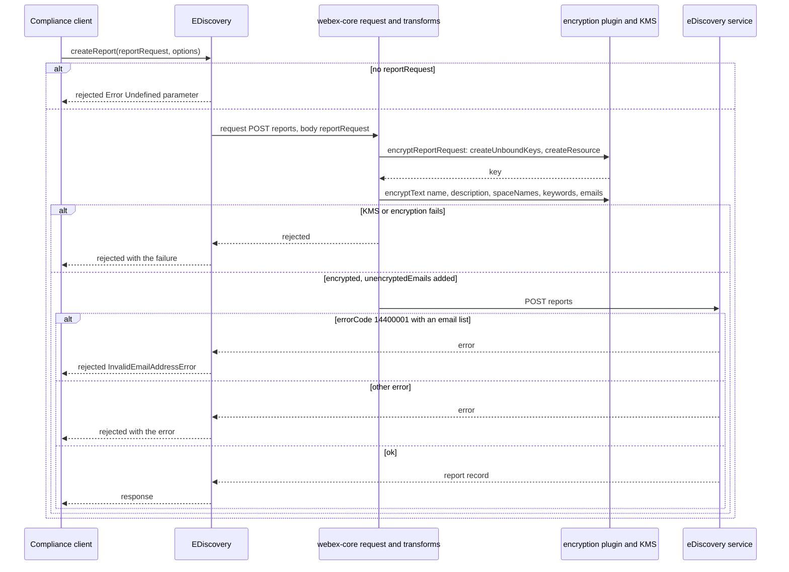
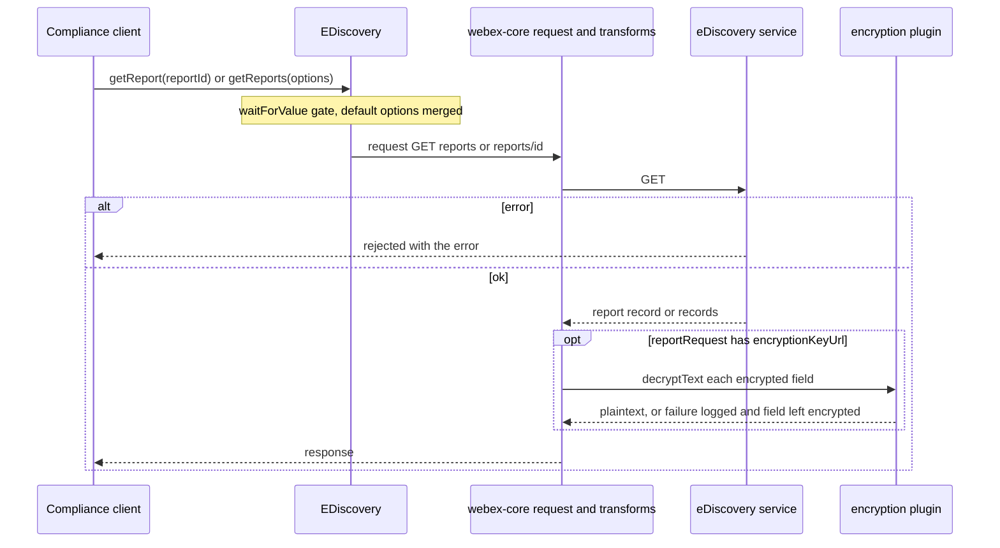
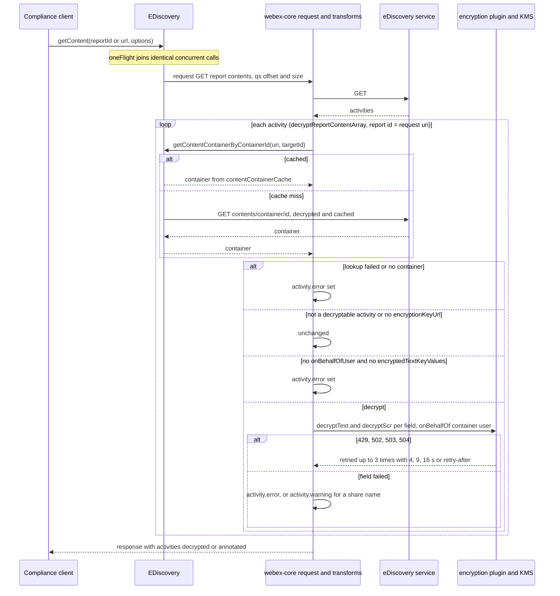
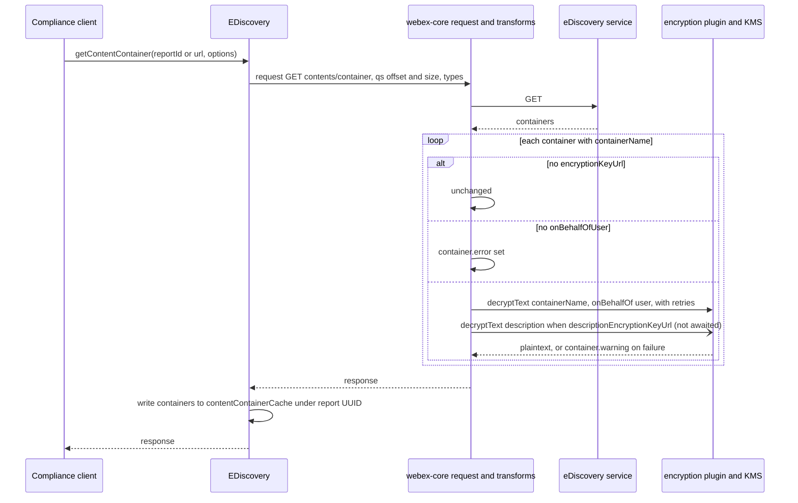
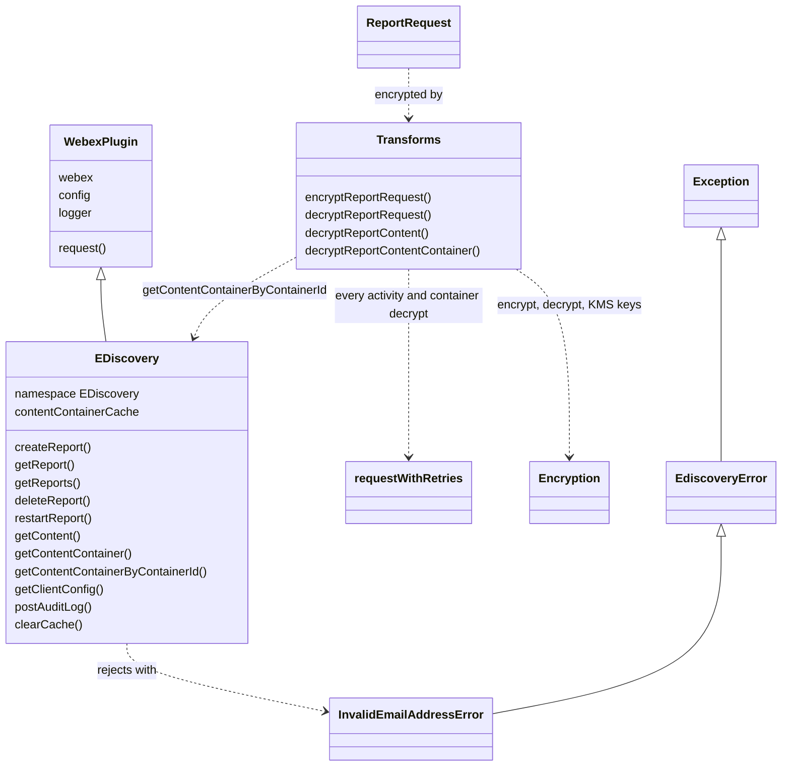

<!-- sdd-generated-metadata
doc_kind: module-spec
generated_from: module-spec@0.3.0
generated_by: claude-code
approved_by: rarajes2@cisco.com
updated_at: 2026-11-12T06:44:53Z
validation_status: pass
-->

# eDiscovery plugin

This source-local document at `src/docs/README.md` owns the stable specification for **the eDiscovery
plugin**: the internal plugin `webex.internal.ediscovery` that compliance-officer clients use to create
and manage compliance reports on the eDiscovery service, page through report content and content
containers, and read that content in plaintext. Its payload transforms encrypt report requests on the
way out and decrypt reports, activities, and containers on the way in through the encryption plugin and
KMS. Ground every claim in package evidence and link to the
[package architecture](../../docs/architecture.md) instead of repeating broader facts. No service
specification exists because this package is a library.

Related context: [documentation index](../../docs/index.md) ·
[package agent instructions](../../AGENTS.md)

## Metadata

| Field             | Value |
| ----------------- | ----- |
| Owner             | @webex/web-sdk |
| Source path       | `src` |
| Resource kind     | package |
| Status            | Draft |
| Last verified     | 2026-11-12 at `ecd5af12a1` |
| Module id         | `internal-plugin-ediscovery` |
| Parent spec       | — |
| Doc kind          | Module spec |
| Coverage score    | 93.3% assessed 2026-11-12 — 14 of 15 mandatory fields PRESENT, critical 8 of 8; test strategy is WEAK because registration, the payload predicates and array transforms, container decryption, and `requestWithRetries` have no unit case |
| Validation status | pass — 2026-11-12; validator runtime `01a1ce6b-d345-7220-b6b0-c125b776f5cc`; 0 Blocking findings, 0 warnings |

## Applicability

| Condition ID                         | Status     | Evidence or reason | Owned section |
| ------------------------------------ | ---------- | ------------------ | ------------- |
| `module.has_tiers`                   | N/A        | No tier policy exists in this package or its `package.json` | Tier |
| `module.has_ui`                      | N/A        | `src/ediscovery.js` and `src/transforms.js` make requests and mutate payloads only; nothing renders | UI use-case flow |
| `module.crosses_service_boundaries`  | Applicable | `src/ediscovery.js` calls the eDiscovery service; `src/transforms.js` calls KMS through the encryption plugin | Cross-boundary use-case flow |
| `module.holds_client_state`          | Applicable | Session property contentContainerCache in `src/ediscovery.js` | Client state model |
| `module.enforces_domain_rules`       | Applicable | Which activity fields are decrypted, with which key and on whose behalf, and how failures mark an activity, in `src/transforms.js` | Business rules and invariants |
| `module.is_concurrent_async`         | Applicable | oneFlight and waitForValue decorators in `src/ediscovery.js`; parallel decryption and retries in `src/transforms.js` and `src/retry.js` | Concurrency and reactive flow |
| `module.owns_persistence`            | N/A        | The cache in `src/ediscovery.js` is in memory; nothing is stored | Data, schema, and migration discipline |
| `module.stateful_transitions`        | N/A        | No state machine; the cache is covered under Client state model (`src/ediscovery.js`) | State machine |
| `module.exposes_wire_protocol`       | Applicable | eDiscovery resource paths, query parameters, the report-request body, and the encrypted field set in `src/ediscovery.js`, `src/transforms.js`, `src/report-request.js` | Protocol and wire format |
| `module.ui_multi_screen`             | N/A        | No UI | UI flow |
| `module.large_data_model`            | N/A        | The module defines only ReportRequest (`src/report-request.js`); activity and container shapes belong to the service and are listed under Protocol and wire format | Data model |
| `module.returns_caller_errors`       | Applicable | Rejections for missing parameters, invalid report URLs, and InvalidEmailAddressError in `src/ediscovery.js` and `src/ediscovery-error.js` | Caller-visible failure modes |
| `module.module_specific_conventions` | Applicable | Error and warning properties written onto activities and containers instead of rejections, in `src/transforms.js` | Module-specific rules |
| `module.published_package`           | Applicable | `package.json` names the package @webex/internal-plugin-ediscovery and defines deploy:npm | Export stability |
| `module.embedded_in_host`            | N/A        | No host theme or embed API | Host integration and theming |
| `module.has_design_tradeoff`         | Applicable | Decryption failures recorded on the payload, an unbounded container cache, and global payload predicates, in `src/transforms.js`, `src/ediscovery.js`, `src/index.js` | Key design trade-off |
| `module.has_submodules`              | N/A        | The src directory has no child module | Sub-modules |

## Evidence register

| Evidence | What it establishes |
| -------- | ------------------- |
| `src/index.js` | Side-effect imports of `@webex/internal-plugin-encryption` and `@webex/internal-plugin-conversation`; `registerInternalPlugin('ediscovery', EDiscovery, {config, payloadTransformer})` with seven predicates and seven transforms; exports default `EDiscovery` and named `config`, `ReportRequest`, `EdiscoveryError`, `InvalidEmailAddressError` |
| `src/ediscovery.js` | The `EDiscovery` plugin: report record methods, content and container retrieval, the container cache, `clearCache`, `postAuditLog`, and the private URL helpers. Its JSDoc and inline comments are the main recorded rationale |
| `src/transforms.js` | Static `Transforms` methods that encrypt report requests and decrypt report requests, activities, and containers, with inline comments explaining each rule |
| `src/retry.js` | `requestWithRetries` and `timeout`, the retry helper used by every activity and container decryption |
| `src/report-request.js` | The `ReportRequest` class and its constructor defaults |
| `src/ediscovery-error.js` | `EdiscoveryError` and `InvalidEmailAddressError` with `getErrorCode()` 14400001 |
| `src/config.js` | Default export `{ediscovery: {defaultOptions: {offset: 0, size: 100, timeoutMs: 30000, types: []}}}` |
| `package.json` | Name, `main` (`dist/index.js`), `devMain` (`src/index.js`), `engines` (`node >=18`), dependencies, and scripts; no `test:integration` or `test:browser` script, though `test` chains both |
| `process` | Package-root module exporting `{browser: true}`; nothing in `src/` imports it and no package script names it |
| `test/unit/spec/report.js` | 23 cases for the report record methods, default and overridden timeouts, and the invalid-email mapping |
| `test/unit/spec/content.js` | 73 cases for content and container retrieval by UUID and by URL, `oneFlight` sharing, the container cache, `clearCache`, `postAuditLog`, and the URL helpers |
| `test/unit/spec/transforms.js` | 26 cases for report-request encryption and decryption and activity decryption; none for container decryption or retries |
| `test/integration/spec/ediscovery.js` | 13 cases against the live eDiscovery service with a compliance test user; no package script runs this file |
| `README.md` | Retained npm page; context only, see `docs/adr/0001-retain-product-readme.md` |
| Sibling package webex-core, file src/docs/README.md | Module spec consulted. `registerInternalPlugin` merges `config` and concatenates `payloadTransformer` predicates and transforms into the module-level default config, so they apply to every instance created afterwards; `WebexPlugin` supplies `webex`, `request`, `logger`, and `config` read as `webex.config[namespace.toLowerCase()]` |
| Sibling package webex-core, file src/interceptors/docs/README.md | Module spec consulted. The payload-transformer interceptor runs the outbound transform on request options and the inbound transform on responses and on error reasons |
| Sibling package webex-core, file src/webex-core.js | Source consulted. `transform(direction, object)` runs every predicate of that direction, then each matched transform with only the extracted object; `ctx.transform(name, ...args)` passes extra arguments through |
| Sibling package webex-core, file src/lib/storage/docs/README.md | Module spec consulted. A `@waitForValue` method always returns a promise and runs only after its keys load; the spec names ediscovery among its users |
| Sibling package common, file src/docs/README.md | Module spec consulted. `oneFlight` shares one in-flight promise per key (method name plus the `keyFactory` result) and evicts it on settle; `Exception` derives `message` from `parse`, which returns the first constructor argument |
| Sibling package internal-plugin-encryption, files src/encryption.js and src/kms.js | Source consulted (no spec). `encryptText`, `decryptText`, and `decryptScr` resolve a key from a key object or a KMS URI, fetching it `onBehalfOf` a user when given; `kms.createUnboundKeys({count})` and `kms.createResource({userIds, keys})` |
| Sibling package internal-plugin-conversation, file src/index.js | Source consulted (no spec). Importing it registers internal plugin `conversation` |
| Sibling package eslint-config-legacy, file static/ignore-patterns.js | Source consulted. The shared lint config ignores every file named `ediscovery.js` ("Files with decorator"), `docs/**`, and `*.md` |
| Observation, no stated WHY | `src/index.js` imports `@webex/internal-plugin-conversation`, but nothing in `src/` calls `webex.internal.conversation`; `@webex/internal-plugin-mercury` is a runtime dependency that `src/` never imports (only `test/unit/spec/report.js` does); `src/index.js` re-exports a named `config` that `src/config.js` does not define. No reason for any of the three is recorded in code or tests, so they are observations, not requirements |

## Purpose and boundary

- Responsibility: give compliance-officer clients one internal plugin for the eDiscovery service. That
  covers creating, listing, reading, restarting, and deleting compliance reports; reading the client
  configuration; posting the summary-download audit event; paging report content (activities) and content
  containers (spaces) by report UUID or by a remote report URL; and turning the encrypted service payloads
  into plaintext, or into payloads that carry an `error` or `warning` describing what could not be
  decrypted.
- In scope: the `EDiscovery` plugin API; the container cache; the seven payload predicates and transforms
  registered in `src/index.js`; report-request encryption; report, activity, and container decryption;
  the retry policy for decryption calls; `ReportRequest`; the two error classes.
- Out of scope: report execution, search, and storage (the eDiscovery service); key storage and fetch,
  JWE and SCR cryptography (`@webex/internal-plugin-encryption` and KMS); request transport, payload
  transform orchestration, and storage gating (`@webex/webex-core`); request de-duplication and the
  `Exception` base (`@webex/common`); writing the downloaded report, which the source comments call "the
  downloader" and which lives in the consuming client.
- Consumers: first-party compliance clients that import `@webex/internal-plugin-ediscovery` and read
  `webex.internal.ediscovery`. No other package in this monorepo imports it, and `webex` does not bundle
  it.

## Structure and key files

| Path | Responsibility |
| ---- | -------------- |
| `src/index.js` | Imports the encryption and conversation plugins, registers internal plugin `ediscovery` with the config and payload transformer, and re-exports the public bindings |
| `src/ediscovery.js` | The `EDiscovery` class, built with `WebexPlugin.extend` in namespace `EDiscovery`; request methods, cache, and URL helpers |
| `src/transforms.js` | `Transforms` static methods called by the registered transforms |
| `src/retry.js` | `requestWithRetries` and `timeout` (CommonJS exports) |
| `src/report-request.js` | `ReportRequest` |
| `src/ediscovery-error.js` | `EdiscoveryError`, `InvalidEmailAddressError` |
| `src/config.js` | Default options |
| `process` | Package-root file exporting `{browser: true}`; not imported by `src/` |
| `package.json` | Package name, entry points, scripts, and dependencies |
| `babel.config.js`, `jest.config.js` | Re-exports of the legacy Babel and Jest configurations |
| `.eslintrc.js` | Sets `root: true` and extends `@webex/eslint-config-legacy` |
| `src/docs/README.md` | This module specification; ignored by the build and by lint |
| `test/unit/spec/report.js`, `test/unit/spec/content.js`, `test/unit/spec/transforms.js` | Unit specs run by Jest through `webex-legacy-tools` |
| `test/integration/spec/ediscovery.js` | Live-service cases; not wired to any package script |
| dist/ (generated) | Build output of `build:src`; ignored by Git and never edited by hand |

## Public surface

| Surface | Consumer | Compatibility commitment | Source |
| ------- | -------- | ------------------------ | ------ |
| Import side effect: internal plugin `ediscovery`, plus internal plugins `encryption` and `conversation` | Compliance clients | The first registration of a name wins; the payload predicates and transforms join the module-level webex config for every instance created afterwards | `src/index.js` |
| Default export `EDiscovery`; named exports `ReportRequest`, `EdiscoveryError`, `InvalidEmailAddressError`, `config` | Compliance clients | The named `config` resolves to `undefined` (see Pitfalls) | `src/index.js` |
| `createReport(reportRequest, options)`, `getReport(reportId, options)`, `getReports(options)`, `deleteReport(reportId, options)`, `restartReport(reportId, options)` | Compliance clients | Each resolves with the HTTP response; `options.timeoutMs` overrides the 30 s default | `src/ediscovery.js` |
| `getContent(reportId, options)`, `getContentContainer(reportId, options)`, `getContentContainerByContainerId(reportId, containerId, options)` | Compliance clients; `getContentContainerByContainerId` is also called by the activity transform | `reportId` is a report UUID or a report URL; responses arrive decrypted, or annotated with `error` or `warning` | `src/ediscovery.js` |
| `getClientConfig(options)`, `postAuditLog(reportId, options)` | Compliance clients | Resolve with the HTTP response | `src/ediscovery.js` |
| `clearCache()` and session property `contentContainerCache` | Compliance clients | Synchronous; empties the whole cache | `src/ediscovery.js` |
| `ReportRequest` constructor | Compliance clients building `createReport` input | Positional arguments in constructor order | `src/report-request.js` |
| `InvalidEmailAddressError.getErrorCode()` | Compliance clients branching on the error | Returns 14400001 | `src/ediscovery-error.js` |

Contract ID `ediscovery-sdk` is indexed in the
[package architecture](../../docs/architecture.md#public-and-consumer-surfaces) and registered in
`.sdd/manifest.json`. Export stability is under [Export stability](#export-stability).

## Dependencies

| Dependency | Why it is required | Failure behavior |
| ---------- | ------------------ | ---------------- |
| `@webex/webex-core` plugin host and transforms (module specs consulted) | `WebexPlugin`, `registerInternalPlugin`, `this.request`, `this.logger`, namespaced `config`, and the payload-transformer pipeline that runs this package's predicates | Request rejections propagate to the caller; a rejected inbound transform rejects the request |
| `@webex/webex-core` storage (module spec consulted) | `@waitForValue('@')` gates every request method until the plugin store has loaded | A method waits; it does not reject because of the gate |
| `@webex/common` (module spec consulted) | `oneFlight` on the three content methods; `Exception` as the error base | Not applicable |
| `@webex/internal-plugin-encryption` (code consulted; no spec) | `encryptText`, `decryptText`, `decryptScr`, `kms.createUnboundKeys`, `kms.createResource` | Encryption failures reject `createReport`; decryption failures annotate the payload and are logged |
| `@webex/internal-plugin-conversation` (code consulted; no spec) | Imported only for its side effect of registering internal plugin `conversation` | Not applicable |
| eDiscovery service (external) | Reports, content, containers, client config, audit events | HTTP errors propagate, except error code 14400001, which becomes `InvalidEmailAddressError` |
| KMS (external, through the encryption plugin) | Keys for report requests, activities, and containers, fetched on behalf of `onBehalfOfUser` | 429, 502, 503, and 504 are retried up to three times; other failures annotate the payload |
| `lodash` | `has` in the predicates | Not applicable |
| `@webex/internal-plugin-mercury`, `uuid` | Declared runtime dependencies that `src/` does not import | Not applicable |

## Requirements

| ID | WHAT | WHY | Source evidence | Test or example evidence | Assumptions or gaps | Confidence |
| -- | ---- | --- | --------------- | ------------------------ | ------------------- | ---------- |
| `MOD-001` | Importing the package imports `@webex/internal-plugin-encryption`, then registers internal plugin `ediscovery` with `src/config.js` and a payload transformer of seven predicates and seven transforms: inbound `decryptReportRequest` (`body.reportRequest`), `decryptReportRequestArray` (`body[0].reportRequest`), `decryptReportContent` (`body.activityId`), `decryptReportContentArray` (`body[0].activityId`), `decryptReportContentContainer` (`body.containerId`), `decryptReportContentContainerArray` (`body[0].containerId`), and outbound `encryptReportRequest` (`body.keywords`, `body.spaceNames`, or `body.emails`). | Every transform calls `ctx.webex.internal.encryption`, so the encryption plugin must be registered, and the transforms are how eDiscovery payloads are encrypted before they are sent and decrypted after they are returned (the `Transforms` class JSDoc). | `src/index.js`, `src/transforms.js` | Unit specs mount EDiscovery through MockWebex children and call Transforms directly | No test exercises `registerInternalPlugin`, a predicate, or an array transform | Weak |
| `MOD-002` | Every request method merges the caller's `options` over `config.ediscovery.defaultOptions` (`offset` 0, `size` 100, `timeoutMs` 30000, `types` empty) and sends `timeout: options.timeoutMs`. | The JSDoc of each method: `options.timeoutMs` is the connection timeout and defaults to 30 s. | `src/config.js`, `src/ediscovery.js` | `test/unit/spec/report.js` and `test/unit/spec/content.js` "timeout defaults to 30s" and "can be overwritten to 5s" cases | None | Present |
| `MOD-003` | `createReport(reportRequest, options)` rejects with `Error('Undefined parameter')` when `reportRequest` is falsy; otherwise it POSTs `reportRequest` as the body to service `ediscovery` resource `reports`. | The JSDoc: create a compliance report with a specific set of search parameters. | `src/ediscovery.js` | `test/unit/spec/report.js` "CreateReport succeeds", "CreateReport fails with no param"; `test/integration/spec/ediscovery.js` createReport 400 case | None | Present |
| `MOD-004` | When `createReport` fails with `body.errorCode` 14400001 and `body.message` parses as a non-empty JSON array, it rejects with `new InvalidEmailAddressError(emails)`, whose `message` is that array. Otherwise it logs (warn for a non-array, error for a parse failure) and rejects with the original reason. | The JSDoc: ensure the appropriate error is sent to the client. The error class comment: an email supplied as a parameter cannot be found in CI, and 14400001 is the service code `INVALID_USER_EMAILS_LIST_IN_MESSAGE`. | `src/ediscovery.js`, `src/ediscovery-error.js` | `test/unit/spec/report.js` "CreateReport with invalid emails fails with InvalidEmailAddressError" | The non-array and parse-failure branches are untested | Present |
| `MOD-005` | `getReport` sends GET `reports/<reportId>`, `getReports` GET `reports` with `qs {offset, size}`, `deleteReport` DELETE `reports/<reportId>`, `restartReport` PUT `reports/<reportId>`, and `getClientConfig` GET `reports/clientconfig`, all to service `ediscovery`. `getReport`, `deleteReport`, and `restartReport` reject with `Error('Undefined parameter')` without `reportId`. | The JSDoc of each method: retrieve a report, list the officer's reports, delete a report, restart a completed or cancelled report from scratch, and retrieve a config object the client can use for optimal performance such as content page size. | `src/ediscovery.js` | `test/unit/spec/report.js` GetReports, GetReport, DeleteReport, RestartReport, and GetClientConfig cases; `test/integration/spec/ediscovery.js` 404 cases and getClientConfig | `getReports` paging is not asserted | Present |
| `MOD-006` | `postAuditLog(reportId, options)` rejects with `Error('No report ID specified')` without `reportId`; otherwise it POSTs to `reports/<reportId>/audit/summary-download`. | The JSDoc: submit an audit event to the eDiscovery service for admin use, expected only for the getContentContainer API. | `src/ediscovery.js` | `test/unit/spec/content.js` PostAuditLog cases | The three cases do not return their promises, so their assertions are not awaited | Weak |
| `MOD-007` | `getContent`, `getContentContainer`, and `getContentContainerByContainerId` accept a report UUID or a report URL. For a URL, the first UUID in it is the report id, everything after that UUID is dropped, and the resource is appended (`url` option); a URL without a UUID throws `Error('Report url does not contain a report id')`. For a UUID, the request uses service `ediscovery` and resource `` `reports/${reportId}/${resource}` ``. | The JSDoc: the id may be a UUID or the URL of the report; the inline comment on the array transform: the report URL resolves correctly for remote reports. | `src/ediscovery.js`, `src/index.js` | `test/unit/spec/content.js` "by url" suites, _getReportIdFromUrl, _isUrl, _createRequestOptions cases; `test/integration/spec/ediscovery.js` remote URL cases | None | Present |
| `MOD-008` | `getContent` sends GET `<report>/contents` with `qs {offset, size}` and rejects with `Error('Undefined parameter')` without `reportId`. Concurrent calls whose report id and `offset`, `size`, and `types` options match share one request. | The JSDoc: retrieve content associated with a report. The `createOneFlightKey` comment: the offset must be part of the key so paged requests get back the correct data. | `src/ediscovery.js` | `test/unit/spec/content.js` GetContent suites, including the one-request and multiple-request cases | None | Present |
| `MOD-009` | `getContentContainer` sends GET `<report>/contents/container` with `qs {offset, size}` and a `types` request option, then writes every returned container that has a `containerId` into the cache under the report UUID. Concurrent calls share a request by the same key as `MOD-008`. | The JSDoc: retrieve the content containers relevant to a report. The cache-writer JSDoc: container information is accessed very frequently when decrypting activities. | `src/ediscovery.js` | `test/unit/spec/content.js` GetContentContainer suites, including the cache cases | None | Present |
| `MOD-010` | `getContentContainerByContainerId(reportId, containerId, options)` rejects with `Error('Undefined parameter')` unless both ids are given. When the cache holds the container for that report UUID, it resolves `{body: container, statusCode: 200}` without a request; otherwise it logs a cache-miss warning, sends GET `<report>/contents/container/<containerId>`, and caches the body. Concurrent calls for the same report id and container id share one request. | The inline comment: a cached container is returned from the cache instead of making a network call to eDiscovery. | `src/ediscovery.js` | `test/unit/spec/content.js` GetContentContainerByContainerId suites | None | Present |
| `MOD-011` | `clearCache()` empties `contentContainerCache` for every report. | The JSDoc: clear the cache when finished with a report to save RAM. | `src/ediscovery.js` | `test/unit/spec/content.js` "Clear caches of spaces and content containers" | The case asserts only that `clear` was called once on a stub | Present |
| `MOD-012` | The outbound `encryptReportRequest` transform creates one unbound KMS key, creates a KMS resource with `userIds: [key.userId]` and that key, sets `encryptionKeyUrl` to the key URI, copies `emails` to `unencryptedEmails`, and encrypts `name`, `description`, each `spaceNames` entry, each `keywords` entry, and each `emails` entry with that key. Empty strings and missing fields are left as they are. A KMS or encryption failure is logged and rejects. | The `Transforms` JSDoc: sensitive report-request properties are encrypted before they reach the createReport API. The inline comment: plaintext emails are kept for the eDiscovery service to convert to user ids. | `src/transforms.js`, `src/index.js` | `test/unit/spec/transforms.js` "Calls the correct encrypt functions when transforming a report request" | The failure path is untested | Present |
| `MOD-013` | The inbound `decryptReportRequest` transform, and its array form per item, decrypts `name`, `description`, `spaceNames`, `keywords`, and `emails` of `body.reportRequest` with `reportRequest.encryptionKeyUrl` and no `onBehalfOf`; without that key URL it changes nothing. | The JSDoc: decrypt the encrypted properties of the report request returned by the getReport(s) API. | `src/transforms.js`, `src/index.js` | `test/unit/spec/transforms.js` "Calls the correct decrypt functions when transforming a report request", "Does not attempt to decrypt a report request if there is no encryption key url" | A per-field decryption failure is logged and the field stays encrypted; no case covers it | Present |
| `MOD-014` | The inbound `decryptReportContentArray` transform decrypts each activity of a content response through `decryptReportContent`, passing the request URI (`object.options.uri`) as the report id. | The inline comment: always use the report URL, because it resolves correctly for remote reports. | `src/index.js` | None found | Untested | Weak |
| `MOD-015` | Before decrypting an activity, the transform reads its container with `getContentContainerByContainerId(reportId, activity.targetId)`. With no container it sets `activity.error` and stops. A container `warning` is copied to `activity.spaceWarning` and `activity.containerWarning`. `containerName` is copied to `activity.spaceName` and `activity.containerName`; for a one-to-one container with no name, both get the participants' and former participants' display names joined with ` & `; otherwise both are empty strings. | The inline comments: warnings are recorded in the downloader; one-to-one spaces have no name, so participant names act as the subject; `spaceName` and `spaceWarning` remain until every client uses the content container model. | `src/transforms.js` | `test/unit/spec/transforms.js` "Creates spaceName from participantDisplayNames for one to one spaces", "Adds warning to activity if warning found while retrieving space" | The missing-container branch is untested | Present |
| `MOD-016` | An activity is decrypted only when its verb is `post` or `share`, or it has `meeting`, `recording`, a `customApp` extension, `spaceInfo.name`, `spaceInfo.description`, or `encryptedTextKeyValues`; others are returned unchanged. An activity without `encryptionKeyUrl` is logged at info and returned unchanged. An activity without `encryptedTextKeyValues` whose container has no `onBehalfOfUser` gets `activity.error` and is not decrypted. | The inline comments: post and share activities carry content to decrypt, as do meetings, recordings, customApp extensions, and space information updates; an empty key URL means the activity is unencrypted; the comment on the `onBehalfOfUser` check says CDR compliance uses the org key, and the check exempts activities with `encryptedTextKeyValues`. | `src/transforms.js` | `test/unit/spec/transforms.js` add and leave activity cases, empty and undefined key URL cases, empty and undefined onBehalfOfUser cases, the encryptedTextKeyValues cases | None | Present |
| `MOD-017` | Each encrypted activity field is decrypted with `decryptText` through `requestWithRetries`, with `{onBehalfOf: container.onBehalfOfUser}`: `objectDisplayName`; `spaceInfo.name`, `spaceInfo.description`, and `spaceInfo.previousName` (with `spaceInfo.previousEncryptionKeyUrl`, when both are present); for a `customApp` extension `contentUrl`, `displayName`, `webUrl` when present, and, on verb `update`, `previous.contentUrl` and `previous.displayName`; `meeting.title`; `recording.topic`. Each value of `encryptedTextKeyValues` is decrypted without `onBehalfOf`. A failed field sets `activity.error` to the failure and the transform still resolves. | The inline comment: the error property is recorded in the downloader and the activity is omitted from the report. | `src/transforms.js`, `src/retry.js` | `test/unit/spec/transforms.js` customApp, update, post, meeting, recording, spaceInfo, encryptedTextKeyValues, and "Decrypt function throws an exception" cases | The two "throws an exception" cases pass through their `catch`, so they do not prove the transform resolves | Present |
| `MOD-018` | Shares are the concatenation of `files`, `whiteboards`, and `links`. A share's `displayName` is decrypted unless the share is a whiteboard, and its failure sets `activity.warning` instead of `error`. `microsoftSharedLinkInfo.driveId` and `itemId` are decrypted. `scr` or `sslr` is decrypted with `decryptScr` using `share.encryptionKeyUrl`, else the activity key; an `scr` is replaced by the decrypted SCR and an `sslr` by its `loc`. | The inline comments: whiteboard display names are unencrypted; a display-name failure marks data loss in the downloader; a share has its own key URL when an old activity is edited with key rotation on; an `sslr` holds only a `loc`. | `src/transforms.js` | `test/unit/spec/transforms.js` file share and Microsoft shared link cases | Whiteboards, links, `sslr`, and the warning path are untested | Present |
| `MOD-019` | When the container lookup itself fails, the transform logs it, sets `activity.error` to the failure, and resolves. | The inline comment: the error is recorded in the downloader and the activity is omitted from the report. | `src/transforms.js` | None found | Untested | Weak |
| `MOD-020` | The inbound `decryptReportContentContainer` transform, and its array form per item, leaves a container without `containerName` unchanged; logs at info and leaves it unchanged without `encryptionKeyUrl`; sets `container.error` without `onBehalfOfUser`; otherwise decrypts `containerName` with retries, and `description` when `descriptionEncryptionKeyUrl` is present, on behalf of `onBehalfOfUser`. A failed field sets `container.warning`. | The inline comments: an empty key URL means the name is unencrypted, and a failure is recorded as a warning in the downloader. | `src/transforms.js`, `src/index.js` | None found | Untested; the description decryption is not awaited (see Pitfalls) | Weak |
| `MOD-021` | `requestWithRetries` retries a call that rejects with status 429, 502, 503, or 504, at most three times, waiting `(attempt + 1)²` seconds (4, 9, 16) or the `retry-after` header value in seconds, and logs each retry with `console.error`. Any other rejection, or the fourth failure, rejects. | The inline comment: 4, 9, and 16 second delays are the default. | `src/retry.js` | None found | Untested | Weak |
| `MOD-022` | `new ReportRequest(name, description, emails, userIds, keywords, encryptionKeyUrl, spaceNames, range)` defaults to empty strings, empty arrays, and `range` `{startTime: '2020-01-01T00:00:00', endTime: '2020-01-01T23:59:59'}`. | The JSDoc: create a report request object with a specific set of search parameters. | `src/report-request.js` | Every unit spec and the integration spec construct new ReportRequest() | The JSDoc omits `encryptionKeyUrl` and lists `spaceNames` before `range` in a different position | Present |

## Design overview

The plugin has two halves that meet in the payload-transformer pipeline of `@webex/webex-core`.

`src/ediscovery.js` builds requests. Every public request method is wrapped by `@waitForValue('@')`, so
it returns a promise that runs after the plugin store has loaded; the three content methods are also
wrapped by `@oneFlight` with a key built from their arguments. A method merges default options, builds the
URL or service resource, and calls `this.request`.

`src/transforms.js` mutates payloads. `src/index.js` registers predicates that recognize eDiscovery
payloads by field name and named transforms that call `Transforms`. The webex-core interceptor runs the
outbound transform on request options, which encrypts a report request before `createReport` sends it,
and the inbound transforms on responses, which decrypt reports, activities, and containers before the
caller's promise resolves.

The two halves are coupled by the container cache. Decrypting an activity needs its container's
`onBehalfOfUser`, so the activity transform calls back into `getContentContainerByContainerId`, which
answers from `contentContainerCache` when `getContentContainer` has already listed the containers, and
otherwise fetches (and itself decrypts) the container. Report URLs let the same plugin read reports held
by a remote eDiscovery deployment; the cache is keyed by the report UUID extracted from either form.

Decryption never rejects the caller's request. A field that cannot be decrypted marks the activity with
`error` or `warning`, or the container with `error` or `warning`, which the consuming client records.

## Data flow and sequence coverage

Call style: in-process calls on `webex.internal.ediscovery`; outbound HTTPS through `this.request`; KMS
key operations through `webex.internal.encryption`. Four operation groups differ in actors or
transforms, and each has a diagram.

| Operation group | Entry and outcome | Diagram or evidence | Failure and recovery coverage |
| --------------- | ----------------- | ------------------- | ----------------------------- |
| Create a report | `createReport` encrypts the request and creates the report | Create-report diagram; `src/ediscovery.js`, `src/transforms.js` | Missing argument; KMS or encryption failure; invalid emails |
| Read report records | `getReport`, `getReports` resolve decrypted report requests; `deleteReport`, `restartReport`, `getClientConfig`, and `postAuditLog` follow the same request path with no transform | Read-report diagram; `src/ediscovery.js`, `src/transforms.js` | HTTP errors propagate; field decryption failures are logged |
| Read report content | `getContent` resolves activities decrypted or annotated | Read-content diagram; `src/ediscovery.js`, `src/transforms.js`, `src/retry.js` | Container lookup failure, missing key or user, retries, field failures |
| Read content containers | `getContentContainer` and `getContentContainerByContainerId` resolve decrypted containers and fill the cache | Read-container diagram; `src/ediscovery.js`, `src/transforms.js` | Cache hit, missing key or user, field failures |

### Create a report

### Read report records

### Read report content

### Read content containers

## Class and component relationships

`src/index.js` connects `EDiscovery` and `Transforms` only through the registered transforms; neither
class imports the other.

## Use cases and flows

| Use case | Actor or caller | Primary steps and outcome | Failure or boundary behavior | Evidence |
| -------- | --------------- | ------------------------- | ---------------------------- | -------- |
| `UC-001` | Compliance officer client | Builds a `ReportRequest`, calls `createReport`; the request is encrypted and the report record returned | Unknown emails reject with `InvalidEmailAddressError` | `src/ediscovery.js`, `src/transforms.js`, `test/unit/spec/report.js` |
| `UC-002` | Compliance officer client | Lists reports with `getReports`, reads one with `getReport`, restarts or deletes it | HTTP errors propagate | `src/ediscovery.js`, `test/integration/spec/ediscovery.js` |
| `UC-003` | Report downloader in the client | Reads `getClientConfig` for page size, lists containers with `getContentContainer`, pages activities with `getContent`, writes plaintext, records `error` and `warning` properties, posts `postAuditLog`, and calls `clearCache` when done | Undecryptable activities carry `error` and are omitted; data loss shows as `warning` | `src/ediscovery.js`, `src/transforms.js` |
| `UC-004` | Client reading a remote report | Passes the report URL instead of its UUID to the content methods | A URL without a UUID throws | `src/ediscovery.js`, `test/unit/spec/content.js`, `test/integration/spec/ediscovery.js` |

### Cross-boundary use-case flow

| Boundary | Transport and ordering | Compatibility | Timeout, retry, and recovery |
| -------- | ---------------------- | ------------- | ---------------------------- |
| eDiscovery service (`UC-001` to `UC-004`) | HTTPS through `this.request`, by service name `ediscovery` or by report URL | Resources and fields under Protocol and wire format | `timeout` from `options.timeoutMs` (30 s default); no retry of service calls |
| KMS through the encryption plugin (`UC-001`, `UC-003`) | In-process calls; key fetches go to KMS on behalf of `onBehalfOfUser` | Key URIs from the payloads | Decryption retries 429, 502, 503, and 504 up to three times; encryption for `createReport` is not retried |

## Client state model

| State or slice | Owner | Initial state | Transition triggers | Reset or persistence boundary |
| -------------- | ----- | ------------- | ------------------- | ----------------------------- |
| `contentContainerCache`: `Map` of report UUID to `Map` of `containerId` to container | EDiscovery (session property) | Empty `Map` per instance | Filled by `getContentContainer` and by a cache miss in `getContentContainerByContainerId`; read by `getContentContainerByContainerId` | Emptied only by `clearCache()`; in memory, no size or time bound |
| `oneFlight` in-flight entries | `@webex/common` | None | A content method call | Evicted when the shared promise settles |

## Business rules and invariants

| ID | Invariant | WHY | Enforcement source | Test evidence |
| -- | --------- | --- | ------------------ | ------------- |
| `INV-001` | A report request leaves the client with `name`, `description`, `spaceNames`, `keywords`, and `emails` encrypted under a new KMS key whose URI is `encryptionKeyUrl`; only `unencryptedEmails` stays plaintext. | Sensitive search parameters are encrypted before they reach the service, and the service needs plaintext emails to resolve user ids (`src/transforms.js` comments). | `src/transforms.js` | `test/unit/spec/transforms.js` |
| `INV-002` | Activity and container content is decrypted on behalf of the container's `onBehalfOfUser`; `encryptedTextKeyValues` is decrypted without it. | KMS keys for space content are fetched as that user; the `src/transforms.js` comment on the check says CDR compliance uses the org key. | `src/transforms.js` | `test/unit/spec/transforms.js` |
| `INV-003` | A decryption failure never rejects the content or container response; it is written to `error` or `warning` on the payload. | The downloader records the property and omits or flags the item (`src/transforms.js` comments). | `src/transforms.js` | `test/unit/spec/transforms.js` |
| `INV-004` | Container lookups during activity decryption go through `getContentContainerByContainerId`, so the cache is consulted first. | Container information is read very frequently while decrypting activities (`src/ediscovery.js` JSDoc). | `src/transforms.js`, `src/ediscovery.js` | `test/unit/spec/content.js` |
| `INV-005` | A paged content request never shares a flight with a request for another page. | Paged requests must get back the correct data (`src/ediscovery.js` comment). | `src/ediscovery.js` | `test/unit/spec/content.js` |

## Concurrency and reactive flow

- Execution model: single event loop; every request method returns a promise; `clearCache` is
  synchronous.
- Gating: `@waitForValue('@')` is the outer decorator on every request method, so a call made before the
  plugin store loads waits for it. `@oneFlight` sits inside it on `getContent`, `getContentContainer`, and
  `getContentContainerByContainerId`.
- Idempotency and de-duplication: `oneFlight` keys are the report id followed by the caller's `offset`,
  `size`, and `types` when truthy (`getContent`, `getContentContainer`), or the report id concatenated with
  the container id (`getContentContainerByContainerId`). The key is built from the caller's arguments
  before default options are merged.
- Parallelism: inside one activity every field decryption starts at once and the transform waits for all
  of them; array transforms decrypt all items in parallel. Many activities of one container therefore call
  `getContentContainerByContainerId` together and share one flight.
- Retry: only decryption calls retry, through `requestWithRetries` (`MOD-021`). Each retry is a recursive
  call after a `setTimeout`.
- Unawaited work: a container's `description` decryption is started but not awaited, so the response can
  resolve, and the container can be cached, before the description is replaced.

## Protocol and wire format

| Message or frame | Version | Producer or serializer | Consumer or parser | Compatibility and ordering rule |
| ---------------- | ------- | ---------------------- | ------------------ | ------------------------------- |
| `POST reports`, body: report request fields `name`, `description`, `emails`, `userIds`, `keywords`, `encryptionKeyUrl`, `spaceNames`, `range {startTime, endTime}`, plus `unencryptedEmails` | Unversioned in code | `createReport` with `encryptReportRequest` | eDiscovery service | Encrypted fields are JWE strings under `encryptionKeyUrl` |
| Error body `{errorCode: 14400001, message: '<JSON array of emails>'}` | Unversioned | eDiscovery service | `_handleReportRequestError` | Any other code passes through |
| `GET reports`, `qs {offset, size}`; `GET`, `PUT`, `DELETE reports/<id>`; `GET reports/clientconfig`; `POST reports/<id>/audit/summary-download` | Unversioned | Report record methods | eDiscovery service | Report records carry `reportRequest`, decrypted inbound when it has `encryptionKeyUrl` |
| `GET <report>/contents`, `qs {offset, size}`: activities with `activityId`, `targetId`, `verb`, `encryptionKeyUrl`, and the encrypted fields listed in `MOD-017` and `MOD-018` | Unversioned | eDiscovery service | `decryptReportContentArray` | Added fields `spaceName`, `containerName`, `spaceWarning`, `containerWarning`, `error`, `warning` |
| `GET <report>/contents/container` (`qs {offset, size}`) and `GET <report>/contents/container/<id>`: containers with `containerId`, `containerType`, `containerName`, `isOneOnOne`, `participants`, `formerParticipants`, `onBehalfOfUser`, `encryptionKeyUrl`, `description`, `descriptionEncryptionKeyUrl`, `warning` | Unversioned | eDiscovery service | `decryptReportContentContainer` | Added fields `error`, `warning` |
| Report URL form `https://<host>/ediscovery/api/v1/reports/<uuid>[/...]` | Unversioned | Caller | `_createRequestOptions` | The first UUID is the report id; the path after it is replaced by the resource |

## Caller-visible failure modes

| Condition | Signal or result | Caller behavior | Retry or recovery | Evidence |
| --------- | ---------------- | --------------- | ----------------- | -------- |
| Missing `reportRequest`, `reportId`, or `containerId` | Rejected `Error('Undefined parameter')`; `postAuditLog` uses `Error('No report ID specified')` | Pass the argument | None | `src/ediscovery.js`, `test/unit/spec/report.js`, `test/unit/spec/content.js` |
| Report URL with no UUID | Rejected `Error('Report url does not contain a report id')` | Pass a report URL or UUID | None | `src/ediscovery.js`, `test/unit/spec/content.js` |
| `createReport` with emails CI does not know | Rejected `InvalidEmailAddressError`; `message` is the array of emails | Remove or correct the emails | None | `src/ediscovery.js`, `test/unit/spec/report.js` |
| `createReport` fails without a `body` (for example a network error) | Rejected `TypeError` from reading `reason.body.errorCode`, not the original error | Inspect the error type | Caller may retry | `src/ediscovery.js` |
| KMS or encryption fails while creating a report | Rejected with that failure | Retry later | None in this module | `src/transforms.js` |
| Any other HTTP error | The `request` rejection, unchanged | Handle the HTTP error | Caller may retry | `src/ediscovery.js` |
| An activity or container cannot be decrypted | Response resolves; the item carries `error` or `warning` | Record or skip the item | KMS 429 and 5xx retried by the transform | `src/transforms.js` |

## Pitfalls and constraints

- The predicates match by field name for every request and response of the webex instance, not only
  eDiscovery ones: any outbound body with `keywords`, `spaceNames`, or `emails` is encrypted with a new KMS
  key, and any inbound body with `reportRequest`, `activityId`, or `containerId` (or an array whose first
  item has one) is run through the decryption transforms. Registration adds them to the module-level
  default config, so every instance created after the import has them.
- A single-activity response (`body.activityId`) matches `decryptReportContent`, but webex-core calls a
  directly matched transform without a report id, so that transform resolves without decrypting. Only the
  array path passes the report URI.
- For a report UUID the resource is `` `reports/${reportId}/${resource}` `` and every caller passes a
  resource that starts with `/`, so requests go to `reports/<id>//contents`; the URL form produces a single
  slash. `test/unit/spec/content.js` asserts the double-slash form.
- `getContentContainer` sends `types` as a top-level request option, not in `qs`. Nothing in this package
  serializes it, and it also changes the `oneFlight` key.
- `oneFlight` keys concatenate values with no separator and omit falsy values, so offset 0 is not part of
  the key and a call with explicit default options does not share a flight with a call without options.
- `getContentContainerByContainerId` also sends `qs {offset, size}` on a single-container fetch.
- The cache is never bounded and is cleared only as a whole; a cache hit returns a synthetic
  `{body, statusCode: 200}` rather than a real response.
- A container's description decryption is not awaited, so a cached container can still hold an encrypted
  `description`.
- `decryptReportRequest` logs and swallows each field failure, so a report can come back partly encrypted
  with no flag on it, unlike activities and containers.
- `activity.error` and `container.warning` hold the failure object itself, not a string, except for the
  missing-container and missing-user cases, which store a message string.
- The encryption failure log interpolates the report request object, which prints `[object Object]`.
- `requestWithRetries` logs with `console.error`, bypassing `webex.logger`, and treats `retry-after` as
  seconds.
- The named `config` export is `undefined`: `src/index.js` re-exports `config` from `src/config.js`, which
  has only a default export (the line carries `eslint-disable-next-line import/named`).
- `InvalidEmailAddressError.message` is an array, not a string.
- The `ReportRequest` default `range` is a fixed day, 2020-01-01; a caller that omits it searches that day.
- `src/index.js` and `src/ediscovery.js` carry a file-level `/* eslint-disable */`, and the shared lint config also
  ignores every `ediscovery.js`, so `test:style` effectively lints only `src/config.js`,
  `src/ediscovery-error.js`, `src/report-request.js`, `src/retry.js`, and `src/transforms.js`.
- The unit specs import the package by name, which loads `dist/`. Run `build:src` before `test:unit`.
- `package.json` `test` chains `test:integration` and `test:browser`, which are not defined, and
  `repository.directory` reads `packages/@webex/ediscovery`, not this package's path.

## Module-specific rules

- Do: record a decryption failure on the activity or container (`error`, or `warning` for data loss)
  and resolve, rather than rejecting the response (`INV-003`).
- Do: look containers up through `getContentContainerByContainerId` during activity decryption
  (`INV-004`).
- Do: wrap every new KMS decryption call in `requestWithRetries` and pass
  `{onBehalfOf: container.onBehalfOfUser}` unless the content uses the org key (`INV-002`).
- Do: include every paging option in a new `oneFlight` key (`INV-005`).
- Do not: add a predicate on a generic field name without checking which other plugins' payloads carry
  it (Pitfalls).

## Export stability

| Export or entry point | Consumer | Stability | Versioning and deprecation rule | Declaration or API report |
| --------------------- | -------- | --------- | ------------------------------- | ------------------------- |
| Default export `EDiscovery`; named `ReportRequest`, `EdiscoveryError`, `InvalidEmailAddressError`, `config` | Compliance clients | Internal | `README.md` states that internal plugins do not strictly follow semantic versioning; no deprecation rule is declared | `src/index.js` |
| Import side effect: internal plugin `ediscovery` and its payload transformer | Compliance clients | Internal | Same | `src/index.js`, `package.json` |
| Plugin API `webex.internal.ediscovery.*` | Compliance clients and this package's transforms | Internal | Same | `src/ediscovery.js` |

No TypeScript declaration or API report is shipped; `package.json` has no `types` field and the source
is JavaScript.

## Key design trade-off

| Chosen trade-off | Preserved invariant or benefit | Cost or limitation | Decision evidence |
| ---------------- | ------------------------------ | ------------------ | ----------------- |
| Decryption failures are written onto the payload instead of rejecting | One bad activity or key does not fail a page of content; the downloader can report exactly what was lost | Callers must inspect `error` and `warning` on every item; report-request failures are only logged | `src/transforms.js` |
| An unbounded per-report container cache shared by the API and the transforms | Activity decryption usually needs no network call for its container | Memory grows until `clearCache`; the description may be cached still encrypted | `src/ediscovery.js` |
| Payloads are recognized by field name through global predicates | Encryption and decryption happen transparently on every eDiscovery request | Any payload of another plugin with the same field names is transformed too | `src/index.js` |
| Decryption calls retry with fixed back-off; service calls do not | KMS throttling during bulk decryption is absorbed | A page of content can take tens of seconds when KMS throttles | `src/retry.js` |

## Verification

| Requirement or invariant | Test level | Positive evidence | Negative or boundary evidence | Gap |
| ------------------------ | ---------- | ----------------- | ----------------------------- | --- |
| `MOD-001` | None | None found | None found | Registration, predicates, and array transforms untested |
| `MOD-002` | Unit | `test/unit/spec/report.js`, `test/unit/spec/content.js` timeout cases | `test/unit/spec/report.js`, `test/unit/spec/content.js` overridden-timeout cases | None |
| `MOD-003` | Unit, integration | `test/unit/spec/report.js` "CreateReport succeeds" | `test/unit/spec/report.js` no-param case; `test/integration/spec/ediscovery.js` 400 case | None |
| `MOD-004` | Unit | `test/unit/spec/report.js` invalid-emails case | None found | Non-array and parse-failure branches |
| `MOD-005` | Unit, integration | `test/unit/spec/report.js` report record suites; `test/integration/spec/ediscovery.js` getClientConfig | `test/unit/spec/report.js` no-param cases; `test/integration/spec/ediscovery.js` 404 cases | Paging query of `getReports` |
| `MOD-006` | Unit | `test/unit/spec/content.js` PostAuditLog cases | `test/unit/spec/content.js` no-reportId case | Assertions are not awaited |
| `MOD-007` | Unit, integration | `test/unit/spec/content.js` by-url suites and URL helper cases | `test/unit/spec/content.js` invalid-URL cases; `test/integration/spec/ediscovery.js` invalid-URL cases | None |
| `MOD-008`, `INV-005` | Unit | `test/unit/spec/content.js` GetContent suites | `test/unit/spec/content.js` multiple-request cases | None |
| `MOD-009`, `MOD-010`, `INV-004` | Unit | `test/unit/spec/content.js` container suites and cache cases | `test/unit/spec/content.js` cases without containerId | None |
| `MOD-011` | Unit | `test/unit/spec/content.js` ClearCache case | None found | Only the stub call is asserted |
| `MOD-012`, `INV-001` | Unit | `test/unit/spec/transforms.js` encrypt case | None found | Failure path |
| `MOD-013` | Unit | `test/unit/spec/transforms.js` decrypt case | `test/unit/spec/transforms.js` no-key-URL case | Field failure path |
| `MOD-014` | None | None found | None found | Untested |
| `MOD-015` | Unit | `test/unit/spec/transforms.js` one-to-one and warning cases | None found | Missing container |
| `MOD-016`, `INV-002` | Unit | `test/unit/spec/transforms.js` post and encryptedTextKeyValues cases | `test/unit/spec/transforms.js` add, leave, empty key URL, and empty onBehalfOfUser cases | None |
| `MOD-017`, `INV-003` | Unit | `test/unit/spec/transforms.js` field cases | `test/unit/spec/transforms.js` "throws an exception" cases | Those cases pass through their `catch` |
| `MOD-018` | Unit | `test/unit/spec/transforms.js` file share and Microsoft shared link cases | None found | Whiteboards, links, `sslr`, warning path |
| `MOD-019` | None | None found | None found | Untested |
| `MOD-020` | None | None found | None found | Untested |
| `MOD-021` | None | None found | None found | Untested |
| `MOD-022` | Unit | Every unit spec constructs new ReportRequest() | None found | Defaults not asserted |

`test:unit` runs the three unit specs (122 cases). The integration spec needs a provisioned compliance
test user and the live eDiscovery service and has no package script, so it is not routine coverage
evidence. A module specification is complete only when its public surface, invariants, failure modes,
and test evidence agree with the implementation. Generator-side field measurement is complete (93.3%,
assessed 2026-11-12). Independent semantic validation passed on 2026-11-12 with zero Blocking findings. A drift
record, a characterization baseline, and promotion past Partial remain pending.
