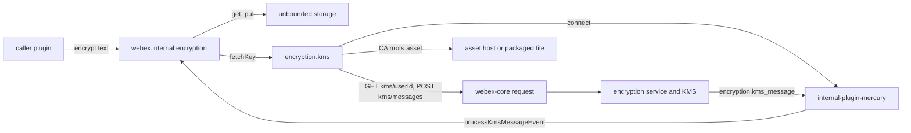
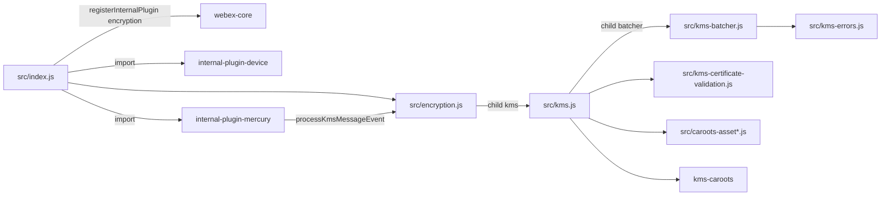
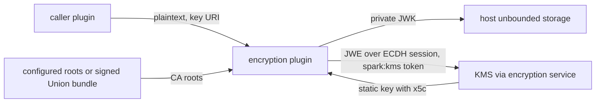

<!-- sdd-generated-metadata
doc_kind: standing-doc
generated_from: architecture@0.3.0
generated_by: claude-code
approved_by: rarajes2@cisco.com
updated_at: 2026-11-16T05:59:53Z
validation_status: pass
-->

# @webex/internal-plugin-encryption architecture

Canonical architecture for this package. Flow behavior lives in the
[Encryption plugin specification](../src/docs/README.md). This page owns package boundaries, the
plugin registration, the contract index, and how the package meets the rest of the SDK.

Related context: [specification registry](specs/README.md) ·
[package agent instructions](../AGENTS.md)

## Applicability

| Condition ID                         | Status     | Evidence or reason | Owned section |
| ------------------------------------ | ---------- | ------------------ | ------------- |
| `repo.owns_datastore`                | Applicable | `src/encryption.js` persists fetched keys in the plugin's unbounded storage | Repository data and schema |
| `repo.holds_client_state`            | Applicable | `src/kms.js` keeps the KMS context, KMS details, and CA roots per instance | Client state model |
| `repo.components_interact`           | Applicable | `src/index.js` registers `src/encryption.js`, whose child is `src/kms.js`, whose child is `src/kms-batcher.js` | Dependency and interaction topology |
| `repo.domain_data_across_components` | Applicable | Keys and KMS messages move between `src/encryption.js`, `src/kms.js`, and `src/kms-batcher.js` | Object and data ownership |
| `repo.caches_data`                   | Applicable | The key cache in `src/encryption.js`; the context, details, and CA roots in `src/kms.js` | Caching catalog |
| `repo.observability_convention`      | Applicable | kms: and encryption: log prefixes and four client metrics in `src/kms.js` and `src/constants.js` | Observability patterns |
| `repo.deploys_to_infra`              | N/A        | Library published to npm (`package.json`); no service runtime | Runtime and infrastructure |
| `repo.shared_base_libs`              | Applicable | Extends WebexPlugin and Batcher and uses the legacy build, lint, and test stack (`babel.config.js`, `.eslintrc.js`, `jest.config.js`) | Shared and base libraries |
| `repo.is_monorepo`                   | N/A        | This SDD root is one package; the workspace around it is out of scope | Package map and inter-package dependencies |
| `repo.multi_platform`                | Applicable | The browser field in `package.json` swaps `src/caroots-asset.browser.js` and `src/ensure-buffer.browser.js` for browser builds | Platform matrix |
| `repo.published_package`             | Applicable | `package.json` name is @webex/internal-plugin-encryption and deploy:npm publishes it | Release and versioning |
| `repo.embedded_in_host`              | N/A        | No host theme or embed API | Host integration and theming |
| `repo.exposes_commands_or_artifacts` | Applicable | build:src, build:assets, and assets:refresh in `package.json`; `src/union-bundle.js` is generated | Commands and generated artifacts |
| `repo.cross_repo_deps_material`      | Applicable | KMS, the encryption service, the files service, and the Cisco Union bundle shape behavior (`src/kms.js`, `src/encryption.js`) | Cross-repository topology |
| `repo.security_arch_warranted`       | Applicable | KMS key material, ECDH, bearer tokens, and certificate trust pass through `src/kms.js` | Security architecture |

## Design overview

`@webex/internal-plugin-encryption` is a published JavaScript library with one module. Importing it
registers the internal plugin `encryption`, reached as `webex.internal.encryption`, and the `device`
and `mercury` plugins it imports. Most content-bearing plugins in the workspace import it and call it
to encrypt or decrypt with KMS keys.

The plugin is three nested pieces: the `Encryption` façade for content crypto and the key cache, its
child `KMS` for every KMS operation and the ECDH session, and the batcher child of `KMS` that sends
requests in batches and matches the answers KMS returns over Mercury. Before any KMS session, the KMS
static key is checked; full chain trust is opt-in. The package also ships Cisco's signed Union bundle
of CA roots.

It keeps client state (the KMS session and caches) in memory and persists fetched keys in the SDK's
unbounded storage.

## Resource inventory and responsibilities

| Resource | Kind | Responsibility | Owner | Source | Detailed specification |
| -------- | ---- | -------------- | ----- | ------ | ---------------------- |
| Encryption plugin | package (one module) | Registration and transforms; content crypto; key cache; KMS requests, session, batching; certificate validation; the Union bundle | @webex/web-sdk (assets: @webex/web-client, @webex/web-sdk) | src | [`src/docs/README.md`](../src/docs/README.md) |

## Interaction and execution flows

Representative end-to-end flow: a plugin encrypts a message with a key it has never used.

| From | To | Interaction or transport | Purpose | Failure or compatibility behavior |
| ---- | -- | ------------------------ | ------- | --------------------------------- |
| Caller plugin | `webex.internal.encryption` | In-process calls | Encrypt, decrypt, keys, KMS resources | Rejections described in the module specification |
| `KMS` | Encryption service | HTTPS through `webex.request`, service `encryption` | KMS details; batched KMS messages | HTTP errors reject; timeouts retry |
| KMS | `KMS` | Mercury `encryption.kms_message` events | KMS responses | Matched by request id; unmatched requests time out |
| `Encryption` | Files service | HTTPS POST `/v1/download/endpoints`, then GET | Encrypted file download | Falls back to the original URL |
| `KMS` | Asset host | HTTPS GET without credentials | CA-roots bundle | Failed loads are retried by the next negotiation |
| Other plugins' requests | Payload transforms | webex-core payload transformer | Wrap and unwrap `kmsMessage` bodies | DRY errors become DryError |

## Dependency topology

| Dependency | Type | Used by | Purpose | Version, failure, or fallback policy |
| ---------- | ---- | ------- | ------- | ------------------------------------ |
| `@webex/webex-core` | Internal | Every source file but the helpers | Registration, plugin and batcher bases, request, storage, asset loader | `workspace:*` |
| `@webex/internal-plugin-mercury`, `@webex/internal-plugin-device` | Internal | `src/index.js`, `src/kms.js` | Connection for KMS responses; user id and device URL | `workspace:*` |
| `@webex/common`, `@webex/common-timers`, `@webex/http-core` | Internal | Several files | Utilities, timers, interceptor base | `workspace:*` |
| `@webex/kms-caroots` | Internal | `src/kms.js`, `scripts/refresh-union-bundle.js` | Union bundle verification | `workspace:*`; no spec |
| `@webex/internal-plugin-metrics` | Internal, undeclared | `src/kms.js` | Client metrics | Must be registered by the host; failures are swallowed |
| `@webex/test-helper-file` | Internal | None under src | — | Runtime dependency with no import |
| `node-kms`, `node-jose`, `node-scr` | External | `src/kms.js`, `src/encryption.js` | KMS messages and ECDH, JWE and JWK, SCR | `^0.4.1`, `^2.2.0`, `^0.3.0` |
| `pkijs`, `asn1js`, `isomorphic-webcrypto`, `safe-buffer`, `valid-url` | External | `src/kms-certificate-validation.js`, `src/kms.js` | Certificate chain checks and WebCrypto | `pkijs` and `asn1js` pinned exactly (3.3.3, 3.0.10) |
| `lodash`, `uuid`, `debug` | External | Several files | Helpers, CMK request ids, debug channel | `^4.17.21`, `^3.3.2`, `^4.3.4` |
| Encryption service, KMS, files service | External service | `src/kms.js`, `src/encryption.js` | Key operations and downloads | Resolved through the service catalog or the file URL host |

No import cycle exists: none of these workspace packages imports this one.

## Public and consumer surfaces

| Surface | Type | Owner | Consumers | Compatibility policy | Source |
| ------- | ---- | ----- | --------- | -------------------- | ------ |
| `internal-plugin-encryption-sdk` — package @webex/internal-plugin-encryption, `webex.internal.encryption`, `.kms`, config, and exports | SDK, published to npm, internal | Encryption plugin | About seventeen workspace packages, from conversation and board to calling and webex | The README: internal, does not strictly follow semantic versioning | `package.json`, `src/index.js`, `src/encryption.js`, `src/kms.js` |
| `encryption-key-cache-entry` — cached key entries | File (storage record), internal | Encryption plugin | This package only | Self-healing on read; no version | `src/encryption.js` |
| `encryption-kms-events` — revoke event and `client:InvalidRequestError` | Event, internal | Encryption plugin | Applications (no in-repository listener) | Names fixed in code | `src/kms-errors.js`, `src/constants.js` |
| `cisco-union-bundle` — shipped CA-roots bundle and its constants | File, published in the package | Encryption plugin | This package; hosts serving the asset | Rollback floor equals the shipped version | `src/union-bundle.js` |

The KMS messages, batch body, details response, Mercury event, and DRY error body are a protocol this
package speaks, described under *Protocol and wire format* in the
[module specification](../src/docs/README.md#protocol-and-wire-format). The contracts this package
requires are registered in `.sdd/manifest.json` `contract_catalog`.

## Repository data and schema

| Datastore or schema | Owning resource | Source of truth | Migration and compatibility rule |
| ------------------- | --------------- | --------------- | -------------------------------- |
| Key cache entries in the plugin's unbounded storage (namespace Encryption) | Encryption plugin | `src/encryption.js` | None declared; an unreadable entry is refetched. Details in the module specification's [Data, schema, and migration discipline](../src/docs/README.md#data-schema-and-migration-discipline) |

## Client state model

| State or slice | Owner | Transition triggers | Persistence or reset boundary |
| -------------- | ----- | ------------------- | ----------------------------- |
| KMS context and partial ECDH context | `KMS` instance | First request, expiry, failure, renegotiation | Memory; see the module [State machine](../src/docs/README.md#state-machine) |
| KMS details, verified CA roots | `KMS` instance | First use per source | Memory; see the Caching catalog |
| Pending batched requests | `KmsBatcher` instance | Requests, Mercury responses, timeouts | Memory |

## Cross-cutting architecture

### Security

- Trust boundaries and identity flow: see [Security architecture](#security-architecture).
- Sensitive surfaces and data classes: KMS keys and JWKs (including private material in the key
  cache), plaintext content, the `spark:kms` bearer token, ECDH ephemeral keys, user and org ids,
  customer master keys.
- Encryption and secret boundaries: see [Security architecture](#security-architecture).

### Observability and operations

- Logging, metrics, and correlation: see [Observability patterns](#observability-patterns).
- Ownership and operational entry points: the workspace `.github/CODEOWNERS` default rule assigns
  `@webex/web-sdk`; its line for this package's `assets/` adds `@webex/web-client`. No dashboards or
  runbooks are recorded in this package.

### Quality attributes

- Compatibility: callers rely on the plugin name, method names, config field names, error classes,
  event names, and metric names.
- Latency: a first KMS call waits for Mercury, the details request, optional asset loading, and the
  ECDHE round trip; requests are batched for up to 150 ms; a timing-out request can take about 90
  seconds to reject with defaults.
- Test confidence: 92 unit cases cover certificate validation and the CA-roots policy most deeply;
  most crypto and KMS request paths are covered only by integration cases that need CI secrets. No
  coverage threshold is enforced.

## Dependency and interaction topology

| From | To | Kind | Purpose | Ordering or failure boundary |
| ---- | -- | ---- | ------- | ---------------------------- |
| `src/index.js` | webex-core | Call at import | Register `encryption` and its transforms | First registration wins |
| `src/encryption.js` | `src/kms.js` | Child plugin | Key fetch and KMS messages | One KMS per Encryption |
| `src/kms.js` | `src/kms-batcher.js` | Child plugin | Batching and matching | One batcher per KMS |
| Mercury plugin | `src/encryption.js` | Autowired event handler | KMS responses | Mercury logs handler errors |

## Object and data ownership

| Object or state | System of record | May write | May read | Movement or lifecycle |
| --------------- | ---------------- | --------- | -------- | --------------------- |
| KMS keys, resources, authorizations, CMKs | KMS | KMS, through `kms` requests | `kms` requests | Fetched per call; keys cached locally |
| Cached key entries | This package (host storage) | `getKey` | `getKey` | Written on first fetch; never deleted here |
| KMS session (ECDH context) | This package (memory) | `KMS` | `KMS` | Renewed before expiry |
| CA roots | Configuration or the signed Union bundle | Application config; the refresh script | `KMS` | Verified, then cached per source |
| Encrypted files | Files service | Callers (upload is outside this package) | `download` | Downloaded and decrypted per call |

## Caching catalog

| Cache | Owner | Backend | Contents | TTL or bound | Invalidation trigger | Failure behavior |
| ----- | ----- | ------- | -------- | ------------ | -------------------- | ---------------- |
| Key cache | `Encryption.getKey` | Plugin unbounded storage | KMS key objects with private JWKs | None | None in this package | Read failure refetches from KMS |
| KMS context | `KMS._getContext` | Module WeakMap | Negotiated node-kms Context | 30 s before ephemeral key expiry | Expiry timer, failure, renegotiation | Failure evicted |
| KMS details | `KMS._getKMSDetails` | Module WeakMap | `kmsCluster` and the parsed static key | Instance life | None | A failure is cached too (module Caller-visible failure modes) |
| Verified CA roots | `KMS._loadCaroots` | Module WeakMap of Maps | Root certificates per mode, URL, and asset name | Instance life | Failure eviction | Failure evicted |
| Asset bytes | webex-core StaticAssetLoader | Per-loader Map | Downloaded bytes | Loader life (one call) | New loader per call | Failure evicted |

## Observability patterns

| Signal  | Convention or required fields | Propagation or naming rule | Primary evidence |
| ------- | ----------------------------- | -------------------------- | ---------------- |
| Logs    | `this.logger` info, warn, and error; wrapped payloads logged only outside production, without the wrapped field; no keys, plaintext, or tokens | Prefixes `kms:`, `kms-batcher:`, and `encryption:`; timeouts also on the `kms` debug channel | `src/kms.js`, `src/kms-batcher.js`, `src/encryption.js` |
| Metrics | `submitClientMetrics` with `fields` and `tags`; every tag set includes `validationMode` | Names from `src/constants.js`: certificate validation failed, asset download failed, asset verification failed, asset stale | `src/constants.js` |
| Traces  | Timeout errors carry the batch request's tracking id | Tracking ids come from the webex-core interceptors | `src/kms-batcher.js` |
| Audit   | None | — | `src/kms.js` |

## Shared and base libraries

| Library | Inherited responsibility | Consumers | Version floor | Compatibility rule |
| ------- | ------------------------ | --------- | ------------- | ------------------ |
| `@webex/webex-core` `WebexPlugin`, `Batcher`, `StaticAssetLoader` | Logger, request, config by namespace, storage; batching; asset fetching | `Encryption`, `KMS`, `KmsBatcher`, the asset loaders | `workspace:*` | Keep the namespace `Encryption` for all three plugins |
| `@webex/babel-config-legacy`, `@webex/eslint-config-legacy`, `@webex/jest-config-legacy`, `@webex/legacy-tools` | Build, lint, and test stack | Package tooling | `workspace:*` | Do not fork the config locally |

## Platform matrix

| Platform   | Shared versus platform-specific boundary | Entry or build      | Support and compatibility constraints |
| ---------- | ---------------------------------------- | ------------------- | ------------------------------------- |
| Node       | Reads the packaged CA-roots asset before any URL; accepts only Buffers | `src/caroots-asset.js`, `src/ensure-buffer.js` | `engines.node` `>=18`; WebCrypto through isomorphic-webcrypto |
| Browser    | Always fetches the asset from `assetsBaseUrl`; converts ArrayBuffer, Blob, and File | `src/caroots-asset.browser.js`, `src/ensure-buffer.browser.js` via the `package.json` browser field | The asset host must allow CORS and the page's `connect-src` (README) |

Everything else is shared. The report-only URL check fetches in both platforms.

## Release and versioning

| Artifact | Publish target | Versioning rule | Deprecation window | Changelog or migration obligation |
| -------- | -------------- | --------------- | ------------------ | --------------------------------- |
| @webex/internal-plugin-encryption, including dist/assets | npm through `deploy:npm` | Internal; the README says it does not strictly follow semantic versioning | None declared | None in the package; the workspace owns changelogs |

## Commands and generated artifacts

| Command or artifact | Owner | Inputs | Output or side effect | Compatibility boundary |
| ------------------- | ----- | ------ | --------------------- | ---------------------- |
| `yarn build:src` | Package scripts | `src`, `assets` | Writes `dist/` through `webex-legacy-tools`, then runs `build:assets`, which copies the bundle to dist/assets | `dist/` is generated |
| `yarn build` | Package scripts | Same | Runs `build:src` | Same output |
| `yarn assets:refresh` | Maintainers | Cisco's bundle URL, or `--in` | New asset, regenerated `src/union-bundle.js`, old asset removed | Refuses a downgrade |
| `yarn test:unit` | Package scripts | `test/unit/spec`, `dist/` | Jest run | Needs a fresh `build:src` |
| `yarn test:style` | Package scripts | `src` | ESLint run | Skips `src/kms.js`, `docs/**`, and `*.md` |
| `src/union-bundle.js` | Refresh script | The verified bundle | Asset name and rollback floor | Never edited by hand |

## Cross-repository topology

| Repository or external system | Relationship | Exchanged contract or artifact | Owner | Sequencing constraint |
| ----------------------------- | ------------- | ------------------------------ | ----- | --------------------- |
| `@webex/webex-core` (workspace sibling; specs consulted) | Consumes | Plugin host, Batcher, storage, StaticAssetLoader (no spec) | @webex/web-sdk | Registered before the first instance |
| `@webex/internal-plugin-mercury` (workspace sibling; spec consulted, stale on sessions) | Consumes | `connect`, KMS message events | @webex/web-sdk | Imported by `src/index.js` |
| `@webex/internal-plugin-device`, `@webex/internal-plugin-metrics`, `@webex/common`, `@webex/common-timers`, `@webex/http-core` (workspace siblings; specs consulted) | Consumes | User id and device URL; client metrics; utilities | @webex/web-sdk | Metrics must be registered by the host |
| `@webex/kms-caroots` (workspace sibling; no spec, code consulted) | Consumes | `verifyUnionBundle`, `loadUnionBundle` | @webex/web-sdk | — |
| About seventeen workspace plugins and bundles | Consumed by | `webex.internal.encryption` | Various | Import registers the plugin |
| KMS and the encryption service; files service | Consumes | KMS messages; download endpoints | Not recorded in this repository | — |
| Cisco Trusted Root Store | Consumes | Signed Union bundle | Cisco | Refreshed by maintainers |

## Security architecture

- KMS requests are JWE messages protected by an ECDH session; the session is negotiated with the KMS
  static RSA key and carries the user's `spark:kms` token as the bearer credential.
- Before the session, the static key must pass the mandatory key checks. Chain trust against CA roots
  is enforced only when `shouldValidateKMSCertificate` is true; asset roots are trusted only after
  their CMS signature verifies against the pinned Cisco root, with a rollback floor (module `INV-001`,
  `INV-002`).
- Asset requests carry no user token or SDK headers (webex-core StaticAssetLoader); with
  `services.validateCatalogUrls`, asset hosts must be listed in `services.allowedDomains`.
- Fetched keys, private material included, are stored unencrypted in the host's unbounded storage
  (module Key design trade-off).
- `onBehalfOf` requests let a compliance officer fetch another user's keys; KMS enforces the
  `spark.kms_orgagent` role.
- Logging rules are under [Observability patterns](#observability-patterns).

## Domain language

| Term | Repository-specific meaning | Authoritative source |
| ---- | --------------------------- | -------------------- |
| KMS | The Webex Key Management Service, reached through the encryption service and Mercury | `src/kms.js` |
| KRO | KMS resource object: a set of keys and the users or resources authorized to them | `src/kms.js` |
| SCR | Secure content resource: the key, IV, and location of an encrypted file, itself encrypted as JWE | `src/encryption.js` |
| ECDHE context | The node-kms session negotiated with KMS; "partial" while the ephemeral key is being derived | `src/kms.js` |
| DRY error | An error from a service that proxies KMS (errorCode 1900000) | `src/kms-errors.js` |
| Union bundle | Cisco's signed Trusted Root Store bundle of CA roots, `ios_union-<version>.p7b` | `src/union-bundle.js` |
| Enforced and report-only | Certificate checks that reject setup versus checks that only report metrics | `src/kms.js` |
| BYOK, CMK | Bring your own key; customer master key | `src/kms.js` |

## References and maintenance

- Decisions: [adr/](adr/index.md)
- Instantiated specifications and routing: [specs/README.md](specs/README.md)
- Repository rules and patterns: [package agent instructions](../AGENTS.md)
- Update this document in the same change that alters package boundaries, resource ownership,
  cross-resource interaction, or cross-cutting architecture.
