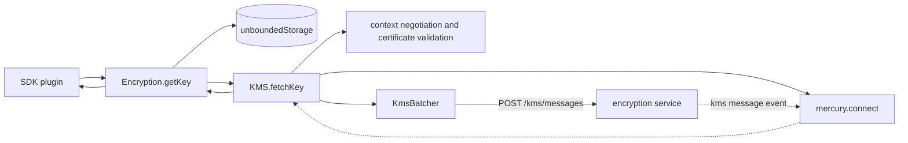
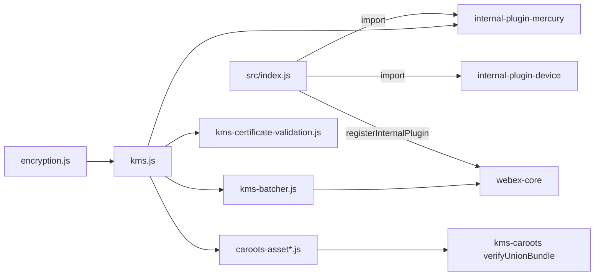
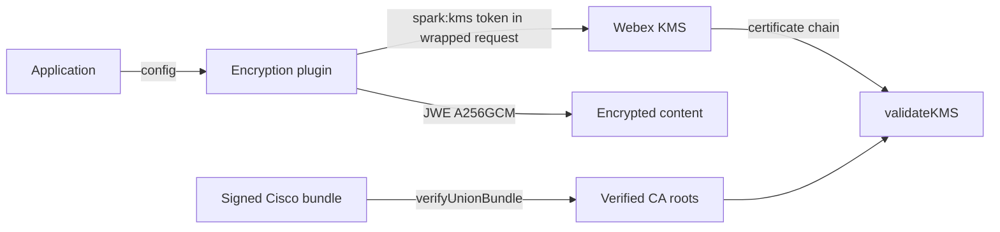

<!-- sdd-generated-metadata
doc_kind: standing-doc
generated_from: architecture@0.3.0
generated_by: claude-code
approved_by: riag@cisco.com
updated_at: 2026-11-05T12:32:04Z
validation_status: pass
-->

# @webex/internal-plugin-encryption architecture

Canonical architecture for the `@webex/internal-plugin-encryption` package inside the Webex JS SDK monorepo. The SDD
scope is this package only; the surrounding monorepo is a dependency context, not part of this document. Owner-local
detail lives in the [module specification](../src/docs/README.md).

Related context: [specification registry](specs/README.md) ·
[repository agent instructions](../AGENTS.md)

## Applicability

| Condition ID                         | Status     | Evidence or reason                                                                                                              | Owned section                       |
| ------------------------------------ | ---------- | ------------------------------------------------------------------------------------------------------------------------------- | ----------------------------------- |
| `repo.owns_datastore`                | N/A        | No store, schema, or migration exists in this package; keys are cached in the host `unboundedStorage` owned by `@webex/webex-core` | Repository data and schema          |
| `repo.holds_client_state`            | Applicable | `src/kms.js` WeakMaps hold the KMS session; `src/encryption.js` caches keys in host storage                                      | Client state model                  |
| `repo.components_interact`           | Applicable | `src/index.js` imports the device and mercury plugins and registers with `@webex/webex-core`; `src/kms.js` calls services       | Dependency and interaction topology |
| `repo.domain_data_across_components` | N/A        | The package owns no domain data; keys and resources are produced by the KMS service                                              | Object and data ownership           |
| `repo.caches_data`                   | Applicable | Key cache in `src/encryption.js`; KMS details, context, and verified CA-root caches in `src/kms.js`                              | Caching catalog                     |
| `repo.observability_convention`      | N/A        | The package submits four client metrics and logs through the host logger, but defines no repository logging or tracing convention | Observability patterns              |
| `repo.deploys_to_infra`              | N/A        | A library; `package.json` defines no deployment target other than npm publication                                                | Runtime and infrastructure          |
| `repo.shared_base_libs`              | N/A        | No base library stack is inherited by multiple resources inside this package                                                     | Shared and base libraries           |
| `repo.is_monorepo`                   | N/A        | The scoped repository is a single package with one module                                                                        | Package map and dependencies        |
| `repo.multi_platform`                | Applicable | `package.json` `browser` field swaps two files; the package declares `engines.node` and a `test:browser` script                  | Platform matrix                     |
| `repo.published_package`             | Applicable | `package.json` declares `main` and `deploy:npm`                                                                                  | Release and versioning              |
| `repo.embedded_in_host`              | N/A        | A plugin for the `@webex/webex-core` host, not mounted into a host UI                                                            | Host integration and theming        |
| `repo.exposes_commands_or_artifacts` | Applicable | `assets:refresh` script and the generated `src/union-bundle.js` plus shipped `assets/ios_union-{version}.p7b`                    | Commands and generated artifacts    |
| `repo.cross_repo_deps_material`      | N/A        | All internal dependencies resolve inside the same workspace; the KMS and file services are runtime services, not repositories    | Cross-repository topology           |
| `repo.security_arch_warranted`       | Applicable | The package negotiates encrypted sessions, handles key material, and validates the KMS certificate                               | Security architecture               |

## Design overview

The package is the SDK's client side of content encryption. It registers the internal plugin `encryption`, whose `kms`
child talks to the Webex key management service (KMS) over a session secured by an ECDH key exchange, and whose
methods encrypt and decrypt text, binary data, and secure content resources (SCR) with keys fetched from the KMS. A
payload transformer lets other plugins send and receive plain `kmsMessage` objects while the plugin wraps and unwraps
them.

Shape: one module (`src/`) of three plugin classes (`Encryption`, `KMS`, `KmsBatcher`), a certificate validator, CA-root
loading, and a shipped signed CA-root bundle. Requests to the KMS are batched into one HTTP post and answered
asynchronously over the Mercury websocket. Certificate-chain enforcement is opt-in; mandatory key-metadata and hostname
checks always run, and a report-only mode trials a new CA bundle without risking setup failure.

Key decisions evidenced in the code: enforcement fails closed; unverified CA bundles are never trusted; the shipped
bundle's signed version is a rollback floor; and platform differences are isolated in two file swaps. The package has no
recorded ADR for these; see [adr/index.md](adr/index.md).

## Resource inventory and responsibilities

| Resource                             | Kind                          | Responsibility                                                                                                   | Owner                                             | Source         | Detailed specification |
| ------------------------------------ | ----------------------------- | ---------------------------------------------------------------------------------------------------------------- | ------------------------------------------------- | -------------- | ---------------------- |
| @webex/internal-plugin-encryption    | package (single module `src`) | Encrypt and decrypt content, manage KMS sessions and keys, wrap and unwrap KMS messages, validate the KMS certificate | Cisco Webex for Developers (named in `README.md`) | `src/index.js` | `src/docs/README.md`   |

## Interaction and execution flows

Representative flow: a plugin asks for a key; the encryption plugin reads its cache, otherwise the KMS child ensures a
session (details, certificate validation, ECDH exchange), sends a batched request, and resolves the response that
arrives over Mercury.

| From                    | To                                  | Interaction or transport                        | Purpose                                         | Failure or compatibility behavior                                                              |
| ----------------------- | ----------------------------------- | ----------------------------------------------- | ----------------------------------------------- | ---------------------------------------------------------------------------------------------- |
| SDK plugin              | `Encryption`                        | Method call (promise)                           | Encrypt, decrypt, fetch keys, download files    | Rejections propagate                                                                           |
| `Encryption`            | `unboundedStorage`                  | Storage get and put                             | Cache keys                                      | Read failure falls through to a KMS fetch                                                       |
| `KMS`                   | `encryption` service                | `webex.request` GET `/kms/{userId}`, POST `/kms/messages` | KMS details and batched KMS messages  | Timeout retry with doubling; certificate errors stop retries                                    |
| `KMS`                   | Mercury                             | `connect()`, kms message event                  | Receive KMS responses                           | A failed connect rejects the request                                                           |
| `Encryption`            | File service                        | `webex.request` POST `/v1/download/endpoints`   | Resolve encrypted-file download URL             | Falls back to the raw file URL                                                                 |
| `KMS`                   | CA-root host or packaged file       | `StaticAssetLoader` or file read                | Obtain the signed Cisco bundle                  | Failure rejects with an actionable `KMSError` and a metric                                     |
| Other plugins           | Payload transformer                 | Request and response hooks                      | Wrap and unwrap `kmsMessage` fields             | A decrypted DRY error rejects with `DryError`                                                  |

## Dependency topology

| Dependency                                                    | Type     | Used by                           | Purpose                                                                                       | Version, failure, or fallback policy                          |
| ------------------------------------------------------------- | -------- | --------------------------------- | --------------------------------------------------------------------------------------------- | ------------------------------------------------------------- |
| `@webex/webex-core`                                           | Internal | All source files                  | Plugin host, `Batcher`, `StaticAssetLoader`, storage, credentials                              | Workspace-linked (`workspace:*`); no fallback                 |
| `@webex/internal-plugin-device`                               | Internal | `src/index.js`, `src/kms.js`      | Registration side effect; `userId` and `url`                                                   | Workspace-linked; no fallback                                 |
| `@webex/internal-plugin-mercury`                              | Internal | `src/index.js`, `src/kms.js`      | Websocket delivery of KMS responses                                                            | Workspace-linked; no fallback                                 |
| `@webex/common`, `@webex/common-timers`, `@webex/http-core`   | Internal | `src/`                            | Helpers, safe timers, `Interceptor` base                                                       | Workspace-linked                                              |
| `@webex/kms-caroots`                                          | Internal | `src/kms.js`, `scripts/`          | Verify the signed CA-root bundle                                                               | Workspace-linked; rejection is converted to a `KMSError`      |
| `node-kms`, `node-scr`, `node-jose`, `isomorphic-webcrypto`, `pkijs`, `asn1js` | External | `src/` | KMS message, SCR, JWE, WebCrypto, and X.509 handling                                  | Exact versions in `package.json`; no fallback                 |
| `lodash`, `uuid`, `valid-url`, `safe-buffer`, `debug`         | External | `src/`                            | Utilities                                                                                      | Exact versions in `package.json`                              |
| `@webex/legacy-tools`, shared legacy configs, `@webex/test-helper-*`, `sinon` | Internal / External | Scripts, tests | Build, test, and lint tooling                                                          | Workspace-linked or dev dependencies                          |

No dependency cycle exists inside the package. Ordering constraint: `src/index.js` imports the device and mercury
plugins before registering. Exact versions are in `package.json`. Dependency documentation: the core, device, mercury,
common, common-timers, and http-core packages have module specifications and were used for behavior;
`@webex/kms-caroots` has none, so its source (`verify.js`, `index.d.ts`) was used.

## Public and consumer surfaces

| Surface                                                                                                  | Type | Owner                                | Consumers                                                              | Compatibility policy                                                                      | Source           |
| -------------------------------------------------------------------------------------------------------- | ---- | ------------------------------------ | ---------------------------------------------------------------------- | ----------------------------------------------------------------------------------------- | ---------------- |
| `encryption-plugin-sdk` (default `Encryption`; named `KMS`, `KmsError`, `DryError`; `webex.config.encryption`) | SDK  | `@webex/internal-plugin-encryption`  | Other SDK plugins, first-party clients, `@webex/plugin-encryption`, `@webex/webex-server` | Internal plugin; semantic versioning not strictly followed (`README.md`)                 | `src/index.js`   |

The contract registry with publication state is `contract_catalog` in `.sdd/manifest.json`; the owning module
specification, [Public surface](../src/docs/README.md#public-surface), mirrors this entry. The consumed contracts
(`device-plugin-sdk`, `mercury-sdk`, `webex-core-sdk`, `webex-common-js-api`, `common-timers-sdk`, `http-core-sdk`,
and `kms-caroots-verify`) are external to this package.

## Client state model

| State or slice                 | Owner                                  | Transition triggers                                           | Persistence or reset boundary                                              |
| ------------------------------ | -------------------------------------- | ------------------------------------------------------------- | -------------------------------------------------------------------------- |
| KMS context (final and partial) | `KMS` plugin instance                 | First KMS request; expiry timer; renegotiation after timeouts | In memory only; discarded on expiry or failed negotiation                  |
| KMS details                    | `KMS` plugin instance                  | First details request                                         | In memory for the instance lifetime                                        |
| Verified CA roots              | `KMS` plugin instance                  | Certificate enforcement or report-only load                   | In memory; failed loads evicted                                            |
| Key cache                      | Host `unboundedStorage`                | `Encryption.getKey` miss                                      | Persisted per host storage; cleared with it                                |

## Cross-cutting architecture

### Security

- Trust boundaries and identity flow: the client authenticates to the KMS with the user's `spark:kms` token wrapped in
  the negotiated context; the KMS is authenticated by its certificate (`MOD-010`, `MOD-011`).
- Sensitive surfaces and data classes: content keys (`jwk`), ephemeral ECDH keys, KMS bearer tokens, plaintext and
  ciphertext content. Payload logging is disabled in production builds.
- Encryption and secret boundaries: content is encrypted with `A256GCM` JWE or SCR; session traffic uses the ECDH
  context from `node-kms`; see [Security architecture](#security-architecture).

### Observability and operations

- Logging and correlation: the host logger (`this.logger`) with `kms:` and `encryption:` message prefixes; the
  `WEBEX_TRACKING_ID` is added to timeout and DRY errors.
- Metrics, traces, and audit signals: `JS_SDK_KMS_CERTIFICATE_VALIDATION_FAILED`,
  `JS_SDK_KMS_CAROOTS_ASSET_DOWNLOAD_FAILED`, `JS_SDK_KMS_CAROOTS_ASSET_VERIFICATION_FAILED`, and
  `JS_SDK_KMS_CAROOTS_ASSET_STALE`, tagged with `validationMode`, submitted through `webex.internal.metrics`.
- Ownership and operational entry points: no dashboards, alerts, or runbooks are defined in this package.

### Quality attributes

- Compatibility: the entry exports and `webex.config.encryption` keys are consumed by other plugins and clients.
- Resilience: timeouts double until `ecdhMaxTimeout`; failed negotiations and failed root loads are evicted so a later
  request retries.
- Verification: unit suites cover certificate validation, CA roots, key management, binary data, and revocation;
  retry arithmetic and browser buffer conversion have no automated evidence. No coverage threshold is evident for this
  package (confirmed by the owner, riag@cisco.com, 2026-11-05).

## Dependency and interaction topology

| From                    | To                                   | Kind   | Purpose                                         | Ordering or failure boundary                                           |
| ----------------------- | ------------------------------------ | ------ | ----------------------------------------------- | ---------------------------------------------------------------------- |
| `src/index.js`          | Device and mercury packages          | Import | Ensure the dependent plugins are registered     | Evaluated at import time; errors propagate to the importer             |
| `src/index.js`          | `@webex/webex-core`                  | Call   | `registerInternalPlugin('encryption', …)`       | At import time                                                         |
| `KMS`                   | `mercury.connect()`                  | Call   | Ensure the response channel is open             | Before every KMS request                                               |
| `KMS`                   | `validateKMS`                        | Call   | Validate the KMS key before the ECDH exchange   | Rejection stops negotiation                                            |
| `KMS`                   | `verifyUnionBundle`                  | Call   | Verify the signed CA bundle                     | Unverified roots are never used                                        |

## Caching catalog

| Cache                  | Owner                      | Backend                       | Contents                                | TTL or bound                                  | Invalidation trigger                                  | Failure behavior                            |
| ---------------------- | -------------------------- | ----------------------------- | --------------------------------------- | --------------------------------------------- | ----------------------------------------------------- | ------------------------------------------- |
| Key cache              | `Encryption`               | Host `unboundedStorage`       | Serialized KMS keys, per URI and delegate | Unbounded (storage name)                    | Host storage clear                                    | Read failure triggers a KMS fetch           |
| KMS context            | `KMS`                      | In-memory WeakMap             | Negotiated session context              | Until 30 s before ephemeral-key expiry        | Expiry timer, failed negotiation, renegotiation       | Next request renegotiates                   |
| KMS details            | `KMS`                      | In-memory WeakMap             | Cluster and RSA public key              | Instance lifetime                             | None in this module                                   | A failed promise stays cached               |
| Verified CA roots      | `KMS`                      | In-memory WeakMap of promises | Roots per (mode, base URL, asset)       | Instance lifetime                             | Failed load removes the entry                         | Next call retries                           |

## Platform matrix

| Platform | Shared versus platform-specific boundary                                                                                  | Entry or build                                  | Support and compatibility constraints                                                                 |
| -------- | ------------------------------------------------------------------------------------------------------------------------- | ----------------------------------------------- | ----------------------------------------------------------------------------------------------------- |
| Browser  | Same source; `ensure-buffer.browser.js` and `caroots-asset.browser.js` replace the Node files through the `browser` field | `package.json` `test:browser` script, browserify transforms | Browser loads CA roots only from `assetsBaseUrl`; accepts `File`/`Blob` input                |
| Node     | Same source; Node reads the packaged bundle first                                                                          | `package.json` `main` (`dist/index.js`) and `test:unit`       | `engines.node` is `>=18`; binary input must be a `Buffer`                                    |

## Release and versioning

| Artifact                            | Publish target                              | Versioning rule                                                                                        | Deprecation window | Changelog or migration obligation          |
| ----------------------------------- | ------------------------------------------- | ------------------------------------------------------------------------------------------------------ | ------------------ | ------------------------------------------ |
| `@webex/internal-plugin-encryption` | npm (`deploy:npm` script in `package.json`) | Internal plugin; `README.md` states semantic versioning is not strictly followed. No version is recorded in `package.json` | None defined       | None defined in this package               |

## Commands and generated artifacts

| Command or artifact                                | Owner                  | Inputs                                         | Output or side effect                                                                       | Compatibility boundary                                                    |
| -------------------------------------------------- | ---------------------- | ---------------------------------------------- | ------------------------------------------------------------------------------------------- | ------------------------------------------------------------------------- |
| `yarn workspace @webex/internal-plugin-encryption assets:refresh` | Maintainers | Cisco bundle URL or `--in <file>`              | Writes `assets/ios_union-{version}.p7b`, regenerates `src/union-bundle.js`, removes the previous bundle | Refuses a version lower than the shipped one; do not edit outputs by hand |
| `src/union-bundle.js`                              | `scripts/refresh-union-bundle.js` | The verified bundle                   | Exports `UNION_BUNDLE_ASSET` and `UNION_BUNDLE_VERSION`                                      | Rollback floor for runtime verification                                   |
| `dist/` (including `dist/assets`)                  | `build:src`            | `src/`, `assets/`                              | Compiled package and copied assets                                                          | Not committed                                                             |

## Security architecture

- Trust anchor: the KMS certificate chain is validated against `config.caroots` or the signed Cisco bundle, itself
  verified against the pinned Cisco TRS Bundle Root CA inside `@webex/kms-caroots`.
- Enforcement is opt-in (`shouldValidateKMSCertificate`, default false) and fails closed when enabled.
- Asset requests suppress the user's access token and SDK custom headers (`README.md`).
- Authoritative security policy: none exists for this package; confirmed by the owner (riag@cisco.com, 2026-11-05).

## Domain language

| Term     | Repository-specific meaning                                                                                  | Authoritative source                         |
| -------- | ------------------------------------------------------------------------------------------------------------ | -------------------------------------------- |
| KMS      | The Webex key management service that stores keys and resources and authorizes users                          | `src/kms.js`                                 |
| KRO      | KMS resource object: a resource to which keys are bound and users authorized                                  | `src/kms.js`                                 |
| SCR      | Secure content resource: metadata and key material for one encrypted file                                     | `src/encryption.js` (`node-scr`)             |
| ECDH context | The session negotiated with the KMS by an ephemeral key exchange                                          | `src/kms.js`                                 |
| DRY error | An error from a service that proxies to the KMS, carrying an encrypted KMS message                           | `src/kms-errors.js`, `src/index.js`          |
| CA roots | Base64 DER certificates used as trust anchors for the KMS chain                                               | `src/config.js`                              |
| Union bundle | Cisco's signed Trusted Root Store bundle `ios_union-{version}.p7b`                                        | `assets/README.md`, `src/union-bundle.js`    |
| On behalf of | Retrieving keys as another user, for compliance roles                                                      | `src/kms.js`, `src/encryption.js`            |

## References and maintenance

- Decisions: [adr/](adr/index.md)
- Instantiated specifications and routing: [specs/README.md](specs/README.md)
- Repository rules and patterns: none approved for this package.
- Update this document in the same change that alters repository boundaries,
  resource ownership, cross-resource interaction, or cross-cutting
  architecture.
