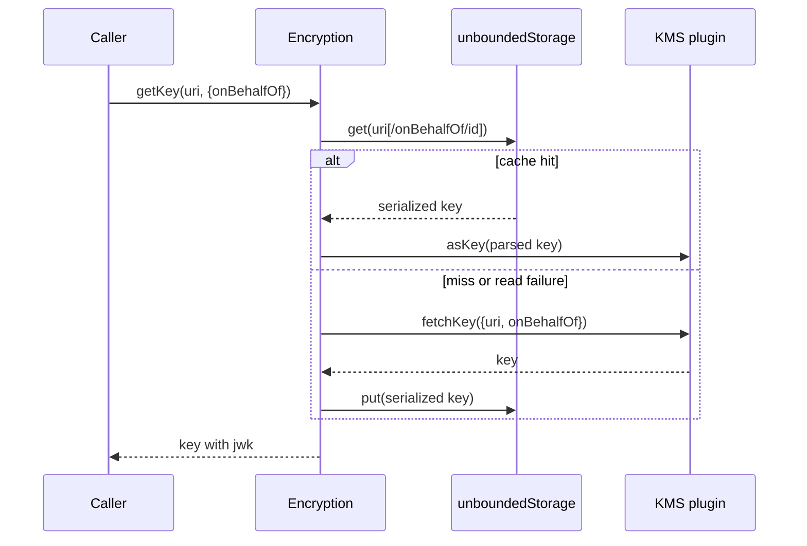
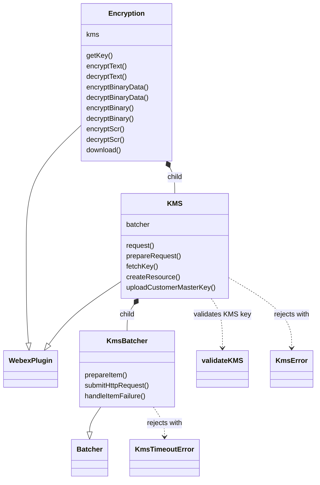
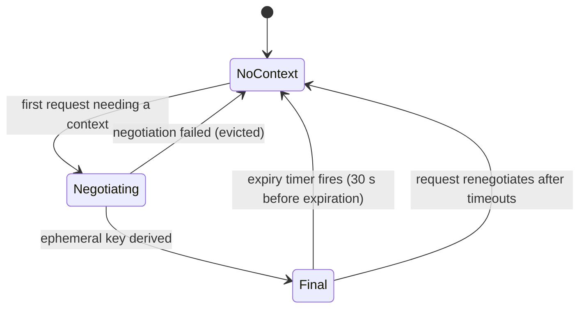

<!-- sdd-generated-metadata
doc_kind: module-spec
generated_from: module-spec@0.3.0
generated_by: claude-code
approved_by: riag@cisco.com
updated_at: 2026-11-05T12:32:04Z
validation_status: pass
-->

# src (encryption and KMS client plugin)

This source-local document at `src/docs/README.md` owns the stable
specification for **the `src` module** of `@webex/internal-plugin-encryption`. It links to the
[package architecture](../../docs/architecture.md) instead of repeating broader facts. The package has no
deployable service, so no service specification exists.

Related context: [documentation index](../../docs/index.md) ·
[agent instructions](../../AGENTS.md) ·
[specification registry](../../docs/specs/README.md)

## Metadata

| Field             | Value                                                                                                                      |
| ----------------- | -------------------------------------------------------------------------------------------------------------------------- |
| Owner             | Cisco Webex for Developers (named as maintainer in `README.md`)                                                            |
| Source path       | `src/`                                                                                                                     |
| Resource kind     | module (the package's only module; an internal SDK plugin)                                                                 |
| Status            | Draft                                                                                                                      |
| Last verified     | 2026-11-05 against the working tree (`src/`, `package.json`, `README.md`, `assets/`, `scripts/`, `test/`)                  |
| Module id         | `src`                                                                                                                      |
| Parent spec       | —                                                                                                                          |
| Doc kind          | Module spec                                                                                                                |
| Coverage score    | Pending coverage assessment                                                                                                |
| Validation status | pass — assessed 2026-11-05 by validator runtime `codex`; 0 Blocking, Important, Medium, or Minor findings |

## Applicability

| Condition ID                         | Status     | Evidence or reason                                                                                                                        | Owned section                 |
| ------------------------------------ | ---------- | ----------------------------------------------------------------------------------------------------------------------------------------- | ----------------------------- |
| `module.has_tiers` | N/A | No tier policy is defined in `package.json` or any file of this package | Tier |
| `module.has_ui` | N/A | No UI code exists under src/ | UI use-case flow |
| `module.crosses_service_boundaries` | Applicable | `src/kms-batcher.js` posts to the encryption service /kms/messages; `src/kms.js` reads /kms/{userId}; `src/encryption.js` posts to the file service | Cross-boundary use-case flow |
| `module.holds_client_state` | Applicable | `src/kms.js` keeps per-instance WeakMaps (contexts, partialContexts, kmsDetails, assetCaroots) and `src/encryption.js` caches keys in unboundedStorage | Client state model |
| `module.enforces_domain_rules` | Applicable | `src/kms-certificate-validation.js` and the key-revocation and onBehalfOf rules in `src/kms.js`, `src/kms-errors.js` | Business rules and invariants |
| `module.is_concurrent_async` | Applicable | `src/kms-batcher.js` (batching, timers), @oneFlight in `src/kms.js`, shared verified-roots promises, background report-only check | Concurrency and reactive flow |
| `module.owns_persistence` | N/A | The module writes key cache entries through the host unboundedStorage (owned by @webex/webex-core); it defines no schema, migration, or store | Data, schema, and migration |
| `module.stateful_transitions` | Applicable | KMS context lifecycle (none, partial, final, expired or discarded) in `src/kms.js` _getContext, _prepareContext, request | State machine |
| `module.exposes_wire_protocol` | Applicable | KMS messages wrapped and unwrapped with node-kms, JWE compact payloads, and the /kms/messages batch body in `src/kms-batcher.js` | Protocol and wire format |
| `module.ui_multi_screen` | N/A | No UI | UI flow |
| `module.large_data_model` | N/A | No data model is defined here; key, resource, and authorization objects are produced by the KMS and handled opaquely | Data model |
| `module.returns_caller_errors` | Applicable | `src/kms-errors.js` error classes, KMSError in `src/kms-certificate-validation.js`, rejections across `src/encryption.js` and `src/kms.js` | Caller-visible failure modes |
| `module.module_specific_conventions` | Applicable | Generated `src/union-bundle.js`, browser and Node file swaps in `package.json`, security-sensitive code | Module-specific rules |
| `module.published_package` | Applicable | `package.json` declares main, devMain, and deploy:npm | Export stability |
| `module.embedded_in_host` | N/A | A plugin for the @webex/webex-core host, not mounted into a host UI | Host integration and theming |
| `module.has_design_tradeoff` | Applicable | Code comments in `src/config.js`, `src/kms.js`, and `src/kms-batcher.js` state three trade-offs (see Key design trade-off) | Key design trade-off |
| `module.has_submodules` | N/A | src/ contains only source files; no child directory owns its own capability | Sub-modules |

## Evidence register

Source basis by category and disposition; no routed legacy spec exists for this module. Evidence comes from the
codebase only; commit and pull-request history was not used.

| Evidence                                                                 | What it establishes                                                                                                                                                  |
| ------------------------------------------------------------------------ | -------------------------------------------------------------------------------------------------------------------------------------------------------------------- |
| `src/index.js` | Plugin registration (`registerInternalPlugin('encryption', …)`), the three payload predicates and transforms, test-only interceptor, and the package exports |
| `src/encryption.js` | The `Encryption` plugin: text, binary, SCR encrypt and decrypt, `download`, `getKey`, and the key cache |
| `src/kms.js` | The `KMS` child plugin: request pipeline, ECDH context negotiation, certificate and CA-root handling, resource, authorization, key, and customer-master-key calls |
| `src/kms-batcher.js` | The `KmsBatcher` child plugin: batching, per-item timeout, response matching, and key-revoked reporting |
| `src/kms-certificate-validation.js` | The curried `validateKMS` check and `KMSError` |
| `src/kms-errors.js`, `src/constants.js` | `KmsError`, `KmsTimeoutError`, `DryError`, the revoke handler, and event, metric, and error-code constants |
| `src/config.js`, `src/union-bundle.js` | The `encryption` config namespace with defaults and the generated bundle name and rollback floor |
| `src/caroots-asset.js`, `src/caroots-asset.browser.js`, `src/caroots-asset-url.js` | Asset loading in Node (packaged file first) and the browser (URL only) |
| `src/ensure-buffer.js`, `src/ensure-buffer.browser.js` | Platform-specific buffer normalization selected through the `browser` field in `package.json` |
| `src/kms-dry-error-interceptor.js` | Test-mode replay of requests that fail for a KMS test-user condition |
| `package.json` | Entry points, `browser` file swaps, scripts, dependencies, and `engines.node >=18` |
| `README.md`, `assets/README.md` | Consumer-facing and maintainer notes on KMS certificate validation configuration and the shipped bundle; reconciled against code, which wins on any difference |
| `scripts/refresh-union-bundle.js` | The maintainer script that refreshes `assets/ios_union-{version}.p7b` and regenerates `src/union-bundle.js` |
| test/unit/spec/*.js | Unit cases for downloads, binary data, key management, certificate validation, CA roots, report-only checks, errors, and key revocation |
| test/integration/spec/*.js | Integration cases for encrypt and decrypt, `getKey`, `onBehalfOf`, KMS resources, CA roots, and DRY error decryption (need provisioned test users and network access) |
| Device package module specification (packages/@webex/internal-plugin-device/src/docs/README.md) | Used for `webex.internal.device` (`userId`, `url`, registration); specification present, so it was used instead of the source |
| Mercury package module specification (packages/@webex/internal-plugin-mercury/src/docs/README.md) | Used for `webex.internal.mercury.connect()`; specification present |
| Core package module specification (packages/@webex/webex-core/src/docs/README.md) | Used for `WebexPlugin`, `Batcher`, `registerInternalPlugin`, and storage; specification present |
| Common package module specification (packages/@webex/common/src/docs/README.md) | Used for `oneFlight`, `tap`, `proxyEvents`, `transferEvents`, `Exception`, and `isBuffer`; specification present |
| Common-timers package module specification (packages/@webex/common-timers/src/docs/README.md) | Used for `safeSetTimeout`; specification present |
| Http-core package module specification (packages/@webex/http-core/src/docs/README.md) | Used for the `Interceptor` base class; specification present |
| packages/@webex/kms-caroots source (verify.js, index.d.ts) | `verifyUnionBundle` and the bundle format; no specification exists for that package, so its source was used |

## Purpose and boundary

- Responsibility: provide the Webex SDK's client side of content encryption. It registers the internal plugin
  `encryption` (`webex.internal.encryption`) with a `kms` child that negotiates an ECDH-secured context with the
  Webex key management service (KMS), fetches and caches keys, encrypts and decrypts text, binary data, and
  secure content resources (SCR), downloads and decrypts encrypted files, and transparently wraps and unwraps
  KMS messages in outgoing and incoming service payloads.
- In scope: everything under `src/`, the shipped CA-root bundle in `assets/` and its refresh script in `scripts/`,
  the package manifest, and the test files.
- Out of scope: the transport and authentication machinery (`@webex/webex-core`, `@webex/http-core`), device
  registration (`@webex/internal-plugin-device`), the websocket that delivers KMS responses
  (`@webex/internal-plugin-mercury`), the cryptographic primitives and KMS message formats (`node-kms`,
  `node-scr`, `node-jose`), CA bundle verification (`@webex/kms-caroots`), and the KMS service itself.
- Consumers: other SDK plugins (conversation, board, calendar, search, and similar) read `webex.internal.encryption`;
  `@webex/plugin-encryption` and `@webex/webex-server` also depend on the package.

## Structure and key files

| Path                                         | Responsibility                                                                                                                                         |
| -------------------------------------------- | ------------------------------------------------------------------------------------------------------------------------------------------------------ |
| `src/index.js` | Registers the plugin, payload transformer predicates and transforms, and the test-only interceptor; exports `Encryption` (default), `KMS`, `KmsError`, `DryError` |
| `src/encryption.js` | `Encryption` plugin: crypto helpers, `getKey` with storage cache, `download`; owns the `kms` child |
| `src/kms.js` | `KMS` plugin: request pipeline, context negotiation, CA-root loading, certificate validation orchestration, resource, key, and BYOK calls |
| `src/kms-batcher.js` | `KmsBatcher`: batches KMS requests, applies timeouts, resolves responses, reports revoked keys |
| `src/kms-certificate-validation.js` | `validateKMS` and `KMSError`: JWK, name, public-key, and chain checks of the KMS certificate |
| `src/kms-errors.js` | `KmsError`, `KmsTimeoutError`, `DryError`, and `handleKmsKeyRevokedEncryptionFailure` |
| `src/config.js` | Defaults for the `encryption` config namespace |
| `src/constants.js` | Event, metric, status, and error-code constants |
| `src/union-bundle.js` | Generated by `scripts/refresh-union-bundle.js`: shipped bundle filename and rollback-floor version; never edited by hand |
| `src/caroots-asset.js`, `src/caroots-asset.browser.js`, `src/caroots-asset-url.js` | Load the bundle bytes: Node reads the packaged file then falls back to the URL; the browser build uses the URL only |
| `src/ensure-buffer.js`, `src/ensure-buffer.browser.js` | Normalize binary input: Node accepts only a Buffer; the browser also converts `File`/`Blob` and typed arrays |
| `src/kms-dry-error-interceptor.js` | Interceptor, registered only when `NODE_ENV === 'test'`, that replays DRY errors caused by a KMS test-user condition |
| assets/ios_union-{version}.p7b, `assets/README.md` | Signed Cisco Trusted Root Store bundle shipped with the package, and its maintainer notes |
| `scripts/refresh-union-bundle.js` | Maintainer script (`assets:refresh`) that verifies and installs a new bundle and regenerates `src/union-bundle.js` |
| `process` | Exports `{browser: true}` (consumed by tooling outside this package) |
| test/unit/spec/, test/integration/spec/, test/fixtures/ | Unit (Jest) and integration (Mocha) suites and a KMS certificate fixture |

## Public surface

Exact declarations stay in the native source `src/index.js`; contract IDs resolve in `.sdd/manifest.json`.

| Surface                                                                                                                                  | Consumer                                                   | Compatibility commitment                                                                                              | Source                |
| ---------------------------------------------------------------------------------------------------------------------------------------- | ---------------------------------------------------------- | --------------------------------------------------------------------------------------------------------------------- | --------------------- |
| `encryption-plugin-sdk`: default export `Encryption`; named exports `KMS`, `KmsError`, `DryError` | SDK plugins, first-party clients, `@webex/plugin-encryption` | Internal plugin: semantic versioning is not strictly followed (`README.md`) | `src/index.js` |
| Registration side effect: `webex.internal.encryption` and `webex.internal.encryption.kms` | Every importer | Importing the package registers the plugin and its config (`MOD-001`) | `src/index.js` |
| `webex.config.encryption` namespace (`joseOptions`, timeouts, batcher limits, `shouldValidateKMSCertificate`, `caroots`, `carootsAsset`, `assetsBaseUrl`, `reportOnlyAssetsBaseUrl`, `carootsReportOnly`) | Application developers | Defaults in `src/config.js`; `README.md` documents the certificate-validation keys | `src/config.js` |
| Event `event:kms:key:revoke:encryption:failure`, triggered on `webex.internal.encryption` | Plugins subscribing to key-revocation failures | Name and trigger condition in `src/constants.js` (`MOD-015`) | `src/constants.js` |
| Metrics `JS_SDK_KMS_CERTIFICATE_VALIDATION_FAILED`, `JS_SDK_KMS_CAROOTS_ASSET_DOWNLOAD_FAILED`, `JS_SDK_KMS_CAROOTS_ASSET_VERIFICATION_FAILED`, `JS_SDK_KMS_CAROOTS_ASSET_STALE` | Metrics pipeline | Names, fields, and tags as submitted in `src/kms.js` (`MOD-011`, `MOD-012`) | `src/constants.js` |
| Payload transformer names `encryptKmsMessage`, `decryptKmsMessage`, `decryptErrorResponse` | Other plugins whose requests carry a `kmsMessage` | Predicates and transforms in `src/index.js` (`MOD-016`) | `src/index.js` |

The repository-wide index of contracts is `Public and consumer surfaces` in the
[package architecture](../../docs/architecture.md). Method-level declarations for `Encryption` and `KMS` live in
`src/encryption.js` and `src/kms.js` JSDoc; they are not copied here.

## Dependencies

| Dependency                                                                                       | Why it is required                                                                                                                                  | Failure behavior                                                                                                       |
| ------------------------------------------------------------------------------------------------ | --------------------------------------------------------------------------------------------------------------------------------------------------- | ---------------------------------------------------------------------------------------------------------------------- |
| @webex/webex-core (module spec present: used for behavior)                                      | `WebexPlugin`, `Batcher`, `StaticAssetLoader`, `WebexHttpError`, `registerInternalPlugin`, `unboundedStorage`, `credentials.getUserToken('spark:kms')` | Errors from requests and token lookup propagate to the caller                                                          |
| @webex/internal-plugin-device (module spec present: used for behavior)                          | Imported for registration side effect; `device.userId` and `device.url` build the KMS details request and client info                              | A missing registration makes KMS details and context creation fail; the rejection propagates                          |
| @webex/internal-plugin-mercury (module spec present: used for behavior)                          | `mercury.connect()` runs before every KMS request because responses arrive over the websocket                                                        | A failed connect rejects the request                                                                                   |
| @webex/common (module spec present: used for behavior)                                           | `oneFlight`, `tap`, `proxyEvents`, `transferEvents`, `Exception`, `isBuffer`, `getUmdAssetsBaseUrl`                                                  | Load-time import                                                                                                       |
| @webex/common-timers (module spec present: used for behavior)                                    | `safeSetTimeout` for request timeouts and context expiry                                                                                             | None                                                                                                                   |
| @webex/http-core (module spec present: used for behavior)                                        | `Interceptor` base class for the test-only interceptor                                                                                               | Load-time import                                                                                                       |
| @webex/kms-caroots (source; no specification)                                                    | `verifyUnionBundle` verifies the signed CA-root bundle                                                                                               | A verification error becomes a `KMSError` with remediation text and a metric (`MOD-011`)                              |
| `node-kms`, `node-scr`, `node-jose`, `isomorphic-webcrypto`, `pkijs`, `asn1js` (npm; external)   | KMS message wrap and unwrap, SCR and JWE crypto, WebCrypto, X.509 chain validation                                                                  | Errors reject the calling promise                                                                                      |
| `lodash`, `uuid`, `valid-url`, `safe-buffer`, `debug` (npm; external)                            | Utilities                                                                                                                                            | None                                                                                                                   |
| `@webex/test-helper-*`, `@webex/legacy-tools`, shared legacy configs, `sinon`                    | Test, build, and lint tooling; `@webex/test-helper-file` appears under `dependencies`                                                               | Tooling only                                                                                                           |

## Requirements

| ID        | WHAT                                                                                                                                                                                                                              | WHY                                                                                              | Source evidence                                       | Test or example evidence                                                                           | Assumptions or gaps                                                                                                    | Confidence |
| --------- | --------------------------------------------------------------------------------------------------------------------------------------------------------------------------------------------------------------------------------- | ------------------------------------------------------------------------------------------------ | ----------------------------------------------------- | -------------------------------------------------------------------------------------------------- | ---------------------------------------------------------------------------------------------------------------------- | ---------- |
| `MOD-001` | Importing the package imports the device and mercury plugins and registers the internal plugin `encryption` with `Encryption`, the `config` namespace, the three payload transformer entries, and (only when `NODE_ENV === 'test'`) `KmsDryErrorInterceptor` | Other plugins can use `webex.internal.encryption` without wiring it | `src/index.js` | `test/unit/spec/kms.js` imports and constructs it | No test asserts the registration arguments | Present |
| `MOD-002` | The package exports the default `Encryption`, and named `KMS`, `KmsError`, `DryError`; `KMSError` and `KmsTimeoutError` are not exported from the entry | Consumers rely on these names; the certificate error class is reachable only from internal files | `src/index.js` | `test/integration/spec/payload-transfom.js` imports DryError | No test asserts the export list | Present |
| `MOD-003` | `getKey(uri, {onBehalfOf})` returns the key directly when `uri.jwk` is present; otherwise reads `unboundedStorage` under `uri` (suffixed `/onBehalfOf/<id>` when set), and on a miss fetches from the KMS and stores the serialized key | Avoid repeated KMS round trips and keep per-delegate keys separate | `src/encryption.js` | `test/integration/spec/encryption.js` (#getKey(), #onBehalfOf); unit tests stub getKey | Cache read failures of any kind fall through to a fetch; the unit suite does not exercise the cache itself | Present |
| `MOD-004` | `encryptText`, `decryptText`, `encryptBinaryData`, and `decryptBinaryData` use JWE with the key's `jwk`; encryption uses `config.joseOptions` (default compact serialization, `A256GCM`) with header `alg: dir` | One key-wrapping scheme across all content | `src/encryption.js`, `src/config.js` | `test/unit/spec/encryption.js` (binary); `test/integration/spec/encryption.js` (text and binary) | Text methods have no unit test | Present |
| `MOD-005` | `encryptBinary` creates an SCR and returns `{scr, cdata}`; `decryptBinary` rejects an empty buffer and otherwise decrypts with the SCR; `encryptScr` rejects when `scr.loc` is unset; `encryptScr` and `decryptScr` use the key's `jwk` | File content is encrypted with a per-file SCR whose metadata is protected by the KMS key | `src/encryption.js` | `test/integration/spec/encryption.js` (#encryptBinary(), #decryptBinary(), #encryptScr(), #decryptScr()) | No unit test | Present |
| `MOD-006` | `download(fileUrl, scr, options)` rejects when either argument is missing; resolves the download URL through the file service `POST /v1/download/endpoints` (with optional `allow`), falls back to the raw `fileUrl` on any failure or missing mapping, bypasses the service for `localhost` URLs outside production, requires `https://` when `useFileService === false`, then downloads as a buffer, decrypts it, and proxies `progress` events | Encrypted files are served through the file service but must still download if it misbehaves | `src/encryption.js` | `test/unit/spec/encryption.js` (_fetchDownloadUrl: service URIs, https, endpoints); #download() integration suite is describe.skip | End-to-end download has no running test | Present |
| `MOD-007` | Every KMS request waits for `mercury.connect()`, is wrapped with the current context, and is queued in `KmsBatcher`; the batcher posts `{destination, kmsMessages}` to service `encryption` resource `/kms/messages`, and matches responses to requests by `requestId` | KMS responses arrive asynchronously over the websocket and requests are batched | `src/kms.js`, `src/kms-batcher.js` | `test/unit/spec/kms.js` (stubbed request); `test/integration/spec/kms.js` | Batching limits (`batcherWait`, `batcherMaxCalls`, `batcherMaxWait`) are configured but no test asserts them | Present |
| `MOD-008` | A request that fails without an HTTP status doubles its timeout (initial `kmsInitialTimeout`) and retries; it rejects when the doubled timeout reaches `ecdhMaxTimeout`; and when the timeout has reached `kmsMaxTimeout` and the next doubling stays below `ecdhMaxTimeout`, it discards the cached context to renegotiate and restarts from the initial timeout | Recover from slow or stale KMS sessions without unbounded retry | `src/kms.js` (request), `src/config.js` | none found | With the defaults (6000, 32000, 96000 ms) the renegotiation branch is not reachable by arithmetic: timeouts run 6000, 12000, 24000, 48000, then the 96000 doubling rejects | Weak |
| `MOD-009` | The context is negotiated once per plugin instance: validate the KMS static public key, create a local ECDH key, submit an `/ecdhe` create request using the partial context, derive the ephemeral key, and cache the context; the cache entry is deleted 30 seconds before the ephemeral key expires, and a failed negotiation is evicted so the next request retries | Establish an encrypted session with the KMS and refresh it before expiry | `src/kms.js` (_getContext, _prepareContext) | `test/unit/spec/kms.js` (_getContext retries after a failed negotiation, _prepareContext validates against resolved roots) | Expiry timer is untested | Present |
| `MOD-010` | KMS certificate validation always checks `kty` is `RSA`, `kid` is a URI with protocol `kms:`, `x5c` is a non-empty array, the first certificate's hostname matches `kid` (Subject Alternative Name first, then Common Name, case-insensitive), and the certificate public exponent and modulus match the JWK; chain signature validation runs only when requested and fails closed when no CA roots exist | Prevent a spoofed KMS from receiving key material | `src/kms-certificate-validation.js` | `test/unit/spec/kms-certificate-validation.js` | None | Present |
| `MOD-011` | When `shouldValidateKMSCertificate` is true the CA roots are `config.caroots` if it is a non-empty array, otherwise the signed `carootsAsset` bundle loaded from the packaged file (Node) or `assetsBaseUrl`, verified with `verifyUnionBundle` against the rollback floor `UNION_BUNDLE_VERSION`; verified roots are cached per source, failed loads are evicted, a bundle older than 365 days submits `JS_SDK_KMS_CAROOTS_ASSET_STALE`, and a download or verification failure rejects with a `KMSError` naming how to fix it; when the flag is false no roots are loaded | Enforce trust in the KMS certificate chain only when the application opts in, without using an unverified bundle | `src/kms.js`, `src/config.js`, src/caroots-asset*.js, `src/union-bundle.js` | `test/unit/spec/kms.js` (CA roots); `test/integration/spec/caroots.js` | Staleness uses wall-clock time; browser download path runs only in the browser integration suite | Present |
| `MOD-012` | Report-only trials never reject setup: a truthy `carootsReportOnly` array (even empty) is validated in the request path and failures are reported as `JS_SDK_KMS_CERTIFICATE_VALIDATION_FAILED` with `validationMode: 'report-only'`; otherwise a `reportOnlyAssetsBaseUrl` starts a background check using the asset loaded from that URL on every platform | Trial a new CA root bundle in parallel with the enforced one without risking total failure | `src/kms.js` (_validateKMSStaticPubKey, _reportKMSStaticPubKey), `src/config.js` | `test/unit/spec/kms.js` (_validateKMSStaticPubKey, independent report-only asset source); `test/integration/spec/caroots.js` | A background check can be cut short when the tab or instance closes (`README.md`) | Present |
| `MOD-013` | A request with `onBehalfOf` uses a copy of the context whose credential carries that user id; the enforced key cache entry is separate per delegate (`MOD-003`) | Compliance and eDiscovery roles retrieve content on behalf of other users without disturbing the shared context | `src/kms.js` (_contextOnBehalfOf) | `test/integration/spec/encryption.js` (#onBehalfOf); `test/unit/spec/kms.js` (fetchKey forwards onBehalfOf) | The context copy itself is not unit-tested; requires the `spark.kms_orgagent` role (JSDoc); authorization is enforced by the service | Present |
| `MOD-014` | `fetchKey` de-duplicates concurrent calls per `uri/onBehalfOf` and, when the response carries error code `301002` with a `redirectUri`, retrieves the key from the redirect target | Keys, resources, or authorizations migrated by the KMS stay reachable | `src/kms.js` (fetchKey), `src/constants.js` | `test/unit/spec/kms.js` (fetchKey redirect cases) | De-duplication is not asserted | Present |
| `MOD-015` | When a batched item fails with status `405` and error code `405005` or `405006`, the plugin triggers `event:kms:key:revoke:encryption:failure` on `webex.internal.encryption` | Subscribers can react when a revoked key blocks encryption | `src/kms-errors.js`, `src/kms-batcher.js`, `src/constants.js` | `test/unit/spec/kms-errors.js` | None | Present |
| `MOD-016` | The registered payload transformer encrypts an outgoing `body.kmsMessage` object into its wrapped form unless it is a template (empty `keyUris`, or a `<KRO>` or `<KEYURL>` placeholder in `resourceUri` or `uri`); decrypts an inbound string `body.kmsMessage`; and, for an inbound error whose body has `errorCode` `1900000`, decrypts each error description and message and rejects with `DryError` | Services that proxy to the KMS exchange encrypted KMS messages the client must wrap and unwrap | `src/index.js` | `test/integration/spec/payload-transfom.js` (Node only) | The predicates have no unit test | Present |
| `MOD-017` | `KMS` exposes customer-master-key operations: `fetchPublicKey`, `uploadCustomerMasterKey`, `listAllCustomerMasterKey`, `changeCustomerMasterKeyState`, `deleteAllCustomerMasterKeys`, and `useGlobalMasterKey`; the upload, list, and delete calls choose the `/awsKmsCmk` URI instead of `/cmk` when `awsKms` is true and attach a generated `requestId` | Bring-your-own-key management for organizations | `src/kms.js` | `test/unit/spec/kms.js` (list, upload without backup, delete); upload integration case is it.skip | Public key, state change, and global-key calls have no test | Present |
| `MOD-018` | `KMS` exposes resource, key, and authorization operations: `createResource`, `createUnboundKeys`, `bindKey`, `addAuthorization`, `listAuthorizations`, `removeAuthorization`, `fetchKey`, and `ping`; each rejects early when a required identifier is missing | Key lifecycle and sharing for conversations and other encrypted resources | `src/kms.js` | `test/integration/spec/kms.js` | Needs provisioned test users; no unit coverage of the early rejections | Present |
| `MOD-019` | `ensureBuffer` returns a Buffer in Node and rejects any other input; the browser build converts `ArrayBuffer`, objects exposing `toArrayBuffer` or `buffer`, and `File`/`Blob` to an `ArrayBuffer` or `Uint8Array`, selected by the `browser` field in `package.json` | One binary code path per platform | `src/ensure-buffer.js`, `src/ensure-buffer.browser.js`, `package.json` | none found (the browser Blob and ArrayBuffer integration cases are commented out) | Browser conversion untested | Weak |
| `MOD-020` | The shipped bundle `assets/ios_union-{version}.p7b` and `src/union-bundle.js` (`UNION_BUNDLE_ASSET`, `UNION_BUNDLE_VERSION`) are generated together by `assets:refresh`, which verifies the bundle with `@webex/kms-caroots` and refuses to downgrade the version; the build copies assets to `dist/assets` | A bundle with an older signed version than the shipped one is rejected at runtime | `scripts/refresh-union-bundle.js`, `src/union-bundle.js`, `package.json` | `test/integration/spec/caroots.js` (loads and verifies the shipped bundle) | The refresh script itself has no test | Present |
| `MOD-021` | `KmsError` builds its message from the KMS response (`reason`, `status`, `requestId`, `statusCode`, `errorCode`); `KmsTimeoutError` states the timeout, request method and URI, request id, and tracking id; `DryError` appends method, URL, tracking id, and KMS status and request id | Callers and support can correlate failures with KMS and service logs | `src/kms-errors.js`, `src/kms-batcher.js` | `test/unit/spec/kms.js` (KMSError, tracking id in timeout errors) | `KmsError` and `DryError` formatting have no direct unit test | Present |

## Design overview

The module is one SDK plugin with two child plugins. `Encryption` (`src/encryption.js`) is the public entry point
and owns key retrieval and content crypto; its `kms` child (`src/kms.js`) owns the connection to the KMS; the
`kms.batcher` child (`src/kms-batcher.js`) groups KMS requests into one HTTP post and matches the asynchronous
responses that Mercury later delivers. Certificate validation (`src/kms-certificate-validation.js`) and CA-root
loading (`src/caroots-asset*.js`, `@webex/kms-caroots`) guard the context negotiation.

State ownership: the negotiated KMS context, the in-progress partial context, the cached KMS details, and the verified
CA-root promises live in module-level WeakMaps keyed by the `KMS` plugin instance (`src/kms.js`), so each SDK
instance has its own session. Decrypted keys are cached in the host's `unboundedStorage` through
`Encryption.getKey`. The validation outcome is configuration-driven: enforcement is opt-in
(`shouldValidateKMSCertificate`, default false), and mandatory key-metadata checks always run.

The outbound and inbound payload transformers (`src/index.js`) let other plugins send plain `kmsMessage` objects
and receive plain results: the transformer wraps them with `kms.prepareRequest` and unwraps responses with
`kms.decryptKmsMessage`. Platform differences (Node versus browser) are isolated in two file swaps declared in
`package.json`. A test-mode interceptor replays requests that fail for a KMS test-user condition.

## Data flow and sequence coverage

Call style: in-process method calls returning promises; HTTP requests through `webex.request`; KMS responses delivered
asynchronously as websocket events that the host passes to `processKmsMessageEvent`. No caller of
`processKmsMessageEvent` exists in this package or elsewhere in the monorepo source (a search of `packages/@webex`
found none outside the package) because the call is reflective: `@webex/internal-plugin-mercury` routes each inbound
websocket envelope to `webex[namespace]` or `webex.internal[namespace]` and calls the handler named
`process<Name>Event` by naming convention (`_getEventHandlers` in `packages/@webex/internal-plugin-mercury/src/mercury.js`;
the Mercury module spec, `packages/@webex/internal-plugin-mercury/src/docs/README.md`, `MOD-009`). Mercury is therefore
the component that delivers KMS message events, as confirmed by the owner (riag@cisco.com, 2026-11-05); this module only
exposes the handler.

| Operation group                       | Entry and outcome                                                                                                               | Diagram or evidence                       | Failure and recovery coverage                                                                                  |
| ------------------------------------- | ------------------------------------------------------------------------------------------------------------------------------- | ----------------------------------------- | -------------------------------------------------------------------------------------------------------------- |
| Key retrieval (`getKey`) | Cache read, KMS `retrieve` on a miss, store, return the key | Sequence diagram 1; `src/encryption.js` | Any cache failure falls through to a fetch; KMS errors reject; redirect error code `301002` follows the redirect |
| KMS request pipeline (`request`) | Connect Mercury, wrap with the context, batch, post, await the unwrapped response | Sequence diagram 2; `src/kms.js` | Doubling timeout retry, KMS error pass-through, `KMSError` triggers `client:InvalidRequestError` |
| Context negotiation (`_prepareContext`) | Validate KMS key, create ECDH key, `/ecdhe` create, derive ephemeral key | State diagram below; `src/kms.js` | Failed negotiation evicts the cached promise; CA-root and validation errors reject |
| File download (`download`) | Resolve URL, download as buffer, decrypt with the SCR | `src/encryption.js` | File-service failure falls back to the raw URL; missing arguments reject |
| Payload transform | Wrap outgoing and unwrap incoming `kmsMessage` fields; decrypt DRY error responses | `src/index.js` | A decrypted DRY error rejects with `DryError` |



```mermaid
sequenceDiagram
  participant Caller
  participant KMS as KMS plugin
  participant Merc as Mercury
  participant Batch as KmsBatcher
  participant Svc as encryption service
  Caller->>KMS: request(payload, options)
  KMS->>Merc: connect()
  KMS->>KMS: prepareRequest (wrap with context)
  KMS->>Batch: request(item with timeout)
  Batch->>Svc: POST /kms/messages {destination, kmsMessages}
  Svc-->>Batch: HTTP accepted (no response data)
  Merc-->>KMS: kms message event
  KMS->>KMS: processKmsMessageEvent (unwrap)
  KMS->>Batch: accept item by requestId
  Batch-->>Caller: resolve body or reject KmsError or KmsTimeoutError
  alt no HTTP status on failure
    KMS->>KMS: double timeout and retry; discard context when due
  end
```

## Class and component relationships



`WebexPlugin` and `Batcher` come from `@webex/webex-core`; `validateKMS` is the default export of
`src/kms-certificate-validation.js`.

## Use cases and flows

| Use case | Actor or caller                              | Primary steps and outcome                                                                                                                                  | Failure or boundary behavior                                                                                                | Evidence                                                              |
| -------- | -------------------------------------------- | ---------------------------------------------------------------------------------------------------------------------------------------------------------- | --------------------------------------------------------------------------------------------------------------------------- | --------------------------------------------------------------------- |
| `UC-001` | SDK plugin encrypting content | Call `encryptText`, `encryptBinaryData`, or `encryptScr` with a key URI; the key is fetched or read from cache and the JWE or SCR JWE is returned | A KMS failure or timeout rejects the promise; missing `scr.loc` rejects | `src/encryption.js`, `test/integration/spec/encryption.js` |
| `UC-002` | SDK plugin decrypting content | Call `decryptText`, `decryptBinaryData`, or `decryptScr` | Same as `UC-001`; an empty binary buffer rejects | `src/encryption.js`, `test/unit/spec/encryption.js` |
| `UC-003` | Client downloading an encrypted file | Call `download(fileUrl, scr)`; the download URL is resolved, the encrypted bytes are fetched, decrypted, and `progress` events are forwarded | Missing arguments reject; file-service failure falls back to the raw URL; non-HTTPS direct URLs reject when the service is bypassed | `src/encryption.js`, `test/unit/spec/encryption.js` |
| `UC-004` | Another plugin sending a request with a `kmsMessage` | The transformer wraps the message before sending and unwraps the response | A DRY error response is decrypted and rejected as `DryError` | `src/index.js`, `test/integration/spec/payload-transfom.js` |
| `UC-005` | Application enabling certificate enforcement | Set `shouldValidateKMSCertificate: true` (optionally `caroots` or `assetsBaseUrl`); the first KMS use validates the chain before the key exchange | Missing roots, failed download, failed verification, or an untrusted chain rejects setup with a `KMSError` | `src/kms.js`, `test/unit/spec/kms.js`, `test/integration/spec/caroots.js` |
| `UC-006` | Application trialling a new CA bundle | Set `reportOnlyAssetsBaseUrl` or `carootsReportOnly`; failures are reported as metrics while setup proceeds | Report-only failures never reject | `src/kms.js`, `test/unit/spec/kms.js` |
| `UC-007` | Compliance officer or service role | Pass `onBehalfOf` to a decrypt or `getKey` call | The KMS rejects when the caller lacks access | `src/encryption.js`, `test/integration/spec/encryption.js` |
| `UC-008` | Org admin tooling | Call the customer-master-key operations on `webex.internal.encryption.kms` | KMS status codes are returned in the response object; `request` rejects on transport failure | `src/kms.js`, `test/unit/spec/kms.js` |
| `UC-009` | Maintainer refreshing the shipped bundle | Run `assets:refresh`; the script verifies the bundle, refuses a downgrade, writes the asset, and regenerates `src/union-bundle.js` | A bundle that fails verification or is older than the shipped version is rejected | `scripts/refresh-union-bundle.js`, `assets/README.md` |

### Cross-boundary use-case flow

| Boundary                                                  | Transport                                                | Ordering and compatibility                                                                                          | Timeout, retry, and recovery                                                                                    |
| --------------------------------------------------------- | -------------------------------------------------------- | ------------------------------------------------------------------------------------------------------------------- | --------------------------------------------------------------------------------------------------------------- |
| Client to the `encryption` service (`/kms/{userId}`)      | `webex.request` GET, once per plugin instance (cached promise) | KMS details precede context creation; `rsaPublicKey` is parsed from JSON                                    | A failure is logged and rejected; the cached promise is not cleared by this module                              |
| Client to the `encryption` service (`/kms/messages`)      | `webex.request` POST of a batch                          | Mercury must be connected first; responses arrive on the websocket, not in the HTTP response                        | Per-item timeout from `kmsInitialTimeout`, doubled on retry (`MOD-008`)                                         |
| Client to the file service (`/v1/download/endpoints`)     | `webex.request` POST                                     | Always `https`; path fixed                                                                                          | Falls back to the raw file URL                                                                                  |
| Client to the CA-root host (`assetsBaseUrl`)              | `StaticAssetLoader` download (browser, or Node fallback) | Asset requests carry no user token and no custom headers (README); each load uses a new loader so unverified bytes are never cached | Failure rejects with an actionable `KMSError`, is evicted from the cache, and is reported as a metric     |

## Client state model

| State or slice                  | Owner                               | Initial state | Transition triggers                                                                     | Reset or persistence boundary                                                              |
| ------------------------------- | ----------------------------------- | ------------- | --------------------------------------------------------------------------------------- | ------------------------------------------------------------------------------------------ |
| Final KMS context               | `KMS` plugin instance (WeakMap)     | Absent        | First request that needs a context; successful `_prepareContext`                         | Deleted before ephemeral-key expiry, after a failed negotiation, or when `request` renegotiates; in memory only |
| Partial (ECDH) context          | `KMS` plugin instance (WeakMap)     | Absent        | Set after the local ECDH key is created; used only for the `/ecdhe` request              | Deleted after the final key is derived                                                     |
| KMS details (cluster, RSA key)  | `KMS` plugin instance (WeakMap)     | Absent        | First call to `_getKMSDetails`                                                           | In memory for the instance lifetime; a rejected promise stays cached                       |
| Verified CA roots               | `KMS` plugin instance (WeakMap of per-source promises) | Absent | `_loadCaroots` for a given source                                                       | Failed loads are removed; verified roots stay for the instance lifetime                    |
| Decrypted key cache             | Host `unboundedStorage` through `Encryption.getKey` | Empty | `getKey` cache miss then successful fetch                                                | Persists per the host storage; cleared when the host clears `unboundedStorage` (logout)    |

## Business rules and invariants

| ID        | Invariant                                                                                                                  | WHY                                                          | Enforcement source                                  | Test evidence                                                     |
| --------- | -------------------------------------------------------------------------------------------------------------------------- | ------------------------------------------------------------ | --------------------------------------------------- | ----------------------------------------------------------------- |
| `INV-001` | An unverified CA-root bundle is never used as trust roots | A tampered bundle would defeat chain validation | `src/kms.js` (_loadAssetCaroots), @webex/kms-caroots | `test/unit/spec/kms.js` (fails closed when verification fails) |
| `INV-002` | With enforcement enabled and no CA roots available, validation fails rather than passing | Fail closed | `src/kms-certificate-validation.js` | `test/unit/spec/kms-certificate-validation.js` |
| `INV-003` | A bundle whose signed version is below `UNION_BUNDLE_VERSION` is rejected | Rollback protection | `src/kms.js` (minBundleVersion), `src/union-bundle.js` | `test/integration/spec/caroots.js` (shipped bundle) |
| `INV-004` | The first certificate's hostname must match `kid`, and its public key must match the JWK's `e` and `n`, regardless of the enforcement flag | The key presented by the KMS must belong to the certificate | `src/kms-certificate-validation.js` | `test/unit/spec/kms-certificate-validation.js` |
| `INV-005` | A report-only check never rejects context setup | A trial must not cause outages | `src/kms.js` | `test/unit/spec/kms.js` |
| `INV-006` | A delegated (`onBehalfOf`) key is cached separately from the user's own key | Prevent a delegate's key from satisfying the user's own lookup | `src/encryption.js` (getKey) | `test/integration/spec/encryption.js` (onBehalfOf cache case) |

## Concurrency and reactive flow

- Execution model: single-threaded promise chains on the host event loop; timers from `safeSetTimeout`; the KMS
  response is event-driven (websocket) and matched to the waiting promise by `requestId`.
- Ordering guarantees: Mercury connect precedes each KMS request; the partial context is used only for the `/ecdhe`
  request; the final context replaces it after derivation. Batched items are matched by `requestId`, not by order.
- Idempotency and retry: `fetchKey` is `@oneFlight` per `uri/onBehalfOf`; `_getContext` is `@oneFlight`; verified-roots
  loads are shared by source key; retry ownership is `KMS.request` (`MOD-008`), and the batcher only times out items.
- Shared-state protection: WeakMaps keyed by plugin instance; failed promises are evicted from the context and
  CA-root caches; the KMS-details promise is not evicted on failure.
- Blocking restrictions: the report-only asset check runs in the background and must not delay context setup
  (`INV-005`).

## State machine



Within `Negotiating`, the partial context exists from local ECDH key creation until the final key is derived; the
`/ecdhe` request is the only request wrapped with it.

## Protocol and wire format

| Message or frame                         | Version                | Producer or serializer                                    | Consumer or parser                                  | Compatibility and ordering rule                                                                       |
| ---------------------------------------- | ---------------------- | --------------------------------------------------------- | --------------------------------------------------- | ----------------------------------------------------------------------------------------------------- |
| KMS request (wrapped `Request`)          | Defined by `node-kms`  | `KMS.prepareRequest` (`src/kms.js`)                       | KMS service                                         | Wrapped with the final context, except `/ecdhe` create which uses the partial context and the server key |
| KMS batch body                           | Not versioned in code  | `KmsBatcher.prepareRequest` (`src/kms-batcher.js`)        | `encryption` service `/kms/messages`                | `{destination: {cluster}, kmsMessages: [...]}`; response data arrives over Mercury                       |
| KMS response (wrapped `Response`)        | Defined by `node-kms`  | KMS service                                               | `KMS.processKmsMessageEvent`, `decryptKmsMessage`   | ECDH-protected messages are detected by comparing the JWE header `kid` with the KMS static key `kid`     |
| JWE compact content                      | `A256GCM`, `alg: dir`  | `Encryption.encryptText`, `encryptBinaryData`             | `decryptText`, `decryptBinaryData`                  | Options in `config.encryption.joseOptions`                                                            |
| SCR (secure content resource)            | Defined by `node-scr`  | `Encryption.encryptBinary`, `encryptScr`                  | `decryptBinary`, `decryptScr`                       | Encrypted SCR metadata is wrapped with a KMS key; requires `scr.loc`                                     |
| Union bundle (`ios_union-{version}.p7b`) | Signed version `YYYYMMDD` | Cisco; verified by `@webex/kms-caroots`                | `KMS._loadAssetCaroots`                             | Versions below the shipped version are rejected                                                        |

Message formats themselves are owned by `node-kms`, `node-scr`, and `node-jose`; this module does not define them.

## Caller-visible failure modes

| Condition                                                    | Signal or result                                                                                   | Caller behavior                                                | Retry or recovery                                                                          | Evidence                                              |
| ------------------------------------------------------------ | -------------------------------------------------------------------------------------------------- | -------------------------------------------------------------- | ------------------------------------------------------------------------------------------ | ----------------------------------------------------- |
| KMS returns an error response | `KmsError` (message includes `KMS_RESPONSE_STATUS`, `KMS_REQUEST_ID`, `KMS_ErrorCode`) | Handle the rejection | Not retried when an HTTP status exists | `src/kms-errors.js`, `src/kms-batcher.js` |
| KMS does not respond in time | `KmsTimeoutError` with timeout, request, and tracking id | Handle the rejection | Retried with a doubled timeout until `ecdhMaxTimeout` (`MOD-008`) | `src/kms-errors.js`, `src/kms.js` |
| KMS certificate invalid or untrusted, or roots unavailable | `KMSError` (`kmsError: true`) with `INVALID KMS:` or a remediation message; `client:InvalidRequestError` is triggered on the webex instance | Surface to the user; do not retry blindly | The SDK stops retrying; fix configuration or roots, then the next request renegotiates | `src/kms-certificate-validation.js`, `src/kms.js` |
| Service error response carries KMS error `1900000` | `DryError` after decrypting the description and message | Handle the rejection | None in this module (test mode replays a specific authorization error) | `src/index.js`, `src/kms-errors.js` |
| Required argument missing (`uri`, `count`, `kro`, `scr`, …) | `Error` such as "`options.uri` is required" | Fix the call | None | `src/kms.js`, `src/encryption.js` |
| Binary input is not a Buffer in Node | `Error('`buffer` must be a buffer')` | Pass a Buffer | None | `src/ensure-buffer.js` |
| Zero-length buffer to `decryptBinary` | `Error('Attempted to decrypt zero-length buffer')` | Check the input | None | `src/encryption.js` |
| Key revoked (status 405, error code 405005 or 405006) | Event `event:kms:key:revoke:encryption:failure` plus the item's `KmsError` | Subscribe to the event to react | Not retried | `src/kms-errors.js` |

## Pitfalls and constraints

- The unit tests `test/unit/spec/kms.js` import `../../../dist/kms-errors` and `../../../dist/union-bundle`, so the
  package must be built (`build:src`) before `test:unit` runs that suite; `kms-errors.js` and
  `kms-certificate-validation.js` import from `src`. Evidence: the imports in those test files.
- `package.json` `scripts.test` chains `test:integration` and `test:browser`, which need provisioned Webex test users
  and network access; a plain `test:unit` run does not exercise them.
- The `README.md` usage snippet ends with `webex.internal.encryption.WHATEVER`, a placeholder; real methods are in
  `src/encryption.js` and `src/kms.js`. The README is a retained, separately owned document and was not edited.
- `src/union-bundle.js` and `assets/ios_union-{version}.p7b` are generated together; editing either by hand breaks the
  rollback floor (`assets/README.md`, `scripts/refresh-union-bundle.js`).
- Certificate-chain enforcement is off by default (`shouldValidateKMSCertificate: false`); only the mandatory
  key-metadata and hostname checks run in that state (`src/config.js`, `src/kms-certificate-validation.js`).
- The cached KMS-details promise is not evicted on failure (`src/kms.js` `_getKMSDetails` sets it unconditionally), so a
  failed details request is reused for the instance lifetime. Confirm intent with the owners before changing it.
- With default timeouts the context-renegotiation branch in `request` cannot run by arithmetic (`MOD-008`); a change to
  `kmsInitialTimeout`, `kmsMaxTimeout`, or `ecdhMaxTimeout` changes which branch executes.
- Decrypted keys are written to host storage as JSON with the private `jwk` serialized (`src/encryption.js` `replacer`);
  treat any change to that path as security-sensitive.
- `@webex/test-helper-file` is listed under `dependencies` although only an integration test imports it (`package.json`,
  `test/integration/spec/encryption.js`); confirm with the owners before changing it.

## Module-specific rules

- Do: keep `src/union-bundle.js` and the shipped asset in step by running `yarn workspace
  @webex/internal-plugin-encryption assets:refresh`; never edit either by hand (`assets/README.md`).
- Do: keep the Node and browser variants (`ensure-buffer`, `caroots-asset`) behaviorally aligned and update the
  `browser` field in `package.json` if a file is renamed.
- Do: update `MOD-` requirements, the public surface, and the architecture contract entry in the same change that
  alters exports, config keys, metric names, or the revoke event.
- Do not: log or persist plaintext keys or tokens beyond the existing storage path; do not add logging of KMS
  request or response payloads in production (the existing payload logs are guarded by `NODE_ENV !== 'production'`).
- Do not: make enforced certificate validation succeed without verified roots, or make report-only checks reject.
- Do not: register `KmsDryErrorInterceptor` outside test mode.

## Export stability

| Export or entry point                                         | Consumer                          | Stability                                         | Versioning and deprecation rule                                                           | Declaration or API report |
| ------------------------------------------------------------- | --------------------------------- | ------------------------------------------------- | ----------------------------------------------------------------------------------------- | ------------------------- |
| Default `Encryption`, named `KMS`, `KmsError`, `DryError` | SDK plugins and first-party clients | Internal plugin; semantic versioning not strictly followed | `README.md`: internal Cisco Webex plugin, use at your own risk | `src/index.js` |
| `webex.config.encryption` keys | Application developers | Certificate-validation keys documented in `README.md` | Same; defaults live in `src/config.js` | `src/config.js` |
| Event and metric names | Subscribers and metrics pipeline | Stable strings in `src/constants.js` | Same | `src/constants.js` |

No API report or generated declaration is committed; `package.json` and `src/index.js` are the native artifacts.
The package version is not recorded in `package.json`.

## Key design trade-off

| Chosen trade-off                                                                                   | Preserved invariant or benefit                                                   | Cost or limitation                                                                          | Decision evidence                                                                 |
| -------------------------------------------------------------------------------------------------- | -------------------------------------------------------------------------------- | ------------------------------------------------------------------------------------------- | --------------------------------------------------------------------------------- |
| Trial a new CA bundle in report-only mode in parallel with the enforced roots | A new bundle can be evaluated without risking total ECDH failure | Two validation paths and extra metrics; background results can be lost when a tab closes | `src/config.js` (carootsReportOnly, reportOnlyAssetsBaseUrl comments), `README.md` |
| Batch KMS requests with one HTTP post and a separate asynchronous response channel | Fewer requests; one `requestId` match per item | Batching "needs at least one more round of refactoring"; retry logic lives in `KMS` rather than the batcher | Code comments in `src/kms.js` (fetchKey, request) and `src/kms-batcher.js` |
| Fetch the key with `@oneFlight` while still using the batcher | The same key is never requested twice concurrently | The batcher alone cannot match responses to requests other than by `requestId` | Code comment above fetchKey in `src/kms.js` |

The report-only CA-root trial is recorded in [ADR-0001](../../docs/adr/0001-report-only-ca-root-trial.md) (proposed). The owner
chose not to record ADRs for batching or the `@oneFlight` key fetch (2026-11-05); their rationale remains the code comments cited above.

## Verification

| Requirement or invariant | Test level                | Positive evidence                                                                                              | Negative or boundary evidence                                                        | Gap                                                                                   |
| ------------------------ | ------------------------- | -------------------------------------------------------------------------------------------------------------- | ------------------------------------------------------------------------------------ | ------------------------------------------------------------------------------------- |
| `MOD-001` | Unit | `test/unit/spec/kms.js` constructs the plugin through MockWebex | none found | Registration arguments are not asserted |
| `MOD-002` | Integration | `test/integration/spec/payload-transfom.js` imports DryError | none found | No export-list assertion |
| `MOD-003` | Integration | `test/integration/spec/encryption.js` (#getKey()) | Cache miss and onBehalfOf cases | No unit test of cache behavior |
| `MOD-004` | Unit and integration | `test/unit/spec/encryption.js`, `test/integration/spec/encryption.js` | none found | Text methods lack unit tests |
| `MOD-005` | Integration | `test/integration/spec/encryption.js` | none found | No unit test; empty-buffer and missing `loc` rejections untested |
| `MOD-006` | Unit | `test/unit/spec/encryption.js` (_fetchDownloadUrl) | https enforcement case | `#download()` integration suite is skipped |
| `MOD-007` | Unit and integration | `test/unit/spec/kms.js`, `test/integration/spec/kms.js` | none found | Batching limits and timeouts not asserted |
| `MOD-008` | none | none found | none found | No test of the retry and renegotiation arithmetic |
| `MOD-009` | Unit | `test/unit/spec/kms.js` (_getContext, _prepareContext) | Failed negotiation retried | Expiry timer untested |
| `MOD-010` | Unit | `test/unit/spec/kms-certificate-validation.js` | Many rejection cases | None |
| `MOD-011` | Unit and integration | `test/unit/spec/kms.js` (CA roots), `test/integration/spec/caroots.js` | Fail-closed, retry, stale cases | Browser download failure runs only in the browser suite |
| `MOD-012` | Unit and integration | `test/unit/spec/kms.js`, `test/integration/spec/caroots.js` | Failure without rejection | None |
| `MOD-013` | Integration and unit | `test/integration/spec/encryption.js` (#onBehalfOf), `test/unit/spec/kms.js` (fetchKey forwards the option) | Forbidden cases | Needs provisioned users |
| `MOD-014` | Unit | `test/unit/spec/kms.js` (fetchKey) | Redirect not taken when code or URI differs | De-duplication untested |
| `MOD-015` | Unit | `test/unit/spec/kms-errors.js` | Wrong status or code does not trigger | None |
| `MOD-016` | Integration | `test/integration/spec/payload-transfom.js` (Node only) | none found | Predicates untested at unit level |
| `MOD-017` | Unit | `test/unit/spec/kms.js` (key management) | none found | Upload integration case is skipped; other calls untested |
| `MOD-018` | Integration | `test/integration/spec/kms.js` | One invalid-token case is skipped | Needs provisioned users; early rejections untested |
| `MOD-019` | none | none found | none found | Browser conversion cases are commented out in the integration suite |
| `MOD-020` | Integration | `test/integration/spec/caroots.js` (shipped bundle) | none found | Refresh script untested |
| `MOD-021` | Unit | `test/unit/spec/kms.js` (KMS error) | none found | `KmsError` and `DryError` formatting untested directly |
| `INV-001` to `INV-006` | Unit and integration | As listed in the invariants table | As listed | `INV-006` has integration evidence only |

Gap summary: the unit suite covers certificate validation, CA-root handling, key management, binary data, and the
revoke handler. The retry and renegotiation policy (`MOD-008`), browser buffer conversion (`MOD-019`), the payload
predicates, and the `KmsError` and `DryError` messages have no automated evidence. Integration evidence needs
provisioned test users and network access and is not runnable in unit CI. A module specification is complete only when
its public surface, invariants, failure modes, and test evidence agree with the implementation.
