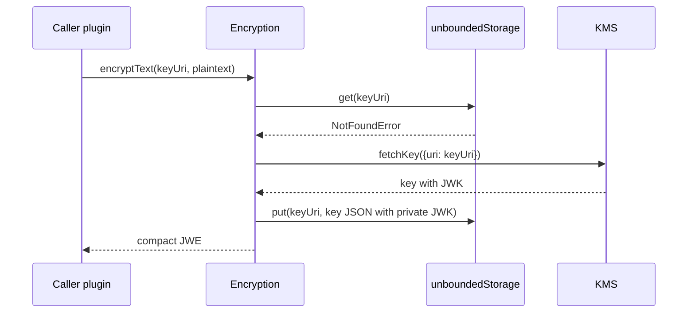
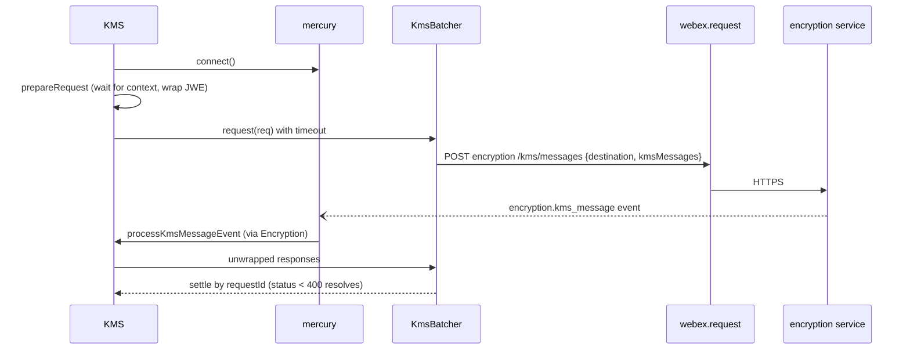
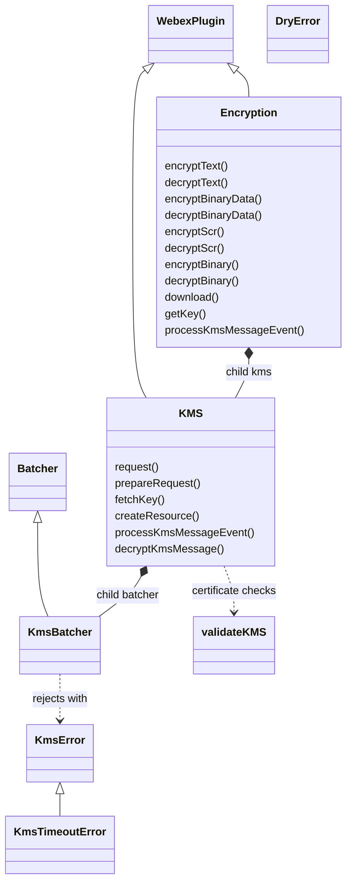
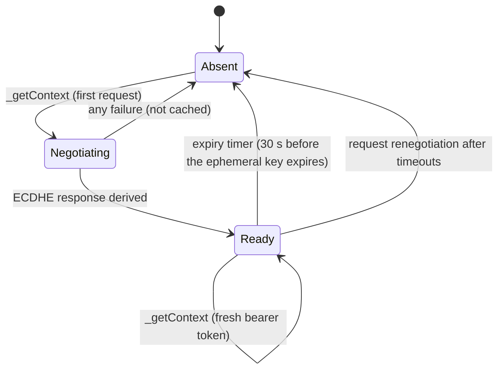

<!-- sdd-generated-metadata
doc_kind: module-spec
generated_from: module-spec@0.3.0
generated_by: claude-code
approved_by: rarajes2@cisco.com
updated_at: 2026-11-16T06:36:00Z
validation_status: pass
-->

# Encryption plugin

This source-local document at `src/docs/README.md` owns the stable specification for **the Encryption
plugin**: the internal plugin `webex.internal.encryption` and its child `webex.internal.encryption.kms`.
The plugin encrypts and decrypts Webex content with keys held by the Key Management Service (KMS). It
fetches and caches keys, negotiates an ECDH session with KMS, wraps and batches every KMS request, and
validates the KMS certificate before trusting it. It also registers the payload transforms that wrap
and unwrap `kmsMessage` bodies on other plugins' requests. Ground every claim in package evidence and
link to the [package architecture](../../docs/architecture.md) instead of repeating broader facts. No
service specification exists because this package is a library.

Related context: [documentation index](../../docs/index.md) ·
[package agent instructions](../../AGENTS.md)

## Metadata

| Field             | Value |
| ----------------- | ----- |
| Owner             | @webex/web-sdk (assets: @webex/web-client, @webex/web-sdk) |
| Source path       | `src` |
| Resource kind     | package |
| Status            | Draft |
| Last verified     | 2026-11-16 at `4c8995f5ff` |
| Module id         | `internal-plugin-encryption` |
| Parent spec       | — |
| Doc kind          | Module spec |
| Coverage score    | 100% assessed 2026-11-16 by the generator — 17 of 17 mandatory fields PRESENT, critical 8 of 8; `test:unit` holds 92 jest cases in four files, and all 92 pass on a current install (2026-11-16) |
| Validation status | Pass — assessed 2026-11-16 by validator runtime 01a1e2e3-e45b-7a33-bbd8-125f8d07b508; 0 Blocking, 0 findings. Previous finding VAL-001 closed after 92 of 92 unit tests passed on a current install. |

## Applicability

| Condition ID                         | Status     | Evidence or reason | Owned section |
| ------------------------------------ | ---------- | ------------------ | ------------- |
| `module.has_tiers`                   | N/A        | No tier policy exists in `package.json` or under src | Tier |
| `module.has_ui`                      | N/A        | Every method returns data or promises; `src/index.js` registers no view | UI use-case flow |
| `module.crosses_service_boundaries`  | Applicable | `src/kms.js` and `src/kms-batcher.js` call the encryption service and receive Mercury events; `src/encryption.js` calls the files service; `src/caroots-asset-url.js` fetches the CA-roots asset | Cross-boundary use-case flow |
| `module.holds_client_state`          | Applicable | `src/kms.js` keeps the KMS context, the KMS details, the partial ECDH context, and the verified CA roots in module-level WeakMaps keyed by the KMS instance | Client state model |
| `module.enforces_domain_rules`       | Applicable | KMS key and certificate checks in `src/kms-certificate-validation.js`; validation policy, retries, and context expiry in `src/kms.js` | Business rules and invariants |
| `module.is_concurrent_async`         | Applicable | Every method returns a promise; requests are batched (`src/kms-batcher.js`) and answered by Mercury events; one-flight dedupe in `src/kms.js` | Concurrency and reactive flow |
| `module.owns_persistence`            | Applicable | `src/encryption.js` getKey writes fetched keys, with private JWK material, to the plugin's unbounded storage | Data, schema, and migration discipline |
| `module.stateful_transitions`        | Applicable | The KMS context moves between absent, negotiating, ready, and discarded in `src/kms.js` | State machine |
| `module.exposes_wire_protocol`       | Applicable | KMS messages, the batch body, the KMS details response, the Mercury KMS event, and the DRY error body in `src/kms.js`, `src/kms-batcher.js`, and `src/index.js` | Protocol and wire format |
| `module.ui_multi_screen`             | N/A        | No UI | UI flow |
| `module.large_data_model`            | N/A        | The KMS objects are owned by node-kms and KMS; this module reads a few named fields, listed under Protocol and wire format | Data model |
| `module.returns_caller_errors`       | Applicable | KmsError, KmsTimeoutError, and DryError in `src/kms-errors.js`; KMSError in `src/kms-certificate-validation.js`; argument guards in `src/kms.js` and `src/encryption.js` | Caller-visible failure modes |
| `module.module_specific_conventions` | Applicable | The kms: log prefix, the metric names in `src/constants.js`, and the generated `src/union-bundle.js` | Module-specific rules |
| `module.published_package`           | Applicable | `package.json` names the package @webex/internal-plugin-encryption and defines deploy:npm | Export stability |
| `module.embedded_in_host`            | N/A        | No host theme or embed API | Host integration and theming |
| `module.has_design_tradeoff`         | Applicable | Certificate-chain enforcement is opt-in, keys are cached unencrypted, and responses are matched through Mercury, in `src/config.js`, `src/encryption.js`, and `src/kms.js` | Key design trade-off |
| `module.has_submodules`              | N/A        | The src directory has no child module (the plugin's module_tree.py reports one module) | Sub-modules |

## Evidence register

| Evidence | What it establishes |
| -------- | ------------------- |
| `src/index.js` | Imports the device and mercury plugins; `registerInternalPlugin('encryption', Encryption, {payloadTransformer, interceptors, config})`; the three predicates and transforms; the test-only interceptor; the exports `default`, `KMS`, `KmsError`, and `DryError`. Its header comment records a known bind-replay bug |
| `src/encryption.js` | `Encryption` extends `WebexPlugin` in namespace `Encryption` with child `kms`; the JWE, SCR, and binary methods, `download`, `_fetchDownloadUrl`, `getKey`, and the `replacer` that serializes private JWK material |
| `src/kms.js` | `KMS` extends `WebexPlugin` in namespace `Encryption` with child `batcher`; every KMS request method, `prepareRequest`, `request` and its retry ladder, the context negotiation, `processKmsMessageEvent`, `decryptKmsMessage`, and the CA-roots loading and validation policy. Its JSDoc and comments are the main recorded rationale |
| `src/kms-batcher.js` | `KmsBatcher` extends the webex-core `Batcher`: per-item timeout, the `/kms/messages` batch request, failure detection by status, and fingerprinting by `requestId` |
| `src/kms-errors.js` | `KmsError`, `KmsTimeoutError`, `DryError`, and `handleKmsKeyRevokedEncryptionFailure` |
| `src/kms-certificate-validation.js` | `validateKMS` and `KMSError`: key-type, kid, certificate-name, public-key, and chain checks through pkijs |
| `src/kms-dry-error-interceptor.js` | Test-only interceptor that replays a DRY request failing with the test-user KMS message |
| `src/config.js` | Default `webex.config.encryption` values and their JSDoc |
| `src/constants.js` | Event name, revoke status and codes, redirect code, metric names, and the 365-day staleness limit with its comment |
| `src/caroots-asset.js`, `src/caroots-asset.browser.js`, `src/caroots-asset-url.js` | How the CA-roots asset is read in Node (packaged file first) and in browsers (URL), and the per-call loader with its no-cache comment |
| `src/union-bundle.js` | Generated asset filename and rollback floor (20261022) |
| `src/ensure-buffer.js`, `src/ensure-buffer.browser.js` | Node accepts only Buffers; browsers convert ArrayBuffer, typed arrays, Blob, and File |
| `scripts/refresh-union-bundle.js` | Maintainer script that downloads or reads a Union bundle, verifies it, refuses a downgrade, writes the asset, regenerates `src/union-bundle.js`, and removes the previous asset |
| `package.json` | Name, entry points, the browser field, dependencies, and scripts (`assets:refresh`, `build`, `build:assets`, `build:src`, `deploy:npm`, `test`, `test:browser`, `test:integration`, `test:style`, `test:unit`) |
| `test/unit/spec/kms.js` | 58 jest cases: CMK requests, fetchKey redirects, the enforced and report-only validation policy, CA-roots loading and caching, context retry after failure, and KMS errors. It imports `dist/` and the package by name |
| `test/unit/spec/kms-certificate-validation.js` | 20 cases over `validateKMS` and `validateCommonName`, with fixtures in `test/fixtures/kms-certificate.js` |
| `test/unit/spec/kms-errors.js` | 3 cases over the revoke trigger |
| `test/unit/spec/encryption.js` | 11 cases over `_fetchDownloadUrl` and the binary-data JWE methods |
| `test/integration/spec/encryption.js`, `test/integration/spec/kms.js`, `test/integration/spec/caroots.js`, `test/integration/spec/payload-transfom.js` | Mocha cases against real KMS with test users: round trips, getKey caching, onBehalfOf, resource and authorization requests, ECDH timeouts, federation, CA roots, and DRY errors. `#download()` and two cases are skipped |
| `README.md`, `assets/README.md` | Retained npm page and asset note; context only (`docs/adr/0001-retain-product-readme.md`) |
| Sibling package webex-core, files src/docs/README.md, src/lib/storage/docs/README.md, src/lib/credentials/docs/README.md, and src/lib/static-asset-loader.ts | Specs consulted, agree with code: plugin registration and transform direction (MOD-008, MOD-016, MOD-037), namespace config (MOD-044), the Batcher (MOD-050 to MOD-053), storage get rejecting NotFoundError (storage MOD-030), getUserToken (credentials MOD-030 to MOD-032). StaticAssetLoader has no spec, so its code was read |
| Sibling package common, file src/docs/README.md; common-timers, file src/docs/README.md | Specs consulted, agree with code: oneFlight (MOD-002), tap (MOD-003; it also awaits the callback's promise), Exception (MOD-005), getUmdAssetsBaseUrl, and safeSetTimeout with unref (common-timers MOD-001, MOD-002) |
| Sibling package internal-plugin-mercury, files src/docs/README.md and src/mercury.js | Spec consulted; its autowiring rule agrees with code (encryption.kms_message calls processKmsMessageEvent). Its multi-session connect API is stale; src/mercury.js is the referee for connect |
| Sibling packages internal-plugin-device, internal-plugin-metrics, and http-core, file src/docs/README.md in each | Specs consulted, agree with code: device userId and url (device MOD-012), submitClientMetrics throws on a missing name (metrics MOD-008), Interceptor defaults (http-core MOD-016) |
| Sibling package kms-caroots, files verify.js and index.js | No spec exists, so the code is the referee for verifyUnionBundle and loadUnionBundle |
| Generator probe of the request retry ladder against the built dist | Recorded with its output in the bootstrap run records; establishes the attempt sequence quoted under Pitfalls and constraints |
| Observation, no stated WHY | Behavior the code shows without stating a reason is recorded once, under State machine, Pitfalls and constraints, or Caller-visible failure modes |

## Purpose and boundary

- Responsibility: give the other SDK plugins one place to encrypt and decrypt content with KMS keys,
  to create and authorize KMS resources and keys, and to send any KMS request over a validated,
  ECDH-protected session.
- In scope: registration of `encryption` and its payload transforms; text and binary JWE encryption;
  SCR encryption and encrypted file download; the key cache; every KMS request method on `kms`; the
  ECDH context; batching and response matching; KMS certificate validation and the CA-roots asset;
  the KMS error classes; the revoke event; the shipped Union bundle and its refresh script.
- Out of scope: the KMS JSON-over-JWE format and ECDH math (`node-kms`, `node-jose`, `node-scr`); the
  Mercury socket and event routing (`@webex/internal-plugin-mercury`); device registration
  (`@webex/internal-plugin-device`); the request pipeline, batching base, storage, and asset loader
  (`@webex/webex-core`); metric delivery (`@webex/internal-plugin-metrics`, which the host must
  register); Union bundle signature verification (`@webex/kms-caroots`); what KMS and the encryption
  and files services decide.
- Consumers: in this repository, internal-plugin-ai-assistant, -board, -calendar, -call-ai-summary,
  -conversation, -ediscovery, -lyra, -scheduler, -search, -task, and -team, plugin-encryption,
  plugin-meetings, calling, recipe-private-web-client, webex-server, and webex import the package or
  call `webex.internal.encryption`. Mercury calls `processKmsMessageEvent`.

## Structure and key files

| Path | Responsibility |
| ---- | -------------- |
| `src/index.js` | Registration, payload predicates and transforms, test-only interceptor, exports |
| `src/encryption.js` | `Encryption`: JWE, SCR, binary, download, and key-cache methods |
| `src/kms.js` | `KMS`: KMS request methods, context negotiation, message handling, certificate policy, CA roots |
| `src/kms-batcher.js` | `KmsBatcher`: batching, per-item timeout, response matching |
| `src/kms-errors.js` | Error classes and the revoke trigger |
| `src/kms-certificate-validation.js` | `validateKMS` and `KMSError` |
| `src/kms-dry-error-interceptor.js` | Test-only DRY replay interceptor |
| `src/config.js`, `src/constants.js` | Default config and constants |
| `src/caroots-asset.js`, `src/caroots-asset.browser.js`, `src/caroots-asset-url.js` | CA-roots asset loaders per platform |
| `src/union-bundle.js` | Generated bundle filename and rollback floor; do not edit |
| `src/ensure-buffer.js`, `src/ensure-buffer.browser.js` | Buffer normalization per platform |
| `assets/ios_union-20261022.p7b` | The shipped Cisco Union bundle; `build:assets` copies it to dist |
| `assets/README.md` | Maintainer note for the bundle; context only |
| `scripts/refresh-union-bundle.js` | Maintainer script behind `assets:refresh` |
| `package.json` | Package name, entry points, browser field, scripts, dependencies |
| `babel.config.js`, `jest.config.js` | Re-exports of the legacy Babel and Jest configurations |
| `.eslintrc.js` | Sets `root: true` and extends `@webex/eslint-config-legacy` |
| `process` | Package-root file exporting `{browser: true}`; not imported by src |
| `src/docs/README.md` | This module specification; ignored by the build and by lint |
| `test/unit/spec/kms.js`, `test/unit/spec/encryption.js`, `test/unit/spec/kms-errors.js`, `test/unit/spec/kms-certificate-validation.js` | Unit cases |
| `test/fixtures/kms-certificate.js` | Certificate fixtures for unit and integration cases |
| dist/ (generated) | Build output of `build:src`, including dist/assets; ignored by Git and never edited by hand |

## Public surface

| Surface | Consumer | Compatibility commitment | Source |
| ------- | -------- | ------------------------ | ------ |
| Import side effect: internal plugin `encryption` with config, three payload predicates and transforms, and (test only) `KmsDryErrorInterceptor`; also registers `device` and `mercury` | Every importing plugin and bundle | First registration of the name wins; reached as `webex.internal.encryption` | `src/index.js` |
| `encryptText(key, plaintext, options)`, `decryptText(key, ciphertext, options)` | Plugins encrypting messages and titles | Compact JWE, `dir` with A256GCM from `joseOptions`; `options.onBehalfOf` | `src/encryption.js` |
| `encryptBinaryData(kmsKeyUri, data, options)`, `decryptBinaryData(kmsKeyUri, JWE, options)` | Plugins encrypting binary payloads | JWE of a buffer; decryption resolves the payload Buffer | `src/encryption.js` |
| `encryptScr(key, scr, options)`, `decryptScr(key, cipherScr, options)` | File and whiteboard plugins | SCR as JWE; `encryptScr` needs `scr.loc` | `src/encryption.js` |
| `encryptBinary(file)`, `decryptBinary(scr, buffer)`, `download(fileUrl, scr, options)` | File plugins | SCR-encrypted bytes; `download` emits `progress` events on the returned promise | `src/encryption.js` |
| `getKey(uri, {onBehalfOf})`, `processKmsMessageEvent(event)` | Plugins; Mercury | Cached KMS key object with a node-jose JWK; Mercury autowiring entry | `src/encryption.js` |
| `kms.bindKey`, `createResource`, `addAuthorization`, `listAuthorizations`, `removeAuthorization`, `createUnboundKeys`, `fetchKey`, `ping`, `asKey` | Plugins that own KMS resources | Resolve the KMS response field named in Requirements | `src/kms.js` |
| `kms.fetchPublicKey` | BYOK administration callers | Resolves only the `publicKey` field of the KMS response | `src/kms.js` |
| `kms.uploadCustomerMasterKey`, `listAllCustomerMasterKey`, `changeCustomerMasterKeyState`, `deleteAllCustomerMasterKeys`, `useGlobalMasterKey` | BYOK administration callers | Resolve the whole KMS response | `src/kms.js` |
| `kms.prepareRequest(payload, onBehalfOf)`, `kms.request(payload, options)`, `kms.decryptKmsMessage(kmsMessage)` | The payload transforms; plugins sending custom KMS messages | Wrapped node-kms Request; the KMS response body | `src/kms.js` |
| Config `webex.config.encryption` (fields under Requirements MOD-027) | Applications | Defaults in config | `src/config.js` |
| Events `event:kms:key:revoke:encryption:failure` (on `webex.internal.encryption`) and `client:InvalidRequestError` (on `webex`) | Applications | Triggered with no payload | `src/kms-errors.js`, `src/kms.js` |
| Metrics `JS_SDK_KMS_CERTIFICATE_VALIDATION_FAILED`, `JS_SDK_KMS_CAROOTS_ASSET_DOWNLOAD_FAILED`, `JS_SDK_KMS_CAROOTS_ASSET_VERIFICATION_FAILED`, `JS_SDK_KMS_CAROOTS_ASSET_STALE` | Telemetry consumers | Names and tags under Protocol and wire format | `src/constants.js`, `src/kms.js` |
| Exports: default `Encryption`, `KMS`, `KmsError`, `DryError` | Hosts and plugins | The entry exports nothing else; `KmsTimeoutError`, `KMSError`, and `validateKMS` are reachable only by deep import | `src/index.js` |
| Underscore-prefixed members (`_fetchDownloadUrl`, `_getContext`, `_loadCaroots`, and others) | The plugin itself and its tests | Not a supported entry | `src/encryption.js`, `src/kms.js` |

Contract ID `internal-plugin-encryption-sdk` is indexed in the
[package architecture](../../docs/architecture.md#public-and-consumer-surfaces) with the internal
contracts `encryption-key-cache-entry`, `encryption-kms-events`, and `cisco-union-bundle`.

## Dependencies

| Dependency | Why it is required | Failure behavior |
| ---------- | ------------------ | ---------------- |
| `@webex/webex-core` (module specs consulted) | `registerInternalPlugin`, `WebexPlugin` (`logger`, `request`, namespace config, `unboundedStorage`), `Batcher`, `StaticAssetLoader`, `WebexHttpError`, `webex.request`, `webex.credentials.getUserToken('spark:kms')` | HTTP failures reject with WebexHttpError; a storage miss rejects NotFoundError, which getKey treats as a cache miss |
| `@webex/internal-plugin-mercury` (spec consulted for autowiring; code is the referee for connect) | Imported by `src/index.js`; every `kms.request` awaits `mercury.connect()`; Mercury delivers KMS responses as `encryption.kms_message` events | A connect failure rejects the request; handler errors are logged by Mercury |
| `@webex/internal-plugin-device` (spec consulted) | Imported by `src/index.js`; `device.userId` names the KMS details resource and the KMS credential; `device.url` is the KMS client id | Read when the context is prepared |
| `@webex/internal-plugin-metrics` (spec consulted; not declared in package.json) | `webex.internal.metrics.submitClientMetrics` for the four certificate and asset metrics | Absent or failing metrics are caught and logged as a warning; KMS behavior is unchanged |
| `@webex/common`, `@webex/common-timers` (specs consulted) | `oneFlight`, `tap`, `proxyEvents`, `transferEvents`, `Exception`, `isBuffer`, `getUmdAssetsBaseUrl`; `safeSetTimeout` for context expiry and request timeouts | — |
| `@webex/http-core` (spec consulted) | `Interceptor` base of the test-only interceptor | — |
| `@webex/kms-caroots` (no spec; code consulted) | `verifyUnionBundle` for the CA-roots asset; `loadUnionBundle` in the refresh script | A verification rejection becomes a KMSError (see Caller-visible failure modes) |
| `node-kms`, `node-jose`, `node-scr` | KMS message wrapping and ECDH; JWE and JWK; SCR | Their errors propagate as rejections |
| `pkijs` 3.3.3, `asn1js` 3.0.10, `isomorphic-webcrypto`, `safe-buffer`, `valid-url` | Certificate parsing and chain verification; WebCrypto; base64 decoding; kid URI check | Pinned exact versions; an older root install breaks bundle parsing (see Verification) |
| `lodash`, `uuid`, `debug` | Helpers, CMK request ids, and the `kms` debug channel for timeouts | — |
| `@webex/test-helper-file` | Listed in `dependencies`, but no file under src imports it | — |
| Encryption service, KMS, files service, Union bundle host (external) | Key operations and file download URLs; CA roots | See Cross-boundary use-case flow |

## Requirements

| ID | WHAT | WHY | Source evidence | Test or example evidence | Assumptions or gaps | Confidence |
| -- | ---- | --- | --------------- | ------------------------ | ------------------- | ---------- |
| `MOD-001` | Importing the package imports the device and mercury plugins and registers `Encryption` as internal plugin `encryption` with `config`, the payload predicates and transforms of MOD-002 to MOD-004, and, only when `process.env.NODE_ENV` is `test`, the interceptor of MOD-029. The entry exports the default `Encryption`, `KMS`, `KmsError`, and `DryError`. | Other plugins reach it as `webex.internal.encryption`, and its KMS traffic needs Mercury and a registered device (inferred from the imports; webex-core MOD-008, MOD-016). | `src/index.js` | `test/integration/spec/payload-transfom.js` exercises the registered transforms | WHY inferred | Present |
| `MOD-002` | The outbound predicate `encryptKmsMessage` matches a request whose `body.kmsMessage` is an object, unless `kmsMessage.keyUris` is an empty array or `kmsMessage.resourceUri` or `kmsMessage.uri` contains the placeholder `<KRO>` or `<KEYURL>`. Its transform replaces a non-string `kmsMessage` with `kms.prepareRequest(kmsMessage).wrapped`. | The code comment: a message with placeholders is a template another transform fills in later, which avoids a rules engine for transform order. | `src/index.js` | None found | — | Present |
| `MOD-003` | The inbound predicate `decryptKmsMessage` matches a response whose `body.kmsMessage` is a string; its transform replaces it with `kms.decryptKmsMessage(kmsMessage)`. | Services that proxy KMS return the KMS answer wrapped for this client (inferred). | `src/index.js` | None found | WHY inferred | Present |
| `MOD-004` | The inbound predicate `decryptErrorResponse` matches an error whose `body.errorCode` is 1900000. Its transform decrypts every `body.errors[].description` and `body.message` in place, then rejects with `new DryError(reason)`. | The class JSDoc: emitted when a REST request includes an encrypter error. | `src/index.js`, `src/kms-errors.js` | `test/integration/spec/payload-transfom.js` (DRY response with an error) | — | Present |
| `MOD-005` | `encryptText(key, plaintext, options)` resolves `getKey(key, options)` and then a compact JWE of the UTF-8 plaintext with `alg: dir` and `config.joseOptions` (A256GCM, `protect: '*'`). `decryptText` decrypts with the key's JWK and resolves the plaintext string. | The JSDoc: encrypt or decrypt text with the supplied key URI; `onBehalfOf` fetches the key for another user and needs the `spark.kms_orgagent` role. | `src/encryption.js`, `src/config.js` | `test/integration/spec/encryption.js` encryptText, decryptText, and onBehalfOf cases | — | Present |
| `MOD-006` | `encryptBinaryData(kmsKeyUri, data, options)` resolves the key, normalizes `data` with `ensureBuffer`, and resolves a JWE of the buffer with the same header and options. `decryptBinaryData` resolves the decrypted `payload` Buffer. | The JSDoc: encrypt or decrypt binary data as JWE. | `src/encryption.js`, `src/ensure-buffer.js` | `test/unit/spec/encryption.js` four encryptBinaryData and four decryptBinaryData cases; `test/integration/spec/encryption.js` | — | Present |
| `MOD-007` | `encryptScr(key, scr, options)` rejects when `scr.loc` is unset; otherwise it resolves `scr.toJWE(key.jwk)`. `decryptScr(key, cipherScr, options)` resolves `SCR.fromJWE(key.jwk, cipherScr)`. | The JSDoc and the error text: an SCR cannot be encrypted before its location is set. | `src/encryption.js` | `test/integration/spec/encryption.js` encryptScr and decryptScr cases | — | Present |
| `MOD-008` | `encryptBinary(file)` normalizes the file, creates a new SCR, encrypts the buffer, and resolves `{scr, cdata}`. `decryptBinary(scr, buffer)` rejects a zero-length buffer and resolves `scr.decrypt(buffer)`. | Files are encrypted with a fresh content key carried in the SCR (inferred from SCR.create). | `src/encryption.js` | `test/integration/spec/encryption.js` encryptBinary and decryptBinary cases | WHY inferred | Present |
| `MOD-009` | `getKey(uri, {onBehalfOf})` returns `kms.asKey(uri)` when `uri` is already a key object with `jwk`. Otherwise it reads the storage key (the URI, plus `/onBehalfOf/<id>` when given) from `unboundedStorage`, parses it, and resolves `kms.asKey`. Any failure of that read leads to `kms.fetchKey({uri, onBehalfOf})`; the fetched key is written back as JSON with its JWK serialized by `toJSON(true)`, and getKey resolves after the write. | The JSDoc: fetch the key for the KMS URI; the replacer comment: private key data must be serialized. | `src/encryption.js` | `test/integration/spec/encryption.js` getKey cases (short circuit, local cache, KMS fetch, stores the key) | Cache rules are under Data, schema, and migration discipline | Present |
| `MOD-010` | `download(fileUrl, scr, options)` rejects without both arguments. It resolves the download URL with `_fetchDownloadUrl(fileUrl, {useFileService: true, ...options})`, GETs it as a buffer, forwards `progress` events to the returned promise, and resolves `decryptBinary(scr, body)`. `_fetchDownloadUrl` returns `fileUrl` unchanged when it contains `localhost` outside production. With `useFileService: false` it rejects a URL that does not start with `https://` and otherwise returns it. Otherwise it POSTs `{endpoints: [fileUrl]}`, plus `allow` when `options.params` has it, to `https://<file host>/v1/download/endpoints`, and returns the mapped URL, or `fileUrl` with a warning when the mapping is missing or the request fails. | The code comments: the URL is forced to https and the files service endpoint; localhost files are test files. The direct-URL rule rejects plain HTTP. | `src/encryption.js` | `test/unit/spec/encryption.js` three _fetchDownloadUrl cases (endpoint URI, https, body) | `#download()` integration cases are skipped | Present |
| `MOD-011` | `bindKey({kro, kroUri, key, keyUri})` sends `update` with `resourceUri` and `uri` and resolves `res.key`. `createResource({userIds, keyUris, key, keys})` gathers key URIs, rejects when none exist, sends `create /resources`, and resolves `res.resource`. `addAuthorization({userIds, authIds, kro, kroUri})` sends `create /authorizations` and resolves `res.authorizations`. `listAuthorizations` sends `retrieve <kroUri>/authorizations`. `removeAuthorization({authId, userId, kro, kroUri})` sends `delete <kroUri>/authorizations?authId=…`. | The JSDoc of each: bind a key to a resource, create a KMS resource, and authorize, list, or deauthorize a user or KRO. | `src/kms.js` | `test/integration/spec/kms.js` createResource, addAuthorization, listAuthorizations, removeAuthorization, bindKey cases | The guards dereference `kro` and `key` first (see Caller-visible failure modes) | Present |
| `MOD-012` | `createUnboundKeys({count})` rejects without `count`, sends `create /keys` with `count`, and resolves `res.keys` converted by `asKey`. | The JSDoc: request unbound keys from KMS. | `src/kms.js` | `test/integration/spec/kms.js` createUnboundKeys case | — | Present |
| `MOD-013` | `fetchPublicKey({assignedOrgId})` sends `retrieve /publicKey` and resolves `res.publicKey`. `uploadCustomerMasterKey`, `listAllCustomerMasterKey`, and `deleteAllCustomerMasterKeys` send `create`, `retrieve`, or `delete` to `/awsKmsCmk` when `awsKms` is true, else `/cmk`. `changeCustomerMasterKeyState({keyId, keyState, assignedOrgId})` sends `update` to `keyId`. `useGlobalMasterKey` sends `update default` with `keyState: 'ACTIVE'`. Each CMK request carries a new v4 `requestId` and resolves the whole response; the backup key and role are sent only with `awsKms`. | The JSDoc and typedefs describe the BYOK APIs and their responses; `deleteAllCustomerMasterKeys` says it is mainly for tests. | `src/kms.js` | `test/unit/spec/kms.js` listAllCustomerMasterKey, uploadCustomerMasterKey, deleteAllCustomerMasterKeys cases | — | Present |
| `MOD-014` | `fetchKey({uri, onBehalfOf})` rejects without `uri` and sends `retrieve uri` on behalf of `onBehalfOf`. When the response has `errorCode` 301002 and `redirectUri`, it retrieves `redirectUri` once and resolves that key; otherwise it resolves `res.key`; both pass through `asKey`. Concurrent calls with the same URI and `onBehalfOf` share one request. | The code comment: KMS responses carry only a request id, so the batcher groups requests and one-flight stops duplicates; redirects handle a migrated KRO, key, or authorization. | `src/kms.js`, `src/constants.js` | `test/unit/spec/kms.js` five fetchKey cases | Only one redirect hop is followed | Present |
| `MOD-015` | `ping()` sends `update /ping`. `asKey(key)` replaces `key.jwk` with a node-jose key and resolves the same object. | The JSDoc: mostly for testing; ensure a key object holds a key instance. | `src/kms.js` | `test/integration/spec/kms.js` ping case | — | Present |
| `MOD-016` | `prepareRequest(payload, onBehalfOf)` treats `create` to a URI containing `/ecdhe` as the ECDH request and wraps it with the partial context and `serverKey: true`; any other request waits for `_getContext()`. With `onBehalfOf` it wraps with a new light context naming that user, leaving the cached context unchanged. Outside production it logs the payload without the wrapped field. | The JSDoc of `_contextOnBehalfOf`: the context is cached, so changing it would affect other requests; eDiscovery officers retrieve keys on behalf of users. | `src/kms.js` | `test/integration/spec/kms.js` fetchKey(onBehalfOf) cases | — | Present |
| `MOD-017` | `request(payload, {timeout, onBehalfOf})` awaits `mercury.connect()`, prepares the request, attaches the timeout (default `kmsInitialTimeout`), and resolves the batcher's response. A KMSError triggers `client:InvalidRequestError` on `webex` and rejects. An error with `status` or `statusCode` rejects. Any other error doubles the timeout and retries, rejecting once the doubled value reaches `ecdhMaxTimeout`; when it reaches `kmsMaxTimeout` and twice it stays below `ecdhMaxTimeout`, the cached context is dropped and the timeout restarts. In test mode a 403 with the KMS test-user message is re-requested. A success after a timeout logs a warning. | The code comments: retries model KMS slowness and a stale ECDH key; KMSError means the SDK should stop retrying and notify the user; test-mode resiliency. | `src/kms.js`, `src/config.js` | `test/integration/spec/kms.js` ECDH timeout cases | Attempt sequences are under Pitfalls and constraints | Present |
| `MOD-018` | `_getContext()` returns one cached context promise per KMS instance (one-flight). A new context is prepared by fetching the KMS details, resolving the CA roots, validating the KMS static key (MOD-024, MOD-025), getting a `spark:kms` token, creating a local ECDH key, sending `create <cluster>/ecdhe` with its public JWK, and deriving the final key. The context expires 30 seconds before the ephemeral key, a failed negotiation is not cached, and every caller gets a fresh bearer token. | The code comment: a failed negotiation, for example CA roots temporarily unavailable, must not stay cached; the next request retries. | `src/kms.js` | `test/unit/spec/kms.js` _prepareContext and _getContext retry cases | KMS details are cached separately, failures included (Caller-visible failure modes) | Present |
| `MOD-019` | `processKmsMessageEvent(event)` unwraps each `event.encryption.kmsMessages[i]` with the partial context when its JWE header `kid` equals the KMS static key's `kid`, else with the cached context. It replaces the entry with the unwrapped Response and passes the event to the batcher, which settles each pending request by `requestId`. A failure is logged and rejected. | The JSDoc: decrypt a KMS message event and pass it to the batcher; KMS answers asynchronously over Mercury (inferred from the batcher's empty HTTP success handler). | `src/kms.js`, `src/kms-batcher.js`, `src/encryption.js` | Integration cases that complete any KMS request | — | Present |
| `MOD-020` | `decryptKmsMessage(kmsMessage)` unwraps a KMS response with the cached context and resolves its body. | The JSDoc: decrypt a KMS message. | `src/kms.js` | `test/integration/spec/payload-transfom.js` | Behavior without a cached context is under Caller-visible failure modes | Present |
| `MOD-021` | `KmsBatcher` starts a timer per item that rejects it with `KmsTimeoutError` (timeout, request, and tracking id) and clears it when the item settles. A batch POSTs `{destination: kmsCluster, kmsMessages}` to `encryption` `/kms/messages`; the HTTP success is ignored. An item fails when `status >= 400` and rejects with `KmsError(body)`; items are fingerprinted by `requestId`. | The JSDoc: the HTTP response does not carry the response data. | `src/kms-batcher.js`, `src/kms-errors.js` | `test/unit/spec/kms.js` tracking-id timeout case | — | Present |
| `MOD-022` | A failed item with status 405 and `errorCode` 405005 or 405006 triggers `event:kms:key:revoke:encryption:failure` on `webex.internal.encryption`. | The function comment: trigger an event for specific encryption failures. | `src/kms-errors.js`, `src/constants.js` | `test/unit/spec/kms-errors.js` three cases | No in-repository listener | Present |
| `MOD-023` | `validateKMS({caroots, validateSignature = true})(jwt)` rejects with `KMSError('INVALID KMS: …')` unless `kty` is `RSA`; `kid` is a URI with protocol `kms:`; `x5c` is a non-empty array; the first certificate's subject alternative names (lower-cased) or common name equal the kid hostname; and its exponent and modulus equal `e` and `n`. When `validateSignature` is true it also rejects without non-empty `caroots`, and when the chain does not verify against them. It resolves the jwt. | The class comment: a KMSError tells the SDK to stop retrying and notify the user; the JSDoc: fail closed without roots. | `src/kms-certificate-validation.js` | `test/unit/spec/kms-certificate-validation.js` 20 cases | — | Present |
| `MOD-024` | Enforced validation: `_getCaroots()` resolves `undefined` when `shouldValidateKMSCertificate` is false, else the configured `caroots` when non-empty, else the verified asset roots (MOD-026). `_validateKMSStaticPubKey` runs `validateKMS` with those roots and `validateSignature` equal to `shouldValidateKMSCertificate`; a failure submits `JS_SDK_KMS_CERTIFICATE_VALIDATION_FAILED` tagged `enforced` and rejects. | The config JSDoc: validation is opt-in and fails closed without roots; configured roots take precedence. | `src/kms.js`, `src/config.js` | `test/unit/spec/kms.js` _validateKMSStaticPubKey and _getCaroots cases | — | Present |
| `MOD-025` | Report-only validation runs only after enforced validation passes. A truthy `carootsReportOnly` is validated with signature checking and awaited; a failure submits the metric tagged `report-only` and setup continues. Otherwise a set `reportOnlyAssetsBaseUrl` starts a background check against the asset from that URL, which is not awaited; its load, verification, and chain failures are reported and never reject. | The config JSDoc: trial a new root bundle without risking total failure; the URL check must not delay or reject setup. | `src/kms.js`, `src/config.js` | `test/unit/spec/kms.js` independent report-only asset source cases; `test/integration/spec/caroots.js` | — | Present |
| `MOD-026` | `_loadCaroots` caches one promise per KMS instance and `[reportOnly, assetsBaseUrl, carootsAsset]`, and evicts it on failure. Enforced loads read the packaged asset first in Node, else fetch `assetsBaseUrl` plus the asset name; report-only loads always fetch the URL; each fetch uses a new StaticAssetLoader. Bytes are verified by `verifyUnionBundle` with the shipped version as the minimum; a bundle older than 365 days submits `JS_SDK_KMS_CAROOTS_ASSET_STALE` and is still used. Download and verification failures submit their metrics and reject with a KMSError that names the asset and the configuration fixes. | The code comments: a new loader per call so a response that later fails verification is never served from cache; Cisco re-signs the bundle regularly, so old bundles may lack new roots. | `src/kms.js`, `src/caroots-asset.js`, `src/caroots-asset.browser.js`, `src/caroots-asset-url.js`, `src/constants.js` | `test/unit/spec/kms.js` CA roots cases; `test/integration/spec/caroots.js` loads the shipped bundle | — | Present |
| `MOD-027` | Default config: `joseOptions` `{compact: true, contentAlg: 'A256GCM', protect: '*'}`, `kmsInitialTimeout` 6000, `kmsMaxTimeout` 32000, `ecdhMaxTimeout` 96000, `batcherWait` 50, `batcherMaxCalls` 50, `batcherMaxWait` 150, `shouldValidateKMSCertificate` false, `reportOnlyAssetsBaseUrl`, `caroots`, and `carootsReportOnly` undefined, `carootsAsset` the shipped filename, and `assetsBaseUrl` from `getUmdAssetsBaseUrl('internal-plugin-encryption', SDK_VERSION, PACKAGE_VERSION)`. | The JSDoc of each field. | `src/config.js`, `src/union-bundle.js` | None found | — | Present |
| `MOD-028` | `KmsError` takes the reason from the body and appends the KMS status, request id, status code, and error code; `KmsTimeoutError` names the timeout, request, request id, and tracking id; `DryError` takes the reason from the decrypted body message and appends the method, URL, tracking id, status, and request id. `KmsError` and `DryError` keep `reason`, `requestId`, and `status` as non-enumerable properties; `KmsTimeoutError` overrides `parse` without calling `KmsError.parse`, so it has none of them, and its request id and tracking id exist only in the message. | The class comments: a KMS error, a missing response, and an encrypter error behind a proxying service. | `src/kms-errors.js` | `test/unit/spec/kms.js` KMS error cases | — | Present |
| `MOD-029` | In test mode, `KmsDryErrorInterceptor` replays a request that failed with a DryError carrying the KMS test-user message, up to `maxAuthenticationReplays`, then rejects. | The class comment: work around the test-user incompatibility in KMS. | `src/kms-dry-error-interceptor.js` | None found | — | Present |
| `MOD-030` | In Node, `ensureBuffer` rejects anything but a Buffer; in browsers it accepts an ArrayBuffer, an object with `toArrayBuffer` or `buffer`, or reads a Blob or File with FileReader. The browser field in `package.json` selects the browser files. | The comments: Node buffers are sometimes byte arrays; browsers convert File and Blob objects. | `src/ensure-buffer.js`, `src/ensure-buffer.browser.js`, `package.json` | `test/integration/spec/encryption.js` Buffer input cases | — | Present |
| `MOD-031` | `yarn assets:refresh` downloads (or reads with `--in`) a Union bundle, verifies it with the shipped version as the floor, writes it as `assets/ios_union-<version>.p7b`, regenerates `src/union-bundle.js`, and removes the previous bundle. | The script header: the shipped bundle version becomes the rollback floor. | `scripts/refresh-union-bundle.js` | None found | Not run by the generator; it needs network access to Cisco | Present |

## Design overview

The package registers two plugins in one tree. `Encryption` is the content-crypto façade other plugins
call; `KMS`, its child, owns everything about talking to KMS; `KmsBatcher`, the child of `KMS`, owns
batching and response matching. All three share the namespace `Encryption`, so each reads
`webex.config.encryption`.

Content operations resolve a key through `getKey`, which reads the unbounded storage before asking
KMS. KMS operations go through `kms.request`. It connects Mercury, waits for a negotiated ECDH
context, wraps the KMS JSON as a JWE, and hands it to the batcher. The batcher POSTs batches to the
encryption service and ignores the HTTP answer. KMS sends each response over Mercury, which calls
`processKmsMessageEvent`, and the batcher settles the waiting request by `requestId`.

Before the first context, the KMS static public key is validated. Mandatory key checks always run;
chain trust is checked against CA roots only when `shouldValidateKMSCertificate` is true. Roots come
from config or from the signed Cisco Union bundle, which is verified before use (`INV-001`). Optional
report-only checks report metrics without blocking (`INV-003`).

The payload transforms let other plugins send `kmsMessage` bodies through services that proxy KMS
without knowing about wrapping.

## Data flow and sequence coverage

Call style: in-process method calls on `webex.internal.encryption` and `.kms`; outbound HTTPS through
`webex.request` and `this.request`; inbound Mercury events; payload transforms on other plugins'
requests.

| Operation group | Entry and outcome | Diagram or evidence | Failure and recovery coverage |
| --------------- | ----------------- | ------------------- | ----------------------------- |
| Content crypto | `encryptText`, `decryptText`, binary-data, SCR, and binary methods; JWE or SCR results | Diagram 1; `src/encryption.js` | Key failures and crypto errors reject |
| File download | `download` | `src/encryption.js` (MOD-010) | URL lookup falls back to the original URL; download and decryption errors reject |
| KMS requests | Every `kms` method through `request` | Diagram 2; `src/kms.js`, `src/kms-batcher.js` | Timeout retry ladder; HTTP-status and KMS errors reject |
| Context negotiation | `_getContext` on the first request and after expiry | Diagram 3; State machine | Failures are not cached; certificate failures reject |
| Payload transforms | `kmsMessage` bodies on other plugins' requests | `src/index.js` (MOD-002 to MOD-004) | A DRY error becomes DryError |

Diagram 1 — encrypting text with a key that is not cached yet:



Diagram 2 — one KMS request:



Diagram 3 — negotiating the context:

```mermaid
sequenceDiagram
  participant K as KMS
  participant W as webex.request
  participant A as CA roots source
  participant V as validateKMS
  K->>W: GET encryption /kms/userId (kmsCluster, rsaPublicKey)
  K->>A: _getCaroots (config, packaged file, or URL; verified)
  K->>V: enforced check (MOD-024)
  V-->>K: key, or KMSError
  K-)A: report-only check, not awaited (MOD-025)
  K->>K: createECDHKey, partial context
  K->>K: request create cluster/ecdhe with local JWK
  K->>K: deriveEphemeralKey, cache context, set expiry timer
```

## Class and component relationships



## Use cases and flows

| Use case | Actor or caller | Primary steps and outcome | Failure or boundary behavior | Evidence |
| -------- | --------------- | ------------------------- | ---------------------------- | -------- |
| `UC-001` | Plugin encrypting a message | `encryptText(keyUri, text)`; later `decryptText` | Key fetch or JWE errors reject | `src/encryption.js` |
| `UC-002` | Plugin sharing a file | `encryptBinary(file)`, upload, `encryptScr(key, scr)`; the receiver calls `decryptScr` then `download(url, scr)` | Download URL lookup falls back to the URL; direct URLs must be HTTPS | `src/encryption.js` |
| `UC-003` | Plugin creating an encrypted space | `createUnboundKeys`, `createResource`, `addAuthorization`, `bindKey` | KMS errors reject; timeouts retry | `src/kms.js`, `test/integration/spec/kms.js` |
| `UC-004` | Compliance officer | Any key read with `onBehalfOf` | Forbidden without the `spark.kms_orgagent` role | `src/kms.js`, `test/integration/spec/kms.js` |
| `UC-005` | BYOK administrator | Public key, CMK upload, list, state change, global key | KMS errors reject | `src/kms.js` |
| `UC-006` | Application hardening KMS trust | Set `shouldValidateKMSCertificate`, optionally `caroots`, `assetsBaseUrl`, or a report-only source | Enforced failures stop every KMS request; report-only failures only report | `src/kms.js`, `src/config.js` |
| `UC-007` | Plugin sending a KMS message through a proxying service | Put `kmsMessage` in the request body | Placeholders defer wrapping; DRY errors become DryError | `src/index.js` |

### Cross-boundary use-case flow

| Boundary | Transport and ordering | Compatibility | Timeout, retry, and recovery |
| -------- | ---------------------- | ------------- | ---------------------------- |
| Encryption service, KMS details (`UC-001` to `UC-007`) | One GET per KMS instance through `webex.request`, service `encryption` | `{kmsCluster, rsaPublicKey}` | Cached for the instance's life, including a failure |
| Encryption service, KMS messages | Batched POSTs; responses over Mercury in any order | Matched by `requestId` | Per-item timeout and the request retry ladder (MOD-017) |
| Mercury (KMS responses) | `encryption.kms_message` events, unwrapped as they arrive | `data.encryption.kmsMessages` | Unmatched or failed unwraps reject the handler; the request times out |
| Files service (`UC-002`) | POST `/v1/download/endpoints`, then GET | `{endpoints: {url: downloadUrl}}` | Falls back to the original URL; no retry |
| CA-roots asset host (`UC-006`) | GET through StaticAssetLoader, no credentials | Signed Union bundle | Failed loads are evicted and retried by the next negotiation |

## Client state model

| State or slice | Owner      | Initial state | Transition triggers | Reset or persistence boundary |
| -------------- | ---------- | ------------- | ------------------- | ----------------------------- |
| KMS context (contexts WeakMap) | `src/kms.js` per KMS instance | absent | `_getContext` sets it; expiry timer, failure, or request renegotiation deletes it | Memory only; see State machine |
| Partial ECDH context (partialContexts) | `src/kms.js` | absent | Set after the local ECDH key is created; deleted after derivation | Memory only; used only for the ECDHE request and its response |
| KMS details (kmsDetails) | `src/kms.js` | absent | First `_getKMSDetails` call | Memory; never cleared, even after a failure (Caller-visible failure modes) |
| Verified CA roots (assetCaroots) | `src/kms.js` | empty Map | `_loadCaroots` per source key | Memory; failures evicted |
| In-flight fetchKey and _getContext calls | `oneFlight` in `src/kms.js` | none | Concurrent calls | Released when settled |
| Pending batched requests | `KmsBatcher` | empty | `request`; settled by Mercury responses or timeouts | Memory |
| Cached keys | `Encryption.getKey` | — | Each KMS fetch | Persisted; see Data, schema, and migration discipline |

## Business rules and invariants

| ID | Invariant | WHY | Enforcement source | Test evidence |
| -- | --------- | --- | ------------------ | ------------- |
| `INV-001` | Asset roots are used only after `verifyUnionBundle` succeeds with the shipped version as the floor; when chain validation is enforced and no roots exist, validation fails closed. | The config JSDoc: the bundle's signature is verified before its certificates are trusted; validation fails closed. | `src/kms.js`, `src/kms-certificate-validation.js` | `test/unit/spec/kms.js` CA roots cases; `test/unit/spec/kms-certificate-validation.js` no-roots cases |
| `INV-002` | The mandatory key checks (kty, kid, certificate list, name, exponent, and modulus) run on every negotiation, whatever `shouldValidateKMSCertificate` says. | The README and the code: only chain trust is opt-in (`validateSignature`). | `src/kms.js`, `src/kms-certificate-validation.js` | `test/unit/spec/kms.js` invalid-metadata cases |
| `INV-003` | Report-only checks never reject setup, and they start only after enforced validation passes. | The config JSDoc: trial new roots without risking total failure. | `src/kms.js` | `test/unit/spec/kms.js` report-only cases |
| `INV-004` | At most one negotiated context is cached per KMS instance; a failed negotiation is not cached; a cached context is dropped 30 seconds before its ephemeral key expires. | The code comment on failed negotiations; the expiry margin is not explained. | `src/kms.js` | `test/unit/spec/kms.js` _getContext retry case |
| `INV-005` | Every KMS request is sent through the batcher and settled by the Mercury response with the same `requestId`, or by its timeout. | The batcher JSDoc: the HTTP response carries no response data. | `src/kms.js`, `src/kms-batcher.js` | None found |
| `INV-006` | A request on behalf of another user never changes the cached context. | The `_contextOnBehalfOf` JSDoc. | `src/kms.js` | `test/integration/spec/kms.js` onBehalfOf in quick succession |
| `INV-007` | The asset filename and rollback floor in `src/union-bundle.js` are generated together by the refresh script and never edited by hand. | The generated-file header and the asset README. | `src/union-bundle.js`, `scripts/refresh-union-bundle.js` | None found |

## Concurrency and reactive flow

- Execution model: one JavaScript event loop; every network method returns a promise.
- Batching: requests queue for up to `batcherWait` (50 ms), capped at `batcherMaxWait` (150 ms) or
  `batcherMaxCalls` (50) items, through the webex-core Batcher.
- Reactive input: KMS responses arrive as Mercury events and may arrive in any order; matching is by
  `requestId`.
- Deduplication: `fetchKey` is one-flight per URI and `onBehalfOf`; `_getContext` is one-flight; CA
  roots share one pending load per source.
- Background work: the report-only URL check runs after `_validateKMSStaticPubKey` resolves and can
  finish after setup; a closing tab or instance can stop it.
- Idempotency and retry: reads are idempotent; a request retried after a timeout may already have
  run on KMS (see the bind-replay note under Pitfalls and constraints).
- Shared-state protection: module WeakMaps keyed by instance; nothing is shared between instances.
  Concurrent `getKey` misses for one URI share the fetch but each writes the cache.

## Data, schema, and migration discipline

| Store or schema | Owned entities or keys | Source of truth | Migration and compatibility rule |
| --------------- | ---------------------- | --------------- | -------------------------------- |
| Plugin unbounded storage, namespace Encryption: one entry per key URI, or key URI plus /onBehalfOf/ plus user id | `JSON.stringify` of the KMS key object (uri and other KMS fields) with `jwk` serialized by `toJSON(true)`, private material included | `src/encryption.js` | Registered as contract `encryption-key-cache-entry` (internal). No version field or migration exists. An entry that fails to read, parse, or convert is replaced by a fresh KMS fetch, so a format change heals on read |

- Retention: no TTL; entries live as long as the host's unbounded storage adapter keeps them. A
  revoked or rotated key stays cached.
- Deletion: nothing in this package deletes an entry; clearing the SDK storage does.
- Persistence location depends on the unbounded storage adapter the host configures; this package
  does not choose it.
- Cache behavior: the key objects returned by `getKey` are the stored data converted to node-jose
  keys; the KMS details and CA roots are memory-only (Client state model).

## State machine

The KMS context of one KMS instance:



- During Negotiating the partial context exists only so the ECDHE request and its response can be
  wrapped and unwrapped.
- Dropping a Ready context does not cancel requests already wrapped with it.
- A late response wrapped for a dropped context cannot be unwrapped (Caller-visible failure modes).

## Protocol and wire format

| Message or frame | Version | Producer or serializer | Consumer or parser | Compatibility and ordering rule |
| ---------------- | ------- | ---------------------- | ------------------ | ------------------------------- |
| KMS request: node-kms Request of `{method, uri, …fields}` wrapped as compact JWE | node-kms ^0.4.1 | `prepareRequest` | KMS | ECDHE request wrapped with the server key, others with the ephemeral key |
| KMS request methods and URIs: `create /resources`, `/authorizations`, `/keys`, `/cmk` or `/awsKmsCmk`, `<cluster>/ecdhe`; `retrieve <key or kro>`, `/publicKey`, `<kro>/authorizations`; `update` with `resourceUri`, `keyId`, `default`, `/ping`; `delete <kro>/authorizations?authId=`, `/cmk` or `/awsKmsCmk` | — | `src/kms.js` methods | KMS | The batcher matches responses by the Request's `requestId`; CMK requests also send a v4 uuid `requestId` field |
| `POST encryption /kms/messages` body `{destination, kmsMessages}` | — | `KmsBatcher` | Encryption service | HTTP response ignored |
| `GET encryption /kms/<userId>` response `{kmsCluster, rsaPublicKey}` | — | Encryption service | `_getKMSDetails` | `rsaPublicKey` is a JSON string of the KMS JWK with `kid`, `kty`, `n`, `e`, `x5c` |
| Mercury `encryption.kms_message` data `{encryption: {kmsMessages: [JWE]}}` | — | KMS through Mercury | `processKmsMessageEvent` | A JWE whose header `kid` equals the static key's is an ECDHE response |
| KMS response fields read: `status`, `requestId`, `reason`, `errorCode`, `redirectUri`, `key`, `keys`, `resource`, `authorizations`, `publicKey` | — | KMS | Batcher and request methods | `status >= 400` fails; 405 with 405005 or 405006 triggers the revoke event; 301002 with `redirectUri` redirects |
| Request body field `kmsMessage` (object or template outbound, string inbound) | — | Other plugins; services proxying KMS | Payload transforms | Placeholders `<KRO>` and `<KEYURL>` defer wrapping |
| DRY error body `{errorCode: 1900000, errors: [{description}], message}` | — | Services proxying KMS | `decryptErrorResponse` | Descriptions and message are wrapped KMS messages |
| Metrics: certificate failure `{fields: {success: false}, tags: {reason, kid, validationMode}}`; download failure tags `{reason, assetsBaseUrl, validationMode}`; verification failure tags `{reason, message, validationMode}`; stale `{fields: {ageInDays}, tags: {bundleVersion, validationMode}}` | — | `_submitMetric` | internal-plugin-metrics | `validationMode` is `enforced` or `report-only` |
| JWE content `{alg: 'dir'}` with A256GCM, compact | — | `encryptText`, `encryptBinaryData` | Any Webex client holding the key | From `joseOptions` |

## Caller-visible failure modes

| Condition | Signal or result | Caller behavior | Retry or recovery | Evidence |
| --------- | ---------------- | --------------- | ----------------- | -------- |
| KMS answers with `status >= 400` | Rejects with `KmsError` carrying `reason`, `status`, `requestId`; 405 with 405005 or 405006 also triggers the revoke event | Handle the error | Not retried | `src/kms-batcher.js`, `src/kms-errors.js` |
| No KMS response within the item timeout | The attempt fails with `KmsTimeoutError`; `request` retries per MOD-017 and finally rejects with it | Handle the error | Automatic, then none | `src/kms-batcher.js`, `src/kms.js` |
| The KMS certificate or key fails validation, or roots cannot be loaded while enforcement is on | Every KMS request rejects with `KMSError` (`INVALID KMS: …` or the CA-roots message with fixes); `client:InvalidRequestError` is triggered; a metric is reported | Fix the configuration or the roots | The next request renegotiates | `src/kms.js`, `src/kms-certificate-validation.js` |
| The KMS details request fails | `_getKMSDetails` caches the rejected promise, so every later negotiation on that instance rejects with the same error; contexts and CA roots, by contrast, evict failures | — | None until a new instance exists | `src/kms.js` |
| An encryption-service HTTP error | Rejects with the WebexHttpError | Handle the error | Not retried | `src/kms.js` |
| A proxying service returns errorCode 1900000 | The request rejects with `DryError` with the decrypted reason | Handle the error | In test mode, replayed by the interceptor | `src/index.js`, `src/kms-errors.js` |
| A required argument is missing (`encryptScr` without `loc`, `download`, `createResource`, `addAuthorization`, `removeAuthorization`, `createUnboundKeys`, `fetchKey`) | Rejects with a plain `Error` naming the argument | Pass it | — | `src/encryption.js`, `src/kms.js` |
| `bindKey`, `addAuthorization`, `listAuthorizations`, or `removeAuthorization` gets neither `kro` nor `kroUri` (or `bindKey` neither `key` nor `keyUri`) | Throws a `TypeError` synchronously while reading `kro.uri` or `key.uri`; the guard after it never runs | Pass one of them | — | `src/kms.js` |
| `decryptKmsMessage` runs while no context is cached | Throws a `TypeError` reading `then` of undefined | — | The next request negotiates again | `src/kms.js` |
| `decryptBinary` gets a zero-length buffer; Node `ensureBuffer` gets a non-Buffer; a direct download URL is not HTTPS | Rejects with a plain `Error` | Pass valid input | — | `src/encryption.js`, `src/ensure-buffer.js` |
| The download URL lookup fails | Logs a warning and downloads `fileUrl` directly | — | — | `src/encryption.js` |
| Metrics plugin missing or failing | Logs a warning; KMS behavior unchanged | — | — | `src/kms.js` |

## Pitfalls and constraints

- Retry ladder: with the default timeouts a request that keeps timing out makes 4 attempts (6, 12,
  24, and 48 seconds, about 90 seconds) and rejects without ever renegotiating the ECDH context,
  because no doubled timeout falls between `kmsMaxTimeout` and half of `ecdhMaxTimeout`. With
  `kmsInitialTimeout` 5000 the doubled value 40000 does, the timeout restarts, and attempts repeat at
  5, 10, and 20 seconds without end. Probed against the built dist on 2026-11-16.
- In test mode, the 403 test-user retry in `request` has no attempt limit.
- `decryptErrorResponse` assumes `body.errors` is an array.
- `src/index.js` records a known bug: a `bindKey` replayed after a timeout whose first attempt
  succeeded fails because the key is already bound.
- `changeCustomerMasterKeyState` logs a literal `{}` placeholder followed by the state.
- `src/kms.js` is never linted: the shared legacy ESLint ignore patterns skip every file named
  `kms.js` (files with decorators). `test:style` prints "File ignored" for it.
- The unit specs import `dist/` and the package by name, so `build:src` must run before `test:unit`.

## Module-specific rules

- Do: send every KMS operation through `kms.request` so Mercury, the context, wrapping, batching, and
  retries apply (`INV-005`).
- Do: keep enforced validation fail-closed and report-only checks non-blocking (`INV-001`,
  `INV-003`); keep the mandatory key checks unconditional (`INV-002`).
- Do: refresh the bundle only with `yarn assets:refresh`; never edit `src/union-bundle.js` or rename
  the asset by hand (`INV-007`).
- Do: report certificate and asset problems through `_submitMetric` with a `validationMode` tag and
  the names in `src/constants.js`.
- Do: start log messages with `kms:` in KMS code and `encryption:` in the façade; log wrapped payloads
  only outside production, without the wrapped field.
- Do not: log keys, JWKs, plaintext, bearer tokens, or decrypted KMS bodies.
- Do not: change a cached context for an `onBehalfOf` request; copy it (`INV-006`).
- Do not: change the registered name `encryption`, the namespace `Encryption`, or the config field
  names without a change request; many plugins and applications rely on them.

## Export stability

| Export or entry point | Consumer | Stability | Versioning and deprecation rule | Declaration or API report |
| --------------------- | -------- | --------- | ------------------------------- | ------------------------- |
| Import side effect: internal plugin `encryption` and its transforms | Workspace plugins and bundles | Internal | The README says the package is internal and does not strictly follow semantic versioning | `src/index.js`, `README.md` |
| Default `Encryption`, `KMS`, `KmsError`, `DryError`; the methods and config above | Plugins and first-party applications | Internal | Same | `src/index.js`, `src/encryption.js`, `src/kms.js` |

The build writes JavaScript only; `package.json` has no `types` entry, so no declarations or API
report are published.

## Key design trade-off

| Chosen trade-off | Preserved invariant or benefit | Cost or limitation | Decision evidence |
| ---------------- | ------------------------------ | ------------------ | ----------------- |
| Certificate-chain enforcement is off by default, with optional report-only trials | Deployments without reachable roots keep working; new bundles can be trialled safely (`INV-003`) | By default the KMS key is trusted after the mandatory checks only (`INV-002`) | `src/config.js`, `README.md` |
| Keys are cached in unbounded storage with private material | One KMS fetch per key across reloads | Key material is stored unencrypted wherever the host adapter persists it, with no expiry | `src/encryption.js` |
| Responses are matched through Mercury and a batcher instead of the HTTP response | Batched requests share one HTTP call (`INV-005`) | Every request needs a Mercury connection; a lost event costs a timeout | `src/kms.js`, `src/kms-batcher.js` |

## Verification

| Requirement or invariant | Test level | Positive evidence | Negative or boundary evidence | Gap |
| ------------------------ | ---------- | ----------------- | ----------------------------- | --- |
| `MOD-023`, `INV-002` | Unit | `test/unit/spec/kms-certificate-validation.js` good JWT and SAN cases | `test/unit/spec/kms-certificate-validation.js` wrong kty, kid, list, name, exponent, modulus, self-signed, no roots | — |
| `MOD-024`, `MOD-025`, `MOD-026`, `INV-001`, `INV-003` | Unit | `test/unit/spec/kms.js` validation policy, report-only, and CA roots cases | `test/unit/spec/kms.js` failure, eviction, and stale cases | — |
| `MOD-013`, `MOD-014` | Unit | `test/unit/spec/kms.js` CMK and fetchKey cases | `test/unit/spec/kms.js` no-redirect and missing-uri cases | — |
| `MOD-018`, `INV-004` | Unit (partial) | `test/unit/spec/kms.js` _prepareContext case | `test/unit/spec/kms.js` retry after a failed attempt | Expiry timer untested |
| `MOD-021`, `MOD-028` | Unit (partial) | `test/unit/spec/kms.js` KMS error and tracking-id cases | None found | Batching, failure detection, and fingerprinting untested |
| `MOD-022` | Unit | `test/unit/spec/kms-errors.js` | `test/unit/spec/kms-errors.js` wrong status or code | — |
| `MOD-006`, `MOD-010` | Unit (partial) | `test/unit/spec/encryption.js` | None found | Direct-URL HTTPS rule and localhost bypass untested |
| `MOD-005`, `MOD-007`, `MOD-008`, `MOD-009`, `MOD-011`, `MOD-012`, `MOD-015`, `MOD-016`, `MOD-017`, `MOD-020`, `MOD-030`, `INV-006` | Integration only | `test/integration/spec/encryption.js`, `test/integration/spec/kms.js`, `test/integration/spec/payload-transfom.js` | `test/integration/spec/kms.js` forbidden onBehalfOf cases | Not run by the generator; needs CI secrets |
| `MOD-001` to `MOD-004`, `MOD-019`, `MOD-027`, `MOD-029`, `MOD-031`, `INV-005`, `INV-007` | None | None found | None found | No unit case for registration, the transforms, Mercury handling, config, the interceptor, or the refresh script |

The four unit files hold 92 cases. After `yarn` and `yarn prebuild:modules`, `build:src` and
`test:unit` pass: 92 of 92 cases (2026-11-16); `build` and `test:style` also exit 0.
`test:integration` and `test:browser` were not run. A module specification is complete only when
its public surface, invariants, failure modes, and test evidence agree with the implementation. Generator-side field measurement is complete (100%, assessed 2026-11-16).
Independent validation passed on 2026-11-16 (0 Blocking, 0 findings; previous finding VAL-001 closed after 92 of 92 unit tests passed on a current install; validator runtime 01a1e2e3-e45b-7a33-bbd8-125f8d07b508). The module stays Partial pending unit cases for the untested requirements, a characterization baseline, and promotion review.
