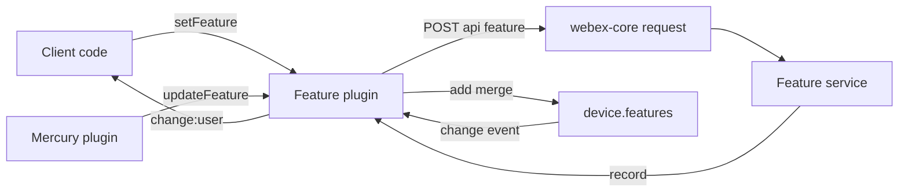
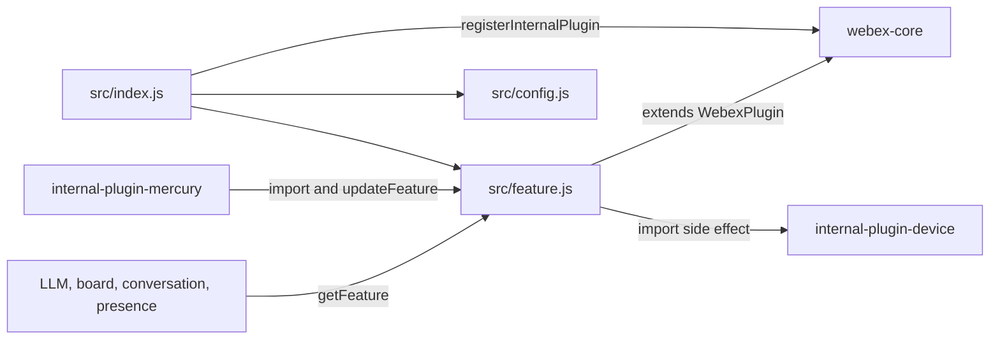

<!-- sdd-generated-metadata
doc_kind: standing-doc
generated_from: architecture@0.3.0
generated_by: claude-code
approved_by: riag@cisco.com
updated_at: 2026-10-12T14:00:30Z
validation_status: pass
-->

# @webex/internal-plugin-feature architecture

Canonical architecture for this package. Feature toggle behavior lives in the
[feature toggle plugin specification](../src/docs/README.md). This page owns package boundaries, the
plugin registration, the contract index, and how the package meets the rest of the SDK.

Related context: [specification registry](specs/README.md) ·
[package agent instructions](../AGENTS.md)

## Applicability

| Condition ID                         | Status     | Evidence or reason | Owned section |
| ------------------------------------ | ---------- | ------------------ | ------------- |
| `repo.owns_datastore`                | N/A        | No database, file store, or migration in `src/` | Repository data and schema |
| `repo.holds_client_state`            | N/A        | `Feature` declares no props or session state in `src/feature.js`; toggle records live in the device plugin | Client state model |
| `repo.components_interact`           | Applicable | `src/feature.js` imports the device plugin and `webex-core`, and Mercury calls `updateFeature` | Dependency and interaction topology |
| `repo.domain_data_across_components` | Applicable | Toggle records are written here and held in the device collections | Object and data ownership |
| `repo.caches_data`                   | N/A        | `src/feature.js` keeps no cache; the device collections are the device plugin's store | Caching catalog |
| `repo.observability_convention`      | N/A        | `src/feature.js` neither logs nor emits metrics | Observability patterns |
| `repo.deploys_to_infra`              | N/A        | Library published to npm. No service runtime. | Runtime and infrastructure |
| `repo.shared_base_libs`              | Applicable | Extends `WebexPlugin` from `webex-core` and uses the legacy build, lint, and test stack | Shared and base libraries |
| `repo.is_monorepo`                   | N/A        | This SDD root is one package. The workspace around it is out of scope. | Package map and inter-package dependencies |
| `repo.multi_platform`                | N/A        | No platform-specific source; `process` exports `{browser: true}` but `src/` does not import it | Platform matrix |
| `repo.published_package`             | Applicable | `package.json` `name` is `@webex/internal-plugin-feature` and `deploy:npm` publishes it | Release and versioning |
| `repo.embedded_in_host`              | N/A        | No host theme or embed API | Host integration and theming |
| `repo.exposes_commands_or_artifacts` | Applicable | `build:src` writes `dist/` | Commands and generated artifacts |
| `repo.cross_repo_deps_material`      | Applicable | Behavior depends on the device plugin collections, `webex-core` request handling, and Mercury callers in sibling packages | Cross-repository topology |
| `repo.security_arch_warranted`       | N/A        | The package handles no credentials; authorization is added by `webex-core` request interceptors | Security architecture |

## Design overview

`@webex/internal-plugin-feature` is a published library with one module. Importing it registers
`Feature` as the internal plugin `feature`, so every webex instance has `webex.internal.feature`.
Callers read a toggle with `getFeature`, change one with `setFeature` or several with
`setBundledFeatures`, and listen for `change:developer`, `change:entitlement`, and `change:user`.

The plugin is a stateless facade. It declares no data of its own and works on the device plugin's three
feature collections, so there is one local copy of every toggle and one change signal regardless of
whether a record arrived from registration, from a write response, or from a server push. The cost is a
hard dependency on device registration for both data and the user id used in write URLs.

The package makes outbound HTTP calls only. It serves no routes and persists nothing.

## Resource inventory and responsibilities

| Resource | Kind | Responsibility | Owner | Source | Detailed specification |
| -------- | ---- | -------------- | ----- | ------ | ---------------------- |
| Feature toggle plugin | package (one module) | Toggle reads, writes to the Feature service, pushed-update handling, and `change:*` events | @webex/web-sdk | `src` | [`src/docs/README.md`](../src/docs/README.md) |

## Interaction and execution flows

Representative end-to-end flow: a client writes a user toggle, the service stores it, the response is
merged into the device collection, and the change reaches listeners as a plugin event. A server-side
change reaches the same collection through Mercury.

| From | To | Interaction or transport | Purpose | Failure or compatibility behavior |
| ---- | -- | ------------------------ | ------- | --------------------------------- |
| Client code | Feature plugin | In-process promise call | Read or write a toggle | Invalid key types reject; malformed bundle arguments throw synchronously |
| Feature plugin | Feature service | HTTPS POST through `webex.request`, service name `feature` | Persist a toggle | Request rejection propagates and leaves local state unchanged |
| Feature plugin | Device collections | In-process `add` with `merge: true` | Store the saved record | Merge by `key`; the device plugin owns typing |
| Mercury plugin | Feature plugin | In-process call from the `featureToggle_update` handler | Apply a server-pushed record | Only `user` and `developer` types apply; a record without `type` throws |

## Dependency topology

| Dependency | Type | Used by | Purpose | Version, failure, or fallback policy |
| ---------- | ---- | ------- | ------- | ------------------------------------ |
| `@webex/internal-plugin-device` | Internal | `src/feature.js` | Toggle collections and `userId` | Workspace version (`workspace:*` in `package.json`); empty before registration |
| `@webex/webex-core` | Internal | `src/index.js`, `src/feature.js` | Plugin base class, registration, request, and event helpers | Workspace version; request errors propagate |
| `lodash` | External | `src/feature.js` | `partition` for the bundled-write response | `^4.17.21` in `package.json` |
| Feature service | External service | `src/feature.js` | Stores toggle writes | Reached by service name through the services catalog; no retry or timeout in this package |
| `@webex/internal-plugin-mercury` | Internal (caller) | Mercury plugin | Delivers pushed toggle records | No import in this package; Mercury imports this one |

No dependency cycle exists at import level: this package imports the device plugin and `webex-core`, and
Mercury imports this package. The single ordering constraint is that the device plugin must be registered
before reads return data or writes know the user id. Exact versions stay in `package.json`.

## Public and consumer surfaces

| Surface | Type | Owner | Consumers | Compatibility policy | Source |
| ------- | ---- | ----- | --------- | -------------------- | ------ |
| `webex-feature-toggles` — package `@webex/internal-plugin-feature` and `webex.internal.feature` API | SDK, published to npm, internal by convention | Feature toggle plugin | Mercury, LLM, board, conversation, presence, calling, webex-server, lyra, recipe-private-web-client | README states no strict semantic versioning | `package.json`, `src/index.js`, `src/feature.js` |
| `feature-plugin-events` — `change:developer`, `change:entitlement`, `change:user` | Event | Feature toggle plugin | Code listening on `webex.internal.feature` | Names follow the device collection names | `src/feature.js` |

The outbound Feature service resources are an internal protocol, described under *Protocol and wire
format* in the [module specification](../src/docs/README.md#protocol-and-wire-format), not a published
contract of this package.

## Cross-cutting architecture

### Security

- Trust boundaries and identity flow: the plugin builds requests and hands them to `webex.request`;
  authorization and host resolution are added by `webex-core` interceptors, not here.
- Sensitive surfaces and data classes: toggle keys and values and the user id in the request path; no
  credentials are read, stored, or logged by `src/feature.js`.
- Encryption and secret boundaries: none owned by this package; transport security is `webex-core`'s.

### Observability and operations

- Logging and correlation: none in this package; request logging comes from `webex-core` interceptors.
- Metrics, traces, and audit signals: none emitted here.
- Ownership and operational entry points: no dashboards or runbooks are recorded in this package;
  `.github/CODEOWNERS` at the workspace root routes the package to `@webex/web-sdk`.

### Quality attributes

- Compatibility: Mercury, LLM, board, conversation, and presence call `getFeature` and chain `.then`;
  Mercury calls `updateFeature` by name. Both signatures are relied upon across packages.
- Footprint: three source files and one runtime dependency beyond the workspace packages (`lodash`).
- Test confidence: unit coverage exists for reads, single writes, one push case, and change events;
  `setBundledFeatures` has none. No coverage threshold is enforced.

## Dependency and interaction topology

| From | To | Kind | Purpose | Ordering or failure boundary |
| ---- | -- | ---- | ------- | ---------------------------- |
| `src/index.js` | `src/feature.js`, `src/config.js` | Import | Build and register the plugin | Registration happens at import time |
| `src/feature.js` | `@webex/internal-plugin-device` | Import and call | Register the device plugin and use its collections | Device must be registered for data |
| `src/feature.js` | `@webex/webex-core` | Import and call | Base class and request | Errors propagate |
| `@webex/internal-plugin-mercury` | `src/feature.js` | Import and call | `updateFeature` on push | Synchronous; thrown errors surface in Mercury's handler |
| LLM, board, conversation, presence | `src/feature.js` | Call | `getFeature` | Promise; `null` for unknown toggles |

## Object and data ownership

| Object or state | System of record | May write | May read | Movement or lifecycle |
| --------------- | ---------------- | --------- | -------- | --------------------- |
| Feature toggle record (`developer`, `user`) | Feature service; local copy in `webex.internal.device.features` | Device registration (replace), this plugin (merge after write or push) | Any plugin through `getFeature` or the device collections | Registration fills the collections; writes and pushes merge by `key` |
| Entitlement record | Feature service; local copy in `webex.internal.device.features.entitlement` | Device registration only | Any plugin through `getFeature` | Replaced on registration; never written by this plugin |

## Shared and base libraries

| Library | Inherited responsibility | Consumers | Version floor | Compatibility rule |
| ------- | ------------------------ | --------- | ------------- | ------------------ |
| `@webex/webex-core` `WebexPlugin` | `webex`, `request`, `config`, namespace-keyed config, event emitter, `initialize` hook | `Feature` | `workspace:*` | Keep `initialize` delegating to `WebexPlugin.prototype.initialize` |
| `@webex/babel-config-legacy`, `@webex/eslint-config-legacy`, `@webex/jest-config-legacy`, `@webex/legacy-tools` | Build, lint, and test stack through one-line config files | Package tooling | `workspace:*` | Do not fork the config locally |

## Release and versioning

| Artifact | Publish target | Versioning rule | Deprecation window | Changelog or migration obligation |
| -------- | -------------- | --------------- | ------------------ | --------------------------------- |
| `@webex/internal-plugin-feature` | npm through `deploy:npm` | The README states the package does not strictly follow semantic versioning; no other rule is in the package | None declared | None declared in the package; the workspace owns changelog generation |

## Commands and generated artifacts

| Command or artifact | Owner | Inputs | Output or side effect | Compatibility boundary |
| ------------------- | ----- | ------ | --------------------- | ---------------------- |
| `yarn workspace @webex/internal-plugin-feature build:src` | Package scripts | `src` | Writes `dist/` through `webex-legacy-tools` (JavaScript, TypeScript, source maps) | `dist/` is generated and never edited by hand |
| `yarn workspace @webex/internal-plugin-feature test:unit` | Package scripts | `test/unit/spec` | Jest run | Aggregate `test` is not usable because `test:integration` is undefined |
| `yarn workspace @webex/internal-plugin-feature test:style` | Package scripts | `src` | ESLint run | None |

## Cross-repository topology

| Repository or external system | Relationship | Exchanged contract or artifact | Owner | Sequencing constraint |
| ----------------------------- | ------------ | ------------------------------ | ----- | --------------------- |
| `@webex/internal-plugin-device` (workspace sibling; module spec consulted) | Consumes | `webex.internal.device.features` collections and `userId` | @webex/web-sdk | Device registration precedes useful reads and writes |
| `@webex/webex-core` (workspace sibling; no module spec, source used) | Consumes | `WebexPlugin`, `registerInternalPlugin`, `request` | @webex/web-sdk | None |
| `@webex/internal-plugin-mercury` (workspace sibling; module spec consulted) | Provides to | `updateFeature` call target | @webex/web-sdk | Mercury must be connected for pushes to arrive |
| Feature service | Consumes | HTTPS resources `features/users/<userId>/<keyType>` and `.../toggles` | Not recorded in this repository | Authenticated user and registered device required |

## Domain language

| Term | Repository-specific meaning | Authoritative source |
| ---- | --------------------------- | -------------------- |
| Feature toggle | A keyed record with a string `val` and a typed `value` | `FeatureModel` in internal-plugin-device src/features/feature-model.js |
| Key type | The collection a toggle belongs to: `developer`, `user`, or `entitlement` | `src/feature.js` |
| Entitlement | A server-granted toggle that clients can read but this plugin never writes | `src/feature.js` |
| Bundled write | One request carrying a list of toggles, typed `USER` or `DEV` | `src/feature.js` |
| Pushed update | A `featureToggle_update` record forwarded by Mercury to `updateFeature` | internal-plugin-mercury src/mercury.js |

## References and maintenance

- Decisions: [adr/](adr/index.md)
- Instantiated specifications and routing: [specs/README.md](specs/README.md)
- Repository rules and patterns: [package agent instructions](../AGENTS.md)
- Update this document in the same change that alters package boundaries, resource ownership,
  cross-resource interaction, or cross-cutting architecture.
