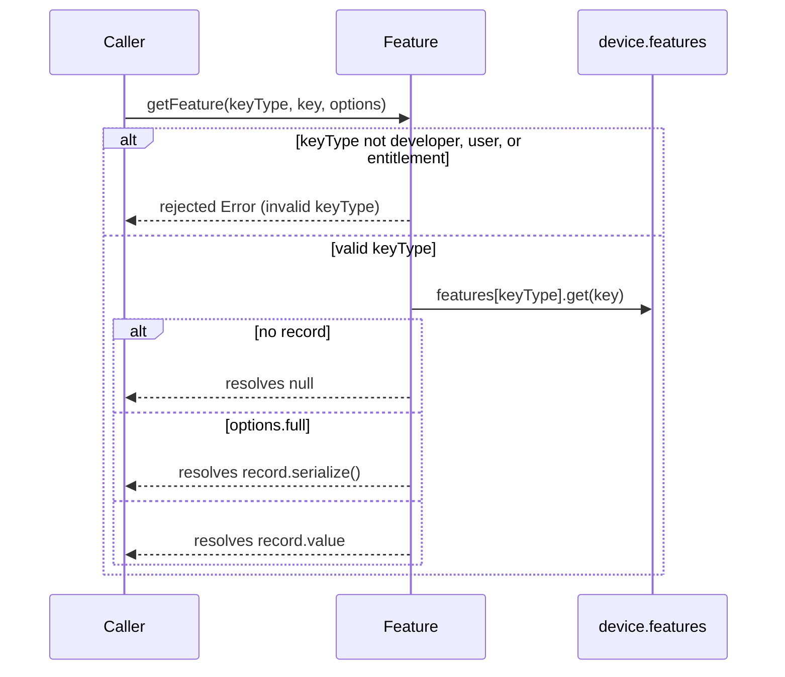
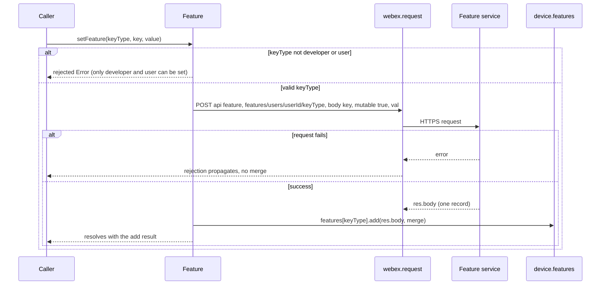
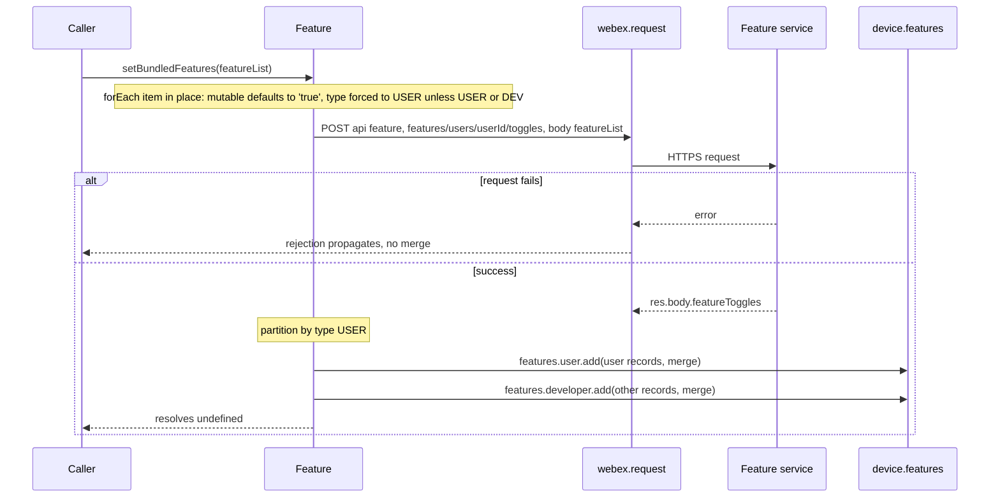
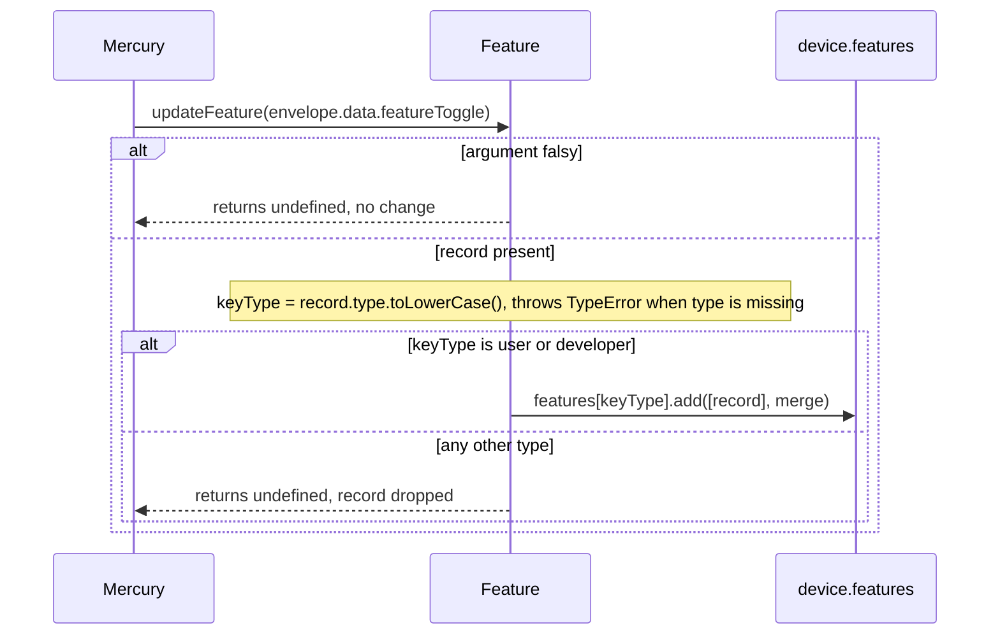
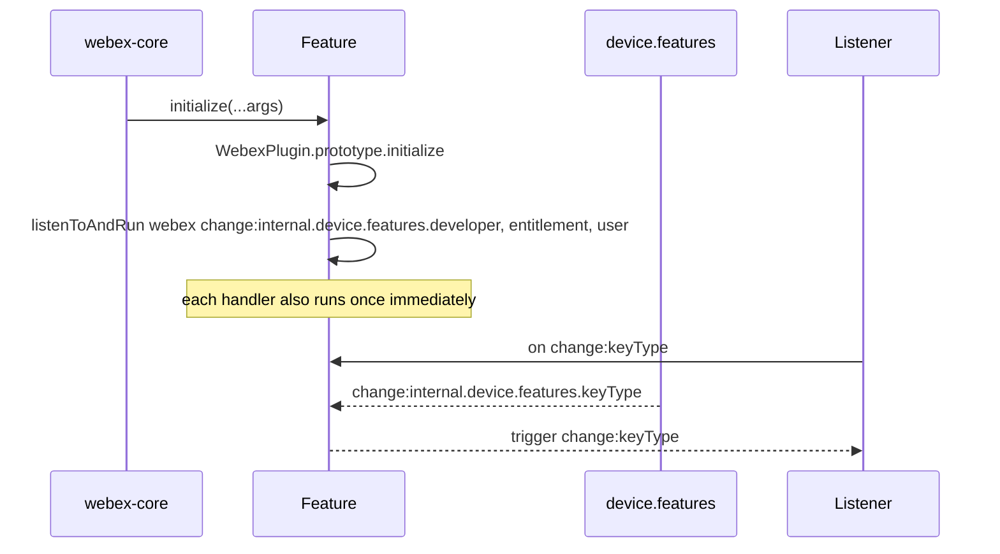
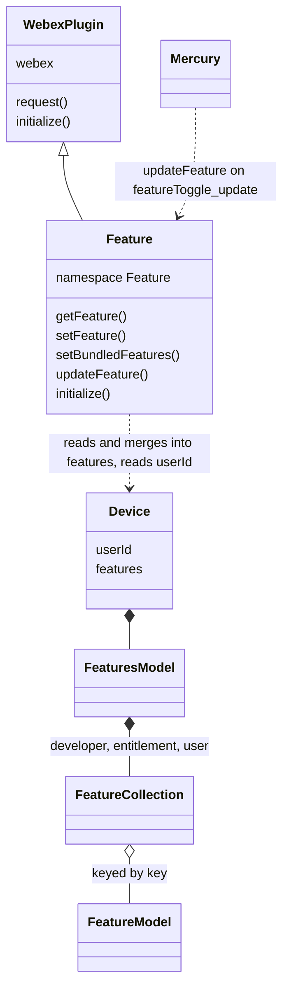

<!-- sdd-generated-metadata
doc_kind: module-spec
generated_from: module-spec@0.3.0
generated_by: claude-code
approved_by: riag@cisco.com
updated_at: 2026-10-28T08:54:44Z
validation_status: pass
-->

# Feature toggle plugin

This source-local document at `src/docs/README.md` owns the stable specification for **the feature
toggle plugin**: the `webex.internal.feature` facade over the device's feature collections. Ground
every claim in package evidence and link to the [package architecture](../../docs/architecture.md)
instead of repeating broader facts. No service specification exists because this package is a
library.

Related context: [documentation index](../../docs/index.md) ·
[package agent instructions](../../AGENTS.md)

## Metadata

| Field             | Value |
| ----------------- | ----- |
| Owner             | @webex/web-sdk |
| Source path       | `src` |
| Resource kind     | package |
| Status            | Draft |
| Last verified     | 2026-10-28 at `ff0d786826` |
| Module id         | `internal-plugin-feature` |
| Parent spec       | — |
| Doc kind          | Module spec |
| Coverage score    | 93.3% assessed 2026-10-28 — 14 of 15 mandatory fields PRESENT, critical 8 of 8; test strategy is WEAK because registration, missing-key reads, `setBundledFeatures`, developer-type and dropped-type `updateFeature`, and the `setFeature` request body are untested and the integration spec is unwired and stale |
| Validation status | pass — validator runtime `codex`, session `01a181ab-6ee4-7841-822a-c45cb65b8d99`, 2026-10-28; 0 findings |

## Applicability

| Condition ID                         | Status     | Evidence or reason | Owned section |
| ------------------------------------ | ---------- | ------------------ | ------------- |
| `module.has_tiers`                   | N/A        | No tier policy exists in this package or its `package.json` | Tier |
| `module.has_ui`                      | N/A        | No view or screen. The module reads and writes toggle records. | UI use-case flow |
| `module.crosses_service_boundaries`  | Applicable | setFeature and setBundledFeatures in `src/feature.js` send HTTP POST requests to the feature service, and Mercury pushes featureToggle_update events into updateFeature | Cross-boundary use-case flow |
| `module.holds_client_state`          | N/A        | Feature declares no props, session, or derived state in `src/feature.js`. Toggle records live in the sibling device plugin's features collections. | Client state model |
| `module.enforces_domain_rules`       | Applicable | Key-type allow-lists in getFeature, setFeature, and updateFeature, and the request normalization in setBundledFeatures, all in `src/feature.js` | Business rules and invariants |
| `module.is_concurrent_async`         | Applicable | Every public read and write returns a promise, and change events are re-emitted from device collection events in `src/feature.js` | Concurrency and reactive flow |
| `module.owns_persistence`            | N/A        | Nothing is written to storage by this package. Records are held by the device plugin and the server. | Data, schema, and migration discipline |
| `module.stateful_transitions`        | N/A        | No lifecycle states exist in `src/feature.js`; each call is independent | State machine |
| `module.exposes_wire_protocol`       | Applicable | The request bodies and the featureToggles response field handled in `src/feature.js` | Protocol and wire format |
| `module.ui_multi_screen`             | N/A        | No UI | UI flow |
| `module.large_data_model`            | N/A        | The module defines no entity types; the record shape belongs to FeatureModel in the device package | Data model |
| `module.returns_caller_errors`       | Applicable | Invalid key types reject with an Error; malformed arguments to setBundledFeatures and updateFeature throw synchronously; request failures propagate | Caller-visible failure modes |
| `module.module_specific_conventions` | Applicable | Promise-wrapped synchronous reads, in-place mutation of the bundled-write input, and server-versus-local key-type spelling in `src/feature.js` | Module-specific rules |
| `module.published_package`           | Applicable | `package.json` names the package @webex/internal-plugin-feature and defines deploy:npm | Export stability |
| `module.embedded_in_host`            | N/A        | No host theme or embed API | Host integration and theming |
| `module.has_design_tradeoff`         | Applicable | The plugin stores nothing and delegates to the device collections, which makes entitlements read-only and ties every call to device registration | Key design trade-off |
| `module.has_submodules`              | N/A        | The src directory has no child module | Sub-modules |

## Evidence register

| Evidence | What it establishes |
| -------- | ------------------- |
| `src/index.js` | Internal plugin registration as `feature` with `config`, and the default export |
| `src/feature.js` | The `Feature` plugin: `getFeature`, `setFeature`, `setBundledFeatures`, `updateFeature`, and the `initialize` change-event wiring |
| `src/config.js` | The `feature` config object, which is empty |
| `package.json` | Name, entry points, dependencies, and scripts |
| `process` | Package-root module exporting `{browser: true}`; nothing in `src/` imports it |
| `test/unit/spec/feature.js` | Unit cases for key-type validation, full and value reads, `setFeature` for two key types, one `updateFeature` case, and `change:<keyType>` events |
| `test/integration/spec/feature.js` | Live-service cases for `setFeature`, `setBundledFeatures`, and push updates; no package script runs it, and it calls `listen` and `handleFeatureUpdate`, which `Feature` does not define |
| Sibling package internal-plugin-device, file src/docs/README.md | Module spec consulted. `webex.internal.device` exposes `userId` and three feature collections (`developer`, `entitlement`, `user`) keyed by `key`, typed on parse, and re-emitting `change:<collection>` |
| Sibling package internal-plugin-device, file src/features/feature-model.js | Record fields `key`, `lastModified`, `mutable`, `type`, `val`, `value`, as used by `serialize()` in the full read |
| Sibling package internal-plugin-mercury, file src/mercury.js | The `event:featureToggle_update` handler that calls `updateFeature` with `envelope.data.featureToggle`, and the `getFeature` callers |
| Sibling package webex-core, file src/docs/README.md | Module spec consulted. `WebexPlugin` supplies `webex`, `request`, namespaced `config`, and the event emitter, and `registerInternalPlugin` surfaces the plugin on `webex.internal` |
| Sibling package webex-core, file src/lib/services/docs/README.md | Module spec consulted. `ServiceInterceptor` maps a request `api` option to `service`, requires `resource`, and resolves the URL from the services catalog |
| Sibling package webex-core, file src/lib/webex-plugin.js | Source consulted for the exact `listenToAndRun` and `request` forwarding used by `initialize` and the write methods |

## Purpose and boundary

- Responsibility: expose feature toggles to SDK code through one promise-based API, write user and
  developer toggles to the Feature service, and re-emit device toggle collection changes as plugin
  events.
- In scope: key-type validation for reads, single writes, and pushed updates; the request shapes for
  `features/users/<userId>/<keyType>` and `features/users/<userId>/toggles`; routing of write
  responses and pushed records into the device collections; the `change:developer`,
  `change:entitlement`, and `change:user` events.
- Out of scope: toggle storage, typing of `val` into `value`, registration, and the `features`
  collections (device plugin); receiving `featureToggle_update` frames from the socket (Mercury
  plugin); request transport, authentication, and URL resolution (webex-core).
- Consumers: Mercury (`getFeature`, `updateFeature`), the LLM plugin, the board, conversation, and
  presence plugins (`getFeature`), and any first-party client reading `webex.internal.feature`.

## Structure and key files

| Path | Responsibility |
| ---- | -------------- |
| `src/index.js` | Imports `Feature` and `config`, calls `registerInternalPlugin('feature', Feature, {config})`, and re-exports `Feature` as the default export |
| `src/feature.js` | The `Feature` class, built with `WebexCore.WebexPlugin.extend`, and the only place where behavior lives |
| `src/config.js` | Default export `{feature: {}}`, the empty configuration object registered with the plugin |
| `process` | Package-root file exporting `{browser: true}`; not imported by `src/` |
| `package.json` | Package name, `main` (`dist/index.js`), `devMain` (`src/index.js`), scripts, and dependencies |
| `babel.config.js`, `jest.config.js`, `.eslintrc.js` | One-line re-exports of the legacy Babel, Jest, and ESLint configurations |
| `test/unit/spec/feature.js` | Mocha-style unit spec run by Jest through `webex-legacy-tools` |
| `test/integration/spec/feature.js` | Live-service spec using test users; not wired to any script |
| dist/ (generated) | Build output of `build:src`; ignored by Git and never edited by hand |

## Public surface

| Surface | Consumer | Compatibility commitment | Source |
| ------- | -------- | ------------------------ | ------ |
| Default export `Feature` and the side effect of registering internal plugin `feature` | Any code that imports @webex/internal-plugin-feature before creating a webex instance | Internal plugin; the README states it does not follow semantic versioning | `src/index.js` |
| `webex.internal.feature.getFeature(keyType, key, options)` | Mercury, LLM, board, conversation, and presence plugins | Resolves with a value, a serialized record, or `null`; callers chain `.then` | `src/feature.js` |
| `webex.internal.feature.setFeature(keyType, key, value)` | First-party clients | Resolves after the server round trip and local merge | `src/feature.js` |
| `webex.internal.feature.setBundledFeatures(featureList)` | First-party clients | Resolves with no value; mutates the input array | `src/feature.js` |
| `webex.internal.feature.updateFeature(feature)` | Mercury `featureToggle_update` handler | Accepts one server record; ignores types other than user and developer | `src/feature.js` |
| Events `change:developer`, `change:entitlement`, `change:user` | Code listening on `webex.internal.feature` | One event per device collection change | `src/feature.js` |
| Configuration namespace `feature` | webex-core config merge | Declared and empty; reading `webex.config.feature` yields `{}` | `src/config.js` |

Contract IDs `webex-feature-toggles` and `feature-plugin-events` are indexed in the
[package architecture](../../docs/architecture.md#public-and-consumer-surfaces) and registered in
`.sdd/manifest.json`. Export stability is under [Export stability](#export-stability).

## Dependencies

| Dependency | Why it is required | Failure behavior |
| ---------- | ------------------ | ---------------- |
| `@webex/internal-plugin-device` (module spec consulted) | Supplies `webex.internal.device.features.{developer,entitlement,user}` and `webex.internal.device.userId`; imported for its registration side effect in `src/feature.js` | Before registration the collections are empty, so reads resolve `null`; `userId` is `undefined`, so write URLs contain the text `undefined` |
| `@webex/webex-core` (module specs consulted) | `WebexPlugin` base class, `registerInternalPlugin`, `this.request`, `listenToAndRun`, and URL resolution for `api: 'feature'` | A rejected request propagates unchanged to the caller |
| Feature service (external, reached as service name `feature`) | Stores toggle writes and returns the saved records | Non-2xx and network failures reject the write promise; local collections stay unchanged |
| `lodash` (`partition`) | Splits the bundled-write response into user and developer records | Not applicable; `partition(undefined, ...)` returns two empty lists |
| `@webex/internal-plugin-mercury` (caller, no import) | Pushes `featureToggle_update` records into `updateFeature` | Without Mercury no pushed updates arrive; reads and writes are unaffected |

## Requirements

| ID | WHAT | WHY | Source evidence | Test or example evidence | Assumptions or gaps | Confidence |
| -- | ---- | --- | --------------- | ------------------------ | ------------------- | ---------- |
| `MOD-001` | Importing the package registers internal plugin `feature` with config `{feature: {}}` and re-exports `Feature` as default. | Consumers read `webex.internal.feature` with no explicit setup. | `src/index.js`, `src/config.js` | `test/unit/spec/feature.js` builds the plugin through `MockWebex` children, not through registration; `test/integration/spec/feature.js` imports the package but is not run | No unit case exercises `registerInternalPlugin` or the default config | Weak |
| `MOD-002` | `getFeature` rejects with an `Error` when `keyType` is not `developer`, `user`, or `entitlement`. | A mistyped key type must fail loudly instead of reading the wrong collection. | `src/feature.js` | `test/unit/spec/feature.js` `requires a valid keyType` | None | Present |
| `MOD-003` | `getFeature` resolves `null` when the collection has no record for `key`. | Callers distinguish an unknown toggle from a false toggle. | `src/feature.js` | None found | No unit case reads a missing key | Weak |
| `MOD-004` | `getFeature` resolves the record's typed `value`, or the record's `serialize()` output when `options.full` is truthy. | Most callers need the value; metadata callers need the whole record. | `src/feature.js` | `test/unit/spec/feature.js` `returns the full feature object`, `returns the feature value` | The full-read test uses a `developer` record only | Present |
| `MOD-005` | `setFeature` rejects with an `Error` unless `keyType` is `developer` or `user`. | Entitlements are server-granted and must not be writable from the client. | `src/feature.js` | `test/unit/spec/feature.js` `does not allow entitlement keyType to be set` | Only `entitlement` is tested; an unknown key type shares the same branch | Present |
| `MOD-006` | `setFeature` POSTs `{key, mutable: true, val}` to service `feature` at `features/users/<device.userId>/<keyType>`, merges `res.body` into `device.features[keyType]`, and resolves with the result of that merge. | The device collection is the single local store, so the write must land there. | `src/feature.js` | `test/unit/spec/feature.js` `sets a value for a developer feature toggle`, `sets a value for a user feature toggle` | The unit test asserts the resource and that `add` was called; it does not assert the body, method, or `api` | Present |
| `MOD-007` | `setBundledFeatures` sets each item's `mutable` to `'true'` when falsy and its `type` to `'USER'` unless it is `'USER'` or `'DEV'`, POSTs the list to `features/users/<device.userId>/toggles`, then merges the response's `featureToggles` records of type `USER` into `features.user` and all others into `features.developer`. | One request updates several toggles and keeps both local collections in step. | `src/feature.js` | `test/integration/spec/feature.js` `sets a value for two user feature toggle` (not run by any script) | No unit case; the integration case is the only evidence | Weak |
| `MOD-008` | `updateFeature` ignores a falsy argument, lower-cases `feature.type`, and merges the record into `features.user` or `features.developer`; any other type is dropped. | Server pushes cover only the legacy user and developer toggles. | `src/feature.js` | `test/unit/spec/feature.js` `updates the feature toggle` (user type) | No case for the developer type, a dropped type, or a falsy argument | Present |
| `MOD-009` | Mercury calls `updateFeature(envelope.data.featureToggle)` on `event:featureToggle_update`. | Server-pushed toggle changes take effect without polling. | internal-plugin-mercury src/mercury.js | Mercury's own unit spec (see its module spec) | The call site is owned by Mercury; this package has no test of the wiring | Present |
| `MOD-010` | After `initialize`, a change to `webex.internal.device.features.developer`, `.entitlement`, or `.user` triggers `change:developer`, `change:entitlement`, or `change:user` on the plugin. | Consumers subscribe to one plugin instead of the device internals. | `src/feature.js` | `test/unit/spec/feature.js` `emits `change:<keyType>` on <keyType> feature change` for all three | The handler also runs once during `initialize`; no test observes that | Present |

## Design overview

`Feature` is a stateless facade. `WebexCore.WebexPlugin.extend` supplies `webex`, `request`, `config`,
and the event emitter; `Feature` adds four methods and one `initialize` override and declares no
props, session fields, or derived fields. All data lives in the device plugin's three feature
collections, so a read is a lookup and a write is a request followed by a merge into those
collections.

Reads go to `webex.internal.device.features[keyType]` and return through `Promise.resolve`, which
keeps the API asynchronous even though the lookup is synchronous. Writes use `this.request` with
`api: 'feature'`; webex-core converts `api` to a service name and resolves the host from the services
catalog, attaches authorization, and returns the response. The response body is merged into the device
collection, which raises the device change event, which `initialize` re-emits on the plugin.

Pushed updates take the short path: Mercury hands one record to `updateFeature`, which merges it into
the collection with no request. Both paths therefore end in the same collection merge and the same
change event, which is why `change:<keyType>` is the one signal a consumer needs.

Ownership of typing (`val` string to `value`) stays with the device plugin's `FeatureModel`, which is
why this module sends strings out and never parses them.

## Data flow and sequence coverage

Call style: in-process promise calls on `webex.internal.feature`; outbound HTTPS requests through
`webex.request`; one inbound in-process call from the Mercury plugin; synchronous Ampersand events
from the device collections. Five operation groups share no actors, ordering, or outcome, so each has
its own diagram. Failure branches are drawn in the diagram where the actor order differs.

| Operation group | Entry and outcome | Diagram or evidence | Failure and recovery coverage |
| --------------- | ----------------- | ------------------- | ----------------------------- |
| Read a toggle | `getFeature` resolves a value, a record, or `null` | Read diagram; `src/feature.js` | Invalid key type rejects; missing key resolves `null` |
| Write one toggle | `setFeature` POSTs one record and merges the reply | Single-write diagram; `src/feature.js` | Invalid key type rejects before any request; request failure rejects with no merge |
| Write a bundle | `setBundledFeatures` POSTs a list and merges by type | Bundle-write diagram; `src/feature.js` | Request failure rejects with no merge; bad input throws before any request |
| Apply a pushed update | Mercury calls `updateFeature` with one record | Push diagram; `src/feature.js` | Falsy input ignored; unsupported type dropped; a record with no `type` throws |
| Initialize and propagate changes | `initialize` subscribes; device changes become plugin events | Initialization diagram; `src/feature.js` | No failure branch; handlers are not removed explicitly |

### Read a toggle

### Write one toggle

### Write a bundle

### Apply a pushed update

### Initialize and propagate changes

## Class and component relationships

`Feature` reaches the device through `this.webex.internal.device` at call time, not through a stored
reference, so it holds no link that could go stale across registrations.

## Use cases and flows

| Use case | Actor or caller | Primary steps and outcome | Failure or boundary behavior | Evidence |
| -------- | --------------- | ------------------------- | ---------------------------- | -------- |
| `UC-001` | SDK plugin gating a code path | Calls `getFeature('developer', name)` and branches on the resolved value | Unknown toggle resolves `null`, which is falsy | `src/feature.js`, internal-plugin-mercury src/mercury.js, `test/unit/spec/feature.js` |
| `UC-002` | Client reading toggle metadata | Calls `getFeature(keyType, key, {full: true})` and receives the serialized record | Missing record resolves `null` | `src/feature.js`, `test/unit/spec/feature.js` |
| `UC-003` | Client changing one toggle | Calls `setFeature('user', key, value)`; the record returned by the service is merged and `change:user` fires | Entitlement and unknown key types reject; request errors reject | `src/feature.js`, `test/unit/spec/feature.js` |
| `UC-004` | Client changing several toggles | Calls `setBundledFeatures([...])`; both collections are updated from one response | Throws when the argument is not an iterable list; request errors reject | `src/feature.js`, `test/integration/spec/feature.js` |
| `UC-005` | Mercury delivering a server change | Calls `updateFeature(record)`; the record is merged and `change:<type>` fires | Unsupported types are dropped; a record without `type` throws | `src/feature.js`, internal-plugin-mercury src/mercury.js, `test/unit/spec/feature.js` |
| `UC-006` | Client reacting to toggle changes | Subscribes with `webex.internal.feature.on('change:user', handler)` | Handlers are invoked synchronously with the device event's arguments | `src/feature.js`, `test/unit/spec/feature.js` |

### Cross-boundary use-case flow

| Boundary | Transport and ordering | Compatibility | Timeout, retry, and recovery |
| -------- | ---------------------- | ------------- | ---------------------------- |
| Feature service, outbound (`UC-003`, `UC-004`) | HTTPS POST through `webex.request`; the local merge happens only after the response resolves, so a write is visible locally after the server accepted it | The `feature` service name, the `features/users/<userId>/...` resources, and the body shapes are the contract; webex-core adds authorization and host resolution | This module sets no timeout and no retry; whatever policy webex-core request interceptors apply is the policy, and a rejection leaves local state untouched |
| Mercury push, inbound (`UC-005`) | In-process call from Mercury's `featureToggle_update` handler, delivered in socket order | Record fields and `type` spelling (`USER`, `DEVELOPER`, any case) follow the server frame, which Mercury forwards unchanged | No acknowledgement or retry; a thrown error surfaces in the Mercury handler |

## Business rules and invariants

| ID | Invariant | WHY | Enforcement source | Test evidence |
| -- | --------- | --- | ------------------ | ------------- |
| `INV-001` | Reads accept exactly the key types `developer`, `user`, and `entitlement`. | Those are the three device collections. | `src/feature.js` | `test/unit/spec/feature.js` `requires a valid keyType` |
| `INV-002` | The plugin never writes the `entitlement` collection: `setFeature` rejects it, `updateFeature` drops it, and `setBundledFeatures` routes records only to `user` or `developer`. | Entitlements are granted by the server, not toggled by clients. | `src/feature.js` | `test/unit/spec/feature.js` `does not allow entitlement keyType to be set`; no test for the other two paths |
| `INV-003` | The plugin holds no toggle data of its own; every read and write goes through `webex.internal.device.features`. | A second store would diverge from the device registration result. | `src/feature.js` | `test/unit/spec/feature.js` `returns the feature value` reads data added directly to the device collection |
| `INV-004` | Writes target the current device user: the resource path always embeds `webex.internal.device.userId`. | The Feature service scopes toggles per user. | `src/feature.js` | `test/unit/spec/feature.js` `sets a value for a <keyType> feature toggle` asserts the resource |
| `INV-005` | Local collections change only after a successful response or an explicit pushed record, never optimistically. | A rejected write must leave the device state matching the server. | `src/feature.js` | None found |

## Concurrency and reactive flow

- Execution model: single JavaScript event loop; public methods return promises, and `updateFeature`
  runs synchronously inside the Mercury event handler.
- Ordering guarantees: none across calls. Two overlapping writes each merge their own response when it
  arrives, so the later response wins for the same `key`. Change events fire synchronously inside the
  collection merge, before the write promise resolves.
- Idempotency and retry: no deduplication, keys, or retries are implemented here; repeating a write
  repeats the request, and the server's final record is merged again with `merge: true`.
- Shared-state protection: none. The device collections are the shared state; Ampersand merging by
  `key` makes repeated adds of the same record converge.
- Blocking restrictions: nothing blocks; `setBundledFeatures` does its normalization and partition
  synchronously, and the list is processed in one pass.

## Protocol and wire format

| Message or frame | Version | Producer or serializer | Consumer or parser | Compatibility and ordering rule |
| ---------------- | ------- | ---------------------- | ------------------ | ------------------------------- |
| POST `features/users/<userId>/<keyType>` body `{key, mutable: true, val}`; response body is one record | Unversioned in this package | `setFeature` in `src/feature.js` | Feature service; response merged into `features[keyType]` | `keyType` is `developer` or `user`; `val` is sent as given and typed by the device model on merge |
| POST `features/users/<userId>/toggles` body `[{key, val, type, mutable}]`; response body `{featureToggles: [...]}` | Unversioned in this package | `setBundledFeatures` in `src/feature.js` | Feature service; response partitioned and merged | `type` is `USER` or `DEV`; `mutable` defaults to the string `'true'`; records with type `USER` go to `user`, all others to `developer` |
| Pushed record `{key, val, type, mutable}` passed to `updateFeature` | Defined by the Mercury frame | Mercury (internal-plugin-mercury src/mercury.js) | `updateFeature` in `src/feature.js` | `type` compared in lower case; only `user` and `developer` are applied |

The shape of a stored record (`key`, `lastModified`, `mutable`, `type`, `val`, `value`) is owned by
`FeatureModel` in the device package. The `feature` service name is resolved by webex-core from the
services catalog; its route definitions are not in this repository.

## Caller-visible failure modes

| Condition | Signal or result | Caller behavior | Retry or recovery | Evidence |
| --------- | ---------------- | --------------- | ----------------- | -------- |
| `getFeature` with a key type other than `developer`, `user`, `entitlement` | Rejected promise, `Error` with message "Invalid feature keyType provided. Only `developer`, `user`, and `entitlement` feature toggles are permitted." | Fix the argument | None | `src/feature.js`, `test/unit/spec/feature.js` |
| `getFeature` for an unknown key, or before registration | Resolves `null` | Treat as toggle off or unknown | Re-read after registration | `src/feature.js` |
| `setFeature` with a key type other than `developer` or `user` | Rejected promise, `Error` with message "Only `developer` and `user` feature toggles can be set." | Fix the argument | None | `src/feature.js`, `test/unit/spec/feature.js` |
| `setFeature` or `setBundledFeatures` request fails | The `webex.request` rejection, unchanged | Handle the HTTP error | Caller may repeat the call; no local state changed | `src/feature.js` |
| `setFeature` or `setBundledFeatures` before the device has a `userId` | Request is sent to a path containing `undefined` | Register the device first | Repeat after registration | `src/feature.js` |
| `setBundledFeatures` with a non-array argument or a null item | Synchronous `TypeError`, not a rejected promise | Validate before calling | None | `src/feature.js` |
| `updateFeature` with a record that has no `type` | Synchronous `TypeError` from `feature.type.toLowerCase()` | Mercury's handler surfaces it | None | `src/feature.js` |
| `updateFeature` with type other than user or developer | Silently ignored | None | None | `src/feature.js` |

## Pitfalls and constraints

- `getFeature` and `setFeature` have JSDoc that describes their resolved values rather than the
  promise they return, and `setFeature` documents resolving with the endpoint's response while the code
  resolves with the result of the collection merge. Trust the code in `src/feature.js`.
- `setBundledFeatures` mutates the objects in the caller's array (`mutable`, `type`). Pass copies when
  the originals are reused.
- A bundled record whose `type` is not `USER` or `DEV` is rewritten to `USER` before sending, but the
  response partition sends every non-`USER` record to the developer collection, including a server
  record typed as an entitlement.
- Write resources embed `webex.internal.device.userId` with no check, so a call made before
  registration targets `features/users/undefined/...`.
- The unit spec covers `getFeature`, `setFeature`, one `updateFeature` case, and change events;
  `setBundledFeatures` is covered only by `test/integration/spec/feature.js`, which no script runs and
  which references `listen` and `handleFeatureUpdate`, neither of which `Feature` defines.
- `yarn test` chains `test:integration`, which `package.json` does not define. Run `test:unit` and
  `test:style` directly.
- The key-type vocabulary differs by path: `developer`, `user`, `entitlement` (lower case) for reads
  and single writes, `USER` and `DEV` for bundled writes, and any case for pushed records, which are
  lower-cased before comparison.

## Module-specific rules

- Do: keep every public read and write returning a promise; callers chain `.then` on `getFeature`
  (internal-plugin-mercury src/mercury.js).
- Do: route every local change through `this.webex.internal.device.features[keyType]` with
  `{merge: true}` so change events and typing stay with the device plugin (`src/feature.js`).
- Do not: add props or caches to `Feature`; a second store would diverge from the device collections
  (`INV-003`).
- Do not: widen the writable key types to `entitlement` without a server contract (`INV-002`).
- Do not: rename `updateFeature`; Mercury and the calling package's connector types reference it by
  name (internal-plugin-mercury src/mercury.js,
  calling src/SDKConnector/types.ts).

## Export stability

| Export or entry point | Consumer | Stability | Versioning and deprecation rule | Declaration or API report |
| --------------------- | -------- | --------- | ------------------------------- | ------------------------- |
| Default export `Feature` from @webex/internal-plugin-feature | First-party SDK packages | Internal | The README states the package is internal and does not strictly follow semantic versioning; no deprecation window is declared | `src/index.js` |
| Import side effect: internal plugin `feature` | Packages that import the barrel (Mercury, board, lyra, calling, webex-server, recipe-private-web-client) | Internal | Same | `src/index.js`, `package.json` |
| Plugin API `webex.internal.feature.*` and `change:*` events | First-party clients | Internal | Same | `src/feature.js` |

No TypeScript declaration or API report is shipped; `package.json` has no `types` field and the
source is JavaScript.

## Key design trade-off

| Chosen trade-off | Preserved invariant or benefit | Cost or limitation | Decision evidence |
| ---------------- | ------------------------------ | ------------------ | ----------------- |
| Hold no state and delegate to the device `features` collections | One source of truth for toggles; the same change events fire for registration results, writes, and pushes | Every call depends on device registration for data and `userId`; entitlements are read-only; reads before registration return `null` instead of failing | `src/feature.js`, internal-plugin-device src/docs/README.md |

## Verification

| Requirement or invariant | Test level | Positive evidence | Negative or boundary evidence | Gap |
| ------------------------ | ---------- | ----------------- | ----------------------------- | --- |
| `MOD-001` | Unit | None found | None found | Registration and default config untested |
| `MOD-002`, `INV-001` | Unit | `test/unit/spec/feature.js` returns the feature value | `test/unit/spec/feature.js` requires a valid keyType | `user` and `entitlement` reads untested |
| `MOD-003` | Unit | None found | None found | Missing-key read untested |
| `MOD-004` | Unit | `test/unit/spec/feature.js` returns the full feature object, returns the feature value | None found | No full read for another key type |
| `MOD-005`, `INV-002` | Unit | `test/unit/spec/feature.js` sets a value for a developer feature toggle, sets a value for a user feature toggle | `test/unit/spec/feature.js` does not allow entitlement keyType to be set | Unknown key type; the `updateFeature` and bundle paths of `INV-002` |
| `MOD-006`, `INV-004` | Unit | `test/unit/spec/feature.js` sets a value for a developer feature toggle (resource and add call) | None found | Request body, `api`, and method not asserted; failed request leaves state unchanged (`INV-005`) untested |
| `MOD-007` | Integration (not run) | `test/integration/spec/feature.js` sets a value for two user feature toggle | None found | No unit case; in-place mutation, `DEV` routing, and empty response unpinned |
| `MOD-008` | Unit | `test/unit/spec/feature.js` updates the feature toggle | None found | Developer type, dropped type, falsy and typeless arguments untested |
| `MOD-009` | Unit (Mercury package) | Mercury unit spec, see internal-plugin-mercury src/docs/README.md | None found | No contract test across the two packages |
| `MOD-010` | Unit | `test/unit/spec/feature.js` emitschange:developeron developer feature change, and the entitlement and user variants | None found | Initial immediate invocation unobserved |
| `INV-003` | Unit | `test/unit/spec/feature.js` returns the feature value | None found | No test asserting absence of local state |

Coverage gaps are recorded above. `test/integration/spec/feature.js` needs repair (`listen`,
`handleFeatureUpdate`) and a runnable script before it can count as coverage. A module specification is
complete only when its public surface, invariants, failure modes, and test evidence agree with the
implementation. Generator-side field measurement is complete. Independent semantic validation by
runtime `codex`, session `01a181ab-6ee4-7841-822a-c45cb65b8d99`, passed on 2026-10-28 with no
findings; drift recording, a characterization baseline, and promotion past Partial remain pending.
