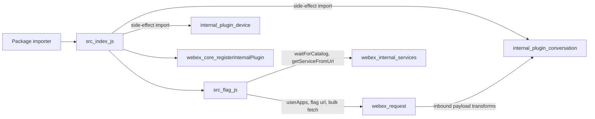
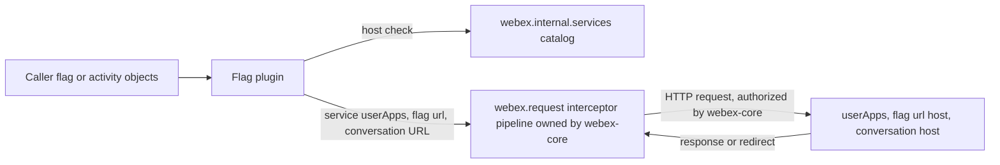

<!-- sdd-generated-metadata
doc_kind: standing-doc
generated_from: architecture@0.3.0
generated_by: claude-cowork
approved_by: akulakum@cisco.com
updated_at: 2026-10-15T14:22:13Z
validation_status: pass-with-warnings
-->

# @webex/internal-plugin-flag architecture

Canonical architecture for this package. Plugin behavior lives in the
[Flag plugin specification](../src/docs/README.md). This page owns package boundaries, the plugin
registration, the contract index, and how the package meets the rest of the SDK.

Related context: [specification registry](specs/README.md) ·
[package agent instructions](../AGENTS.md)

## Applicability

| Condition ID                         | Status     | Evidence or reason | Owned section |
| ------------------------------------ | ---------- | ------------------ | ------------- |
| `repo.owns_datastore`                | N/A        | No database, file store, or migration in `src/`; flag storage is assumed to be in the user-apps flags service (contract not in this repository) | Repository data and schema |
| `repo.holds_client_state`            | N/A        | No state is kept between calls (`src/flag.js`) | Client state model |
| `repo.components_interact`           | N/A        | One module. The import graph is shown under Interaction and execution flows. | Dependency and interaction topology |
| `repo.domain_data_across_components` | N/A        | One module; flag and activity objects are passed through, not shared between components | Object and data ownership |
| `repo.caches_data`                   | N/A        | No cache in `src/` | Caching catalog |
| `repo.observability_convention`      | N/A        | One warning line, no logging, metric, or trace convention; see Observability and operations | Observability patterns |
| `repo.deploys_to_infra`              | N/A        | Library published to npm. No service runtime. | Runtime and infrastructure |
| `repo.shared_base_libs`              | Applicable | Inherits WebexPlugin and the legacy build, lint, and test stack | Shared and base libraries |
| `repo.is_monorepo`                   | N/A        | This SDD root is one package. The workspace around it is out of scope. | Package map and dependencies |
| `repo.multi_platform`                | Applicable | The same `src/` targets Node (`package.json` engines, the Jest run) and browsers (the browserify transforms, the test:browser script, and the `process` browser-testing file) | Platform matrix |
| `repo.published_package`             | Applicable | `package.json` name is @webex/internal-plugin-flag and the deploy:npm script publishes it | Release and versioning |
| `repo.embedded_in_host`              | N/A        | No host theme or embed API | Host integration and theming |
| `repo.exposes_commands_or_artifacts` | Applicable | The build:src script writes the build output directory (`package.json`) | Commands and generated artifacts |
| `repo.cross_repo_deps_material`      | Applicable | Behavior depends on sibling workspace packages webex-core, internal-plugin-conversation, and internal-plugin-device | Cross-repository topology |
| `repo.security_arch_warranted`       | Applicable | Requests go to URLs taken from flag objects, and the package checks activity hosts against the catalog before a bulk fetch | Security architecture |

## Design overview

`@webex/internal-plugin-flag` is a published library with one module. Importing it imports the
conversation and device plugins and registers `Flag` as the internal plugin `flag` with an empty
config. Webex instances constructed after the import have `webex.internal.flag`.

The plugin is a thin client for activity flags: it creates and lists flags through the catalog
service `userApps`, changes or deletes a flag through the flag's own `url`, and fetches flagged
activities from conversation hosts that the service catalog recognizes. It keeps no state, serves no
routes, and persists nothing.

## Resource inventory and responsibilities

| Resource | Kind | Responsibility | Owner | Source | Detailed specification |
| -------- | ---- | -------------- | ----- | ------ | ---------------------- |
| Flag plugin | module | Flag requests and activity mapping | @webex/web-sdk | `src/` | `src/docs/README.md` |
| Published package | package | npm entry points and the registration side effect | @webex/web-sdk | `package.json` | N/A (this document) |

## Interaction and execution flows

| From | To | Interaction or transport | Purpose | Failure or compatibility behavior |
| ---- | -- | ------------------------ | ------- | --------------------------------- |
| Importer | `src/index.js` | package import | Register the plugin | Without the import, `webex.internal.flag` is absent |
| `src/index.js` | conversation and device plugins | side-effect import | Registers both plugins and their request-pipeline additions, such as the device plugin's device-URL interceptor | Registration happens at load time. On webex instances constructed after the import, when the device-URL interceptor is in the interceptor set (see the Flag plugin spec Dependencies row for webex-core) and a device is registered, it can add a header to, or reject, this package's requests (owned by internal-plugin-device; see its SDD module spec) |
| `src/index.js` | webex-core | `registerInternalPlugin` | Stores the plugin and config | See the Flag plugin spec `MOD-001` |
| `src/flag.js` | `webex.internal.services` | in-process promise and calls | Catalog wait and host check before a bulk fetch | See the Flag plugin spec `INV-003` |
| `src/flag.js` | `webex.request` | HTTP | Flag and bulk-fetch requests | See the Flag plugin spec Caller-visible failure modes |
| webex-core payload pipeline | conversation plugin | in-process promise | When the payload-transformer interceptor is in the interceptor set (see the Flag plugin spec Dependencies row for webex-core), the conversation plugin's registered inbound predicates can run on the responses, including the bulk-fetch `multistatus` body | Owned by internal-plugin-conversation |

## Dependency topology

| Dependency | Type | Used by | Purpose | Version, failure, or fallback policy |
| ---------- | ---- | ------- | ------- | ------------------------------------ |
| `@webex/webex-core` | Internal | `src` | Plugin base, registration, request, logger, services plugin | Workspace version |
| `@webex/internal-plugin-conversation` | Internal | `src` | Side-effect import; its payload transforms can act on responses (interceptor-set dependent) | Workspace version |
| `@webex/internal-plugin-device` | Internal | `src` | Side-effect import only | Workspace version |
| `lodash` | External | `src` | `flatten` | Range in `package.json` |
| `@webex/test-helper-chai`, `@webex/test-helper-mock-webex`, `@webex/test-helper-test-users` | Internal | tests only | Declared under `dependencies` and `devDependencies`; not imported by `src/` | Workspace version |

No dependency cycle exists inside the package.

## Public and consumer surfaces

| Surface | Type | Owner | Consumers | Compatibility policy | Source |
| ------- | ---- | ----- | --------- | -------------------- | ------ |
| `flag-sdk` (published) | SDK | Flag plugin | Sibling packages webex-server and recipe-private-web-client (import only); any application that imports the package | Internal plugin; see Release and versioning | `package.json` |
| `webex-core-plugin-host` (required) | SDK | sibling package webex-core | Flag plugin | External | Sibling package webex-core |
| `conversation-sdk` (required) | SDK | sibling package internal-plugin-conversation | Package barrel; bulk-fetch responses | External | Sibling package internal-plugin-conversation |
| `webex-device-registration` (required) | SDK | sibling package internal-plugin-device | Package barrel | Specified in its SDD module spec, file src/docs/README.md of that package | Sibling package internal-plugin-device |
| `user-apps-flags-http` (required) | HTTP | User-apps flags service | Flag plugin | External; consumed, not served | Catalog service userApps (contract not in this repository) |
| `conversation-bulk-activities-http` (required) | HTTP | Conversation service | `mapToActivities` | External; consumed, not served | bulk_activities_fetch on a conversation URL (contract not in this repository) |

`flag-sdk` entry points: `main` points at the build output and `devMain` at `src/index.js`. No HTTP
surface is served, so `api-specs/openapi.yaml` is omitted.

## Cross-cutting architecture

### Security

- Trust boundaries and identity flow: see Security architecture.
- Sensitive surfaces and data classes: see Security architecture.
- Encryption and secret boundaries: see Security architecture.

### Observability and operations

- Logging and correlation: one `this.logger.warn` in `mapToActivities` (webex-core's `webex.logger`,
  or `console` when absent) for each skipped activity URL; no prefix or correlation convention.
- Metrics, traces, and audit signals: none emitted by this package.
- Ownership and operational entry points: no runtime to deploy or monitor; owners are listed in
  References and maintenance.

### Quality attributes

- Compatibility: the plugin name `flag`, the six method names, and their resolved values are the
  surfaces callers rely on.
- Correctness: the host check and the `'200'` filter decide which activities callers see; see the
  Flag plugin spec `INV-003` and `INV-005`.
- Footprint: three direct runtime imports beyond lodash; through them, the conversation and device
  plugins and the plugins they import are registered. No native or platform-specific code.

## Shared and base libraries

| Library | Inherited responsibility | Consumers | Version floor | Compatibility rule |
| ------- | ------------------------ | --------- | ------------- | ------------------ |
| `WebexPlugin` from `@webex/webex-core` | `this.webex`, `this.logger`, `this.config`, and `request()` delegating to `webex.request` | `src/flag.js` | workspace | Follow webex-core plugin conventions |
| `@webex/babel-config-legacy`, `@webex/eslint-config-legacy`, `@webex/jest-config-legacy` | Build, lint, and Jest config passthroughs | `babel.config.js`, `.eslintrc.js`, `jest.config.js` | workspace | Change upstream, not in the passthrough files |
| `@webex/legacy-tools` | `webex-legacy-tools` build and test runners | `package.json` scripts | workspace | Scripts call it; do not replace locally |

## Platform matrix

| Platform | Shared versus platform-specific boundary | Entry or build | Support and compatibility constraints |
| -------- | ---------------------------------------- | -------------- | ------------------------------------- |
| Node.js | All of `src/` is shared; no platform-specific code | `main` build output from `yarn workspace @webex/internal-plugin-flag build:src`; tested by `test:unit` (Jest) | Consumer floor: see [Getting started](getting-started.md) Prerequisites; Node 22.14 for development |
| Browser | Same `src/`, bundled by the consumer through the `browserify` transforms (`babelify`, `envify`) in `package.json` | `yarn workspace @webex/internal-plugin-flag test:browser` (karma), with the package-root `process` browser-testing file | Not verified in this Stage 0; see [Getting started](getting-started.md) Tests |

## Release and versioning

| Artifact | Publish target | Versioning rule | Deprecation window | Changelog or migration obligation |
| -------- | -------------- | --------------- | ------------------ | --------------------------------- |
| `@webex/internal-plugin-flag` | npm, through the `deploy:npm` script (manifest `commands.deploy`) | Workspace release workflow (file .github/workflows/deploy.yml at the repository root), which runs this script for each released package with public access, the branch as the dist-tag, and an npm token; README says the internal plugin does not strictly follow semver | None declared in code | No package-local changelog; workspace tooling owns it |

## Commands and generated artifacts

| Command or artifact | Owner | Inputs | Output or side effect | Compatibility boundary |
| ------------------- | ----- | ------ | --------------------- | ---------------------- |
| `yarn install` | workspace | root `package.json` and lockfile | workspace `node_modules` | Run from the workspace root |
| `yarn workspace @webex/internal-plugin-flag build` | package | `src/` | build output through `build:src` | Build output is never edited by hand |
| `yarn workspace @webex/internal-plugin-flag build:src` | package | `src/` (`.js` and `.ts`) | build output with source maps | Markdown under `src/` is not processed |
| `yarn workspace @webex/internal-plugin-flag test:unit` | package | `test/unit/spec/` | Jest result | See Getting started Tests |
| `yarn workspace @webex/internal-plugin-flag test:browser` | package | `test/integration/spec/` | karma result | The integration tier; see Getting started Tests |
| `yarn workspace @webex/internal-plugin-flag test:style` | package | files under `src/` | eslint result | See Getting started Tests |
| `yarn workspace @webex/internal-plugin-flag deploy:npm` | package | build output, `package.json` | Publishes the package to the npm registry | Release pipeline only: the release workflow adds public access, the dist-tag, and the npm token; a direct run publishes with Yarn's default access and dist-tag, to the registry set by the root `.yarnrc.yml` `npmRegistryServer`, using the caller's own npm auth |

## Cross-repository topology

| Repository or external system | Relationship | Exchanged contract or artifact | Owner | Sequencing constraint |
| ----------------------------- | ------------ | ------------------------------ | ----- | --------------------- |
| Sibling package webex-core | Consumes | `webex-core-plugin-host` | @webex/web-client and @webex/web-sdk (explicit CODEOWNERS entry) | Plugin host must exist before registration |
| Sibling package internal-plugin-conversation | Consumes | `conversation-sdk` | @webex/web-client and @webex/web-sdk (explicit CODEOWNERS entry) | Imported before registration |
| Sibling package internal-plugin-device | Consumes | `webex-device-registration` | @webex/web-client and @webex/web-sdk (explicit CODEOWNERS entry) | Imported before registration |
| Sibling package webex-server | Consumed by | `flag-sdk` (import for side effect) | @webex/web-sdk (CODEOWNERS default rule) | Resolves this package's build output |
| Sibling package recipe-private-web-client | Consumed by | `flag-sdk` (import for side effect) | @webex/web-client (explicit CODEOWNERS entry) | Resolves this package's build output |
| User-apps flags service and conversation service | Calls | `user-apps-flags-http`, `conversation-bulk-activities-http` | Service owners outside this repository | `mapToActivities` waits on the services plugin's postauth catalog wait before a bulk fetch; that wait can resolve without a ready postauth catalog (owned by webex-core services); then only the conversation prefixes that another catalog group can still resolve are fetched, so results can be partial or empty |

These are sibling workspace packages and services outside this package-scoped SDD root.

## Security architecture

Threats addressed: activity URLs sent to a host that flag data names but the catalog does not, and
the user's access token reaching an unintended host.

Controls and boundaries:

- This package never reads, stores, or sends a token itself, and sets no request header.
- Activity host check: before a bulk fetch, `mapToActivities` keeps only activity URLs whose
  conversation prefix the catalog names as service `conversation` (Flag plugin spec `INV-003`).
  `archive`, `unflag`, and `delete` send to `flag.url` without a host check of their own.
- Authorization, host validation, and redirect handling belong to the sibling package webex-core
  request pipeline (files src/webex-core.js and src/config.js, and the interceptors under
  src/interceptors/). With the interceptor set described in the Flag plugin spec Dependencies row for
  webex-core:
  - Whether the auth interceptor adds the authorization header is decided by its
    `requiresCredentials` check (file src/interceptors/auth.js). That check depends on the request,
    the services plugin, and configuration, for example whether the URL belongs to a catalog
    service, whether domain validation and allowed domains are configured, and per-request opt-outs.
    A request that already carries an authorization header keeps it. So a `flag.url` that the check
    does not accept is sent without the user's token.
  - When `config.services.validateCatalogUrls` is `true` (default `false`, files src/config.js and
    src/webex-core.js), `CatalogUrlInterceptor` rejects a request whose `uri` (or `url`) is not in the
    catalog and, when domain validation is on and allowed domains are configured, not in the allowed
    domains (file src/interceptors/catalog-url.js). That covers the flag-URL
    requests and the bulk fetch. A request that carries `service` and no `uri`, as `create` and
    `list` do when first sent, is not checked; a re-issued redirect is.
  - Known gap, redirects: the redirect interceptor re-issues a request on a `cisco-location`
    header, a Locus body with `errorCode` 2000002 and `location`, or an App API body with `code`
    404100 and `data.siteFullUrl`, reusing options that already carry the authorization header, and
    the auth interceptor keeps an existing header, so the token can reach the redirect host. The
    redirect interceptor clears the header only for `webex-appapi-service` `preJoin` requests, which
    this package never makes. An active `CatalogUrlInterceptor` also checks the re-issued request (file
    src/interceptors/redirect.js).
- These controls depend on the interceptor set; see the Flag plugin spec Dependencies row for
  webex-core.

Known gaps owned by this package, such as the logged activity URL and the ignored `options`
argument, are recorded in the Flag plugin spec Pitfalls. Neither this package nor the workspace root
has a `SECURITY.md`, and this package adds none.

## Domain language

| Term | Repository-specific meaning | Authoritative source |
| ---- | --------------------------- | -------------------- |
| Flag | The object the user-apps flags service returns for one flagged activity (assumed from the fields the code reads; the service contract is not in this repository); this package reads its `url` and `flag-item` | `src/flag.js` |
| Flag item | The `flag-item` field: the URL of the flagged activity | `src/flag.js` |
| Flag state | `flagged`, `unflagged`, or `archived`, as sent or queried by the methods | `src/flag.js` |
| Conversation URL | The part of an activity URL before `/activities/`, used as the bulk-fetch base | `src/flag.js` |
| Multistatus | The bulk-fetch response list; this package reads each entry's `status` and `data.activity` (shape assumed; the conversation service contract is not in this repository) | `src/flag.js` |

## References and maintenance

- Decisions: [adr/](adr/), including [ADR 0001](adr/0001-retain-product-readme.md)
- Repository rules and patterns: [package agent instructions](../AGENTS.md)
- Instantiated specifications and routing: [specs/README.md](specs/README.md)
- Module spec: `src/docs/README.md`
- Owner: `@webex/web-sdk` through the monorepo `.github/CODEOWNERS` default rule
- Manifest: `.sdd/manifest.json`
- Update this document in the same change that alters package boundaries, contracts, or
  cross-cutting behavior.
