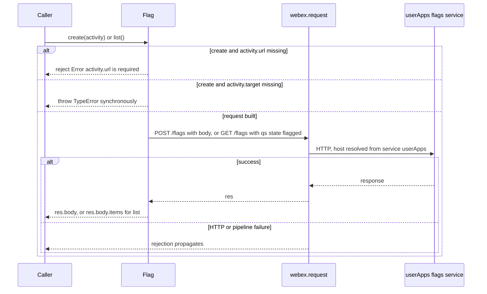
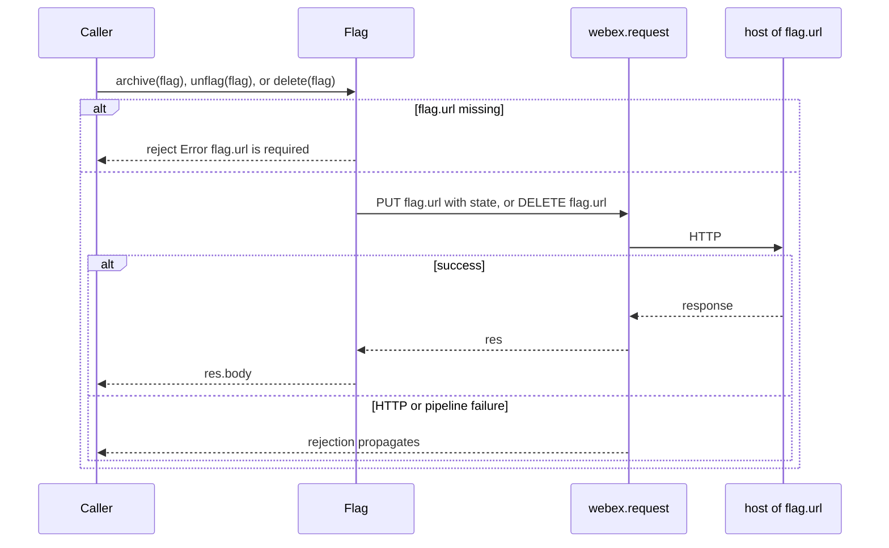
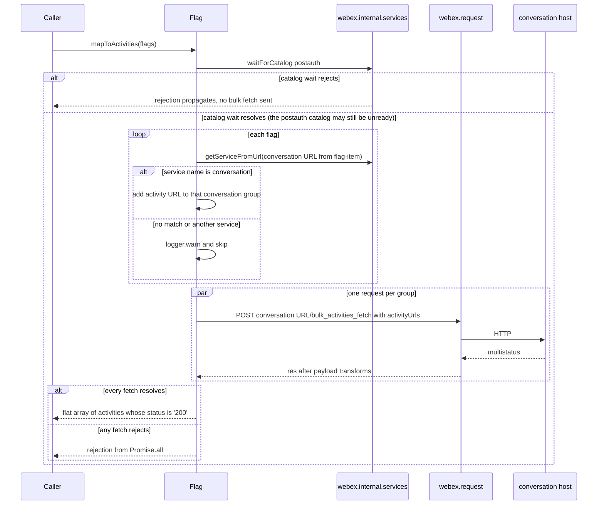
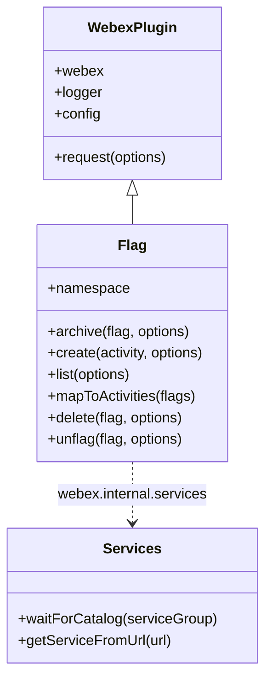

<!-- sdd-generated-metadata
doc_kind: module-spec
generated_from: module-spec@0.3.0
generated_by: claude-cowork
approved_by: akulakum@cisco.com
updated_at: 2026-10-15T14:22:13Z
validation_status: pass-with-warnings
-->

# Flag plugin

This source-local document at `src/docs/README.md` owns the stable specification for **the Flag
plugin**: the `webex.internal.flag` internal plugin, which flags conversation activities for the
current user, lists and changes those flags, and maps flags back to their activities. Ground every
claim in package evidence and link to the [package architecture](../../docs/architecture.md)
instead of repeating broader facts. No service specification exists because this package is a
library.

Related context: [documentation index](../../docs/index.md) ·
[package agent instructions](../../AGENTS.md)

## Metadata

| Field             | Value |
| ----------------- | ----- |
| Owner             | @webex/web-sdk (CODEOWNERS default rule) |
| Source path       | `src` |
| Resource kind     | package |
| Status            | Draft |
| Last verified     | 2026-10-12 at `8a63b4aac9` |
| Module id         | `internal-plugin-flag` |
| Parent spec       | — |
| Doc kind          | Module spec |
| Coverage score    | 93.3% assessed 2026-10-12 — 14 of 15 mandatory fields PRESENT, critical 8 of 8; test strategy is WEAK (gaps listed under Verification) and no characterization baseline exists. Independent validation: pass-with-warnings assessed 2026-10-15 by validator current-session (round 7 at fbb8720); see the Validation status row |
| Validation status | pass-with-warnings; assessed 2026-10-15 by validator current-session; 0 Blocking, 1 Medium, 8 Minor |

## Applicability

| Condition ID                         | Status     | Evidence or reason | Owned section |
| ------------------------------------ | ---------- | ------------------ | ------------- |
| `module.has_tiers`                   | N/A        | No tier policy exists in this package or its `package.json` | Tier |
| `module.has_ui`                      | N/A        | No view or screen | UI use-case flow |
| `module.crosses_service_boundaries`  | Applicable | Once its guards pass, each method calls webex.request against the user-apps flags service, a flag URL, or a conversation host; mapToActivities sends no bulk fetch when no flag passes INV-003 (its catalog wait can still send service-catalog requests) (`src/flag.js`) | Cross-boundary use-case flow |
| `module.holds_client_state`          | N/A        | No state is kept between calls; each method builds its request from its arguments | Client state model |
| `module.enforces_domain_rules`       | Applicable | Required url fields, the conversation-host rule, the fixed state values, and the multistatus '200' filter (`src/flag.js`) | Business rules and invariants |
| `module.is_concurrent_async`         | Applicable | Each method returns a promise unless reading a property of its argument throws (the synchronous TypeError cases under Caller-visible failure modes); mapToActivities sends one bulk fetch per conversation URL in parallel | Concurrency and reactive flow |
| `module.owns_persistence`            | N/A        | Nothing is stored by this package; flag storage is assumed to be in the user-apps flags service (contract not in this repository) | Data, schema, and migration |
| `module.stateful_transitions`        | N/A        | The package sends a target state value; it enforces no transition rules, and the flag lifecycle is owned by the service | State machine |
| `module.exposes_wire_protocol`       | Applicable | Request bodies, query, and response fields read by the methods | Protocol and wire format |
| `module.ui_multi_screen`             | N/A        | No UI | UI flow |
| `module.large_data_model`            | N/A        | No data model; the config is an empty object | Data model |
| `module.returns_caller_errors`       | Applicable | Guard rejections, a synchronous TypeError in create, and propagated webex.request and catalog-wait rejections | Caller-visible failure modes |
| `module.module_specific_conventions` | Applicable | The guard-then-request pattern and the host check before the bulk fetch | Module-specific rules |
| `module.published_package`           | Applicable | `package.json` names the package @webex/internal-plugin-flag and deploy:npm publishes it | Export stability |
| `module.embedded_in_host`            | N/A        | No host theme or embed API | Host integration and theming |
| `module.has_design_tradeoff`         | Applicable | mapToActivities skips unrecognized activity hosts with a warning instead of rejecting, and sends one request per conversation URL instead of one batched request (a source comment says it should become one) | Key design trade-off |
| `module.has_submodules`              | N/A        | Computed false by the Repo Annotation module_tree.py script: the manifest has one module | Sub-modules |

## Evidence register

| Evidence | What it establishes |
| -------- | ------------------- |
| `src/index.js` | Side-effect imports of the conversation and device plugins; registration as internal plugin `flag` with the config and an empty payload transformer; the default export |
| `src/flag.js` | The `Flag` plugin: `namespace`, `archive`, `create`, `list`, `mapToActivities`, `delete`, `unflag` |
| `src/config.js` | The config `{flag: {}}` |
| `package.json` | Name, entry points, dependencies, and scripts |
| `test/unit/spec/flag.js` | Nine Jest cases: four `url`-required rejections and five `mapToActivities` host-validation cases |
| `test/integration/spec/flag.js` | Six live cases (create, list, mapToActivities, delete, archive, unflag) run by `test:browser` |
| `README.md` | Retained product documentation, not the behavioral authority. See ADR 0001. |
| Sibling package webex-core, file src/lib/webex-plugin.js | `WebexPlugin`: `request` delegates to `webex.request`; `logger` is `webex.logger` or `console`; `config` is `webex.config` under the lower-cased namespace |
| Sibling package webex-core, file src/lib/webex-internal-core-plugin-mixin.js | How `registerInternalPlugin` stores the plugin, merges `config`, and concatenates payload-transformer lists |
| Sibling package webex-core, files src/lib/services/services.js and src/lib/services/service-catalog.js | `waitForCatalog` and `getServiceFromUrl`, including the origin and path-boundary match |
| Sibling package webex-core, files src/lib/services/index.js and src/lib/interceptors/service.js | The services plugin registers the service interceptor that resolves `service` and `resource` to a URL |
| Sibling package webex-core, files src/webex-core.js and src/interceptors/ | The default interceptor set and its replacement by `config.interceptors` |
| Sibling package http-core, file src/request/index.js; its SDD module spec src/docs/README.md (MOD-007 to MOD-009, MOD-013, MOD-014) | `url` is copied to `uri` before interceptors run. Which responses reject, the 404 redirect bodies that resolve, status 0, and how the error class is chosen are owned by http-core and specified there |
| Sibling package internal-plugin-conversation, file src/index.js | The inbound payload predicate on `body.multistatus` that this package's bulk-fetch response passes through |
| Sibling package internal-plugin-device, SDD module spec src/docs/README.md | The device plugin that `src/index.js` imports for its side effect, and its device-URL interceptor (sibling file src/interceptors/device-url.js) |

## Purpose and boundary

- Responsibility: own the client calls for activity flags. `create` flags an activity, `list` returns
  the user's current flags, `unflag` and `archive` change a flag's state, `delete` removes it, and
  `mapToActivities` turns a list of flags into the flagged activities.
- In scope: the `Flag` plugin in `src/flag.js`, the config in `src/config.js`, and the registration
  side effect in `src/index.js`.
- Out of scope: HTTP transport, service URL resolution, authorization, redirects, and error classes
  (sibling packages webex-core and http-core); the service catalog and its readiness (webex-core
  services plugin); activity decryption and the activity object shape (sibling package
  internal-plugin-conversation); device registration (sibling package internal-plugin-device); the
  flag lifecycle and storage (the user-apps flags service).
- Consumers: sibling packages webex-server (file src/webex.js) and recipe-private-web-client (file
  src/index.js) import the package for its registration side effect. A search of workspace sources
  found no call to a `webex.internal.flag` method outside this package.

## Structure and key files

| Path | Responsibility |
| ---- | -------------- |
| `src/index.js` | Imports `@webex/internal-plugin-conversation` and `@webex/internal-plugin-device` for their side effects, calls `registerInternalPlugin('flag', Flag, {config, payloadTransformer: {predicates: [], transforms: []}})`, and re-exports `Flag` as default |
| `src/flag.js` | `Flag = WebexPlugin.extend({namespace: 'Flag', …})` with the six methods |
| `src/config.js` | Default export `{flag: {}}` |
| `test/unit/spec/flag.js` | Jest spec; mounts `Flag` in `MockWebex` and stubs `webex.internal.services` |
| `test/integration/spec/flag.js` | Live spec collected by `test:browser`; creates two test users and a conversation |
| `process` | Legacy-tools browser-testing file containing `module.exports = {browser: true};` (see Pitfalls) |

## Public surface

| Surface | Consumer | Compatibility commitment | Source |
| ------- | -------- | ------------------------ | ------ |
| Registration side effect | Every importer, including webex-server and recipe-private-web-client | Installs `webex.internal.flag` (`MOD-001`, `INV-001`) | `src/index.js` |
| Default export `Flag` | Importers and the unit spec | The plugin constructor (`MOD-002`) | `src/index.js` |
| `create(activity, options)` | Applications | `MOD-003`, `INV-002`, `INV-004` | `src/flag.js` |
| `list(options)` | Applications | `MOD-004`, `INV-004` | `src/flag.js` |
| `archive(flag, options)`, `unflag(flag, options)` | Applications | `MOD-005`, `INV-002`, `INV-004` | `src/flag.js` |
| `delete(flag, options)` | Applications | `MOD-006`, `INV-002` | `src/flag.js` |
| `mapToActivities(flags)` | Applications | `MOD-007`, `INV-003`, `INV-005` | `src/flag.js` |
| Config `webex.config.flag` | None found | `MOD-008` | `src/config.js` |

Contract `flag-sdk` is published with native artifact `package.json`. Required contracts:
`webex-core-plugin-host`, `conversation-sdk`, `webex-device-registration`, `user-apps-flags-http`,
and `conversation-bulk-activities-http`.

## Dependencies

| Dependency | Why it is required | Failure behavior |
| ---------- | ------------------ | ---------------- |
| `@webex/webex-core` (`webex-core-plugin-host`) | `WebexPlugin`, `registerInternalPlugin`, `webex.request`, `logger`, and `webex.internal.services` (`waitForCatalog`, `getServiceFromUrl`) | Error classes (`WebexHttpError` subtypes through `HttpStatusInterceptor`), service URL resolution, host checks, auth, redirects, payload transforms, and plugin-registered interceptors such as the device-URL interceptor assume webex-core's default interceptor set, built when a webex instance is constructed. A host-supplied `config.interceptors` set replaces it, and then the HTTP rows under Caller-visible failure modes depend on the interceptors that host lists. Pipeline security is described in the architecture Security architecture |
| `@webex/internal-plugin-conversation` (`conversation-sdk`) | Imported for its side effect; with the default interceptor set (row above), its registered payload transforms can act on the bulk-fetch response; `create` reads the conversation activity fields `url` and `target.url` | What the conversation transforms do to the returned activities is owned by that package |
| `@webex/internal-plugin-device` (`webex-device-registration`) | Imported for its side effect; `src/` calls no device API. The import also registers the device-URL interceptor | With the default interceptor set (webex-core row) and on instances constructed after the import, once a device is registered that interceptor can add the `cisco-device-url` header to this package's requests or reject them; owned by internal-plugin-device (see its SDD module spec) |
| User-apps flags service (`user-apps-flags-http`) | `create`, `list`, and, through the flag URLs it returns, `archive`, `unflag`, `delete` | Rejections from `webex.request` propagate; this package does not catch them |
| Conversation service (`conversation-bulk-activities-http`) | `mapToActivities` bulk fetch | Propagates; one failed fetch rejects the whole call (`MOD-007`) |
| `lodash` | `flatten` in `mapToActivities` | Range in `package.json` |

Declared dependencies that `src/` does not import are listed in the architecture Dependency topology.

## Requirements

| ID | WHAT | WHY | Source evidence | Test or example evidence | Assumptions or gaps | Confidence |
| -- | ---- | --- | --------------- | ------------------------ | ------------------- | ---------- |
| `MOD-001` | Importing the package imports the conversation and device plugins, then registers `Flag` under `INV-001` with the config of `MOD-008` and empty payload-transformer lists. | Webex instances built after the import get `webex.internal.flag`. | `src/index.js` | `test/integration/spec/flag.js` reads webex.internal.flag on WebexCore instances (live) | No unit test reads the registration | Present |
| `MOD-002` | The barrel exports only `Flag` as default. | Callers reach the plugin through `webex.internal.flag`; the export exists for tests and extension. | `src/index.js` | `test/unit/spec/flag.js` mounts the default export in MockWebex | — | Present |
| `MOD-003` | `create(activity, options)` applies `INV-002` to `activity.url`, then sends POST to service `userApps`, resource `/flags`, with the body under Protocol and wire format and `state` from `INV-004`, and resolves with the response body. | Records a flag for the current user on one activity. | `src/flag.js` | Unit: `test/unit/spec/flag.js` (#flag() rejection); live: `test/integration/spec/flag.js` (#create()) | `activity.target` is not checked; see Caller-visible failure modes | Present |
| `MOD-004` | `list(options)` sends GET to service `userApps`, resource `/flags`, with query `state` from `INV-004`, and resolves with `body.items`. | Returns the user's current flags. | `src/flag.js` | Live: `test/integration/spec/flag.js` (#list() and the afterEach cleanup) | No unit test; paging is under Pitfalls | Present |
| `MOD-005` | `archive(flag, options)` and `unflag(flag, options)` apply `INV-002` to `flag.url`, then send PUT to that URL with body `{state}` from `INV-004`, and resolve with the response body. | Changes a flag's state without deleting it. | `src/flag.js` | Unit: `test/unit/spec/flag.js` (#archive() and #unflag() rejections); live: `test/integration/spec/flag.js` (#archive() and #unflag()) | — | Present |
| `MOD-006` | `delete(flag, options)` applies `INV-002` to `flag.url`, then sends DELETE to that URL through `this.request` and resolves with the response body. | Removes a flag. | `src/flag.js`; sibling package webex-core, file src/lib/webex-plugin.js | Unit: `test/unit/spec/flag.js` (#remove() rejection); live: `test/integration/spec/flag.js` (#remove() and the afterEach cleanup) | `this.request` delegates to `webex.request`, so the pipeline is the same as the other methods | Present |
| `MOD-007` | `mapToActivities(flags)` waits for the `postauth` catalog, groups the `flag-item` URLs that pass `INV-003` by conversation URL, warns and skips the rest, sends one POST to `<conversation URL>/bulk_activities_fetch` per group in parallel, keeps the activities allowed by `INV-005`, and resolves with them as one flat array (groups in first-seen order). | Shows the flagged activities while refusing to send a request to a host that the catalog does not name as `conversation`. | `src/flag.js` | Unit: `test/unit/spec/flag.js` (five #mapToActivities() cases); live: `test/integration/spec/flag.js` (#mapToActivities(), with a flag returned by create) | No test of the catalog wait, `'200'` filtering, multiple groups, or a failed fetch | Present |
| `MOD-008` | The config under the `INV-001` key is an empty object; webex-core merges it into `webex.config`, and `src/` reads no key. | Reserves the plugin's config namespace. | `src/config.js` | none found | — | Present |
| `MOD-009` | `create`, `list`, `archive`, `unflag`, and `delete` default `options` to `{}` and put it under the request key `options`; they do not merge it into the request. | Matches the method signatures; see Pitfalls for the effect. | `src/flag.js` | none found | Transport settings inside the nested object, such as headers and `qs`, are not applied; see Pitfalls for the conversation `deferDecrypt` check | Present |

## Design overview

`Flag` is built with `WebexPlugin.extend` and mounted by webex-core as a child of `webex.internal`.
Each method is stateless. `create`, `list`, `archive`, `unflag`, and `delete` check their input,
build one request object, and return the `webex.request` promise mapped to the part of the response
they need (`MOD-003` to `MOD-006`). `mapToActivities` sends one bulk fetch per accepted
conversation URL, or none.

Two request styles are used. `create` and `list` name the catalog service `userApps` and a resource,
so webex-core resolves the host. `archive`, `unflag`, and `delete` send to the `url` of a flag object
that the service returned earlier, so the host comes from data.

`mapToActivities` is the only method with internal logic. It derives each conversation URL from the
activity URL, asks the services plugin whether that URL belongs to the catalog service
`conversation`, and fetches the activities of each accepted conversation in one request
(`MOD-007`, `INV-003`).

## Data flow and sequence coverage

Transport: HTTP through `webex.request`; in-process calls to `webex.internal.services`.

| Operation group | Entry and outcome | Diagram or evidence | Failure and recovery coverage |
| --------------- | ----------------- | ------------------- | ----------------------------- |
| Registration | Import, then webex instance construction → `webex.internal.flag` | MOD-001; the architecture Interaction and execution flows | None in this module |
| Service requests | `create`, `list` → body or `body.items` | Service request diagram below | Guard rejection, synchronous TypeError, propagated request rejection |
| Flag URL requests | `archive`, `unflag`, `delete` → body | Flag URL request diagram below | Guard rejection, propagated request rejection |
| Activity mapping | `mapToActivities` → activities array | Activity mapping diagram below | Catalog-wait rejection, skipped hosts, non-`'200'` entries, a failed fetch |

Service requests:

Flag URL requests:

Activity mapping:

## Class and component relationships

| Component | Relationship |
| --------- | ------------ |
| `Flag` | Extends `WebexPlugin`; registered as `flag` |
| `webex.internal.services` | Called by `mapToActivities` only; owned by webex-core |
| `config` | Plain object passed to registration; not read by `Flag` |

## Use cases and flows

| Use case | Actor or caller | Primary steps and outcome | Failure or boundary behavior | Evidence |
| -------- | --------------- | ------------------------- | ---------------------------- | -------- |
| `UC-001` | Application flagging a message | Passes a conversation activity to `create`; receives the response body; the live integration spec expects `state` `flagged`, `flag-item`, and `conversation-url` in it (service contract not in this repository) | Missing `url` rejects; missing `target` throws | `test/integration/spec/flag.js` #create() |
| `UC-002` | Application showing flagged messages | Calls `list`, then `mapToActivities` with the result; receives the activities | Activities on unrecognized hosts are skipped with a warning | Partial: `test/integration/spec/flag.js` #mapToActivities() passes a flag returned by create, not by list; the list-then-map flow has no test (Verification) |
| `UC-003` | Application clearing a flag | Passes a flag from `create` or `list` to `unflag`, `archive`, or `delete` | Missing `url` rejects | Partial: `test/integration/spec/flag.js` #unflag(), #archive(), #remove() pass a flag returned by create; no test passes a flag from list |

### Cross-boundary use-case flow

| Boundary | Transport | Ordering | Timeout and retry | Recovery |
| -------- | --------- | -------- | ----------------- | -------- |
| User-apps flags service (`userApps`) | HTTP through `webex.request` | One request per call | No retry here; any retry or timeout belongs to the webex-core request pipeline | None here |
| Host of a flag `url` | HTTP through `webex.request` | One request per call | Same as above | None here |
| Conversation hosts | HTTP through `webex.request` | After the catalog wait; one request per conversation URL, in parallel | Same as above; how long the catalog wait can take is owned by the webex-core services plugin | None here |
| Services plugin | In-process promise and calls | Before any bulk fetch | Owned by webex-core | None here |

## Business rules and invariants

| ID | Invariant | WHY | Enforcement source | Test evidence |
| -- | --------- | --- | ------------------ | ------------- |
| `INV-001` | The plugin is registered as `flag`, its `namespace` is `Flag`, and its config key is `flag`. webex-core reads `this.config` by the lower-cased namespace, so the three must stay aligned. | Importers read `webex.internal.flag`, and a mismatched key leaves the config under another name. | `src/index.js`, `src/flag.js`, `src/config.js`; sibling package webex-core, file src/lib/webex-plugin.js | Gap: the unit spec mounts the class under the literal child name flag |
| `INV-002` | `create` requires `activity.url`; `archive`, `unflag`, and `delete` require `flag.url`. When the field is falsy, the method returns a rejected promise with an `Error` whose message names the field, and sends no request. | Prevents a request with no target. | `src/flag.js` | `test/unit/spec/flag.js` (#flag(), #unflag(), #archive(), #remove()) |
| `INV-003` | A flag's `flag-item` is used only when the greedy pattern `(.*)/activities/` matches it and `getServiceFromUrl` on the captured prefix returns a service named `conversation`. The bulk fetch goes to that captured prefix, not to a catalog URL. The matching rules of `getServiceFromUrl` (origin, path boundary, alternate hosts) are owned by webex-core. | Stops the plugin from posting activity URLs to a host that the flag data names but the catalog does not. | `src/flag.js`; sibling package webex-core, file src/lib/services/service-catalog.js | `test/unit/spec/flag.js` (unrecognized host, non-conversation service, known service, mixed list, malformed URL) |
| `INV-004` | The state values are fixed: `create` sends `flagged`, `list` queries `flagged`, `unflag` sends `unflagged`, and `archive` sends `archived`. | Assumed from the code: the user-apps service filters and changes flags by these values; its contract is not in this repository. | `src/flag.js` | Live only: `test/integration/spec/flag.js` |
| `INV-005` | From each bulk-fetch response, only `multistatus` entries whose `status` is the string `'200'` contribute `data.activity`; other entries are dropped without a log. | Returns only the entries the code treats as fetched; the meaning of each status is assumed, because the conversation service contract is not in this repository. | `src/flag.js` | Gap: the unit cases use only '200' entries |

## Concurrency and reactive flow

- Execution model: single JavaScript event loop. Each method returns a promise unless reading a
  property of its argument throws; those synchronous `TypeError` cases are listed under
  Caller-visible failure modes.
- Ordering guarantees: `mapToActivities` starts all bulk fetches together after the catalog wait.
  The result keeps group order (first-seen conversation URL) and, within a group, response order.
- Idempotency and retry: none in this package (Cross-boundary use-case flow).
- Shared-state protection: none needed; no shared state.
- Blocking restrictions: none.

## Protocol and wire format

| Message or frame | Version | Producer or serializer | Consumer or parser | Compatibility and ordering rule |
| ---------------- | ------- | ---------------------- | ------------------ | ------------------------------- |
| Create flag request | Unversioned | `create` | User-apps flags service | POST `/flags`; body keys `conversation-url` (from `activity.target.url`), `flag-item` (from `activity.url`), `state`. The body is serialized as JSON, so a key whose value is `undefined` (for example `conversation-url` when `activity.target.url` is missing) is left out |
| List flags request and response | Unversioned | `list` | User-apps flags service | GET `/flags`, query `state`; the method reads `body.items` |
| Change flag request | Unversioned | `archive`, `unflag` | Host of `flag.url` | PUT, body `{state}` |
| Delete flag request | Unversioned | `delete` | Host of `flag.url` | DELETE, no body |
| Flag object | Unversioned | User-apps flags service | Callers and `mapToActivities` | This package reads `url` and `flag-item` |
| Bulk activities fetch | Unversioned | `mapToActivities` | Conversation host | POST `<conversation URL>/bulk_activities_fetch`, body `{activityUrls}`; the method reads `body.multistatus[].status` and `body.multistatus[].data.activity` |

## Caller-visible failure modes

| Condition | Signal or result | Caller behavior | Retry or recovery | Evidence |
| --------- | ---------------- | --------------- | ----------------- | -------- |
| `url` missing (`INV-002`) | Rejected promise, `Error` "`activity.url` is required" or "`flag.url` is required" | Pass a conversation activity or a flag returned by the service | None | `src/flag.js`; `test/unit/spec/flag.js` |
| `create` with an activity that has `url` but no `target` | Synchronous `TypeError` from reading `target.url`, thrown before a promise exists | Wrap the call or pass a full activity | None | `src/flag.js` |
| `flag` or `activity` argument is `undefined` | Synchronous `TypeError` | Same as above | None | `src/flag.js` |
| `create` or `list` when `userApps` cannot be resolved (default interceptor set; see Dependencies) | Rejects with a plain `Error` from the service interceptor that the webex-core services plugin registers | Inspect the message | None here | Sibling package webex-core, files src/lib/services/index.js and src/lib/interceptors/service.js |
| HTTP failure on any request (see Dependencies) | Rejects with an `HttpError` subtype whose base class is `WebexHttpError`. Which statuses reject, which 404 redirect bodies resolve, the class for each status (including status 0 and 429), and the fallback for unmapped statuses are specified by http-core, whose subtype tree webex-core builds onto `WebexHttpError`; when a resolved redirect response is re-sent is owned by the webex-core redirect interceptor | Branch on the error class or status | None here | Sibling package http-core, SDD module spec src/docs/README.md (MOD-007 to MOD-009, MOD-013, MOD-014); sibling package webex-core, files src/lib/webex-http-error.js and src/interceptors/redirect.js |
| Pipeline failure on any request (default interceptor set; see Dependencies) | Rejections include a plain `Error` from the catalog check when `validateCatalogUrls` is on (URL requests), or from exceeding the configured `maxAuthenticationReplays`, `maxAppLevelRedirects`, or `maxLocusRedirects` limit (webex-core defaults 1, 10, and 5 in its file src/config.js). Other rejections are possible, such as a failed credentials refresh, the device-URL interceptor once a device is registered, or another plugin's payload transform, such as the conversation plugin's | Inspect the class or message | None here | Sibling package webex-core, files src/config.js, src/interceptors/catalog-url.js, src/interceptors/auth.js, src/interceptors/redirect.js, and src/interceptors/payload-transformer.js; sibling package internal-plugin-device, file src/interceptors/device-url.js |
| `postauth` catalog wait rejects | `mapToActivities` rejects with that error before sending any bulk activity request. The wait itself can send service-catalog requests, owned by the webex-core services plugin | Retry after the catalog is ready | None here | `src/flag.js`; sibling package webex-core, file src/lib/services/services.js |
| `postauth` catalog wait resolves while the postauth catalog is unready (for example when the services plugin catches a failed catalog update, owned by webex-core services) | No rejection from the wait. Conversation prefixes the catalog cannot resolve are skipped with a `logger.warn`. Prefixes it can still resolve, for example from another catalog group such as configured overrides, pass `INV-003` and are fetched, and those fetches can still reject. The result can be partial or empty | Treat a short or empty result as possibly incomplete | Retry after the catalog is ready | `src/flag.js`; sibling package webex-core, files src/lib/services/services.js and src/lib/services/service-catalog.js |
| Any bulk fetch rejects | `mapToActivities` rejects; activities from the other conversations are lost | Retry the call | None here | `src/flag.js` |
| Activity URL on an unrecognized host, or a malformed `flag-item` | Skipped with a `logger.warn`; the activity is missing from the result | Treat a shorter result as possible | None | `src/flag.js`; `test/unit/spec/flag.js` |
| `multistatus` entry with a status other than `'200'` | Dropped silently (`INV-005`) | Same as above | None | `src/flag.js` |

## Pitfalls and constraints

- The README usage line `webex.internal.flag.WHATEVER` is a placeholder, not a method (Purpose and
  boundary lists the real methods).
- The caller's `options` argument is not merged into the request (`MOD-009`), so headers, `qs`, or
  other transport settings passed there are not applied. The conversation plugin's inbound predicates
  check `deferDecrypt` on `response.options`, which http-core sets to the request object itself
  (sibling package internal-plugin-conversation, file src/index.js; sibling package http-core, file
  src/request/request.js). They read the request's top-level `deferDecrypt` key, so a
  `deferDecrypt` passed inside the nested `options` object is not seen either.
- `delete` calls `this.request` while the other methods call `this.webex.request`. Both reach the
  same pipeline today; keep them equal if one changes.
- `INV-005` compares `status` with the string `'200'`. A numeric status from the service would drop
  every activity. The unit cases use string statuses; that the live service sends strings is an
  assumption (the integration spec reads activities from it but does not check the type).
- The skip warning in `mapToActivities` logs the full activity URL.
- `list` returns `body.items` as received and does not follow any paging link.
- The unit `describe` titles `#flag()` and `#remove()` test `create` and `delete`.
- The unit spec imports `sinon`, which this package's `package.json` does not declare; it resolves
  from the workspace root install.
- The three test helpers are declared under `dependencies` as well as `devDependencies`, so
  importers install them.
- The aggregate `test` script calls `test:integration`, which is not defined (see Getting started
  Tests).
- The integration spec calls the test-users helper in `beforeEach`; missing client credentials make
  that hook fail, and mocha reports the hook failure and skips the remaining cases. Its `afterEach`
  deletes the flags that `list` returns for query `state=flagged` (the service is assumed to filter
  by it), so archived or unflagged flags may remain.
- The package-root `process` file is the browser-testing file that the README of the sibling package
  legacy-tools recommends; nothing in `src/` reads it. Do not remove it without running
  `yarn workspace @webex/internal-plugin-flag test:browser`.

## Module-specific rules

- Do: check a method's required `url` field and return a rejected promise before building a request
  (`INV-002`).
- Do: keep the host check before the bulk fetch, whose URL is built from `flag-item` (`INV-003`);
  keep the SECURITY unit cases passing. `archive`, `unflag`, and `delete` send to `flag.url` without
  a host check today; adding one is a behavior change that needs its own change and tests.
- Do: change the plugin name, `namespace`, and config key together (`INV-001`).
- Do not: send a bulk fetch to a catalog `priorityUrl` or another derived host without updating
  `INV-003` and its tests.
- Do not: rely on the `options` argument to change a request until `MOD-009` changes.

## Export stability

| Export or entry point | Consumer | Stability | Versioning and deprecation rule | Declaration or API report |
| --------------------- | -------- | --------- | ------------------------------- | ------------------------- |
| default `Flag` | Tests and importers | Internal plugin | README states the package does not strictly follow semver | `src/index.js` |
| Registration as `flag` | webex-server, recipe-private-web-client, and code reading `webex.internal.flag` | Stable name | Renaming is breaking | `src/index.js` |
| Method names and signatures | Applications | Internal plugin | Changing a name, argument, or resolved value is breaking for callers | `src/flag.js` |

No TypeScript declaration or API report exists for this package.

## Key design trade-off

| Chosen trade-off | Preserved invariant or benefit | Cost or limitation | Decision evidence |
| ---------------- | ------------------------------ | ------------------ | ----------------- |
| Skip and warn on activity URLs whose host the catalog does not name as `conversation`, instead of rejecting | `INV-003`: no bulk fetch goes to an unknown host, and one bad or hostile `flag-item` does not fail the whole list | Callers get fewer activities than flags, with only a log line as the signal | `src/flag.js` (catalog-wait comment); `test/unit/spec/flag.js` (SECURITY cases) |
| One bulk fetch per conversation URL, combined with `Promise.all` | Activities in many conversations are fetched in parallel | A failure in one conversation rejects the whole call; a source comment on `mapToActivities` says this should become one batched request | `src/flag.js` (comment on mapToActivities) |

## Verification

| Requirement or invariant | Test level | Positive evidence | Negative or boundary evidence | Gap |
| ------------------------ | ---------- | ----------------- | ----------------------------- | --- |
| `INV-002` | Unit | none found | `test/unit/spec/flag.js` four rejection cases | Synchronous `TypeError` cases |
| `MOD-007`, `INV-003` | Unit | `test/unit/spec/flag.js` known-service and mixed-list cases | Unrecognized host, non-conversation service, malformed URL | Catalog wait rejection, several groups, failed fetch |
| `INV-005` | none | '200' entries only | none found | Non-`'200'` entries |
| `MOD-003` to `MOD-006`, `INV-004` | Integration (`test:browser`, live) | `test/integration/spec/flag.js` | none found | No unit test of request shape or resolved value |
| `MOD-001`, `INV-001` | Integration (live) | `test/integration/spec/flag.js` uses webex.internal.flag | none found | No unit test |
| `MOD-008`, `MOD-009` | none | none found | none found | No config or `options` test |
| `UC-002`, `UC-003` composed flows | Integration (live) | `test/integration/spec/flag.js` (flags returned by create) | none found | No test of `list` followed by `mapToActivities`, `unflag`, `archive`, or `delete` |

Test tiers, the First-run verification precondition, and the expected unit count are described in
[Getting started](../../docs/getting-started.md).
