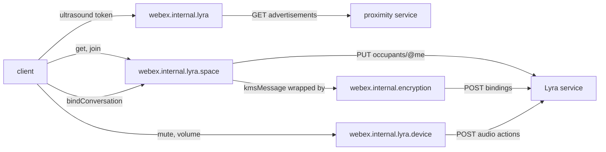
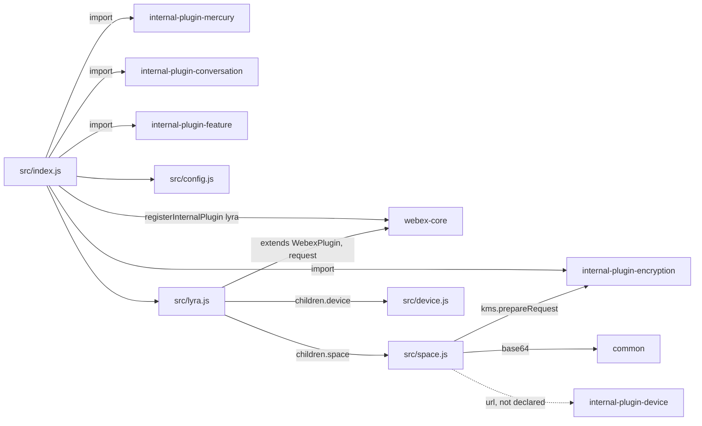
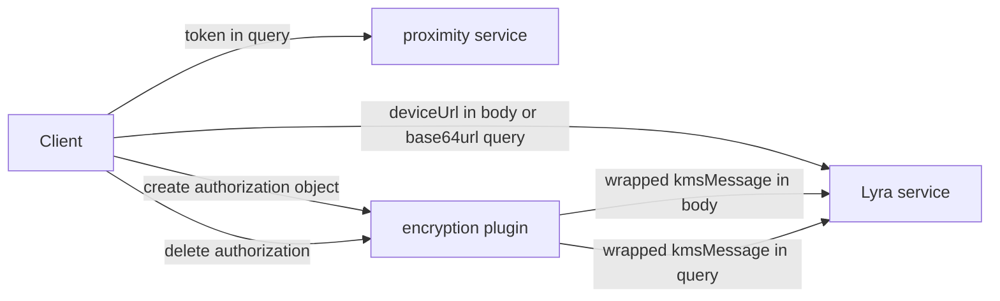

<!-- sdd-generated-metadata
doc_kind: standing-doc
generated_from: architecture@0.3.0
generated_by: claude-code
approved_by: rarajes2@cisco.com
updated_at: 2026-11-12T15:15:46Z
validation_status: pass
-->

# @webex/internal-plugin-lyra architecture

Canonical architecture for this package. Flow behavior lives in the
[Lyra plugin specification](../src/docs/README.md). This page owns package boundaries, the plugin
registration, the contract index, and how the package meets the rest of the SDK.

Related context: [specification registry](specs/README.md) ·
[package agent instructions](../AGENTS.md)

## Applicability

| Condition ID                         | Status     | Evidence or reason | Owned section |
| ------------------------------------ | ---------- | ------------------ | ------------- |
| `repo.owns_datastore`                | N/A        | No database, file store, or migration in `src/space.js` or `src/device.js` | Repository data and schema |
| `repo.holds_client_state`            | N/A        | `src/lyra.js`, `src/space.js`, and `src/device.js` keep no instance state and `src/config.js` defines an empty lyra block | Client state model |
| `repo.components_interact`           | Applicable | `src/lyra.js` mounts the space and device children; `src/space.js` drives the encryption and device plugins | Dependency and interaction topology |
| `repo.domain_data_across_components` | Applicable | Space objects pass between the Lyra service, the caller, and the space and device children; KMS authorizations pass through the encryption plugin (`src/space.js`) | Object and data ownership |
| `repo.caches_data`                   | N/A        | `src/space.js` and `src/device.js` keep no cache | Caching catalog |
| `repo.observability_convention`      | N/A        | No log, metric, or trace call in `src/lyra.js`, `src/space.js`, or `src/device.js` | Observability patterns |
| `repo.deploys_to_infra`              | N/A        | Library published to npm (`package.json`). No service runtime | Runtime and infrastructure |
| `repo.shared_base_libs`              | Applicable | Extends WebexPlugin and uses the legacy build, lint, and test stack (`babel.config.js`, `jest.config.js`, `.eslintrc.js`) | Shared and base libraries |
| `repo.is_monorepo`                   | N/A        | This SDD root is one package. The workspace around it is out of scope | Package map and inter-package dependencies |
| `repo.multi_platform`                | N/A        | `src/space.js` uses no platform-specific API beyond Node querystring, which the browserify transforms bundle; `process` declares only {browser: true} | Platform matrix |
| `repo.published_package`             | Applicable | `package.json` name is @webex/internal-plugin-lyra and deploy:npm publishes it | Release and versioning |
| `repo.embedded_in_host`              | N/A        | No host theme or embed API in `src/lyra.js` | Host integration and theming |
| `repo.exposes_commands_or_artifacts` | Applicable | build:src in `package.json` writes dist | Commands and generated artifacts |
| `repo.cross_repo_deps_material`      | Applicable | Behavior depends on the Lyra service, the proximity service, and the KMS (`src/lyra.js`, `src/space.js`, `src/device.js`) | Cross-repository topology |
| `repo.security_arch_warranted`       | Applicable | Bindings send KMS authorization messages, and device URLs and ultrasound tokens travel in query strings (`src/space.js`, `src/lyra.js`) | Security architecture |

## Design overview

`@webex/internal-plugin-lyra` is a published JavaScript library with one module. Importing it
registers the mercury, encryption, conversation, and feature plugins and then `Lyra` as the internal
plugin `lyra`, reached as `webex.internal.lyra`, with the children `webex.internal.lyra.space` and
`webex.internal.lyra.device`. Inside this repository `@webex/plugin-device-manager` drives it to
discover, pair with, bind, and control room devices, and `@webex/recipe-private-web-client` imports it
to register it.

A Lyra space is the Lyra service's record of a room device and its occupants. The plugin finds a space
from an ultrasound token through the proximity service, joins and leaves it on behalf of the current
device, binds conversations to it by granting the space a KMS authorization, and sends the device's
audio actions. Each method is one request; the space URL comes from the caller in one of two forms
(see `INV-001` in the module specification).

The package serves no routes and persists nothing itself.

## Resource inventory and responsibilities

| Resource | Kind | Responsibility | Owner | Source | Detailed specification |
| -------- | ---- | -------------- | ----- | ------ | ---------------------- |
| Lyra plugin | package (one module) | Registration; proximity lookup; space occupancy and bindings; device audio | @webex/web-sdk | `src` | [`src/docs/README.md`](../src/docs/README.md) |

## Interaction and execution flows

Representative end-to-end flow: a client pairs with a nearby room device and binds a conversation.

| From | To | Interaction or transport | Purpose | Failure or compatibility behavior |
| ---- | -- | ------------------------ | ------- | --------------------------------- |
| Client | `webex.internal.lyra` and its children | In-process calls | Discovery, pairing, bindings, audio | Rejections and some synchronous throws propagate |
| `Space` | Encryption plugin | In-process calls and the outbound KMS transform | Wrap KMS authorization messages | Its errors reject the method |
| `Space` | Device plugin | Property read | The current device URL | A missing URL makes `leave` throw |
| `Lyra`, `Space`, `Device` | Proximity and Lyra services | HTTPS through `webex.request` | Advertisements; spaces, occupants, bindings, audio | No retry here |

## Dependency topology

| Dependency | Type | Used by | Purpose | Version, failure, or fallback policy |
| ---------- | ---- | ------- | ------- | ------------------------------------ |
| `@webex/webex-core` | Internal | `src/index.js`, `src/lyra.js`, `src/space.js`, `src/device.js` | Registration, plugin base, `webex.request`, service resolution | `workspace:*` in `package.json` |
| `@webex/internal-plugin-encryption` | Internal | `src/index.js`, `src/space.js` | KMS message wrapping | `workspace:*` |
| `@webex/common` | Internal | `src/space.js` | base64url encoding | `workspace:*` |
| `@webex/internal-plugin-mercury`, `@webex/internal-plugin-conversation`, `@webex/internal-plugin-feature` | Internal, imported, not called | `src/index.js` | Registration side effect only | `workspace:*` |
| `@webex/internal-plugin-locus` | Internal, declared, not imported by `src/` | Integration specs only | Registration for live tests | `workspace:*` |
| `@webex/internal-plugin-device` | Internal, read, not declared | `src/space.js` | `url` | Registered through the encryption plugin's imports |
| `bowser`, `uuid` | External, declared, not imported by `src/` | `bowser` in the integration specs; `uuid` nowhere | None at runtime | `^2.11.0` and `^3.3.2` in `package.json` |
| Lyra service, proximity service, KMS | External service | `src/lyra.js`, `src/space.js`, `src/device.js` | Spaces and audio; advertisements; authorizations | Resolved through the service catalog and the encryption plugin |

No import cycle exists: none of the plugins this package imports imports it back.

## Public and consumer surfaces

| Surface | Type | Owner | Consumers | Compatibility policy | Source |
| ------- | ---- | ----- | --------- | -------------------- | ------ |
| `lyra-internal-sdk` — package @webex/internal-plugin-lyra, `webex.internal.lyra` with its `space` and `device` children, their methods, and the config | SDK, published to npm, internal | Lyra plugin | `@webex/plugin-device-manager`; `@webex/recipe-private-web-client`, which registers it; first-party clients | The README states that internal plugins do not strictly follow semantic versioning; no deprecation rule is declared | `package.json`, `src/index.js`, `src/lyra.js`, `src/space.js`, `src/device.js` |

The proximity, occupancy, binding, and audio requests are protocols this package speaks with the Lyra
and proximity services, described under *Protocol and wire format* in the
[module specification](../src/docs/README.md#protocol-and-wire-format). The other contracts this
package requires are registered in `.sdd/manifest.json` `contract_catalog`.

## Cross-cutting architecture

### Security

- Trust boundaries and identity flow: see [Security architecture](#security-architecture).
- Sensitive surfaces and data classes: ultrasound tokens and proofs, device URLs, conversation URLs,
  and KMS authorization messages.
- Encryption and secret boundaries: see [Security architecture](#security-architecture).

### Observability and operations

- Logging and correlation: none; the package has no log line, and request tracking comes from the
  webex-core interceptors.
- Metrics, traces, and audit signals: none.
- Ownership and operational entry points: `.github/CODEOWNERS` at the workspace root has no line for
  this package, so its default rule assigns it to `@webex/web-sdk`. No dashboards or runbooks are
  recorded in this package.

### Quality attributes

- Compatibility: clients rely on the registered name `lyra`, the child names `space` and `device`,
  the method names and argument orders, which methods resolve a body and which the whole response,
  and the `space.url` form each method expects.
- Footprint: five source files; runtime imports are webex-core, common, the four plugins in
  `src/index.js`, and Node `querystring`.
- Test confidence: 20 unit cases cover argument guards, the `join` bodies, the proximity request, and
  the `setVolume` default; registration, `list`, `leave`, the bindings success paths, and most device
  requests have no unit case. No coverage threshold is enforced.

## Dependency and interaction topology

| From | To | Kind | Purpose | Ordering or failure boundary |
| ---- | -- | ---- | ------- | ---------------------------- |
| `src/index.js` | webex-core | Call at import | Register `lyra` | First registration wins |
| `src/lyra.js` | `src/space.js`, `src/device.js` | `children` map | Mount `space` and `device` | Created with each `Lyra` instance |
| `src/space.js` | Encryption plugin | Calls; outbound transform | KMS wrapping | Wrap before the request |
| `src/space.js` | `webex.internal.device` | Property read | Device URL | Read at call time |

## Object and data ownership

| Object or state | System of record | May write | May read | Movement or lifecycle |
| --------------- | ---------------- | --------- | -------- | --------------------- |
| Space, its occupants, and its bindings | Lyra service | This package, through requests | This package, then the caller | Fetched per call; not stored here |
| Space audio state | Lyra service, reported by the room device | The room device through `putAudioState`; clients through the audio actions | Clients through `getAudioState` | Reported every 10 minutes and on change; not stored here |
| Advertisements | Proximity service | The room device (outside this package) | This package | Looked up per token |
| KMS authorizations on a conversation resource | KMS | The encryption plugin, on behalf of the bindings methods | The KMS | Created on bind, deleted on unbind |
| Device `url` | Device plugin | The device plugin | This package | Read per call |

## Shared and base libraries

| Library | Inherited responsibility | Consumers | Version floor | Compatibility rule |
| ------- | ------------------------ | --------- | ------------- | ------------------ |
| `@webex/webex-core` `WebexPlugin` | `webex`, `children`, `config`, `request` | `Lyra`, `Space`, `Device` | `workspace:*` | Keep the registered name `lyra` and the namespace `Lyra` |
| `@webex/babel-config-legacy`, `@webex/eslint-config-legacy`, `@webex/jest-config-legacy`, `@webex/legacy-tools` | Build, lint, and test stack through one-line config files | Package tooling | `workspace:*` | Do not fork the config locally |

## Release and versioning

| Artifact | Publish target | Versioning rule | Deprecation window | Changelog or migration obligation |
| -------- | -------------- | --------------- | ------------------ | --------------------------------- |
| @webex/internal-plugin-lyra | npm through `deploy:npm` | Internal plugin; the README says semantic versioning is not strictly followed | None declared | None declared in the package; the workspace owns changelog generation |

## Commands and generated artifacts

| Command or artifact | Owner | Inputs | Output or side effect | Compatibility boundary |
| ------------------- | ----- | ------ | --------------------- | ---------------------- |
| `yarn build:src` | Package scripts | `src` | Writes `dist/` (JavaScript and source maps) through `webex-legacy-tools` | `dist/` is generated and never edited by hand |
| `yarn build` | Package scripts | `src` | Runs `build:src` | Same output |
| `yarn test:unit` | Package scripts | `test/unit/spec`, `dist/` | Jest run | Run `build:src` first |
| `yarn test:style` | Package scripts | `src` | ESLint run | The shared config ignores `docs/**` and `*.md` |

## Cross-repository topology

| Repository or external system | Relationship | Exchanged contract or artifact | Owner | Sequencing constraint |
| ----------------------------- | ------------- | ------------------------------ | ----- | --------------------- |
| `@webex/webex-core` (workspace sibling; module and services specs consulted) | Consumes | `registerInternalPlugin`, `WebexPlugin`, service resolution | @webex/web-sdk | Registered before the first instance |
| `@webex/internal-plugin-encryption` (workspace sibling; no spec, code consulted) | Consumes | `kms.prepareRequest`, the outbound KMS transform | @webex/web-sdk | Imported before registration |
| `@webex/common` (workspace sibling; module spec consulted) | Consumes | `base64` | @webex/web-sdk | None |
| `@webex/internal-plugin-device` (workspace sibling; module spec consulted) | Consumes | `url` | @webex/web-sdk | Device registered before `join` and `leave` |
| `@webex/internal-plugin-mercury` (workspace sibling; module spec consulted) | Imports | Registration only; the room device receives `lyra.*` events through it | @webex/web-sdk | None |
| `@webex/plugin-device-manager` (workspace sibling; no spec, code consulted) | Consumed by | Every public method except `list`, `verifyOccupant`, `getCurrentBindings`, and `deleteBinding` | @webex/web-sdk | None |
| `@webex/recipe-private-web-client` (workspace sibling) | Consumed by | The plugin registration | @webex/web-sdk | None |
| Lyra service, proximity service, KMS | Consumes | Spaces, occupants, bindings, audio; advertisements; authorizations | Not recorded in this repository | KMS wrap before a delete binding request |

## Security architecture

- This package holds no credential and no key. `bindConversation` asks the KMS, through the encryption
  plugin's outbound transform, to authorize the space identity on the conversation's KMS resource, so
  the space can decrypt that conversation; `unbindConversation` and `deleteBinding` delete that
  authorization (`MOD-010`, `MOD-012`, `MOD-013` in the module spec).
- Delete KMS messages travel in a query string and are wrapped by `kms.prepareRequest` before the
  request (`INV-003`).
- The ultrasound token is sent as a query parameter to the proximity service, and the device URL as a
  base64url query parameter on `leave`; both reach request URLs and any URL logging downstream.
- The package writes no log line, so it adds no logging exposure of its own.

## Domain language

| Term | Repository-specific meaning | Authoritative source |
| ---- | --------------------------- | -------------------- |
| Lyra space | The Lyra service's record of a room device, identified by `identity.id`, with occupants, bindings, and audio | `src/space.js` |
| Occupant | A user device joined to a space at `occupants/@me` | `src/space.js` |
| Pass type | The `pass.type` of an occupancy request: `MANUAL` by default for `join` (callers also send other types such as `PIN_ANSWER`), and `VERIFICATION` for `verifyOccupant` | `src/space.js` |
| Binding | A link between a space and a conversation, created with a KMS authorization for the space | `src/space.js` |
| Advertised endpoint | The proximity service's answer for an ultrasound token: the advertiser, links, and a proof | `src/lyra.js` |
| KRO | KMS resource object, `kmsResourceObjectUrl`; authorizing a user id on it shares its keys | `src/space.js` |

## References and maintenance

- Decisions: [adr/](adr/index.md)
- Instantiated specifications and routing: [specs/README.md](specs/README.md)
- Repository rules and patterns: [package agent instructions](../AGENTS.md)
- Update this document in the same change that alters package boundaries, resource ownership,
  cross-resource interaction, or cross-cutting architecture.
