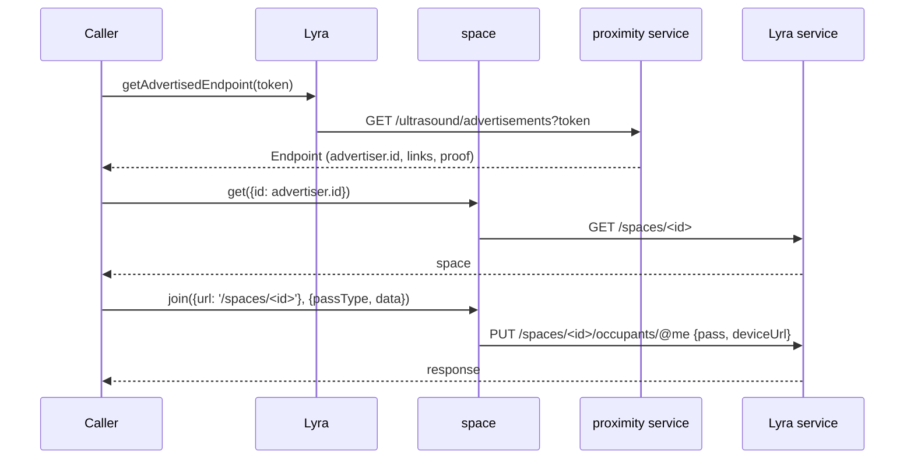
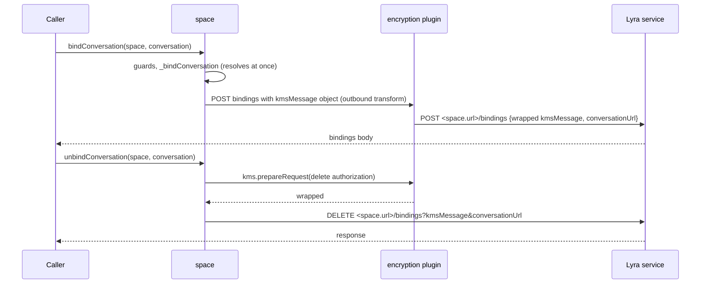
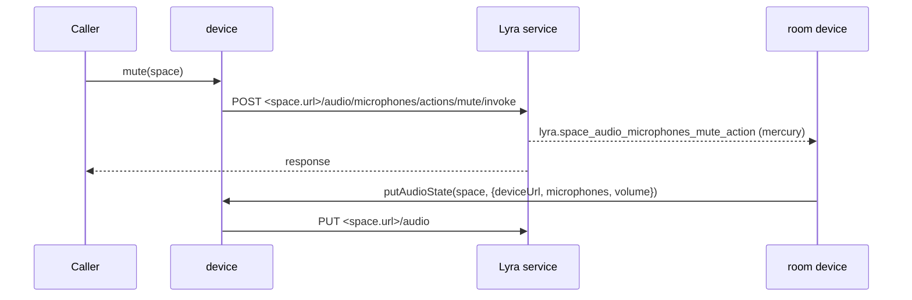
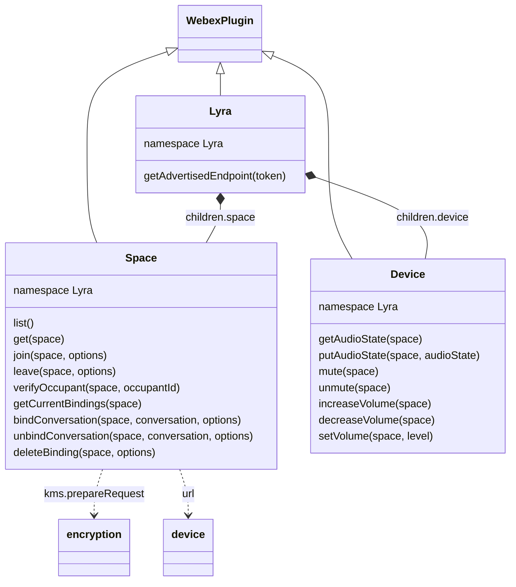

<!-- sdd-generated-metadata
doc_kind: module-spec
generated_from: module-spec@0.3.0
generated_by: claude-code
approved_by: rarajes2@cisco.com
updated_at: 2026-11-12T15:15:46Z
validation_status: pass
-->

# Lyra plugin

This source-local document at `src/docs/README.md` owns the stable specification for **the Lyra
plugin**: the internal plugin `webex.internal.lyra` and its two children, `webex.internal.lyra.space`
and `webex.internal.lyra.device`. It looks up a Lyra space from an ultrasound token through the
proximity service, lists and reads the user's Lyra spaces, joins and leaves them, verifies occupants,
binds and unbinds conversations with KMS authorization messages, and reads and drives a space
device's audio (state, mute, and volume). Ground every claim in package evidence and link to the
[package architecture](../../docs/architecture.md) instead of repeating broader facts. No service
specification exists because this package is a library.

Related context: [documentation index](../../docs/index.md) ·
[package agent instructions](../../AGENTS.md)

## Metadata

| Field             | Value |
| ----------------- | ----- |
| Owner             | @webex/web-sdk |
| Source path       | `src` |
| Resource kind     | package |
| Status            | Draft |
| Last verified     | 2026-11-12 at `bd4ed4b952` |
| Module id         | `internal-plugin-lyra` |
| Parent spec       | — |
| Doc kind          | Module spec |
| Coverage score    | 100% assessed 2026-11-12 by the generator — 13 of 13 mandatory fields PRESENT, critical 7 of 7; `test:unit` runs 20 passing cases in `test/unit/spec/lyra.js`, `test/unit/spec/space.js`, and `test/unit/spec/device.js`, which cover argument guards, the `join` request bodies, the `getAdvertisedEndpoint` request, and the `setVolume` default; no unit case covers registration, `list`, `leave`, `verifyOccupant`, the bindings success paths, or the other device requests |
| Validation status | Pass — 2026-11-12; 0 Blocking, 0 findings; validator runtime 01a1d048-7850-76c1-b613-3973b3145b4d; prior B11-001 rechecked and fixed: all five package-script commands resolve to scripts defined in `package.json` |

## Applicability

| Condition ID                         | Status     | Evidence or reason | Owned section |
| ------------------------------------ | ---------- | ------------------ | ------------- |
| `module.has_tiers`                   | N/A        | No tier policy exists in `package.json` or `src/lyra.js` | Tier |
| `module.has_ui`                      | N/A        | `src/space.js` and `src/device.js` send requests and resolve promises; they render nothing | UI use-case flow |
| `module.crosses_service_boundaries`  | Applicable | `src/lyra.js` calls the proximity service; `src/space.js` and `src/device.js` call the Lyra service; `src/space.js` calls the KMS through the encryption plugin | Cross-boundary use-case flow |
| `module.holds_client_state`          | N/A        | `src/lyra.js`, `src/space.js`, and `src/device.js` keep no instance state, and `src/config.js` defines an empty lyra block | Client state model |
| `module.enforces_domain_rules`       | Applicable | Argument guards and the two space.url forms in `src/space.js` and `src/device.js` | Business rules and invariants |
| `module.is_concurrent_async`         | Applicable | Every method returns a promise; `src/space.js` orders the KMS wrap and the binding stub before the request | Concurrency and reactive flow |
| `module.owns_persistence`            | N/A        | `src/space.js` and `src/device.js` store nothing | Data, schema, and migration discipline |
| `module.stateful_transitions`        | N/A        | Occupancy, bindings, and audio state live on the Lyra service; `src/space.js` holds no state machine | State machine |
| `module.exposes_wire_protocol`       | Applicable | Request paths, query strings, and bodies built in `src/lyra.js`, `src/space.js`, and `src/device.js` | Protocol and wire format |
| `module.ui_multi_screen`             | N/A        | No UI | UI flow |
| `module.large_data_model`            | N/A        | No local data model; the space and endpoint fields read are covered under Protocol and wire format | Data model |
| `module.returns_caller_errors`       | Applicable | Guard, KMS, and request failures reject, and some missing arguments throw, from the methods in `src/space.js` and `src/device.js` | Caller-visible failure modes |
| `module.module_specific_conventions` | Applicable | The relative and absolute space.url forms and the options.uri override in `src/space.js` | Module-specific rules |
| `module.published_package`           | Applicable | `package.json` names the package @webex/internal-plugin-lyra and defines deploy:npm | Export stability |
| `module.embedded_in_host`            | N/A        | No host theme or embed API | Host integration and theming |
| `module.has_design_tradeoff`         | Applicable | Caller-supplied space URLs, the disabled capabilities call, and explicit KMS wrapping for query-string messages in `src/space.js` | Key design trade-off |
| `module.has_submodules`              | N/A        | The src directory has no child module | Sub-modules |

## Evidence register

| Evidence | What it establishes |
| -------- | ------------------- |
| `src/index.js` | Imports the mercury, encryption, conversation, and feature plugins, then `registerInternalPlugin('lyra', Lyra, {config})` at import time; re-exports the default `Lyra` and the named `config` |
| `src/lyra.js` | `Lyra` extends `WebexPlugin` in namespace `Lyra` with children `space` and `device`, the `Endpoint` typedef, and `getAdvertisedEndpoint` |
| `src/space.js` | `Space` extends `WebexPlugin` in namespace `Lyra` with `list`, `get`, `join`, `leave`, `verifyOccupant`, `getCurrentBindings`, `bindConversation`, `_bindConversation`, `unbindConversation`, and `deleteBinding`; the comments on `options.uri`, on `leave`, and on `_bindConversation` are the only recorded rationale in the package |
| `src/device.js` | `Device` extends `WebexPlugin` in namespace `Lyra` with `getAudioState`, `putAudioState`, `mute`, `unmute`, `increaseVolume`, `decreaseVolume`, and `setVolume`; the JSDoc states the refresh cadence and the preference for increase and decrease |
| `src/config.js` | The default config `{lyra: {}}` |
| `package.json` | Name, `main` (`dist/index.js`), `devMain` (`src/index.js`), `engines` (`node >=18`), dependencies, and scripts; `test:unit` exists, `test:integration` does not |
| `test/unit/spec/lyra.js`, `test/unit/spec/space.js`, `test/unit/spec/device.js` | 20 jest cases with `@webex/test-helper-mock-webex` and sinon: argument guards, the `join` request bodies, the `getAdvertisedEndpoint` request, and the `setVolume` default; they import the package by name, so they test `dist/` |
| `test/integration/spec/space.js`, `test/integration/spec/device.js` | Live-service cases with a `LYRA_SPACE` machine user; they pass a space whose `url` is `/spaces/<id>` to `join`, `leave`, and `bindConversation`, and the space returned by `get` to the absolute-URL methods; the bindings blocks and the in-call device block are `describe.skip`; run only by `test:browser` |
| `README.md` | Retained npm page; context only. Its Usage block shows a placeholder member and no method; see `docs/adr/0001-retain-product-readme.md` |
| Sibling package webex-core, file src/docs/README.md | Module spec consulted, agrees with code. `registerInternalPlugin` keys the plugin by its raw name and the first registration wins (MOD-013); registration merges `config` into the defaults (MOD-008); `WebexPlugin.config` is the namespace key of `webex.config` (MOD-044) |
| Sibling package webex-core, file src/lib/services/docs/README.md | Services spec consulted, agrees with code: `api` maps to `service`, `resource` and `service` are required, and the resource is joined to the catalog URL; a request with `uri` is left unchanged (SVC-022) |
| Sibling package webex-core, file src/lib/interceptors/service.js | Code consulted where the spec is silent: `generateUri` strips one leading or trailing slash and concatenates, so an absolute resource yields a malformed URL rather than an error |
| Sibling package common, file src/docs/README.md | Module spec consulted, agrees with code: `base64.toBase64Url` and `base64.encode` are base64url encoders; the code shows `toBase64Url` builds a `Buffer` from its input, which throws for `undefined` |
| Sibling package internal-plugin-device, file src/docs/README.md | Module spec consulted: `url` is a registration property other plugins read from `webex.internal.device` |
| Sibling package internal-plugin-encryption, files src/index.js, src/kms.js | No spec exists; code consulted. `kms.prepareRequest(payload)` resolves a request whose `wrapped` field is the encrypted message; the outbound `encryptKmsMessage` predicate wraps an object `body.kmsMessage` on every request unless it carries an empty `keyUris` or a `<KRO>` or `<KEYURL>` template |
| Sibling package internal-plugin-mercury, file src/docs/README.md | Module spec consulted. It is stale on sessions, which this package does not use; its emit scheme (`event:<eventType>` for dotted types) matches the `lyra.*` events the integration specs wait for |
| Sibling package plugin-device-manager, file src/device-manager.js | No spec exists; code consulted as the in-repo caller: it builds `{url: '/spaces/<id>'}` for `join`, `leave`, `bindConversation`, and `unbindConversation`, passes `verificationInitiation: 'PIN'` to `join`, and passes the paired space from `get` to the device methods |
| Observation, no stated WHY | Behavior the code shows without stating a reason is recorded once, under Pitfalls and constraints |

## Purpose and boundary

- Responsibility: let a Webex client find a nearby Lyra space (a room device) from an ultrasound
  token, pair with it by joining it, bind a conversation to it, and control the device's audio.
- In scope: registration of `lyra` and its config; `getAdvertisedEndpoint`; the `space` child's
  `list`, `get`, `join`, `leave`, `verifyOccupant`, `getCurrentBindings`, `bindConversation`,
  `unbindConversation`, and `deleteBinding`, and its underscore-prefixed `_bindConversation`; the
  `device` child's `getAudioState`, `putAudioState`, `mute`, `unmute`, `increaseVolume`,
  `decreaseVolume`, and `setVolume`.
- Out of scope: decoding the ultrasound token; KMS context and message encryption
  (`@webex/internal-plugin-encryption`); device registration and identity
  (`@webex/internal-plugin-device`); service-catalog resolution and the request pipeline
  (`@webex/webex-core`); Lyra event delivery (`@webex/internal-plugin-mercury`); pairing state,
  PIN flows, and device lists (`@webex/plugin-device-manager`); what the Lyra and proximity services
  do with these requests.
- Consumers: in this repository `@webex/plugin-device-manager` calls every public method except
  `list`, `verifyOccupant`, `getCurrentBindings`, and `deleteBinding`, and
  `@webex/recipe-private-web-client` imports the package to register it. First-party clients reach the
  plugin as `webex.internal.lyra`.

## Structure and key files

| Path | Responsibility |
| ---- | -------------- |
| `src/index.js` | Imports the mercury, encryption, conversation, and feature plugins, registers internal plugin `lyra` with its config, and exports the class as default and `config` by name |
| `src/lyra.js` | `Lyra`, its `space` and `device` children, and `getAdvertisedEndpoint` |
| `src/space.js` | `Space`: space lookup, occupancy, occupant verification, and conversation bindings |
| `src/device.js` | `Device`: audio state, microphone mute, and volume |
| `src/config.js` | The empty `lyra` config block |
| `package.json` | Package name, entry points, scripts, and dependencies |
| `babel.config.js`, `jest.config.js` | Re-exports of the legacy Babel and Jest configurations |
| `.eslintrc.js` | Sets `root: true` and extends `@webex/eslint-config-legacy` |
| `process` | Package-root file exporting `{browser: true}`; not imported by `src/` |
| `src/docs/README.md` | This module specification; ignored by the build and by lint |
| `test/unit/spec/lyra.js`, `test/unit/spec/space.js`, `test/unit/spec/device.js` | Unit cases run by `test:unit` |
| `test/integration/spec/space.js`, `test/integration/spec/device.js` | Live-service cases run by `test:browser` |
| dist/ (generated) | Build output of `build:src`; ignored by Git and never edited by hand |

## Public surface

| Surface | Consumer | Compatibility commitment | Source |
| ------- | -------- | ------------------------ | ------ |
| Import side effect: internal plugin `lyra` with config `{lyra: {}}`, and the mercury, encryption, conversation, and feature plugins | `@webex/plugin-device-manager`, `@webex/recipe-private-web-client` | First registration of the name wins; reached as `webex.internal.lyra` | `src/index.js`, `src/config.js` |
| `getAdvertisedEndpoint(token)` | `@webex/plugin-device-manager`, first-party clients | Resolves the proximity service response body | `src/lyra.js` |
| `space.list()`, `space.get(space)`, `space.getCurrentBindings(space)`, `space.bindConversation(space, conversation, options)` | `@webex/plugin-device-manager`, first-party clients | Resolve the response body, or its `items` for `list` | `src/space.js` |
| `space.join(space, options)`, `space.leave(space, options)`, `space.verifyOccupant(space, occupantId)`, `space.unbindConversation(space, conversation, options)`, `space.deleteBinding(space, options)` | `@webex/plugin-device-manager`, first-party clients, the Lyra device (`verifyOccupant`) | Resolve the whole response object | `src/space.js` |
| `device.getAudioState(space)`, `device.putAudioState(space, audioState)` | `@webex/plugin-device-manager` | Resolve the response body | `src/device.js` |
| `device.mute`, `device.unmute`, `device.increaseVolume`, `device.decreaseVolume` (each `(space)`), `device.setVolume(space, level)` | `@webex/plugin-device-manager` | Resolve the whole response object | `src/device.js` |
| `space._bindConversation(spaceId)` | `bindConversation` | Underscore-prefixed; reachable on the instance but not a supported entry | `src/space.js` |
| Default export `Lyra` and named export `config` | The unit specs; clients that mount the class themselves | The entry exports nothing else | `src/index.js` |

Contract ID `lyra-internal-sdk` is indexed in the
[package architecture](../../docs/architecture.md#public-and-consumer-surfaces) and registered in
`.sdd/manifest.json`. Export stability is under [Export stability](#export-stability).

## Dependencies

| Dependency | Why it is required | Failure behavior |
| ---------- | ------------------ | ---------------- |
| `@webex/webex-core` plugin host (module spec consulted) | `registerInternalPlugin`, `WebexPlugin` (`webex`, `children`, namespaced config), and `webex.request` | A request rejection rejects the method |
| `@webex/webex-core` services (services spec consulted; code consulted for URL joining) | Resolves `api: 'lyra'` and `api: 'proximity'` with a resource to the catalog URL; leaves `uri` requests unchanged | A missing catalog entry rejects with `service-interceptor: '<name>' is not a known service` |
| `@webex/internal-plugin-encryption` (no spec; code consulted) | `kms.prepareRequest` wraps the delete KMS messages of `unbindConversation` and `deleteBinding`; its outbound `encryptKmsMessage` predicate wraps the `bindConversation` body | A KMS rejection rejects the method before the request |
| `@webex/internal-plugin-device` (module spec consulted) | `webex.internal.device.url` names the joining or leaving device | Not imported by `src/` or declared in `package.json`; registered through the encryption plugin's imports. A missing `url` makes `leave` throw (see Caller-visible failure modes) |
| `@webex/common` (module spec consulted) | `base64.toBase64Url` for the device and conversation URLs in query strings; `base64.encode` in the unreachable part of `_bindConversation` | Throws for an `undefined` input |
| `@webex/internal-plugin-mercury`, `@webex/internal-plugin-conversation`, `@webex/internal-plugin-feature` | Imported by `src/index.js` for their registration only; no `src/` file calls them | Not applicable |
| Node `querystring` | Encodes `deviceUrl`, `authId`, `kmsMessage`, and `conversationUrl` query parameters | Bundled by the browserify transforms declared in `package.json` |
| Lyra and proximity services, KMS (external) | Spaces, occupants, bindings, and audio; advertisements; authorizations | Errors propagate |

## Requirements

| ID | WHAT | WHY | Source evidence | Test or example evidence | Assumptions or gaps | Confidence |
| -- | ---- | --- | --------------- | ------------------------ | ------------------- | ---------- |
| `MOD-001` | Importing the package imports `@webex/internal-plugin-mercury`, `@webex/internal-plugin-encryption`, `@webex/internal-plugin-conversation`, and `@webex/internal-plugin-feature`, then registers `Lyra` as internal plugin `lyra` with config `{lyra: {}}`, so the plugin is `webex.internal.lyra`. The entry re-exports the default `Lyra` and the named `config`. | The encryption plugin wraps the KMS messages the bindings methods send (inferred from `MOD-010` and `MOD-012`). No comment or call explains the mercury, conversation, and feature imports. | `src/index.js`, `src/config.js` | `test/unit/spec/lyra.js` imports the package and the named config but mounts the class through a mock children map, so registration is not asserted | WHY inferred for encryption; a gap for the other three imports | Weak |
| `MOD-002` | `Lyra`, `Space`, and `Device` all extend `WebexPlugin` with namespace `Lyra`, and `Lyra` declares children `space: Space` and `device: Device`, so they are reached as `webex.internal.lyra.space` and `webex.internal.lyra.device` and all three read `config.lyra`. | The children group the space and device calls under one plugin (inferred from the `children` map; no comment states it). | `src/lyra.js`, `src/space.js`, `src/device.js` | `test/unit/spec/space.js` and `test/unit/spec/device.js` call webex.internal.lyra.space and webex.internal.lyra.device | No code reads a `config.lyra` key | Weak |
| `MOD-003` | `getAdvertisedEndpoint(token)` GETs service `proximity`, resource `/ultrasound/advertisements`, with query `{token}`, and resolves the body: the `Endpoint` with `advertiser` (`id`, `displayName`, `orgId`), `links.addMeToSpace` and `links.lyra_space` (`href`, `method`), `proof`, and `token.value`. | The JSDoc: the token is the decoded ultrasound token, and the result identifies the advertising space. | `src/lyra.js` | `test/unit/spec/lyra.js` request case | The `Endpoint` shape is the typedef only; no case asserts the response | Present |
| `MOD-004` | `space.list()` GETs service `lyra`, resource `/spaces`, and resolves `body.items`. | The JSDoc: lists the Lyra spaces associated with the user. | `src/space.js` | `test/integration/spec/space.js` list case | No unit case | Present |
| `MOD-005` | `space.get(space = {})` takes the id from `space.id`, else `space.identity.id`; without either it rejects with `space.id is required`; otherwise it GETs service `lyra`, resource `/spaces/<id>`, and resolves the body. | A space returned by the service names its id under `identity`, while callers may hold only an id (inferred from the fallback). | `src/space.js` | `test/unit/spec/space.js` guard case; `test/integration/spec/space.js` get cases | Success path not unit-tested | Present |
| `MOD-006` | `space.join(space, options)` defaults `options.passType` to `MANUAL` and PUTs `{pass: {type: passType}, deviceUrl: webex.internal.device.url}`, adding `pass.data` when `options.data` is truthy and `verificationInitiation` when `options.verificationInitiation` is truthy. With `options.uri` it PUTs to that URI; otherwise to service `lyra`, resource `<space.url>/occupants/@me`. It resolves the response. | The JSDoc: a `MANUAL` join must be repeated every 10 minutes to stay alive, and `data` carries extra proof such as the ultrasound proof. The code comment: `options.uri` holds the complete Lyra service URL. | `src/space.js` | `test/unit/spec/space.js` four cases (default pass type, other pass type, custom uri, data); `test/integration/spec/space.js` join case | `verificationInitiation`, which `@webex/plugin-device-manager` sends for PIN pairing, is untested and absent from the JSDoc | Present |
| `MOD-007` | `space.leave(space, options = {})` DELETEs service `lyra`, resource `<space.url>/occupants/@me`; unless `options.removeAllDevices` is truthy, the resource gets the query `deviceUrl=<base64url of webex.internal.device.url>`. It resolves the response. | The code comment: the service removes every device of the user when `deviceUrl` is not supplied, so the query limits the leave to this device. | `src/space.js` | `test/integration/spec/space.js` leave cases, including removeAllDevices with a second device | No unit case | Present |
| `MOD-008` | `space.verifyOccupant(space, occupantId)` PUTs `<space.url>/occupants/<occupantId>` with body `{pass: {type: 'VERIFICATION'}}` and resolves the response. | The JSDoc: the Lyra device calls it to verify a space occupant. | `src/space.js` | `test/integration/spec/space.js` calls it in skipped before hooks only | No case runs | Present |
| `MOD-009` | `space.getCurrentBindings(space)` GETs `<space.url>/bindings` and resolves the body. | The JSDoc: the body is the state of bindings in the space. | `src/space.js` | `test/integration/spec/space.js` skipped binding cases | No case runs | Present |
| `MOD-010` | `space.bindConversation(space = {}, conversation = {}, options = {})` rejects, in this order, with `space.url is required`, `space.id is required` (no `space.id` or `space.identity.id`), `conversation.kmsResourceObjectUrl is required`, and `conversation.url is required`. Otherwise it awaits `_bindConversation(spaceId)` (`MOD-011`), POSTs `{kmsMessage: {method: 'create', uri: '/authorizations', resourceUri: conversation.kmsResourceObjectUrl, userIds: [spaceId]}, conversationUrl: conversation.url}` to `options.uri` or to service `lyra`, resource `<space.url>/bindings`, and resolves the body. The `kmsMessage` object is wrapped by the encryption plugin's outbound `encryptKmsMessage` predicate. | Binding grants the space identity a KMS authorization on the conversation's resource so the space can decrypt it (inferred from the message; no comment states it). The code comment: `options.uri` holds the complete Lyra service URL. | `src/space.js` | `test/unit/spec/space.js` four guard cases; `test/integration/spec/space.js` skipped binding block | Success path not unit-tested; the integration block is skipped | Present |
| `MOD-011` | `space._bindConversation(spaceId)` resolves `undefined` at once. The code after its `return`, a PUT to service `lyra`, resource `spaces/<spaceId>/devices/<base64url device url>/capabilities` with `{bindingCleanupAfterCall: true}`, never runs. | The code comments: Lyra no longer enables binding automatically for a space with a `SPARK_BOARD` device, the board now posts its capabilities itself, and the call is skipped until a conversation can be bound by posting capabilities. | `src/space.js` | None found | Untested | Present |
| `MOD-012` | `space.unbindConversation(space = {}, conversation = {}, options = {})` rejects, in this order, with `space.url is required`, `space.id is required`, `conversation.url is required`, and `conversation.kmsResourceObjectUrl is required`. Otherwise it wraps `{method: 'delete', uri: '<conversation.kmsResourceObjectUrl>/authorizations?authId=<spaceId>'}` with `encryption.kms.prepareRequest`, and DELETEs `<options.uri>?kmsMessage=<wrapped>&conversationUrl=<base64url of conversation.url>`, or, without `options.uri`, service `lyra`, resource `<space.url>/bindings?` with the same query. It resolves the response. | A DELETE carries the KMS message in its query string, where no body transform reaches it, so the method wraps it first (inferred from the explicit `prepareRequest`). | `src/space.js` | `test/unit/spec/space.js` four guard cases; `test/integration/spec/space.js` skipped unbind block | Success path not unit-tested | Present |
| `MOD-013` | `space.deleteBinding(space = {}, options = {})` rejects, in this order, with `space.url is required`, `space.id is required`, `options.kmsResourceObjectUrl is required`, and `options.bindingId is required`. Otherwise it wraps `{method: 'delete', uri: '<options.kmsResourceObjectUrl>/authorizations?authId=<spaceId>'}` with `kms.prepareRequest`, DELETEs `<space.url>/bindings/<bindingId>?kmsMessage=<wrapped>`, and resolves the response. | The JSDoc: deletes one binding by its id. The KMS wrap follows `MOD-012` (inferred). | `src/space.js` | `test/unit/spec/space.js` four guard cases; `test/integration/spec/space.js` skipped delete block | Success path not unit-tested | Present |
| `MOD-014` | `device.getAudioState(space)` GETs `<space.url>/audio` and resolves the body (`volume`, `microphones`, `url`). `device.putAudioState(space, audioState = {})` rejects with `audioState.deviceUrl is required` without `audioState.deviceUrl`; otherwise it PUTs `audioState` to `<space.url>/audio` and resolves the body. | The JSDoc: the Lyra device reports its audio state every 10 minutes and whenever the microphone or volume changes. | `src/device.js` | `test/unit/spec/device.js` guard case; `test/integration/spec/device.js` audio-state case | Success paths not unit-tested | Present |
| `MOD-015` | `device.mute`, `unmute`, `increaseVolume`, and `decreaseVolume(space)` POST with no body to `<space.url>/audio/microphones/actions/mute/invoke`, `.../microphones/actions/un-mute/invoke`, `.../volume/actions/increase/invoke`, and `.../volume/actions/decrease/invoke`. `device.setVolume(space, level = 0)` POSTs `{level}` to `<space.url>/audio/volume/actions/set/invoke`. Each resolves the response. | The JSDoc: callers should prefer increase and decrease over `setVolume`. The integration specs show the device receives each action as a `lyra.space_audio_*` mercury event. | `src/device.js` | `test/unit/spec/device.js` setVolume default case; `test/integration/spec/device.js` skipped in-call block | Only the `setVolume` default is asserted | Present |

## Design overview

`Lyra` is a thin `WebexPlugin` with no state of its own. It owns one call, the proximity lookup that
turns an ultrasound token into the advertising space, and mounts two children that do the rest:
`space` for occupancy and conversation bindings, and `device` for the room device's audio. Every
method builds one request and hands it to `webex.request`.

Requests are addressed in two ways. Calls that start from nothing (`list`, `get`) go through the
service catalog as `api: 'lyra'`. Calls that act on a space take the URL from the caller's `space`
object: `join`, `leave`, and the bindings writes pass it as a catalog resource, so it must be relative
to the Lyra service, while `verifyOccupant`, `getCurrentBindings`, `deleteBinding`, and every device
call pass it as a full `uri`, so it must be absolute (`INV-001`). Bindings send KMS authorization
messages: the encryption plugin wraps the create message in a body, and the package wraps the delete
messages itself because they travel in a query string.

## Data flow and sequence coverage

Call style: in-process method calls on `webex.internal.lyra`, `webex.internal.lyra.space`, and
`webex.internal.lyra.device`; outbound HTTPS through `webex.request`; KMS message wrapping through the
encryption plugin. Three operation groups differ in actors and outcome, and each has a diagram.

| Operation group | Entry and outcome | Diagram or evidence | Failure and recovery coverage |
| --------------- | ----------------- | ------------------- | ----------------------------- |
| Discover and pair | `getAdvertisedEndpoint`, `get`, and `join` find a space from a token and add the user's device to it | Diagram 1; `src/lyra.js`, `src/space.js` | Guards reject first; request errors reject |
| Conversation binding | `bindConversation`, `unbindConversation`, and `deleteBinding` grant or revoke the space's KMS authorization and change its bindings | Diagram 2; `src/space.js` | Guards reject first; KMS and request errors reject |
| Device audio | `getAudioState`, `putAudioState`, and the mute and volume actions read and change the space device's audio | Diagram 3; `src/device.js` | One guard; request errors reject |

Diagram 1 — discover and pair:

Diagram 2 — conversation binding:

Diagram 3 — device audio:

## Class and component relationships

## Use cases and flows

| Use case | Actor or caller | Primary steps and outcome | Failure or boundary behavior | Evidence |
| -------- | --------------- | ------------------------- | ---------------------------- | -------- |
| `UC-001` | Client near a room device | Decode the ultrasound token, `getAdvertisedEndpoint(token)`, then `space.get({id: advertiser.id})` | Request errors reject | `src/lyra.js`, `src/space.js`, `test/unit/spec/lyra.js` |
| `UC-002` | Client pairing with a space | `space.join(space, {passType, data, verificationInitiation})`, repeated every 10 minutes for `MANUAL`; later `space.leave(space, {removeAllDevices})` | A space URL in the wrong form reaches a malformed URL (`INV-001`) | `src/space.js`, `test/integration/spec/space.js` |
| `UC-003` | Paired client in a call | `space.bindConversation(space, conversation)`, then `unbindConversation` or `deleteBinding` | Guards reject; KMS errors reject | `src/space.js`, `test/unit/spec/space.js` |
| `UC-004` | Paired client controlling audio | `device.getAudioState`, `mute`, `unmute`, `increaseVolume`, `decreaseVolume`, `setVolume` | Request errors reject | `src/device.js`, `test/integration/spec/device.js` |
| `UC-005` | The Lyra room device | `space.verifyOccupant(space, occupantId)`; `device.putAudioState(space, audioState)` every 10 minutes and on change | `putAudioState` rejects without `audioState.deviceUrl` | `src/space.js`, `src/device.js`, `test/unit/spec/device.js` |

### Cross-boundary use-case flow

| Boundary | Transport and ordering | Compatibility | Timeout, retry, and recovery |
| -------- | ---------------------- | ------------- | ---------------------------- |
| Proximity service (`UC-001`) | HTTPS through `webex.request`, catalog service `proximity` | Request under Protocol and wire format | No retry or timeout in this module; webex-core interceptors apply |
| Lyra service (`UC-001` to `UC-005`) | HTTPS through `webex.request`, by catalog service `lyra`, by a caller-supplied absolute URL, or by `options.uri` | Requests under Protocol and wire format | No retry or timeout in this module; the caller repeats `MANUAL` joins |
| KMS through the encryption plugin (`UC-003`) | The delete message is wrapped before the request; the create message is wrapped by the outbound transform | Owned by the encryption plugin | A wrap failure rejects before any Lyra request |
| Mercury (`UC-004`, `UC-005`) | The Lyra service delivers `lyra.space_audio_*` events to the room device | Not consumed by this package | Owned by the mercury plugin |

## Business rules and invariants

| ID | Invariant | WHY | Enforcement source | Test evidence |
| -- | --------- | --- | ------------------ | ------------- |
| `INV-001` | Without `options.uri`, `join`, `leave`, `bindConversation`, and `unbindConversation` send `space.url` as a resource of service `lyra`, so it must be a path relative to that service (`/spaces/<id>`); `verifyOccupant`, `getCurrentBindings`, `deleteBinding`, and every `device` method send `space.url` as the request `uri`, so it must be absolute. | Webex-core joins a resource to the catalog URL by concatenation and leaves a `uri` unchanged (services spec SVC-022; `generateUri` code). | `src/space.js`, `src/device.js` | `test/integration/spec/space.js` and `test/integration/spec/device.js` pass a relative space URL to the first group and the space returned by get to the second; `test/unit/spec/space.js` asserts the resource form with an absolute fixture URL (see Pitfalls) |
| `INV-002` | Each argument guard of `MOD-005`, `MOD-010`, `MOD-012`, `MOD-013`, and `MOD-014` rejects before any KMS call or request. | Fail fast without network traffic (inferred). | `src/space.js`, `src/device.js` | `test/unit/spec/space.js`, `test/unit/spec/device.js` guard cases |
| `INV-003` | A KMS message sent in a query string is the `wrapped` output of `kms.prepareRequest`, never the plain object. | The outbound KMS transform only reaches `body.kmsMessage` (encryption plugin code). | `src/space.js` | None found |
| `INV-004` | `join` always sends `webex.internal.device.url` as `deviceUrl`, and `leave` names that device unless `removeAllDevices` is truthy. | Occupancy is per device; the service removes every device of the user when no device is named (code comment). | `src/space.js` | `test/unit/spec/space.js` join cases |

## Concurrency and reactive flow

- Execution model: one JavaScript event loop; every method returns a promise or throws synchronously
  before creating one (see Caller-visible failure modes).
- Ordering guarantees: `bindConversation` awaits `_bindConversation` before its request;
  `unbindConversation` and `deleteBinding` await the KMS wrap before theirs.
- Parallel work: none inside the package; each method sends at most one Lyra request.
- Idempotency and retry: nothing is retried here. A `MANUAL` join stays alive only while the caller
  repeats it every 10 minutes (`MOD-006`), and the room device repeats `putAudioState` on the same
  cadence (`MOD-014`); the package schedules neither.
- Fire-and-forget work: none.
- Shared-state protection: none needed; the plugin holds no state, and `join` copies `options` before
  adding defaults.

## Protocol and wire format

| Message or frame | Version | Producer or serializer | Consumer or parser | Compatibility and ordering rule |
| ---------------- | ------- | ---------------------- | ------------------ | ------------------------------- |
| `GET <proximity>/ultrasound/advertisements?token=<token>` | Unversioned | `getAdvertisedEndpoint` | Proximity service | Response: the `Endpoint` of `MOD-003` |
| `GET <lyra>/spaces` and `GET <lyra>/spaces/<id>` | Unversioned | `list`, `get` | Lyra service | Responses `{items}` and the space (`identity.id`, `url`, `occupants`) |
| `PUT <lyra>/<space.url>/occupants/@me` or `PUT <options.uri>`, body `{pass: {type, data?}, deviceUrl, verificationInitiation?}` | Unversioned | `join` | Lyra service | `type` defaults to `MANUAL`; callers in this repository also send `PIN_ANSWER` |
| `DELETE <lyra>/<space.url>/occupants/@me[?deviceUrl=<base64url>]` | Unversioned | `leave` | Lyra service | No query removes every device of the user |
| `PUT <space.url>/occupants/<occupantId>`, body `{pass: {type: 'VERIFICATION'}}` | Unversioned | `verifyOccupant` | Lyra service | Absolute `space.url` |
| `GET <space.url>/bindings` | Unversioned | `getCurrentBindings` | Lyra service | Response `{bindings: [{conversationUrl, bindingUrl}]}` as read by the integration spec |
| `POST <lyra>/<space.url>/bindings` or `POST <options.uri>`, body `{kmsMessage, conversationUrl}` | Unversioned | `bindConversation` | Lyra service | `kmsMessage` is a KMS `create /authorizations` for `userIds: [spaceId]`, wrapped by the outbound transform |
| `DELETE <lyra>/<space.url>/bindings?kmsMessage=<wrapped>&conversationUrl=<base64url>` or the same query on `options.uri` | Unversioned | `unbindConversation` | Lyra service | KMS `delete <KRO>/authorizations?authId=<spaceId>`, wrapped first |
| `DELETE <space.url>/bindings/<bindingId>?kmsMessage=<wrapped>` | Unversioned | `deleteBinding` | Lyra service | Absolute `space.url`; no `conversationUrl` |
| `GET` and `PUT <space.url>/audio`, body `audioState` `{deviceUrl, volume?: {level}, microphones?: {muted}}` | Unversioned | `getAudioState`, `putAudioState` | Lyra service | `deviceUrl` is required on PUT |
| `POST <space.url>/audio/microphones/actions/{mute,un-mute}/invoke` and `.../audio/volume/actions/{increase,decrease}/invoke`, no body; `.../audio/volume/actions/set/invoke`, body `{level}` | Unversioned | `mute`, `unmute`, `increaseVolume`, `decreaseVolume`, `setVolume` | Lyra service | `level` defaults to `0` |

## Caller-visible failure modes

| Condition | Signal or result | Caller behavior | Retry or recovery | Evidence |
| --------- | ---------------- | --------------- | ----------------- | -------- |
| A required argument is missing (`MOD-005`, `MOD-010`, `MOD-012`, `MOD-013`, `MOD-014`) | Rejects with the guard's `Error` message before any request (`INV-002`) | Pass the named field | Call again with it | `src/space.js`, `src/device.js`, `test/unit/spec/space.js`, `test/unit/spec/device.js` |
| `space` is `undefined` for `join`, `leave`, `verifyOccupant`, `getCurrentBindings`, or a device method | Throws `TypeError` synchronously while reading `space.url` instead of returning a rejected promise | Pass a space object | Call again | `src/space.js`, `src/device.js` |
| `leave` without `removeAllDevices` while `webex.internal.device.url` is unset | Throws `TypeError` synchronously from `base64.toBase64Url` | Register the device first | Call again | `src/space.js` |
| `space.url` in the wrong form for the method (`INV-001`) | The request goes to a malformed URL and rejects with the service or network error | Pass `/spaces/<id>` to the resource-form methods and the absolute URL to the others | Call again with the right form | `src/space.js`, `src/device.js` |
| The `lyra` or `proximity` service is not in the catalog | Rejects with `service-interceptor: '<name>' is not a known service` | Wait for the catalog | Call again | `src/space.js`, `src/lyra.js` |
| A KMS wrap or a service request fails | Rejects with that error, unchanged | Handle the error | Call again | `src/space.js`, `src/device.js` |

## Pitfalls and constraints

- The JSDoc of `unbindConversation` and `deleteBinding` promises the bindings response body, but both
  resolve the whole response object, as `join`, `leave`, `verifyOccupant`, and the mute and volume
  actions do.
- The `leave` comment describes the service: with `options = {}` the method sends `deviceUrl`, so by
  default it removes only this device (`MOD-007`).
- `bindConversation` checks `conversation.kmsResourceObjectUrl` before `conversation.url`, while
  `unbindConversation` checks them the other way round; a caller missing both sees different messages.
- `deleteBinding` has no `options.uri` path, unlike `bindConversation` and `unbindConversation`, and
  its JSDoc lists `space.identity.id` but not the `space.id` the code also accepts.
- `package.json` declares `@webex/internal-plugin-locus`, `bowser`, and `uuid`, which `src/` never
  imports; locus and bowser are imported only by the integration specs.
- `test:style` reports one `no-unreachable` warning, on the dead code of `_bindConversation` (`MOD-011`),
  plus "File ignored" for this specification.
- `test/unit/spec/space.js` uses one fixture whose `url` is absolute (`https://lyra/api/v1/lyra-1337`) for
  the `join` cases, which assert the resource form; the mock request passes, but against the service
  that combination reaches a malformed URL (`INV-001`).
- `src/space.js` and `src/device.js` tag their classes `@extends {Lyra}` in JSDoc; both extend
  `WebexPlugin`.

## Module-specific rules

- Do: pass `space.url` in the form each method expects (`INV-001`); build `{url: '/spaces/<id>'}` for
  the resource-form methods, as the integration specs and `@webex/plugin-device-manager` do.
- Do: keep `options.uri` as a full override of the request URL in `join`, `bindConversation`, and
  `unbindConversation`.
- Do: wrap a KMS message with `kms.prepareRequest` before putting it in a query string (`INV-003`),
  and leave a body `kmsMessage` as an object for the encryption plugin's transform.
- Do not: add a guard or request before the `return` in `_bindConversation` without enabling the
  capabilities call it documents (`MOD-011`).
- Do not: log space ids, device URLs, tokens, or KMS messages; the package has no log line today.

## Export stability

| Export or entry point | Consumer | Stability | Versioning and deprecation rule | Declaration or API report |
| --------------------- | -------- | --------- | ------------------------------- | ------------------------- |
| Import side effect: internal plugin `lyra` and its config | `@webex/plugin-device-manager`, `@webex/recipe-private-web-client` | Internal | The README states that internal plugins do not strictly follow semantic versioning | `src/index.js` |
| Default export `Lyra`, named export `config`, and the public methods of the `space` and `device` children | `@webex/plugin-device-manager`, first-party clients | Internal | Same | `src/index.js`, `src/lyra.js`, `src/space.js`, `src/device.js` |

The build writes JavaScript only; `package.json` has no `types` entry, so no declarations or API
report are published.

## Key design trade-off

| Chosen trade-off | Preserved invariant or benefit | Cost or limitation | Decision evidence |
| ---------------- | ------------------------------ | ------------------ | ----------------- |
| Take the space URL from the caller instead of deriving it from the space id | Callers can address a space on any Lyra host, and `options.uri` can name the complete service URL | The two URL forms of `INV-001` are invisible in the signatures; a wrong form fails at the service | `src/space.js` options.uri comments; `test/integration/spec/space.js` |
| Keep `_bindConversation` as a stub that resolves at once | `bindConversation` keeps its ordering and can re-enable the capabilities call in one place | Dead code and a lint warning remain; the bindings integration cases are skipped | `src/space.js` _bindConversation comments |
| Wrap delete KMS messages in the method, and leave the create message to the transform | Query-string KMS messages are never sent in plain form (`INV-003`) | Two wrapping paths for one kind of message | `src/space.js`; the encryption plugin's encryptKmsMessage predicate |

## Verification

| Requirement or invariant | Test level | Positive evidence | Negative or boundary evidence | Gap |
| ------------------------ | ---------- | ----------------- | ----------------------------- | --- |
| `MOD-001`, `MOD-002` | Unit (indirect) | `test/unit/spec/space.js` and `test/unit/spec/device.js` reach the children | None found | Registration and the plugin imports are untested |
| `MOD-003` | Unit | `test/unit/spec/lyra.js` request case | None found | Response not asserted |
| `MOD-004` | Integration | `test/integration/spec/space.js` | None found | No unit case; the integration cases do not run today |
| `MOD-005` | Unit, integration | `test/integration/spec/space.js` | `test/unit/spec/space.js` guard case | Success path not unit-tested |
| `MOD-006`, `INV-004` | Unit, integration | `test/unit/spec/space.js` four join cases | None found | `verificationInitiation` untested |
| `MOD-007` | Integration | `test/integration/spec/space.js` leave cases | None found | No unit case; the `deviceUrl` query is not asserted |
| `MOD-008`, `MOD-009` | None | None found | None found | Only skipped integration hooks call them |
| `MOD-010`, `MOD-012`, `MOD-013`, `INV-002`, `INV-003` | Unit | None found | `test/unit/spec/space.js` twelve guard cases | Success paths, KMS wrapping, and the `options.uri` paths are untested; the integration blocks are skipped |
| `MOD-011` | None | None found | None found | Untested |
| `MOD-014` | Unit, integration | `test/integration/spec/device.js` audio-state case | `test/unit/spec/device.js` guard case | Request shapes not unit-tested |
| `MOD-015` | Unit | `test/unit/spec/device.js` setVolume default | None found | Mute and volume requests untested; the in-call block is skipped |
| `INV-001` | Integration | `test/integration/spec/space.js`, `test/integration/spec/device.js` | None found | The unit fixture passes the absolute form to the resource-form `join` (see Pitfalls); the integration cases do not run today |

`yarn test:unit`, run from the package directory, passed all 20 cases on 2026-11-12 under Node 22.14
after `build:src`. The unit specs import `@webex/internal-plugin-lyra` by name, so they test
`dist/`; run `build:src` first. `test:browser` runs the two integration specs through karma and
reported 0 tests on 2026-11-12 because the bundle failed to parse `isbot`. `package.json` has no
`test:integration` script, so the aggregate `test` script stops there. A module specification is
complete only when its public surface, invariants, failure modes, and test evidence agree with the
implementation. Generator-side field measurement is complete (100%, assessed 2026-11-12). Independent semantic
validation passed with warnings on 2026-11-12 (0 Blocking; one Important finding, B11-001). B11-001 is
repaired in `.sdd/manifest.json`: the five package-script commands now use the package-directory form
that their cited `package.json` defines; re-validation is pending.
