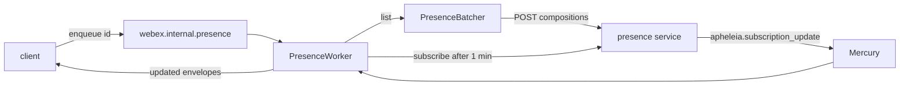
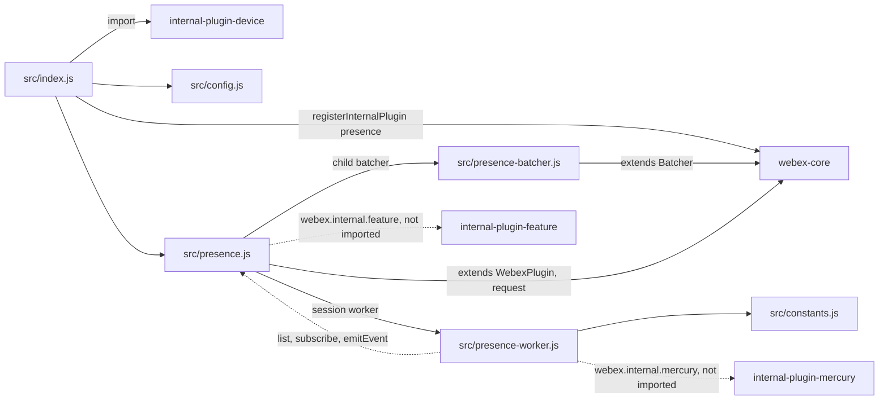
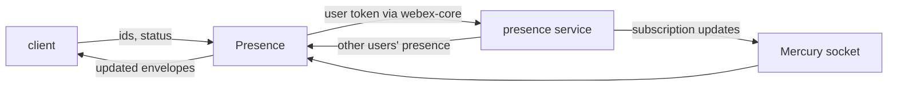

<!-- sdd-generated-metadata
doc_kind: standing-doc
generated_from: architecture@0.3.0
generated_by: claude-code
approved_by: rarajes2@cisco.com
updated_at: 2026-11-12T13:05:26Z
validation_status: blocked
-->

# @webex/internal-plugin-presence architecture

Canonical architecture for this package. Flow behavior lives in the
[Presence plugin specification](../src/docs/README.md). This page owns package boundaries, the plugin
registration, the contract index, and how the package meets the rest of the SDK.

Related context: [specification registry](specs/README.md) ·
[package agent instructions](../AGENTS.md)

## Applicability

| Condition ID                         | Status     | Evidence or reason | Owned section |
| ------------------------------------ | ---------- | ------------------ | ------------- |
| `repo.owns_datastore`                | N/A        | No database, file store, or migration in `src/presence-worker.js` or `src/presence.js` | Repository data and schema |
| `repo.holds_client_state`            | Applicable | `src/presence-worker.js` keeps per-user watch, fetch, and subscription maps; defaults in `src/config.js` | Client state model |
| `repo.components_interact`           | Applicable | `src/presence.js` drives the batcher and the worker, and the worker calls back into the plugin (`src/presence-worker.js`) | Dependency and interaction topology |
| `repo.domain_data_across_components` | Applicable | Presence status objects pass from the presence service through the batcher and worker to the client (`src/presence-batcher.js`, `src/presence-worker.js`) | Object and data ownership |
| `repo.caches_data`                   | N/A        | `src/presence-worker.js` stores times and counts, not presence objects; the client keeps the data | Caching catalog |
| `repo.observability_convention`      | N/A        | `src/presence.js`, `src/presence-worker.js`, and `src/presence-batcher.js` make no logger, metrics, or trace call | Observability patterns |
| `repo.deploys_to_infra`              | N/A        | Library published to npm (`package.json`). No service runtime | Runtime and infrastructure |
| `repo.shared_base_libs`              | Applicable | Extends WebexPlugin and the webex-core Batcher, and uses the legacy build, lint, and test stack (`babel.config.js`, `jest.config.js`, `.eslintrc.js`) | Shared and base libraries |
| `repo.is_monorepo`                   | N/A        | This SDD root is one package. The workspace around it is out of scope | Package map and inter-package dependencies |
| `repo.multi_platform`                | N/A        | `src/presence-worker.js` uses only timers; `process` declares only {browser: true} | Platform matrix |
| `repo.published_package`             | Applicable | `package.json` name is @webex/internal-plugin-presence and deploy:npm publishes it | Release and versioning |
| `repo.embedded_in_host`              | N/A        | No host theme or embed API in `src/presence.js` | Host integration and theming |
| `repo.exposes_commands_or_artifacts` | Applicable | build:src in `package.json` writes dist | Commands and generated artifacts |
| `repo.cross_repo_deps_material`      | Applicable | Behavior depends on the presence service, Mercury, and the feature plugin (`src/presence.js`, `src/presence-worker.js`) | Cross-repository topology |
| `repo.security_arch_warranted`       | Applicable | Other users' presence and the current user's id leave or enter the client under the SDK's authorization (`src/presence.js`) | Security architecture |

## Design overview

`@webex/internal-plugin-presence` is a published JavaScript library with one module. Importing it
registers the device plugin and then `Presence` as the internal plugin `presence`, reached as
`webex.internal.presence`. The `webex`, `webex-node`, and `@webex/recipe-private-web-client`
packages load it; no workspace code calls it, so its callers are first-party clients.

The plugin talks to the presence service, catalog name `apheleia`. It reads one user's presence or
many users' through a batcher that folds lookups into one `compositions` request, subscribes to and
unsubscribes from presence updates, and sets the current user's status. It turns the presence
feature on and off through the feature plugin. Registration also adds an inbound transform to the
SDK's global pipeline that copies `eventType` to `status` on events responses.

An optional worker, started on request, tracks which users the client is showing. It fetches their
presence, subscribes after a minute, renews while they are shown, receives updates from Mercury, and
tells the client about every change through `updated` events. The package serves no routes and
persists nothing.

## Resource inventory and responsibilities

| Resource | Kind | Responsibility | Owner | Source | Detailed specification |
| -------- | ---- | -------------- | ----- | ------ | ---------------------- |
| Presence plugin | package (one module) | Registration, transform, and config defaults; presence service requests; feature toggle; batcher; worker | @webex/web-sdk | src/ | [`src/docs/README.md`](../src/docs/README.md) |

## Interaction and execution flows

Representative end-to-end flow: a client shows a person, and the worker keeps that person's presence
current.

| From | To | Interaction or transport | Purpose | Failure or compatibility behavior |
| ---- | -- | ------------------------ | ------- | --------------------------------- |
| Client | `webex.internal.presence` | In-process calls and `updated` events | Presence reads, writes, and worker control | Request rejections propagate |
| `Presence` | `PresenceBatcher` | In-process calls | Batched lookups | A failed flush rejects each lookup |
| `PresenceWorker` | `Presence` | In-process calls | `list`, `subscribe`, `emitEvent` | Rejections are not caught |
| `Presence`, `PresenceBatcher` | Presence service | HTTPS through `webex.request` | Compositions, subscriptions, events | No retry here |
| `PresenceWorker` | Mercury | Event listener | Subscription updates | Mercury owns the socket |
| `Presence` | Feature plugin | In-process calls | Presence feature toggle | Requires the host to register it |

## Dependency topology

| Dependency | Type | Used by | Purpose | Version, failure, or fallback policy |
| ---------- | ---- | ------- | ------- | ------------------------------------ |
| `@webex/webex-core` | Internal | `src/index.js`, `src/presence.js`, `src/presence-batcher.js` | Registration, plugin base, `Batcher`, `webex.request`, transform pipeline | `workspace:*` in `package.json` |
| `@webex/internal-plugin-device` | Internal | `src/index.js`, `src/presence.js` | Registration side effect; `userId` | `workspace:*` |
| `@webex/internal-plugin-mercury` | Internal | `src/presence-worker.js` | `connect`, `connected`, the subscription update event | `workspace:*`; reached as `webex.internal.mercury`, not imported by `src/` |
| `@webex/internal-plugin-feature` | Internal, not declared | `src/presence.js` | `setFeature`, `getFeature` | Provided by the host |
| `lodash` | External | `src/index.js`, `src/presence-worker.js` | `has`, `debounce` | `^4.17.21` in `package.json` |
| `@webex/test-helper-*` packages | Internal, declared under dependencies | Specs only | Test setup | `workspace:*`; not used by `src/` |
| Presence service | External service | `src/presence.js`, `src/presence-batcher.js` | Compositions, subscriptions, events | Resolved through the service catalog |

No import cycle exists: neither webex-core, Mercury, the device plugin, nor the feature plugin imports
this package.

## Public and consumer surfaces

| Surface | Type | Owner | Consumers | Compatibility policy | Source |
| ------- | ---- | ----- | --------- | -------------------- | ------ |
| `presence-internal-sdk` — package @webex/internal-plugin-presence, `webex.internal.presence`, its request, toggle, and worker methods, the `updated` event, the config defaults, and the inbound transform | SDK, published to npm, internal | Presence plugin | First-party clients; `webex`, `webex-node`, `@webex/recipe-private-web-client` | The README states that internal plugins do not strictly follow semantic versioning; no deprecation rule is declared | `package.json`, `src/index.js`, `src/presence.js` |

The compositions, subscriptions, and events requests, the Mercury event, and the `updated` envelope
are protocols this package speaks with other parties, described under *Protocol and wire format* in
the [module specification](../src/docs/README.md#protocol-and-wire-format). The other contracts this
package requires are registered in `.sdd/manifest.json` `contract_catalog`.

## Client state model

| State or slice | Owner | Transition triggers | Persistence or reset boundary |
| -------------- | ----- | ------------------- | ----------------------------- |
| Worker maps (watchers, campers, fetchers, flights, subscribers, presences) | `PresenceWorker` | `enqueue`, `dequeue`, fetches, the groundskeeper, Mercury events | In memory for the life of the plugin |
| Batcher queue and pending lookups | `PresenceBatcher` | `list` and flushes | Settled lookups are removed |
| `config.presence` | webex-core config | Host config at construction | SDK instance lifetime |

Full detail is in the module specification's *Client state model* and *State machine*.

## Cross-cutting architecture

### Security

- Trust boundaries and identity flow: see [Security architecture](#security-architecture).
- Sensitive surfaces and data classes: other users' presence (status, last activity, last device
  URL), the current user's id sent as `subject` and `label`, and the presence feature toggle.
- Encryption and secret boundaries: see [Security architecture](#security-architecture).

### Observability and operations

- Logging and correlation: the package writes no log line; the webex-core `Batcher` base logs a failed
  flush through the plugin logger, and webex-core adds tracking ids to every request.
- Metrics, traces, and audit signals: none in this package.
- Ownership and operational entry points: `.github/CODEOWNERS` at the workspace root has no line for
  this package, so its default rule assigns it to `@webex/web-sdk`. No dashboards or runbooks are
  recorded in this package.

### Quality attributes

- Compatibility: clients rely on the registered name `presence`, the method names and argument
  order, the `updated` event and its envelope types, and the result shapes `{statusList}` and
  `{responses}`.
- Footprint: six source files; runtime imports are webex-core, the device plugin, and lodash. The
  worker adds one 20-second interval per start.
- Test confidence: every unit and integration case is skipped, so no behavior has a running test.
  No coverage threshold is enforced.

## Dependency and interaction topology

| From | To | Kind | Purpose | Ordering or failure boundary |
| ---- | -- | ---- | ------- | ---------------------------- |
| `src/index.js` | webex-core | Call at import | Register `presence` and its transform | First registration wins |
| `src/presence.js` | `src/presence-batcher.js` | Child plugin | Batched `list` lookups | Flush timing from `config.presence` |
| `src/presence.js` | `src/presence-worker.js` | Session property, created per instance | Watch upkeep | Started only on request |
| `src/presence-worker.js` | `src/presence.js` | Calls through `webex.internal.presence` | Lookups, subscriptions, events | Rejections are not caught |
| `src/presence-worker.js` | Mercury | Property reads and a listener, no import | Subscription updates | The host must provide Mercury |
| `src/presence.js` | Feature plugin | Calls, no import | Feature toggle | The host must provide the feature plugin |

## Object and data ownership

| Object or state | System of record | May write | May read | Movement or lifecycle |
| --------------- | ---------------- | --------- | -------- | --------------------- |
| Presence status objects | Presence service | The service | This package, then the client | Returned per request or Mercury event; not kept here |
| The current user's status | Presence service | This package through `setStatus` | The service and subscribers | Sent per call with a TTL |
| Presence subscriptions | Presence service | This package | The service | Created, renewed, or ended by TTL |
| `user-presence-enabled` toggle | Feature service through the feature and device plugins | This package through `enable` and `disable` | This package through `isEnabled` | Merged into the device feature collection |
| Worker times and counts | `PresenceWorker` | The worker | The worker | In memory |

## Shared and base libraries

| Library | Inherited responsibility | Consumers | Version floor | Compatibility rule |
| ------- | ------------------------ | --------- | ------------- | ------------------ |
| `@webex/webex-core` `WebexPlugin` | `webex`, `config`, `trigger`, `request` | `Presence` | `workspace:*` | Keep the registered name `presence` |
| `@webex/webex-core` `Batcher` | Fingerprint de-duplication, capped-debounce flush, failure fan-out | `PresenceBatcher` | `workspace:*` | Keep `batcherWait`, `batcherMaxCalls`, `batcherMaxWait` in `config.presence` |
| `@webex/babel-config-legacy`, `@webex/eslint-config-legacy`, `@webex/jest-config-legacy`, `@webex/legacy-tools` | Build, lint, and test stack through one-line config files | Package tooling | `workspace:*` | Do not fork the config locally |

## Release and versioning

| Artifact | Publish target | Versioning rule | Deprecation window | Changelog or migration obligation |
| -------- | -------------- | --------------- | ------------------ | --------------------------------- |
| @webex/internal-plugin-presence | npm through `deploy:npm` | Internal plugin; the README says semantic versioning is not strictly followed | None declared | None declared in the package; the workspace owns changelog generation |

## Commands and generated artifacts

| Command or artifact | Owner | Inputs | Output or side effect | Compatibility boundary |
| ------------------- | ----- | ------ | --------------------- | ---------------------- |
| `yarn workspace @webex/internal-plugin-presence build:src` | Package scripts | `src` | Writes `dist/` (JavaScript and source maps) through `webex-legacy-tools` | `dist/` is generated and never edited by hand |
| `yarn workspace @webex/internal-plugin-presence build` | Package scripts | `src` | Runs `build:src` | Same output |
| `yarn workspace @webex/internal-plugin-presence test:unit` | Package scripts | `test/unit/spec`, `dist/` | Jest run; every case is skipped today | Run `build:src` first |
| `yarn workspace @webex/internal-plugin-presence test:style` | Package scripts | `src` | ESLint run | The shared config ignores `docs/**` and `*.md` |

## Cross-repository topology

| Repository or external system | Relationship | Exchanged contract or artifact | Owner | Sequencing constraint |
| ----------------------------- | ------------- | ------------------------------ | ----- | --------------------- |
| `@webex/webex-core` (workspace sibling; module, interceptors, and services specs consulted) | Consumes | `registerInternalPlugin`, `WebexPlugin`, `Batcher`, `transform`, `webex.request` | @webex/web-sdk | Registration at import |
| `@webex/internal-plugin-mercury` (workspace sibling; spec consulted, stale on sessions, code used) | Consumes | `connect`, `connected`, `event:apheleia.subscription_update` | @webex/web-sdk | Device registered before Mercury connects |
| `@webex/internal-plugin-feature` (workspace sibling; module spec consulted) | Consumes | `setFeature`, `getFeature` | @webex/web-sdk | Device registered before a toggle is set |
| `@webex/internal-plugin-device` (workspace sibling; spec consulted) | Consumes | `userId` | @webex/web-sdk | Device registered before `setStatus` |
| `webex`, `webex-node`, `@webex/recipe-private-web-client` (workspace siblings) | Consumed by | The plugin registration | @webex/web-sdk | None |
| `@webex/plugin-presence` (workspace sibling) | Parallel public package | Same service requests and transform name, registered as public plugin `presence` | @webex/web-sdk | No workspace package imports it |
| Presence service | Consumes | Compositions, subscriptions, events | Not recorded in this repository | Subscribe before expecting Mercury updates |

## Security architecture

- This package holds no credential. Every request goes through `webex.request`, so the webex-core auth
  interceptor adds the user's authorization.
- `setStatus` sends the device `userId` as `subject` and, except for `dnd`, as `label`.
- Responses and Mercury events carry other users' presence; the worker passes them to the client
  unchanged and keeps only times and counts. The package logs none of it.

## Domain language

| Term | Repository-specific meaning | Authoritative source |
| ---- | --------------------------- | -------------------- |
| apheleia | The catalog name of the presence service | `src/presence.js` |
| Composition | The presence service's composed presence of one user, read through `compositions` | `src/presence.js` |
| Watcher | A count of the client's `enqueue` calls for a user, less its `dequeue` calls | `src/presence-worker.js` |
| Camper | A watched user waiting a minute before the worker subscribes | `src/presence-worker.js` |
| Groundskeeper | The worker's 20-second upkeep: subscribe, renew, expire, clean | `src/presence-worker.js` |
| Envelope | The `{type, payload}` object of an `updated` event | `src/constants.js` |

## References and maintenance

- Decisions: [adr/](adr/index.md)
- Instantiated specifications and routing: [specs/README.md](specs/README.md)
- Repository rules and patterns: [package agent instructions](../AGENTS.md)
- Update this document in the same change that alters package boundaries, resource ownership,
  cross-resource interaction, or cross-cutting architecture.
