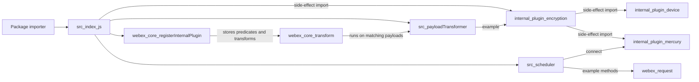
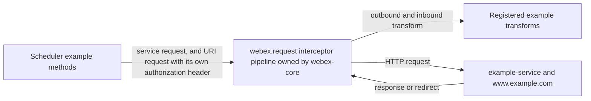

<!-- sdd-generated-metadata
doc_kind: standing-doc
generated_from: architecture@0.3.0
generated_by: claude-cowork
approved_by: akulakum@cisco.com
updated_at: 2026-10-15T11:06:00Z
validation_status: pass-with-warnings
-->

# @webex/internal-plugin-scheduler architecture

Canonical architecture for this package. Plugin behavior lives in the
[Scheduler plugin specification](../src/docs/README.md). This page owns package boundaries, the
plugin registration, the contract index, and how the package meets the rest of the SDK.

Related context: [specification registry](specs/README.md) ·
[package agent instructions](../AGENTS.md)

## Applicability

| Condition ID                         | Status     | Evidence or reason | Owned section |
| ------------------------------------ | ---------- | ------------------ | ------------- |
| `repo.owns_datastore`                | N/A        | No database, file store, or migration in `src/` | Repository data and schema |
| `repo.holds_client_state`            | N/A        | No state is read across calls (`src/scheduler/scheduler.js`) | Client state model |
| `repo.components_interact`           | N/A        | One module. The import graph is shown under Interaction and execution flows. | Dependency and interaction topology |
| `repo.domain_data_across_components` | N/A        | No domain data | Object and data ownership |
| `repo.caches_data`                   | N/A        | No cache in `src/` | Caching catalog |
| `repo.observability_convention`      | N/A        | No logging, metric, or trace convention; see Observability and operations | Observability patterns |
| `repo.deploys_to_infra`              | N/A        | Library published to npm. No service runtime. | Runtime and infrastructure |
| `repo.shared_base_libs`              | Applicable | Inherits `WebexPlugin` and the legacy build, lint, and test stack | Shared and base libraries |
| `repo.is_monorepo`                   | N/A        | This SDD root is one package. The workspace around it is out of scope. | Package map and dependencies |
| `repo.multi_platform`                | Applicable | The same `src/` targets Node (`package.json` engines, the Jest run) and browsers (the `browserify` transforms, `test:browser`, and the `process` browser-testing file) | Platform matrix |
| `repo.published_package`             | Applicable | `package.json` `name` is `@webex/internal-plugin-scheduler` and `deploy:npm` publishes it | Release and versioning |
| `repo.embedded_in_host`              | N/A        | No host theme or embed API | Host integration and theming |
| `repo.exposes_commands_or_artifacts` | Applicable | `build:src` writes the build output directory | Commands and generated artifacts |
| `repo.cross_repo_deps_material`      | Applicable | Behavior depends on sibling workspace packages webex-core, internal-plugin-encryption, and internal-plugin-mercury | Cross-repository topology |
| `repo.security_arch_warranted`       | Applicable | An example request sets its own authorization header, and the package registers transforms in the webex-core request pipeline | Security architecture |

## Design overview

`@webex/internal-plugin-scheduler` is a published library with one module. It is an unchanged
plugin scaffold: importing it imports the encryption plugin and registers `Scheduler` as the internal
plugin `scheduler`, with a placeholder config and three example payload predicates and transforms.
Webex instances constructed after the import have `webex.internal.scheduler`.

Its methods show how to send requests, use events, and connect Mercury. The registered transforms
act on webex-core payloads beyond this plugin's own calls; when they run is the Scheduler plugin spec
`INV-002`.

The package serves no routes and persists nothing.

## Resource inventory and responsibilities

| Resource | Kind | Responsibility | Owner | Source | Detailed specification |
| -------- | ---- | -------------- | ----- | ------ | ---------------------- |
| Scheduler plugin | module | Plugin scaffold, placeholder config, example payload transforms | @webex/web-sdk | `src/` | `src/docs/README.md` |
| Published package | package | npm entry points and the registration side effect | @webex/web-sdk | `package.json` | N/A (this document) |

## Interaction and execution flows

| From | To | Interaction or transport | Purpose | Failure or compatibility behavior |
| ---- | -- | ------------------------ | ------- | --------------------------------- |
| Importer | `src/index.js` | package import | Register the plugin | Without the import, `webex.internal.scheduler` is absent |
| `src/index.js` | encryption plugin | side-effect import | Registers encryption, and through its own imports device and Mercury | Load-time only |
| `src/index.js` | webex-core | `registerInternalPlugin` | Stores the plugin, config, predicates, and transforms | See the Scheduler plugin spec `MOD-001` |
| webex-core `transform` | `src/payloadTransformer/` | in-process promise | Runs a matching transform | See the Scheduler plugin spec Caller-visible failure modes |
| `src/scheduler/scheduler.js` | `webex.request`, Mercury | in-process promise | Example methods only | See the Scheduler plugin spec |

## Dependency topology

| Dependency | Type | Used by | Purpose | Version, failure, or fallback policy |
| ---------- | ---- | ------- | ------- | ------------------------------------ |
| `@webex/webex-core` | Internal | `src` | Plugin base, registration, request, logger, payload-transform pipeline | Workspace version |
| `@webex/internal-plugin-encryption` | Internal | `src` | Side-effect import; target of the example transforms | Workspace version |
| `@webex/internal-plugin-mercury` | Internal | `src` | `connect` in `exampleMercuryConnection` | Declared; reached at runtime through the encryption import, not through an import in `src/` |
| `@webex/common`, `@webex/common-timers`, `@webex/http-core`, `@webex/internal-plugin-device`, `@webex/internal-plugin-metrics` | Internal | none | Declared but not imported | Workspace version |
| `ampersand-collection`, `ampersand-state`, `lodash` | External | none | Declared but not imported | Range in `package.json` |

No dependency cycle exists inside the package.

## Public and consumer surfaces

| Surface | Type | Owner | Consumers | Compatibility policy | Source |
| ------- | ---- | ----- | --------- | -------------------- | ------ |
| `scheduler-sdk` (published) | SDK | Scheduler plugin | None in this workspace; any code that imports the package | Internal plugin; see Release and versioning | `package.json` |
| `webex-core-plugin-host` (required) | SDK | sibling package webex-core | Scheduler plugin | External | `@webex/webex-core` |
| `encryption-sdk` (required) | SDK | sibling package internal-plugin-encryption | Package barrel and transforms | External | `@webex/internal-plugin-encryption` |
| `mercury-sdk` (required) | SDK | sibling package internal-plugin-mercury | Scheduler plugin | Its files src/index.js and src/mercury-plugin.ts (the `MercuryPlugin` wrapper) | `@webex/internal-plugin-mercury` |

`scheduler-sdk` entry points: `main` points at the build output and `devMain` at `src/index.js`. No
HTTP surface is served, so `api-specs/openapi.yaml` is omitted.

## Cross-cutting architecture

### Security

- Trust boundaries and identity flow: see Security architecture.
- Sensitive surfaces and data classes: see Security architecture.
- Encryption and secret boundaries: see Security architecture.

### Observability and operations

- Logging and correlation: `this.logger.log` (webex-core's `webex.logger`, or `console` when absent)
  in the constructor and in example handlers; no prefix or correlation convention.
- Metrics, traces, and audit signals: none emitted by this package.
- Ownership and operational entry points: no runtime to deploy or monitor; owners are listed in
  References and maintenance.

### Quality attributes

- Compatibility: the plugin name `scheduler` and the default export are the only surfaces an
  importer can rely on.
- Correctness: the registered example transforms affect the shared webex-core pipeline; see the
  Scheduler plugin spec Pitfalls.
- Footprint: one direct runtime import beyond webex-core. Through it, the encryption plugin registers
  the device and Mercury plugins and the plugins they import; no native or platform-specific code.

## Shared and base libraries

| Library | Inherited responsibility | Consumers | Version floor | Compatibility rule |
| ------- | ------------------------ | --------- | ------------- | ------------------ |
| `WebexPlugin` from `@webex/webex-core` | `this.webex`, `this.logger`, `this.config`, events, and `request()` delegating to `webex.request` | `src/scheduler/scheduler.js` | workspace | Follow webex-core plugin conventions |
| `@webex/babel-config-legacy`, `@webex/eslint-config-legacy`, `@webex/jest-config-legacy` | Build, lint, and Jest config passthroughs | `babel.config.js`, `.eslintrc.js`, `jest.config.js` | workspace | Change upstream, not in the passthrough files |
| `@webex/legacy-tools` | `webex-legacy-tools` build and test runners | `package.json` scripts | workspace | Scripts call it; do not replace locally |

## Platform matrix

| Platform | Shared versus platform-specific boundary | Entry or build | Support and compatibility constraints |
| -------- | ---------------------------------------- | -------------- | ------------------------------------- |
| Node.js | All of `src/` is shared; no platform-specific code | `main` build output from `yarn workspace @webex/internal-plugin-scheduler build:src`; tested by `test:unit` (Jest) | Consumer floor: see [Getting started](getting-started.md) Prerequisites; Node 22.14 for development |
| Browser | Same `src/`, bundled by the consumer through the `browserify` transforms (`babelify`, `envify`) in `package.json` | `yarn workspace @webex/internal-plugin-scheduler test:browser` (karma), with the package-root `process` browser-testing file | Not verified in this Stage 0; see [Getting started](getting-started.md) Tests |

## Release and versioning

| Artifact | Publish target | Versioning rule | Deprecation window | Changelog or migration obligation |
| -------- | -------------- | --------------- | ------------------ | --------------------------------- |
| `@webex/internal-plugin-scheduler` | npm, through the `deploy:npm` script (manifest `commands.deploy`) | Workspace release tooling; README says the internal plugin does not strictly follow semver | None declared in code | No package-local changelog; workspace tooling owns it |

## Commands and generated artifacts

| Command or artifact | Owner | Inputs | Output or side effect | Compatibility boundary |
| ------------------- | ----- | ------ | --------------------- | ---------------------- |
| `yarn install` | workspace | root `package.json` and lockfile | workspace `node_modules` | Run from the workspace root |
| `yarn workspace @webex/internal-plugin-scheduler build` | package | `src/` | build output through `build:src` | Build output is never edited by hand |
| `yarn workspace @webex/internal-plugin-scheduler build:src` | package | `src/` (`.js` and `.ts`) | build output with source maps | Markdown under `src/` is not processed |
| `yarn workspace @webex/internal-plugin-scheduler test:unit` | package | `test/unit/spec/` | Jest result | See Getting started Tests |
| `yarn workspace @webex/internal-plugin-scheduler test:browser` | package | `test/integration/spec/` | karma result | The integration tier; see Getting started Tests |
| `yarn workspace @webex/internal-plugin-scheduler test:style` | package | files under `src/` | eslint result | See Getting started Tests |
| `yarn workspace @webex/internal-plugin-scheduler deploy:npm` | package | build output, `package.json` | Publishes the package to the npm registry | Release pipeline only |

## Cross-repository topology

| Repository or external system | Relationship | Exchanged contract or artifact | Owner | Sequencing constraint |
| ----------------------------- | ------------ | ------------------------------ | ----- | --------------------- |
| Sibling package webex-core | Consumes | `webex-core-plugin-host` | @webex/web-client and @webex/web-sdk (explicit CODEOWNERS entry) | Plugin host must exist before registration |
| Sibling package internal-plugin-encryption | Consumes | `encryption-sdk` | @webex/web-sdk (CODEOWNERS default rule) | Imported before registration |
| Sibling package internal-plugin-mercury | Consumes | `mercury-sdk` | @webex/web-client and @webex/web-sdk (explicit CODEOWNERS entry) | See Dependency topology |

These are sibling workspace packages outside this package-scoped SDD root. No workspace package
consumes this one.

## Security architecture

Threats addressed: a request sent with an unintended authorization header, and transforms that run
on payloads this package does not own.

Controls and boundaries:

- This package never reads or stores the user's token. `exampleRequestUsage` sets its own
  `authorization` header with a fixed placeholder value (Scheduler plugin spec Protocol and wire
  format).
- Authorization, host validation, and redirect handling belong to the sibling package webex-core
  request pipeline (files src/webex-core.js and src/config.js, and the interceptors under
  src/interceptors/). With webex-core's default interceptor set:
  - The auth interceptor keeps an `authorization` header that the request already carries, and
    otherwise adds the user's token when its credentials check passes (file src/interceptors/auth.js).
    The example POST's first attempt therefore carries the placeholder value. On a 401, unless the
    request sets `shouldRefreshAccessToken: false`, the auth interceptor removes the header and, when
    the credentials can refresh, refreshes and replays; otherwise the 401 rejects. The replay goes
    back through the auth interceptor, which adds the user's token when its `requiresCredentials`
    check passes for the request URL (file src/interceptors/auth.js).
  - When `config.services.validateCatalogUrls` is `true` (default `false`, files src/config.js and
    src/webex-core.js), `CatalogUrlInterceptor` rejects a request whose `uri` is outside the
    catalog and allowed domains, which would include the example POST unless the host's catalog or
    `allowedDomains` covers `www.example.com` (file
    src/interceptors/catalog-url.js). A request that carries `service` and no `uri` is not checked.
  - `PayloadTransformerInterceptor` passes requests, responses, and response errors through
    `webex.transform`, where this package's predicates are evaluated (file
    src/interceptors/payload-transformer.js). Requests that set `noTransform` skip the outbound pass,
    and requests that set `disableTransform` skip the inbound pass in its `onResponse` step.
    Response errors are passed to `webex.transform` regardless of `disableTransform`, so an error
    object that carries a trigger field can still match an inbound predicate (Scheduler plugin spec
    Caller-visible failure modes).
- These controls assume webex-core's default interceptor set; the Scheduler plugin spec Dependencies
  row for webex-core records what changes when a host supplies its own set.

Transform-related gaps owned by this package are recorded in the Scheduler plugin spec Pitfalls and
Caller-visible failure modes. Neither this package nor the workspace root has a `SECURITY.md`, and this package adds
none.

## Domain language

| Term | Repository-specific meaning | Authoritative source |
| ---- | --------------------------- | -------------------- |
| Scheduler | The plugin class registered as `webex.internal.scheduler` | `src/scheduler/scheduler.js` |
| Scaffold | The example-only code this package contains, marked by `example` names and comments | `src/scheduler/scheduler.js`, `src/payloadTransformer/` |
| Predicate | An object with `name`, `direction`, `test`, and `extract` that webex-core evaluates to choose a transform | `src/payloadTransformer/predicates.js` |
| Transform | An object with `name`, `direction`, and `fn` that webex-core runs by name | `src/payloadTransformer/transformers.js` |
| Direction | `inbound` (responses and events), `outbound` (requests), or none for both | `src/payloadTransformer/predicates.js` |

## References and maintenance

- Decisions: [adr/](adr/), including [ADR 0001](adr/0001-retain-product-readme.md)
- Repository rules and patterns: [package agent instructions](../AGENTS.md)
- Instantiated specifications and routing: [specs/README.md](specs/README.md)
- Module spec: `src/docs/README.md`
- Owner: `@webex/web-sdk` through the monorepo `.github/CODEOWNERS` default rule
- Manifest: `.sdd/manifest.json`
- Update this document in the same change that alters package boundaries, contracts, or
  cross-cutting behavior.
