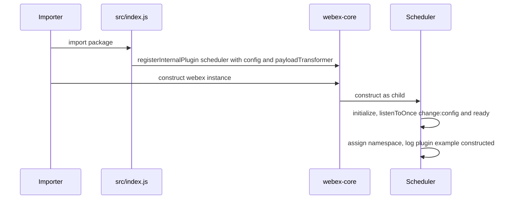
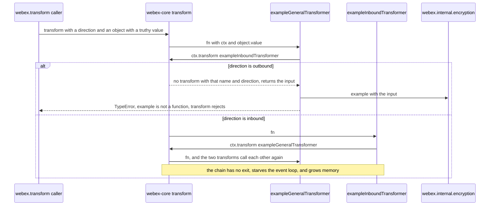
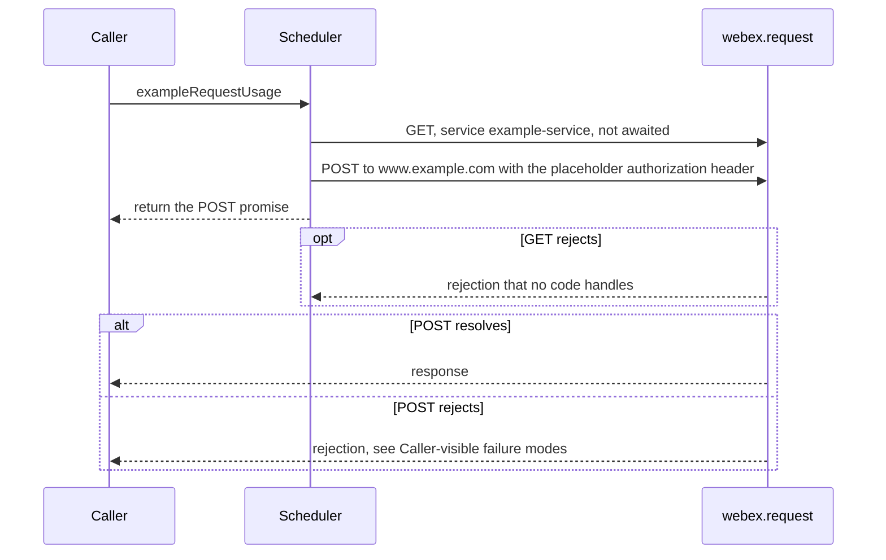
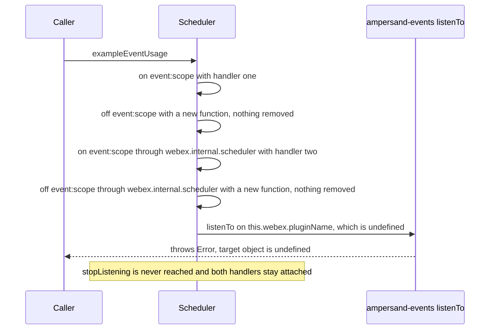
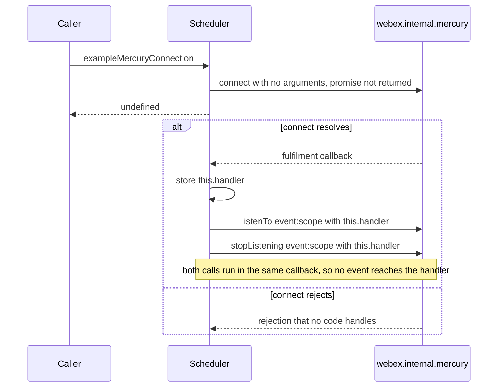
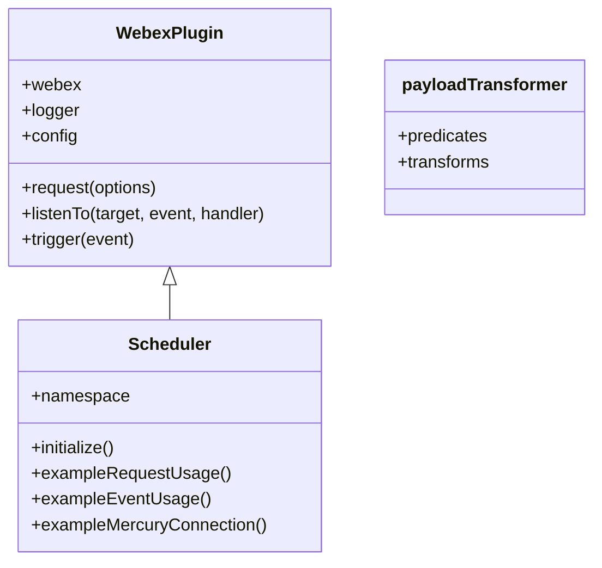

<!-- sdd-generated-metadata
doc_kind: module-spec
generated_from: module-spec@0.3.0
generated_by: claude-cowork
approved_by: akulakum@cisco.com
updated_at: 2026-10-15T11:06:00Z
validation_status: pass-with-warnings
-->

# Scheduler plugin

This source-local document at `src/docs/README.md` owns the stable specification for **the
Scheduler plugin**: the `webex.internal.scheduler` internal plugin. Ground every
claim in package evidence and link to the [package architecture](../../docs/architecture.md)
instead of repeating broader facts. No service specification exists because this package is a
library.

Related context: [documentation index](../../docs/index.md) ·
[package agent instructions](../../AGENTS.md)

## Metadata

| Field             | Value |
| ----------------- | ----- |
| Owner             | @webex/web-sdk (CODEOWNERS default rule) |
| Source path       | `src` |
| Resource kind     | package |
| Status            | Draft |
| Last verified     | 2026-10-12 at `8a63b4aac9` |
| Module id         | `internal-plugin-scheduler` |
| Parent spec       | — |
| Doc kind          | Module spec |
| Coverage score    | 93.3% assessed 2026-10-12 — 14 of 15 mandatory fields PRESENT, critical 8 of 8; test strategy is WEAK (gaps listed under Verification) and no characterization baseline exists. Independent validation: see the Validation status row |
| Validation status | pass-with-warnings — 2026-10-15; validator runtime `current-session`; 0 Blocking, 5 Minor warnings |

## Applicability

| Condition ID                         | Status     | Evidence or reason | Owned section |
| ------------------------------------ | ---------- | ------------------ | ------------- |
| `module.has_tiers`                   | N/A        | No tier policy exists in this package or its `package.json` | Tier |
| `module.has_ui`                      | N/A        | No view or screen | UI use-case flow |
| `module.crosses_service_boundaries`  | Applicable | exampleRequestUsage calls webex.request, exampleMercuryConnection calls the Mercury plugin, and the registered transforms call the encryption plugin (`src/scheduler/scheduler.js`, `src/payloadTransformer/transformers.js`) | Cross-boundary use-case flow |
| `module.holds_client_state`          | N/A        | No state is read across calls. exampleMercuryConnection assigns this.handler, which nothing else reads | Client state model |
| `module.enforces_domain_rules`       | Applicable | The predicates decide, by direction and payload field, which registered transform runs (`src/payloadTransformer/predicates.js`) | Business rules and invariants |
| `module.is_concurrent_async`         | Applicable | Requests, the Mercury connection, and the transforms are promise-based; one request and the Mercury connection are not awaited | Concurrency and reactive flow |
| `module.owns_persistence`            | N/A        | Nothing is stored by this package | Data, schema, and migration |
| `module.stateful_transitions`        | N/A        | No state machine; initialize only attaches one-time listeners with empty bodies | State machine |
| `module.exposes_wire_protocol`       | Applicable | The example request shapes, the payload fields that trigger the transforms, and the event:scope event name | Protocol and wire format |
| `module.ui_multi_screen`             | N/A        | No UI | UI flow |
| `module.large_data_model`            | N/A        | No data model; the config holds five placeholder keys | Data model |
| `module.returns_caller_errors`       | Applicable | exampleEventUsage throws, exampleRequestUsage can reject, and the transforms reject or never settle inside webex.transform | Caller-visible failure modes |
| `module.module_specific_conventions` | Applicable | The scaffold comments prescribe where startup work goes and how listeners are removed | Module-specific rules |
| `module.published_package`           | Applicable | `package.json` names the package @webex/internal-plugin-scheduler and deploy:npm publishes it | Export stability |
| `module.embedded_in_host`            | N/A        | No host theme or embed API | Host integration and theming |
| `module.has_design_tradeoff`         | N/A        | No design decision beyond the scaffold structure is recorded in code or documentation | Key design trade-off |
| `module.has_submodules`              | N/A        | Computed false by the Repo Annotation module_tree.py script: the manifest has one module | Sub-modules |

## Evidence register

| Evidence | What it establishes |
| -------- | ------------------- |
| `src/index.js` | Side-effect import of the encryption plugin; registration as internal plugin `scheduler` with the config and the payload transformer; the default export |
| `src/scheduler/scheduler.js` | The `Scheduler` class: the `namespace` class field, the constructor log, `initialize`, and the three example methods |
| `src/scheduler/scheduler.config.js` | The placeholder config under the `scheduler` key |
| `src/scheduler/scheduler.constants.js` | `NAMESPACE = 'scheduler'` |
| `src/scheduler/index.js` | Re-exports `Scheduler` as default and `config` and `CONSTANTS` as named exports |
| `src/payloadTransformer/index.js` | Builds `{predicates, transforms}` from the values of the two maps |
| `src/payloadTransformer/predicates.js` | Three example predicates |
| `src/payloadTransformer/transformers.js` | Three example transforms |
| `package.json` | Name, entry points, dependencies, and scripts |
| `test/unit/spec/scheduler/scheduler.js` | Two cases: `request` and `logger` exist on a Scheduler mounted in `MockWebex` |
| `test/integration/spec/scheduler/scheduler.js`, `test/integration/spec/payloadTransformer/predicates.js`, `test/integration/spec/payloadTransformer/transformers.js` | Placeholder specs; each has one `assert.isTrue(true)` case |
| `README.md` | Retained product documentation, not the behavioral authority. See ADR 0001. |
| Sibling package webex-core, file src/lib/webex-plugin.js | `WebexPlugin`: `request` delegates to `webex.request`; `logger` is `webex.logger` or `console`; `config` is `webex.config` under the namespace; its `initialize` propagates `change` events to the parent |
| Sibling package webex-core, file src/lib/webex-internal-core-plugin-mixin.js | How `registerInternalPlugin` stores the plugin, merges `config`, and concatenates payload-transformer predicates and transforms |
| Sibling package webex-core, file src/webex-core.js | `transform` and `applyNamedTransform`; the `change:config` and `ready` triggers |
| Sibling package webex-core, file src/interceptors/payload-transformer.js | The interceptor that calls `webex.transform` for requests, responses, and response errors |
| Sibling package webex-core, file src/interceptors/auth.js | An existing `authorization` header is kept |
| Sibling package webex-core, files src/lib/services/index.js and src/lib/interceptors/service.js | The services plugin registers the service interceptor that resolves `service` to a URL |
| Sibling package internal-plugin-encryption, files src/index.js and src/encryption.js | The import registers the device and Mercury plugins; no `example` method exists |
| Sibling package internal-plugin-mercury, files src/index.js and src/mercury-plugin.ts | `webex.internal.mercury` is the `MercuryPlugin` wrapper: `connect(webSocketUrl)` delegates to its inner Mercury, and every event the inner Mercury triggers after the wrapper's constructor attaches its `all` listener is re-emitted on the plugin |
| Ampersand packages ampersand-state and ampersand-events (npm) | The base constructor calls `initialize`; `listenTo` throws when its target is undefined |

## Purpose and boundary

- Responsibility: reserve the `webex.internal.scheduler` namespace and provide a starting point for a
  scheduler plugin. The code is an unchanged plugin scaffold: no scheduling behavior is implemented,
  and the class methods, config, and transforms are examples.
- In scope: the `Scheduler` class in `src/scheduler/scheduler.js`, the config and constant in
  `src/scheduler/`, the predicates and transforms in `src/payloadTransformer/`, and the
  registration side effect in `src/index.js`.
- Out of scope: HTTP transport, service URL resolution, authorization, and error classes (sibling
  packages webex-core and http-core); payload-transform execution (webex-core); encryption (sibling
  package internal-plugin-encryption); the Mercury connection (sibling package
  internal-plugin-mercury).
- Consumers: none inside this workspace; no other workspace package lists this package as a
  dependency or reads `webex.internal.scheduler`.

## Structure and key files

| Path | Responsibility |
| ---- | -------------- |
| `src/index.js` | Imports the encryption plugin for its side effect, calls `registerInternalPlugin(CONSTANTS.NAMESPACE, Scheduler, {payloadTransformer, config})`, and re-exports `Scheduler` as default |
| `src/scheduler/scheduler.js` | `class Scheduler extends WebexPlugin` |
| `src/scheduler/scheduler.config.js` | Default export `{scheduler: {…}}` with five placeholder keys |
| `src/scheduler/scheduler.constants.js` | Default export `{NAMESPACE}` |
| `src/scheduler/index.js` | Local barrel for the three files above |
| `src/payloadTransformer/predicates.js`, `src/payloadTransformer/transformers.js`, `src/payloadTransformer/index.js` | Example predicates and transforms, and the object passed to registration |
| `test/unit/spec/scheduler/scheduler.js` | Jest spec |
| `test/integration/spec/scheduler/scheduler.js`, `test/integration/spec/payloadTransformer/predicates.js`, `test/integration/spec/payloadTransformer/transformers.js` | Placeholder specs collected by `test:browser` |
| `process` | Legacy-tools browser-testing file containing `module.exports = {browser: true};` (see Pitfalls) |

## Public surface

| Surface | Consumer | Compatibility commitment | Source |
| ------- | -------- | ------------------------ | ------ |
| Registration side effect | Every importer | Installs `webex.internal.scheduler` and the payload transforms (`MOD-001`) | `src/index.js` |
| Default export `Scheduler` | Importers and the unit spec | The plugin class (`MOD-002`) | `src/index.js` |
| `namespace` | webex-core | `INV-001` | `src/scheduler/scheduler.js` |
| Construction and `initialize` | webex-core | `MOD-003`, `MOD-004` | `src/scheduler/scheduler.js` |
| `exampleRequestUsage` | None found | Example (`MOD-005`) | `src/scheduler/scheduler.js` |
| `exampleEventUsage` | None found | Example (`MOD-006`) | `src/scheduler/scheduler.js` |
| `exampleMercuryConnection` | None found | Example (`MOD-007`) | `src/scheduler/scheduler.js` |
| Payload predicates and transforms | webex-core `transform` | `MOD-008`, `INV-002`, `INV-003` | `src/payloadTransformer/index.js` |
| Config `webex.config.scheduler` | None found | `MOD-009` | `src/scheduler/scheduler.config.js` |

Contract `scheduler-sdk` is published with native artifact `package.json`. Required contracts:
`webex-core-plugin-host`, `encryption-sdk`, and `mercury-sdk`.

## Dependencies

| Dependency | Why it is required | Failure behavior |
| ---------- | ------------------ | ---------------- |
| `@webex/webex-core` (`webex-core-plugin-host`) | `WebexPlugin`, `registerInternalPlugin`, `request`, `logger`, events, and the payload-transformer pipeline | Error classes (`WebexHttpError` subtypes through `HttpStatusInterceptor`), service URL resolution, host checks, auth, redirects, and the `PayloadTransformerInterceptor` that runs this package's transforms on requests, responses, and response errors assume webex-core's default interceptor set. A host-supplied `config.interceptors` set replaces it, and then the HTTP and transform rows under Caller-visible failure modes depend on the interceptors that host lists. Pipeline security is described in the architecture Security architecture |
| `@webex/internal-plugin-encryption` (`encryption-sdk`) | Imported for its side effect; the transforms call `webex.internal.encryption.example` | The encryption plugin defines no `example` method; see Caller-visible failure modes |
| `webex.internal.mercury` (`mercury-sdk`) | `exampleMercuryConnection` calls `connect()` | A rejection is not handled (`MOD-007`). How the plugin is registered, and the declared dependencies that `src/` does not import, are in the architecture Dependency topology |

## Requirements

| ID | WHAT | WHY | Source evidence | Test or example evidence | Assumptions or gaps | Confidence |
| -- | ---- | --- | --------------- | ------------------------ | ------------------- | ---------- |
| `MOD-001` | Importing the package imports the encryption plugin, then registers `Scheduler` under `INV-001` with the config of `MOD-009` and the payload transformer of `MOD-008`. | Webex instances built after the import get `webex.internal.scheduler` and the predicates of `INV-002`. | `src/index.js` | none found; the unit spec imports the package but asserts nothing about registration | No test reads `webex.internal.scheduler` from a webex instance built after the import | Present |
| `MOD-002` | The barrel exports only `Scheduler` as default. `config` and `CONSTANTS` are named exports of `src/scheduler/index.js` and are not re-exported by the barrel. | Callers reach the plugin through `webex.internal.scheduler`; the class export exists for tests and extension. | `src/index.js`, `src/scheduler/index.js` | `test/unit/spec/scheduler/scheduler.js` mounts the default export in MockWebex (indirect) | No test checks the absence of other exports | Present |
| `MOD-003` | Constructing a `Scheduler` runs the WebexPlugin constructor, which calls `initialize` (`MOD-004`); the `namespace` class field is then assigned, and the constructor logs `plugin example constructed` through `this.logger.log`. | The scaffold shows that `request` and `logger` exist after construction. | `src/scheduler/scheduler.js`; ampersand-state base constructor | `test/unit/spec/scheduler/scheduler.js` asserts request and logger exist | The log line runs for every instance | Present |
| `MOD-004` | `initialize()` attaches one-time listeners for `change:config` and `ready` on the webex instance; both handlers are empty. It does not call `WebexPlugin`'s `initialize`. | The scaffold marks where startup work belongs. | `src/scheduler/scheduler.js`; sibling package webex-core, file src/lib/webex-plugin.js | none found | Consequence under Pitfalls | Present |
| `MOD-005` | `exampleRequestUsage()` sends the example GET without returning or catching it, then sends the example POST and returns that promise (both under Protocol and wire format). | Shows the service-based and URI-based request forms. | `src/scheduler/scheduler.js` | none found | No caller; see Pitfalls | Present |
| `MOD-006` | `exampleEventUsage()` adds an `event:scope` handler on the plugin twice (once through `this` and once through `webex.internal.scheduler`), calls `off` twice with new functions that match neither handler, then calls `listenTo` on `this.webex.pluginName`, which is undefined, and throws. | Shows the event methods. | `src/scheduler/scheduler.js`; ampersand-events `listenTo` | none found | See Caller-visible failure modes | Present |
| `MOD-007` | `exampleMercuryConnection()` calls `webex.internal.mercury.connect()` with no arguments and returns `undefined`. When the connection resolves, it stores a handler in `this.handler`, listens for `event:scope` on Mercury, and stops listening at once. | Shows the Mercury connect and listen pattern. | `src/scheduler/scheduler.js` | none found | Connect behavior is owned by internal-plugin-mercury | Present |
| `MOD-008` | Registration adds three predicates and three transforms to the webex-core payload-transformer config; their selection and effects follow `INV-002` and `INV-003`. | Shows how a plugin hooks inbound and outbound payloads. | `src/payloadTransformer/index.js`, `src/index.js` | none found | No test runs a transform | Present |
| `MOD-009` | The config under the `INV-001` key holds the five placeholder keys `configurationBoolean`, `configurationString`, `configurationNumber`, `configurationArray`, and `configurationObject` with the values in `src/scheduler/scheduler.config.js`; webex-core merges it into `webex.config`, and `src/` reads none of the keys. | Shows how a plugin declares defaults reachable as `this.config`. | `src/scheduler/scheduler.config.js` | none found | — | Present |

## Design overview

`Scheduler` is an ES class that extends `WebexPlugin`. webex-core constructs it as a child of
`webex.internal`; the base constructor sets `parent` and calls `initialize` before the subclass constructor body
and class-field initializers run (`MOD-003`). The class keeps no state that other calls read.

The three example methods are independent. They call `this.request`, the event methods inherited
from `WebexPlugin`, and `webex.internal.mercury`, and return or drop the resulting promises as
`MOD-005` to `MOD-007` state.

The payload-transformer object is not called by the plugin. webex-core stores it at registration
and evaluates it (`INV-002`).

## Data flow and sequence coverage

Transport: HTTP through `webex.request`; in-process promise calls to the Mercury and encryption
plugins; ampersand events on the plugin and on Mercury.

| Operation group | Entry and outcome | Diagram or evidence | Failure and recovery coverage |
| --------------- | ----------------- | ------------------- | ----------------------------- |
| Registration and construction | Import, then webex instance construction → plugin mounted, `initialize` listeners attached, log line | Construction diagram below | None in this module |
| Example requests | `exampleRequestUsage` → dropped GET, returned POST promise | Example requests diagram below | Unhandled GET rejection; POST rejection classes in Caller-visible failure modes |
| Example local events | `exampleEventUsage` → two handlers attached, then a throw | Example local events diagram below | The `listenTo` throw; handlers left attached |
| Example Mercury connection | `exampleMercuryConnection` → `undefined` at once, connect settles later | Example Mercury connection diagram below | Unhandled connect rejection |
| Payload transforms | `webex.transform` with a triggering field → named transform chain | Payload transform diagram below | See Caller-visible failure modes |

Construction:

Payload transform, when the general predicate matches:

Example requests (`MOD-005`):

Example local events (`MOD-006`):

Example Mercury connection (`MOD-007`):

## Class and component relationships

| Component | Relationship |
| --------- | ------------ |
| `Scheduler` | Extends `WebexPlugin`; registered as `scheduler` |
| `payloadTransformer` | Plain object `{predicates, transforms}` passed to registration; not referenced by `Scheduler` |
| `config`, `CONSTANTS` | Plain objects imported by `src/index.js` and `src/scheduler/scheduler.js` |

## Use cases and flows

| Use case | Actor or caller | Primary steps and outcome | Failure or boundary behavior | Evidence |
| -------- | --------------- | ------------------------- | ---------------------------- | -------- |
| `UC-001` | Developer starting a scheduler plugin | Replaces the example methods, config keys, and transforms with real behavior, keeping the registration in `src/index.js` | See Module-specific rules | `src/scheduler/scheduler.js` comments |
| `UC-002` | Application that imports the package | Gets `webex.internal.scheduler`, the constructor log line, and the registered transforms | See Pitfalls | `src/index.js`, `README.md` |
| `UC-003` | webex-core payload pipeline | Evaluates the predicates for each `webex.transform` call | See Caller-visible failure modes | `src/payloadTransformer/predicates.js` |

### Cross-boundary use-case flow

| Boundary | Transport | Ordering | Timeout and retry | Recovery |
| -------- | --------- | -------- | ----------------- | -------- |
| Catalog service `example-service` and `https://www.example.com` | HTTP through `webex.request` | GET then POST, sent without waiting for the GET | No retry here; any retry or timeout belongs to the webex-core request pipeline | None here |
| Mercury plugin | In-process promise | One `connect()` call | None here | None here |
| Encryption plugin | In-process call from a transform | After the nested `ctx.transform` resolves | None here | None here |

## Business rules and invariants

| ID | Invariant | WHY | Enforcement source | Test evidence |
| -- | --------- | --- | ------------------ | ------------- |
| `INV-001` | The plugin name (`src/index.js`) and the `namespace` value (`src/scheduler/scheduler.js`) come from `CONSTANTS.NAMESPACE`, which is `scheduler`. The config key is a separate literal `scheduler` in `src/scheduler/scheduler.config.js`, which does not import the constant; it must stay equal to `CONSTANTS.NAMESPACE`. | webex-core mounts the plugin under the registration name and reads `this.config` by the lower-cased namespace, so a key that differs leaves the defaults under the old name. | `src/scheduler/scheduler.constants.js`, `src/index.js`, `src/scheduler/scheduler.js`, `src/scheduler/scheduler.config.js` | Gap: no test checks the equality; the unit spec mounts the class under the literal child name `scheduler` |
| `INV-002` | A predicate applies only in its direction (no direction applies to both). It matches when the object passed to `webex.transform` has a truthy field: `value` for `exampleGeneralPredicate`, `inboundValue` for `exampleInboundPredicate`, `outboundValue` for `exampleOutboundPredicate`. On a match, that field's value is passed to the transform of the same name. | Shows predicate gating and extraction. | `src/payloadTransformer/predicates.js` | Gap: no test |
| `INV-003` | `exampleGeneralTransformer` (both directions) calls `ctx.transform('exampleInboundTransformer')`; `exampleInboundTransformer` (inbound) and `exampleOutboundTransformer` (outbound) call `ctx.transform('exampleGeneralTransformer')`. Each then passes the result to `ctx.webex.internal.encryption.example`. | Shows named-transform chaining. | `src/payloadTransformer/transformers.js` | Gap: no test |

## Concurrency and reactive flow

- Execution model: single JavaScript event loop.
- Ordering guarantees: `exampleRequestUsage` starts the GET and the POST without ordering between
  them. The transforms run inside webex-core's sequential reduce over matched predicates.
- Idempotency and retry: none (Cross-boundary use-case flow).
- Shared-state protection: none needed; no shared state.
- Blocking restrictions: see the inbound transform row under Caller-visible failure modes.

## Protocol and wire format

| Message or frame | Version | Producer or serializer | Consumer or parser | Compatibility and ordering rule |
| ---------------- | ------- | ---------------------- | ------------------ | ------------------------------- |
| Example GET | Unversioned | `src/scheduler/scheduler.js` | Catalog service `example-service` | Resource `example/resource/path`, no body. No response shape is defined in this repository |
| Example POST | Unversioned | `src/scheduler/scheduler.js` | `https://www.example.com` | Headers `accept: application/json`, `authorization: example-token`, `x-custom-header`; body with keys `example-param-a`, `example-param-b`, `example-param-c`. No response shape is defined in this repository |
| Transform trigger fields | Unversioned | Any caller of `webex.transform` | `src/payloadTransformer/predicates.js` | `value`, `inboundValue`, `outboundValue` per `INV-002` |
| `event:scope` | Unversioned | Code that triggers it on the plugin or on Mercury | Example handlers | Handlers log the event (`MOD-006`, `MOD-007`) |

## Caller-visible failure modes

| Condition | Signal or result | Caller behavior | Retry or recovery | Evidence |
| --------- | ---------------- | --------------- | ----------------- | -------- |
| `exampleEventUsage()` | Throws `Error` "Trying to listenTo event: 'event:scope' but the target object is undefined" after adding two handlers | Do not call it | None | `src/scheduler/scheduler.js`; ampersand-events |
| `exampleRequestUsage()` GET fails (default interceptor set; see Dependencies) | Unhandled rejection. When `example-service` is not in the catalog, the service interceptor that the webex-core services plugin registers rejects with a plain `Error` | None possible; the promise is not returned | None | `src/scheduler/scheduler.js`; sibling package webex-core, files src/lib/services/index.js and src/lib/interceptors/service.js |
| `exampleRequestUsage()` POST fails (default interceptor set) | An HTTP status failure rejects with the `WebexHttpError` subtype for the final status. Pipeline failures include a plain `Error` from the catalog check when `validateCatalogUrls` is on, or from exceeding the configured `maxAuthenticationReplays`, `maxAppLevelRedirects`, or `maxLocusRedirects` limit (webex-core defaults 1, 10, and 5 in its file src/config.js). Other rejections are possible, such as a failed credentials refresh, the device-URL interceptor when a device is registered, or another plugin's payload transform | Inspect the class or status | None here | Sibling package http-core, file src/interceptors/http-status.js; sibling package webex-core, files src/interceptors/catalog-url.js, src/interceptors/auth.js, src/interceptors/redirect.js, and src/interceptors/payload-transformer.js; sibling package internal-plugin-device, file src/interceptors/device-url.js |
| `exampleMercuryConnection()` connect fails | Unhandled rejection; the method already returned `undefined` | None possible | None | `src/scheduler/scheduler.js` |
| Outbound `webex.transform` with a matching predicate | Rejects with a TypeError because `encryption.example` is not a function; for a request through the payload-transformer interceptor, the request rejects | Avoid the trigger fields (`INV-002`) | None | `src/payloadTransformer/transformers.js`; sibling package webex-core, file src/webex-core.js |
| Inbound `webex.transform` with a matching predicate | The transform never settles: the two transforms call each other through promise callbacks without yielding, so timers and I/O stop running and memory grows until the runtime runs out of it. A sandbox simulation of webex-core's transform with these transforms ended with a Node heap out-of-memory abort | Avoid the trigger fields | Restart the runtime | Same as above |

## Pitfalls and constraints

- The README's "Plugin for scheduler management" describes intent, not behavior (Purpose and
  boundary).
- Importing the package arms the example transforms for webex-core payloads that are unrelated to
  this plugin (`INV-002`); see Caller-visible failure modes. Found by code reading and a sandbox
  simulation; no test.
- `initialize` does not call `WebexPlugin`'s `initialize` (`MOD-004`), so this plugin's `change`
  events are not re-triggered on its parent `webex.internal` as `change:scheduler`.
- The example POST's placeholder `authorization` header and what a 401 replay sends instead are
  described in the architecture Security architecture.
- The example methods are not safe to call (`MOD-005` to `MOD-007`); see Caller-visible failure
  modes.
- The integration specs call the test-users helper in `beforeEach`. Missing client credentials make
  the hook throw and fail every case; a later rejection of the user creation is not returned from
  the hook and does not fail the placeholder case.
- `package.json` `description` is empty, and its `engines` value `>=14` is lower than the effective
  consumer floor recorded in Getting started Prerequisites.
- The package-root `process` file is the browser-testing file that the README of the sibling package
  legacy-tools recommends; nothing in `src/` reads it. Do not remove it without running
  `yarn workspace @webex/internal-plugin-scheduler test:browser`.

## Module-specific rules

- Do: put startup work in `initialize` listeners, not in the constructor, as the scaffold comments
  say; call `WebexPlugin`'s `initialize` when overriding it.
- Do: keep the plugin name and `namespace` on `CONSTANTS.NAMESPACE`, and change the literal config key
  in `src/scheduler/scheduler.config.js` in the same edit (`INV-001`).
- Do: remove listeners with the same function reference that was added.
- Do not: call the example methods from product code or ship new behavior on top of them.
- Do not: add a predicate or transform without a test (`INV-002`).

## Export stability

| Export or entry point | Consumer | Stability | Versioning and deprecation rule | Declaration or API report |
| --------------------- | -------- | --------- | ------------------------------- | ------------------------- |
| default `Scheduler` | Tests and importers | Internal plugin | README states the package does not strictly follow semver | `src/index.js` |
| Registration as `scheduler` | Code reading `webex.internal.scheduler` | Stable name | Renaming is breaking | `src/index.js` |
| Example methods and config keys | None found | Placeholder | May be replaced when real behavior is added | `src/scheduler/scheduler.js`, `src/scheduler/scheduler.config.js` |

No TypeScript declaration or API report exists for this package.

## Verification

| Requirement or invariant | Test level | Positive evidence | Negative or boundary evidence | Gap |
| ------------------------ | ---------- | ----------------- | ----------------------------- | --- |
| `MOD-003` | Unit | `test/unit/spec/scheduler/scheduler.js` (request and logger exist) | none found | Log line, `namespace` value |
| `MOD-002` | Unit (indirect) | `test/unit/spec/scheduler/scheduler.js` mounts the default export | none found | Other exports |
| `MOD-001`, `INV-001` | none | none found | none found | No test of the registration |
| `MOD-004` to `MOD-007` | none | none found | none found | No test of `initialize` or the example methods |
| `MOD-008`, `INV-002`, `INV-003` | none | none found | none found | No test runs a predicate or transform |
| `MOD-009` | none | none found | none found | No config test |
| Integration tier | Integration (`test:browser`, karma) | Placeholder cases only | none found | No integration behavior |

Test tiers, the build-before-unit order, and the first-run build are described in
[Getting started](../../docs/getting-started.md).
