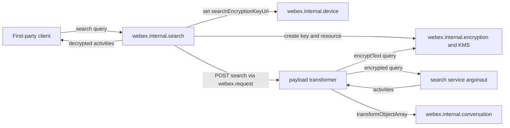
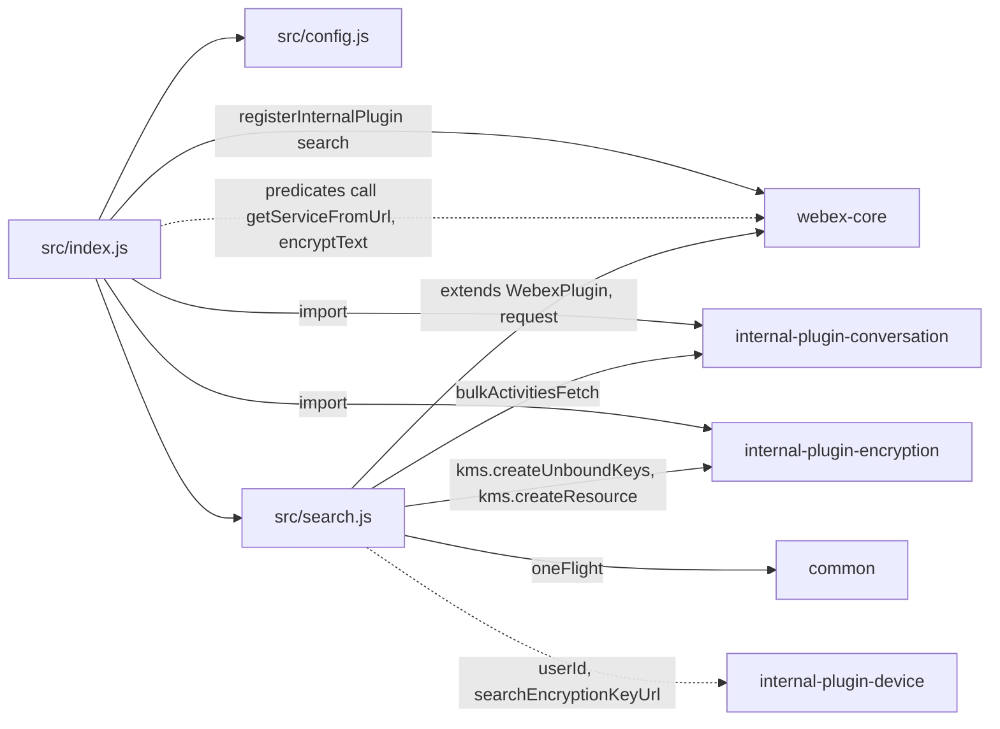
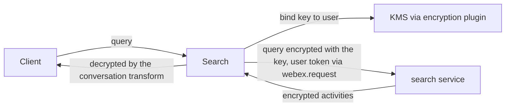

<!-- sdd-generated-metadata
doc_kind: standing-doc
generated_from: architecture@0.3.0
generated_by: claude-code
approved_by: rarajes2@cisco.com
updated_at: 2026-11-12T11:40:54Z
validation_status: pass-with-warnings
-->

# @webex/internal-plugin-search architecture

Canonical architecture for this package. Flow behavior lives in the
[Search plugin specification](../src/docs/README.md). This page owns package boundaries, the plugin
registration, the contract index, and how the package meets the rest of the SDK.

Related context: [specification registry](specs/README.md) ·
[package agent instructions](../AGENTS.md)

## Applicability

| Condition ID                         | Status     | Evidence or reason | Owned section |
| ------------------------------------ | ---------- | ------------------ | ------------- |
| `repo.owns_datastore`                | N/A        | No database, file store, or migration in `src/search.js` | Repository data and schema |
| `repo.holds_client_state`            | Applicable | The search key URL written onto the device and the one-flight key binding in `src/search.js` | Client state model |
| `repo.components_interact`           | Applicable | `src/search.js` and `src/index.js` drive the encryption and conversation plugins, the payload transformer, and webex.request | Dependency and interaction topology |
| `repo.domain_data_across_components` | Applicable | Query strings, directory entries, and conversation activities pass between the caller, the search service, KMS, and remote clusters (`src/search.js`) | Object and data ownership |
| `repo.caches_data`                   | N/A        | `src/search.js` keeps no result cache | Caching catalog |
| `repo.observability_convention`      | Applicable | One warn line through this.logger with the search: prefix in `src/search.js` | Observability patterns |
| `repo.deploys_to_infra`              | N/A        | Library published to npm (`package.json`). No service runtime | Runtime and infrastructure |
| `repo.shared_base_libs`              | Applicable | Extends WebexPlugin, uses the webex-core payload transformer and the common oneFlight decorator, and the legacy build, lint, and test stack (`babel.config.js`, `jest.config.js`, `.eslintrc.js`) | Shared and base libraries |
| `repo.is_monorepo`                   | N/A        | This SDD root is one package. The workspace around it is out of scope | Package map and inter-package dependencies |
| `repo.multi_platform`                | N/A        | `src/search.js` uses no platform-specific API; `process` declares only {browser: true} | Platform matrix |
| `repo.published_package`             | Applicable | `package.json` name is @webex/internal-plugin-search and deploy:npm publishes it | Release and versioning |
| `repo.embedded_in_host`              | N/A        | No host theme or embed API in `src/search.js` | Host integration and theming |
| `repo.exposes_commands_or_artifacts` | Applicable | build:src in `package.json` writes dist | Commands and generated artifacts |
| `repo.cross_repo_deps_material`      | Applicable | Behavior depends on the search service, KMS, and remote conversation clusters (`src/search.js`, `src/index.js`) | Cross-repository topology |
| `repo.security_arch_warranted`       | Applicable | Search queries are encrypted under a user-bound KMS key and results are decrypted (`src/index.js`, `src/search.js`) | Security architecture |

## Design overview

`@webex/internal-plugin-search` is a published JavaScript library with one module. Importing it
registers the conversation and encryption plugins and then `Search` as the internal plugin `search`,
reached as `webex.internal.search`, together with two payload predicates and one payload transform
that webex-core applies to every request and response of the SDK instance. Inside this repository
`@webex/plugin-device-manager` calls it, and `@webex/webex-server` and
`@webex/recipe-private-web-client` load it.

The plugin talks to the search service, catalog name `argonaut`. `people` posts a directory query and
resolves the response body. `search` posts an activity query: on its first use on a device it binds a
KMS key to the user and stores the key URL on the device, and the registered outbound transform
encrypts the query with that key before the request leaves the client. The inbound predicate hands the
returned activities to the conversation plugin's transform, which decrypts them. With
`includeRemoteClusterReferences`, `search` also fetches the matching activities held in other
clusters and appends them.

The package serves no routes and persists nothing itself.

## Resource inventory and responsibilities

| Resource | Kind | Responsibility | Owner | Source | Detailed specification |
| -------- | ---- | -------------- | ----- | ------ | ---------------------- |
| Search plugin | package (one module) | Registration and payload predicates, people lookup, encrypted activity search, search key binding, remote-cluster merge | @webex/web-sdk | `src` | [`src/docs/README.md`](../src/docs/README.md) |

## Interaction and execution flows

Representative end-to-end flow: a client searches message history for the first time on a device.

| From | To | Interaction or transport | Purpose | Failure or compatibility behavior |
| ---- | -- | ------------------------ | ------- | --------------------------------- |
| Client | `webex.internal.search` | In-process calls | People lookup and activity search | Rejections propagate |
| `Search` | Search service | HTTPS POST through `webex.request` | `directory` and `search` | No retry here; webex-core interceptors apply |
| `Search` | Encryption plugin and KMS | In-process calls | Bind the search key | A failure rejects `search` |
| Payload transformer | Encryption and conversation plugins | Registered predicates and transforms | Encrypt the query, decrypt results | Applies only to the search service |
| `Search` | Conversation plugin and remote clusters | `bulkActivitiesFetch` | Remote-cluster activities | A rejected fetch is skipped |

## Dependency topology

| Dependency | Type | Used by | Purpose | Version, failure, or fallback policy |
| ---------- | ---- | ------- | ------- | ------------------------------------ |
| `@webex/webex-core` | Internal | `src/index.js`, `src/search.js` | Registration, plugin base, payload transformer, services lookups, `webex.request` | `workspace:*` in `package.json` |
| `@webex/common` | Internal | `src/search.js` | `oneFlight` | `workspace:*` |
| `@webex/internal-plugin-encryption` | Internal | `src/index.js`, `src/search.js` | Registration side effect; `encryptText` and KMS | `workspace:*` |
| `@webex/internal-plugin-conversation` | Internal | `src/index.js`, `src/search.js` | Registration side effect; the decrypting transform and `bulkActivitiesFetch` | `workspace:*` |
| `@webex/internal-plugin-device` | Internal, not imported | `src/search.js` | `userId` and `searchEncryptionKeyUrl` | `workspace:*`; read by property, so the host must register it |
| `lodash` | External | `src/index.js`, `src/search.js` | `has`, `get` | `^4.17.21` in `package.json` |
| `uuid` | External | Integration spec only | Bot e-mail addresses in the test | `^3.3.2`; not used by `src/` |
| Search service | External service | `src/search.js` | Directory lookup and activity search | Resolved through the service catalog as `argonaut` |

No import cycle exists: none of the packages this one imports imports it back.

## Public and consumer surfaces

| Surface | Type | Owner | Consumers | Compatibility policy | Source |
| ------- | ---- | ----- | --------- | -------------------- | ------ |
| `search-internal-sdk` — package @webex/internal-plugin-search, `webex.internal.search`, `people`, `search`, `bindSearchKey`, and the registered payload predicates | SDK, published to npm, internal | Search plugin | First-party clients; `@webex/plugin-device-manager`, `@webex/webex-server`, `@webex/recipe-private-web-client` | The README states that internal plugins do not strictly follow semantic versioning; no deprecation rule is declared | `package.json`, `src/index.js`, `src/search.js` |

The directory and search request bodies, the search response fields, and the KMS calls are protocols
this package speaks with other services, described under *Protocol and wire format* in the
[module specification](../src/docs/README.md#protocol-and-wire-format). The other contracts this
package requires are registered in `.sdd/manifest.json` `contract_catalog`.

## Client state model

| State or slice | Owner | Transition triggers | Persistence or reset boundary |
| -------------- | ----- | ------------------- | ----------------------------- |
| `searchEncryptionKeyUrl` | `@webex/internal-plugin-device`, written by `Search` | `bindSearchKey` | With the device's properties |
| In-flight key binding | `oneFlight` | `bindSearchKey` | Ends when it settles |
| Registered payload predicates and transform | webex-core default config | Import | Process lifetime |

Full detail is in the module specification's *Client state model*.

## Cross-cutting architecture

### Security

- Trust boundaries and identity flow: see [Security architecture](#security-architecture).
- Sensitive surfaces and data classes: search query strings, directory entries, and conversation
  activity content.
- Encryption and secret boundaries: see [Security architecture](#security-architecture).

### Observability and operations

- Logging and correlation: see [Observability patterns](#observability-patterns).
- Metrics, traces, and audit signals: see [Observability patterns](#observability-patterns).
- Ownership and operational entry points: `.github/CODEOWNERS` at the workspace root has no line for
  this package, so its default rule assigns it to `@webex/web-sdk`. No dashboards or runbooks are
  recorded in this package.

### Quality attributes

- Compatibility: clients rely on the registered name `search`, the method names and resolve shapes,
  the `people` rejection message, and the predicate names that pair with the conversation transform.
- Footprint: three source files; runtime imports are webex-core, common, encryption, conversation,
  and lodash.
- Test confidence: no test runs. The package has no unit spec, and its integration spec is disabled.
  No coverage threshold is enforced.

## Dependency and interaction topology

| From | To | Kind | Purpose | Ordering or failure boundary |
| ---- | -- | ---- | ------- | ---------------------------- |
| `src/index.js` | webex-core | Call at import | Register `search` and the payload entries | First registration wins |
| Payload predicates | Every request and response | Registered config | Encrypt and decrypt search traffic | Search service only |
| `src/search.js` | encryption | Calls | Bind the key | Before the first search request |
| `src/search.js` | conversation | Calls | Remote-cluster activities | After the local response |
| `src/search.js` | `webex.internal.device` | Property read and `set`, no import | Key URL and user id | The host must have registered the device |

## Object and data ownership

| Object or state | System of record | May write | May read | Movement or lifecycle |
| --------------- | ---------------- | --------- | -------- | --------------------- |
| Conversation activities | Conversation service, per cluster | — | This package, then the caller | Returned per search, decrypted in memory; not stored here |
| Directory entries | Search service | — | This package, then the caller | Returned per `people` call; not stored here |
| Search key | KMS | `Search` creates it | Encryption plugin | Its URL lives on the device |
| Search key URL | Device | `Search` | `Search`, the outbound transform | Persisted with the device |
| Query strings | The caller | The caller | This package, the search service | Sent per call |

## Observability patterns

| Signal  | Convention or required fields | Propagation or naming rule | Primary evidence |
| ------- | ----------------------------- | -------------------------- | ---------------- |
| Logs    | One `this.logger.warn` line, `search: error fetching from remote clusters`, with the error object | No correlation id is added by this package | `src/search.js` |
| Metrics | None | — | `src/search.js` |
| Traces  | None | — | `src/search.js` |
| Audit   | None | — | `src/search.js` |

## Shared and base libraries

| Library | Inherited responsibility | Consumers | Version floor | Compatibility rule |
| ------- | ------------------------ | --------- | ------------- | ------------------ |
| `@webex/webex-core` `WebexPlugin` | `webex`, `logger`, `request` | `Search` | `workspace:*` | Keep the registered name `search` |
| `@webex/webex-core` payload transformer | Runs matching predicates and named transforms on every request and response | The predicates in `src/index.js` | `workspace:*` | Keep the predicates limited to the search service |
| `@webex/common` `oneFlight` | Shares an in-flight promise | `bindSearchKey` | `workspace:*` | — |
| `@webex/babel-config-legacy`, `@webex/eslint-config-legacy`, `@webex/jest-config-legacy`, `@webex/legacy-tools` | Build, lint, and test stack through one-line config files | Package tooling | `workspace:*` | Do not fork the config locally |

## Release and versioning

| Artifact | Publish target | Versioning rule | Deprecation window | Changelog or migration obligation |
| -------- | -------------- | --------------- | ------------------ | --------------------------------- |
| @webex/internal-plugin-search | npm through `deploy:npm` | Internal plugin; the README says semantic versioning is not strictly followed | None declared | None declared in the package; the workspace owns changelog generation |

## Commands and generated artifacts

| Command or artifact | Owner | Inputs | Output or side effect | Compatibility boundary |
| ------------------- | ----- | ------ | --------------------- | ---------------------- |
| `yarn workspace @webex/internal-plugin-search build:src` | Package scripts | `src` | Writes `dist/` (JavaScript and source maps) through `webex-legacy-tools` | `dist/` is generated and never edited by hand |
| `yarn workspace @webex/internal-plugin-search build` | Package scripts | `src` | Runs `build:src` | Same output |
| `yarn workspace @webex/internal-plugin-search test:style` | Package scripts | `src` | ESLint run | The shared config ignores `docs/**` and `*.md` |

## Cross-repository topology

| Repository or external system | Relationship | Exchanged contract or artifact | Owner | Sequencing constraint |
| ----------------------------- | ------------- | ------------------------------ | ----- | --------------------- |
| `@webex/webex-core` (workspace sibling; module and services specs consulted) | Consumes | `registerInternalPlugin`, `WebexPlugin`, payload transformer, services lookups, `webex.request` | @webex/web-sdk | None beyond registration |
| `@webex/http-core` (workspace sibling; spec consulted and silent, code used) | Consumes indirectly | `url` to `uri` normalization | @webex/web-sdk | Before the interceptors |
| `@webex/common` (workspace sibling; module spec consulted) | Consumes | `oneFlight` | @webex/web-sdk | None |
| `@webex/internal-plugin-encryption` (workspace sibling; no spec, code used) | Consumes | `encryptText`, `kms.createUnboundKeys`, `kms.createResource` | @webex/web-sdk | Key bound before the first search |
| `@webex/internal-plugin-conversation` (workspace sibling; no spec, code used) | Consumes | The `transformObjectArray` transform, `bulkActivitiesFetch` | @webex/web-sdk | Registered at import |
| `@webex/internal-plugin-device` (workspace sibling; spec consulted, code used) | Consumes | `userId`, `searchEncryptionKeyUrl` | @webex/web-sdk | Device registered before searches |
| `@webex/plugin-device-manager`, `@webex/webex-server`, `@webex/recipe-private-web-client` (workspace siblings) | Consumed by | `people`; the plugin registration | @webex/web-sdk | None |
| Search service and KMS | Consumes | Directory and search POSTs; KMS key and resource creation | Not recorded in this repository | KMS before the first search |

## Security architecture

- This package holds no credential or key material. Requests reuse `webex.request`, which adds the
  user's authorization through webex-core; the key itself stays in the encryption plugin, and this
  package keeps only its URL on the device.
- The search key is bound to the device user's id (`MOD-005` in the module spec), and an activity
  search query is encrypted with it before it leaves the client (`INV-002`). `people` queries are not
  encrypted.
- Returned activities are decrypted in memory and handed to the caller; nothing is stored here. The
  logging rule is under [Observability patterns](#observability-patterns).

## Domain language

| Term | Repository-specific meaning | Authoritative source |
| ---- | --------------------------- | -------------------- |
| argonaut | The catalog name of the search service used by both methods | `src/search.js` |
| People search | A directory lookup through `people`, resource `directory` | `src/search.js` |
| Activity search | A search of conversation activities through `search`, resource `search` | `src/search.js` |
| Search key | The KMS key bound to the user whose URL is `searchEncryptionKeyUrl` on the device | `src/search.js` |
| Breadcrumbs | The response map from remote cluster id to the activity URLs held there | `src/search.js` |
| Payload predicate | A registered test-and-extract step that selects a part of a request or response for a named transform | `src/index.js` |

## References and maintenance

- Decisions: [adr/](adr/index.md)
- Instantiated specifications and routing: [specs/README.md](specs/README.md)
- Repository rules and patterns: [package agent instructions](../AGENTS.md)
- Update this document in the same change that alters package boundaries, resource ownership,
  cross-resource interaction, or cross-cutting architecture.
