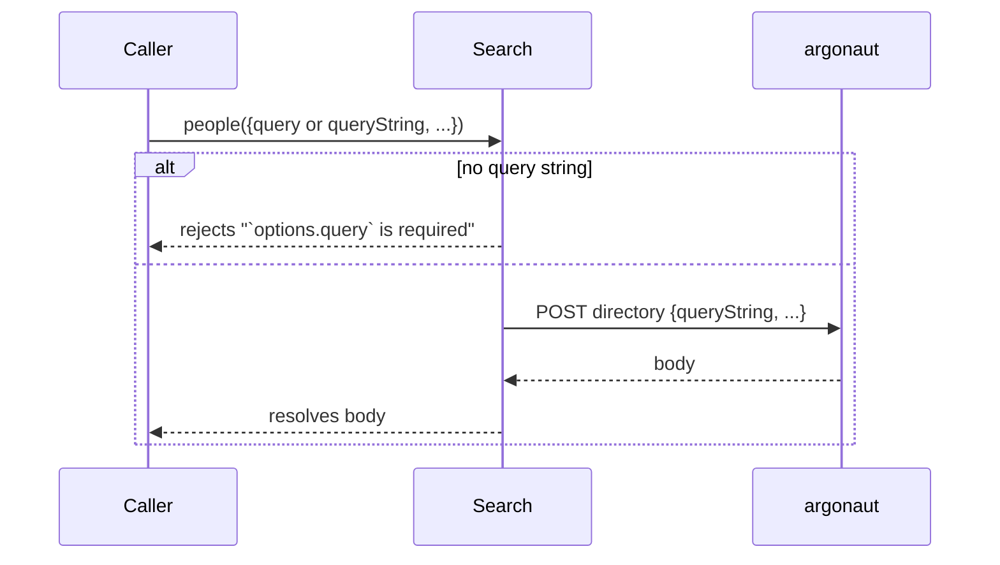
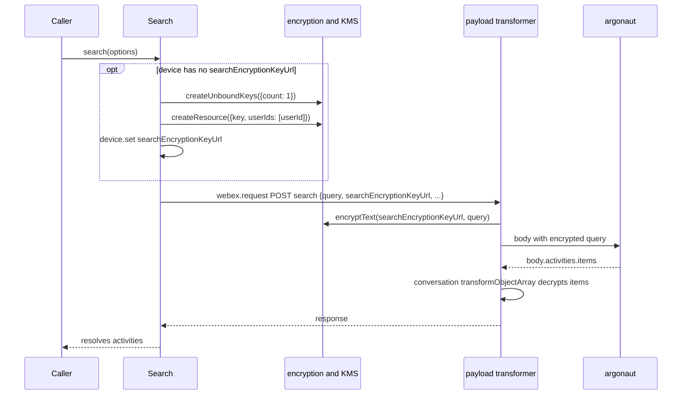
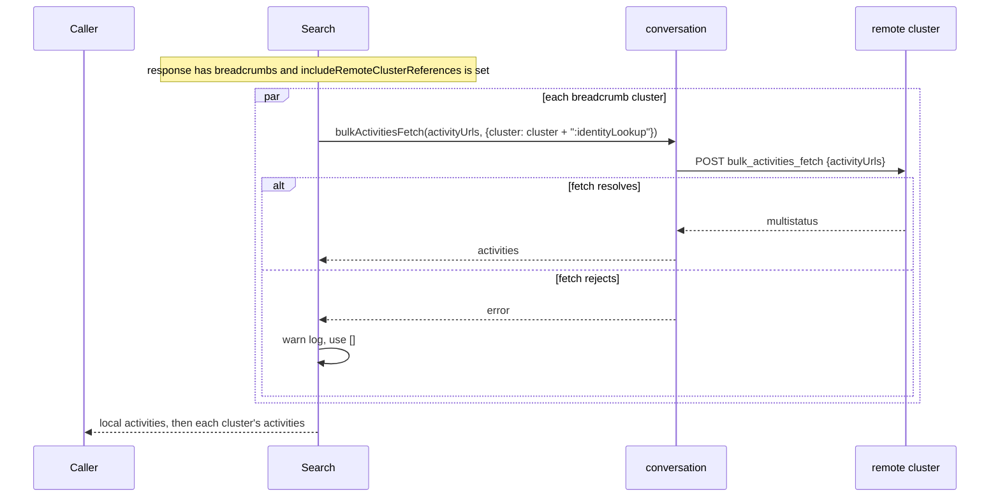
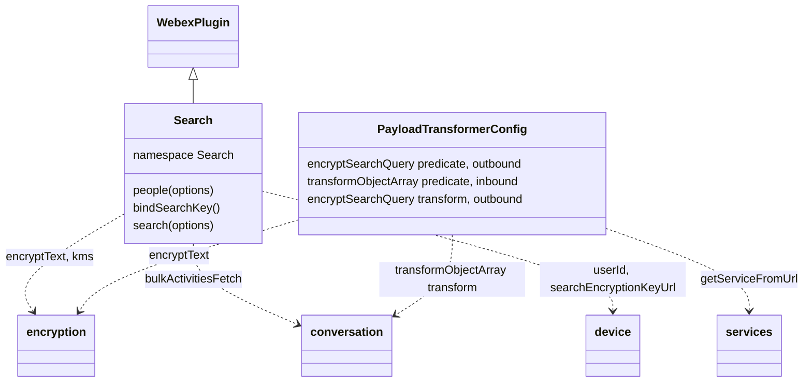
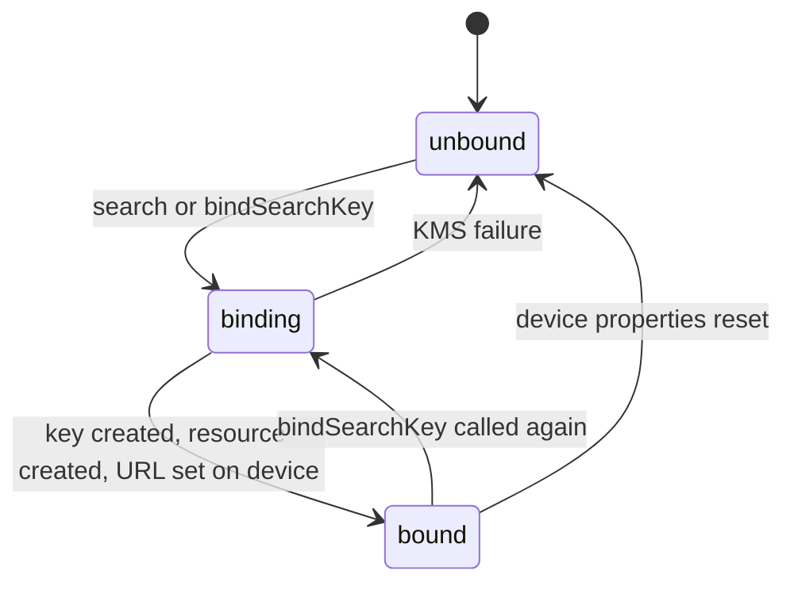

<!-- sdd-generated-metadata
doc_kind: module-spec
generated_from: module-spec@0.3.0
generated_by: claude-code
approved_by: rarajes2@cisco.com
updated_at: 2026-11-12T11:40:54Z
validation_status: pass-with-warnings
-->

# Search plugin

This source-local document at `src/docs/README.md` owns the stable specification for **the Search
plugin**: the internal plugin `webex.internal.search`. It looks up people and devices in the
directory, searches the user's conversation activities through the search service (catalog service
`argonaut`), binds a KMS key that encrypts each activity search query before it leaves the client,
and can add matching activities held in remote clusters. Ground every claim in package evidence and
link to the [package architecture](../../docs/architecture.md) instead of repeating broader facts. No
service specification exists because this package is a library.

Related context: [documentation index](../../docs/index.md) ·
[package agent instructions](../../AGENTS.md)

## Metadata

| Field             | Value |
| ----------------- | ----- |
| Owner             | @webex/web-sdk |
| Source path       | `src` |
| Resource kind     | package |
| Status            | Draft |
| Last verified     | 2026-11-12 at `bcb75ab054` |
| Module id         | `internal-plugin-search` |
| Parent spec       | — |
| Doc kind          | Module spec |
| Coverage score    | 93.3% assessed 2026-11-12 by the generator — 14 of 15 mandatory fields PRESENT, critical 8 of 8; test strategy is WEAK because the package has no unit test and no `test:unit` script, and its only spec, `test/integration/spec/search.js`, is disabled with `xdescribe` and runs under a browser tier that bundles nothing |
| Validation status | Pass with warnings — validated 2026-11-12 by validator runtime `01a1cf84-ad67-72e1-9afd-c1b97580ada4`; 0 Blocking and 2 Important findings, both accepted warnings (V-001 unit-test command unavailable; V-002 command-source parity) |

## Applicability

| Condition ID                         | Status     | Evidence or reason | Owned section |
| ------------------------------------ | ---------- | ------------------ | ------------- |
| `module.has_tiers`                   | N/A        | No tier policy exists in `package.json` or `src/search.js` | Tier |
| `module.has_ui`                      | N/A        | `src/search.js` sends requests and resolves promises; it renders nothing | UI use-case flow |
| `module.crosses_service_boundaries`  | Applicable | `src/search.js` calls the search service, KMS through the encryption plugin, and remote conversation clusters | Cross-boundary use-case flow |
| `module.holds_client_state`          | Applicable | `src/search.js` writes the search key URL onto the device and shares one in-flight key binding | Client state model |
| `module.enforces_domain_rules`       | Applicable | A people query needs a query string; activity search queries are encrypted only for the search service (`src/search.js`, `src/index.js`) | Business rules and invariants |
| `module.is_concurrent_async`         | Applicable | A one-flight key binding and parallel remote-cluster fetches in `src/search.js` | Concurrency and reactive flow |
| `module.owns_persistence`            | N/A        | The key URL is stored by the device plugin, which owns its persistence; `src/search.js` stores nothing itself | Data, schema, and migration discipline |
| `module.stateful_transitions`        | Applicable | The search key moves from unbound to bound in `src/search.js` | State machine |
| `module.exposes_wire_protocol`       | Applicable | The directory and search request bodies, the search response fields, and the KMS calls in `src/search.js`, plus the payload predicates in `src/index.js` | Protocol and wire format |
| `module.ui_multi_screen`             | N/A        | No UI | UI flow |
| `module.large_data_model`            | N/A        | No local data model; bodies and responses are covered under Protocol and wire format | Data model |
| `module.returns_caller_errors`       | Applicable | people rejects without a query, and service, KMS, and encryption failures reject search (`src/search.js`) | Caller-visible failure modes |
| `module.module_specific_conventions` | Applicable | Named payload predicates and transforms in `src/index.js` and the search: log prefix in `src/search.js` | Module-specific rules |
| `module.published_package`           | Applicable | `package.json` names the package @webex/internal-plugin-search and defines deploy:npm | Export stability |
| `module.embedded_in_host`            | N/A        | No host theme or embed API | Host integration and theming |
| `module.has_design_tradeoff`         | Applicable | Query encryption through a registered payload transform instead of inside search, and remote-cluster failures that degrade instead of rejecting (`src/index.js`, `src/search.js`) | Key design trade-off |
| `module.has_submodules`              | N/A        | The src directory has no child module | Sub-modules |

## Evidence register

| Evidence | What it establishes |
| -------- | ------------------- |
| `src/index.js` | Imports the conversation and encryption plugins, then `registerInternalPlugin('search', Search, {config, payloadTransformer})` at import time with the outbound predicate `encryptSearchQuery`, the inbound predicate `transformObjectArray`, and the outbound transform `encryptSearchQuery`; re-exports the default `Search` |
| `src/search.js` | `Search` extends `WebexPlugin` in namespace `Search` with `people`, `bindSearchKey` (decorated `@oneFlight`), and `search`; the JSDoc of `search` is the only recorded rationale in the package |
| `src/config.js` | Default configuration `{search: {}}`; no key is read |
| `package.json` | Name, `main` (`dist/index.js`), `devMain` (`src/index.js`), `engines` (`node >=18`), dependencies, and scripts; no `test:unit` or `test:integration` script |
| `test/integration/spec/search.js` | The only spec. Live-service cases for `people` and `search` with test users, wrapped in `xdescribe`, so every case is skipped; run only by `test:browser` |
| `README.md` | Retained npm page; context only. Its Usage block shows a placeholder member and no method; see `docs/adr/0001-retain-product-readme.md` |
| Sibling package webex-core, file src/docs/README.md | Module spec consulted, agrees with code. `registerInternalPlugin` keys the plugin by its raw name and the first registration wins; plugin `payloadTransformer` predicates and transforms are concatenated into the default config (MOD-008); `transform` runs every matching predicate, extracts its target, and applies the named transforms serially (MOD-037) |
| Sibling package webex-core, file src/lib/services/docs/README.md | Services spec consulted, agrees with code. `ServiceInterceptor` maps `api` to `service` (SVC-022); `getServiceFromUrl` matches a URL to a catalog service by origin and path (SVC-014); `getServiceUrlFromClusterId` appends a service name to a short cluster id and throws `Could not find service for cluster [<cluster>]` when nothing matches (SVC-018) |
| Sibling package webex-core, files src/webex-core.js, src/interceptors/payload-transformer.js | Source consulted as referee for ordering: the payload-transformer interceptor runs `transform('outbound', options)` on every request unless `noTransform` is set and `transform('inbound', response)` on every response unless `disableTransform` is set; `ServiceInterceptor` sits before it in the chain |
| Sibling package http-core, files src/docs/README.md, src/request/index.js | Spec consulted, silent on the point. Source: `request` moves `options.url` to `options.uri` and sets `url` to `null` before the interceptor chain runs |
| Sibling package common, file src/docs/README.md | Module spec consulted, agrees with code. `oneFlight` returns the in-progress promise for concurrent calls with the same key and evicts it once it settles (MOD-002) |
| Sibling package internal-plugin-device, files src/docs/README.md, src/device.js | Spec consulted: registration DTO properties are persisted unless ephemeral and reset by `clear()`; it does not name `searchEncryptionKeyUrl`. Source: `searchEncryptionKeyUrl` and `userId` are declared string properties |
| Sibling package internal-plugin-encryption, files src/encryption.js, src/kms.js | No SDD spec; code used. `encryptText(key, plaintext)` returns a JWE string; `kms.createUnboundKeys({count})` resolves keys; `kms.createResource({key, userIds})` binds a key to a KMS resource |
| Sibling package internal-plugin-conversation, files src/index.js, src/conversation.js | No SDD spec; code used. It registers the `transformObjectArray` transform that runs `transformObject` on each item, and its own inbound predicate for `body.multistatus`; `bulkActivitiesFetch(activityUrls, {cluster})` POSTs `bulk_activities_fetch` to the cluster URL and resolves the activities whose status is `200` |
| Observation, no stated WHY | Behavior the code shows without stating a reason is recorded once, under Pitfalls and constraints |

## Purpose and boundary

- Responsibility: let a Webex client find people and devices in the directory, and find the user's
  conversation activities that match a query, with the activity query encrypted under a
  user-bound KMS key and with results from remote clusters added on request.
- In scope: registration of `search` and its two payload predicates and one transform; `people`;
  `bindSearchKey`; `search` and its remote-cluster merge; writing `searchEncryptionKeyUrl` onto the
  device.
- Out of scope: KMS key creation and JWE encryption (`@webex/internal-plugin-encryption`); decrypting
  returned activities, which the `transformObjectArray` transform of
  `@webex/internal-plugin-conversation` does; the bulk activity fetch and cluster URL lookup
  (`@webex/internal-plugin-conversation` and the webex-core services plugin); HTTP transport,
  service-catalog resolution, retries, and authentication (`webex.request` in `@webex/webex-core`);
  persisting the device and its properties (`@webex/internal-plugin-device`); the shape of returned
  users, devices, and activities, which the services own.
- Consumers: in this repository `@webex/plugin-device-manager` calls `people` from its own `search`
  method; `@webex/webex-server` and `@webex/recipe-private-web-client` import the package to register
  it; the `@webex/internal-plugin-support` integration spec imports it. First-party clients reach the
  plugin as `webex.internal.search`.

## Structure and key files

| Path | Responsibility |
| ---- | -------------- |
| `src/index.js` | Imports conversation and encryption, registers internal plugin `search` with its payload predicates and transform, and exports the class as default |
| `src/search.js` | `Search`, where `people`, `bindSearchKey`, and `search` live |
| `src/config.js` | Empty default configuration under `search` |
| `package.json` | Package name, entry points, scripts, and dependencies |
| `babel.config.js`, `jest.config.js` | Re-exports of the legacy Babel and Jest configurations; no unit spec uses the Jest one |
| `.eslintrc.js` | Sets `root: true` and extends `@webex/eslint-config-legacy` |
| `process` | Package-root file exporting `{browser: true}`; not imported by `src/` |
| `src/docs/README.md` | This module specification; ignored by the build and by lint |
| `test/integration/spec/search.js` | Disabled live-service spec run by `test:browser` |
| dist/ (generated) | Build output of `build:src`; ignored by Git and never edited by hand |

## Public surface

| Surface | Consumer | Compatibility commitment | Source |
| ------- | -------- | ------------------------ | ------ |
| Import side effect: internal plugin `search` with config `{search: {}}`, plus the conversation and encryption plugins | First-party clients; `@webex/webex-server`, `@webex/recipe-private-web-client` | First registration of the name wins; reached as `webex.internal.search` | `src/index.js`, `src/config.js` |
| Payload predicates `encryptSearchQuery` (outbound) and `transformObjectArray` (inbound), and transform `encryptSearchQuery` (outbound) | Every request and response through `webex.request` on the same SDK instance | Apply only to the search service (`MOD-002`, `MOD-003`) | `src/index.js` |
| `people(options)` | `@webex/plugin-device-manager`; first-party clients | Resolves the directory response body | `src/search.js` |
| `search(options)` | First-party clients | Resolves an array of activities | `src/search.js` |
| `bindSearchKey()` | First-party clients; called by `search` | Resolves once the key URL is on the device | `src/search.js` |
| Default export `Search` | Clients that mount the class themselves | The entry exports nothing else | `src/index.js` |

Contract ID `search-internal-sdk` is indexed in the
[package architecture](../../docs/architecture.md#public-and-consumer-surfaces) and registered in
`.sdd/manifest.json`. Export stability is under [Export stability](#export-stability).

## Dependencies

| Dependency | Why it is required | Failure behavior |
| ---------- | ------------------ | ---------------- |
| `@webex/webex-core` plugin host (module spec consulted) | `registerInternalPlugin`, `WebexPlugin` (`webex`, `logger`, `request`), the payload transformer, and `webex.request` | A request rejection rejects the method |
| `@webex/webex-core` services plugin (services spec consulted) | `api` to `service` mapping, `getServiceFromUrl` in both predicates, and the cluster URL lookup behind `bulkActivitiesFetch` | An unknown cluster throws (see Pitfalls) |
| `@webex/http-core` (spec consulted, silent; code consulted) | Moves `url` to `uri` before interceptors run | See Pitfalls for the predicates' `url` branch |
| `@webex/common` (module spec consulted) | `oneFlight` on `bindSearchKey` | Not applicable |
| `@webex/internal-plugin-encryption` (no spec; code consulted) | Imported for registration; `encryptText` for the query and `kms.createUnboundKeys` and `kms.createResource` for the key | A KMS or encryption failure rejects `search` |
| `@webex/internal-plugin-conversation` (no spec; code consulted) | Imported for registration; its `transformObjectArray` transform decrypts returned activities and `bulkActivitiesFetch` reads remote clusters | A rejected fetch is logged and contributes no activity (`INV-003`) |
| `@webex/internal-plugin-device` (spec consulted; code consulted) | `userId` for the KMS resource, and `searchEncryptionKeyUrl` read and written through `set` | Read as-is; see Client state model |
| `lodash` | `has` in the predicates and `get` for the activity list | Not applicable |
| Search service `argonaut` and remote `identityLookup` clusters (external) | Directory lookup, activity search, and bulk activity fetch | Errors propagate, except remote-cluster rejections |

`@webex/internal-plugin-device` is declared in `package.json` but not imported by `src/`; the plugin
reads `webex.internal.device` by property, and the host registers it. `uuid` is declared but used only
by the integration spec.

## Requirements

| ID | WHAT | WHY | Source evidence | Test or example evidence | Assumptions or gaps | Confidence |
| -- | ---- | --- | --------------- | ------------------------ | ------------------- | ---------- |
| `MOD-001` | Importing the package first imports `@webex/internal-plugin-conversation` and `@webex/internal-plugin-encryption`, then registers `Search` as internal plugin `search` with config `{search: {}}` and the payload predicates and transform of `MOD-002` and `MOD-003`, so the plugin is `webex.internal.search`. | `search` and `bindSearchKey` call `webex.internal.encryption` and `webex.internal.conversation`, and decryption of results relies on the conversation transform, so both must be registered when this package is (inferred from the imports and calls; no comment states it). | `src/index.js`, `src/config.js` | `test/integration/spec/search.js` imports the package and calls webex.internal.search (disabled) | WHY inferred from code; no comment or running case states it | Weak |
| `MOD-002` | The outbound predicate `encryptSearchQuery` matches a request whose `body` has both `query` and `searchEncryptionKeyUrl` and whose `service` is `argonaut` (or whose `url` maps to the catalog service `argonaut`); it extracts the body, and the outbound transform `encryptSearchQuery` replaces `body.query` with `encryption.encryptText(body.searchEncryptionKeyUrl, body.query)`. | The activity query is plaintext user content, so it leaves the client only as ciphertext under the user's search key (inferred from the transform; no comment states it). | `src/index.js` | None runnable: `test/integration/spec/search.js` sends queries through search but is disabled | WHY inferred from code; no case checks the ciphertext or the non-matching paths | Weak |
| `MOD-003` | The inbound predicate `transformObjectArray` matches a response whose `body.activities.items[0]` has an `objectType` and whose request `service` is `argonaut` (or whose `url` maps to `argonaut`); it extracts `body.activities.items`, which the `transformObjectArray` transform registered by `@webex/internal-plugin-conversation` passes item by item to `transformObject`. This package registers no transform of that name. | Search results are encrypted conversation activities; reusing the conversation transform decrypts them the way conversation responses are decrypted (inferred from the shared name). | `src/index.js` | None runnable: the disabled `test/integration/spec/search.js` asserts plaintext object.displayName values | WHY inferred from the shared transform name; no case checks decryption | Weak |
| `MOD-004` | `people(options)` treats a missing `options` as `{}`; when `queryString` is absent and `query` is present it moves `query` to `queryString` and deletes `query` on the caller's object; without `queryString` it rejects with `Error` `` `options.query` is required ``; otherwise it sends `request({api: 'argonaut', resource: 'directory', method: 'POST', body: options})` and resolves the response `body`. Every other option is sent unchanged. | The rejection message names `options.query` while the directory body carries `queryString`, so a caller may pass either name; `query` is also the name `search` takes. | `src/search.js` | `test/integration/spec/search.js` #people four cases (disabled), including includeRobots true and false | The response shape is owned by the service; the disabled cases read it as an array of users | Present |
| `MOD-005` | `bindSearchKey()` asks KMS for one unbound key, creates a KMS resource for that key with `userIds: [webex.internal.device.userId]`, then sets `searchEncryptionKeyUrl` on the device to the key `uri`, and resolves. It is decorated with `@oneFlight`, so concurrent calls share one binding. | One key bound to the user serves every later activity search on this device (inferred from the property it writes). | `src/search.js` | None found | WHY inferred from code; no case | Weak |
| `MOD-006` | `search(options)` treats a missing `options` as `{}`, calls `bindSearchKey` first when the device has no `searchEncryptionKeyUrl`, then sends `webex.request({service: 'argonaut', resource: 'search', method: 'POST', body})` where `body` is the caller's `options` with `searchEncryptionKeyUrl` assigned onto it, and resolves `get(res, 'body.activities.items', [])`. | The JSDoc: fetches search result activities and resolves with the activities. | `src/search.js` | `test/integration/spec/search.js` #search query, size, and sharedIn/type cases (disabled) | The activity shape is owned by the service | Present |
| `MOD-007` | When `options.includeRemoteClusterReferences` is truthy and the response has `body.breadcrumbs`, `search` calls `conversation.bulkActivitiesFetch(<activityUrl of each breadcrumbs[cluster].items>, {cluster: '<cluster>:identityLookup'})` for every cluster key, in parallel; a rejected fetch logs `search: error fetching from remote clusters` at warn level and contributes `[]`. It resolves the local activities followed by each cluster's activities in `Object.keys` order. | The JSDoc: when true, includes search results from remote clusters. | `src/search.js` | `test/integration/spec/search.js` cases with includeRemoteClusterReferences and an EU-org user (disabled) | No running case | Present |

## Design overview

`Search` is a thin `WebexPlugin` with three methods and no state of its own. Its lasting effect is the
`searchEncryptionKeyUrl` it writes onto the device; everything else is per call.

Encryption and decryption do not happen inside the methods. At import, the package registers two
payload predicates with webex-core. Every request and response that passes through `webex.request` on
the SDK instance is tested against them, and they match only search-service traffic: an outbound body
that carries a query and a key URL has its query encrypted, and an inbound activity list is handed to
the conversation plugin's transform to decrypt. `search` therefore only has to make sure the key URL
exists and is in the body.

`people` is a plain directory request with no key and no encryption. `search` optionally fans out to
remote clusters named in the response breadcrumbs, fetching their activities through the conversation
plugin, whose own predicate decrypts them, and appends them to the local results.

## Data flow and sequence coverage

Call style: in-process method calls on `webex.internal.search`; outbound HTTPS through
`webex.request` (`people` through the plugin's `request` proxy); KMS calls through the encryption
plugin; remote-cluster fetches through the conversation plugin. Three operation groups differ in
actors, ordering, or outcome, and each has a diagram.

| Operation group | Entry and outcome | Diagram or evidence | Failure and recovery coverage |
| --------------- | ----------------- | ------------------- | ----------------------------- |
| People lookup | `people` POSTs `directory` and resolves the body | Diagram 1; `src/search.js` | Missing query rejects; service errors reject |
| Activity search | `search` binds a key when needed, POSTs `search` with an encrypted query, and resolves the decrypted activities | Diagram 2; `src/search.js`, `src/index.js` | KMS, encryption, and service errors reject |
| Remote clusters | `search` with `includeRemoteClusterReferences` fetches each breadcrumb cluster and appends its activities | Diagram 3; `src/search.js` | A rejected cluster fetch contributes nothing |

Diagram 1 — people lookup:

Diagram 2 — activity search:

Diagram 3 — remote clusters:

## Class and component relationships

`PayloadTransformerConfig` is not a class: it is the `payloadTransformer` option passed to
`registerInternalPlugin` in `src/index.js`, shown here because its entries act on every request of the
SDK instance rather than on `Search` calls alone.

## Use cases and flows

| Use case | Actor or caller | Primary steps and outcome | Failure or boundary behavior | Evidence |
| -------- | --------------- | ------------------------- | ---------------------------- | -------- |
| `UC-001` | Device manager searching devices by name | `people({queryString, searchType: 'DEVICE_SEARCH', searchEntity: 'device', includePeople: false, includeRooms: true, searchId})` | Rejects when the service fails; the device manager logs and rethrows | `src/search.js` |
| `UC-002` | Client looking up people or bots | `people({query, includeRobots})` | Rejects without a query | `src/search.js`, `test/integration/spec/search.js` |
| `UC-003` | Client searching message history | `search({query, limit})`; the first call on a device binds the key | KMS or service failure rejects | `src/search.js`, `test/integration/spec/search.js` |
| `UC-004` | Client listing one conversation's content of a type | `search({sharedIn, type})` with no query, so nothing is encrypted | As `UC-003` | `src/search.js`, `test/integration/spec/search.js` |
| `UC-005` | Client searching across data-residency clusters | `search({query, includeRemoteClusterReferences: true})` | Unreachable clusters are skipped (`INV-003`) | `src/search.js`, `test/integration/spec/search.js` |

### Cross-boundary use-case flow

| Boundary | Transport and ordering | Compatibility | Timeout, retry, and recovery |
| -------- | ---------------------- | ------------- | ---------------------------- |
| Search service (`UC-001` to `UC-005`) | HTTPS POST through `webex.request`, service `argonaut` from the catalog | Bodies under Protocol and wire format | No retry or timeout in this module; webex-core interceptors apply |
| KMS (`UC-003` to `UC-005`, first call) | Through `webex.internal.encryption.kms` | Owned by the encryption plugin | Errors reject `search` |
| Remote clusters (`UC-005`) | `bulkActivitiesFetch` per cluster, in parallel, after the local search | Owned by the conversation plugin | A rejected fetch is logged and skipped |

## Client state model

| State or slice | Owner | Initial state | Transition triggers | Reset or persistence boundary |
| -------------- | ----- | ------------- | ------------------- | ----------------------------- |
| `searchEncryptionKeyUrl` on the device | `@webex/internal-plugin-device`, written by `bindSearchKey` | Unset, unless restored with the device | `bindSearchKey` sets it | Kept and reset with the device's properties (device spec) |
| In-flight key binding | `oneFlight` in `@webex/common` | None | `bindSearchKey` starts it | Evicted when it settles |
| Registered payload predicates and transform | webex-core default config | Added at import | — | For the life of the process |

## Business rules and invariants

| ID | Invariant | WHY | Enforcement source | Test evidence |
| -- | --------- | --- | ------------------ | ------------- |
| `INV-001` | Every `search` request body carries a `searchEncryptionKeyUrl`; one is bound first when the device has none. | The outbound transform needs the key to encrypt the query. | `src/search.js` | None runnable |
| `INV-002` | A `query` in a search-service request body that also carries `searchEncryptionKeyUrl` leaves the client encrypted. | Search queries are user content. | `src/index.js` | None runnable |
| `INV-003` | A rejected remote-cluster fetch never fails `search`; the local activities and the other clusters' activities are still returned. | The JSDoc frames remote results as an addition to the local ones. | `src/search.js` | None runnable |
| `INV-004` | `people` sends no request without a query string. | The directory search needs a query (rejection message in code). | `src/search.js` | None runnable |
| `INV-005` | Concurrent `bindSearchKey` calls create one key and one KMS resource. | Two keys for one device would leave one unused (inferred from `@oneFlight`). | `src/search.js` | None runnable |

## Concurrency and reactive flow

- Execution model: one JavaScript event loop; every method returns a promise.
- Ordering guarantees: the key binding, when needed, completes before the search request is sent;
  remote-cluster fetches start together after the local response and their results are appended in
  breadcrumb key order, not completion order.
- Idempotency and retry: `bindSearchKey` is one-flight (`INV-005`), but a later call after it settles
  binds a new key; nothing is retried.
- Fire-and-forget work: none.
- Shared-state protection: `oneFlight` only; two SDK instances sharing a persisted device each check
  the key URL on their own.

## State machine

Search key. `search` starts a binding only from `unbound`; an explicit `bindSearchKey` call always
binds a new key and overwrites the URL.

## Protocol and wire format

| Message or frame | Version | Producer or serializer | Consumer or parser | Compatibility and ordering rule |
| ---------------- | ------- | ---------------------- | ------------------ | ------------------------------- |
| `POST <argonaut>/directory`, body: the caller's options with `queryString` (and `query` removed) | Unversioned | `people` | Search service | Sent as given; see Pitfalls on encryption |
| `POST <argonaut>/search`, body: the caller's options plus `searchEncryptionKeyUrl`, with `query` as a JWE string when present | Unversioned | `search`, then the `encryptSearchQuery` transform | Search service | Options seen in the spec: `query`, `limit`, `includeRemoteClusterReferences`, `sharedIn`, `type` |
| Search response `body.activities.items[]`, each with `objectType` | Unversioned | Search service | `transformObjectArray` predicate, then `search` | Items are decrypted before `search` reads them |
| Search response `body.breadcrumbs`, `{<cluster>: {items: [{activityUrl}]}}` | Unversioned | Search service | `search` (`MOD-007`) | Read only with `includeRemoteClusterReferences` |
| `bulk_activities_fetch` at the URL of `<cluster>:identityLookup`, body `{activityUrls}` | Unversioned | `bulkActivitiesFetch` in the conversation plugin | Remote conversation service | Response `multistatus` decrypted by the conversation plugin |
| KMS create keys with `count: 1`, then create resource with `keyUris: [<key uri>]` and `userIds: [<userId>]` | KMS protocol of the encryption plugin | `bindSearchKey` | KMS | Key first, then resource |

## Caller-visible failure modes

| Condition | Signal or result | Caller behavior | Retry or recovery | Evidence |
| --------- | ---------------- | --------------- | ----------------- | -------- |
| `people` without `query` or `queryString` | Rejection `Error` with message `` `options.query` is required `` | Pass a query | Call again | `src/search.js` |
| The search service rejects a request | The `webex.request` rejection, unchanged | Handle the HTTP error | Call again | `src/search.js` |
| KMS key or resource creation fails | `search` or `bindSearchKey` rejects with that error; no key URL is set | Treat search as unavailable | Call again; a new binding starts | `src/search.js` |
| Query encryption fails | The request rejects before it is sent | As above | Call again | `src/index.js` |
| A remote-cluster fetch rejects | Warn log; that cluster adds no activity | None needed | None | `src/search.js` |

## Pitfalls and constraints

- Because `people` and `search` modify the caller's object (`MOD-004`, `MOD-006`), reusing one
  options object sends the added `searchEncryptionKeyUrl` or the renamed `queryString` again, and
  client-side flags such as `includeRemoteClusterReferences` reach the service too.
- `people` queries are not encrypted: after the rename the body has no `query`, and `people` adds no
  key URL. A caller that passes both `query` and `queryString` keeps `query` in the body, still
  without a key URL, so it is not encrypted either.
- The `url` branch of both predicates never matches through `webex.request`: http-core moves `url` to
  `uri` and sets `url` to `null` before the interceptor chain runs, so a search-service request
  addressed only by `uri` is neither encrypted nor decrypted by this package (inferred from http-core
  and webex-core code; no test).
- `bulkActivitiesFetch` resolves the cluster URL synchronously, and the services plugin throws
  `Could not find service for cluster [...]` for an unknown cluster. That throw happens before the
  per-cluster `catch` is attached, so it rejects the whole `search` instead of being skipped. A
  breadcrumb entry without `items` rejects `search` with a `TypeError` the same way (inferred from
  code; no test).
- A device registration body that carries `searchEncryptionKeyUrl` overwrites the URL this plugin set,
  because the device applies the whole body with `set` (from the device code and spec; no test).
- `config.js` declares `{search: {}}` and nothing reads `this.config`.
- The `beforeEach` of `test/integration/spec/search.js` sets the device property `searchKeyUrl`, not
  `searchEncryptionKeyUrl`, so it would not force a new key binding if the spec were enabled.
  `package.json` `test` runs `yarn test:unit` and `yarn test:integration`, which this package does not
  define, so the aggregate stops there.
- `test:style` reports seven `require-jsdoc` warnings (five in `src/index.js`, two in `src/search.js`)
  plus "File ignored" for this specification.

## Module-specific rules

- Do: keep the predicate and transform names `encryptSearchQuery` and `transformObjectArray`; the
  inbound name must stay equal to the conversation plugin's transform name or results stay encrypted.
- Do: keep both predicates limited to the `argonaut` service, because they are tested against every
  request and response of the SDK instance.
- Do: prefix log lines `search:` and log no query string, key URL, user id, or activity.
- Do not: encrypt or decrypt inside `search`; the payload transformer does both (`MOD-002`,
  `MOD-003`).

## Export stability

| Export or entry point | Consumer | Stability | Versioning and deprecation rule | Declaration or API report |
| --------------------- | -------- | --------- | ------------------------------- | ------------------------- |
| Import side effect: internal plugin `search` and its payload predicates | First-party clients; `@webex/webex-server`, `@webex/recipe-private-web-client` | Internal | The README states that internal plugins do not strictly follow semantic versioning | `src/index.js` |
| Default export `Search` and `people`, `bindSearchKey`, `search` | First-party clients; `@webex/plugin-device-manager` | Internal | Same | `src/index.js`, `src/search.js` |

The build writes JavaScript only; `package.json` has no `types` entry, so no declarations or API
report are published.

## Key design trade-off

| Chosen trade-off | Preserved invariant or benefit | Cost or limitation | Decision evidence |
| ---------------- | ------------------------------ | ------------------ | ----------------- |
| Encrypt the query and decrypt the results through registered payload predicates instead of inside `search` | Any search-service request with a query and key URL is encrypted, and results decrypt through the same transform as conversation responses | The predicates run on every request and response of the SDK instance, and the `url` branch is dead (see Pitfalls) | `src/index.js` |
| Bind the search key lazily on the first `search`, one-flight | No KMS round trip until a search is made, and concurrent first searches share one key | The first search waits for two KMS calls | `src/search.js` |
| Skip a remote cluster whose fetch rejects | Local results survive an unreachable cluster | A partial result looks complete to the caller | `src/search.js` |

## Verification

| Requirement or invariant | Test level | Positive evidence | Negative or boundary evidence | Gap |
| ------------------------ | ---------- | ----------------- | ----------------------------- | --- |
| `MOD-001` | Integration (disabled) | `test/integration/spec/search.js` imports the package | None found | No running case |
| `MOD-002`, `INV-002` | None | None found | None found | Encryption and non-matching requests untested |
| `MOD-003` | Integration (disabled) | `test/integration/spec/search.js` asserts plaintext results | None found | No running case |
| `MOD-004`, `INV-004` | Integration (disabled) | `test/integration/spec/search.js` #people cases | None found | Missing-query rejection untested |
| `MOD-005`, `INV-005` | None | None found | None found | Key binding and one-flight sharing untested |
| `MOD-006`, `INV-001` | Integration (disabled) | `test/integration/spec/search.js` #search cases | None found | No running case |
| `MOD-007`, `INV-003` | Integration (disabled) | `test/integration/spec/search.js` remote-cluster cases | None found | Rejected fetch and unknown cluster untested |

No test runs for this package: it has no unit spec and no `test:unit` script, its integration spec is
disabled, and `test:browser` reported 0 tests on 2026-11-12 under Node 22.14 after `build:src`. A
module specification is complete only when its public surface, invariants, failure modes, and test
evidence agree with the implementation. Generator-side field measurement is complete (93.3%,
assessed 2026-11-12); independent semantic validation passed with warnings on 2026-11-12 under validator runtime
`01a1cf84-ad67-72e1-9afd-c1b97580ada4` (0 Blocking, 2 Important findings). Both Important findings
are accepted warnings recorded in `.sdd/manifest.json` `modules[0].coverage_evidence`: V-001, the
missing unit-test command, and V-002, the command-source parity of the workspace-qualified command
form. A characterization baseline, which needs a unit test setup for this package, and promotion past
Partial remain pending.
