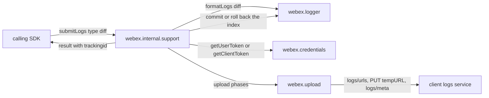
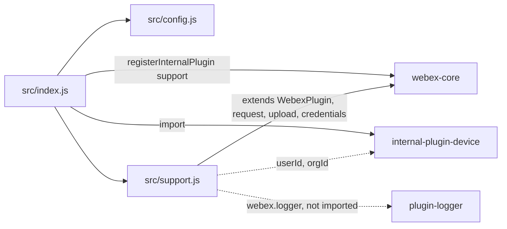
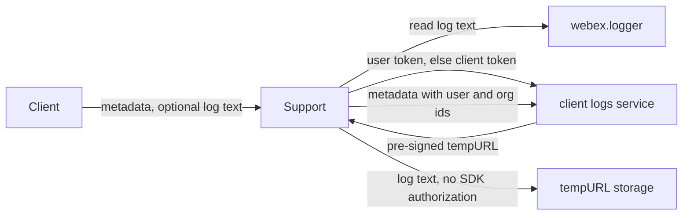

<!-- sdd-generated-metadata
doc_kind: standing-doc
generated_from: architecture@0.3.0
generated_by: claude-code
approved_by: rarajes2@cisco.com
updated_at: 2026-11-12T12:27:40Z
validation_status: pass-with-warnings
-->

# @webex/internal-plugin-support architecture

Canonical architecture for this package. Flow behavior lives in the
[Support plugin specification](../src/docs/README.md). This page owns package boundaries, the plugin
registration, the contract index, and how the package meets the rest of the SDK.

Related context: [specification registry](specs/README.md) ·
[package agent instructions](../AGENTS.md)

## Applicability

| Condition ID                         | Status     | Evidence or reason | Owned section |
| ------------------------------------ | ---------- | ------------------ | ------------- |
| `repo.owns_datastore`                | N/A        | No database, file store, or migration in `src/support.js` | Repository data and schema |
| `repo.holds_client_state`            | Applicable | `src/support.js` commits or rolls back the logger's diff index; defaults in `src/config.js` | Client state model |
| `repo.components_interact`           | Applicable | `src/support.js` drives the logger, credentials, upload, and device plugins | Dependency and interaction topology |
| `repo.domain_data_across_components` | Applicable | Log text and its metadata pass between the logger, this package, and the client logs service (`src/support.js`) | Object and data ownership |
| `repo.caches_data`                   | N/A        | `src/support.js` keeps no cache | Caching catalog |
| `repo.observability_convention`      | Applicable | One error line through webex.logger with the Support: prefix in `src/support.js` | Observability patterns |
| `repo.deploys_to_infra`              | N/A        | Library published to npm (`package.json`). No service runtime | Runtime and infrastructure |
| `repo.shared_base_libs`              | Applicable | Extends WebexPlugin, uses webex.upload and the credentials plugin, and the legacy build, lint, and test stack (`babel.config.js`, `jest.config.js`, `.eslintrc.js`) | Shared and base libraries |
| `repo.is_monorepo`                   | N/A        | This SDD root is one package. The workspace around it is out of scope | Package map and inter-package dependencies |
| `repo.multi_platform`                | N/A        | `src/support.js` uses no platform-specific API; `process` declares only {browser: true} | Platform matrix |
| `repo.published_package`             | Applicable | `package.json` name is @webex/internal-plugin-support and deploy:npm publishes it | Release and versioning |
| `repo.embedded_in_host`              | N/A        | No host theme or embed API in `src/support.js` | Host integration and theming |
| `repo.exposes_commands_or_artifacts` | Applicable | build:src in `package.json` writes dist | Commands and generated artifacts |
| `repo.cross_repo_deps_material`      | Applicable | Behavior depends on the client logs and conversation services (`src/support.js`) | Cross-repository topology |
| `repo.security_arch_warranted`       | Applicable | Log text and identity metadata leave the client under a user or client token, and the file body goes to a pre-signed URL (`src/support.js`) | Security architecture |

## Design overview

`@webex/internal-plugin-support` is a published JavaScript library with one module. Importing it
registers the device plugin and then `Support` as the internal plugin `support`, reached as
`webex.internal.support`. Inside this repository `@webex/calling`, `@webex/contact-center`, and
`@webex/plugin-meetings` call its `submitLogs`, and the `webex`, `webex-node`, `@webex/webex-server`,
`@webex/recipe-private-web-client`, and `@webex/contact-center` packages load it.

The plugin talks to two services. On the conversation service it fetches the desk feedback and desk
support URLs. On the client logs service, catalog name `clientLogs`, it uploads log text in the three
phases that `webex.upload` runs: it asks for an upload session, the file goes to the URL the session
returns, and a metadata list that tags the file with the call, meeting, feedback, tracking, user, and
organization ids follows. The log text normally comes from the SDK logger, either all of it or only
what is new since the last upload; this package commits or rolls back the logger's position.

The package serves no routes and persists nothing itself.

## Resource inventory and responsibilities

| Resource | Kind | Responsibility | Owner | Source | Detailed specification |
| -------- | ---- | -------------- | ----- | ------ | ---------------------- |
| Support plugin | package (one module) | Registration and config defaults, desk feedback and support URLs, log upload with metadata, diff index commit and rollback | @webex/web-sdk | `src` | [`src/docs/README.md`](../src/docs/README.md) |

## Interaction and execution flows

Representative end-to-end flow: the calling SDK uploads the logs written since its last upload.

| From | To | Interaction or transport | Purpose | Failure or compatibility behavior |
| ---- | -- | ------------------------ | ------- | --------------------------------- |
| Client | `webex.internal.support` | In-process calls | Log upload; desk URLs | Rejections propagate |
| `Support` | `webex.logger` | In-process calls | Read log text; commit or roll back the diff index | Not read until its buffers exist |
| `Support` | Credentials | In-process calls | Authorization for the upload | User token, then client token |
| `Support` | Client logs service | `webex.upload`, HTTPS | Upload session, file, metadata | Upload phase retried by webex-core; other failures reject |
| `Support` | Conversation service | HTTPS through `webex.request` | Desk feedback and support URLs | No retry here |

## Dependency topology

| Dependency | Type | Used by | Purpose | Version, failure, or fallback policy |
| ---------- | ---- | ------- | ------- | ------------------------------------ |
| `@webex/webex-core` | Internal | `src/index.js`, `src/support.js` | Registration, plugin base, `webex.request`, `webex.upload`, credentials, `sessionId` | `workspace:*` in `package.json` |
| `@webex/internal-plugin-device` | Internal | `src/index.js`, `src/support.js` | Registration side effect; `userId` and `orgId` | `workspace:*` |
| `@webex/plugin-logger` | Internal, not declared | `src/support.js` | `webex.logger` buffers and index calls | Provided by the host |
| `lodash` | External | `src/support.js` | `defaults` | `^4.17.21` in `package.json` |
| `uuid` | External | `src/support.js` | Feedback id | `^3.3.2` in `package.json` |
| `@webex/internal-plugin-search` and the `@webex/test-helper-*` packages | Internal, declared under dependencies | Integration spec only | Test setup | `workspace:*`; not used by `src/` |
| Client logs and conversation services | External service | `src/support.js` | Log upload; desk URLs | Resolved through the service catalog |

No import cycle exists: neither webex-core nor the device plugin imports this package.

## Public and consumer surfaces

| Surface | Type | Owner | Consumers | Compatibility policy | Source |
| ------- | ---- | ----- | --------- | -------------------- | ------ |
| `support-internal-sdk` — package @webex/internal-plugin-support, `webex.internal.support`, `submitLogs`, `getFeedbackUrl`, `getSupportUrl`, and the config defaults | SDK, published to npm, internal | Support plugin | First-party clients; `@webex/calling`, `@webex/contact-center`, `@webex/plugin-meetings`, and the packages that register it | The README states that internal plugins do not strictly follow semantic versioning; no deprecation rule is declared | `package.json`, `src/index.js`, `src/support.js` |

The upload phase bodies, the metadata list, and the desk URL requests are protocols this package
speaks with other services, described under *Protocol and wire format* in the
[module specification](../src/docs/README.md#protocol-and-wire-format). The other contracts this
package requires are registered in `.sdd/manifest.json` `contract_catalog`.

## Client state model

| State or slice | Owner | Transition triggers | Persistence or reset boundary |
| -------------- | ----- | ------------------- | ----------------------------- |
| Logger diff indexes | `@webex/plugin-logger`, moved by `Support` | `formatLogs({diff: true})`, then a commit or rollback by `submitLogs` | In memory with the logger |
| `config.support` | webex-core config | Host config at construction | SDK instance lifetime |

Full detail is in the module specification's *Client state model* and *State machine*.

## Cross-cutting architecture

### Security

- Trust boundaries and identity flow: see [Security architecture](#security-architecture).
- Sensitive surfaces and data classes: log text, which can hold any SDK or client log line, and the
  metadata ids (locus, meeting, correlation, user, and organization).
- Encryption and secret boundaries: see [Security architecture](#security-architecture).

### Observability and operations

- Logging and correlation: see [Observability patterns](#observability-patterns).
- Metrics, traces, and audit signals: see [Observability patterns](#observability-patterns).
- Ownership and operational entry points: `.github/CODEOWNERS` at the workspace root has no line for
  this package, so its default rule assigns it to `@webex/web-sdk`. No dashboards or runbooks are
  recorded in this package.

### Quality attributes

- Compatibility: clients rely on the registered name `support`, the `submitLogs` argument order and
  `type` values, the metadata key names, and the resolved result fields `url`, `userId`, and
  `trackingid`.
- Footprint: three source files; runtime imports are webex-core, the device plugin, lodash, and uuid.
- Test confidence: 43 unit cases cover the log choice, the commit and rollback, and the metadata list;
  the desk URL methods and the registration have no test. No coverage threshold is enforced.

## Dependency and interaction topology

| From | To | Kind | Purpose | Ordering or failure boundary |
| ---- | -- | ---- | ------- | ---------------------------- |
| `src/index.js` | webex-core | Call at import | Register `support` | First registration wins |
| `src/support.js` | `webex.logger` | Property reads and calls, no import | Log text and index moves | The host must provide the logger |
| `src/support.js` | credentials, then `webex.upload` | Calls | Authorize and upload | Token before upload |
| `src/support.js` | `webex.internal.device` | Property reads | Identity metadata | Missing values are left out |

## Object and data ownership

| Object or state | System of record | May write | May read | Movement or lifecycle |
| --------------- | ---------------- | --------- | -------- | --------------------- |
| Log buffers and indexes | `@webex/plugin-logger` | The logger; this package moves the indexes | This package | In memory; read per upload |
| Uploaded log file and metadata | Client logs service | This package, per upload | The service | Sent per call; not stored here |
| Desk feedback and support URLs | Conversation service | — | This package, then the caller | Returned per call |
| Device `userId` and `orgId` | Device plugin | The device plugin | This package | Read per upload |

## Observability patterns

| Signal  | Convention or required fields | Propagation or naming rule | Primary evidence |
| ------- | ----------------------------- | -------------------------- | ---------------- |
| Logs    | One `webex.logger.error` line, `Support: Failed to upload logs. Will retry to upload these logs at next interval`, with the error object, only for a failed diff upload with the retry config | The uploaded metadata carries `trackingId` (`webex.sessionId`) | `src/support.js` |
| Metrics | None; the calling and contact-center callers emit their own upload metrics | — | `src/support.js` |
| Traces  | None | — | `src/support.js` |
| Audit   | None | — | `src/support.js` |

## Shared and base libraries

| Library | Inherited responsibility | Consumers | Version floor | Compatibility rule |
| ------- | ------------------------ | --------- | ------------- | ------------------ |
| `@webex/webex-core` `WebexPlugin` | `webex`, `config`, `logger`, `request` | `Support` | `workspace:*` | Keep the registered name `support` |
| `@webex/webex-core` `upload` | Three-phase upload, size limit, upload-phase retry | `submitLogs` | `workspace:*` | Keep the `$uri` and `$body` phase keys |
| `@webex/babel-config-legacy`, `@webex/eslint-config-legacy`, `@webex/jest-config-legacy`, `@webex/legacy-tools` | Build, lint, and test stack through one-line config files | Package tooling | `workspace:*` | Do not fork the config locally |

## Release and versioning

| Artifact | Publish target | Versioning rule | Deprecation window | Changelog or migration obligation |
| -------- | -------------- | --------------- | ------------------ | --------------------------------- |
| @webex/internal-plugin-support | npm through `deploy:npm` | Internal plugin; the README says semantic versioning is not strictly followed | None declared | None declared in the package; the workspace owns changelog generation |

## Commands and generated artifacts

| Command or artifact | Owner | Inputs | Output or side effect | Compatibility boundary |
| ------------------- | ----- | ------ | --------------------- | ---------------------- |
| `yarn workspace @webex/internal-plugin-support build:src` | Package scripts | `src` | Writes `dist/` (JavaScript and source maps) through `webex-legacy-tools` | `dist/` is generated and never edited by hand |
| `yarn workspace @webex/internal-plugin-support build` | Package scripts | `src` | Runs `build:src` | Same output |
| `yarn workspace @webex/internal-plugin-support test:unit` | Package scripts | `test/unit/spec`, `dist/` | Jest run | Run `build:src` first |
| `yarn workspace @webex/internal-plugin-support test:style` | Package scripts | `src` | ESLint run | The shared config ignores `docs/**` and `*.md` |

## Cross-repository topology

| Repository or external system | Relationship | Exchanged contract or artifact | Owner | Sequencing constraint |
| ----------------------------- | ------------- | ------------------------------ | ----- | --------------------- |
| `@webex/webex-core` (workspace sibling; module, credentials, interceptors, and services specs consulted) | Consumes | `registerInternalPlugin`, `WebexPlugin`, `upload`, credentials, auth and service interceptors | @webex/web-sdk | Credentials before the upload |
| `@webex/plugin-logger` (workspace sibling; module spec consulted) | Consumes | Buffers, `formatLogs`, index calls | @webex/web-sdk | Buffers must exist before a logger read |
| `@webex/internal-plugin-device` (workspace sibling; spec consulted, code used) | Consumes | `userId`, `orgId` | @webex/web-sdk | Device registered before identity is tagged |
| `@webex/calling`, `@webex/contact-center`, `@webex/plugin-meetings` (workspace siblings) | Consumed by | `submitLogs` | @webex/web-sdk | None |
| `webex`, `webex-node`, `@webex/webex-server`, `@webex/recipe-private-web-client` (workspace siblings) | Consumed by | The plugin registration | @webex/web-sdk | None |
| Client logs and conversation services | Consumes | Upload sessions, files, and metadata; desk URLs | Not recorded in this repository | Initialize, upload, finalize |

## Security architecture

- This package holds no credential. It asks webex-core for a user token, or a client token when that
  fails, and sets it as the `authorization` header of the session and metadata requests
  (`MOD-006` in the module spec).
- The file itself is sent to the pre-signed `tempURL` without SDK authorization or credentials, as
  `webex.upload` sets for its upload phase.
- Log text is sent as the logger formats it; this package does not filter or redact it. The metadata
  adds the device user and organization ids. The logging rule is under
  [Observability patterns](#observability-patterns).

## Domain language

| Term | Repository-specific meaning | Authoritative source |
| ---- | --------------------------- | -------------------- |
| clientLogs | The catalog name of the client logs service that receives uploads | `src/support.js` |
| Diff upload | An upload of only the log entries written since the logger's next index, selected by `type: 'diff'` or `incrementalLogs` | `src/support.js` |
| Full upload | An upload of every buffered log entry | `src/support.js` |
| File metadata | The `{key, value}` list sent with the finalize phase | `src/support.js` |
| Desk feedback and support URLs | Links the conversation service returns for the feedback form and the support page | `src/support.js` |

## References and maintenance

- Decisions: [adr/](adr/index.md)
- Instantiated specifications and routing: [specs/README.md](specs/README.md)
- Repository rules and patterns: [package agent instructions](../AGENTS.md)
- Update this document in the same change that alters package boundaries, resource ownership,
  cross-resource interaction, or cross-cutting architecture.
