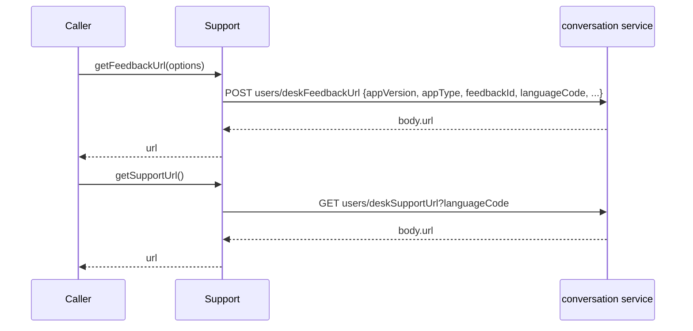
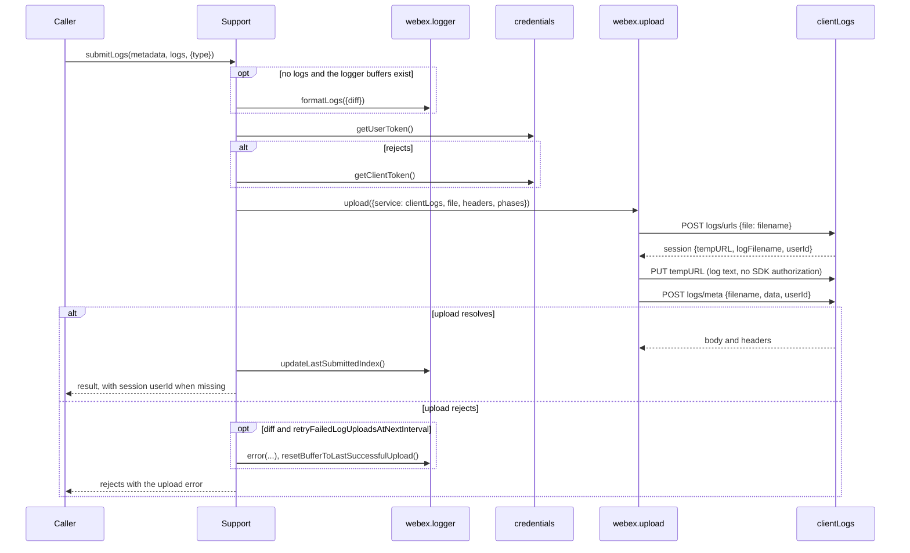
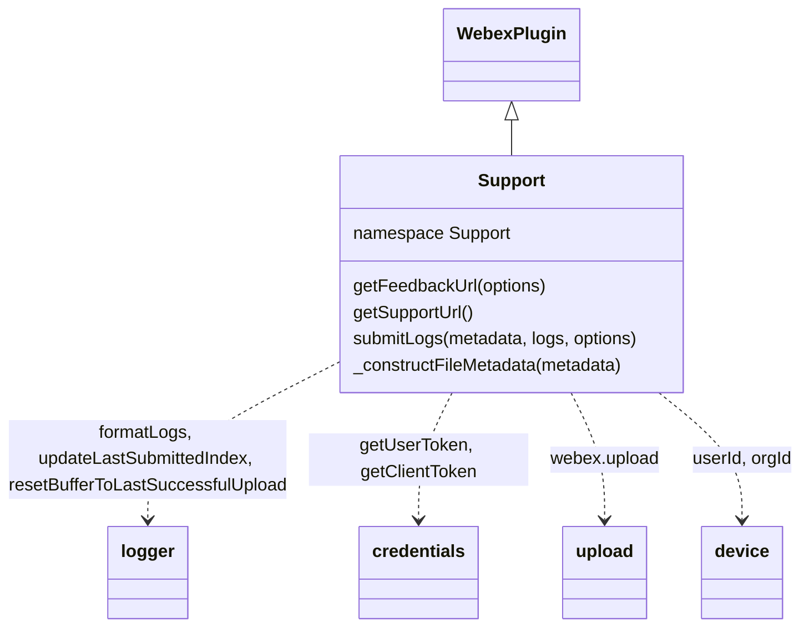
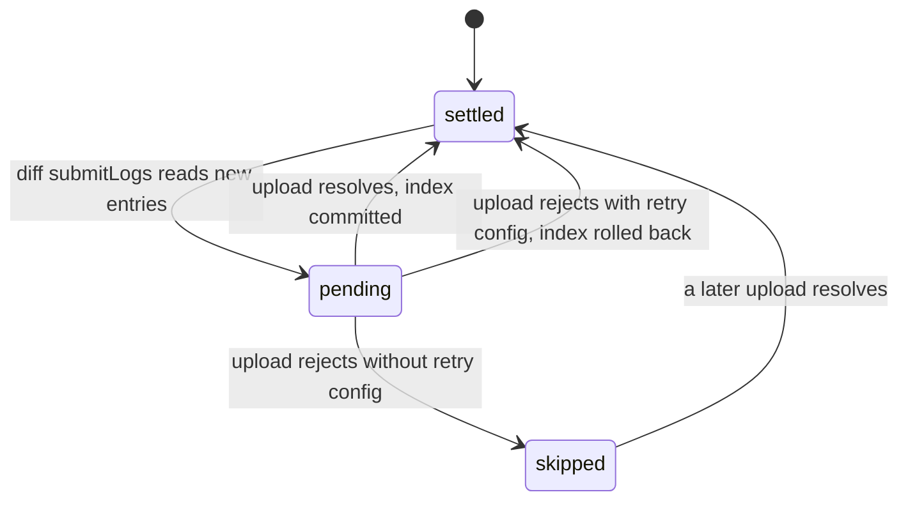

<!-- sdd-generated-metadata
doc_kind: module-spec
generated_from: module-spec@0.3.0
generated_by: claude-code
approved_by: rarajes2@cisco.com
updated_at: 2026-11-12T12:27:40Z
validation_status: pass-with-warnings
-->

# Support plugin

This source-local document at `src/docs/README.md` owns the stable specification for **the Support
plugin**: the internal plugin `webex.internal.support`. It fetches the desk feedback and desk support
URLs from the conversation service, and it uploads the SDK's logs, or logs the caller supplies, to the
client logs service (catalog service `clientLogs`) together with a key-value metadata list that
identifies the call, meeting, user, and organization. Ground every claim in package evidence and link
to the [package architecture](../../docs/architecture.md) instead of repeating broader facts. No
service specification exists because this package is a library.

Related context: [documentation index](../../docs/index.md) ·
[package agent instructions](../../AGENTS.md)

## Metadata

| Field             | Value |
| ----------------- | ----- |
| Owner             | @webex/web-sdk |
| Source path       | `src` |
| Resource kind     | package |
| Status            | Draft |
| Last verified     | 2026-11-12 at `3377fcc30e` |
| Module id         | `internal-plugin-support` |
| Parent spec       | — |
| Doc kind          | Module spec |
| Coverage score    | 100% assessed 2026-11-12 by the generator — 15 of 15 mandatory fields PRESENT, critical 8 of 8; `test:unit` runs 43 passing cases in `test/unit/spec/support.js`, while `MOD-001` to `MOD-004`, the client-token fallback of `MOD-006`, and `INV-005` have no test |
| Validation status | Pass with warnings — validator runtime `01a1cfae-ad4f-7710-befe-9beb15f9c6b4`, 2026-11-12; 0 Blocking and 1 Important finding (B11-001, command-source parity for five command entries), accepted as a warning |

## Applicability

| Condition ID                         | Status     | Evidence or reason | Owned section |
| ------------------------------------ | ---------- | ------------------ | ------------- |
| `module.has_tiers`                   | N/A        | No tier policy exists in `package.json` or `src/support.js` | Tier |
| `module.has_ui`                      | N/A        | `src/support.js` sends requests and resolves promises; it renders nothing | UI use-case flow |
| `module.crosses_service_boundaries`  | Applicable | `src/support.js` calls the conversation service and the client logs service, and PUTs to a URL the client logs service returns | Cross-boundary use-case flow |
| `module.holds_client_state`          | Applicable | `src/support.js` commits or rolls back the logger's buffer indexes and reads the device identity; its defaults live in `src/config.js` | Client state model |
| `module.enforces_domain_rules`       | Applicable | The full-or-diff choice, the fixed metadata key list, and the log file name rule in `src/support.js` | Business rules and invariants |
| `module.is_concurrent_async`         | Applicable | Every method returns a promise; `src/support.js` does not serialize concurrent log uploads | Concurrency and reactive flow |
| `module.owns_persistence`            | N/A        | Log buffers are held by the logger plugin; `src/support.js` stores nothing itself | Data, schema, and migration discipline |
| `module.stateful_transitions`        | Applicable | A diff log span moves from pending to committed, rolled back, or skipped through `src/support.js` | State machine |
| `module.exposes_wire_protocol`       | Applicable | The three upload phase bodies, the metadata list, and the desk URL requests in `src/support.js` | Protocol and wire format |
| `module.ui_multi_screen`             | N/A        | No UI | UI flow |
| `module.large_data_model`            | N/A        | No local data model; bodies are covered under Protocol and wire format | Data model |
| `module.returns_caller_errors`       | Applicable | Token, upload, and request failures reject the methods in `src/support.js` | Caller-visible failure modes |
| `module.module_specific_conventions` | Applicable | The Support: log prefix and the metadata key list in `src/support.js` | Module-specific rules |
| `module.published_package`           | Applicable | `package.json` names the package @webex/internal-plugin-support and defines deploy:npm | Export stability |
| `module.embedded_in_host`            | N/A        | No host theme or embed API | Host integration and theming |
| `module.has_design_tradeoff`         | Applicable | Client-token fallback, rollback only on request, and the logger readiness check in `src/support.js` | Key design trade-off |
| `module.has_submodules`              | N/A        | The src directory has no child module | Sub-modules |

## Evidence register

| Evidence | What it establishes |
| -------- | ------------------- |
| `src/index.js` | Imports `@webex/internal-plugin-device`, then `registerInternalPlugin('support', Support, {config})` at import time; re-exports the default `Support` |
| `src/support.js` | `Support` extends `WebexPlugin` in namespace `Support` with `getFeedbackUrl`, `getSupportUrl`, `submitLogs`, and `_constructFileMetadata`; the JSDoc of `submitLogs` and the comment on the logger readiness check are the only recorded rationale in the package |
| `src/config.js` | Defaults for `config.support` and for `config.device.preDiscoveryServices` |
| `package.json` | Name, `main` (`dist/index.js`), `devMain` (`src/index.js`), `engines` (`node >=18`), dependencies, and scripts; `test:unit` exists, `test:integration` does not |
| `test/unit/spec/support.js` | 43 jest cases over `_constructFileMetadata` and `submitLogs` with `@webex/test-helper-mock-webex` and sinon stubs; it imports the package by name, so it tests `dist/` |
| `test/integration/spec/support.js` | Live-service case for `submitLogs` with a test user; run only by `test:browser` |
| `README.md` | Retained npm page; context only. Its Usage block shows a placeholder member and no method; see `docs/adr/0001-retain-product-readme.md` |
| Sibling package webex-core, file src/docs/README.md | Module spec consulted, agrees with code. `registerInternalPlugin` keys the plugin by its raw name and the first registration wins; `upload` requires `file` (MOD-038), fills the three phase blocks (MOD-039), aborts above the size limit (MOD-040), resolves `$`-prefixed phase keys against the initialize body (MOD-041), and resolves the finalize body merged with its headers (MOD-042) |
| Sibling package webex-core, file src/lib/credentials/docs/README.md | Credentials spec consulted, agrees with code. `Token.toString` (MOD-007), `getUserToken` rejection when the state cannot authorize (MOD-031), uncached `getClientToken` (MOD-039) |
| Sibling package webex-core, files src/interceptors/docs/README.md, src/interceptors/auth.js | Interceptors spec consulted, agrees with code: on a 401 the auth interceptor deletes `authorization`, refreshes, and replays unless `shouldRefreshAccessToken` is `false` (INT-007). Source: an existing `authorization` header is kept |
| Sibling package webex-core, file src/lib/services/docs/README.md | Services spec consulted, agrees with code: `api` maps to `service` and the resource is joined to the catalog URL (SVC-022) |
| Sibling package plugin-logger, files src/docs/README.md, src/logger.js | Module spec consulted, agrees with code and names this package as the consumer. `formatLogs({diff})` returns newline-joined text and with `diff` advances `nextIndex` (MOD-011); `updateLastSubmittedIndex` and `resetBufferToLastSuccessfulUpload` move the indexes (MOD-012) |
| Sibling package internal-plugin-device, files src/docs/README.md, src/device.js | Spec consulted: registration DTO properties are set from the body and unknown fields are kept (`extraProperties: 'allow'`). Source: `userId` is declared; `orgId` is not, so it exists only when the registration body carries it |
| Workspace search for readers of device.preDiscoveryServices | No source file in the workspace reads `config.device.preDiscoveryServices`; webex-core, internal-plugin-user, and internal-plugin-metrics only define entries under it |
| Observation, no stated WHY | Behavior the code shows without stating a reason is recorded once, under Pitfalls and constraints |

## Purpose and boundary

- Responsibility: let a Webex client hand the user a desk feedback or desk support link, and upload the
  SDK's logs to the client logs service tagged with the call, meeting, feedback, user, and organization
  they belong to, sending only the logs since the last upload when asked.
- In scope: registration of `support` and its configuration defaults; `getFeedbackUrl`;
  `getSupportUrl`; `submitLogs`, including the log choice, the token choice, the upload options, and the
  logger index commit or rollback; `_constructFileMetadata`.
- Out of scope: buffering and formatting the logs (`@webex/plugin-logger`); the three-phase upload,
  its size limit, and its retry (`webex.upload` in `@webex/webex-core`); token acquisition and refresh
  (webex-core credentials); service-catalog resolution, authorization headers, and 401 handling
  (webex-core interceptors and services); device registration and identity
  (`@webex/internal-plugin-device`); what the services do with the logs and feedback.
- Consumers: in this repository `@webex/calling` (`uploadLogs` in its common utilities) and
  `@webex/contact-center` (`WebexRequest.uploadLogs`) call `submitLogs` with `{type: 'diff'}`;
  `@webex/plugin-meetings` (`LogsRequest.uploadLogs`) calls it with metadata only. `webex`,
  `webex-node`, `@webex/webex-server`, `@webex/recipe-private-web-client`, and
  `@webex/contact-center` import the package to register it. No in-repo code calls `getFeedbackUrl` or
  `getSupportUrl`; first-party clients reach the plugin as `webex.internal.support`.

## Structure and key files

| Path | Responsibility |
| ---- | -------------- |
| `src/index.js` | Imports the device plugin, registers internal plugin `support` with its config, and exports the class as default |
| `src/support.js` | `Support`, where `getFeedbackUrl`, `getSupportUrl`, `submitLogs`, and `_constructFileMetadata` live |
| `src/config.js` | Defaults under `support` and `device.preDiscoveryServices` |
| `package.json` | Package name, entry points, scripts, and dependencies |
| `babel.config.js`, `jest.config.js` | Re-exports of the legacy Babel and Jest configurations |
| `.eslintrc.js` | Sets `root: true` and extends `@webex/eslint-config-legacy` |
| `process` | Package-root file exporting `{browser: true}`; not imported by `src/` |
| `src/docs/README.md` | This module specification; ignored by the build and by lint |
| `test/unit/spec/support.js` | Unit cases run by `test:unit` |
| `test/integration/spec/support.js` | Live-service case run by `test:browser` |
| dist/ (generated) | Build output of `build:src`; ignored by Git and never edited by hand |

## Public surface

| Surface | Consumer | Compatibility commitment | Source |
| ------- | -------- | ------------------------ | ------ |
| Import side effect: internal plugin `support` with the defaults of `MOD-002`, plus the device plugin | `webex`, `webex-node`, `@webex/webex-server`, `@webex/recipe-private-web-client`, `@webex/contact-center` | First registration of the name wins; reached as `webex.internal.support` | `src/index.js`, `src/config.js` |
| `submitLogs(metadata, logs, options)` | `@webex/calling`, `@webex/contact-center`, `@webex/plugin-meetings`; first-party clients | Resolves the finalize response body merged with its headers | `src/support.js` |
| `getFeedbackUrl(options)` | First-party clients | Resolves the feedback URL string | `src/support.js` |
| `getSupportUrl()` | First-party clients | Resolves the support URL string | `src/support.js` |
| `_constructFileMetadata(metadata)` | `submitLogs`; the unit spec | Underscore-prefixed; reachable on the instance but not a supported entry | `src/support.js` |
| Default export `Support` | Clients that mount the class themselves | The entry exports nothing else | `src/index.js` |

Contract ID `support-internal-sdk` is indexed in the
[package architecture](../../docs/architecture.md#public-and-consumer-surfaces) and registered in
`.sdd/manifest.json`. Export stability is under [Export stability](#export-stability).

## Dependencies

| Dependency | Why it is required | Failure behavior |
| ---------- | ------------------ | ---------------- |
| `@webex/webex-core` plugin host (module spec consulted) | `registerInternalPlugin`, `WebexPlugin` (`webex`, `config`, `logger`, `request`), `webex.request`, and `webex.sessionId` | A request rejection rejects the method |
| `@webex/webex-core` upload (module spec consulted) | `webex.upload` runs the three phases of `MOD-007` | Its rejection is handled by `MOD-009` |
| `@webex/webex-core` credentials (credentials spec consulted) | `getUserToken`, `getClientToken`, and `Token.toString` for the upload header | A `getClientToken` rejection rejects `submitLogs` |
| `@webex/webex-core` interceptors and services (specs consulted) | The auth interceptor keeps the explicit header; the service interceptor resolves `clientLogs` and `conversation` | See Pitfalls for 401 handling |
| `@webex/plugin-logger` (module spec consulted) | `webex.logger` buffers, `formatLogs`, `updateLastSubmittedIndex`, `resetBufferToLastSuccessfulUpload`, `error` | Not declared in `package.json`; the host provides `webex.logger` |
| `@webex/internal-plugin-device` (spec consulted; code consulted) | Imported for registration; `userId` and `orgId` for the metadata and the finalize body | Absent values are left out (`INV-004`) |
| `lodash` | `defaults` for the feedback body and the upload options | Not applicable |
| `uuid` | `v4` for a missing `feedbackId` | Not applicable |
| Conversation service and client logs service (external) | Desk URLs; log upload sessions and metadata | Errors propagate |

`package.json` also lists `@webex/internal-plugin-search` and four `@webex/test-helper-*` packages
under `dependencies`; `src/` imports none of them. The integration spec imports the search plugin and
the test helpers.

## Requirements

| ID | WHAT | WHY | Source evidence | Test or example evidence | Assumptions or gaps | Confidence |
| -- | ---- | --- | --------------- | ------------------------ | ------------------- | ---------- |
| `MOD-001` | Importing the package first imports `@webex/internal-plugin-device`, then registers `Support` as internal plugin `support` with the config of `MOD-002`, so the plugin is `webex.internal.support`. | `submitLogs` and `_constructFileMetadata` read `webex.internal.device`, so the device plugin must be registered with this one (inferred from the import and the reads; no comment states it). | `src/index.js` | `test/unit/spec/support.js` imports the package but mounts the class through a mock children map, so registration is not asserted | WHY inferred from code | Weak |
| `MOD-002` | Default config: `support` is `{appType: '', appVersion: '', languageCode: '', incrementalLogs: false}`; `device.preDiscoveryServices` sets `atlas` and `atlasServiceUrl` from `ATLAS_SERVICE_URL`, else `https://atlas-a.wbx2.com/admin/api/v1`, and `clientLogs` and `clientLogsServiceUrl` from `CLIENT_LOGS_SERVICE_URL`, else `https://client-logs-a.wbx2.com/api/v1`, read at import. `retryFailedLogUploadsAtNextInterval` has no default. | Gives the app identity and log mode a host can override, and pre-discovery addresses for the atlas and client logs services (inferred from the key names; no comment states it). | `src/config.js` | None found | WHY inferred; no test asserts the defaults; see Pitfalls on the pre-discovery entries | Weak |
| `MOD-003` | `getFeedbackUrl(options)` treats a missing `options` as `{}`, fills its undefined `appVersion`, `appType`, and `languageCode` from `config.support`, and `feedbackId` with `options.feedbackId` or a fresh `uuid.v4()`, on the caller's object; then sends `request({method: 'POST', api: 'conversation', resource: 'users/deskFeedbackUrl', body: options})` and resolves `res.body.url`. | A feedback form link is tied to the app and to one feedback id, which can also tag an uploaded log through `MOD-010` (inferred from the shared `feedbackId` key; no comment states it). | `src/support.js` | None found | WHY inferred; no test | Weak |
| `MOD-004` | `getSupportUrl()` sends `webex.request({method: 'GET', api: 'conversation', resource: 'users/deskSupportUrl', qs: {languageCode: config.languageCode}})` and resolves `res.body.url`. | The support page is localized by the configured language (inferred from the query; no comment states it). | `src/support.js` | None found | WHY inferred; no test | Weak |
| `MOD-005` | `submitLogs(metadata, logs, options = {})` uses a diff upload when `options.type` is `'diff'`, a full upload for any other defined `type`, and `config.incrementalLogs` when `type` is undefined. When `logs` is falsy and `webex.logger` has `sdkBuffer`, `clientBuffer`, and `buffer`, it sets `logs` to `webex.logger.formatLogs({diff})`; otherwise it sends `logs` unchanged. | The JSDoc: a diff sends only the logs since the last upload, a full upload all buffered logs, and the type option overrides the config; the code comment: the buffers exist only once the SDK is fully ready. | `src/support.js` | `test/unit/spec/support.js` six parametrized type and config cases, submits provided logs | None | Present |
| `MOD-006` | The log file name is `<locusId>_<callStart>.txt` when `metadata` has both, else `<webex.sessionId>.txt`. The upload is authorized with `getUserToken()`, or `getClientToken()` when that rejects, as `{authorization: token.toString()}`. | Logs from a call are named after the call (inferred from the name rule); a client without a usable user token can still upload (inferred from the fallback; no comment states it). | `src/support.js` | `test/unit/spec/support.js` calls getUserToken | The file name rule and the client-token fallback have no test | Weak |
| `MOD-007` | `submitLogs` calls `webex.upload` with `service: 'clientLogs'`, `resource: 'logs/urls'`, `file: logs`, `shouldAttemptReauth: false`, the header of `MOD-006`, and phases: initialize body `{file: <filename>}`; upload `$uri` from the session `tempURL`; finalize `service: 'clientLogs'`, `resource: 'logs/meta'`, and `$body` `{filename: session.logFilename, data: <the MOD-010 list>, userId: device.userId or session.userId}`, which also records `session.userId`. | The client logs service hands out an upload URL and then takes the metadata for the uploaded file (inferred from the resources; no comment states it). | `src/support.js` | `test/unit/spec/support.js` asserts the uploaded file and invokes the finalize body | The other phase options are not asserted | Present |
| `MOD-008` | When the upload resolves, `submitLogs` calls `webex.logger.updateLastSubmittedIndex()` and resolves the upload result, adding `userId` from the initialize session when that result has none. | Marks the uploaded span so the next diff starts after it (plugin-logger MOD-012); callers read the user id the logs were filed under. | `src/support.js` | `test/unit/spec/support.js` updateLastSubmittedIndex, response body, userId added and not overwritten cases | None | Present |
| `MOD-009` | When the upload rejects, a diff upload with a truthy `config.retryFailedLogUploadsAtNextInterval` logs `Support: Failed to upload logs. Will retry to upload these logs at next interval` with the error through `webex.logger.error` and calls `webex.logger.resetBufferToLastSuccessfulUpload()`; in every case `submitLogs` rejects with the upload error and does not call `updateLastSubmittedIndex`. | The log message: the failed logs are uploaded again at the next interval. | `src/support.js` | `test/unit/spec/support.js` eight parametrized reset cases and two rejection cases | None | Present |
| `MOD-010` | `_constructFileMetadata(metadata)` returns `{key, value}` entries for each truthy `metadata` value among `locusId`, `appVersion`, `callStart`, `feedbackId`, `correlationId`, `broadworksCorrelationInfo`, `meetingId`, `surveySessionId`, `productAreaTag`, `issueTypeTag`, `issueDescTag`, `locussessionid`, and `autoupload`, in that order, then appends `trackingId` (`webex.sessionId`), `appVersion` (`webex.internal.support.config.appVersion`), `userId` (`device.userId`), and `orgId` (`device.orgId`), each only when truthy. Other metadata keys are dropped. | The finalize body tags the uploaded file so it can be found by call, meeting, feedback, tracking id, user, and organization (inferred from the keys). | `src/support.js` | `test/unit/spec/support.js` #_constructFileMetadata, 16 cases | The trackingId omission case checks a key the code never emits (see Pitfalls) | Present |

## Design overview

`Support` is a thin `WebexPlugin` with no state of its own. Two methods are plain conversation-service
requests that resolve a URL. The third, `submitLogs`, is a coordinator: it decides which logs to send,
names the file, builds the metadata list, chooses a token, and hands everything to `webex.upload`, which
runs the three phases against the client logs service.

The logs normally come from `webex.logger`. In a diff upload, `formatLogs` advances the logger's next
index as it reads; `submitLogs` then commits that index on success or, when the host asked for it,
rolls it back on failure. The logger owns the buffers and the indexes; this plugin only decides which
call to make.

The configuration also places client logs and atlas addresses under `device.preDiscoveryServices`,
but the upload addresses the service by catalog name.

## Data flow and sequence coverage

Call style: in-process method calls on `webex.internal.support`; outbound HTTPS through
`webex.request` and `webex.upload`; log text read from `webex.logger`. Two operation groups differ in
actors and outcome, and each has a diagram.

| Operation group | Entry and outcome | Diagram or evidence | Failure and recovery coverage |
| --------------- | ----------------- | ------------------- | ----------------------------- |
| Desk URLs | `getFeedbackUrl` POSTs and `getSupportUrl` GETs on the conversation service, resolving `body.url` | Diagram 1; `src/support.js` | Request errors reject |
| Log upload | `submitLogs` reads the logs, chooses a token, runs the three upload phases, and commits or rolls back the logger index | Diagram 2; `src/support.js` | Token and upload errors reject; diff rollback on request |

Diagram 1 — desk URLs:

Diagram 2 — log upload:

## Class and component relationships

## Use cases and flows

| Use case | Actor or caller | Primary steps and outcome | Failure or boundary behavior | Evidence |
| -------- | --------------- | ------------------------- | ---------------------------- | -------- |
| `UC-001` | Calling SDK uploading logs | `submitLogs({...metadata, feedbackId}, undefined, {type: 'diff'})`; reads `trackingid` and `url` from the result | Rejects on failure; the caller logs and reports a metric | `src/support.js` |
| `UC-002` | Contact center SDK uploading logs | As `UC-001` | As `UC-001` | `src/support.js` |
| `UC-003` | Meetings SDK uploading a meeting's logs | `submitLogs({autoupload, locussessionid, feedbackId, locusId, correlationId, meetingId, callStart})`; the config decides full or diff | Rejects on failure; the caller logs and rethrows | `src/support.js` |
| `UC-004` | Client uploading its own log text | `submitLogs(metadata, logs)`; the logger is not read | As `UC-001` | `src/support.js`, `test/unit/spec/support.js` |
| `UC-005` | Client opening a feedback or support page | `getFeedbackUrl({feedbackId})` or `getSupportUrl()` | Request errors reject | `src/support.js` |

The consumers of `UC-001` to `UC-003` live in the sibling packages calling, contact-center, and
plugin-meetings.

### Cross-boundary use-case flow

| Boundary | Transport and ordering | Compatibility | Timeout, retry, and recovery |
| -------- | ---------------------- | ------------- | ---------------------------- |
| Conversation service (`UC-005`) | HTTPS through `webex.request`, service `conversation` from the catalog | Requests under Protocol and wire format | No retry or timeout in this module; webex-core interceptors apply |
| Client logs service (`UC-001` to `UC-004`) | `webex.upload`: initialize, upload, finalize, in that order | Bodies under Protocol and wire format | `webex.upload` retries the upload phase only; a rejection is handled by `MOD-009` |
| Credentials (`UC-001` to `UC-004`) | User token, then client token on rejection, before the upload | Owned by webex-core credentials | A client-token rejection rejects `submitLogs` |

## Client state model

| State or slice | Owner | Initial state | Transition triggers | Reset or persistence boundary |
| -------------- | ----- | ------------- | ------------------- | ----------------------------- |
| Logger `nextIndex` and `lastSubmitted` per buffer | `@webex/plugin-logger` | `0` | `formatLogs({diff: true})` advances `nextIndex`; `submitLogs` commits it or rolls it back (`MOD-008`, `MOD-009`) | In memory with the logger; see the logger spec |
| `config.support` | webex-core config, defaults from `src/config.js` | `MOD-002` | Host config at construction | For the life of the SDK instance |
| Device `userId` and `orgId` | `@webex/internal-plugin-device` | Unset until registration | Device registration | Read only here |

## Business rules and invariants

| ID | Invariant | WHY | Enforcement source | Test evidence |
| -- | --------- | --- | ------------------ | ------------- |
| `INV-001` | `updateLastSubmittedIndex` is called once after a resolved upload and never after a rejected one. | Only uploaded logs may count as submitted. | `src/support.js` | `test/unit/spec/support.js` |
| `INV-002` | `resetBufferToLastSuccessfulUpload` is called only for a rejected diff upload with a truthy `retryFailedLogUploadsAtNextInterval`. | A full upload does not move the diff index, and the host decides whether failed spans are resent. | `src/support.js` | `test/unit/spec/support.js` |
| `INV-003` | `submitLogs` never hides an upload rejection: it rejects with the same error, with or without the rollback. | The caller decides how to report the failure. | `src/support.js` | `test/unit/spec/support.js` |
| `INV-004` | The metadata list carries only truthy values and only the keys named in `MOD-010`. | The finalize body holds known tags only (inferred from the fixed list). | `src/support.js` | `test/unit/spec/support.js` |
| `INV-005` | Every feedback URL request carries a `feedbackId`, the caller's or a new v4 uuid. | The id ties the feedback to later records (inferred from `MOD-003`). | `src/support.js` | None found |

## Concurrency and reactive flow

- Execution model: one JavaScript event loop; every method returns a promise.
- Ordering guarantees: in `submitLogs` the logs are read synchronously before the token request, the
  token is chosen before the upload, and the index commit or rollback follows the upload result.
- Idempotency and retry: nothing is retried here; `webex.upload` retries its upload phase. A rolled-back
  diff span is resent by the next diff call, not by this one.
- Fire-and-forget work: none.
- Shared-state protection: none. Concurrent `submitLogs` calls are not serialized and share the
  logger's indexes. Depending on the order in which interleaved calls settle, the next diff can resend
  a span another call uploaded, or never resend one another call failed to upload (inferred from code;
  no test).

## State machine

A diff log span, per logger buffer. `settled` means `nextIndex` equals `lastSubmitted`. In `pending`
the span has been read but not committed. After a rollback the next diff reads the span again. In
`skipped` the span stays behind `nextIndex`, so no later diff sends it, and the next resolved upload
moves `lastSubmitted` past it. Full uploads read every entry and leave `nextIndex` unchanged.

## Protocol and wire format

| Message or frame | Version | Producer or serializer | Consumer or parser | Compatibility and ordering rule |
| ---------------- | ------- | ---------------------- | ------------------ | ------------------------------- |
| `POST <conversation>/users/deskFeedbackUrl`, body: the caller's options with `appVersion`, `appType`, `feedbackId`, `languageCode` filled | Unversioned | `getFeedbackUrl` | Conversation service | Response `body.url` |
| `GET <conversation>/users/deskSupportUrl?languageCode=<config>` | Unversioned | `getSupportUrl` | Conversation service | Response `body.url` |
| `POST <clientLogs>/logs/urls`, body `{file: <filename>, uploadProtocol: 'content-length'}`, header `authorization` | Unversioned | `submitLogs` through `webex.upload` | Client logs service | Response session: `tempURL`, `logFilename`, `userId` |
| `PUT <tempURL>`, body: the log text | Unversioned | `webex.upload` | Storage behind the client logs service | No SDK authorization and no credentials |
| `POST <clientLogs>/logs/meta`, body `{filename, data: [{key, value}], userId}`, header `authorization` | Unversioned | `submitLogs` through `webex.upload` | Client logs service | Key order of `data` per `MOD-010`; response body and headers are merged into the result |
| Log text | Unversioned | `formatLogs` in plugin-logger | The upload body | Entries joined by newlines; see the logger spec |

## Caller-visible failure modes

| Condition | Signal or result | Caller behavior | Retry or recovery | Evidence |
| --------- | ---------------- | --------------- | ----------------- | -------- |
| `submitLogs` called without `metadata` | Throws `TypeError` synchronously instead of returning a rejected promise | Always pass an object | Call again with `{}` | `src/support.js` |
| No logs passed and the logger has no buffers, or a diff finds no new entries (empty text) | Rejects with `` `options.file` is required `` from `webex.upload`; for a diff with retry config the error line and rollback of `MOD-009` also run | Treat as nothing to upload | Call again later | `src/support.js` |
| Neither a user nor a client token is available | Rejects with the `getClientToken` error | Treat log upload as unavailable | Call again | `src/support.js` |
| Any upload phase rejects | Rejects with that error (`INV-003`), after the optional rollback | Report the failure | A diff with retry config resends the span at the next diff call | `src/support.js` |
| The conversation service rejects a desk URL request | The `webex.request` rejection, unchanged | Handle the HTTP error | Call again | `src/support.js` |
| A desk URL response has no `body` | Rejects with `TypeError`; a body without `url` resolves `undefined` | Check the result | Call again | `src/support.js` |

## Pitfalls and constraints

- `shouldAttemptReauth: false` is read by no code: the auth interceptor checks
  `shouldRefreshAccessToken`. On a 401 from `logs/urls` or `logs/meta` it therefore deletes the chosen
  header, refreshes when it can, and replays, and the replay can carry the user token in place of a
  client token (inferred from webex-core code and INT-007; no test).
- No workspace source reads `config.device.preDiscoveryServices`, so the `clientLogs` and `atlas`
  entries of `MOD-002`, and their environment overrides, do not change where logs go; the upload
  resolves `clientLogs` from the service catalog (inferred from a workspace search; no test).
- `retryFailedLogUploadsAtNextInterval` is set nowhere in this repository; a host enables the rollback
  of `MOD-009` only by setting `config.support.retryFailedLogUploadsAtNextInterval`.
- The size limit of `webex.upload` (webex-core MOD-040) reads `file.byteLength`. Log text from the
  logger is a string, which has no `byteLength`, so the limit never applies to SDK logs.
- `metadata.appVersion` and `config.support.appVersion` each add an `appVersion` entry, so both can
  appear in `data` (`MOD-010`).
- `getFeedbackUrl` modifies the caller's options object (`MOD-003`); reusing it sends the same
  `feedbackId` again.
- `_constructFileMetadata` reads `appVersion` from `webex.internal.support.config`, not `this.config`;
  the two differ only when the class is mounted under another name.
- The unit case "does not send sessionId key if sessionId is not defined" looks for key `sessionId`,
  which the code never emits (it emits `trackingId`), so the case passes whatever the code does.
- The integration spec's comment "Disabled because rackspace is broken" sits on a `describe` that is
  not disabled.
- `test:style` reports two `require-jsdoc` warnings, on `getFeedbackUrl` and `getSupportUrl`, plus
  "File ignored" for this specification.

## Module-specific rules

- Do: prefix log lines `Support:` and log no log text, metadata values, token, user id, or org id.
- Do: add a new metadata tag to the fixed key list of `MOD-010` and to its unit cases; keys outside
  the list are dropped.
- Do: keep the logger readiness check before calling `formatLogs`, and keep the commit and rollback
  calls tied to the upload result (`INV-001`, `INV-002`).
- Do not: retry the upload inside `submitLogs`; `webex.upload` retries its upload phase and the
  rollback defers the rest to the next diff call.

## Export stability

| Export or entry point | Consumer | Stability | Versioning and deprecation rule | Declaration or API report |
| --------------------- | -------- | --------- | ------------------------------- | ------------------------- |
| Import side effect: internal plugin `support` and its config defaults | `webex`, `webex-node`, `@webex/webex-server`, `@webex/recipe-private-web-client`, `@webex/contact-center` | Internal | The README states that internal plugins do not strictly follow semantic versioning | `src/index.js` |
| Default export `Support` and `getFeedbackUrl`, `getSupportUrl`, `submitLogs` | `@webex/calling`, `@webex/contact-center`, `@webex/plugin-meetings`; first-party clients | Internal | Same | `src/index.js`, `src/support.js` |

The build writes JavaScript only; `package.json` has no `types` entry, so no declarations or API
report are published.

## Key design trade-off

| Chosen trade-off | Preserved invariant or benefit | Cost or limitation | Decision evidence |
| ---------------- | ------------------------------ | ------------------ | ----------------- |
| Fall back to a client token when the user token is unavailable | Logs can be uploaded without a usable user token | The upload is then not tied to a user token, and a 401 replay can switch tokens (see Pitfalls) | `src/support.js` |
| Roll the diff index back only when the host sets `retryFailedLogUploadsAtNextInterval` | A failed span can be resent at the next interval without re-uploading everything | Without the flag a failed span is never resent (State machine) | `src/support.js` |
| Read the logger only when its three buffers exist | No `formatLogs` call before the SDK is ready | A call before then has nothing to send unless the caller passes logs (see Caller-visible failure modes) | `src/support.js` |

## Verification

| Requirement or invariant | Test level | Positive evidence | Negative or boundary evidence | Gap |
| ------------------------ | ---------- | ----------------- | ----------------------------- | --- |
| `MOD-001` | None | None found | None found | Registration untested |
| `MOD-002` | None | None found | None found | Defaults and overrides untested |
| `MOD-003`, `INV-005` | None | None found | None found | Feedback request untested |
| `MOD-004` | None | None found | None found | Support request untested |
| `MOD-005` | Unit | `test/unit/spec/support.js` type and config cases | `test/unit/spec/support.js` provided-logs cases | Logger readiness check untested |
| `MOD-006` | Unit | `test/unit/spec/support.js` getUserToken case | None found | File name and client-token fallback untested |
| `MOD-007` | Unit, integration | `test/unit/spec/support.js` file and finalize body; `test/integration/spec/support.js` | None found | Phase options not asserted; integration case does not run |
| `MOD-008`, `INV-001` | Unit | `test/unit/spec/support.js` success cases | `test/unit/spec/support.js` failure cases | None |
| `MOD-009`, `INV-002`, `INV-003` | Unit | `test/unit/spec/support.js` reset cases | `test/unit/spec/support.js` no-reset and rejection cases | Empty-diff rejection untested |
| `MOD-010`, `INV-004` | Unit | `test/unit/spec/support.js` #_constructFileMetadata | `test/unit/spec/support.js` omission cases | trackingId omission case is vacuous (see Pitfalls) |

`yarn workspace @webex/internal-plugin-support test:unit` ran 43 cases, all passing, on 2026-11-12
under Node 22.14 after `build:src`. The unit spec imports `@webex/internal-plugin-support` by name, so
it tests `dist/`; run `build:src` first. `test:browser` runs the integration spec through karma and
reported 0 tests on 2026-11-12 because the bundle failed to parse `isbot`. `package.json` has no
`test:integration` script (a script named `test:integratio:broken` runs the integration spec under
mocha), so the aggregate `test` script stops there. A module specification is complete only when its
public surface, invariants, failure modes, and test evidence agree with the implementation.
Generator-side field measurement is complete (100%, assessed 2026-11-12); independent semantic validation passed with warnings on 2026-11-12 (0 Blocking; one Important finding). B11-001, the command-source parity of the workspace-qualified
command form for five entries, is an accepted warning recorded in `.sdd/manifest.json`
`modules[0].coverage_evidence`. A characterization baseline and promotion past Partial remain pending.
