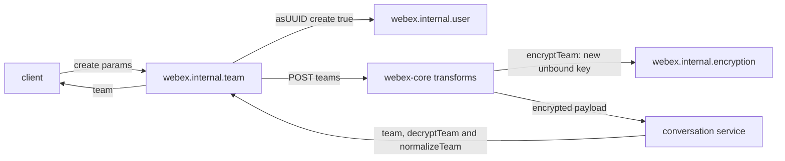
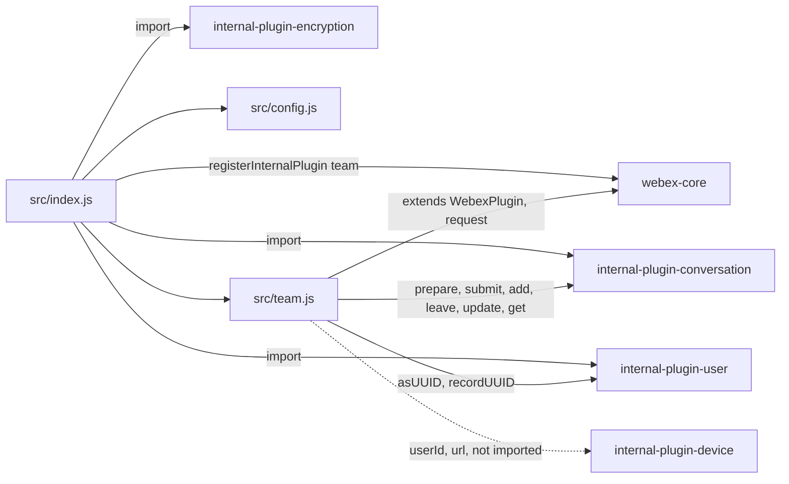
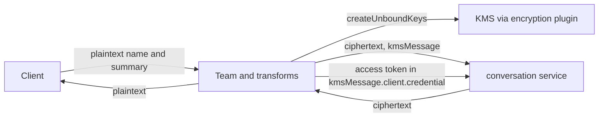

<!-- sdd-generated-metadata
doc_kind: standing-doc
generated_from: architecture@0.3.0
generated_by: claude-code
approved_by: rarajes2@cisco.com
updated_at: 2026-11-12T14:15:30Z
validation_status: pass-with-warnings
-->

# @webex/internal-plugin-team architecture

Canonical architecture for this package. Flow behavior lives in the
[Team plugin specification](../src/docs/README.md). This page owns package boundaries, the plugin
registration, the contract index, and how the package meets the rest of the SDK.

Related context: [specification registry](specs/README.md) ·
[package agent instructions](../AGENTS.md)

## Applicability

| Condition ID                         | Status     | Evidence or reason | Owned section |
| ------------------------------------ | ---------- | ------------------ | ------------- |
| `repo.owns_datastore`                | N/A        | No database, file store, or migration in `src/team.js` | Repository data and schema |
| `repo.holds_client_state`            | N/A        | `src/team.js` keeps no instance state and `src/config.js` defines an empty team block | Client state model |
| `repo.components_interact`           | Applicable | `src/team.js` drives the conversation, user, and device plugins; `src/index.js` joins the webex-core transform pipeline | Dependency and interaction topology |
| `repo.domain_data_across_components` | Applicable | Team objects pass between the conversation service, the transforms in `src/index.js`, the conversation plugin, and the user plugin's uuid cache | Object and data ownership |
| `repo.caches_data`                   | N/A        | `src/team.js` keeps no cache; it feeds the user plugin's | Caching catalog |
| `repo.observability_convention`      | Applicable | One warning line through the plugin logger in `src/team.js` | Observability patterns |
| `repo.deploys_to_infra`              | N/A        | Library published to npm (`package.json`). No service runtime | Runtime and infrastructure |
| `repo.shared_base_libs`              | Applicable | Extends WebexPlugin, joins the conversation plugin's transforms, and uses the legacy build, lint, and test stack (`babel.config.js`, `jest.config.js`, `.eslintrc.js`) | Shared and base libraries |
| `repo.is_monorepo`                   | N/A        | This SDD root is one package. The workspace around it is out of scope | Package map and inter-package dependencies |
| `repo.multi_platform`                | N/A        | `src/team.js` uses no platform-specific API; `process` declares only {browser: true} | Platform matrix |
| `repo.published_package`             | Applicable | `package.json` name is @webex/internal-plugin-team and deploy:npm publishes it | Release and versioning |
| `repo.embedded_in_host`              | N/A        | No host theme or embed API in `src/team.js` | Host integration and theming |
| `repo.exposes_commands_or_artifacts` | Applicable | build:src in `package.json` writes dist | Commands and generated artifacts |
| `repo.cross_repo_deps_material`      | Applicable | Behavior depends on the conversation service and the KMS (`src/team.js`, `src/index.js`) | Cross-repository topology |
| `repo.security_arch_warranted`       | Applicable | Team names and summaries are encrypted with KMS keys, and `joinConversation` puts the access token in a request body (`src/index.js`, `src/team.js`) | Security architecture |

## Design overview

`@webex/internal-plugin-team` is a published JavaScript library with one module. Importing it
registers the conversation, user, and encryption plugins and then `Team` as the internal plugin
`team`, reached as `webex.internal.team`. Inside this repository `@webex/webex-server` and
`@webex/recipe-private-web-client` import it to register it; no in-repo code calls its methods.

A team is a conversation-shaped resource on the conversation service with its own encryption key and
a general conversation. The plugin creates, reads, and lists teams with direct requests, and changes
them by posting activities to the general conversation through the conversation plugin. Its payload
transforms plug the `team` object type into the conversation plugin's encryption pipeline, so team
names and summaries leave the client encrypted and arrive decrypted.

The package serves no routes and persists nothing itself.

## Resource inventory and responsibilities

| Resource | Kind | Responsibility | Owner | Source | Detailed specification |
| -------- | ---- | -------------- | ----- | ------ | ---------------------- |
| Team plugin | package (one module) | Registration and transforms, team create and read, team conversations, team activities through the general conversation | @webex/web-sdk | `src` | [`src/docs/README.md`](../src/docs/README.md) |

## Interaction and execution flows

Representative end-to-end flow: a client creates a team.

| From | To | Interaction or transport | Purpose | Failure or compatibility behavior |
| ---- | -- | ------------------------ | ------- | --------------------------------- |
| Client | `webex.internal.team` | In-process calls | Team create, read, and activities | Rejections and some synchronous throws propagate |
| `Team` | Conversation plugin | In-process calls | Prepare and submit activities; creation payloads; general conversation lookup | Its errors propagate |
| `Team` | User plugin | In-process calls | Participant uuids; uuid records for members | Lookup failures reject; record failures are logged |
| Transforms | Encryption plugin | In-process calls through the conversation text transforms | New team key; encrypt and decrypt name and summary | Handled by the conversation plugin |
| `Team` | Conversation service | HTTPS through `webex.request` and the conversation plugin | Teams, team conversations, participants, activities | No retry here |

## Dependency topology

| Dependency | Type | Used by | Purpose | Version, failure, or fallback policy |
| ---------- | ---- | ------- | ------- | ------------------------------------ |
| `@webex/webex-core` | Internal | `src/index.js`, `src/team.js` | Registration, plugin base, `webex.request`, transform pipeline, credentials | `workspace:*` in `package.json` |
| `@webex/internal-plugin-conversation` | Internal | `src/index.js`, `src/team.js` | Activities, creation payloads, object-type transform dispatch | `workspace:*` |
| `@webex/internal-plugin-encryption` | Internal | `src/index.js` | KMS keys and text encryption | `workspace:*` |
| `@webex/internal-plugin-user` | Internal | `src/index.js`, `src/team.js` | `asUUID`, `recordUUID` | `workspace:*` |
| `@webex/internal-plugin-device` | Internal, declared, not imported | `src/team.js` | `userId`, `url` | `workspace:*`; registered through the user and encryption plugins |
| `lodash` | External | `src/index.js`, `src/team.js` | Object helpers | `^4.17.21` in `package.json` |
| `uuid` | External | `src/team.js` | KMS `requestId` | `^3.3.2` in `package.json` |
| Conversation service and KMS | External service | `src/team.js`, `src/index.js` | Team resources; keys and authorizations | Resolved through the service catalog and the encryption plugin |

No import cycle exists: none of the plugins this package imports imports it back.

## Public and consumer surfaces

| Surface | Type | Owner | Consumers | Compatibility policy | Source |
| ------- | ---- | ----- | --------- | -------------------- | ------ |
| `team-internal-sdk` — package @webex/internal-plugin-team, `webex.internal.team`, its methods, its transforms, and its config | SDK, published to npm, internal | Team plugin | First-party clients; `@webex/webex-server` and `@webex/recipe-private-web-client`, which register it | The README states that internal plugins do not strictly follow semantic versioning; no deprecation rule is declared | `package.json`, `src/index.js`, `src/team.js` |

The team, team-conversation, participant, and activity bodies are protocols this package speaks with
the conversation service, described under *Protocol and wire format* in the
[module specification](../src/docs/README.md#protocol-and-wire-format). The other contracts this
package requires are registered in `.sdd/manifest.json` `contract_catalog`.

## Cross-cutting architecture

### Security

- Trust boundaries and identity flow: see [Security architecture](#security-architecture).
- Sensitive surfaces and data classes: team names and summaries, member records with emails, and the
  access token that `joinConversation` places in a request body.
- Encryption and secret boundaries: see [Security architecture](#security-architecture).

### Observability and operations

- Logging and correlation: see [Observability patterns](#observability-patterns).
- Metrics, traces, and audit signals: see [Observability patterns](#observability-patterns).
- Ownership and operational entry points: `.github/CODEOWNERS` at the workspace root has no line for
  this package, so its default rule assigns it to `@webex/web-sdk`. No dashboards or runbooks are
  recorded in this package.

### Quality attributes

- Compatibility: clients rely on the registered name `team`, the method names and argument orders,
  the transform names the conversation plugin dispatches to, and the general-conversation routing of
  team activities.
- Footprint: three source files; runtime imports are webex-core, the conversation, user, and
  encryption plugins, lodash, uuid, and Node `querystring`.
- Test confidence: 14 unit cases cover argument guards and the `joinConversation` body; the
  transforms, registration, and every success path except `joinConversation` have no unit case. No
  coverage threshold is enforced.

## Dependency and interaction topology

| From | To | Kind | Purpose | Ordering or failure boundary |
| ---- | -- | ---- | ------- | ---------------------------- |
| `src/index.js` | webex-core | Call at import | Register `team` and its transforms | First registration wins; transforms join every later instance |
| `src/index.js` transforms | Conversation plugin transforms | Named transform calls | Dispatch for `objectType: 'team'` and text props | The conversation plugin must be registered |
| `src/team.js` | Conversation plugin | Calls | Activities and creation payloads | General conversation resolved first |
| `src/team.js` | User plugin | Calls | uuids | Participants resolved before the request |
| `src/team.js` | `webex.internal.device` | Property reads | Creator id; KMS client id | Read at call time |

## Object and data ownership

| Object or state | System of record | May write | May read | Movement or lifecycle |
| --------------- | ---------------- | --------- | -------- | --------------------- |
| Team, its members, conversations, and archive state | Conversation service | This package, through requests and activities | This package, then the caller | Fetched per call; not stored here |
| Team key and KMS resources | KMS | The encryption plugin, on behalf of the transforms | The encryption plugin | Created per team; not stored here |
| User uuid cache | User plugin | The user plugin, fed by this package | The user plugin | In memory with the user plugin |
| Device `userId` and `url` | Device plugin | The device plugin | This package | Read per call |

## Observability patterns

| Signal  | Convention or required fields | Propagation or naming rule | Primary evidence |
| ------- | ----------------------------- | -------------------------- | ---------------- |
| Logs    | One `logger.warn` line, `Could not record uuid`, with the error object, per member whose uuid record fails | No package prefix | `src/team.js` |
| Metrics | None | — | `src/team.js` |
| Traces  | None | — | `src/team.js` |
| Audit   | None | — | `src/team.js` |

## Shared and base libraries

| Library | Inherited responsibility | Consumers | Version floor | Compatibility rule |
| ------- | ------------------------ | --------- | ------------- | ------------------ |
| `@webex/webex-core` `WebexPlugin` | `webex`, `config`, `logger`, `request` | `Team` | `workspace:*` | Keep the registered name `team` |
| `@webex/internal-plugin-conversation` transforms | `decryptObject`, `encryptObject`, and `normalizeObject` dispatch; text-prop encryption | The transforms in `src/index.js` | `workspace:*` | Keep the `<verb><ObjectType>` transform names |
| `@webex/babel-config-legacy`, `@webex/eslint-config-legacy`, `@webex/jest-config-legacy`, `@webex/legacy-tools` | Build, lint, and test stack through one-line config files | Package tooling | `workspace:*` | Do not fork the config locally |

## Release and versioning

| Artifact | Publish target | Versioning rule | Deprecation window | Changelog or migration obligation |
| -------- | -------------- | --------------- | ------------------ | --------------------------------- |
| @webex/internal-plugin-team | npm through `deploy:npm` | Internal plugin; the README says semantic versioning is not strictly followed | None declared | None declared in the package; the workspace owns changelog generation |

## Commands and generated artifacts

| Command or artifact | Owner | Inputs | Output or side effect | Compatibility boundary |
| ------------------- | ----- | ------ | --------------------- | ---------------------- |
| `yarn workspace @webex/internal-plugin-team build:src` | Package scripts | `src` | Writes `dist/` (JavaScript and source maps) through `webex-legacy-tools` | `dist/` is generated and never edited by hand |
| `yarn workspace @webex/internal-plugin-team build` | Package scripts | `src` | Runs `build:src` | Same output |
| `yarn workspace @webex/internal-plugin-team test:unit` | Package scripts | `test/unit/spec`, `dist/` | Jest run | Run `build:src` first |
| `yarn workspace @webex/internal-plugin-team test:style` | Package scripts | `src` | ESLint run | The shared config ignores `docs/**` and `*.md` |

## Cross-repository topology

| Repository or external system | Relationship | Exchanged contract or artifact | Owner | Sequencing constraint |
| ----------------------------- | ------------- | ------------------------------ | ----- | --------------------- |
| `@webex/webex-core` (workspace sibling; module and services specs consulted) | Consumes | `registerInternalPlugin`, `WebexPlugin`, the transform pipeline, service resolution | @webex/web-sdk | Registered before the first instance |
| `@webex/internal-plugin-conversation` (workspace sibling; no spec, code consulted) | Consumes | Activities, creation payloads, transform dispatch | @webex/web-sdk | Imported before registration |
| `@webex/internal-plugin-encryption` (workspace sibling; no spec, code consulted) | Consumes | KMS keys, text encryption | @webex/web-sdk | Imported before registration |
| `@webex/internal-plugin-user` (workspace sibling; module spec consulted) | Consumes | `asUUID`, `recordUUID` | @webex/web-sdk | Imported before registration |
| `@webex/internal-plugin-device` (workspace sibling; module spec consulted) | Consumes | `userId`, `url` | @webex/web-sdk | Device registered before team calls |
| `@webex/webex-server`, `@webex/recipe-private-web-client` (workspace siblings) | Consumed by | The plugin registration | @webex/web-sdk | None |
| Conversation service and KMS | Consumes | Team resources and activities; keys and authorizations | Not recorded in this repository | Key before the create request |

## Security architecture

- This package holds no credential and no key. `encryptTeam` asks the encryption plugin for a new
  unbound KMS key and the conversation text transforms encrypt `displayName` and `summary` with it;
  `decryptTeam` decrypts them with the team's `encryptionKeyUrl` (`MOD-002`, `MOD-003` in the module
  spec).
- Team conversations grant the general conversation's KMS resource access, so every team member can
  decrypt their titles (`INV-003`).
- `joinConversation` copies `webex.credentials.supertoken.access_token` into the request body as the
  KMS client credential (`MOD-009`); the token leaves the client in a body as well as in the header.
- The logging rule is under [Observability patterns](#observability-patterns).

## Domain language

| Term | Repository-specific meaning | Authoritative source |
| ---- | --------------------------- | -------------------- |
| Team | A conversation-service resource with `objectType: 'team'`, its own key, members, and conversations | `src/team.js` |
| General conversation | The team conversation named by `generalConversationUuid`; team activities are posted to it | `src/team.js` |
| Team conversation | A conversation created inside a team at `<team.url>/conversations` | `src/team.js` |
| KRO | KMS resource object, `kmsResourceObjectUrl`; granting a KRO access to a resource shares its keys | `src/team.js` |
| teamRoomStatus | An event object that carries an `activityEvent` for a team conversation | `src/index.js` |

## References and maintenance

- Decisions: [adr/](adr/index.md)
- Instantiated specifications and routing: [specs/README.md](specs/README.md)
- Repository rules and patterns: [package agent instructions](../AGENTS.md)
- Update this document in the same change that alters package boundaries, resource ownership,
  cross-resource interaction, or cross-cutting architecture.
