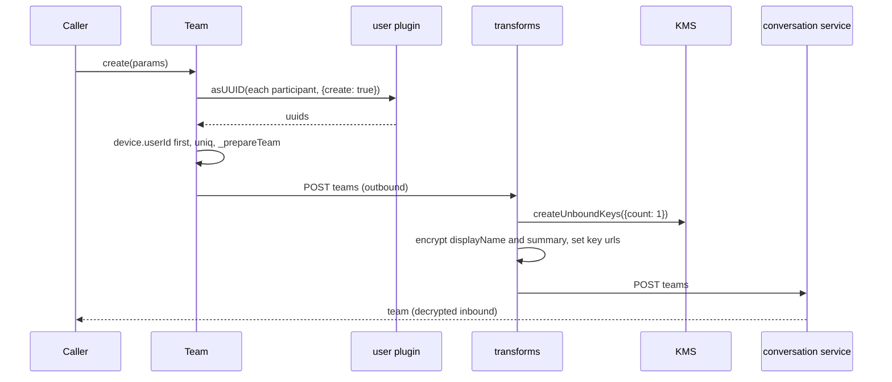
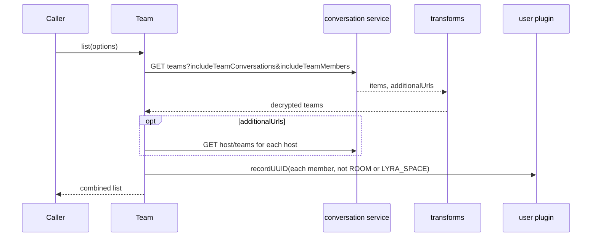
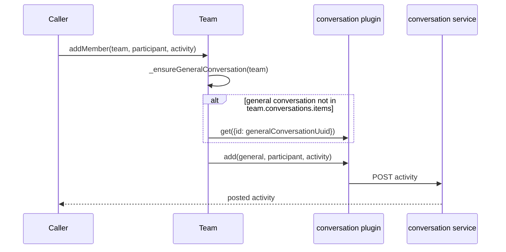
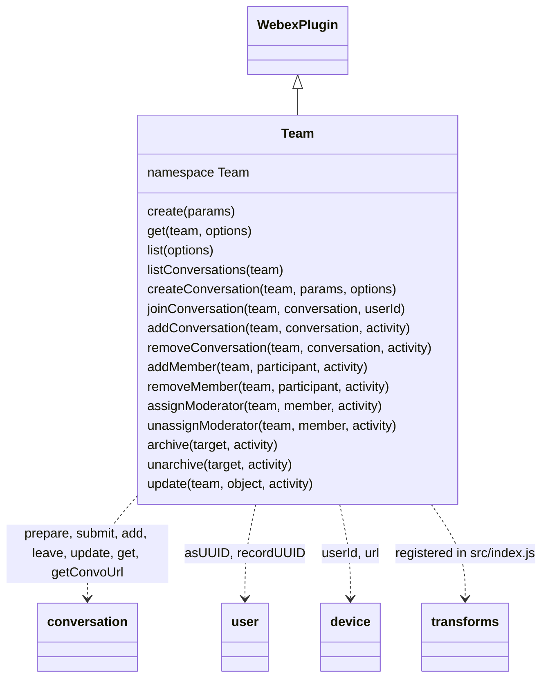

<!-- sdd-generated-metadata
doc_kind: module-spec
generated_from: module-spec@0.3.0
generated_by: claude-code
approved_by: rarajes2@cisco.com
updated_at: 2026-11-12T14:15:30Z
validation_status: pass-with-warnings
-->

# Team plugin

This source-local document at `src/docs/README.md` owns the stable specification for **the Team
plugin**: the internal plugin `webex.internal.team`. It creates, reads, and lists teams on the
conversation service, creates and joins team conversations, and changes team membership, moderators,
archive state, and fields by posting activities to the team's general conversation through
`webex.internal.conversation`. It also registers the payload transforms that encrypt and decrypt a
team's `displayName` and `summary` and decrypt `teamRoomStatus` events. Ground every claim in package
evidence and link to the [package architecture](../../docs/architecture.md) instead of repeating
broader facts. No service specification exists because this package is a library.

Related context: [documentation index](../../docs/index.md) ·
[package agent instructions](../../AGENTS.md)

## Metadata

| Field             | Value |
| ----------------- | ----- |
| Owner             | @webex/web-sdk |
| Source path       | `src` |
| Resource kind     | package |
| Status            | Draft |
| Last verified     | 2026-11-12 at `8613209907` |
| Module id         | `internal-plugin-team` |
| Parent spec       | — |
| Doc kind          | Module spec |
| Coverage score    | 100% assessed 2026-11-12 by the generator — 13 of 13 mandatory fields PRESENT, critical 7 of 7; `test:unit` runs 14 passing cases in `test/unit/spec/team.js`, which cover argument guards, `_recordUUIDs` early returns, and the `joinConversation` body; no unit case covers another success path or the transforms of `MOD-002` to `MOD-004` |
| Validation status | Pass with warnings — validator runtime `01a1d014-9c2d-7e83-93cc-06aec7587d43`, 2026-11-12; 0 Blocking and 1 Important finding (B11-001, command-source parity for five command entries), accepted as a warning |

## Applicability

| Condition ID                         | Status     | Evidence or reason | Owned section |
| ------------------------------------ | ---------- | ------------------ | ------------- |
| `module.has_tiers`                   | N/A        | No tier policy exists in `package.json` or `src/team.js` | Tier |
| `module.has_ui`                      | N/A        | `src/team.js` sends requests and resolves promises; it renders nothing | UI use-case flow |
| `module.crosses_service_boundaries`  | Applicable | `src/team.js` calls the conversation service directly and through the conversation plugin; `src/index.js` transforms call the KMS through the encryption plugin | Cross-boundary use-case flow |
| `module.holds_client_state`          | N/A        | `src/team.js` keeps no instance state and `src/config.js` defines an empty team block; the uuid cache it feeds belongs to the user plugin | Client state model |
| `module.enforces_domain_rules`       | Applicable | Argument guards, the general-conversation rule, the creator-first participant list, and the KRO grant in `src/team.js` | Business rules and invariants |
| `module.is_concurrent_async`         | Applicable | Every method returns a promise; `src/team.js` resolves participants, extra list hosts, and uuid records in parallel | Concurrency and reactive flow |
| `module.owns_persistence`            | N/A        | `src/team.js` stores nothing | Data, schema, and migration discipline |
| `module.stateful_transitions`        | N/A        | Archive and moderator state live on the conversation service; `src/team.js` holds no state machine | State machine |
| `module.exposes_wire_protocol`       | Applicable | Team, team-conversation, participant, and activity bodies in `src/team.js`; the encrypted fields set by the transforms in `src/index.js` | Protocol and wire format |
| `module.ui_multi_screen`             | N/A        | No UI | UI flow |
| `module.large_data_model`            | N/A        | No local data model; the team fields read are covered under Protocol and wire format | Data model |
| `module.returns_caller_errors`       | Applicable | Guard, request, and conversation-plugin failures reject or throw from the methods in `src/team.js` | Caller-visible failure modes |
| `module.module_specific_conventions` | Applicable | Transform names and directions in `src/index.js`; the general-conversation lookup before every activity in `src/team.js` | Module-specific rules |
| `module.published_package`           | Applicable | `package.json` names the package @webex/internal-plugin-team and defines deploy:npm | Export stability |
| `module.embedded_in_host`            | N/A        | No host theme or embed API | Host integration and theming |
| `module.has_design_tradeoff`         | Applicable | Activities through the general conversation, the KRO grant on team conversations, and swallowed uuid record failures in `src/team.js` | Key design trade-off |
| `module.has_submodules`              | N/A        | The src directory has no child module | Sub-modules |

## Evidence register

| Evidence | What it establishes |
| -------- | ------------------- |
| `src/index.js` | Imports the conversation, user, and encryption plugins, then `registerInternalPlugin('team', Team, {payloadTransformer, config})` at import time with one predicate and six transforms; re-exports the default `Team` |
| `src/team.js` | `Team` extends `WebexPlugin` in namespace `Team` with fifteen methods on the object literal and four added to the prototype in two loops; the comments on the KRO push, the ROOM and LYRA_SPACE skip, and the default activity key are the only recorded rationale in the package |
| `src/config.js` | The default config `{team: {}}` |
| `package.json` | Name, `main` (`dist/index.js`), `devMain` (`src/index.js`), `engines` (`node >=18`), dependencies, and scripts; `test:unit` exists, `test:integration` does not |
| `test/unit/spec/team.js` | 14 jest cases with `@webex/test-helper-mock-webex` and sinon: argument guards, `_prepareTeamConversation` KRO guard, `_recordUUIDs` early returns, and the `joinConversation` request; it imports the package by name, so it tests `dist/` |
| `test/integration/spec/create.js`, `test/integration/spec/get.js`, `test/integration/spec/actions.js`, `test/integration/spec/mercury.js` | Live-service cases for create, read, list, every activity method, and a `teamRoomStatus` mercury event; run only by `test:browser` |
| `README.md` | Retained npm page; context only. Its Usage block shows a placeholder member and no method; see `docs/adr/0001-retain-product-readme.md` |
| Sibling package webex-core, file src/docs/README.md | Module spec consulted, agrees with code. `registerInternalPlugin` keys the plugin by its raw name and the first registration wins (MOD-013); registration concatenates `payloadTransformer` predicates and transforms into the defaults (MOD-008); `transform` runs matching predicates and named transforms serially (MOD-037); `WebexPlugin.config` is the namespace key of `webex.config` (MOD-044) |
| Sibling package webex-core, file src/webex-core.js | Code consulted where the spec is silent: `applyNamedTransform` runs every transform with the given name whose direction matches or is unset, so a transform without `direction` runs inbound and outbound |
| Sibling package webex-core, file src/lib/services/docs/README.md | Services spec consulted, agrees with code: `api` maps to `service` and the resource is joined to the catalog URL; a request with `uri` is left unchanged (SVC-022) |
| Sibling package internal-plugin-user, file src/docs/README.md | Module spec consulted, agrees with code: `asUUID` returns uuids unchanged and resolves emails through `getUUID` (MOD-002, MOD-003); `recordUUID` rejects a user without an id or a valid email (MOD-006) |
| Sibling package internal-plugin-device, file src/docs/README.md | Module spec consulted: `url` and `userId` are registration properties other plugins read from `webex.internal.device` |
| Sibling package internal-plugin-conversation, files src/conversation.js, src/index.js, src/encryption-transforms.js, src/decryption-transforms.js | No spec exists; code consulted. `decryptObject` and `encryptObject` dispatch to `decrypt<ObjectType>` and `encrypt<ObjectType>`, and `normalizeObject` to `normalize<ObjectType>`; `_prepareConversationForCreation`, `prepare`, `submit`, `add`, `leave`, `update`, `get`, `getConvoUrl`, `prepareConversation`, and the moderator verbs behave as cited per requirement |
| Sibling package internal-plugin-encryption, files src/kms.js, src/encryption.js | No spec exists; code consulted. `kms.createUnboundKeys({count})`, `encryptText`, and `decryptText` are the calls the conversation text transforms make |
| Observation, no stated WHY | Behavior the code shows without stating a reason is recorded once, under Pitfalls and constraints |

## Purpose and boundary

- Responsibility: let a Webex client create and read teams, list a team's conversations, create
  conversations inside a team, and change a team's members, moderators, conversations, archive state,
  and fields, while keeping the team's `displayName` and `summary` encrypted on the wire.
- In scope: registration of `team`, its config, and its payload transforms; `create`, `get`, `list`,
  `listConversations`, `createConversation`, `joinConversation`, `addConversation`,
  `removeConversation`, `addMember`, `removeMember`, `assignModerator`, `unassignModerator`,
  `archive`, `unarchive`, `update`; and the underscore-prefixed helpers `_ensureGeneralConversation`,
  `_prepareTeam`, `_prepareTeamConversation`, and `_recordUUIDs`.
- Out of scope: building, encrypting, and submitting conversation activities
  (`@webex/internal-plugin-conversation`); KMS keys and text encryption
  (`@webex/internal-plugin-encryption`); uuid lookup and caching (`@webex/internal-plugin-user`);
  device registration and identity (`@webex/internal-plugin-device`); service-catalog resolution and
  the transform pipeline (`@webex/webex-core`); what the conversation service does with teams.
- Consumers: in this repository `@webex/webex-server` and `@webex/recipe-private-web-client` import
  the package to register it. No in-repo source outside this package calls a `webex.internal.team`
  method; first-party clients reach the plugin as `webex.internal.team`.

## Structure and key files

| Path | Responsibility |
| ---- | -------------- |
| `src/index.js` | Imports the conversation, user, and encryption plugins, registers internal plugin `team` with its transforms and config, and exports the class as default |
| `src/team.js` | `Team`, where every public method and helper lives |
| `src/config.js` | The empty `team` config block |
| `package.json` | Package name, entry points, scripts, and dependencies |
| `babel.config.js`, `jest.config.js` | Re-exports of the legacy Babel and Jest configurations |
| `.eslintrc.js` | Sets `root: true` and extends `@webex/eslint-config-legacy` |
| `process` | Package-root file exporting `{browser: true}`; not imported by `src/` |
| `src/docs/README.md` | This module specification; ignored by the build and by lint |
| `test/unit/spec/team.js` | Unit cases run by `test:unit` |
| `test/integration/spec/create.js`, `test/integration/spec/get.js`, `test/integration/spec/actions.js`, `test/integration/spec/mercury.js` | Live-service cases run by `test:browser` |
| dist/ (generated) | Build output of `build:src`; ignored by Git and never edited by hand |

## Public surface

| Surface | Consumer | Compatibility commitment | Source |
| ------- | -------- | ------------------------ | ------ |
| Import side effect: internal plugin `team` with config `{team: {}}`, its payload transforms, and the conversation, user, and encryption plugins | `@webex/webex-server`, `@webex/recipe-private-web-client` | First registration of the name wins; reached as `webex.internal.team`; transforms apply to every later SDK instance | `src/index.js`, `src/config.js` |
| `create(params)`, `get(team, options)`, `list(options)`, `listConversations(team)` | First-party clients | Resolve the service response body, its `items`, or the combined list | `src/team.js` |
| `createConversation(team, params, options)`, `joinConversation(team, conversation, userId)` | First-party clients | Resolve the service response body | `src/team.js` |
| `addConversation`, `removeConversation`, `addMember`, `removeMember`, `assignModerator`, `unassignModerator`, `archive`, `unarchive`, `update` | First-party clients | Resolve the activity the conversation plugin posts | `src/team.js` |
| `_ensureGeneralConversation`, `_prepareTeam`, `_prepareTeamConversation`, `_recordUUIDs` | The methods above; the unit spec | Underscore-prefixed; reachable on the instance but not a supported entry | `src/team.js` |
| Default export `Team` | Clients that mount the class themselves; the unit spec | The entry exports nothing else | `src/index.js` |

Contract ID `team-internal-sdk` is indexed in the
[package architecture](../../docs/architecture.md#public-and-consumer-surfaces) and registered in
`.sdd/manifest.json`. Export stability is under [Export stability](#export-stability).

## Dependencies

| Dependency | Why it is required | Failure behavior |
| ---------- | ------------------ | ---------------- |
| `@webex/webex-core` plugin host and transform pipeline (module spec consulted; code consulted for named transforms) | `registerInternalPlugin`, `WebexPlugin` (`webex`, `logger`), `webex.request`, and the predicate and transform chain the transforms join | A request rejection rejects the method |
| `@webex/webex-core` services (services spec consulted) | Resolves `service: 'conversation'` and `api: 'conversation'` with a resource to the catalog URL | A catalog failure rejects the request |
| `@webex/internal-plugin-conversation` (no spec; code consulted) | `prepare`, `submit`, `prepareConversation`, `_prepareConversationForCreation`, `get`, `add`, `leave`, `update`, `assignModerator`, `unassignModerator`, `getConvoUrl`, and the `decryptObject`, `encryptObject`, `normalizeObject`, and text-prop transforms | Its rejections and synchronous throws reach the caller unchanged |
| `@webex/internal-plugin-encryption` (no spec; code consulted) | `kms.createUnboundKeys` for a new team key; `encryptText` and `decryptText` behind the text-prop transforms | A key or encryption rejection rejects the request |
| `@webex/internal-plugin-user` (module spec consulted) | `asUUID(participant, {create: true})` for participants; `recordUUID` for team members | `asUUID` rejection rejects `create` and `createConversation`; `recordUUID` rejection is logged (`MOD-017`) |
| `@webex/internal-plugin-device` (module spec consulted) | `userId` as the creator and `url` as the KMS client id | Declared in `package.json` but not imported by `src/`; the encryption and user plugins import it |
| `@webex/webex-core` credentials | `webex.credentials.supertoken.access_token` for `joinConversation` | A missing supertoken throws (see Caller-visible failure modes) |
| `lodash` | `isArray`, `has`, `get`, `find`, `pick`, `uniq` | Not applicable |
| `uuid` | `v4` for the KMS `requestId` of `joinConversation` | Not applicable |
| Node `querystring` | Encodes `authId` in the remove activity's KMS uri | Bundled by the browserify transforms declared in `package.json` |
| Conversation service and KMS (external) | Team resources and activities; keys and authorizations | Errors propagate |

## Requirements

| ID | WHAT | WHY | Source evidence | Test or example evidence | Assumptions or gaps | Confidence |
| -- | ---- | --- | --------------- | ------------------------ | ------------------- | ---------- |
| `MOD-001` | Importing the package imports `@webex/internal-plugin-conversation`, `@webex/internal-plugin-user`, and `@webex/internal-plugin-encryption`, then registers `Team` as internal plugin `team` with config `{team: {}}` and the payload transformer of `MOD-002` to `MOD-004`, so the plugin is `webex.internal.team`. | Every method calls the conversation or user plugin and the transforms call the encryption plugin, so they must be registered with this one (inferred from the imports and calls; no comment states it). | `src/index.js`, `src/config.js` | `test/unit/spec/team.js` imports the package but mounts the class through a mock children map, so registration is not asserted | WHY inferred from code | Weak |
| `MOD-002` | Inbound transform `decryptTeam(ctx, key, team)` runs `decryptObject(null, item)` for each `team.conversations.items` entry, and, with `team.encryptionKeyUrl` or else `key`, `decryptPropDisplayName` and `decryptPropSummary` (`decryptTextProp('summary')`) on the team; without either key it decrypts only the conversations. The conversation plugin's `decryptObject` reaches it for `objectType: 'team'`. | A team's own key protects its name and summary, while each listed conversation carries its own key (inferred from the per-item `null` key; no comment states it). | `src/index.js` | `test/integration/spec/get.js` decrypts teams and their conversations against live services | No unit case; the integration cases do not run today | Weak |
| `MOD-003` | Outbound transform `encryptTeam(ctx, key, team)` does nothing when `key` is `false`; otherwise it uses `key` or one key from `kms.createUnboundKeys({count: 1})`, adds that key's `uri` to `team.kmsMessage.keyUris` when the list exists and lacks it, encrypts `displayName` and `summary` (`encryptPropSummary`), and sets `encryptionKeyUrl` to the key `uri` or the key itself. Only when no key was passed in does it set `defaultActivityEncryptionKeyUrl`, keeping an existing value. The conversation plugin's `encryptObject` reaches it for `objectType: 'team'`. | The code comment: the default activity key is set only when a new key was bound. Binding the new key through `keyUris` lets the KMS create request cover it (inferred). | `src/index.js` | `test/integration/spec/create.js` asserts new teams arrive encrypted | No unit case | Present |
| `MOD-004` | Transform `normalizeTeam`, which has no direction and so runs inbound and outbound, defaults `conversations.items` and `teamMembers.items` to empty arrays and runs `normalizeObject` on every item. Inbound predicate `decryptTeamRoomStatus` matches a payload whose `activity.object.objectType` is `teamRoomStatus` and that has `activity.object.activityEvent`, extracts `activity.object`, and the same-named transform runs `decryptObject` on its `activityEvent` with `activityEvent.encryptionKeyUrl`. | Later code can iterate a team's lists without checks, and a member who has not joined a team conversation still receives its decrypted updates (inferred from the mercury integration case; no comment states it). | `src/index.js` | `test/integration/spec/mercury.js` expects a decrypted `teamRoomStatus` update for an unjoined member | No unit case | Weak |
| `MOD-005` | `create(params)` rejects with `` `params.displayName` is required `` without a `displayName` and with `` `params.participants` is required `` without a non-empty `participants`. It resolves each participant with `user.asUUID(participant, {create: true})` in parallel, puts `device.userId` first, removes duplicates, and writes the list back to `params.participants`; then builds the conversation plugin's `_prepareConversationForCreation(params)` payload with `objectType: 'team'` and, when truthy, `summary`, POSTs it to service `conversation`, resource `teams`, and resolves the response body. | The creator is always a member (inferred from the unshift; the integration case asserts the creator is the moderator). | `src/team.js` | `test/unit/spec/team.js` three guard cases; `test/integration/spec/create.js` | Request body not asserted in a unit case | Present |
| `MOD-006` | `createConversation(team, params, options = {})` rejects with `` `team.url` is required `` and `` `params.displayName` is required ``, resolves the general conversation (`MOD-010`), resolves and orders participants as `MOD-005`, and builds `_prepareTeamConversation(general, params)`: it rejects with `Team general conversation must have a KRO` when the general conversation has no `kmsResourceObjectUrl`, else takes the conversation creation payload and appends that KRO to `kmsMessage.userIds`. It POSTs to `<team.url>/conversations` with query `includeAllTeamMembers` when given, and resolves the body. | The code comment: the general conversation KRO lets team members decrypt the title of this open room without joining it. | `src/team.js` | `test/unit/spec/team.js` URL, displayName, general-conversation, and KRO guard cases; `test/integration/spec/create.js` | Success path not unit-tested | Present |
| `MOD-007` | `get({url}, options = {})` rejects with `` `team.url` is required `` without `url`; otherwise GETs `url` with query `{includeTeamConversations: false, includeTeamMembers: false, ...options}`, records member uuids (`MOD-017`), and resolves the body. `listConversations({url})` has the same guard, GETs `<url>/conversations`, and resolves `body.items`. | Fetching members and conversations is opt-in per call (inferred from the false defaults). | `src/team.js` | `test/unit/spec/team.js` guard cases; `test/integration/spec/get.js` | Success paths not unit-tested | Present |
| `MOD-008` | `list(options = {})` GETs `api: 'conversation'`, resource `teams`, with the query of `MOD-007`. When the body has `additionalUrls`, it GETs `<host>/teams` for every host in parallel with the same query and appends each non-empty `items` in host order. It records member uuids for the teams of the first response only and resolves the combined list. | Teams can live on more than one conversation host, which the first response names (inferred from `additionalUrls`; no comment states it). | `src/team.js` | `test/integration/spec/get.js` list cases | No unit case; the extra-host branch is untested | Weak |
| `MOD-009` | `joinConversation(team, conversation, userId)` rejects with `` `userId` is required `` without `userId`; otherwise POSTs to `<team.url>/conversations/<conversation.id>/participants` a body `{kmsMessage}` with `client: {clientId: device.url, credential: {bearer: <supertoken access_token>, userId}}`, `method: 'create'`, a fresh v4 `requestId`, `resourceUri: conversation.kmsResourceObjectUrl`, `uri: '/authorizations'`, and `userIds: [userId]`, and resolves the body. | The joining user needs a KMS authorization on the conversation's resource; the conversation service forwards the message with the client credential (inferred from the body; no comment states it). | `src/team.js` | `test/unit/spec/team.js` guard and request body cases | The unit case matches with `sinon.match` and does not check `requestId` | Present |
| `MOD-010` | `_ensureGeneralConversation(team)` rejects with `` `team.generalConversationUuid` must be present `` without that field; resolves the entry of `team.conversations.items` whose `id` equals it; otherwise resolves `conversation.get({id: team.generalConversationUuid})`. | Team-level actions are activities on the general conversation (see Key design trade-off). | `src/team.js` | `test/unit/spec/team.js` general-conversation guard case | Lookup and fetch paths not unit-tested | Present |
| `MOD-011` | `addConversation(team, conversation, activity)` prepares an `add` activity with target `prepareConversation(general)`, object `{id: conversation.id, objectType: 'conversation'}`, and `kmsMessage {method: 'create', uri: '/authorizations', resourceUri: conversation.kmsResourceObjectUrl, userIds: [general.kmsResourceObjectUrl]}`, and submits it. `removeConversation(team, conversation, activity)` prepares a `remove` activity with object and target picked to `id`, `url`, and `objectType` and `kmsMessage {method: 'delete', uri: '<KRO>/authorizations?authId=<conversation.id>'}`, and submits it. | Moving a conversation into a team grants the general conversation's KRO access to it, and removing it deletes that authorization (inferred from the KMS messages). | `src/team.js` | `test/integration/spec/actions.js` add and remove cases | No unit case | Weak |
| `MOD-012` | `addMember` and `removeMember(team, participant, activity)` resolve to `conversation.add` and `conversation.leave` on the general conversation. `assignModerator` and `unassignModerator(team, member, activity)` resolve to the conversation plugin's method of the same name on the general conversation. | Membership and moderation of a team are those of its general conversation (inferred from the delegation). | `src/team.js` | `test/integration/spec/actions.js` member and moderator cases | No unit case | Weak |
| `MOD-013` | `archive` and `unarchive(target, activity)` reject with `` `target.objectType` is required `` without it; otherwise they prepare an activity of that verb whose object and target are both `target` picked to `id`, `url`, and `objectType`, and submit it to `conversation.getConvoUrl(target)`, which for a team is the URL of its general conversation entry in `target.conversations.items`. | The conversation service has no team endpoint for activities (conversation plugin code comment in `getConvoUrl`). | `src/team.js` | `test/integration/spec/actions.js` archive and unarchive cases for a team and a team conversation | No unit case | Present |
| `MOD-014` | `update(team, object, activity)` returns `conversation.update(team, object, activity)` unchanged. | The JSDoc: updates `displayName`, `summary`, or `teamColor`. | `src/team.js` | `test/integration/spec/actions.js` update cases; `test/integration/spec/mercury.js` updates a team conversation through it | No unit case | Present |
| `MOD-015` | `_prepareTeam(params)` returns the conversation plugin's creation payload with `objectType` replaced by `'team'` and `summary` added when truthy; the payload carries the `create` and per-participant `add` activities and a KMS `create /resources` message for the participants. | A team is created as a conversation-shaped resource of another type (inferred). | `src/team.js` | None found | No unit case | Weak |
| `MOD-016` | `create` and `createConversation` resolve all participants before any request; `get` and `list` resolve only after every uuid record of `MOD-017` settles. | The uuid cache is filled before callers read members (inferred from the ordering). | `src/team.js` | None found | Ordering not asserted | Weak |
| `MOD-017` | `_recordUUIDs(team)` resolves `team` when `teamMembers.items` is missing; otherwise calls `user.recordUUID(member)` for every member whose `type` is not `ROOM` or `LYRA_SPACE`, logs a rejection with `logger.warn('Could not record uuid', err)`, and resolves when all settle. | The code comment: ROOMs and LYRA_SPACEs have no email address, so recording their uuid is pointless. | `src/team.js` | `test/unit/spec/team.js` three `#recordUUIDs` cases | The LYRA_SPACE case is vacuous (see Pitfalls) | Present |

## Design overview

`Team` is a thin `WebexPlugin` with no state of its own. Reads and creates go straight to the
conversation service through `webex.request`. Every other change is an activity on the team's general
conversation, which `MOD-010` finds in the team object or fetches, and which the conversation plugin
prepares, encrypts, and submits.

Encryption is not in `Team` at all. The conversation plugin's payload transforms dispatch on
`objectType`, and this package adds the `team` cases: `encryptTeam` binds a new KMS key and encrypts
the name and summary on the way out, `decryptTeam` decrypts them and the listed conversations on the
way in, and `normalizeTeam` fills empty lists. A separate predicate decrypts `teamRoomStatus` events
so members see updates to team conversations they have not joined.

## Data flow and sequence coverage

Call style: in-process method calls on `webex.internal.team`; outbound HTTPS through `webex.request`
and through the conversation plugin's `submit`; inbound and outbound payload transforms run by the
webex-core pipeline. Three operation groups differ in actors and outcome, and each has a diagram.

| Operation group | Entry and outcome | Diagram or evidence | Failure and recovery coverage |
| --------------- | ----------------- | ------------------- | ----------------------------- |
| Create | `create` and `createConversation` resolve participants and POST an encrypted creation payload | Diagram 1; `src/team.js`, `src/index.js` | Guards reject first; request and key errors reject |
| Read | `get`, `list`, and `listConversations` GET and decrypt teams, recording member uuids | Diagram 2; `src/team.js` | Request errors reject; uuid record errors are logged |
| Team activity | Membership, moderator, conversation, archive, and update changes post activities to the general conversation | Diagram 3; `src/team.js` | Guards reject; conversation-plugin errors propagate |

Diagram 1 — create:

Diagram 2 — read:

Diagram 3 — team activity:

## Class and component relationships

## Use cases and flows

| Use case | Actor or caller | Primary steps and outcome | Failure or boundary behavior | Evidence |
| -------- | --------------- | ------------------------- | ---------------------------- | -------- |
| `UC-001` | Client creating a team | `create({displayName, summary, participants})`; the creator becomes a member | Guards reject; a participant lookup failure rejects | `src/team.js`, `test/integration/spec/create.js` |
| `UC-002` | Client browsing teams | `list({includeTeamMembers})`, then `get(team)` and `listConversations(team)` | Request errors reject | `src/team.js`, `test/integration/spec/get.js` |
| `UC-003` | Client opening a team conversation | `createConversation(team, {displayName, participants})` or `joinConversation(team, conversation, userId)` | Guards reject; a general conversation without a KRO rejects | `src/team.js`, `test/integration/spec/create.js`, `test/integration/spec/actions.js` |
| `UC-004` | Team moderator managing a team | `addMember`, `removeMember`, `assignModerator`, `unassignModerator`, `addConversation`, `removeConversation`, `archive`, `unarchive`, `update` | See Caller-visible failure modes | `src/team.js`, `test/integration/spec/actions.js` |
| `UC-005` | Member who has not joined a team conversation | Receives its `teamRoomStatus` update decrypted through mercury | The event is decrypted only when it carries `activityEvent` | `src/index.js`, `test/integration/spec/mercury.js` |

### Cross-boundary use-case flow

| Boundary | Transport and ordering | Compatibility | Timeout, retry, and recovery |
| -------- | ---------------------- | ------------- | ---------------------------- |
| Conversation service (`UC-001` to `UC-003`) | HTTPS through `webex.request`, by catalog service `conversation` or by the team's own URL | Requests under Protocol and wire format | No retry or timeout in this module; webex-core interceptors apply |
| Conversation service through the conversation plugin (`UC-004`) | Activities prepared and submitted by `webex.internal.conversation` | Activity verbs under Protocol and wire format | Owned by the conversation plugin |
| KMS through the encryption plugin (`UC-001`, `UC-002`, `UC-005`) | A new unbound key before the create request; text decryption after each response | Owned by the encryption plugin | A key or decryption failure is handled by the conversation text transforms |
| Mercury (`UC-005`) | Inbound event through the predicate of `MOD-004` | `teamRoomStatus` shape under Protocol and wire format | Owned by the mercury plugin |

## Business rules and invariants

| ID | Invariant | WHY | Enforcement source | Test evidence |
| -- | --------- | --- | ------------------ | ------------- |
| `INV-001` | Every team activity of `MOD-011` to `MOD-013` targets the team's general conversation, and a team without `generalConversationUuid` rejects before any request. | The conversation service has no team endpoint for activities (conversation plugin `getConvoUrl` comment). | `src/team.js` | `test/unit/spec/team.js` general-conversation guard |
| `INV-002` | `create` and `createConversation` send `device.userId` as the first participant and no participant twice. | The creator must be a member (inferred). | `src/team.js` | None found |
| `INV-003` | Every team conversation's KMS create message lists the general conversation's KRO in `userIds`. | The code comment: team members can decrypt the title of an open room without joining it. | `src/team.js` | `test/unit/spec/team.js` KRO guard |
| `INV-004` | `encryptTeam` never overwrites an existing `defaultActivityEncryptionKeyUrl` and sets one only when it bound a new key. | The code comment on binding a new key. | `src/index.js` | None found |
| `INV-005` | A failed uuid record never rejects `get` or `list`. | The uuid cache is an optimization for later lookups (inferred from the catch). | `src/team.js` | None found |
| `INV-006` | Each argument guard of `MOD-005` to `MOD-010` and `MOD-013` rejects before any request is sent. | Fail fast without network traffic (inferred). | `src/team.js` | `test/unit/spec/team.js` guard cases |

## Concurrency and reactive flow

- Execution model: one JavaScript event loop; every method returns a promise, and `list` is `async`.
- Ordering guarantees: participants resolve before the create request (`MOD-016`); the general
  conversation resolves before any activity is prepared; member uuids are recorded before `get` and
  `list` resolve.
- Parallel work: participant lookups, the extra `list` hosts, and uuid records each run with
  `Promise.all`; the first rejection rejects the participant and host groups.
- Idempotency and retry: nothing is retried here. Activities get a `clientTempId` from the conversation
  plugin's `prepare`; this package adds no de-duplication.
- Fire-and-forget work: none.
- Shared-state protection: none needed; the plugin holds no state. `create` and `createConversation`
  write to the caller's `params` object, so concurrent calls must not share one.

## Protocol and wire format

| Message or frame | Version | Producer or serializer | Consumer or parser | Compatibility and ordering rule |
| ---------------- | ------- | ---------------------- | ------------------ | ------------------------------- |
| `POST <conversation>/teams`, body: creation payload with `objectType: 'team'`, encrypted `displayName` and `summary`, `encryptionKeyUrl`, `defaultActivityEncryptionKeyUrl`, the create and add activities, and `kmsMessage {method: 'create', uri: '/resources', userIds, keyUris}` | Unversioned | `create` with `MOD-003` | Conversation service | Response: the team, decrypted by `MOD-002` and normalized by `MOD-004` |
| `GET <team.url>?includeTeamConversations&includeTeamMembers` | Unversioned | `get` | Conversation service | Both flags default to `false` |
| `GET <conversation>/teams?...` and `GET <additional host>/teams?...` | Unversioned | `list` | Conversation service | Response `{items, additionalUrls}`; items appended in host order |
| `GET <team.url>/conversations` | Unversioned | `listConversations` | Conversation service | Response `items` |
| `POST <team.url>/conversations[?includeAllTeamMembers]`, body: conversation creation payload with the general KRO in `kmsMessage.userIds` | Unversioned | `createConversation` | Conversation service | Response: the conversation |
| `POST <team.url>/conversations/<id>/participants`, body `{kmsMessage}` of `MOD-009` | Unversioned | `joinConversation` | Conversation service | The KMS message carries the supertoken access token as `credential.bearer` |
| Activities `add`, `remove`, `archive`, `unarchive`, `assignModerator`, `unassignModerator`, `update`, and the person `add` and `leave` | Unversioned | The conversation plugin, from the properties of `MOD-011` to `MOD-014` | Conversation service | Target is the general conversation, or the team itself for archive state |
| Inbound `activity.object` with `objectType: 'teamRoomStatus'` and `activityEvent` | Unversioned | Conversation service through mercury | `MOD-004` predicate | `activityEvent` is decrypted with its own `encryptionKeyUrl` |
| Team object fields read: `url`, `generalConversationUuid`, `conversations.items`, `teamMembers.items[].type`, `encryptionKeyUrl`, `objectType` | Unversioned | Conversation service | `src/team.js`, `src/index.js` | Member types `ROOM` and `LYRA_SPACE` are not recorded |

## Caller-visible failure modes

| Condition | Signal or result | Caller behavior | Retry or recovery | Evidence |
| --------- | ---------------- | --------------- | ----------------- | -------- |
| A required argument is missing (`MOD-005` to `MOD-010`, `MOD-013`) | Rejects with the guard's `Error` message before any request | Pass the named field | Call again with it | `src/team.js`, `test/unit/spec/team.js` |
| `team.conversations` is missing when an activity method or `createConversation` runs | Throws `TypeError` synchronously from `_ensureGeneralConversation` instead of returning a rejected promise | Pass a team object as `get` or `list` returned it | Fetch the team again | `src/team.js` |
| `archive` or `unarchive` on a team whose general conversation is not in `conversations.items` | Throws `TypeError` synchronously from the conversation plugin's `getConvoUrl` | Fetch the team with `includeTeamConversations: true` | Call again | `src/team.js` |
| `joinConversation` with no supertoken on `webex.credentials` | Throws `TypeError` synchronously while building the body | Authorize the SDK first | Call again | `src/team.js` |
| `createConversation` with no `params.participants` | Rejects with `TypeError` after the general conversation resolves | Pass an array | Call again | `src/team.js` |
| A participant lookup, key request, or service request fails | Rejects with that error, unchanged | Handle the error | Call again | `src/team.js` |
| One of the `additionalUrls` requests of `list` fails | `list` rejects; the teams of the other hosts are not returned | Handle the error | Call again | `src/team.js` |
| A member's uuid cannot be recorded | Logged as a warning; `get` and `list` still resolve (`INV-005`) | None | Not applicable | `src/team.js` |

## Pitfalls and constraints

- `create` and `createConversation` replace the caller's `params.participants` with the resolved uuid
  list, creator first (`MOD-005`); reusing the object sends uuids.
- `list` records member uuids for the teams of the first response only; teams from `additionalUrls`
  are returned without being recorded (`MOD-008`).
- `decryptTeam` reads `team.conversations.items` without a guard, and the conversation plugin's inbound
  `transformObject` runs `decryptObject` before `normalizeObject`, so an inbound team payload without
  `conversations` would reject with `TypeError` before `normalizeTeam` fills it (inferred from code; no
  test).
- The remove activity of `MOD-011` carries a `<KRO>` placeholder that the conversation plugin's
  outbound KMS-message transform replaces from `activity.target.kmsResourceObjectUrl`, while the target
  this method builds keeps only `id`, `url`, and `objectType`. Whether the KMS message reaches the
  request is decided by the conversation plugin (code only, no spec; no unit test here).
- `package.json` declares `@webex/internal-plugin-device`, but `src/` does not import it; the device
  plugin is registered because the user and encryption plugins import it.
- The unit case "resolves if there is a LYRA_SPACE user" passes `teamMembers` keyed by id without
  `items`, so it exercises the early return of `MOD-017`, not the LYRA_SPACE skip, and passes whatever
  the skip does.
- The JSDoc above the moderator loop names the second parameter `participant`; the function names it
  `member`.
- `test:style` reports eight `require-jsdoc` warnings, all on the predicate and transform callbacks in `src/index.js`,
  plus "File ignored" for this specification.

## Module-specific rules

- Do: resolve the general conversation with `_ensureGeneralConversation` before preparing any team
  activity (`INV-001`).
- Do: name a transform after the `objectType` it handles (`decryptTeam`, `encryptTeam`,
  `normalizeTeam`) and give it a `direction` unless it must run both ways, because the conversation
  plugin dispatches by name and webex-core runs every transform with that name.
- Do: keep the general conversation KRO in a team conversation's `kmsMessage.userIds` (`INV-003`).
- Do not: encrypt or decrypt team fields inside `Team` methods; the transforms in `src/index.js` own
  that.
- Do not: log team names, summaries, member records, or tokens; the only existing log line carries the
  error object.

## Export stability

| Export or entry point | Consumer | Stability | Versioning and deprecation rule | Declaration or API report |
| --------------------- | -------- | --------- | ------------------------------- | ------------------------- |
| Import side effect: internal plugin `team`, its transforms, and its config | `@webex/webex-server`, `@webex/recipe-private-web-client` | Internal | The README states that internal plugins do not strictly follow semantic versioning | `src/index.js` |
| Default export `Team` and the public methods of `src/team.js` | First-party clients | Internal | Same | `src/index.js`, `src/team.js` |

The build writes JavaScript only; `package.json` has no `types` entry, so no declarations or API
report are published.

## Key design trade-off

| Chosen trade-off | Preserved invariant or benefit | Cost or limitation | Decision evidence |
| ---------------- | ------------------------------ | ------------------ | ----------------- |
| Post team changes as activities on the general conversation | One activity pipeline, with its encryption and KMS handling, serves teams and conversations (`INV-001`) | Every activity method needs the general conversation, and a team object without it throws or costs a fetch (see Caller-visible failure modes) | `src/team.js`; the getConvoUrl comment in the conversation plugin |
| Grant the general conversation's KRO access to each team conversation | Members can read the titles of open rooms without joining (`INV-003`) | Every team member can decrypt those titles | `src/team.js` comment |
| Log and swallow uuid record failures | Reading teams never fails on a member without a usable email (`INV-005`) | Later uuid lookups for that member go to the service | `src/team.js` |

## Verification

| Requirement or invariant | Test level | Positive evidence | Negative or boundary evidence | Gap |
| ------------------------ | ---------- | ----------------- | ----------------------------- | --- |
| `MOD-001` | None | None found | None found | Registration untested |
| `MOD-002`, `MOD-003`, `MOD-004`, `INV-004` | Integration | `test/integration/spec/create.js`, `test/integration/spec/get.js`, `test/integration/spec/mercury.js` | None found | No unit case; the integration cases do not run today |
| `MOD-005`, `INV-002`, `INV-006` | Unit, integration | `test/integration/spec/create.js` | `test/unit/spec/team.js` three guard cases | Participant ordering and request body not unit-tested |
| `MOD-006`, `INV-003` | Unit, integration | `test/integration/spec/create.js` | `test/unit/spec/team.js` guard and KRO cases | Success path not unit-tested |
| `MOD-007` | Unit, integration | `test/integration/spec/get.js` | `test/unit/spec/team.js` guard cases | Query defaults not unit-tested |
| `MOD-008` | Integration | `test/integration/spec/get.js` | None found | Extra-host branch untested |
| `MOD-009` | Unit | `test/unit/spec/team.js` request body case | `test/unit/spec/team.js` userId guard | `requestId` not asserted |
| `MOD-010`, `INV-001` | Unit | None found | `test/unit/spec/team.js` general-conversation guard | Lookup and fetch paths untested |
| `MOD-011`, `MOD-012`, `MOD-013`, `MOD-014` | Integration | `test/integration/spec/actions.js` | None found | No unit case |
| `MOD-015`, `MOD-016` | None | None found | None found | Untested |
| `MOD-017`, `INV-005` | Unit | `test/unit/spec/team.js` early-return cases | None found | Skip and warning paths untested; the LYRA_SPACE case is vacuous (see Pitfalls) |

`yarn workspace @webex/internal-plugin-team test:unit` ran 14 cases, all passing, on 2026-11-12 under
Node 22.14 after `build:src`. The unit spec imports `@webex/internal-plugin-team` by name, so it tests
`dist/`; run `build:src` first. `test:browser` runs the four integration specs through karma and
reported 0 tests on 2026-11-12 because the bundle failed to parse `isbot`. `package.json` has no
`test:integration` script, so the aggregate `test` script stops there. A module specification is
complete only when its public surface, invariants, failure modes, and test evidence agree with the
implementation. Generator-side field measurement is complete (100%, assessed 2026-11-12); independent semantic
validation passed with warnings on 2026-11-12 (0 Blocking; one Important finding). B11-001, the
command-source parity of the workspace-qualified command form for five entries, is an accepted warning
recorded in `.sdd/manifest.json` `modules[0].coverage_evidence`. A characterization baseline and
promotion past Partial remain pending.
