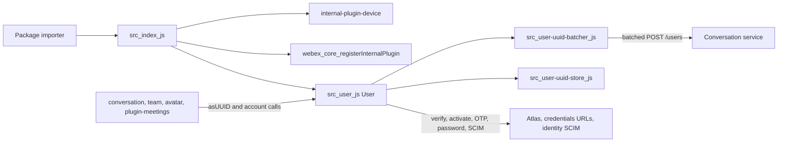
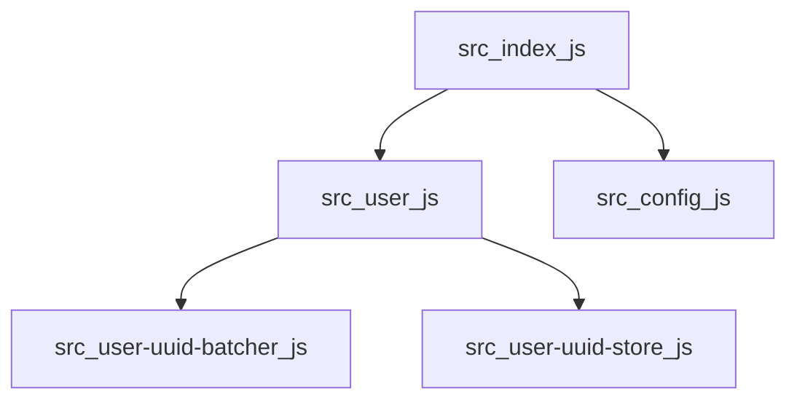
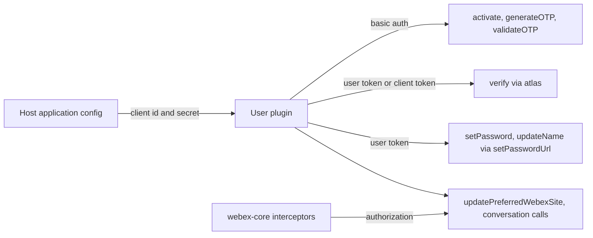

<!-- sdd-generated-metadata
doc_kind: standing-doc
generated_from: architecture@0.3.0
generated_by: claude-code
approved_by: riag@cisco.com
updated_at: 2026-10-27T00:00:00Z
validation_status: pass
-->

# @webex/internal-plugin-user architecture

Canonical architecture for this package. User plugin behavior lives in the
[User plugin specification](../src/docs/README.md). This page owns package boundaries, the plugin
registration, the contract index, and how the package meets the rest of the SDK.

Related context: [specification registry](specs/README.md) ·
[package agent instructions](../AGENTS.md)

## Applicability

| Condition ID                         | Status     | Evidence or reason | Owned section |
| ------------------------------------ | ---------- | ------------------ | ------------- |
| `repo.owns_datastore`                | N/A        | No database, file store, or migration in `src/`. The uuid store is in memory. | Repository data and schema |
| `repo.holds_client_state`            | Applicable | `UserUUIDStore` in `src/user-uuid-store.js` and the `hasPassword` property in `src/user.js` | Client state model |
| `repo.components_interact`           | Applicable | `src/index.js` registers `src/user.js`, which owns `src/user-uuid-batcher.js` and `src/user-uuid-store.js` | Dependency and interaction topology |
| `repo.domain_data_across_components` | N/A        | One module owns all state; no record is shared across resources | Object and data ownership |
| `repo.caches_data`                   | Applicable | `UserUUIDStore` caches user ids and emails for the session | Caching catalog |
| `repo.observability_convention`      | N/A        | `src/` has no logger call, metric, trace, or audit event | Observability patterns |
| `repo.deploys_to_infra`              | N/A        | Library published to npm. No service runtime. | Runtime and infrastructure |
| `repo.shared_base_libs`              | Applicable | Extends `WebexPlugin` and `Batcher` from `webex-core` and uses the legacy build, lint, and test stack | Shared and base libraries |
| `repo.is_monorepo`                   | N/A        | This SDD root is one package. The workspace around it is out of scope. | Package map and inter-package dependencies |
| `repo.multi_platform`                | N/A        | No platform-specific source; `package.json` `browserify` transforms apply to every build | Platform matrix |
| `repo.published_package`             | Applicable | `package.json` `name` is `@webex/internal-plugin-user` and `deploy:npm` publishes it | Release and versioning |
| `repo.embedded_in_host`              | N/A        | No host theme or embed API | Host integration and theming |
| `repo.exposes_commands_or_artifacts` | Applicable | `build:src` writes `dist/` | Commands and generated artifacts |
| `repo.cross_repo_deps_material`      | Applicable | Behavior depends on `webex-core`, the device plugin, `common`, and several remote services | Cross-repository topology |
| `repo.security_arch_warranted`       | Applicable | Client credentials, user and client tokens, one-time passwords, and password changes pass through `src/user.js` | Security architecture |

## Design overview

`@webex/internal-plugin-user` is a published library with one module. Importing it imports the device
plugin and registers `User` as the internal plugin `user`, so every webex instance has
`webex.internal.user`. Sibling packages call `asUUID` to turn an email or user object into a uuid,
and the sign-in and settings code calls the account methods.

`User` adds a cached, batched uuid lookup and a set of single-request account flows on top of the
`webex-core` plugin host. `webex-core` owns the request pipeline, the `Batcher` base, credentials, and
state storage. Keeping the plugin a thin client means authentication, retries, and token refresh behave
like every other SDK plugin.

The package makes outbound HTTP calls only. It serves no routes and persists nothing of its own.

## Resource inventory and responsibilities

| Resource | Kind | Responsibility | Owner | Source | Detailed specification |
| -------- | ---- | -------------- | ----- | ------ | ---------------------- |
| User plugin | module | uuid resolution and cache, account flows, profile and SCIM updates | @webex/web-client, @webex/web-sdk | `src/` | `src/docs/README.md` |
| Published package | package | npm entry points and the registration side effect | @webex/web-client, @webex/web-sdk | `package.json` | `docs/architecture.md` |

## Interaction and execution flows

| From | To | Interaction or transport | Purpose | Failure or compatibility behavior |
| ---- | -- | ------------------------ | ------- | --------------------------------- |
| Importer | `src/index.js` | package import | Register the plugin | Without the import, `webex.internal.user` is absent |
| Sibling packages | `webex.internal.user` | method calls | Resolve uuids, run account flows | See the module spec failure modes |
| `src/user.js` | `src/user-uuid-store.js` | in-process calls | Read and write the uuid cache | Missing entries reject and trigger a fetch |
| `src/user.js` | `src/user-uuid-batcher.js` | in-process calls | Batch email lookups | A partial batch response never settles the missing lookup |
| Batchers | Conversation service | HTTP POST `/users` | Resolve emails to ids | HTTP errors reject the queued lookups |
| `src/user.js` | Atlas, credentials, and identity services | HTTP | Account flows | Service errors propagate unchanged |

## Dependency topology

| Dependency | Type | Used by | Purpose | Version, failure, or fallback policy |
| ---------- | ---- | ------- | ------- | ------------------------------------ |
| `@webex/webex-core` | Internal | `src` | Plugin host, `Batcher`, request, credentials, storage decorators | `workspace:*` in `package.json`; no module spec, so source was used |
| `@webex/internal-plugin-device` | Internal | `src` | `device.userId` and registration ordering | `workspace:*`; module spec consulted |
| `@webex/common` | Internal | `src` | `patterns`, `oneFlight`, `tap`, `deprecated` | `workspace:*`; module spec consulted |
| `lodash` | External | `src/user.js` | `isArray` | Range declared in `package.json` |
| `uuid` | External | tests | `uuid.v4()` in test files | Range declared in `package.json`; no use in `src/` |

Ordering constraint: `src/index.js` imports the device plugin before it registers `user`, so the
device plugin is registered first. No dependency cycle exists inside the package.

## Public and consumer surfaces

| Surface | Type | Owner | Consumers | Compatibility policy | Source |
| ------- | ---- | ----- | --------- | -------------------- | ------ |
| `user-sdk` (published) | SDK | User plugin | avatar, conversation, team, plugin-meetings, recipe-private-web-client, webex-server | Internal plugin; README says semver is not strictly followed | `package.json` |
| `user-identity-http` (internal) | RPC | User plugin | conversation, atlas, activation, OTP, password, and identity SCIM services | Must match each service's request and response | `src/user.js` |
| `webex-core-plugin-host` (required) | SDK | sibling package webex-core | User plugin | External | `@webex/webex-core` |
| `webex-device-registration` (required) | SDK | sibling package internal-plugin-device | User plugin | External | `@webex/internal-plugin-device` |
| `webex-common-sdk` (required) | SDK | sibling package common | User plugin | External | `@webex/common` |

Exported surface of `user-sdk`, named here and described in the module specification; native sources are linked, signatures are not copied:

| Exported surface | Group | Reachable from | Source |
| ---------------- | ----- | -------------- | ------ |
| `User` (default export) | Plugin class; registers `webex.internal.user` | Package entry point | `src/index.js` |
| `asUUID`, `getUUID`, `fetchUUID`, `recordUUID` | uuid resolution and cache | `webex.internal.user` | `src/user.js` |
| `get`, `update`, `updateName`, `setPassword` | Current user profile and password | `webex.internal.user` | `src/user.js` |
| `verify`, `register` (deprecated alias of `verify`), `getUserCI` | Account status and identity URLs | `webex.internal.user` | `src/user.js` |
| `activate`, `generateOTP`, `validateOTP` | Activation and one-time password | `webex.internal.user` | `src/user.js` |
| `updatePreferredWebexSite`, `getMeetingSiteList` | Preferred meeting site | `webex.internal.user` | `src/user.js` |
| `hasPassword` (property) | Persisted password flag | `webex.internal.user` | `src/user.js` |
| `buildPreferredSiteBody`, `buildMeetingSiteList`, `SCIM_SCHEMAS` | Deep-path helpers, not package-entry exports | `@webex/internal-plugin-user/src/user` | `src/user.js` |

`user-sdk` entry points: `main` `dist/index.js` and `devMain` `src/index.js`. No HTTP surface is
served, so `api-specs/openapi.yaml` is omitted.

## Client state model

| State or slice | Owner | Transition triggers | Persistence or reset boundary |
| -------------- | ----- | ------------------- | ----------------------------- |
| `hasPassword` | User plugin | `verify`, `setPassword` | Persisted through `@persist('@')` and the `webex-core` storage layer |
| uuid store (id and email maps) | User plugin | `recordUUID`, `get()` | In memory per plugin instance; never evicted; lost on reload |

Slice detail is in the module spec.

## Cross-cutting architecture

### Security

- Trust boundaries and identity flow: see Security architecture.
- Sensitive surfaces and data classes: client id and secret, user and client tokens, one-time
  passwords, new passwords, and email addresses; controls and gaps are in Security architecture.
- Encryption and secret boundaries: transport security is whatever the configured service URLs use;
  nothing is stored by this package other than the in-memory uuid cache and the persisted
  `hasPassword` flag.

### Observability and operations

- Logging and correlation: none. `src/` calls no logger.
- Metrics, traces, and audit signals: none are emitted by this package.
- Ownership and operational entry points: no runtime to deploy or monitor; owners are listed in
  References and maintenance.

### Quality attributes

- Availability: nothing is retried here; request behavior is `webex-core`'s.
- Compatibility: method names and argument shapes are relied on by sibling packages.
- Latency: a lone uuid lookup waits about the 100 ms batch quiet period; a burst of 100 queued lookups flushes immediately, and a stream of calls less than 100 ms apart flushes at the 1500 ms maximum wait.
- Memory: the uuid cache grows for the session and has no eviction.

## Dependency and interaction topology

| From | To | Kind | Purpose | Ordering or failure boundary |
| ---- | -- | ---- | ------- | ---------------------------- |
| `src/index.js` | `src/user.js` | Import | Register the class | Registration runs at import time |
| `src/index.js` | `src/config.js` | Import | Pass `config` to registration | Load-time only |
| `src/user.js` | `src/user-uuid-batcher.js` | Import | The `batcher` child | Load-time only |
| `src/user.js` | `src/user-uuid-store.js` | Import | The `store` session value | Load-time only |

## Caching catalog

| Cache | Owner | Backend | Contents | TTL or bound | Invalidation trigger | Failure behavior |
| ----- | ----- | ------- | -------- | ------------ | -------------------- | ---------------- |
| `UserUUIDStore` | User plugin | Two in-memory `Map`s in module-level `WeakMap`s | User records by id and by email | No TTL; unbounded keys | None; the store has no removal method | A miss rejects and triggers a fetch |

## Shared and base libraries

| Library | Inherited responsibility | Consumers | Version floor | Compatibility rule |
| ------- | ------------------------ | --------- | ------------- | ------------------ |
| `WebexPlugin` and `Batcher` from `@webex/webex-core` | Plugin lifecycle, `this.request`, `this.config`, queueing, deferreds, debounced flush | `src/user.js`, `src/user-uuid-batcher.js` | workspace | Follow webex-core plugin conventions |
| `@webex/babel-config-legacy`, `@webex/eslint-config-legacy`, `@webex/jest-config-legacy` | Build, lint, and Jest config passthroughs | `babel.config.js`, `.eslintrc.js`, `jest.config.js` | workspace | Change upstream, not in the passthrough files |
| `@webex/legacy-tools` | `webex-legacy-tools` build and test runners | `package.json` scripts | workspace | Scripts call it; do not replace locally |

## Release and versioning

| Artifact | Publish target | Versioning rule | Deprecation window | Changelog or migration obligation |
| -------- | -------------- | --------------- | ------------------ | --------------------------------- |
| `@webex/internal-plugin-user` | npm, through the `deploy:npm` script, which wraps Yarn's npm publish | Workspace release tooling; README says the internal plugin does not strictly follow semver | None declared in code | No package-local changelog; workspace tooling owns it |

## Commands and generated artifacts

| Command or artifact | Owner | Inputs | Output or side effect | Compatibility boundary |
| ------------------- | ----- | ------ | --------------------- | ---------------------- |
| `yarn` | workspace | root `package.json` and lockfile | workspace `node_modules` | Run from the workspace root |
| `yarn workspace @webex/internal-plugin-user build` | package | `src/` | `dist/` through `build:src` | `dist/` is never edited by hand |
| `yarn workspace @webex/internal-plugin-user build:src` | package | `src/` (`.js` and `.ts`) | `dist/` with source maps | Markdown under `src/` is not processed |
| `yarn workspace @webex/internal-plugin-user test:unit` | package | `test/unit/spec/` | jest result | — |
| `yarn workspace @webex/internal-plugin-user test:browser:broken` | package | `test/integration/spec/` | karma result; unsupported | See Getting started |
| `yarn workspace @webex/internal-plugin-user test:style` | package | files under `src/` | eslint result | — |
| `yarn workspace @webex/internal-plugin-user deploy:npm` | package | `dist/`, `package.json` | npm publish | Release pipeline only |

## Cross-repository topology

| Repository or external system | Relationship | Exchanged contract or artifact | Owner | Sequencing constraint |
| ----------------------------- | ------------ | ------------------------------ | ----- | --------------------- |
| Sibling package webex-core | Consumes | `webex-core-plugin-host` | @webex/web-client, @webex/web-sdk | Plugin host must exist before registration |
| Sibling package internal-plugin-device | Consumes | `webex-device-registration` | @webex/web-client, @webex/web-sdk | Device registration must finish before `device.userId` is set |
| Sibling package common | Consumes | `webex-common-sdk` | @webex/web-client, @webex/web-sdk | Shared helpers load first |
| Sibling packages internal-plugin-avatar, internal-plugin-conversation, internal-plugin-team, plugin-meetings, recipe-private-web-client, webex-server | Provides | `user-sdk` | @webex/web-client, @webex/web-sdk | Method and argument changes ship with their changes |
| Conversation, atlas, activation, OTP, password, and identity services | Coordinates | `user-identity-http` | External Webex services; owners not recorded in this repository | Request and response fields must match |

These are sibling workspace packages and external services outside this package-scoped SDD root.

## Security architecture

Threats addressed: client credentials or tokens reaching the wrong endpoint, anonymous account flows
being abused, and a stale or fabricated uuid being treated as a real user.

Controls in this package:

- Anonymous account flows authenticate with the configured client id and secret as basic auth, and
  signed-in changes use the user token (module spec `INV-005`).
- `verify` disables token refresh on its request, so a sign-in check does not rotate tokens.
- A lookup without `create` can resolve an id for an email that has no account; callers needing a
  real user must pass `create: true` (module spec `INV-002`).
- Argument guards reject missing or malformed input before any request is sent.

Known gaps are recorded where the code lives: `setPassword` and `updateName` do not check
`device.userId` before building the request URI, `activate` and `validateOTP` mutate the caller's
options object, and the uuid cache has no invalidation (module spec Pitfalls and constraints).

The workspace root `SECURITY.md` is the security policy; this package adds none.

## Domain language

| Term | Repository-specific meaning | Authoritative source |
| ---- | --------------------------- | -------------------- |
| uuid lookup | Resolving an email or user object to a user id, from the cache or the conversation service | `src/user.js` |
| fake uuid | The id the service returns for an email with no account when `create` is not set | `src/user-uuid-batcher.js` |
| `create` | Option that asks the service to ensure a real user exists | `src/user.js` |
| batcher | A `Batcher` that collapses lookups into one HTTP request; `faker` for ordinary lookups, `creator` for `create` | `src/user-uuid-batcher.js` |
| store | The in-memory id and email maps | `src/user-uuid-store.js` |
| supertoken | The credentials token set from `tokenData` after activation or OTP validation | `src/user.js` |
| SCIM body | The request body for identity PATCH calls, built with `SCIM_SCHEMAS` | `src/user.js` |
| preferred Webex site | The user's default meeting site, updated through the org-scoped SCIM API | `src/user.js` |

## References and maintenance

- Decisions: [adr/](adr/), including [ADR 0001](adr/0001-retain-product-readme.md)
- Instantiated specifications and routing: [specs/README.md](specs/README.md)
- Module spec: `src/docs/README.md`
- Owner: `@webex/web-client @webex/web-sdk` in the monorepo `.github/CODEOWNERS`
- Manifest: `.sdd/manifest.json`
- Update this document in the same change that alters package boundaries, contracts, or
  cross-cutting behavior.
